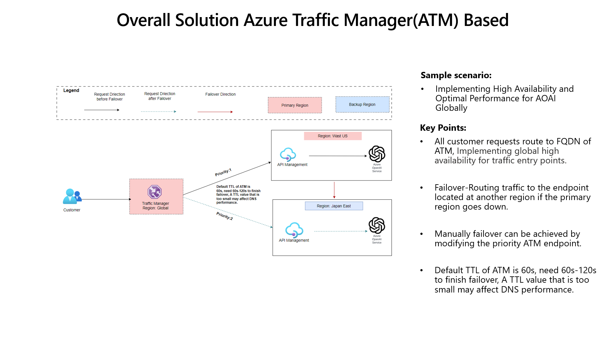

# Azure OpenAI High Availability (Failover Script)

> [!NOTE]
> **Archived.** This project predates June 2026 and its models, APIs or tool versions may have changed since. It stays here so existing links keep working; check current documentation before reusing the steps. Newer related work: [AOAI-APIM-Gateway-LoadBalancing](../AOAI-APIM-Gateway-LoadBalancing/).

### Failover script is xinyu.sh, run it in a small Azure VM
> **Author**: Xinyu Wei (魏新宇) — Microsoft AI Lead Senior System Engineer

**English** | [中文](README-CN.md)

## Overview

