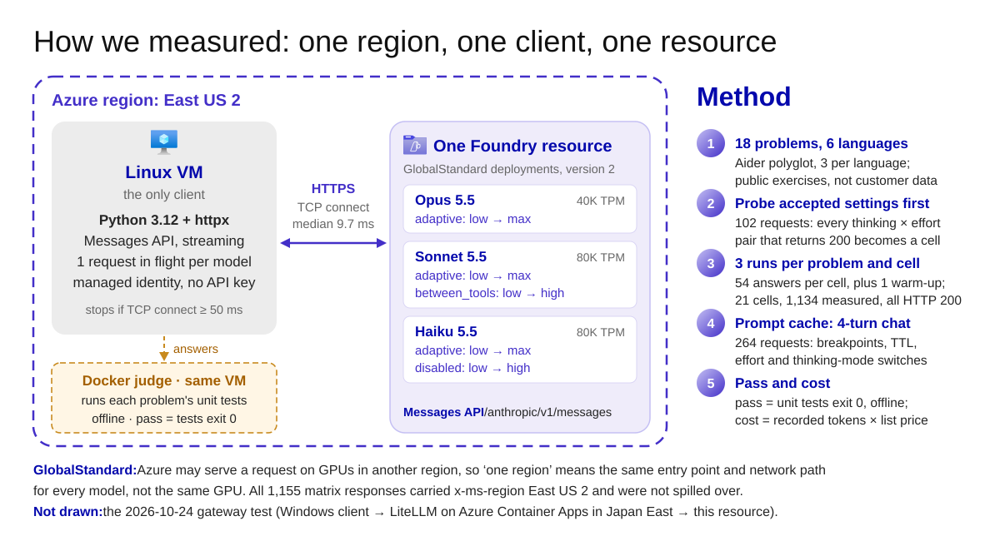
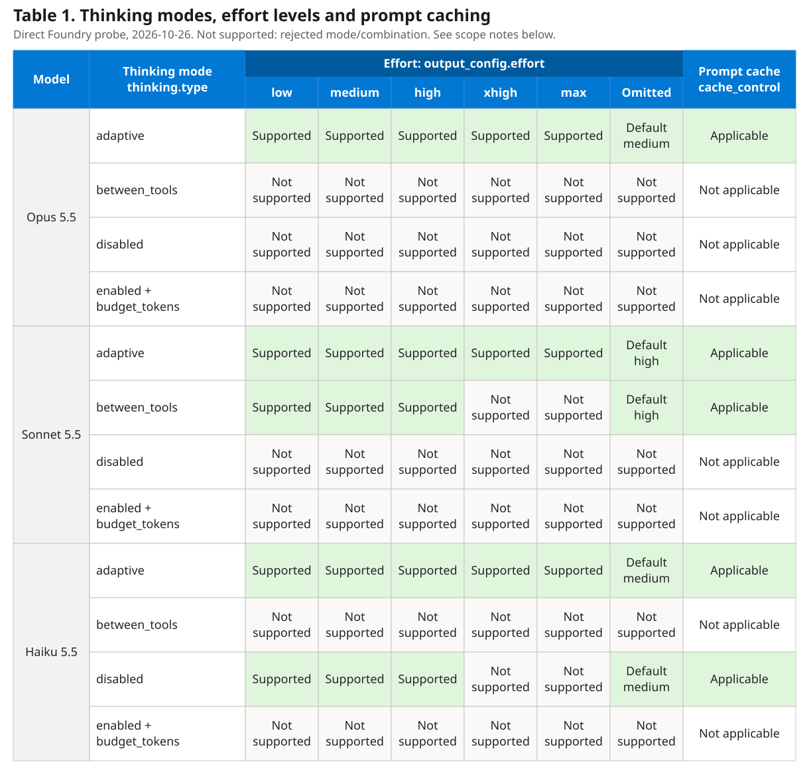
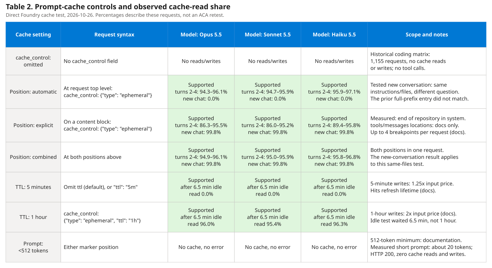

# Claude 5.5 on Microsoft Foundry: Thinking, Effort, Prompt Caching, Latency and Coding Accuracy

[](#purpose)
[](#results)
[](https://github.com/david-xinyuwei/david-share/actions/workflows/claude-foundry-performance-ci.yml)

Author: Xinyu Wei · [中文](README_CN.md)

## Purpose

**What this measures.** How Claude Opus 5.5, Sonnet 5.5 and Haiku 5.5 perform as deployed in Microsoft Foundry with the [Hosted on Azure](https://platform.claude.com/docs/en/build-with-claude/claude-in-microsoft-foundry#hosting-options) option: model version 2, an Anthropic-operated service running on Azure infrastructure, in GlobalStandard deployments. For each coding request we measure how long the first visible text and the full answer take, whether the code passes the problem's own unit tests, and what the request costs at list price. The request settings in the table below change all of these, and some combinations are rejected with HTTP 400; a successful HTTP response shows none of this.

**Current ACA evidence:** 154/650 request records retained; full completion and correctness are unverified. The client VM was deallocated at the recorded verification time. [Partial results and current-state boundary](docs/results.md#aca-gateway-snapshot).

**Current test method.** Linux VM client → LiteLLM on Azure Container Apps → Foundry, with the client, gateway and Foundry resource in East US 2. The client uses the gateway key; LiteLLM uses its managed identity to call Foundry. Prompt caching is enabled with top-level `cache_control`. Each model has one request in flight, so this measures individual requests, not load.

**Historical gateway check (2026-10-24).** A Windows client sent a five-turn conversation through LiteLLM on Azure Container Apps in Japan East to the same deployments; LiteLLM used its own managed identity and was set not to drop parameters or retry. Those times include Japan-to-US network latency and are not results from the current East US 2 run. See [the results page](docs/results.md#gateway-test-2026-10-24).



The figure shows the new East US 2 gateway path, not the historical direct-VM result path. The [runner](gateway-cache/aca_cache_matrix.py) uses the [12-problem manifest](data/gateway-cache-problems.json): 26 accepted mode/effort cells, two identical requests per problem/cell, plus 26 warm-ups (650 planned requests). Top-level `cache_control` is `ephemeral`, TTL `1h`; request 1 writes and request 2 is checked for native cache reads. This is not a cache-disabled comparison. Historical results retain their original dates and paths; the new run's completion, performance and correctness require its own evidence. Original explanatory diagram with unmodified [Azure icons](images/icon-sources.json).

**Historical request settings.** What each setting does, from Claude's documentation, and what the retained direct-VM runs sent. Accepted values come from that historical probe; these observations do not describe the current ACA run:

| Setting | What it does | Historical observation |
|---|---|---|
| `thinking.type: "adaptive"` | The model decides for each request whether to think before answering and for how long; `output_config.effort` steers how much. Sending no `thinking` field does the same on these three models | All three models, effort low to max |
| `thinking.type: "between_tools"` | Sonnet 5.5's lowest setting: no thinking before the answer. Short progress updates written between tool calls still come back as thinking blocks; without tools the answer is text only. Accepted at effort `high` or below | Sonnet, effort low, medium, high; no tools |
| `thinking.type: "disabled"` | Thinking off. Only Haiku 5.5 accepts it, at effort `high` or below; Opus 5.5 cannot turn thinking off | Haiku, effort low, medium, high |
| `thinking.display` | Whether thinking text comes back. The default on these models, `"omitted"`, returns thinking blocks with empty text and an encrypted signature, so the answer starts streaming sooner; the thinking tokens are still billed. `"summarized"` returns a summary | Not sent: 610 matrix answers used thinking tokens and none streamed thinking text |
| `output_config.effort` | How much work goes into the whole response, thinking included: `low`, `medium`, `high`, `xhigh`, `max`. A behavioral signal, not a token budget. Default when omitted: Opus and Haiku `medium`, Sonnet `high` | Every level each thinking mode accepted: 21 cells |
| `max_tokens` | Hard limit on output tokens, thinking included; an answer that reaches it stops with `stop_reason: "max_tokens"`. At most 128,000 on these models | 128,000 in the matrix; 1,000,000 returned HTTP 400 |
| No `cache_control` (the default) | Nothing is cached: caching is opt-in. "Automatic caching" also needs the top-level field; "automatic" means the breakpoint is placed for you, not that caching is on by default. The documented exceptions involve tools: in a tool-use loop, history sent back with tool results can be cached without a marker, and server-tool results are cached automatically | The coding matrix (1,155 requests) and the cache test's baseline (24 requests; each turn resent the same prefix of about 15,500 tokens): 0 cache reads and 0 cache writes in every response |
| `cache_control` at the top level | Automatic caching: the breakpoint goes on the last cacheable block and moves forward as the conversation grows | Cache test: most scenarios |
| `cache_control` on a content block | Explicit breakpoint: caches the prompt up to and including that block, in the order `tools`, `system`, `messages`. At most 4 breakpoints per request; a prompt under 512 tokens is not cached | Cache test: after the repository files |
| `cache_control.ttl` | How long an unused entry lives: `"5m"` by default, renewed on every read, or `"1h"`. Writes cost 1.25× the input price (5 minutes) or 2× (1 hour); reads cost 0.05× on Opus and Sonnet, 0.1× on Haiku | Both: 6.5 minutes idle before the second turn |
| Per-message effort | An effort-only `system` message changes effort for later turns without touching the top-level field, so the cached prefix stays valid. Beta, header `anthropic-beta: mid-conversation-output-config-2026-07-01`; Foundry is not among the platforms the effort page lists for it | One cache scenario; all 264 cache requests returned HTTP 200 |
| `temperature`, `top_p`, `top_k` | Sampling. On these models any non-default value returns HTTP 400 | Probe only: HTTP 400 in every mode tried; never sent in the matrix |
| `stream` | `true` returns server-sent events, the only way to time the first visible text | `true` on every timed request; the pre-warm request with `max_tokens: 0` is not streamed, as the API requires |
| Deployment type, chosen when the deployment is created | GlobalStandard may serve a request outside the resource's region; US Data Zone Standard keeps inference in the United States, like `inference_geo: "us"` on the Claude API. Sonnet 5.5 supports GlobalStandard only | GlobalStandard only; every matrix response reported `usage.inference_geo` `global` |

**Table 1. Complete thinking-mode and effort matrix.**

[](images/parameter-support-en.svg)

The 54 `adaptive`/`between_tools`/`disabled` × effort cells were individually probed; 26 were accepted, including five omitted-effort cells. For `enabled`, one request per model used `budget_tokens: 1024` and omitted effort; the HTTP 400 rejects the mode itself, so all effort cells say not supported. The cache column states applicability only: a rejected thinking mode makes the request inapplicable; it does not mean the model lacks caching. Default effort values are from the [effort documentation](https://platform.claude.com/docs/en/build-with-claude/effort).

Cache observations: all five accepted model/mode rows read cache at effort low; adaptive also read cache in the high-effort switch scenario. Other effort combinations still need cache-hit verification through ACA. Applicability and parameter acceptance are not completed cache-enabled performance testing. Fixed matrix controls: `max_tokens: 128000`, `stream: true`; `temperature`, `top_p`, `top_k` omitted. No `thinking` field is documented to select adaptive; the three omitted-thinking/omitted-effort probes returned 200.

**Table 2. Complete prompt-cache settings.**

[](images/cache-settings-en.svg)

Sources: [probe requests](evidence/coding-matrix-20261026/probe/probe_results.jsonl), [cache requests](evidence/coding-matrix-20261026/cache/cache_results.jsonl) and [prompt-caching documentation](https://platform.claude.com/docs/en/build-with-claude/prompt-caching). Table 2 uses two repetitions per scenario: Opus adaptive, Sonnet between_tools, Haiku disabled, effort low; first writes are separate from turns 2-4. Read share is read tokens / (uncached + written + read input tokens), aggregated within each model/scenario/turn. New conversations reuse the files but change the question. The 512-token boundary and four-breakpoint limit are documented, not boundary-sweep measurements. All cache markers use `type: ephemeral`; reads cost 0.05x base input on Opus/Sonnet and 0.1x on Haiku (documented prices). These tables preserve the historical direct-VM evidence; no new ACA performance result is asserted.

**Not covered:** tool use, where `between_tools` and progress updates matter; `display: "summarized"`; US Data Zone deployments; and the separate `claude-opus-5-5-fast` model in the Foundry catalog.

**Historical per-model summary.** What each deployment accepted and how it did on the 18 problems in the retired direct-VM batch; not current ACA results:

| Question | Opus 5.5 | Sonnet 5.5 | Haiku 5.5 |
|---|---|---|---|
| Thinking modes the API accepted | `adaptive` only; `disabled` and `between_tools` return 400 | `adaptive`; `between_tools` at low, medium, high | `adaptive`; `disabled` at low, medium, high |
| Effort levels / default when omitted | low to max / medium | low to max / high | low to max / medium |
| First visible text, P50 of the fastest cell | 0.48 s (`adaptive` · low) | 0.39 s (`between_tools` · high) | 0.43 s (`disabled` · high) |
| Unit tests passed per cell, of 54 answers | 54 in every cell | 40 to 44 | 24 to 28 with `adaptive`; 17 to 21 with `disabled` |
| List-price cost per 1,000 requests | $23.34 to $355.75 | $13.04 to $356.49 | $0.69 to $22.26 |
| Choose it when (our reading of this test) | Answers must be right the first time. Start at `low`: every effort level passed all 54, and `low` was the fastest (0.48 s) and cheapest | You want most of Opus's accuracy at a lower price: `between_tools` passed as often as `adaptive`, started in under 0.5 s and cost $13.16–$13.76 per 1,000 requests | Cost matters most and a wrong answer can be retried. Keep thinking on: at the same effort levels `adaptive` passed 12.3 points more often than `disabled` |

**Historical scope.** The problems are public Exercism exercises from [Aider's polyglot benchmark](https://github.com/Aider-AI/polyglot-benchmark), each answered once, without tools and without seeing the tests; they are not your production tasks. The retired batch called Foundry directly, one request at a time per deployment. Its costs and accuracy are historical observations, not evidence for the current cache-enabled ACA path. Costs use list prices and were not reconciled with an Azure invoice.

**Sources.** Accepted values and the HTTP 400 messages come from our probe ([results](docs/results.md#parameter-probe-2026-10-26)). What each setting does, the defaults, the rules for `between_tools` and `disabled`, and the advice to set `max_tokens` to 128,000 for agentic coding on Sonnet 5.5 come from Claude's [thinking](https://platform.claude.com/docs/en/build-with-claude/thinking) and [effort](https://platform.claude.com/docs/en/build-with-claude/effort) pages; cache rules and price multipliers from [prompt caching](https://platform.claude.com/docs/en/build-with-claude/prompt-caching); prices from [pricing](https://platform.claude.com/docs/en/about-claude/pricing); hosting options and Foundry setup from [Claude in Microsoft Foundry](https://platform.claude.com/docs/en/build-with-claude/claude-in-microsoft-foundry); all read on 2026-10-26. The *Choose it when* row is our reading of these 18 problems, not general advice.

## Results

### ACA gateway: partial results

**Partial evidence, not a completed benchmark.** The retained snapshot contains 154 of 650 planned requests: 26 warm-ups and 128 of 624 measured requests. Its run file was last updated at `2026-10-27T00:07:59.720+00:00`. The other 496 requests are missing from this snapshot, not proven unrun or failed.

**Client state.** At `2026-10-26T20:10:18.9885833-07:00`, Azure reported the client VM as `PowerState/deallocated`. It was no longer sending new requests. The final workload result and the shutdown cause remain unverified; the snapshot's `RUNNING` label is historical, not current status. [Verification record](evidence/gateway-cache-20261026/collection-status.json).

**Question and method.** For coding prompts sent through the East US 2 ACA LiteLLM gateway, does the identical second request read the cache written by the first, and what timing and cost were observed? The client and gateway were in East US 2; the Foundry resource was also in East US 2. One request was in flight per model. This is a cache-write versus cache-read pair, not a cache-disabled control or a gateway-overhead experiment.

**Input.** [12 public SWE-bench Lite BM25-13K problems](data/gateway-cache-problems.json), with the source revision and prompt hashes recorded in [run.json](evidence/gateway-cache-20261026/run.json). This is an author-run latency/cache workload, not official SWE-bench scoring or customer production data. The [input builder](gateway-cache/build_swebench_problems.py) reconstructs the prompts; the [runner](gateway-cache/aca_cache_matrix.py) sends 26 mode/effort cells, two identical requests per problem/cell and one warm-up per cell. Fixed: `max_tokens: 128000`, `stream: true`, top-level `cache_control: {"type": "ephemeral", "ttl": "1h"}`. Timing starts immediately before the client sends the request; first text means the first non-empty text delta, not a ping or thinking event.

| Model | Retained / planned requests, warm-ups included | Completed requests | Truncated requests | Complete measured pairs |
|---|---:|---:|---:|---:|
| Opus 5.5 | 29/150 | 29 | 0 | 11 |
| Sonnet 5.5 | 46/250 | 44 | 2 | 17 |
| Haiku 5.5 | 79/250 | 79 | 0 | 34 |

**What is established.** 62 measured pairs have two completed answers. In these pairs the cold request read at most 0 cached tokens; the warm request read at least 100.0% of the preceding request's written cache tokens. There were 0 pairs with a reused response message ID. These native usage observations establish cache reads for those pairs, not answer correctness or a general speedup. Saved responses report `inference_geo: global`; the returned region header is East US 2, not proof that GlobalStandard guarantees regional inference.

**Cost and limits.** Retained requests cost $13.90 using the recorded [list-price model](coding-matrix/pricing.py), including warm-ups, cache writes/reads, output and truncated answers. This is not the whole run's final spend or an Azure invoice; infrastructure is excluded. Correctness grading was not collected. Pair statistics exclude warm-ups and pairs with an incomplete/truncated answer; the table above keeps those requests visible. Cells have unequal, partial samples, so do not rank models or effort levels from this snapshot.

[All 26 configurations and paired observations](docs/results.md#aca-gateway-snapshot).

**Evidence and replay.** [Facts](evidence/gateway-cache-20261026/interim-facts.json), [export hashes and redactions](evidence/gateway-cache-20261026/_export_manifest.json), [Opus](evidence/gateway-cache-20261026/responses_opus.jsonl), [Sonnet](evidence/gateway-cache-20261026/responses_sonnet.jsonl), [Haiku](evidence/gateway-cache-20261026/responses_haiku.jsonl). The metrics-only projection omits prompt/answer bodies, thinking signatures, private endpoints and other headers; it is not a correctness-scoring dataset. Replay instructions are in [Testing](docs/testing.md#aca-snapshot-replay).

**Historical results only.** The following direct-VM measurements belong to the retired method. In particular, the 21-cell coding matrix omitted `cache_control` and does not meet the current ACA cache-enabled protocol. The Japan East gateway check is separately dated. None of these numbers is a result from the current East US 2 ACA run.

Words used in the results:

| Term | Meaning |
|---|---|
| Cell | One model × thinking mode × effort level. Each cell answered the 18 problems three times: 54 answers |
| Thinking mode, effort level | Defined in the request-settings table under [Purpose](#purpose) |
| First visible text | Seconds from just before the request is written to the first non-empty `text_delta`, timed on the VM. Thinking comes first and its text is not streamed (`display` omitted), so this wait includes all thinking |
| First event | Seconds to the first server-sent event, `message_start` |
| Full answer | Seconds to the end of the stream, completed requests only |
| Completed | HTTP 200, `message_stop` received, `stop_reason` `end_turn` and non-empty text |
| Pass | The files in the answer, written over the exercise's solution files, make its own unit tests exit 0 in an offline container (Aider's first-attempt rule) |
| By-problem 95% interval | 2.5th to 97.5th percentile over 5,000 resamples of the 18 problems (seed 20261026). The three answers to one problem are not independent, so the problem is the unit |
| Cost | List price × the token counts in the API's `usage`, cache writes and reads included |

**Where each part ran.**

| Part | Where | Detail |
|---|---|---|
| Client: probe, matrix, cache test | Linux VM `Standard_D4s_v5`, East US 2 | Ubuntu 24.04, kernel 7.0.0-1017-azure, Python 3.12.3, httpx 0.28.1, azure-identity 1.25.1; Entra token from the VM's managed identity; TCP connect to the endpoint 9.67 ms median before the matrix |
| Models | Foundry resource in East US 2 | `claude-opus-5-5` 40,000 tokens per minute; `claude-sonnet-5-5` and `claude-haiku-5-5` 80,000 each; version 2, GlobalStandard, so a request may be served outside East US 2 |
| Unit tests | Docker on the same VM | `--network none`, 1.5 CPUs, 3 GB; the toolchains of Aider's benchmark image: Python 3.11, Go 1.21.5, Rust, Node 20, OpenJDK 21, CMake and Boost |

**What each matrix request sent.** One streamed Messages request per answer; the `system` and `content` values are shortened here:

```json
{
  "model": "claude-sonnet-5-5",
  "max_tokens": 128000,
  "stream": true,
  "thinking": {"type": "between_tools"},
  "output_config": {"effort": "low"},
  "system": "Act as an expert software developer. …",
  "messages": [{"role": "user", "content": "I have *added these files to the chat* so you can go ahead and edit them. …"}]
}
```

Only `model`, `thinking.type` and `output_config.effort` change between cells. There is no `cache_control`, no tool and no `temperature`, `top_p` or `top_k`. The full system prompt and a complete user message are quoted in [the results page](docs/results.md#coding-matrix-2026-10-26); all 18 are in [problems.json](evidence/coding-matrix-20261026/matrix/problems.json).

**How each number is measured, and the scripts.**

| Number | From → to, or how | Script |
|---|---|---|
| Accepted values | HTTP 200 or 400 for a one-word prompt sent with each value | [`probe.py`](coding-matrix/probe.py) |
| First visible text, first event, full answer | request written → first `text_delta`, `message_start`, end of stream; clock on the VM | [`claude_api.py`](coding-matrix/claude_api.py) `stream_message` |
| Completed, thinking and output tokens | status, `stop_reason` and `usage` of each stream | [`bench.py`](coding-matrix/bench.py) |
| Pass | the exercise's unit tests, offline in Docker | [`judge.py`](coding-matrix/judge.py) |
| P50, P95, intervals, cost per 1,000 | nearest rank; bootstrap over problems; mean list-price cost × 1,000 | [`analyze.py`](coding-matrix/analyze.py) |
| Cache reads and writes, conversation cost | `usage` of each turn; the same tokens priced as if nothing were cached | [`cache_test.py`](coding-matrix/cache_test.py), [`cache_analyze.py`](coding-matrix/cache_analyze.py) |

**Do not read these grids as a general ranking of the three models.** Opus answered all 18 problems correctly in every cell, so this test cannot separate its effort levels. With 18 problems, a Sonnet or Haiku cell's 95% interval spans 30 to 44 points (for example Sonnet `between_tools` · high: 44 of 54, 65% to 94%). The problems are short single-file exercises. Each row is one model and thinking mode, each column an effort level; *not accepted* means the API returned HTTP 400. P95, full-answer times, token counts and every interval are on [the results page](docs/results.md#results-per-cell).

**Unit tests passed, of 54 answers**

| Model · thinking | low | medium | high | xhigh | max |
|---|---:|---:|---:|---:|---:|
| Opus 5.5 · `adaptive` | 54/54 | 54/54 | 54/54 | 54/54 | 54/54 |
| Sonnet 5.5 · `adaptive` | 41/54 | 42/54 | 40/54 | 41/54 | 44/54 |
| Sonnet 5.5 · `between_tools` | 42/54 | 41/54 | 44/54 | not accepted | not accepted |
| Haiku 5.5 · `adaptive` | 24/54 | 26/54 | 27/54 | 28/54 | 28/54 |
| Haiku 5.5 · `disabled` | 19/54 | 17/54 | 21/54 | not accepted | not accepted |

**First visible text, P50, seconds**

| Model · thinking | low | medium | high | xhigh | max |
|---|---:|---:|---:|---:|---:|
| Opus 5.5 · `adaptive` | 0.48 | 3.71 | 4.05 | 6.04 | 51.4 |
| Sonnet 5.5 · `adaptive` | 0.46 | 0.50 | 3.25 | 7.44 | 190 |
| Sonnet 5.5 · `between_tools` | 0.42 | 0.44 | 0.39 | not accepted | not accepted |
| Haiku 5.5 · `adaptive` | 4.13 | 4.62 | 8.21 | 14.9 | 121 |
| Haiku 5.5 · `disabled` | 0.46 | 0.45 | 0.43 | not accepted | not accepted |

**List-price cost per 1,000 requests, US dollars**

| Model · thinking | low | medium | high | xhigh | max |
|---|---:|---:|---:|---:|---:|
| Opus 5.5 · `adaptive` | $23.34 | $34.52 | $38.75 | $65.36 | $355.75 |
| Sonnet 5.5 · `adaptive` | $13.04 | $13.57 | $18.36 | $31.62 | $356.49 |
| Sonnet 5.5 · `between_tools` | $13.16 | $13.21 | $13.76 | not accepted | not accepted |
| Haiku 5.5 · `adaptive` | $1.27 | $1.57 | $2.14 | $4.19 | $22.26 |
| Haiku 5.5 · `disabled` | $0.69 | $0.69 | $0.73 | not accepted | not accepted |

What stands out:
- **The platform answered every request.** All 1,155 matrix requests returned HTTP 200, none with 429 or 5xx, and 1,130 of the 1,134 measured requests completed. Of the other four, three Haiku `adaptive` · max answers spent all 128,000 output tokens on thinking (`stop_reason: max_tokens`), and one Sonnet `adaptive` · max stream sent `message_start` and two pings, then nothing until the client's 600 s read timeout ended it at 661 s.
- **Without thinking, text starts in under half a second.** Sonnet `between_tools` and Haiku `disabled` showed the first visible text after 0.44 s P50 and 0.74 s P95 over 324 requests. The first event came after 0.47 s P50 over all requests, and between 0.39 and 0.53 s P50 in each cell; the rest of the wait is thinking, which is not streamed. At effort max the first visible text took 51.4 s (Opus), 190 s (Sonnet) and 121 s (Haiku), P50.
- **Thinking raised Haiku's pass rate, not Sonnet's.** At the same three effort levels, Haiku passed 47.5% with `adaptive` and 35.2% with `disabled`: +12.3 points (95% interval +2.5 to +23.5; 9 problems better, 2 worse, 7 equal). Sonnet: 75.9% against 78.4% with `between_tools`, -2.5 points (-7.4 to +1.9).
- **Higher effort mostly bought time and cost.** Opus cost $23.34 per 1,000 requests at low and $355.75 at max for the same 54 passes. Sonnet's eight cells passed 40 to 44 times each, inside one another's intervals.
- **The problem mattered more than the setting.** Over all its cells Sonnet passed `java/house` 1 time in 24 and `javascript/promises` 3 times in 24; Haiku never passed 6 of the 18 problems. Opus passed every problem every time.

**Prompt caching in a four-turn coding conversation.** Each conversation sends the same instructions and three httpx source files (about 15,500 tokens) as the system prompt, then four questions in turn: how an `Auth` subclass takes part in a request, a new `BearerTokenAuth` class, pytest tests for it, and a commit message. Opus uses `adaptive`, Sonnet `between_tools` and Haiku `disabled`, effort low, two repetitions per scenario. Each scenario changes one thing; results are the range over the three models:

| Scenario | What changed | Result |
|---|---|---|
| Automatic caching | top-level `cache_control` on every turn | turns 2–4 read 94–97% of the prompt from cache; the conversation cost 52–53% less than the same tokens without cache |
| Breakpoint after the files, new conversation | `cache_control` on the repository block; then a second conversation with the same files and a new question | the new conversation read 15,440–15,442 tokens from cache and cost 76–80% less |
| Automatic caching only, new conversation | top-level `cache_control`; then a second conversation with the same files | read 0 tokens and wrote a new entry: 20–21% more than without cache |
| Top-level effort change | effort low → high on turn 3 | turn 3 still read 95–97% of the prompt from cache |
| Per-message effort | the same change as an effort-only system message, beta header `mid-conversation-output-config-2026-07-01` | turn 3 read 95–97% from cache |
| Thinking mode change (Sonnet, Haiku) | thinking off → `adaptive` on turn 3 | turn 3 read 0 tokens and rewrote 16,609–17,138; turn 4 read 95–96% again |
| 6.5 minutes idle, 5-minute TTL | default TTL | turn 2 read 0 tokens and rewrote 16,145–16,158 |
| 6.5 minutes idle, 1-hour TTL | `"ttl": "1h"` | turn 2 read 15,490–15,493 tokens |
| Pre-warm | a non-streaming request with `max_tokens: 0`, then the first question | the first question read 15,440–15,444 tokens (99.7% of its prompt) |
| Cold and warm, same prompt | five pairs, one-word answer | first visible text P50 at about 15,500 tokens: Opus 1.51 → 1.38 s, Sonnet 1.03 → 0.89 s, Haiku 0.75 → 0.71 s; at about 53,300: Sonnet 0.94 → 0.92 s, Haiku 0.85 → 0.87 s. The warm request cost 4–8% of the cold one |

Claude's [effort page](https://platform.claude.com/docs/en/build-with-claude/effort) says that changing the top-level effort between requests invalidates cache breakpoints. In this test, with automatic caching, turn 3 still read the cached prefix; we did not find out why, so treat it as an observation on these deployments on 2026-10-26. The per-message form, which the docs say keeps the cache, behaved the same. All 264 cache requests returned HTTP 200. Per-turn read shares and costs are on [the results page](docs/results.md#prompt-caching-2026-10-26).

**Through a LiteLLM gateway (2026-10-24).** An earlier test sent a five-turn source-review conversation through LiteLLM 1.106.2 on Azure Container Apps in Japan East to the same East US 2 resource, in ten configurations at effort medium. All 50 requests completed, and the gateway's outbound log showed the model, thinking mode, effort, `stream`, `max_tokens` and cache markers of every request reaching Foundry unchanged. First visible text P50 was 0.78 to 0.95 s with thinking off and up to 9.32 s with `adaptive`. The gateway and the models were in different regions, so these times include a round trip between Japan and the eastern United States and do not measure the gateway's own overhead. Its full tables are on [the results page](docs/results.md#gateway-test-2026-10-24).

**Measured runs.**

| Run | When, UTC | What | Requests | List-price cost | Result |
|---|---|---|---:|---:|---|
| `probe` | 2026-10-26 08:11–08:12 | accepted values, one-word prompt | 102 | $0.05 | 50 × HTTP 200, 52 × HTTP 400 |
| `smoke` | 2026-10-26 08:35 | one problem in each of the 21 cells, `max_tokens` 32,000 | 21 | $0.14 | 21 completed |
| `pilot-32k` | 2026-10-26 08:37–09:04 | the matrix with `max_tokens` 32,000 | 173 | $5.59 | stopped: 7 answers hit 32,000 tokens and 4 hit the output-token-per-minute limit (HTTP 429); not used in the results |
| `matrix` | 2026-10-26 09:04–14:11 | 21 cells × 18 problems × 3, plus 21 warm-ups | 1,155 | $55.36 | 1,130 of 1,134 completed; no 429 |
| `cache` | 2026-10-26 13:04–14:57 | caching scenarios | 264 | $6.70 | 264 × HTTP 200 |
| `gateway` | 2026-10-24 | five-turn conversation through LiteLLM, ten configurations | 50 | $0.79 | 50 completed |

The 2026-10-26 runs cost $67.85 at list prices. Their records are in [`evidence/coding-matrix-20261026/`](evidence/coding-matrix-20261026/), with the endpoint and VM names replaced; the 2026-10-24 records are in [`evidence/`](evidence/).

**Limits.**
- **One client, one region, one day, one request at a time per deployment.** No concurrency, load or soak test, and no client outside Azure.
- **Public exercises, first attempt, no tools.** As in Aider's benchmark the model sees the stub and the instructions but not the tests. `between_tools` differs from `disabled` only in tool loops, which this test never ran.
- **Ceiling and sample size.** Opus passed all 54 answers in every cell, and 18 problems give wide intervals; a difference of a few answers between two cells is within noise.
- **Thinking display.** 610 matrix requests used thinking tokens and 0 streamed any thinking text, so the first visible text includes all thinking. `display: "summarized"` was not tested.
- **Routing.** GlobalStandard deployments may serve a request outside East US 2, and all 1,155 matrix responses reported `usage.inference_geo` as `global`; other client locations or deployment types will give other latencies.
- **Cost.** List prices on 2026-10-26, not an Azure invoice.
- **Gateway.** The retained 2026-10-24 gateway results used another region and do not characterize the current East US 2 ACA path.

| You want to | Read |
|---|---|
| See every cell, problem, probe message and cache turn | [Results](docs/results.md) |
| Repeat the tests or run the offline checks | [Testing](docs/testing.md) |
| Check what each public script changed from the measured one | [Provenance](evidence/coding-matrix-20261026/provenance.json) |

## Steps

**Current test entry.** New tests use the [ACA cache runner](gateway-cache/aca_cache_matrix.py) and its [launcher](gateway-cache/run.sh), with the [12-problem manifest](data/gateway-cache-problems.json). Requests go from the VM client through the gateway, with `cache_control` enabled; do not use the old direct-VM client for the current test.

**Retired direct-VM procedure: reference only.** The commands below document how the historical evidence was produced. They are not the current deployment or test instructions and must not be used for a new run under the ACA protocol. Historical procedures and offline evidence checks remain in [docs/testing.md](docs/testing.md).

**Execution boundary:** the 2026-10-26 results came from these scripts, on a VM created with the commands of step 3 under our own resource names. The repository was assembled afterwards. Step 4 was then run once from the same VM with the published `claude_api.py`, `pricing.py` and `call_once.py`: completed, HTTP 200, first visible text after 0.89 s ([record](evidence/coding-matrix-20261026/readme-step4.json)). Steps 1 to 3 have not been re-run in a fresh subscription.

| Order | Where | Action | Entry |
|---|---|---|---|
| 1 | Bash with Azure CLI | Sign in and name the resources | `az login` |
| 2 | Foundry portal and Azure CLI | Deploy the three models | `az cognitiveservices account deployment create` |
| 3 | Azure CLI | Create a VM in the same region and let its identity call Foundry | `az vm create`, `az role assignment create` |
| 4 | The VM | Install the client and send one request | [`coding-matrix/call_once.py`](coding-matrix/call_once.py) |

**Prerequisites.** Bash with Azure CLI (we used 2.91.0; Azure Cloud Shell works); a Foundry resource in a region that offers Claude 5.5 (East US 2 here); permission to deploy models, create a VM and assign roles on the Foundry resource; Claude 5.5 quota; and the Marketplace terms for Anthropic models, which the subscription owner accepts in the portal on the first deployment. Model calls, the VM and its disk are charged.

**1. Sign in and name the resources.** Fill in the five values; `LOCATION` is the Foundry resource's region.

```bash
SUBSCRIPTION_ID="<subscription-id>"
FOUNDRY_RG="<resource-group-of-the-Foundry-resource>"
FOUNDRY="<Foundry-resource-name>"
VM_RG="<new-resource-group-for-the-client-VM>"
LOCATION="eastus2"
az login
az account set --subscription "$SUBSCRIPTION_ID"
az cognitiveservices account show -g "$FOUNDRY_RG" -n "$FOUNDRY" --query "{name:name, location:location}" -o table
```

Success: the last command prints the resource and its region. If it fails, check the subscription and the resource names before going on.

**2. Deploy the three models.** Capacity is thousands of tokens per minute; these are the values of the test (Opus 40, Sonnet and Haiku 80). If a command fails on Marketplace terms, deploy that model once in the Foundry portal (**Discover → Models**, then **Deploy → Custom settings**, deployment type **Global**, version 2) and run the command again.

```bash
az cognitiveservices account deployment create -g "$FOUNDRY_RG" -n "$FOUNDRY" --deployment-name claude-opus-5-5 \
  --model-name claude-opus-5-5 --model-version 2 --model-format Anthropic --sku-name GlobalStandard --sku-capacity 40
az cognitiveservices account deployment create -g "$FOUNDRY_RG" -n "$FOUNDRY" --deployment-name claude-sonnet-5-5 \
  --model-name claude-sonnet-5-5 --model-version 2 --model-format Anthropic --sku-name GlobalStandard --sku-capacity 80
az cognitiveservices account deployment create -g "$FOUNDRY_RG" -n "$FOUNDRY" --deployment-name claude-haiku-5-5 \
  --model-name claude-haiku-5-5 --model-version 2 --model-format Anthropic --sku-name GlobalStandard --sku-capacity 80
az cognitiveservices account deployment list -g "$FOUNDRY_RG" -n "$FOUNDRY" \
  --query "[?properties.model.format=='Anthropic'].{name:name, sku:sku.name, capacity:sku.capacity, version:properties.model.version, state:properties.provisioningState}" -o table
```

Success: three rows with `GlobalStandard`, version `2` and `Succeeded`. Without quota, request it rather than switching models. The test client paces itself to these capacities (`TPM` in `bench.py` and `cache_test.py`); with other capacities, change those two values before repeating the measurements.

**3. Create the client VM in the same region.** The VM gets a system-assigned managed identity, and `Cognitive Services User` on the Foundry resource lets that identity call the models. `--nsg-rule NONE` opens no inbound port: connect through Azure Bastion (we used it), or add an SSH rule limited to your own IP address.

```bash
az group create -n "$VM_RG" -l "$LOCATION"
az vm create -g "$VM_RG" -n claude-client -l "$LOCATION" \
  --image Canonical:ubuntu-24_04-lts:server:latest --size Standard_D4s_v5 --os-disk-size-gb 128 \
  --admin-username azureuser --generate-ssh-keys --assign-identity '[system]' \
  --public-ip-sku Standard --nsg-rule NONE
PRINCIPAL_ID=$(az vm show -g "$VM_RG" -n claude-client --query identity.principalId -o tsv)
FOUNDRY_ID=$(az cognitiveservices account show -g "$FOUNDRY_RG" -n "$FOUNDRY" --query id -o tsv)
az role assignment create --assignee-object-id "$PRINCIPAL_ID" --assignee-principal-type ServicePrincipal \
  --role "Cognitive Services User" --scope "$FOUNDRY_ID"
```

Success: `az vm create` prints `"powerState": "VM running"` and the role assignment prints its JSON. A new role assignment can take a few minutes to apply.

**4. Install the client and send one request.** Run this on the VM. Set `FOUNDRY_ANTHROPIC_BASE` to your resource's endpoint ending in `/anthropic`.

```bash
sudo apt-get update && sudo apt-get install -y python3-venv git
git clone --filter=blob:none --sparse --depth=1 https://github.com/david-xinyuwei/david-share.git
git -C david-share sparse-checkout set Agents/Claude-Foundry-LiteLLM-Performance
cd david-share/Agents/Claude-Foundry-LiteLLM-Performance/coding-matrix
python3 -m venv ~/venv && ~/venv/bin/pip install -r requirements.txt
export FOUNDRY_ANTHROPIC_BASE="https://<foundry-resource>.services.ai.azure.com/anthropic"
~/venv/bin/python call_once.py --model claude-sonnet-5-5 --thinking between_tools --effort low \
  "Write a Python function that returns the n-th Fibonacci number."
```

Success: the answer, then a line such as `{"status": "completed", "http_status": 200, "first_text_s": 0.8893, ...}`, and exit code 0. HTTP 401 or 403: the role has not applied yet or was assigned on another resource; wait and retry. HTTP 400: the model does not accept that thinking mode or effort (see the first table). HTTP 404: the deployment name or the endpoint is wrong.

**Done.** The three deployments answer a client in their own region with the parameters used here. To repeat the measurements, follow [docs/testing.md](docs/testing.md).

**Remove resources only after the owner approves; this is not part of deployment.** Each block removes one thing; run only the one you need.

Delete the client VM and its resource group (`az` asks you to confirm):

```bash
az group delete -n "$VM_RG"
```

Delete the three model deployments:

```bash
for name in claude-opus-5-5 claude-sonnet-5-5 claude-haiku-5-5; do
  az cognitiveservices account deployment delete -g "$FOUNDRY_RG" -n "$FOUNDRY" --deployment-name "$name"
done
```

**Repository.** [`coding-matrix/`](coding-matrix/) client, probe, matrix, judge, cache test and analysis · [`data/`](data/) the measured problem list and the gateway workload · [`evidence/coding-matrix-20261026/`](evidence/coding-matrix-20261026/) run records, facts and provenance · [`evidence/`](evidence/) gateway records · [`scripts/`](scripts/) gateway collector, gateway analysis and the page generator · [`deploy/`](deploy/) gateway image · [`images/`](images/) figures and icon ledger · [`tests/`](tests/) offline tests (`python -B -m unittest discover -s tests -v`, run by CI) · [`NOTICE.md`](NOTICE.md) third-party notices.
