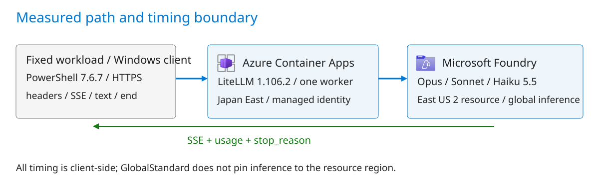

# Claude on Foundry: Thinking, Prompt Caching and First-Text Latency

LiteLLM 1.106.2 · Claude 5.5 · 50 requests · [Other language](README_CN.md)

## Purpose

Measure thinking mode, cache coverage and client-visible waiting separately. A successful HTTP response, streaming flag or cache marker is not a performance acceptance test. This project provides a fixed five-turn workload, a streaming collector, ten measured configurations and independent offline verification.

This is one fixed source-review workload, not customer production traffic. There is no answer-quality score, concurrent load test, AWS comparison or effort-level ranking.



Original explanatory diagram. Azure icon provenance: images/icon-sources.json. A diagram is not runtime evidence.

## Steps

Use your own Foundry resource with three Azure-hosted deployments (version 2), named claude-opus-5-5, claude-sonnet-5-5 and claude-haiku-5-5. Allocate within your quota; this run used 40,000 TPM each. You need Windows PowerShell 7, Python 3.13, Docker or ACR Tasks, and an authorized Azure CLI session.

Use a dedicated Azure Container App with system-assigned managed identity and the Cognitive Services User role on the Foundry resource. A private registry also requires AcrPull. Store the gateway key as an ACA Secret (for example gateway-key), never in Git or a command line.

Run from this project directory. Supply your own resource values. Enter the key through a secure terminal prompt; it is used in-process only.

**1. Build your gateway image**

```powershell
$env:ACR_NAME = Read-Host 'Your ACR name'
$env:APP_RG = Read-Host 'Your dedicated Container App resource group'
$env:APP_NAME = Read-Host 'Your dedicated Container App name'
$env:FOUNDRY_ANTHROPIC_BASE = Read-Host 'Your Foundry /anthropic base URL'
az acr build --registry $env:ACR_NAME --image claude-gateway:1.106.2 --file deploy/Dockerfile deploy
```

The Dockerfile builds from a pinned public LiteLLM image, not an author's private image. The measured gateway's build, startup and live requests were verified; a fresh deployment of this public packaging has not been run. Offline checks are not deployment proof.

**2. Update the dedicated Container App**

```powershell
$digest = az acr repository show --name $env:ACR_NAME --image claude-gateway:1.106.2 --query digest -o tsv
$server = az acr show --name $env:ACR_NAME --query loginServer -o tsv
$image = "$server/claude-gateway@$digest"
az containerapp update --resource-group $env:APP_RG --name $env:APP_NAME --image $image --set-env-vars "FOUNDRY_ANTHROPIC_BASE=$env:FOUNDRY_ANTHROPIC_BASE" 'LITELLM_MASTER_KEY=secretref:gateway-key' 'PYTHONPATH=/app/claude-gateway'
```

Configure HTTPS ingress to target port 4000 and restrict access to your test client. Keep the gateway secret unchanged and record the previous image digest before upgrading.

**3. Verify the entry point, then run the matrix**

```powershell
$env:CLAUDE_GATEWAY_URL = Read-Host 'Your HTTPS gateway URL'
$secureKey = Read-Host 'Your gateway key' -AsSecureString
$env:CLAUDE_GATEWAY_KEY = [Net.NetworkCredential]::new('', $secureKey).Password
try {
    $headers = @{Authorization='Bearer '+$env:CLAUDE_GATEWAY_KEY}
    (Invoke-RestMethod "$env:CLAUDE_GATEWAY_URL/v1/models" -Headers $headers).data.id
    $run = Join-Path 'live-runs' (Get-Date -Format 'yyyyMMdd-HHmmss')
    ./scripts/run_matrix.ps1 -RunDirectory $run
} finally {
    $env:CLAUDE_GATEWAY_KEY = $null
}
```

The metadata endpoint should list three standard aliases; the full matrix should save 50 responses. Ctrl+C stops the local test, not Azure resources. Resource shutdown and ingress restoration are separate owner-controlled actions.

## Results

All **50/50 requests completed**. Published-rate model cost: **US$0.78989513**. Each row contains five turns. Output throughput is output_tokens/E2E, including thinking.

| Model | Thinking | Cached prefix | N | Cache-read share | First text P50 (s) | E2E P50 (s) | Output P50 (tokens/s) | Model USD |
|---|---|---|---:|---:|---:|---:|---:|---:|
| Opus 5.5 | adaptive | system | 5 | 28.27% | 9.321 | 18.334 | 95.78 | 0.258394 |
| Sonnet 5.5 | adaptive | system | 5 | 33.52% | 8.051 | 15.233 | 117.84 | 0.110115 |
| Sonnet 5.5 | between_tools | system | 5 | 39.96% | 0.954 | 7.991 | 114.76 | 0.073466 |
| Haiku 5.5 | adaptive | system | 5 | 32.81% | 4.235 | 7.160 | 183.51 | 0.004840 |
| Haiku 5.5 | disabled | system | 5 | 47.47% | 0.810 | 3.553 | 153.96 | 0.002472 |
| Opus 5.5 | adaptive | system + history | 5 | 69.25% | 7.293 | 16.022 | 90.86 | 0.193501 |
| Sonnet 5.5 | adaptive | system + history | 5 | 67.68% | 1.434 | 8.604 | 115.29 | 0.081004 |
| Sonnet 5.5 | between_tools | system + history | 5 | 70.68% | 0.893 | 7.874 | 112.64 | 0.060174 |
| Haiku 5.5 | adaptive | system + history | 5 | 71.04% | 2.910 | 5.917 | 172.62 | 0.003642 |
| Haiku 5.5 | disabled | system + history | 5 | 72.44% | 0.781 | 3.983 | 156.55 | 0.002288 |

The no-up-front-thinking modes produced zero thinking tokens in this tool-free workload. Sonnet between_tools is not a universal full-off switch; Opus 5.5 cannot disable thinking. With five samples, P95 is the maximum, not a production-tail estimate.

Higher cache share does not attribute all first-text improvements to caching: conversations generate independently, changing history and thinking usage. All timing is client-side; server queues, network time and model compute are not isolated.

| Goal | Read |
|---|---|
| Inspect per-turn and timing results | [Results](docs/results.md) |
| Verify, reproduce and understand limits | [Testing](docs/testing.md) |

Directories: [deploy](deploy/), [scripts](scripts/), [data](data/), [evidence](evidence/), [images](images/), [tests](tests/). [Dependencies](requirements.txt).
