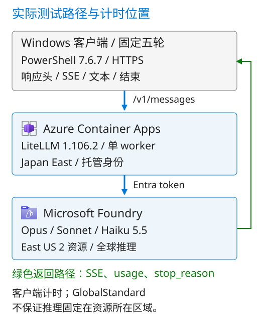

# Claude on Foundry：thinking、缓存与首字延迟

[](deploy/Dockerfile)
[](requirements.txt)
[](data/matrix.json)
[](https://github.com/david-xinyuwei/david-share/stargazers)

作者: Xinyu Wei · [English](README.md)

Stars 属于整个 david-share 仓库，不代表本目录。

## 目的

本项目把模型 thinking、缓存覆盖范围和客户端首字等待分开测量，避免把 HTTP 200、已开启流式或缓存标记存在当成性能达标。提供三模型的固定五轮输入、流式采集器、十组实际结果和离线验算。

这是一次固定资料问答实验，不是客户生产负载。没有答案质量评分、并发压测、AWS 对照或其他 effort 档位排名。

原实验为真实模型调用；本次公开包装的全新云部署未运行。离线核验不代表部署通过。



原创解释图。客户端负责提问、历史和计时；LiteLLM 负责协议及身份转发；模型服务负责生成与缓存。图只解释连接，不证明运行结果。 [Azure icons](images/icon-sources.json) · [Runtime](evidence/provenance.json)

自适应思考对应 adaptive；Sonnet 的无前置思考对应 between_tools，Haiku 的关闭思考对应 disabled。调用始终保留流式。

## 操作步骤

| 顺序 | 位置 | 操作 |
|---|---|---|
| 1 | 本机与 Foundry | 配置、登录、三个模型部署 |
| 2 | Azure CLI | 构建镜像和基础资源 |
| 3 | CLI 与 Portal | 身份、Secret、镜像和 Ingress |
| 4 | Portal 与本机 | revision 与元数据就绪 |
| 5 | 两个本机终端 | 保留日志并运行矩阵 |
| 6 | 本机 | 审计新运行、读取报告 |

以下主路径使用专用的新 Container App、ACR 和环境；不要将创建或停用步骤套到共享生产资源。需要 PowerShell 7.6、Python 3.13、Azure CLI，以及创建资源、运行 ACR Tasks、为指定资源分配角色和读取日志的权限。模型访问与 Marketplace 条款由订阅所有者确认。资源、构建、日志和模型调用可能计费，执行前确认预算。

**1. 设置上下文并部署模型**

先在 Foundry Portal 选择现有资源，或由有权限的用户创建资源并记录租户、订阅、资源组、资源名和 /anthropic 基础地址。然后在本项目目录启动 PowerShell。首次运行只输入一次非秘密配置；其他终端从 private/settings.json 读取。登录由用户在本机完成交互认证，不复制 token cache。

```powershell
$ErrorActionPreference = 'Stop'
$PSNativeCommandUseErrorActionPreference = $true
if ($PSVersionTable.PSVersion -lt [version]'7.6') { throw 'Use PowerShell 7.6 or later' }
$projectRoot = (Get-Location).ProviderPath
$private = Join-Path $projectRoot 'private'
[void][IO.Directory]::CreateDirectory($private)
$settings = @{
    tenant = Read-Host 'Tenant ID'
    subscription = Read-Host 'Subscription ID'
    group = Read-Host 'Dedicated resource group name'
    location = Read-Host 'Container Apps region'
    app = Read-Host 'New Container App name'
    environment = Read-Host 'New Container Apps environment name'
    registry = Read-Host 'New globally unique ACR name'
    foundryGroup = Read-Host 'Foundry resource group'
    foundry = Read-Host 'Foundry resource name'
    baseUrl = Read-Host 'Foundry base URL ending in /anthropic'
    clientCidr = Read-Host 'Test client public IPv4 address with /32'
}
$settings | ConvertTo-Json | Set-Content -LiteralPath (Join-Path $private 'settings.json') -Encoding utf8
$env:AZURE_CONFIG_DIR = Join-Path $private 'azure-cli'
az login --tenant $settings.tenant --output none
az account set --subscription $settings.subscription
$account = az account show --output json | ConvertFrom-Json
if ($account.id -ne $settings.subscription -or $account.tenantId -ne $settings.tenant) {
    throw 'Unexpected Azure context'
}
az cognitiveservices account show --resource-group $settings.foundryGroup `
    --name $settings.foundry --query '{name:name,location:location}' --output table
```

成功时显示所选 Foundry 资源。尚无资源时，在 Foundry Portal 创建资源并选择所需区域。在 **Discover → Models** 中分别选择 Opus 5.5、Sonnet 5.5、Haiku 5.5，进入 **Deploy → Custom settings**；首次部署由用户接受 Marketplace 条款。选 **Global** 与标为 **Hosted on Azure** 的版本 2，部署名分别为 claude-opus-5-5、claude-sonnet-5-5、claude-haiku-5-5；按已批准配额填写容量。待三个部署完成后，在 **Build → Models → Details** 核对名称、版本与 Target URI；baseUrl 只保留到 /anthropic。没有访问资格或配额就停在这一步，不换模型。

[Foundry provisioning and authentication](https://platform.claude.com/docs/en/build-with-claude/claude-in-microsoft-foundry#provisioning)

**2. 构建并固定镜像**

```powershell
$deployments = @(az cognitiveservices account deployment list `
    --resource-group $settings.foundryGroup --name $settings.foundry --output json | ConvertFrom-Json)
foreach ($model in @('claude-opus-5-5','claude-sonnet-5-5','claude-haiku-5-5')) {
    $match = @($deployments | Where-Object { $_.name -eq $model })
    if ($match.Count -ne 1 -or $match[0].properties.provisioningState -ne 'Succeeded' -or
        $match[0].properties.model.name -ne $model -or $match[0].properties.model.version -ne '2' -or
        $match[0].properties.model.format -ne 'Anthropic' -or $match[0].sku.name -ne 'GlobalStandard') {
        throw "Deployment contract mismatch: $model"
    }
}
az group create --name $settings.group --location $settings.location --output none
az acr create --name $settings.registry --resource-group $settings.group `
    --location $settings.location --sku Basic --admin-enabled false --output none
az containerapp env create --name $settings.environment --resource-group $settings.group `
    --location $settings.location --output none
$tag = 'claude-gateway:' + (Get-Date -Format 'yyyyMMdd-HHmmss')
az acr build --registry $settings.registry --image $tag --file deploy/Dockerfile deploy
$digest = az acr repository show --name $settings.registry --image $tag --query digest --output tsv
$server = az acr show --name $settings.registry --query loginServer --output tsv
if ($digest -notmatch '^sha256:[a-f0-9]{64}$') { throw 'Image digest missing' }
$image = "$server/claude-gateway@$digest"
```

成功时 ACR Tasks 构建完成，image 为带 SHA-256 digest 的镜像地址。Dockerfile 的公开 LiteLLM base 已固定；本次修复未执行这套公开包装的全新构建和云部署，ENV_BUILD_STATUS=NOT_BUILT。

**3. 配置身份、密钥和入口**

按微软系统分配身份流程，先以公开 quickstart 镜像创建无外部入口的临时 revision，再配置真实网关。临时镜像只用于取得身份，不是模型服务，也不进入测量。先解析其 digest，后续使用不可变地址。

```powershell
$manifest = Invoke-WebRequest -Method Head `
    -Uri 'https://mcr.microsoft.com/v2/k8se/quickstart/manifests/latest' `
    -Headers @{Accept='application/vnd.docker.distribution.manifest.v2+json'} -TimeoutSec 15
$bootstrapDigest = @($manifest.Headers['Docker-Content-Digest'])[0]
if ($bootstrapDigest -notmatch '^sha256:[a-f0-9]{64}$') { throw 'Bootstrap digest missing' }
az containerapp create --name $settings.app --resource-group $settings.group `
    --environment $settings.environment --system-assigned --revisions-mode single `
    --image "mcr.microsoft.com/k8se/quickstart@$bootstrapDigest" `
    --cpu 0.25 --memory 0.5Gi --min-replicas 0 --max-replicas 1 --output none
$principal = az containerapp identity show --name $settings.app `
    --resource-group $settings.group --query principalId --output tsv
$registryId = az acr show --name $settings.registry --query id --output tsv
$foundryId = az cognitiveservices account show --name $settings.foundry `
    --resource-group $settings.foundryGroup --query id --output tsv
az role assignment create --assignee-object-id $principal --assignee-principal-type ServicePrincipal `
    --role AcrPull --scope $registryId --output none
az role assignment create --assignee-object-id $principal --assignee-principal-type ServicePrincipal `
    --role 'Cognitive Services User' --scope $foundryId --output none
az acr config authentication-as-arm update --registry $settings.registry --status enabled --output none
az containerapp registry set --name $settings.app --resource-group $settings.group `
    --server $server --identity system --output none
```

在 Azure Portal 打开此 Container App，进入 **Application → Secrets → Add**，名称为 gateway-key，值由用户从自己的密码管理器输入；保存。保留原入口密钥，不在 CLI 参数、日志或 Git 中写明文。然后执行以下更新。

```powershell
az containerapp update --name $settings.app --resource-group $settings.group `
    --image $image --cpu 1 --memory 2Gi --min-replicas 1 --max-replicas 1 `
    --set-env-vars "FOUNDRY_ANTHROPIC_BASE=$($settings.baseUrl)" `
        'LITELLM_MASTER_KEY=secretref:gateway-key' 'PYTHONPATH=/app/claude-gateway' --output none
```

在 **Ingress** 启用来自外部的 HTTP 访问，目标端口 4000，关闭 Allow insecure connections；在 **IP security restrictions** 只允许 settings.clientCidr，并保存。不要添加 0.0.0.0/0。网关仍以入口密钥保护请求；调用 Foundry 使用该应用的 Managed Identity（托管身份），不是入口密钥。

[Managed-identity image pull](https://learn.microsoft.com/en-us/azure/container-apps/managed-identity-image-pull)

**4. 检查实际服务版本**

```powershell
$app = az containerapp show --name $settings.app --resource-group $settings.group --output json | ConvertFrom-Json
$revision = az containerapp revision show --name $settings.app --resource-group $settings.group `
    --revision $app.properties.latestRevisionName --output json | ConvertFrom-Json
if (-not $revision.properties.active -or $revision.properties.healthState -ne 'Healthy' -or
    $app.properties.latestReadyRevisionName -ne $app.properties.latestRevisionName -or
    $revision.properties.template.containers[0].image -ne $image) {
    throw 'Revision not ready: inspect Revision management and system logs, then repeat this step'
}
$env:CLAUDE_GATEWAY_URL = 'https://' + $app.properties.configuration.ingress.fqdn
$secureKey = Read-Host 'Gateway key (entered privately)' -AsSecureString
$env:CLAUDE_GATEWAY_KEY = [Net.NetworkCredential]::new('', $secureKey).Password
try {
    ./scripts/check_gateway.ps1
} finally {
    $env:CLAUDE_GATEWAY_KEY = $null
}
```

预期 METADATA_READY 并列出三个 standard 别名。该检查没有推理调用，不证明模型能成功回答。失败时查看 **Revision management** 和 **Log stream → System**，检查镜像拉取、角色传播和 Secret 引用后重做本步骤，不跳过就绪检查。

**5. 保存日志并运行矩阵**

先在第二个 PowerShell 终端切到同一项目目录，启动控制台日志流；记下输出的 TRACE_FILE 路径，终端保持打开。

```powershell
$ErrorActionPreference = 'Stop'
$PSNativeCommandUseErrorActionPreference = $true
$private = Join-Path (Get-Location).ProviderPath 'private'
$env:AZURE_CONFIG_DIR = Join-Path $private 'azure-cli'
$settings = Get-Content -LiteralPath (Join-Path $private 'settings.json') -Raw | ConvertFrom-Json
$traceFile = Join-Path $private ('provider-console_' + (Get-Date -Format 'yyyyMMdd-HHmmss') + '.jsonl')
Write-Output "TRACE_FILE=$traceFile"
az containerapp logs show --name $settings.app --resource-group $settings.group `
    --type console --follow --format json --tail 300 | Tee-Object -FilePath $traceFile
```

回到第一个终端运行。固定十组、每组五轮、medium、流式、零重试，最多 50 次请求；脚本预算为 50 美元，其中 3 美元为固定保守预留，不是本次实测费用。费率来自冻结采集器，调用前核对最新价目；该预算不覆盖基础设施，也不能保证当前实际账单。

```powershell
$run = Join-Path $projectRoot ('live-runs/' + (Get-Date -Format 'yyyyMMdd-HHmmss'))
$secureKey = Read-Host 'Gateway key (entered privately)' -AsSecureString
$env:CLAUDE_GATEWAY_KEY = [Net.NetworkCredential]::new('', $secureKey).Password
try {
    ./scripts/check_gateway.ps1
    ./scripts/run_matrix.ps1 -RunDirectory $run
} finally {
    $env:CLAUDE_GATEWAY_KEY = $null
}
```

预期 run.json 为 EXECUTED_PENDING_PROVIDER_TRACE_AUDIT，目录内有 50 份原始响应。结束后在日志终端按 Ctrl+C；日志来自一个 revision/replica/container，本路径固定单副本。如果日志流中断，保留文件并重新采集，不能用旧日志冒充缺失记录。运行器失败不自动重试或覆盖目录，先定位对应原始响应。

**6. 验收本次运行**

```powershell
$traceFile = Read-Host 'Full path of the console log captured for this run'
python -B scripts/analyze.py --run-directory $run --trace-file $traceFile
Get-Content -LiteralPath (Join-Path $run 'analysis.md')
```

预期 status=PASS、requests=50、providerCalls=50，analysis.json 与 analysis.md 的 run 对应本次目录。缺日志、错误模型、缺轮次、断流或 usage 不符会失败，不回退到仓库旧证据。多份日志可重复传 --trace-file；--check 只验算不写文件。

**升级、回滚与停用**：升级前读取并保存当前镜像 digest，更新为新 digest 后重复第 4 步；失败时用已保存的旧 digest 执行同一 update 命令并再次检查。单副本维护可能中断请求。Ctrl+C 仅停止客户端；容器临时文件可能在重启时丢失，先保留本地原始响应和 trace。只有资源所有者确认停止后，才在 Portal 的 Revision management 停用该专用应用所有 active revision，并核对副本为 0；ACR、环境和日志仍可能计费，按各自资源另行决定，不删除共享资源。

## 实现效果

2026-10-24 的原实验 **50/50 正常完成**，按当时记录费率估算的模型费用为 **US$0.78989513**。每个缓存配置各有五轮；下表是历史实测，不是读者新运行的结果或当前价格。首字为发送请求到第一个非空 text_delta；P50 为五轮中位数。

**首个可见文本 P50，单位：秒**

| 模型 / 模式 | 仅系统前缀 | 系统与历史 |
|---|---:|---:|
| Opus 5.5<br>自适应思考 | 9.321 | 7.293 |
| Sonnet 5.5<br>自适应思考 | 8.051 | 1.434 |
| Sonnet 5.5<br>无前置思考 | 0.954 | 0.893 |
| Haiku 5.5<br>自适应思考 | 4.235 | 2.910 |
| Haiku 5.5<br>关闭思考 | 0.810 | 0.781 |

**全部五轮的缓存读取占比，单位：%**

缓存读取占比统计同一配置全部五轮：读取 token 总和 /（未缓存、写入、读取 token 总和）。首轮写入也在分母里，不算命中；新问题和新增历史仍需处理。仅系统前缀只复用固定资料，系统与历史额外启用随会话增长的自动缓存。这里不是末轮命中率，也不是平均每轮百分比。

| 模型 / 模式 | 仅系统前缀 | 系统与历史 |
|---|---:|---:|
| Opus 5.5<br>自适应思考 | 28.27 | 69.25 |
| Sonnet 5.5<br>自适应思考 | 33.52 | 67.68 |
| Sonnet 5.5<br>无前置思考 | 39.96 | 70.68 |
| Haiku 5.5<br>自适应思考 | 32.81 | 71.04 |
| Haiku 5.5<br>关闭思考 | 47.47 | 72.44 |

关闭模式在无工具任务中均为零 thinking token。Sonnet 的 between_tools 不是所有场景下的完全关闭；Opus 5.5 不支持关闭。P95 在五个样本下等于最大值，不代表生产尾延迟。

更高缓存占比不等于全部首字改善来自缓存：各会话独立生成，历史和 thinking 用量随之变化。所有计时在客户端，未分离服务端排队、网络和推理计算。

| 想要 | 入口 |
|---|---|
| 查看逐轮与分段计时 | [实测结果](docs/results_CN.md) |
| 核验、复测与限制 | [复测与核验](docs/testing_CN.md) |

目录: [deploy](deploy/), [scripts](scripts/), [data](data/), [evidence](evidence/), [images](images/), [tests](tests/). [Dependencies](requirements.txt).
