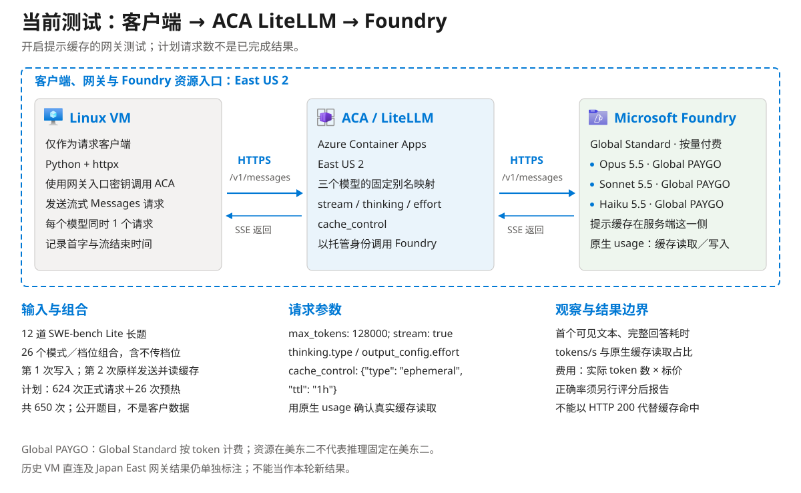
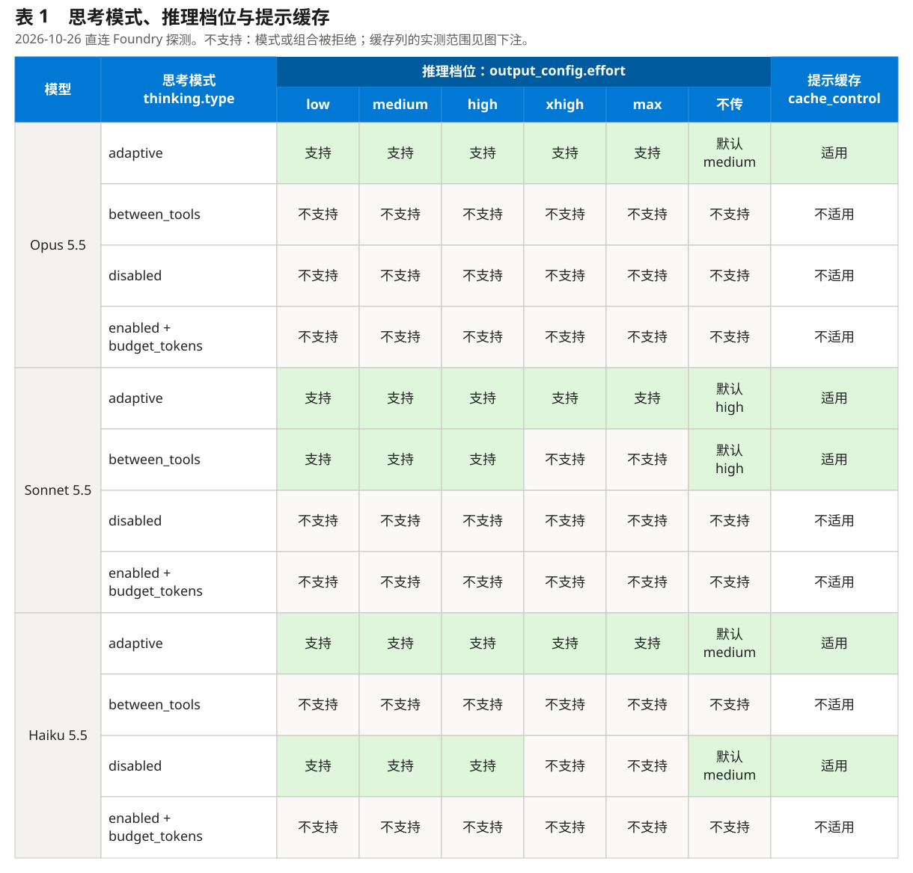
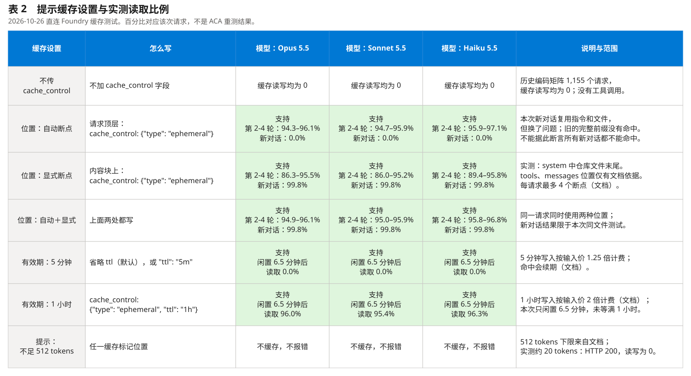

# Microsoft Foundry 上的 Claude 5.5：思考模式、推理档位、提示缓存、延迟与编码正确率

[](#目的)
[](#实现效果)
[](https://github.com/david-xinyuwei/david-share/actions/workflows/claude-foundry-performance-ci.yml)

作者：魏新宇 · [English](README.md)

## 目的

**测什么。** 测 Claude Opus 5.5、Sonnet 5.5 和 Haiku 5.5 以 [Hosted on Azure](https://platform.claude.com/docs/en/build-with-claude/claude-in-microsoft-foundry#hosting-options) 方式部署在 Microsoft Foundry 上时的表现：模型版本 2，即 Anthropic 运营、运行在 Azure 基础设施上的服务，部署类型为 GlobalStandard。对每个编码请求，我们测首个可见文字和完整回答各要等多久、写出的代码能否通过题目自带的单元测试、按标价花多少钱。下表中的请求设置会同时改变这几项，有些组合还会直接返回 HTTP 400；只看请求成功看不出这些。

两种测试方法，调用的都是 East US 2 的同一个 Foundry 资源：

1. **从 VM 直连（2026-10-26）。** 同一 Azure 区域的 Linux VM 上运行 Python 测试脚本，用 VM 的托管身份调用 Foundry Messages API：参数探测（102 个请求）、编码矩阵（21 个被接受的思考模式 × 推理档位组合，18 道题各答 3 次，每格另加 1 次预热，共 1,155 个请求）和提示缓存测试（264 个请求）。每个模型同一时间只有 1 个请求，测的是单个请求的表现，不是压力测试。除非某节另有说明，结果都来自这种方法。
2. **经 Azure Container Apps 上的 LiteLLM 网关（2026-10-24）。** 客户端把 Anthropic Messages 请求发给 LiteLLM，由 LiteLLM 用自己的托管身份转发到同一组部署；LiteLLM 设置为不丢弃参数、不重试。那次测试由一台 Windows 客户端发起五轮对话，网关在 Japan East，所以时间里包含日本到美国东部的往返。详见[结果页](docs/results_CN.md#网关测试)。



图中内容：方法 1，即 2026-10-26 结果背后的客户端、资源和测试步骤；时间在 VM 上计，从请求发出到首个可见文字。方法 2 在图下注明，详见[结果页](docs/results_CN.md#网关测试)。原创说明图，使用未修改的 [Azure 图标](images/icon-sources.json)。

**请求设置。** 每个设置的作用（依据 Claude 官方文档）和本测试发送了什么；各部署接受哪些取值来自我们的参数探测：

| 设置 | 作用 | 本测试 |
|---|---|---|
| `thinking.type: "adaptive"` | 模型对每个请求自己决定要不要先思考、思考多久；`output_config.effort` 调节思考多少。这三个模型不传 `thinking` 字段时也是这样 | 三个模型，档位 low 到 max |
| `thinking.type: "between_tools"` | Sonnet 5.5 最低的思考设置：回答前不思考。在工具调用之间写的简短进度仍以 thinking 块返回；不用工具时只返回文字。只接受 `high` 及以下档位 | Sonnet，档位 low、medium、high；不用工具 |
| `thinking.type: "disabled"` | 关闭思考。只有 Haiku 5.5 接受，且只在 `high` 及以下档位；Opus 5.5 关不掉思考 | Haiku，档位 low、medium、high |
| `thinking.display` | 是否返回思考文字。这些模型默认 `"omitted"`：thinking 块的文字为空、只带加密签名，所以回答更早开始流式返回；思考 token 照样计费。`"summarized"` 返回摘要 | 未发送：矩阵中 610 个回答用了思考 token，没有一个流式返回思考文字 |
| `output_config.effort` | 模型在整个回答上投入多少，包括思考：`low`、`medium`、`high`、`xhigh`、`max`。它是行为信号，不是 token 预算。不传时 Opus 和 Haiku 为 `medium`，Sonnet 为 `high` | 每种思考模式接受的全部档位，共 21 格 |
| `max_tokens` | 输出 token 的硬上限，包括思考；回答达到上限时以 `stop_reason: "max_tokens"` 停止。这些模型最大 128,000 | 矩阵用 128,000；1,000,000 返回 HTTP 400 |
| 不传 `cache_control`（默认） | 不缓存：缓存要由请求主动开启。“自动缓存”同样要在顶层传 `cache_control`，“自动”指断点位置由系统决定，不是默认开启。官方文档写明的例外都和工具有关：工具调用循环中随 tool_result 回传的历史不加标记也可能被缓存，服务器工具的结果会自动缓存 | 编码矩阵（1,155 个请求）和缓存测试的基线场景（24 个请求，每轮都重发同样约 15,500 个 token 的前缀）：每个响应的缓存读取和写入都是 0 |
| 顶层 `cache_control` | 自动缓存：断点放在最后一个可缓存块上，随对话增长自动后移 | 缓存测试的大多数场景 |
| 内容块上的 `cache_control` | 显式断点：缓存到该块为止的提示，顺序为 `tools`、`system`、`messages`。每个请求最多 4 个断点；不足 512 个 token 的提示不会被缓存 | 缓存测试：放在仓库文件之后 |
| `cache_control.ttl` | 缓存条目闲置多久后失效：默认 `"5m"`，每次读取都会续期；也可设为 `"1h"`。写入按输入价的 1.25 倍（5 分钟）或 2 倍（1 小时）计费；读取在 Opus 和 Sonnet 上按 0.05 倍，在 Haiku 上按 0.1 倍 | 两种都测了：第 2 轮前空闲 6.5 分钟 |
| 按消息设置 effort | 用只含 effort 的 `system` 消息改变后续轮次的档位，不动顶层字段，缓存前缀因此保持有效。Beta 功能，请求头 `anthropic-beta: mid-conversation-output-config-2026-07-01`；effort 文档列出的支持平台中没有 Foundry | 一个缓存场景；缓存测试的 264 个请求全部返回 HTTP 200 |
| `temperature`、`top_p`、`top_k` | 采样参数。这些模型上任何非默认值都返回 HTTP 400 | 只在探测中发送：试过的每种模式都返回 HTTP 400；矩阵从未发送 |
| `stream` | 为 `true` 时以服务端事件流返回，只有这样才能测首个可见文字的时间 | 计时的请求都是 `true`；`max_tokens: 0` 的预热请求按 API 要求不用流式 |
| 部署类型（创建部署时选择，不是请求参数） | GlobalStandard 的请求可能在资源所在区域以外处理；US Data Zone Standard 把推理留在美国，相当于 Claude API 的 `inference_geo: "us"`。Sonnet 5.5 只支持 GlobalStandard | 只测了 GlobalStandard；矩阵每个响应的 `usage.inference_geo` 都是 `global` |

**表 1：完整思考模式与推理档位矩阵。**

[](images/parameter-support-zh.svg)

`adaptive`、`between_tools`、`disabled` 与六列档位共 54 格，均单独探测；其中 26 格被接受，包括五个不传 effort 的格子。`enabled` 每模型只测一次：`budget_tokens: 1024`，不传 effort；HTTP 400 拒绝的是模式本身，所以六个档位格都画斜线。缓存列只写适用性：思考模式使请求被拒时标“不适用”，不是说模型不支持缓存。默认档位来自[effort 文档](https://platform.claude.com/docs/en/build-with-claude/effort)。

缓存实测范围：五个被接受的模型／模式行均在 low 档读到缓存；adaptive 在切换到 high 的场景也读到缓存。其他档位组合仍需经 ACA 逐格验证缓存命中。“适用”和“参数被接受”不等于“开启缓存后的性能已测完”。矩阵固定项：`max_tokens: 128000`、`stream: true`；`temperature`、`top_p`、`top_k` 不传。不传 thinking 等同 adaptive 来自文档；三个模型同时不传 thinking、effort 的探测均返回 200。

**表 2：完整提示缓存设置。**

[](images/cache-settings-zh.svg)

来源：[探测请求](evidence/coding-matrix-20261026/probe/probe_results.jsonl)、[缓存请求](evidence/coding-matrix-20261026/cache/cache_results.jsonl)及[缓存文档](https://platform.claude.com/docs/en/build-with-claude/prompt-caching)。表 2 每场景重复两次：Opus adaptive、Sonnet between_tools、Haiku disabled，effort low；首轮写入与第 2-4 轮读取分开。读取比例＝读取 tokens ÷（未缓存＋写入＋读取的输入 tokens），按模型／场景／轮次汇总。新对话复用文件但换了问题。512-token 边界和四断点上限来自文档，并非边界扫描实测。缓存标记均为 `type: ephemeral`；读取按输入价计费：Opus／Sonnet 0.05 倍、Haiku 0.1 倍（文档价格）。这里保留历史 VM 直连证据，不宣称已有新的 ACA 性能结果。

**未覆盖：** 工具调用（`between_tools` 和进度更新只在使用工具时才起作用）、`display: "summarized"`、US Data Zone 部署，以及 Foundry 模型目录里单独的 `claude-opus-5-5-fast` 模型。

**按模型汇总。** 每个部署接受什么，以及在这 18 道题上的表现：

| 问题 | Opus 5.5 | Sonnet 5.5 | Haiku 5.5 |
|---|---|---|---|
| API 接受的思考模式 | 只接受 `adaptive`；`disabled` 和 `between_tools` 返回 400 | `adaptive`；`between_tools` 只接受 low、medium、high | `adaptive`；`disabled` 只接受 low、medium、high |
| 推理档位 / 不传时的默认值 | low 到 max / medium | low 到 max / high | low 到 max / medium |
| 最快一格的首个可见文字 P50 | 0.48 秒（`adaptive` · low） | 0.39 秒（`between_tools` · high） | 0.43 秒（`disabled` · high） |
| 每格通过单元测试的回答数（共 54 个） | 每格都是 54 | 40 到 44 | `adaptive` 24 到 28；`disabled` 17 到 21 |
| 按标价计每 1,000 次请求的费用 | $23.34 到 $355.75 | $13.04 到 $356.49 | $0.69 到 $22.26 |
| 适合的情况（本测试的解读） | 答案必须一次就对。从 `low` 开始：每个档位都 54 个全过，`low` 最快（0.48 秒）也最便宜 | 要接近 Opus 的正确率、价格更低：`between_tools` 的通过数与 `adaptive` 相当，首字不到 0.5 秒，每 1,000 次请求 $13.16–$13.76 | 费用最重要、答错可以重试。保持思考开启：同样的档位下 `adaptive` 比 `disabled` 通过率高 12.3 个百分点 |

**范围。** 题目是 [Aider polyglot benchmark](https://github.com/Aider-AI/polyglot-benchmark) 收录的 Exercism 公开练习，每次只答一次、不用工具、看不到测试；它们不是你的生产任务。方法 1 的所有请求直接发往 Foundry 的 Messages API，每个部署同一时间只有一个请求。费用按标价计算，没有与 Azure 账单核对。

**来源。** 接受哪些取值、HTTP 400 的报错原文来自我们的参数探测（[结果页](docs/results_CN.md#参数探测)）。各设置的作用、默认值、`between_tools` 和 `disabled` 的使用规则，以及 Sonnet 5.5 做智能体编码时把 `max_tokens` 设为 128,000 的建议，来自 Claude 的 [thinking](https://platform.claude.com/docs/en/build-with-claude/thinking) 和 [effort](https://platform.claude.com/docs/en/build-with-claude/effort) 文档；缓存规则和价格倍数来自 [prompt caching](https://platform.claude.com/docs/en/build-with-claude/prompt-caching)；价格来自 [pricing](https://platform.claude.com/docs/en/about-claude/pricing)；托管方式和 Foundry 配置来自 [Claude in Microsoft Foundry](https://platform.claude.com/docs/en/build-with-claude/claude-in-microsoft-foundry)；均于 2026-10-26 查阅。“适合的情况”一行是我们对这 18 道题的解读，不是通用建议。

## 实现效果

看结果时会用到的词：

| 术语 | 含义 |
|---|---|
| 格 | 一个模型 × 思考模式 × 推理档位的组合。每格把 18 道题各答 3 次，共 54 个回答 |
| 思考模式、推理档位 | 定义见[目的](#目的)一节的请求设置表 |
| 首个可见文字 | 从请求即将发出到收到第一个非空 `text_delta` 的秒数，在 VM 上计时。思考在它之前进行，且思考文字默认不流式返回（`display` 为 omitted），所以这段等待包含全部思考时间 |
| 首个事件 | 收到第一个服务端事件 `message_start` 的秒数 |
| 完整回答 | 收到流结束的秒数，只统计完成的请求 |
| 完成 | HTTP 200、收到 `message_stop`、`stop_reason` 为 `end_turn` 且文字不为空 |
| 通过 | 把回答里的文件覆盖到练习的解答文件上，题目自带的单元测试在离线容器里以 0 退出（Aider 的首次作答规则） |
| 按题目的 95% 区间 | 对 18 道题有放回重抽 5,000 次（种子 20261026）取 2.5% 到 97.5% 分位。同一道题的 3 个回答不独立，所以以题目为单位 |
| 费用 | 标价 × API 返回的 `usage` 中的 token 数，包括缓存写入和读取 |

**各部分在哪里运行。**

| 部分 | 位置 | 说明 |
|---|---|---|
| 客户端：参数探测、编码矩阵、缓存测试 | Linux VM `Standard_D4s_v5`，East US 2 | Ubuntu 24.04，内核 7.0.0-1017-azure，Python 3.12.3，httpx 0.28.1，azure-identity 1.25.1；用 VM 的托管身份取 Entra 令牌；矩阵开始前到端点的 TCP 建连中位数 9.67 毫秒 |
| 模型 | East US 2 的 Foundry 资源 | `claude-opus-5-5` 每分钟 40,000 token；`claude-sonnet-5-5` 和 `claude-haiku-5-5` 各 80,000；版本 2，GlobalStandard，请求可能在 East US 2 以外执行 |
| 单元测试 | 同一台 VM 上的 Docker | `--network none`，1.5 个 CPU，3 GB；工具链与 Aider 评测镜像一致：Python 3.11、Go 1.21.5、Rust、Node 20、OpenJDK 21、CMake 和 Boost |

**编码矩阵每个请求发送的内容。** 每个回答对应一次流式 Messages 请求；这里截短了 `system` 和 `content`：

```json
{
  "model": "claude-sonnet-5-5",
  "max_tokens": 128000,
  "stream": true,
  "thinking": {"type": "between_tools"},
  "output_config": {"effort": "low"},
  "system": "Act as an expert software developer. …",
  "messages": [{"role": "user", "content": "I have *added these files to the chat* so you can go ahead and edit them. …"}]
}
```

各格之间只有 `model`、`thinking.type` 和 `output_config.effort` 不同。没有 `cache_control`、工具，也没有 `temperature`、`top_p` 或 `top_k`。完整的系统提示和一条完整的用户消息见[结果页](docs/results_CN.md#编码矩阵)；18 条全部在 [problems.json](evidence/coding-matrix-20261026/matrix/problems.json)。

**每个指标怎么测、用哪个脚本。**

| 指标 | 起止或算法 | 脚本 |
|---|---|---|
| 接受的取值 | 带上每个取值发一个只需回答一个词的请求，看返回 200 还是 400 | [`probe.py`](coding-matrix/probe.py) |
| 首个可见文字、首个事件、完整回答 | 请求发出 → 第一个 `text_delta`、`message_start`、流结束；在 VM 上计时 | [`claude_api.py`](coding-matrix/claude_api.py) `stream_message` |
| 完成、思考 token、输出 token | 每个流的状态、`stop_reason` 和 `usage` | [`bench.py`](coding-matrix/bench.py) |
| 通过 | 练习自带的单元测试，在 Docker 里离线运行 | [`judge.py`](coding-matrix/judge.py) |
| P50、P95、区间、每 1,000 次费用 | 最近秩分位；按题目自助重抽；平均标价费用 × 1,000 | [`analyze.py`](coding-matrix/analyze.py) |
| 缓存读写、整段对话费用 | 每轮的 `usage`；同样的 token 按不缓存计价作对照 | [`cache_test.py`](coding-matrix/cache_test.py)、[`cache_analyze.py`](coding-matrix/cache_analyze.py) |

**不要把下面三张表当成三个模型的通用排名。** Opus 每一格都把 18 道题全部答对，这次测试分不出它各档位的差别。只有 18 道题，Sonnet 和 Haiku 每格的 95% 区间宽 30 到 44 个百分点（例如 Sonnet `between_tools` · high：54 个通过 44 个，区间 65% 到 94%）。题目都是短小的单文件练习。每行是一个模型加一种思考模式，每列是一个推理档位；*不接受* 表示 API 返回 HTTP 400。P95、完整回答耗时、token 数和每格的区间见[结果页](docs/results_CN.md#每格结果)。

**通过单元测试的回答数（每格 54 个）**

| 模型 · 思考模式 | low | medium | high | xhigh | max |
|---|---:|---:|---:|---:|---:|
| Opus 5.5 · `adaptive` | 54/54 | 54/54 | 54/54 | 54/54 | 54/54 |
| Sonnet 5.5 · `adaptive` | 41/54 | 42/54 | 40/54 | 41/54 | 44/54 |
| Sonnet 5.5 · `between_tools` | 42/54 | 41/54 | 44/54 | 不接受 | 不接受 |
| Haiku 5.5 · `adaptive` | 24/54 | 26/54 | 27/54 | 28/54 | 28/54 |
| Haiku 5.5 · `disabled` | 19/54 | 17/54 | 21/54 | 不接受 | 不接受 |

**首个可见文字 P50（秒）**

| 模型 · 思考模式 | low | medium | high | xhigh | max |
|---|---:|---:|---:|---:|---:|
| Opus 5.5 · `adaptive` | 0.48 | 3.71 | 4.05 | 6.04 | 51.4 |
| Sonnet 5.5 · `adaptive` | 0.46 | 0.50 | 3.25 | 7.44 | 190 |
| Sonnet 5.5 · `between_tools` | 0.42 | 0.44 | 0.39 | 不接受 | 不接受 |
| Haiku 5.5 · `adaptive` | 4.13 | 4.62 | 8.21 | 14.9 | 121 |
| Haiku 5.5 · `disabled` | 0.46 | 0.45 | 0.43 | 不接受 | 不接受 |

**按标价计每 1,000 次请求的费用（美元）**

| 模型 · 思考模式 | low | medium | high | xhigh | max |
|---|---:|---:|---:|---:|---:|
| Opus 5.5 · `adaptive` | $23.34 | $34.52 | $38.75 | $65.36 | $355.75 |
| Sonnet 5.5 · `adaptive` | $13.04 | $13.57 | $18.36 | $31.62 | $356.49 |
| Sonnet 5.5 · `between_tools` | $13.16 | $13.21 | $13.76 | 不接受 | 不接受 |
| Haiku 5.5 · `adaptive` | $1.27 | $1.57 | $2.14 | $4.19 | $22.26 |
| Haiku 5.5 · `disabled` | $0.69 | $0.69 | $0.73 | 不接受 | 不接受 |

值得注意的几点：
- **平台接住了每一个请求。** 矩阵的 1,155 个请求全部返回 HTTP 200，没有 429，也没有 5xx；1,134 个计分请求中 1,130 个完成。另外 4 个里，3 个是 Haiku `adaptive` · max 把 128,000 个输出 token 全部用在思考上（`stop_reason: max_tokens`）；1 个是 Sonnet `adaptive` · max 的流在发出 `message_start` 和两个 ping 后再无数据，直到客户端 600 秒读超时在第 661 秒结束它。
- **不思考时，文字半秒内就开始出现。** Sonnet `between_tools` 和 Haiku `disabled` 共 324 个请求，首个可见文字 P50 为 0.44 秒，P95 为 0.74 秒。全部请求的首个事件 P50 为 0.47 秒，各格在 0.39 到 0.53 秒之间；其余的等待是思考，思考内容不流式返回。effort 为 max 时，首个可见文字 P50 为 51.4 秒（Opus）、190 秒（Sonnet）、121 秒（Haiku）。
- **思考提高了 Haiku 的通过率，没有提高 Sonnet 的。** 在相同的三个档位上，Haiku 用 `adaptive` 通过 47.5%，用 `disabled` 通过 35.2%，高 12.3 个百分点（95% 区间 +2.5 到 +23.5；9 道题更好，2 道更差，7 道持平）。Sonnet 用 `adaptive` 通过 75.9%，用 `between_tools` 通过 78.4%，低 2.5 个百分点（区间 -7.4 到 +1.9）。
- **提高推理档位主要换来更长的时间和更高的费用。** Opus 同样 54 个全过，low 每 1,000 次请求 $23.34，max 要 $355.75。Sonnet 的 8 格每格通过 40 到 44 个，彼此都在对方的区间内。
- **题目本身比设置影响更大。** Sonnet 所有格合计，`java/house` 24 次只过了 1 次，`javascript/promises` 24 次过了 3 次；Haiku 有 6 道题一次都没过。Opus 每道题每次都过。

**四轮编码对话中的提示缓存。** 每段对话都把同样的说明和三个 httpx 源文件（约 15,500 个 token）作为系统提示，再依次问四个问题：`Auth` 子类在请求中怎样起作用、写一个新的 `BearerTokenAuth` 类、为它写 pytest 测试、写提交信息。Opus 用 `adaptive`，Sonnet 用 `between_tools`，Haiku 用 `disabled`，推理档位 low，每个场景重复 2 次。每个场景只改一处；结果是三个模型的范围：

| 场景 | 改了什么 | 结果 |
|---|---|---|
| 自动缓存 | 每轮都带顶层 `cache_control` | 第 2–4 轮有 94–97% 的提示从缓存读取；整段对话比同样 token 不缓存便宜 52–53% |
| 在文件后设断点，开新对话 | 在仓库文件块上放 `cache_control`；再开一段文件相同、问题不同的对话 | 新对话从缓存读取 15,440–15,442 个 token，便宜 76–80% |
| 只用自动缓存，开新对话 | 顶层 `cache_control`；再开一段文件相同的对话 | 读取 0 个 token，又写了一份新缓存：比不缓存贵 20–21% |
| 改顶层推理档位 | 第 3 轮把 effort 从 low 改成 high | 第 3 轮仍有 95–97% 的提示从缓存读取 |
| 按消息改推理档位 | 同样的改动用只含 effort 的 system 消息表达，beta 头 `mid-conversation-output-config-2026-07-01` | 第 3 轮有 95–97% 从缓存读取 |
| 切换思考模式（Sonnet、Haiku） | 第 3 轮从不思考改为 `adaptive` | 第 3 轮读取 0 个 token，重写 16,609–17,138 个；第 4 轮又有 95–96% 从缓存读取 |
| 空闲 6.5 分钟，5 分钟 TTL | 默认 TTL | 第 2 轮读取 0 个 token，重写 16,145–16,158 个 |
| 空闲 6.5 分钟，1 小时 TTL | `"ttl": "1h"` | 第 2 轮读取 15,490–15,493 个 token |
| 预热 | 先发一个 `max_tokens: 0` 的非流式请求，再问第一个问题 | 第一个问题从缓存读取 15,440–15,444 个 token（占其提示的 99.7%） |
| 冷请求与热请求，提示相同 | 五对，只答一个词 | 约 15,500 个 token 时首个可见文字 P50：Opus 1.51 → 1.38 秒，Sonnet 1.03 → 0.89 秒，Haiku 0.75 → 0.71 秒；约 53,300 个 token 时：Sonnet 0.94 → 0.92 秒，Haiku 0.85 → 0.87 秒。热请求的费用是冷请求的 4–8% |

Claude 的 [effort 文档](https://platform.claude.com/docs/en/build-with-claude/effort) 写明：两次请求之间改动顶层 effort 会让缓存断点失效。本测试在自动缓存下，第 3 轮仍然读到了缓存前缀；原因未查明，只能当作 2026-10-26 这些部署上的观察结果。文档说明会保留缓存的按消息改档方式，表现相同。缓存测试的 264 个请求全部返回 HTTP 200。每轮的读取占比和费用见[结果页](docs/results_CN.md#提示缓存)。

**经过 LiteLLM 网关（2026-10-24）。** 更早的一次测试把五轮代码审阅对话经 Japan East 的 Azure Container Apps 上的 LiteLLM 1.106.2 发到同一个 East US 2 资源，共十种配置，推理档位 medium。50 个请求全部完成；网关自己的出站日志显示，每个请求的模型、思考模式、推理档位、`stream`、`max_tokens` 和缓存标记都原样到达 Foundry。首个可见文字 P50 在关闭思考时为 0.78 到 0.95 秒，`adaptive` 时最高 9.32 秒。网关和模型不在同一个区域，这些时间包含日本到美国东部的往返，不能代表网关本身增加的延迟。完整表格见[结果页](docs/results_CN.md#网关测试)。

**每次实测。**

| 运行 | 时间（UTC） | 内容 | 请求数 | 标价费用 | 结果 |
|---|---|---|---:|---:|---|
| `probe` | 2026-10-26 08:11–08:12 | 接受的取值，只需回答一个词 | 102 | $0.05 | 50 个 HTTP 200，52 个 HTTP 400 |
| `smoke` | 2026-10-26 08:35 | 21 格各答一道题，`max_tokens` 32,000 | 21 | $0.14 | 21 个完成 |
| `pilot-32k` | 2026-10-26 08:37–09:04 | `max_tokens` 32,000 的矩阵 | 173 | $5.59 | 已停止：7 个回答用满 32,000 token，4 个触发每分钟输出 token 上限（HTTP 429）；不计入结果 |
| `matrix` | 2026-10-26 09:04–14:11 | 21 格 × 18 题 × 3 次，另有 21 个预热请求 | 1,155 | $55.36 | 1,134 个中 1,130 个完成；没有 429 |
| `cache` | 2026-10-26 13:04–14:57 | 缓存场景 | 264 | $6.70 | 264 个 HTTP 200 |
| `gateway` | 2026-10-24 | 经 LiteLLM 的五轮对话，十种配置 | 50 | $0.79 | 50 个完成 |

2026-10-26 的几次运行按标价共 $67.85。记录在 [`evidence/coding-matrix-20261026/`](evidence/coding-matrix-20261026/)，端点和 VM 名称已替换；2026-10-24 的记录在 [`evidence/`](evidence/)。

**边界。**
- **一个客户端、一个区域、一天、每个部署同一时间一个请求。** 没有并发、压力或长时间测试，也没有 Azure 以外的客户端。
- **公开练习、只答一次、不用工具。** 与 Aider 的评测一样，模型能看到待补全的文件和题目说明，看不到测试。`between_tools` 与 `disabled` 只在工具循环里有区别，本测试没有工具循环。
- **上限与样本量。** Opus 每格 54 个全过；18 道题的区间很宽，两格之间差几个回答属于噪声范围。
- **思考内容的显示。** 矩阵中 610 个请求用了思考 token，流式返回思考文字的有 0 个，所以首个可见文字包含全部思考时间。没有测试 `display: "summarized"`。
- **路由。** GlobalStandard 部署可能在 East US 2 以外处理请求，矩阵的 1,155 个响应里 `usage.inference_geo` 都是 `global`；换客户端位置或部署类型，延迟会不同。
- **费用。** 按 2026-10-26 的标价计算，不是 Azure 账单。
- **网关。** 2026-10-24 的网关在另一个区域；与模型同区域的网关尚未测试。

| 想要 | 去看 |
|---|---|
| 查看每一格、每道题、每条探测报错和每轮缓存 | [实测结果](docs/results_CN.md) |
| 重做测试或运行离线检查 | [复测与核验](docs/testing_CN.md) |
| 核对公开脚本相对实测脚本改了什么 | [来源记录](evidence/coding-matrix-20261026/provenance.json) |

## 操作步骤

**先部署，再调用。** 下面的步骤部署三个模型，并用测试中的请求格式发一个流式请求。重做测量、2026-10-24 的网关测试和离线检查见 [docs/testing_CN.md](docs/testing_CN.md)。

**执行边界：** 2026-10-26 的结果由这些脚本产生，所用 VM 由第 3 步的命令（换成我们自己的资源名）创建。仓库是事后整理的。整理后在同一台 VM 上用公开的 `claude_api.py`、`pricing.py` 和 `call_once.py` 运行了一次第 4 步：完成，HTTP 200，首个可见文字在 0.89 秒后出现（[记录](evidence/coding-matrix-20261026/readme-step4.json)）。第 1 到 3 步还没有在全新订阅中重跑。

| 顺序 | 位置 | 操作 | 入口 |
|---|---|---|---|
| 1 | 装有 Azure CLI 的 Bash | 登录并填写资源名 | `az login` |
| 2 | Foundry 门户和 Azure CLI | 部署三个模型 | `az cognitiveservices account deployment create` |
| 3 | Azure CLI | 在同一区域创建 VM，并允许它的身份调用 Foundry | `az vm create`、`az role assignment create` |
| 4 | VM | 安装客户端并发一个请求 | [`coding-matrix/call_once.py`](coding-matrix/call_once.py) |

**前提。** 装有 Azure CLI 的 Bash（我们用的是 2.91.0；Azure Cloud Shell 也可以）；位于提供 Claude 5.5 的区域的 Foundry 资源（这里是 East US 2）；部署模型、创建 VM 和在 Foundry 资源上分配角色的权限；Claude 5.5 配额；以及 Anthropic 模型的 Marketplace 条款，首次部署时由订阅所有者在门户中接受。模型调用、VM 和磁盘都会产生费用。

**1. 登录并填写资源名。** 填好五个值；`LOCATION` 是 Foundry 资源所在的区域。

```bash
SUBSCRIPTION_ID="<subscription-id>"
FOUNDRY_RG="<resource-group-of-the-Foundry-resource>"
FOUNDRY="<Foundry-resource-name>"
VM_RG="<new-resource-group-for-the-client-VM>"
LOCATION="eastus2"
az login
az account set --subscription "$SUBSCRIPTION_ID"
az cognitiveservices account show -g "$FOUNDRY_RG" -n "$FOUNDRY" --query "{name:name, location:location}" -o table
```

成功时最后一条命令输出资源名和区域。失败时先核对订阅和资源名再继续。

**2. 部署三个模型。** capacity 的单位是每分钟千 token；这里用的是测试时的值（Opus 40，Sonnet 和 Haiku 各 80）。如果命令因 Marketplace 条款失败，先在 Foundry 门户部署一次该模型（**Discover → Models**，然后 **Deploy → Custom settings**，部署类型选 **Global**，版本 2），再重新运行命令。

```bash
az cognitiveservices account deployment create -g "$FOUNDRY_RG" -n "$FOUNDRY" --deployment-name claude-opus-5-5 \
  --model-name claude-opus-5-5 --model-version 2 --model-format Anthropic --sku-name GlobalStandard --sku-capacity 40
az cognitiveservices account deployment create -g "$FOUNDRY_RG" -n "$FOUNDRY" --deployment-name claude-sonnet-5-5 \
  --model-name claude-sonnet-5-5 --model-version 2 --model-format Anthropic --sku-name GlobalStandard --sku-capacity 80
az cognitiveservices account deployment create -g "$FOUNDRY_RG" -n "$FOUNDRY" --deployment-name claude-haiku-5-5 \
  --model-name claude-haiku-5-5 --model-version 2 --model-format Anthropic --sku-name GlobalStandard --sku-capacity 80
az cognitiveservices account deployment list -g "$FOUNDRY_RG" -n "$FOUNDRY" \
  --query "[?properties.model.format=='Anthropic'].{name:name, sku:sku.name, capacity:sku.capacity, version:properties.model.version, state:properties.provisioningState}" -o table
```

成功时输出三行，都是 `GlobalStandard`、版本 `2`、`Succeeded`。没有配额就申请配额，不要换模型。测试客户端按这些容量控制发送速度（`bench.py` 和 `cache_test.py` 里的 `TPM`）；容量不同，重做测量前先改这两处。

**3. 在同一区域创建客户端 VM。** VM 带系统分配的托管身份；在 Foundry 资源上授予该身份 `Cognitive Services User`，它就能调用模型。`--nsg-rule NONE` 不开放任何入站端口：通过 Azure Bastion 连接（我们用的方式），或者添加一条只允许你自己 IP 的 SSH 规则。

```bash
az group create -n "$VM_RG" -l "$LOCATION"
az vm create -g "$VM_RG" -n claude-client -l "$LOCATION" \
  --image Canonical:ubuntu-24_04-lts:server:latest --size Standard_D4s_v5 --os-disk-size-gb 128 \
  --admin-username azureuser --generate-ssh-keys --assign-identity '[system]' \
  --public-ip-sku Standard --nsg-rule NONE
PRINCIPAL_ID=$(az vm show -g "$VM_RG" -n claude-client --query identity.principalId -o tsv)
FOUNDRY_ID=$(az cognitiveservices account show -g "$FOUNDRY_RG" -n "$FOUNDRY" --query id -o tsv)
az role assignment create --assignee-object-id "$PRINCIPAL_ID" --assignee-principal-type ServicePrincipal \
  --role "Cognitive Services User" --scope "$FOUNDRY_ID"
```

成功时 `az vm create` 输出 `"powerState": "VM running"`，角色分配输出它的 JSON。新分配的角色可能要几分钟才生效。

**4. 安装客户端并发一个请求。** 在 VM 上运行。把 `FOUNDRY_ANTHROPIC_BASE` 设为你的资源以 `/anthropic` 结尾的端点。

```bash
sudo apt-get update && sudo apt-get install -y python3-venv git
git clone --filter=blob:none --sparse --depth=1 https://github.com/david-xinyuwei/david-share.git
git -C david-share sparse-checkout set Agents/Claude-Foundry-LiteLLM-Performance
cd david-share/Agents/Claude-Foundry-LiteLLM-Performance/coding-matrix
python3 -m venv ~/venv && ~/venv/bin/pip install -r requirements.txt
export FOUNDRY_ANTHROPIC_BASE="https://<foundry-resource>.services.ai.azure.com/anthropic"
~/venv/bin/python call_once.py --model claude-sonnet-5-5 --thinking between_tools --effort low \
  "Write a Python function that returns the n-th Fibonacci number."
```

成功时先输出回答，再输出一行类似 `{"status": "completed", "http_status": 200, "first_text_s": 0.8893, ...}` 的结果，退出码 0。HTTP 401 或 403：角色还没生效，或者分配到了别的资源上，稍等后重试。HTTP 400：模型不接受这个思考模式或推理档位（见第一张表）。HTTP 404：部署名或端点写错了。

**完成。** 三个部署已能用这里的参数回答同区域客户端的请求。要重做测量，按 [docs/testing_CN.md](docs/testing_CN.md) 操作。

**只有在资源所有者同意后才删除资源；这不是部署步骤。** 每个代码块只删除一样东西，只运行需要的那一个。

删除客户端 VM 及其资源组（`az` 会要求确认）：

```bash
az group delete -n "$VM_RG"
```

删除三个模型部署：

```bash
for name in claude-opus-5-5 claude-sonnet-5-5 claude-haiku-5-5; do
  az cognitiveservices account deployment delete -g "$FOUNDRY_RG" -n "$FOUNDRY" --deployment-name "$name"
done
```

**仓库目录。** [`coding-matrix/`](coding-matrix/) 客户端、参数探测、编码矩阵、评分、缓存测试和分析 · [`data/`](data/) 实测题目清单和网关测试的对话 · [`evidence/coding-matrix-20261026/`](evidence/coding-matrix-20261026/) 运行记录、汇总和来源 · [`evidence/`](evidence/) 网关测试记录 · [`scripts/`](scripts/) 网关采集、网关分析和页面生成 · [`deploy/`](deploy/) 网关镜像 · [`images/`](images/) 图和图标台账 · [`tests/`](tests/) 离线测试（`python -B -m unittest discover -s tests -v`，CI 每次推送都会运行）· [`NOTICE.md`](NOTICE.md) 第三方声明。
