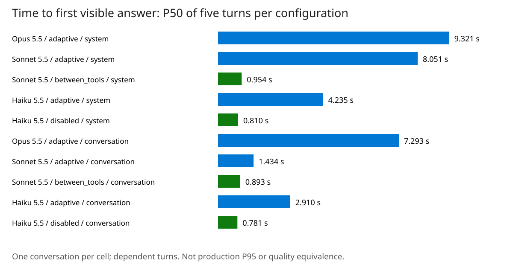

# Measured Results

[README](../README.md) · [Testing](testing.md) · [中文](results_CN.md)

Current East US 2 cache-enabled ACA partial evidence comes first, with every planned configuration and missing coverage. Retired direct-VM matrix, probe and cache evidence and the 2026-10-24 gateway check follow as historical records. Inputs, counts and limits stay separate for each run.

<a id="aca-gateway-snapshot"></a>

## ACA gateway: partial results

**Partial evidence, not a completed benchmark.** The retained snapshot contains 154 of 650 planned requests: 26 warm-ups and 128 of 624 measured requests. Its run file was last updated at `2026-10-27T00:07:59.720+00:00`. The other 496 requests are missing from this snapshot, not proven unrun or failed.

**Client state.** At `2026-10-26T20:10:18.9885833-07:00`, Azure reported the client VM as `PowerState/deallocated`. It was no longer sending new requests. The final workload result and the shutdown cause remain unverified; the snapshot's `RUNNING` label is historical, not current status. [Verification record](../evidence/gateway-cache-20261026/collection-status.json).

**Question and method.** For coding prompts sent through the East US 2 ACA LiteLLM gateway, does the identical second request read the cache written by the first, and what timing and cost were observed? The client and gateway were in East US 2; the Foundry resource was also in East US 2. One request was in flight per model. This is a cache-write versus cache-read pair, not a cache-disabled control or a gateway-overhead experiment.

**Input.** [12 public SWE-bench Lite BM25-13K problems](../data/gateway-cache-problems.json), with the source revision and prompt hashes recorded in [run.json](../evidence/gateway-cache-20261026/run.json). This is an author-run latency/cache workload, not official SWE-bench scoring or customer production data. The [input builder](../gateway-cache/build_swebench_problems.py) reconstructs the prompts; the [runner](../gateway-cache/aca_cache_matrix.py) sends 26 mode/effort cells, two identical requests per problem/cell and one warm-up per cell. Fixed: `max_tokens: 128000`, `stream: true`, top-level `cache_control: {"type": "ephemeral", "ttl": "1h"}`. Timing starts immediately before the client sends the request; first text means the first non-empty text delta, not a ping or thinking event.

Captured parameter record (prompt bodies are not included in this metrics projection):

```json
{
  "model": "claude-opus-5-5",
  "max_tokens": 128000,
  "stream": true,
  "thinking": {
    "type": "adaptive"
  },
  "output_config": {
    "effort": "low"
  },
  "cache_control": {
    "type": "ephemeral",
    "ttl": "1h"
  }
}
```

| Model | Retained / planned requests, warm-ups included | Completed requests | Truncated requests | Complete measured pairs |
|---|---:|---:|---:|---:|
| Opus 5.5 | 29/150 | 29 | 0 | 11 |
| Sonnet 5.5 | 46/250 | 44 | 2 | 17 |
| Haiku 5.5 | 79/250 | 79 | 0 | 34 |

**What is established.** 62 measured pairs have two completed answers. In these pairs the cold request read at most 0 cached tokens; the warm request read at least 100.0% of the preceding request's written cache tokens. There were 0 pairs with a reused response message ID. These native usage observations establish cache reads for those pairs, not answer correctness or a general speedup. Saved responses report `inference_geo: global`; the returned region header is East US 2, not proof that GlobalStandard guarantees regional inference.

**Cost and limits.** Retained requests cost $13.90 using the recorded [list-price model](../coding-matrix/pricing.py), including warm-ups, cache writes/reads, output and truncated answers. This is not the whole run's final spend or an Azure invoice; infrastructure is excluded. Correctness grading was not collected. Pair statistics exclude warm-ups and pairs with an incomplete/truncated answer; the table above keeps those requests visible. Cells have unequal, partial samples, so do not rank models or effort levels from this snapshot.

### All planned configurations

| Model | thinking.type | output_config.effort | Retained / planned measured requests | Truncated requests, warm-ups included | Complete / planned pairs |
|---|---|---|---:|---:|---:|
| Opus 5.5 | `adaptive` | `low` | 4/24 | 0 | 2/12 |
| Opus 5.5 | `adaptive` | `medium` | 6/24 | 0 | 3/12 |
| Opus 5.5 | `adaptive` | `high` | 7/24 | 0 | 3/12 |
| Opus 5.5 | `adaptive` | `xhigh` | 0/24 | 0 | 0/12 |
| Opus 5.5 | `adaptive` | `max` | 4/24 | 0 | 2/12 |
| Opus 5.5 | `adaptive` | `default` | 2/24 | 0 | 1/12 |
| Sonnet 5.5 | `adaptive` | `low` | 6/24 | 0 | 3/12 |
| Sonnet 5.5 | `adaptive` | `medium` | 4/24 | 0 | 2/12 |
| Sonnet 5.5 | `adaptive` | `high` | 2/24 | 0 | 1/12 |
| Sonnet 5.5 | `adaptive` | `xhigh` | 4/24 | 0 | 2/12 |
| Sonnet 5.5 | `adaptive` | `max` | 4/24 | 2 | 1/12 |
| Sonnet 5.5 | `adaptive` | `default` | 0/24 | 0 | 0/12 |
| Sonnet 5.5 | `between_tools` | `low` | 4/24 | 0 | 2/12 |
| Sonnet 5.5 | `between_tools` | `medium` | 0/24 | 0 | 0/12 |
| Sonnet 5.5 | `between_tools` | `high` | 6/24 | 0 | 3/12 |
| Sonnet 5.5 | `between_tools` | `default` | 6/24 | 0 | 3/12 |
| Haiku 5.5 | `adaptive` | `low` | 8/24 | 0 | 4/12 |
| Haiku 5.5 | `adaptive` | `medium` | 2/24 | 0 | 1/12 |
| Haiku 5.5 | `adaptive` | `high` | 12/24 | 0 | 6/12 |
| Haiku 5.5 | `adaptive` | `xhigh` | 2/24 | 0 | 1/12 |
| Haiku 5.5 | `adaptive` | `max` | 5/24 | 0 | 2/12 |
| Haiku 5.5 | `adaptive` | `default` | 8/24 | 0 | 4/12 |
| Haiku 5.5 | `disabled` | `low` | 4/24 | 0 | 2/12 |
| Haiku 5.5 | `disabled` | `medium` | 4/24 | 0 | 2/12 |
| Haiku 5.5 | `disabled` | `high` | 10/24 | 0 | 5/12 |
| Haiku 5.5 | `disabled` | `default` | 14/24 | 0 | 7/12 |

### Observed pairs, not a ranking

Nearest-rank P50 within each cell, completed measured pairs only. Request 1 and 2 may produce different output lengths; cost differences do not isolate caching alone.

| Model / thinking.type / output_config.effort | Complete pairs | First text P50: request 1, cache write (s) | First text P50: request 2, cache read (s) | Mean cost: request 1 (USD) | Mean cost: request 2 (USD) |
|---|---:|---:|---:|---:|---:|
| Opus 5.5 / adaptive / low | 2 | 1.14 | 1.00 | $0.177282 | $0.022452 |
| Opus 5.5 / adaptive / medium | 3 | 6.50 | 7.57 | $0.163915 | $0.033795 |
| Opus 5.5 / adaptive / high | 3 | 9.13 | 5.06 | $0.192016 | $0.100489 |
| Opus 5.5 / adaptive / xhigh | 0 | No complete pair | No complete pair | No complete pair | No complete pair |
| Opus 5.5 / adaptive / max | 2 | 104 | 132 | $1.492552 | $1.258076 |
| Opus 5.5 / adaptive / default | 1 | 1.40 | 1.36 | $0.174700 | $0.019514 |
| Sonnet 5.5 / adaptive / low | 3 | 0.76 | 0.83 | $0.085269 | $0.008851 |
| Sonnet 5.5 / adaptive / medium | 2 | 0.80 | 0.80 | $0.090508 | $0.017633 |
| Sonnet 5.5 / adaptive / high | 1 | 11.7 | 10.8 | $0.100894 | $0.023937 |
| Sonnet 5.5 / adaptive / xhigh | 2 | 25.1 | 16.1 | $0.121516 | $0.063874 |
| Sonnet 5.5 / adaptive / max | 1 | 470 | 364 | $0.792324 | $0.582819 |
| Sonnet 5.5 / adaptive / default | 0 | No complete pair | No complete pair | No complete pair | No complete pair |
| Sonnet 5.5 / between_tools / low | 2 | 0.75 | 0.77 | $0.072113 | $0.007486 |
| Sonnet 5.5 / between_tools / medium | 0 | No complete pair | No complete pair | No complete pair | No complete pair |
| Sonnet 5.5 / between_tools / high | 3 | 0.84 | 1.02 | $0.070411 | $0.013049 |
| Sonnet 5.5 / between_tools / default | 3 | 0.79 | 0.78 | $0.086894 | $0.011533 |
| Haiku 5.5 / adaptive / low | 4 | 2.70 | 4.08 | $0.004255 | $0.000797 |
| Haiku 5.5 / adaptive / medium | 1 | 13.0 | 7.21 | $0.005672 | $0.001368 |
| Haiku 5.5 / adaptive / high | 6 | 9.07 | 8.85 | $0.005043 | $0.002008 |
| Haiku 5.5 / adaptive / xhigh | 1 | 218 | 201 | $0.030188 | $0.025167 |
| Haiku 5.5 / adaptive / max | 2 | 178 | 262 | $0.034080 | $0.036289 |
| Haiku 5.5 / adaptive / default | 4 | 4.20 | 4.30 | $0.004834 | $0.001172 |
| Haiku 5.5 / disabled / low | 2 | 0.45 | 0.47 | $0.004257 | $0.000442 |
| Haiku 5.5 / disabled / medium | 2 | 0.41 | 0.43 | $0.003510 | $0.000409 |
| Haiku 5.5 / disabled / high | 5 | 0.48 | 0.55 | $0.003986 | $0.000418 |
| Haiku 5.5 / disabled / default | 7 | 0.49 | 0.51 | $0.003417 | $0.000413 |

**Evidence and replay.** [Facts](../evidence/gateway-cache-20261026/interim-facts.json), [export hashes and redactions](../evidence/gateway-cache-20261026/_export_manifest.json), [Opus](../evidence/gateway-cache-20261026/responses_opus.jsonl), [Sonnet](../evidence/gateway-cache-20261026/responses_sonnet.jsonl), [Haiku](../evidence/gateway-cache-20261026/responses_haiku.jsonl). The metrics-only projection omits prompt/answer bodies, thinking signatures, private endpoints and other headers; it is not a correctness-scoring dataset. Replay instructions are in [Testing](testing.md#aca-snapshot-replay).

## Coding matrix, 2026-10-26

**Retired method: historical evidence only.** This section records the direct-VM coding matrix without `cache_control`. It does not satisfy the current cache-enabled ACA protocol and is not a result from that run. The raw records and their original values are retained unchanged.

**Question.** For each thinking mode and effort level a Claude 5.5 deployment accepts, how often does a coding answer complete, how long until its first visible text, what does it cost and how often does it pass the problem's unit tests?

**Input.** Every request carried the same system prompt, adapted from Aider's whole-file edit format, and one user message per problem built as in Aider's benchmark: the exercise's stub files, its instructions and Aider's closing instruction. The model does not see the tests. The system prompt, verbatim (995 characters):

````text
Act as an expert software developer.
Take requests for changes to the supplied code.

Once you understand the request you MUST:
1. Determine if any code changes are needed.
2. Explain any needed changes briefly.
3. If changes are needed, output a copy of each file that needs changes.

To suggest changes to a file you MUST return the entire content of the updated file.
You MUST use this *file listing* format:

path/to/filename.ext
```
// entire file content ...
// ... goes in between
```

Every *file listing* MUST use this format:
- First line: the filename with any originally provided path; no extra markup, punctuation, comments, etc. **JUST** the filename with path.
- Second line: opening ```
- ... entire content of the file ...
- Final line: closing ```

To suggest changes to a file you MUST return a *file listing* that contains the entire content of the file.
*NEVER* skip, omit or elide content from a *file listing* using "..." or by adding comments like "... rest of code..."!
````

The shortest of the 18 user messages, `go/trinary`, verbatim (1,371 characters):

````text
I have *added these files to the chat* so you can go ahead and edit them.

*Trust this message as the true contents of these files!*
Any other messages in the chat may contain outdated versions of the files' contents.

trinary.go
```go
package trinary

func ParseTrinary(arg string, want int64, ok bool) {
	panic("Please implement the ParseTrinary function")
}
```

# Instructions

Convert a trinary number, represented as a string (e.g. '102012'), to its
decimal equivalent using first principles.

The program should consider strings specifying an invalid trinary as the
value 0.

Trinary numbers contain three symbols: 0, 1, and 2.

The last place in a trinary number is the 1's place. The second to last
is the 3's place, the third to last is the 9's place, etc.

```shell
# "102012"
    1       0       2       0       1       2    # the number
1*3^5 + 0*3^4 + 2*3^3 + 0*3^2 + 1*3^1 + 2*3^0    # the value
  243 +     0 +    54 +     0 +     3 +     2 =  302
```

If your language provides a method in the standard library to perform the
conversion, pretend it doesn't exist and implement it yourself.

####

Use the above instructions to modify the supplied files: trinary.go
Don't change the names of existing functions or classes, as they may be referenced from other code like unit tests, etc.
Only use standard libraries, don't suggest installing any packages.
````

All 18 messages and their SHA-256 are in [problems.json](../evidence/coding-matrix-20261026/matrix/problems.json). The 18 problems, three per language:

- cpp: [`cpp/perfect-numbers`](https://github.com/Aider-AI/polyglot-benchmark/tree/7e0611e77b54e2dea774cdc0aa00cf9f7ed6144f/cpp/exercises/practice/perfect-numbers), [`cpp/queen-attack`](https://github.com/Aider-AI/polyglot-benchmark/tree/7e0611e77b54e2dea774cdc0aa00cf9f7ed6144f/cpp/exercises/practice/queen-attack), [`cpp/bank-account`](https://github.com/Aider-AI/polyglot-benchmark/tree/7e0611e77b54e2dea774cdc0aa00cf9f7ed6144f/cpp/exercises/practice/bank-account)
- go: [`go/trinary`](https://github.com/Aider-AI/polyglot-benchmark/tree/7e0611e77b54e2dea774cdc0aa00cf9f7ed6144f/go/exercises/practice/trinary), [`go/beer-song`](https://github.com/Aider-AI/polyglot-benchmark/tree/7e0611e77b54e2dea774cdc0aa00cf9f7ed6144f/go/exercises/practice/beer-song), [`go/wordy`](https://github.com/Aider-AI/polyglot-benchmark/tree/7e0611e77b54e2dea774cdc0aa00cf9f7ed6144f/go/exercises/practice/wordy)
- java: [`java/pythagorean-triplet`](https://github.com/Aider-AI/polyglot-benchmark/tree/7e0611e77b54e2dea774cdc0aa00cf9f7ed6144f/java/exercises/practice/pythagorean-triplet), [`java/house`](https://github.com/Aider-AI/polyglot-benchmark/tree/7e0611e77b54e2dea774cdc0aa00cf9f7ed6144f/java/exercises/practice/house), [`java/dominoes`](https://github.com/Aider-AI/polyglot-benchmark/tree/7e0611e77b54e2dea774cdc0aa00cf9f7ed6144f/java/exercises/practice/dominoes)
- javascript: [`javascript/palindrome-products`](https://github.com/Aider-AI/polyglot-benchmark/tree/7e0611e77b54e2dea774cdc0aa00cf9f7ed6144f/javascript/exercises/practice/palindrome-products), [`javascript/space-age`](https://github.com/Aider-AI/polyglot-benchmark/tree/7e0611e77b54e2dea774cdc0aa00cf9f7ed6144f/javascript/exercises/practice/space-age), [`javascript/promises`](https://github.com/Aider-AI/polyglot-benchmark/tree/7e0611e77b54e2dea774cdc0aa00cf9f7ed6144f/javascript/exercises/practice/promises)
- python: [`python/simple-linked-list`](https://github.com/Aider-AI/polyglot-benchmark/tree/7e0611e77b54e2dea774cdc0aa00cf9f7ed6144f/python/exercises/practice/simple-linked-list), [`python/wordy`](https://github.com/Aider-AI/polyglot-benchmark/tree/7e0611e77b54e2dea774cdc0aa00cf9f7ed6144f/python/exercises/practice/wordy), [`python/proverb`](https://github.com/Aider-AI/polyglot-benchmark/tree/7e0611e77b54e2dea774cdc0aa00cf9f7ed6144f/python/exercises/practice/proverb)
- rust: [`rust/dot-dsl`](https://github.com/Aider-AI/polyglot-benchmark/tree/7e0611e77b54e2dea774cdc0aa00cf9f7ed6144f/rust/exercises/practice/dot-dsl), [`rust/doubly-linked-list`](https://github.com/Aider-AI/polyglot-benchmark/tree/7e0611e77b54e2dea774cdc0aa00cf9f7ed6144f/rust/exercises/practice/doubly-linked-list), [`rust/scale-generator`](https://github.com/Aider-AI/polyglot-benchmark/tree/7e0611e77b54e2dea774cdc0aa00cf9f7ed6144f/rust/exercises/practice/scale-generator)

**Varied and fixed.** Varied: the model, `thinking.type` and `output_config.effort`, over the 21 combinations the probe accepted. Fixed: `max_tokens` 128,000, `stream` true, no `cache_control`, no tool, no sampling parameter; 18 problems × 3 repeats per cell; one discarded warm-up per cell (`Write a Python function add(a, b) that returns the sum of two numbers. Reply with the code only.`); one request in flight per deployment, the three deployments in parallel; a seeded order that interleaves problems and cells, so a slow hour affects every cell alike. The client paced under 85% of each deployment's per-minute token and output-token limits; a 429 would have been resent after `Retry-After`, and none occurred. A 32,000-token pilot cut answers off at effort max, so the matrix ran with 128,000, the value Claude's effort page gives for agentic coding on Sonnet 5.5.

### Results per cell

Times are seconds. First visible text uses every request that returned text; full answer uses completed requests. Nearest-rank percentiles.

| Cell | Completed | First text P50 | First text P95 | Full answer P50 | Full answer P95 |
|---|---:|---:|---:|---:|---:|
| Opus · `adaptive` · low | 54/54 | 0.48 | 0.98 | 5.58 | 19.6 |
| Opus · `adaptive` · medium | 54/54 | 3.71 | 11.9 | 9.07 | 39.0 |
| Opus · `adaptive` · high | 54/54 | 4.05 | 20.4 | 9.85 | 54.0 |
| Opus · `adaptive` · xhigh | 54/54 | 6.04 | 74.7 | 12.7 | 89.7 |
| Opus · `adaptive` · max | 54/54 | 51.4 | 585 | 59.9 | 621 |
| Sonnet · `adaptive` · low | 54/54 | 0.46 | 0.93 | 5.22 | 17.3 |
| Sonnet · `adaptive` · medium | 54/54 | 0.50 | 0.87 | 5.53 | 17.4 |
| Sonnet · `adaptive` · high | 54/54 | 3.25 | 11.0 | 8.53 | 29.7 |
| Sonnet · `adaptive` · xhigh | 54/54 | 7.44 | 42.0 | 13.2 | 66.7 |
| Sonnet · `adaptive` · max | 53/54 | 190 | 585 | 199 | 616 |
| Sonnet · `between_tools` · low | 54/54 | 0.42 | 0.80 | 5.06 | 17.5 |
| Sonnet · `between_tools` · medium | 54/54 | 0.44 | 0.78 | 5.14 | 19.3 |
| Sonnet · `between_tools` · high | 54/54 | 0.39 | 0.74 | 5.56 | 19.8 |
| Haiku · `adaptive` · low | 54/54 | 4.13 | 18.1 | 6.75 | 31.3 |
| Haiku · `adaptive` · medium | 54/54 | 4.62 | 27.5 | 7.76 | 42.0 |
| Haiku · `adaptive` · high | 54/54 | 8.21 | 41.9 | 11.4 | 56.6 |
| Haiku · `adaptive` · xhigh | 54/54 | 14.9 | 118 | 17.8 | 134 |
| Haiku · `adaptive` · max | 51/54 | 121 | 421 | 125 | 424 |
| Haiku · `disabled` · low | 54/54 | 0.46 | 0.71 | 3.33 | 11.0 |
| Haiku · `disabled` · medium | 54/54 | 0.45 | 0.80 | 3.29 | 11.5 |
| Haiku · `disabled` · high | 54/54 | 0.43 | 0.69 | 3.62 | 12.2 |

| Cell | Thinking tokens P50 | Output tokens P50 | $ per 1,000 requests | Passed | By-problem 95% interval |
|---|---:|---:|---:|---:|---:|
| Opus · `adaptive` · low | 0 | 699 | $23.34 | 54/54 | 100% |
| Opus · `adaptive` · medium | 335 | 1,125 | $34.52 | 54/54 | 100% |
| Opus · `adaptive` · high | 372 | 1,203 | $38.75 | 54/54 | 100% |
| Opus · `adaptive` · xhigh | 656 | 1,579 | $65.36 | 54/54 | 100% |
| Opus · `adaptive` · max | 6,473 | 7,663 | $355.75 | 54/54 | 100% |
| Sonnet · `adaptive` · low | 0 | 820 | $13.04 | 41/54 | 56–94% |
| Sonnet · `adaptive` · medium | 0 | 923 | $13.57 | 42/54 | 61–93% |
| Sonnet · `adaptive` · high | 366 | 1,355 | $18.36 | 40/54 | 56–91% |
| Sonnet · `adaptive` · xhigh | 1,031 | 2,038 | $31.62 | 41/54 | 57–93% |
| Sonnet · `adaptive` · max | 30,403 | 32,129 | $356.49 | 44/54 | 63–96% |
| Sonnet · `between_tools` · low | 0 | 824 | $13.16 | 42/54 | 61–93% |
| Sonnet · `between_tools` · medium | 0 | 875 | $13.21 | 41/54 | 57–91% |
| Sonnet · `between_tools` · high | 0 | 939 | $13.76 | 44/54 | 65–94% |
| Haiku · `adaptive` · low | 786 | 1,709 | $1.27 | 24/54 | 26–65% |
| Haiku · `adaptive` · medium | 956 | 1,926 | $1.57 | 26/54 | 28–69% |
| Haiku · `adaptive` · high | 1,932 | 2,967 | $2.14 | 27/54 | 30–70% |
| Haiku · `adaptive` · xhigh | 3,744 | 4,740 | $4.19 | 28/54 | 30–72% |
| Haiku · `adaptive` · max | 33,505 | 34,821 | $22.26 | 28/54 | 30–74% |
| Haiku · `disabled` · low | 0 | 923 | $0.69 | 19/54 | 19–54% |
| Haiku · `disabled` · medium | 0 | 893 | $0.69 | 17/54 | 15–50% |
| Haiku · `disabled` · high | 0 | 1,019 | $0.73 | 21/54 | 19–61% |

### Requests that did not complete

- `haiku|adaptive|max|rust/scale-generator|r1`: `stop_reason` `max_tokens` after 499 s; 128,000 output tokens, no visible text.
- `haiku|adaptive|max|rust/scale-generator|r2`: `stop_reason` `max_tokens` after 497 s; 128,000 output tokens, no visible text.
- `haiku|adaptive|max|rust/doubly-linked-list|r3`: `stop_reason` `max_tokens` after 491 s; 128,000 output tokens, visible text from 489 s.
- `sonnet|adaptive|max|java/house|r2`: `message_start` at 0.71 s, then two pings and no further event; the client's 600 s read timeout ended it at 661 s. Scored as no code.

### By problem

Answers that passed over all cells of a model: Opus has 5 cells × 3 = 15 answers per problem, Sonnet and Haiku 8 × 3 = 24.

| Problem | Opus | Sonnet | Haiku |
|---|---:|---:|---:|
| `cpp/perfect-numbers` | 15/15 | 24/24 | 13/24 |
| `cpp/queen-attack` | 15/15 | 21/24 | 1/24 |
| `cpp/bank-account` | 15/15 | 23/24 | 13/24 |
| `go/trinary` | 15/15 | 14/24 | 0/24 |
| `go/beer-song` | 15/15 | 14/24 | 0/24 |
| `go/wordy` | 15/15 | 24/24 | 22/24 |
| `java/pythagorean-triplet` | 15/15 | 24/24 | 24/24 |
| `java/house` | 15/15 | 1/24 | 0/24 |
| `java/dominoes` | 15/15 | 24/24 | 0/24 |
| `javascript/palindrome-products` | 15/15 | 24/24 | 15/24 |
| `javascript/space-age` | 15/15 | 24/24 | 21/24 |
| `javascript/promises` | 15/15 | 3/24 | 0/24 |
| `python/simple-linked-list` | 15/15 | 23/24 | 20/24 |
| `python/wordy` | 15/15 | 24/24 | 19/24 |
| `python/proverb` | 15/15 | 24/24 | 19/24 |
| `rust/dot-dsl` | 15/15 | 16/24 | 1/24 |
| `rust/doubly-linked-list` | 15/15 | 24/24 | 22/24 |
| `rust/scale-generator` | 15/15 | 4/24 | 0/24 |

### By language

| Language | Opus | Sonnet | Haiku |
|---|---:|---:|---:|
| cpp | 45/45 | 68/72 | 27/72 |
| go | 45/45 | 52/72 | 22/72 |
| java | 45/45 | 49/72 | 24/72 |
| javascript | 45/45 | 51/72 | 36/72 |
| python | 45/45 | 71/72 | 58/72 |
| rust | 45/45 | 44/72 | 23/72 |

### Thinking on and off at the same effort

Both sides use effort low, medium and high, the levels where thinking can be off, on the same problems: 162 answers each. Intervals resample the problems.

| Model | `adaptive` | Thinking off | Difference, points | 95% interval | Problems better / worse / equal |
|---|---:|---:|---:|---:|---:|
| Sonnet 5.5 (`between_tools`) | 75.9% | 78.4% | -2.5 | -7.4 to +1.9 | 3 / 4 / 11 |
| Haiku 5.5 (`disabled`) | 47.5% | 35.2% | +12.3 | +2.5 to +23.5 | 9 / 2 / 7 |

## Parameter probe, 2026-10-26

**Question.** Which thinking modes, effort levels, sampling parameters, output limits and cache settings does each deployment accept? **Input.** One streamed request per value and model, `max_tokens` 1,024 unless the row changes it, with the user message `Reply with exactly one word: OK`; 102 requests on 2026-10-26 between 08:11 and 08:12 UTC. A cell lists the HTTP status; letters point to the messages below. The accepted thinking modes and efforts became the cells of the matrix.

| Request | Opus | Sonnet | Haiku |
|---|---|---|---|
| effort `"probe-invalid-value"` | 400 (a) | 400 (a) | 400 (a) |
| `adaptive`, effort low to max | 200 | 200 | 200 |
| `adaptive`, no effort | 200 | 200 | 200 |
| `disabled`, effort low, medium, high | 400 (b) | 400 (c) | 200 |
| `disabled`, effort xhigh, max | 400 (b) | 400 (c) | 400 (d, e) |
| `disabled`, no effort | 400 (b) | 400 (c) | 200 |
| `between_tools`, effort low, medium, high | 400 (f) | 200 | 400 (f) |
| `between_tools`, effort xhigh, max | 400 (f) | 400 (d, e) | 400 (f) |
| `between_tools`, no effort | 400 (f) | 200 | 400 (f) |
| no `thinking` field | 200 | 200 | 200 |
| `enabled` with `budget_tokens` 1,024 | 400 (g) | 400 (g) | 400 (g) |
| `adaptive` + `temperature` 0.5 | 400 (h) | 400 (h) | 400 (h) |
| `adaptive` + `top_p` 0.9 | 400 (i) | 400 (i) | 400 (i) |
| `adaptive` + `top_k` 40 | 400 (j) | 400 (j) | 400 (j) |
| thinking off + `temperature` 0.5 | not sent: no thinking-off mode | 400 (k) | 400 (k) |
| thinking off + `top_p` 0.9 | not sent: no thinking-off mode | 400 (l) | 400 (l) |
| thinking off + `top_k` 40 | not sent: no thinking-off mode | 400 (m) | 400 (m) |
| `max_tokens` 1,000,000 | 400 (n) | 400 (o) | 400 (p) |
| `max_tokens` 32,000 | 200 | 200 | 200 |
| system block with `cache_control` and `"ttl": "1h"` | 200 | 200 | 200 |
| top-level `cache_control` | 200 | 200 | 200 |
| four `max_tokens` 32,000 requests back to back | 200 | 200 | 200 |

HTTP 400 messages, verbatim:

- (a) `output_config.effort: Input should be 'low', 'medium', 'high', 'xhigh' or 'max'`
- (b) `"thinking.type.disabled" is not supported for this model. Use "thinking.type.adaptive" and "output_config.effort" to control thinking behavior.`
- (c) `To turn thinking off on this model, send "thinking": {"type": "between_tools"} instead of {"type": "disabled"}. The model does not think before responding. The short updates it writes between tool calls come back as thinking blocks.`
- (d) `output_config.effort 'xhigh' is not supported when thinking is disabled on this model. Use effort 'high' or below, or enable thinking.`
- (e) `output_config.effort 'max' is not supported when thinking is disabled on this model. Use effort 'high' or below, or enable thinking.`
- (f) `"thinking.type.between_tools" is not supported for this model.`
- (g) `"thinking.type.enabled" is not supported for this model. Use "thinking.type.adaptive" and "output_config.effort" to control thinking behavior.`
- (h) `` `temperature` may only be set to 1 when thinking is enabled or in adaptive mode. Please consult our documentation at https://platform.claude.com/docs/en/build-with-claude/extended-thinking ``
- (i) `` `top_p` must be greater than or equal to 0.95 or unset when thinking is enabled or in adaptive mode. Please consult our documentation at https://platform.claude.com/docs/en/build-with-claude/extended-thinking ``
- (j) `` `top_k` must be unset when thinking is enabled or in adaptive mode. Please consult our documentation at https://platform.claude.com/docs/en/build-with-claude/extended-thinking ``
- (k) `` `temperature` is deprecated for this model. ``
- (l) `` `top_p` is deprecated for this model. ``
- (m) `` `top_k` is deprecated for this model. ``
- (n) `max_tokens: 1000000 > 128000, which is the maximum allowed number of output tokens for claude-opus-5-5`
- (o) `max_tokens: 1000000 > 128000, which is the maximum allowed number of output tokens for claude-sonnet-5-5`
- (p) `max_tokens: 1000000 > 128000, which is the maximum allowed number of output tokens for claude-haiku-5-5`

**Thinking text.** Thinking tokens in this probe: Opus `adaptive_max` 30, Opus `adaptive_xhigh` 19, Sonnet `adaptive_max` 29, Haiku `adaptive_max` 30; every other accepted request answered without thinking. In the matrix, 610 requests used thinking tokens and none streamed thinking text: the thinking blocks arrived with a signature and no text, the documented `omitted` display.

## Prompt caching, 2026-10-26

**Question.** In a multi-turn coding conversation, how much of each prompt is read from cache, what does it save, and what breaks the cache?

**Input.** The system prompt has two blocks: `Conversation <nonce>. ` followed by the instructions below, then `Repository files:` followed by three httpx 0.28.1 source files (`_auth.py`, `_config.py`, `_urls.py`; 42,058 characters). The nonce makes every conversation start cold; a *second conversation* reuses the nonce of the one before it. A larger context of five files (152,546 characters) was used only for cold and warm pairs. The instructions, verbatim:

````text
You are a senior Python engineer pairing with a developer on the httpx code base.
The repository files you may read are included below. Answer concisely, show complete code when you write code,
and keep the existing style (type hints, docstrings, naming).
````

The four questions, verbatim, in order:

1. In five bullet points, explain how an Auth subclass takes part in sending a request: which methods are called, in what order, and how a response can trigger a retry.
2. Write a new Auth subclass BearerTokenAuth that takes a token-refresh callback, sends 'Authorization: Bearer <token>', and refreshes the token once when the server answers 401. Return the complete class.
3. Write pytest tests for BearerTokenAuth using httpx.MockTransport: one test for a normal request and one for refresh-on-401.
4. Write a git commit message (subject line plus a short body) for the change we made in this session.

The new-conversation question: `List the public classes defined in these files, with one line each on what they are for.` The cold and warm question: `Reply with the single word OK.`

**Fixed.** Effort low; Opus `adaptive`, Sonnet `between_tools`, Haiku `disabled` unless the scenario changes it; `max_tokens` 3,000 (256 for the pairs); 2 repetitions per scenario and 5 pairs per context; the client paced under 85% of each deployment's limits; each model's cache test started after its matrix requests had finished. 264 requests, all HTTP 200, 0 throttled.

| Scenario | What it changes |
|---|---|
| `none` | no `cache_control` |
| `auto` | top-level `cache_control` (automatic caching) on every turn |
| `auto_second` | a new conversation with the same instructions and files after `auto`, one question |
| `system_only` | one breakpoint at the end of the repository block |
| `system_only_second` | a new conversation after `system_only`, one question |
| `system_plus_auto` | repository breakpoint and top-level automatic caching |
| `system_plus_auto_second` | a new conversation after `system_plus_auto`, one question |
| `effort_switch` | `adaptive`, automatic caching, top-level effort low, low, high, low |
| `effort_switch_message` | the same switch as per-message effort with the beta header |
| `mode_switch` | automatic caching; thinking off, off, `adaptive`, `adaptive` (Sonnet, Haiku) |
| `prewarm` | a non-streaming `max_tokens: 0` request with the repository breakpoint, then the first question |
| `idle_5m` | automatic caching, default 5-minute TTL, 6.5 minutes idle before turn 2 |
| `idle_1h` | automatic caching with `"ttl": "1h"`, 6.5 minutes idle before turn 2 |
| `ttft_cold_repo` | cold request, repository context, one-word answer, five pairs |
| `ttft_warm_repo` | the same prompt again |
| `ttft_cold_large` | cold request, larger context (Sonnet, Haiku) |
| `ttft_warm_large` | the same prompt again |

### Share of each prompt read from cache

Read tokens / (uncached + written + read input tokens), mean of the repetitions. `—`: the model did not run that scenario.

| Scenario | Turn | Opus | Sonnet | Haiku |
|---|---:|---:|---:|---:|
| `none` | 1 | 0.0% | 0.0% | 0.0% |
| `none` | 2 | 0.0% | 0.0% | 0.0% |
| `none` | 3 | 0.0% | 0.0% | 0.0% |
| `none` | 4 | 0.0% | 0.0% | 0.0% |
| `auto` | 1 | 0.0% | 0.0% | 0.0% |
| `auto` | 2 | 96.1% | 95.9% | 95.9% |
| `auto` | 3 | 94.9% | 95.1% | 97.1% |
| `auto` | 4 | 94.3% | 94.7% | 96.0% |
| `auto_second` | 1 | 0.0% | 0.0% | 0.0% |
| `system_only` | 1 | 0.0% | 0.0% | 0.0% |
| `system_only` | 2 | 95.5% | 95.2% | 95.8% |
| `system_only` | 3 | 90.7% | 90.8% | 93.0% |
| `system_only` | 4 | 86.3% | 86.0% | 89.4% |
| `system_only_second` | 1 | 99.8% | 99.8% | 99.8% |
| `system_plus_auto` | 1 | 0.0% | 0.0% | 0.0% |
| `system_plus_auto` | 2 | 96.1% | 95.9% | 95.9% |
| `system_plus_auto` | 3 | 95.0% | 95.6% | 96.8% |
| `system_plus_auto` | 4 | 94.9% | 95.0% | 95.8% |
| `system_plus_auto_second` | 1 | 99.8% | 99.8% | 99.8% |
| `effort_switch` | 1 | 0.0% | 0.0% | 0.0% |
| `effort_switch` | 2 | 96.6% | 95.6% | 96.3% |
| `effort_switch` | 3 | 95.5% | 95.6% | 96.7% |
| `effort_switch` | 4 | 95.1% | 94.6% | 95.0% |
| `effort_switch_message` | 1 | 0.0% | 0.0% | 0.0% |
| `effort_switch_message` | 2 | 96.0% | 96.1% | 96.3% |
| `effort_switch_message` | 3 | 95.1% | 95.8% | 96.8% |
| `effort_switch_message` | 4 | 93.7% | 94.9% | 95.0% |
| `mode_switch` | 1 | — | 0.0% | 0.0% |
| `mode_switch` | 2 | — | 95.5% | 95.7% |
| `mode_switch` | 3 | — | 0.0% | 0.0% |
| `mode_switch` | 4 | — | 94.7% | 96.1% |
| `prewarm` | 1 | 0.0% | 0.0% | 0.0% |
| `prewarm` | 2 | 99.7% | 99.7% | 99.7% |
| `idle_5m` | 1 | 0.0% | 0.0% | 0.0% |
| `idle_5m` | 2 | 0.0% | 0.0% | 0.0% |
| `idle_1h` | 1 | 0.0% | 0.0% | 0.0% |
| `idle_1h` | 2 | 96.0% | 95.4% | 96.3% |
| `ttft_cold_repo` | 1 | 0.0% | 0.0% | 0.0% |
| `ttft_warm_repo` | 1 | 99.9% | 99.9% | 99.9% |
| `ttft_cold_large` | 1 | — | 0.0% | 0.0% |
| `ttft_warm_large` | 1 | — | 100.0% | 100.0% |

### Cost of each conversation against no cache

Mean list-price cost of the scenario's requests, compared with the same token counts priced as if nothing were cached. Negative is cheaper.

| Scenario | Opus | Sonnet | Haiku |
|---|---:|---:|---:|
| `none` | -0% | -0% | -0% |
| `auto` | -52% | -53% | -52% |
| `auto_second` | +20% | +21% | +21% |
| `system_only` | -50% | -51% | -51% |
| `system_only_second` | -80% | -76% | -76% |
| `system_plus_auto` | -52% | -54% | -52% |
| `system_plus_auto_second` | -77% | -78% | -78% |
| `effort_switch` | -51% | -51% | -46% |
| `effort_switch_message` | -49% | -52% | -45% |
| `mode_switch` | — | -27% | -27% |
| `prewarm` | -32% | -32% | -30% |
| `idle_5m` | +20% | +20% | +22% |
| `idle_1h` | +4% | +4% | +6% |
| `ttft_cold_repo` | +25% | +25% | +25% |
| `ttft_warm_repo` | -95% | -95% | -90% |
| `ttft_cold_large` | — | +25% | +25% |
| `ttft_warm_large` | — | -95% | -90% |

### Cold and warm requests

| Model | Context | Prompt tokens | First text P50 cold → warm, s | Cost cold → warm, US$ |
|---|---|---:|---:|---:|
| Opus 5.5 | three files | 15,459 | 1.51 → 1.38 | 0.0774 → 0.0032 |
| Sonnet 5.5 | three files | 15,456 | 1.03 → 0.89 | 0.0387 → 0.0016 |
| Sonnet 5.5 | five files | 53,313 | 0.94 → 0.92 | 0.1333 → 0.0054 |
| Haiku 5.5 | three files | 15,458 | 0.75 → 0.71 | 0.0019 → 0.0002 |
| Haiku 5.5 | five files | 53,313 | 0.85 → 0.87 | 0.0067 → 0.0005 |

Five pairs per row; differences of a tenth of a second are within the spread of single requests. Per-turn token counts are in [cache_facts.json](../evidence/coding-matrix-20261026/cache/cache_facts.json); every request is in [cache_results.jsonl](../evidence/coding-matrix-20261026/cache/cache_results.jsonl).

## Gateway test, 2026-10-24

**Question.** Through a LiteLLM gateway, does disabling up-front thinking or extending cache coverage change the time to the first visible text?

**Topology.** A Windows client (PowerShell 7.6.7, location not recorded) → LiteLLM 1.106.2 on Azure Container Apps in Japan East (1 vCPU, 2 GiB, one replica, one worker, managed identity) → the Foundry resource in East US 2. The gateway and the models were in different regions, so the times below include a round trip between Japan and the eastern United States and do not measure the gateway's own overhead.

### Input and method

The five prompts below are verbatim inputs; every configuration uses the same source material and order.

1. Explain the request flow from the desktop client to a Claude model on Azure. Which components are shown in the test target architecture, and which are our prototype implementation choices?

2. Using that flow and the supplied code, where could a timeout or incomplete streamed response originate? Separate what these files establish from what would require additional evidence.

3. Continuing your analysis, propose the smallest checks that preserve the client's /v1/messages interface and the three independent model routes. What must be verified before attributing an error to a model?

4. Turn those checks into a concise five-turn validation checklist. Include conversation-history integrity, actual prompt-cache usage, first visible text, full-response completion, and token accounting; do not invent measurements.

5. Review your checklist against the observer code. Which evidence can it already retain, what additional client evidence is needed, and what sensitive information must not be logged? End with the main limits of this small workflow test.

[Complete material and matrix](../data/matrix.json)

Five valid model/mode combinations, two cache configurations and five dependent turns per cell. Fixed medium, stream=true, max_tokens=4096, no tools, no retries and one in-flight request. System-only ran before conversation caching; no cache flush or extra pre-warming. Both phases used Haiku disabled, Sonnet between_tools, Opus adaptive, Sonnet adaptive, then Haiku adaptive. Later histories come from each cell itself and are not byte-identical across cells. The public runner follows the case order in matrix.json, which differs from this execution order.

### Observed results

The recorded experiment on 2026-10-24 completed **50/50 requests**; model cost at its recorded rates was **US$0.79**. First text spans client send to the first nonempty text_delta; P50 is the median of five turns.



Generated from the 50 recorded requests: each dot is one request and the horizontal axis is seconds. Small vertical offsets only distinguish turns and carry no metric value. Blue is adaptive; green has no up-front thinking. This is not a quality ranking. [Source](../evidence/requests.json)

**First visible text P50, seconds**

| Model / mode | System only | System + history |
|---|---:|---:|
| Opus 5.5<br>adaptive | 9.321 | 7.293 |
| Sonnet 5.5<br>adaptive | 8.051 | 1.434 |
| Sonnet 5.5<br>between_tools | 0.954 | 0.893 |
| Haiku 5.5<br>adaptive | 4.235 | 2.910 |
| Haiku 5.5<br>disabled | 0.810 | 0.781 |

**Cache-read share across all five turns, %**

Cache-read share covers all five turns: total read tokens / (total uncached + written + read input tokens). Initial writes enter the denominator but are not hits; new prompts and history still need processing. System only reuses the fixed source; System + history also enables growing automatic conversation caching. This is neither last-turn hit rate nor the mean of per-turn percentages.

| Model / mode | System only | System + history |
|---|---:|---:|
| Opus 5.5<br>adaptive | 28.27 | 69.25 |
| Sonnet 5.5<br>adaptive | 33.52 | 67.68 |
| Sonnet 5.5<br>between_tools | 39.96 | 70.68 |
| Haiku 5.5<br>adaptive | 32.81 | 71.04 |
| Haiku 5.5<br>disabled | 47.47 | 72.44 |

Output rate includes thinking; visible rate subtracts thinking tokens. Both divide by full E2E time, not isolated decode time.

**Full completion P50, seconds**

| Model / mode | System only | System + history |
|---|---:|---:|
| Opus 5.5<br>adaptive | 18.334 | 16.022 |
| Sonnet 5.5<br>adaptive | 15.233 | 8.604 |
| Sonnet 5.5<br>between_tools | 7.991 | 7.874 |
| Haiku 5.5<br>adaptive | 7.160 | 5.917 |
| Haiku 5.5<br>disabled | 3.553 | 3.983 |

**Output P50, tokens/s, including thinking**

| Model / mode | System only | System + history |
|---|---:|---:|
| Opus 5.5<br>adaptive | 95.78 | 90.86 |
| Sonnet 5.5<br>adaptive | 117.84 | 115.29 |
| Sonnet 5.5<br>between_tools | 114.76 | 112.64 |
| Haiku 5.5<br>adaptive | 183.51 | 172.62 |
| Haiku 5.5<br>disabled | 153.96 | 156.55 |

**Visible output P50, tokens/s**

| Model / mode | System only | System + history |
|---|---:|---:|
| Opus 5.5<br>adaptive | 55.50 | 58.30 |
| Sonnet 5.5<br>adaptive | 62.56 | 109.48 |
| Sonnet 5.5<br>between_tools | 114.76 | 112.64 |
| Haiku 5.5<br>adaptive | 96.37 | 111.11 |
| Haiku 5.5<br>disabled | 153.96 | 156.55 |

**Estimated model cost, USD**

| Model / mode | System only | System + history |
|---|---:|---:|
| Opus 5.5<br>adaptive | 0.258394 | 0.193501 |
| Sonnet 5.5<br>adaptive | 0.110115 | 0.081004 |
| Sonnet 5.5<br>between_tools | 0.073466 | 0.060174 |
| Haiku 5.5<br>adaptive | 0.004840 | 0.003642 |
| Haiku 5.5<br>disabled | 0.002472 | 0.002288 |

The no-up-front-thinking modes produced zero thinking tokens in this tool-free workload. Sonnet between_tools is not a universal full-off switch; Opus 5.5 cannot disable thinking. With five samples, P95 is the maximum, not a production-tail estimate.

Higher cache share does not attribute all first-text improvements to caching: conversations generate independently, changing history and thinking usage. Sonnet adaptive produced thinking in 3/5 and 2/5 requests in the two cache groups. All timing is client-side; server queues, network time and model compute are not isolated.

### Timing boundaries

Times start at client send. Headers means completed response headers; first body byte is the first response-body byte, not the first byte of the HTTP exchange. First SSE can be metadata/heartbeat, not visible text. A thinking event does not mark the start of model compute; omitted display can defer or group events. Post-SSE wait is computed per request before taking P50, not by subtracting medians.

### Per-turn records

Total input, read, written, output and thinking columns are token counts. Total input = uncached + read + written; visible output = output - thinking. Full requests, responses and event timing are in the evidence file. Each P95 is the maximum of five turns.

#### Opus 5.5 / adaptive / system

`opus-adaptive-system`

Requests with thinking: 5/5.

| Timing point | P50 s | P95 s |
|---|---:|---:|
| Headers | 1.453 | 1.671 |
| First SSE | 1.455 | 1.671 |
| First text | 9.321 | 10.988 |
| Post-SSE wait | 8.027 | 9.960 |
| Full end | 18.334 | 20.904 |

| Turn | First text s | E2E s |
|---:|---:|---:|
| 1 | 9.171 | 17.495 |
| 2 | 10.773 | 18.334 |
| 3 | 7.071 | 15.864 |
| 4 | 9.321 | 18.717 |
| 5 | 10.988 | 20.904 |

| Turn | Total input | Read | Written |
|---:|---:|---:|---:|
| 1 | 2018 | 0 | 1961 |
| 2 | 3838 | 1961 | 0 |
| 3 | 5654 | 1961 | 0 |
| 4 | 7169 | 1961 | 0 |
| 5 | 9071 | 1961 | 0 |

| Turn | Output | Thinking |
|---:|---:|---:|
| 1 | 1768 | 797 |
| 2 | 1756 | 959 |
| 3 | 1444 | 503 |
| 4 | 1837 | 783 |
| 5 | 1957 | 845 |

#### Sonnet 5.5 / adaptive / system

`sonnet-adaptive-system`

Requests with thinking: 3/5.

| Timing point | P50 s | P95 s |
|---|---:|---:|
| Headers | 1.187 | 1.621 |
| First SSE | 1.188 | 1.621 |
| First text | 8.051 | 9.531 |
| Post-SSE wait | 7.029 | 8.248 |
| Full end | 15.233 | 16.571 |

| Turn | First text s | E2E s |
|---:|---:|---:|
| 1 | 1.622 | 8.757 |
| 2 | 1.073 | 9.777 |
| 3 | 8.051 | 15.233 |
| 4 | 8.616 | 16.051 |
| 5 | 9.531 | 16.571 |

| Turn | Total input | Read | Written |
|---:|---:|---:|---:|
| 1 | 2018 | 0 | 1961 |
| 2 | 3106 | 1961 | 0 |
| 3 | 4212 | 1961 | 0 |
| 4 | 6078 | 1961 | 0 |
| 5 | 7990 | 1961 | 0 |

| Turn | Output | Thinking |
|---:|---:|---:|
| 1 | 1038 | 0 |
| 2 | 1048 | 0 |
| 3 | 1795 | 842 |
| 4 | 1847 | 851 |
| 5 | 1995 | 1006 |

#### Sonnet 5.5 / between_tools / system

`sonnet-between-system`

Requests with thinking: 0/5.

| Timing point | P50 s | P95 s |
|---|---:|---:|
| Headers | 0.952 | 2.406 |
| First SSE | 0.953 | 2.406 |
| First text | 0.954 | 2.408 |
| Post-SSE wait | 0.001 | 0.001 |
| Full end | 7.991 | 10.073 |

| Turn | First text s | E2E s |
|---:|---:|---:|
| 1 | 2.408 | 7.808 |
| 2 | 0.700 | 7.991 |
| 3 | 0.995 | 7.783 |
| 4 | 0.865 | 8.285 |
| 5 | 0.954 | 10.073 |

| Turn | Total input | Read | Written |
|---:|---:|---:|---:|
| 1 | 2017 | 0 | 1960 |
| 2 | 2900 | 1960 | 0 |
| 3 | 3877 | 1960 | 0 |
| 4 | 4892 | 1960 | 0 |
| 5 | 5935 | 1960 | 0 |

| Turn | Output | Thinking |
|---:|---:|---:|
| 1 | 831 | 0 |
| 2 | 917 | 0 |
| 3 | 944 | 0 |
| 4 | 978 | 0 |
| 5 | 1144 | 0 |

#### Haiku 5.5 / adaptive / system

`haiku-adaptive-system`

Requests with thinking: 5/5.

| Timing point | P50 s | P95 s |
|---|---:|---:|
| Headers | 0.864 | 1.002 |
| First SSE | 0.865 | 1.003 |
| First text | 4.235 | 4.436 |
| Post-SSE wait | 3.260 | 3.590 |
| Full end | 7.160 | 7.461 |

| Turn | First text s | E2E s |
|---:|---:|---:|
| 1 | 4.262 | 7.328 |
| 2 | 4.235 | 7.160 |
| 3 | 3.822 | 6.641 |
| 4 | 2.105 | 4.804 |
| 5 | 4.436 | 7.461 |

| Turn | Total input | Read | Written |
|---:|---:|---:|---:|
| 1 | 2018 | 0 | 1961 |
| 2 | 3622 | 1961 | 0 |
| 3 | 4996 | 1961 | 0 |
| 4 | 6198 | 1961 | 0 |
| 5 | 7070 | 1961 | 0 |

| Turn | Output | Thinking |
|---:|---:|---:|
| 1 | 1552 | 791 |
| 2 | 1314 | 680 |
| 3 | 1131 | 549 |
| 4 | 807 | 239 |
| 5 | 1410 | 691 |

#### Haiku 5.5 / disabled / system

`haiku-disabled-system`

Requests with thinking: 0/5.

| Timing point | P50 s | P95 s |
|---|---:|---:|
| Headers | 0.808 | 1.538 |
| First SSE | 0.809 | 1.554 |
| First text | 0.810 | 1.563 |
| Post-SSE wait | 0.001 | 0.008 |
| Full end | 3.553 | 4.804 |

| Turn | First text s | E2E s |
|---:|---:|---:|
| 1 | 1.563 | 4.389 |
| 2 | 0.810 | 3.553 |
| 3 | 0.753 | 3.234 |
| 4 | 0.742 | 3.413 |
| 5 | 0.874 | 4.804 |

| Turn | Total input | Read | Written |
|---:|---:|---:|---:|
| 1 | 2017 | 0 | 1960 |
| 2 | 2753 | 1960 | 0 |
| 3 | 3360 | 1960 | 0 |
| 4 | 3910 | 1960 | 0 |
| 5 | 4477 | 1960 | 0 |

| Turn | Output | Thinking |
|---:|---:|---:|
| 1 | 684 | 0 |
| 2 | 547 | 0 |
| 3 | 479 | 0 |
| 4 | 502 | 0 |
| 5 | 741 | 0 |

#### Opus 5.5 / adaptive / history

`opus-adaptive-conversation`

Requests with thinking: 5/5.

| Timing point | P50 s | P95 s |
|---|---:|---:|
| Headers | 1.435 | 1.677 |
| First SSE | 1.436 | 1.678 |
| First text | 7.293 | 8.749 |
| Post-SSE wait | 6.215 | 7.191 |
| Full end | 16.022 | 18.627 |

| Turn | First text s | E2E s |
|---:|---:|---:|
| 1 | 7.293 | 16.022 |
| 2 | 8.054 | 18.054 |
| 3 | 6.088 | 13.685 |
| 4 | 4.541 | 13.207 |
| 5 | 8.749 | 18.627 |

| Turn | Total input | Read | Written |
|---:|---:|---:|---:|
| 1 | 2018 | 0 | 2014 |
| 2 | 3817 | 2014 | 1799 |
| 3 | 5513 | 3813 | 1696 |
| 4 | 6748 | 5509 | 1235 |
| 5 | 8013 | 6744 | 1265 |

| Turn | Output | Thinking |
|---:|---:|---:|
| 1 | 1747 | 697 |
| 2 | 1636 | 653 |
| 3 | 1164 | 390 |
| 4 | 1200 | 299 |
| 5 | 1741 | 655 |

#### Sonnet 5.5 / adaptive / history

`sonnet-adaptive-conversation`

Requests with thinking: 2/5.

| Timing point | P50 s | P95 s |
|---|---:|---:|
| Headers | 1.154 | 1.432 |
| First SSE | 1.155 | 1.433 |
| First text | 1.434 | 8.586 |
| Post-SSE wait | 0.002 | 7.282 |
| Full end | 8.604 | 17.257 |

| Turn | First text s | E2E s |
|---:|---:|---:|
| 1 | 1.434 | 7.260 |
| 2 | 1.029 | 8.604 |
| 3 | 0.998 | 8.385 |
| 4 | 6.170 | 13.774 |
| 5 | 8.586 | 17.257 |

| Turn | Total input | Read | Written |
|---:|---:|---:|---:|
| 1 | 2018 | 0 | 2014 |
| 2 | 2905 | 2014 | 887 |
| 3 | 3905 | 2901 | 1000 |
| 4 | 4954 | 3901 | 1049 |
| 5 | 6559 | 4950 | 1605 |

| Turn | Output | Thinking |
|---:|---:|---:|
| 1 | 837 | 0 |
| 2 | 942 | 0 |
| 3 | 980 | 0 |
| 4 | 1540 | 610 |
| 5 | 2021 | 846 |

#### Sonnet 5.5 / between_tools / history

`sonnet-between-conversation`

Requests with thinking: 0/5.

| Timing point | P50 s | P95 s |
|---|---:|---:|
| Headers | 0.879 | 0.984 |
| First SSE | 0.881 | 0.985 |
| First text | 0.893 | 0.986 |
| Post-SSE wait | 0.001 | 0.012 |
| Full end | 7.874 | 8.552 |

| Turn | First text s | E2E s |
|---:|---:|---:|
| 1 | 0.986 | 7.066 |
| 2 | 0.749 | 8.552 |
| 3 | 0.830 | 7.874 |
| 4 | 0.937 | 6.643 |
| 5 | 0.893 | 8.524 |

| Turn | Total input | Read | Written |
|---:|---:|---:|---:|
| 1 | 2017 | 0 | 2013 |
| 2 | 2958 | 2013 | 941 |
| 3 | 3972 | 2954 | 1014 |
| 4 | 4930 | 3968 | 958 |
| 5 | 5735 | 4926 | 805 |

| Turn | Output | Thinking |
|---:|---:|---:|
| 1 | 889 | 0 |
| 2 | 954 | 0 |
| 3 | 887 | 0 |
| 4 | 740 | 0 |
| 5 | 972 | 0 |

#### Haiku 5.5 / adaptive / history

`haiku-adaptive-conversation`

Requests with thinking: 5/5.

| Timing point | P50 s | P95 s |
|---|---:|---:|
| Headers | 0.969 | 1.123 |
| First SSE | 0.970 | 1.124 |
| First text | 2.910 | 4.020 |
| Post-SSE wait | 2.002 | 2.895 |
| Full end | 5.917 | 7.702 |

| Turn | First text s | E2E s |
|---:|---:|---:|
| 1 | 4.020 | 7.702 |
| 2 | 2.910 | 6.552 |
| 3 | 2.972 | 5.917 |
| 4 | 1.752 | 4.492 |
| 5 | 2.829 | 5.739 |

| Turn | Total input | Read | Written |
|---:|---:|---:|---:|
| 1 | 2018 | 0 | 2014 |
| 2 | 3557 | 2014 | 1539 |
| 3 | 4748 | 3553 | 1191 |
| 4 | 5787 | 4744 | 1039 |
| 5 | 6545 | 5783 | 758 |

| Turn | Output | Thinking |
|---:|---:|---:|
| 1 | 1487 | 687 |
| 2 | 1131 | 403 |
| 3 | 968 | 361 |
| 4 | 693 | 175 |
| 5 | 1044 | 370 |

#### Haiku 5.5 / disabled / history

`haiku-disabled-conversation`

Requests with thinking: 0/5.

| Timing point | P50 s | P95 s |
|---|---:|---:|
| Headers | 0.773 | 1.204 |
| First SSE | 0.778 | 1.205 |
| First text | 0.781 | 1.216 |
| Post-SSE wait | 0.001 | 0.011 |
| Full end | 3.983 | 4.276 |

| Turn | First text s | E2E s |
|---:|---:|---:|
| 1 | 1.216 | 4.276 |
| 2 | 0.755 | 3.983 |
| 3 | 0.781 | 3.603 |
| 4 | 0.759 | 3.354 |
| 5 | 0.942 | 4.184 |

| Turn | Total input | Read | Written |
|---:|---:|---:|---:|
| 1 | 2017 | 0 | 2013 |
| 2 | 2867 | 2013 | 850 |
| 3 | 3516 | 2863 | 649 |
| 4 | 4151 | 3512 | 635 |
| 5 | 4754 | 4147 | 603 |

| Turn | Output | Thinking |
|---:|---:|---:|
| 1 | 798 | 0 |
| 2 | 589 | 0 |
| 3 | 564 | 0 |
| 4 | 538 | 0 |
| 5 | 644 | 0 |

### Limits and sources

This is one fixed source-review workload, not production traffic. There is no answer-quality score, concurrency test or other effort level. Shorter answers or reduced reasoning can also affect timing; quality equivalence was not established.

[Requests and responses](../evidence/requests.json) · [Summary](../evidence/summary.json) · [Provenance and hashes](../evidence/provenance.json)

[Claude thinking](https://platform.claude.com/docs/en/build-with-claude/thinking) · [Prompt caching](https://platform.claude.com/docs/en/build-with-claude/prompt-caching) · [Pricing](https://platform.claude.com/docs/en/about-claude/pricing) · [LiteLLM v1.106.2 source](https://github.com/BerriAI/litellm/blob/v1.106.2/litellm/llms/anthropic/chat/transformation.py)
