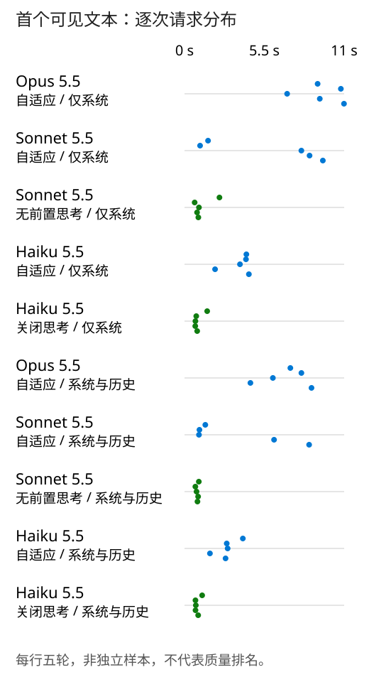

# 实测结果

[README](../README_CN.md) · [Testing](testing_CN.md) · [Other language](results.md)

## 输入与方法

本轮比较关闭回答前的 thinking，以及扩大缓存覆盖范围，是否改变首个可见回答的等待。下面是实际发送的五个问题原文；所有配置使用同一材料和顺序。

1. Explain the request flow from the desktop client to a Claude model on Azure. Which components are shown in the test target architecture, and which are our prototype implementation choices?

2. Using that flow and the supplied code, where could a timeout or incomplete streamed response originate? Separate what these files establish from what would require additional evidence.

3. Continuing your analysis, propose the smallest checks that preserve the client's /v1/messages interface and the three independent model routes. What must be verified before attributing an error to a model?

4. Turn those checks into a concise five-turn validation checklist. Include conversation-history integrity, actual prompt-cache usage, first visible text, full-response completion, and token accounting; do not invent measurements.

5. Review your checklist against the observer code. Which evidence can it already retain, what additional client evidence is needed, and what sensitive information must not be logged? End with the main limits of this small workflow test.

[完整材料与矩阵](../data/matrix.json)

五种合法模型/模式组合，各做两种缓存配置，每组独立五轮。固定 medium、stream=true、max_tokens=4096、无工具、零重试、单请求串行。首先执行 system-only 阶段，再执行会话缓存阶段；未清缓存，也没有额外预热。两阶段的模型执行顺序均为 Haiku disabled、Sonnet between_tools、Opus adaptive、Sonnet adaptive、Haiku adaptive。后续历史来自各组自己的响应，不保证逐字相同。

## 观察结果

图由本轮 50 条记录计算；蓝色为 adaptive，绿色为无前置 thinking。不是质量排名。

| 模型 | thinking | 缓存覆盖 | 样本 | 缓存读取占比 | 首字 P50（秒） | E2E P50（秒） | 输出 P50（token/秒） | 模型费（美元） |
|---|---|---|---:|---:|---:|---:|---:|---:|
| Opus 5.5 | adaptive | system | 5 | 28.27% | 9.321 | 18.334 | 95.78 | 0.258394 |
| Sonnet 5.5 | adaptive | system | 5 | 33.52% | 8.051 | 15.233 | 117.84 | 0.110115 |
| Sonnet 5.5 | between_tools | system | 5 | 39.96% | 0.954 | 7.991 | 114.76 | 0.073466 |
| Haiku 5.5 | adaptive | system | 5 | 32.81% | 4.235 | 7.160 | 183.51 | 0.004840 |
| Haiku 5.5 | disabled | system | 5 | 47.47% | 0.810 | 3.553 | 153.96 | 0.002472 |
| Opus 5.5 | adaptive | system + history | 5 | 69.25% | 7.293 | 16.022 | 90.86 | 0.193501 |
| Sonnet 5.5 | adaptive | system + history | 5 | 67.68% | 1.434 | 8.604 | 115.29 | 0.081004 |
| Sonnet 5.5 | between_tools | system + history | 5 | 70.68% | 0.893 | 7.874 | 112.64 | 0.060174 |
| Haiku 5.5 | adaptive | system + history | 5 | 71.04% | 2.910 | 5.917 | 172.62 | 0.003642 |
| Haiku 5.5 | disabled | system + history | 5 | 72.44% | 0.781 | 3.983 | 156.55 | 0.002288 |

## 分段时间

所有时间从客户端发出请求起算。Headers 是完整响应头到达，First body byte 是响应正文首 byte，不是完整 HTTP 首 byte。First SSE 包括 metadata/heartbeat，不等于可见回答。thinking 事件到达不等于推理开始；omitted 模式可能延后或合并事件。Post-SSE wait 是逐请求相减后取 P50，不是两个 P50 相减。

| Case | N | Headers P50 s | First SSE P50 s | First text P50 s | Post-SSE wait P50 s | First text P95 s | Thinking requests |
|---|---:|---:|---:|---:|---:|---:|---:|
| opus-adaptive-system | 5 | 1.453 | 1.455 | 9.321 | 8.027 | 10.988 | 5/5 |
| sonnet-adaptive-system | 5 | 1.187 | 1.188 | 8.051 | 7.029 | 9.531 | 3/5 |
| sonnet-between-system | 5 | 0.952 | 0.953 | 0.954 | 0.001 | 2.408 | 0/5 |
| haiku-adaptive-system | 5 | 0.864 | 0.865 | 4.235 | 3.260 | 4.436 | 5/5 |
| haiku-disabled-system | 5 | 0.808 | 0.809 | 0.810 | 0.001 | 1.563 | 0/5 |
| opus-adaptive-conversation | 5 | 1.435 | 1.436 | 7.293 | 6.215 | 8.749 | 5/5 |
| sonnet-adaptive-conversation | 5 | 1.154 | 1.155 | 1.434 | 0.002 | 8.586 | 2/5 |
| sonnet-between-conversation | 5 | 0.879 | 0.881 | 0.893 | 0.001 | 0.986 | 0/5 |
| haiku-adaptive-conversation | 5 | 0.969 | 0.970 | 2.910 | 2.002 | 4.020 | 5/5 |
| haiku-disabled-conversation | 5 | 0.773 | 0.778 | 0.781 | 0.001 | 1.216 | 0/5 |

## 逐轮记录

token 列均为 token 数；完整回答、请求及事件时间在证据文件内。

| Case | Turn | First text s | E2E s | Input | Cache read | Cache write | Output | Thinking |
|---|---:|---:|---:|---:|---:|---:|---:|---:|
| opus-adaptive-system | 1 | 9.171 | 17.495 | 2018 | 0 | 1961 | 1768 | 797 |
| opus-adaptive-system | 2 | 10.773 | 18.334 | 3838 | 1961 | 0 | 1756 | 959 |
| opus-adaptive-system | 3 | 7.071 | 15.864 | 5654 | 1961 | 0 | 1444 | 503 |
| opus-adaptive-system | 4 | 9.321 | 18.717 | 7169 | 1961 | 0 | 1837 | 783 |
| opus-adaptive-system | 5 | 10.988 | 20.904 | 9071 | 1961 | 0 | 1957 | 845 |
| sonnet-adaptive-system | 1 | 1.622 | 8.757 | 2018 | 0 | 1961 | 1038 | 0 |
| sonnet-adaptive-system | 2 | 1.073 | 9.777 | 3106 | 1961 | 0 | 1048 | 0 |
| sonnet-adaptive-system | 3 | 8.051 | 15.233 | 4212 | 1961 | 0 | 1795 | 842 |
| sonnet-adaptive-system | 4 | 8.616 | 16.051 | 6078 | 1961 | 0 | 1847 | 851 |
| sonnet-adaptive-system | 5 | 9.531 | 16.571 | 7990 | 1961 | 0 | 1995 | 1006 |
| sonnet-between-system | 1 | 2.408 | 7.808 | 2017 | 0 | 1960 | 831 | 0 |
| sonnet-between-system | 2 | 0.700 | 7.991 | 2900 | 1960 | 0 | 917 | 0 |
| sonnet-between-system | 3 | 0.995 | 7.783 | 3877 | 1960 | 0 | 944 | 0 |
| sonnet-between-system | 4 | 0.865 | 8.285 | 4892 | 1960 | 0 | 978 | 0 |
| sonnet-between-system | 5 | 0.954 | 10.073 | 5935 | 1960 | 0 | 1144 | 0 |
| haiku-adaptive-system | 1 | 4.262 | 7.328 | 2018 | 0 | 1961 | 1552 | 791 |
| haiku-adaptive-system | 2 | 4.235 | 7.160 | 3622 | 1961 | 0 | 1314 | 680 |
| haiku-adaptive-system | 3 | 3.822 | 6.641 | 4996 | 1961 | 0 | 1131 | 549 |
| haiku-adaptive-system | 4 | 2.105 | 4.804 | 6198 | 1961 | 0 | 807 | 239 |
| haiku-adaptive-system | 5 | 4.436 | 7.461 | 7070 | 1961 | 0 | 1410 | 691 |
| haiku-disabled-system | 1 | 1.563 | 4.389 | 2017 | 0 | 1960 | 684 | 0 |
| haiku-disabled-system | 2 | 0.810 | 3.553 | 2753 | 1960 | 0 | 547 | 0 |
| haiku-disabled-system | 3 | 0.753 | 3.234 | 3360 | 1960 | 0 | 479 | 0 |
| haiku-disabled-system | 4 | 0.742 | 3.413 | 3910 | 1960 | 0 | 502 | 0 |
| haiku-disabled-system | 5 | 0.874 | 4.804 | 4477 | 1960 | 0 | 741 | 0 |
| opus-adaptive-conversation | 1 | 7.293 | 16.022 | 2018 | 0 | 2014 | 1747 | 697 |
| opus-adaptive-conversation | 2 | 8.054 | 18.054 | 3817 | 2014 | 1799 | 1636 | 653 |
| opus-adaptive-conversation | 3 | 6.088 | 13.685 | 5513 | 3813 | 1696 | 1164 | 390 |
| opus-adaptive-conversation | 4 | 4.541 | 13.207 | 6748 | 5509 | 1235 | 1200 | 299 |
| opus-adaptive-conversation | 5 | 8.749 | 18.627 | 8013 | 6744 | 1265 | 1741 | 655 |
| sonnet-adaptive-conversation | 1 | 1.434 | 7.260 | 2018 | 0 | 2014 | 837 | 0 |
| sonnet-adaptive-conversation | 2 | 1.029 | 8.604 | 2905 | 2014 | 887 | 942 | 0 |
| sonnet-adaptive-conversation | 3 | 0.998 | 8.385 | 3905 | 2901 | 1000 | 980 | 0 |
| sonnet-adaptive-conversation | 4 | 6.170 | 13.774 | 4954 | 3901 | 1049 | 1540 | 610 |
| sonnet-adaptive-conversation | 5 | 8.586 | 17.257 | 6559 | 4950 | 1605 | 2021 | 846 |
| sonnet-between-conversation | 1 | 0.986 | 7.066 | 2017 | 0 | 2013 | 889 | 0 |
| sonnet-between-conversation | 2 | 0.749 | 8.552 | 2958 | 2013 | 941 | 954 | 0 |
| sonnet-between-conversation | 3 | 0.830 | 7.874 | 3972 | 2954 | 1014 | 887 | 0 |
| sonnet-between-conversation | 4 | 0.937 | 6.643 | 4930 | 3968 | 958 | 740 | 0 |
| sonnet-between-conversation | 5 | 0.893 | 8.524 | 5735 | 4926 | 805 | 972 | 0 |
| haiku-adaptive-conversation | 1 | 4.020 | 7.702 | 2018 | 0 | 2014 | 1487 | 687 |
| haiku-adaptive-conversation | 2 | 2.910 | 6.552 | 3557 | 2014 | 1539 | 1131 | 403 |
| haiku-adaptive-conversation | 3 | 2.972 | 5.917 | 4748 | 3553 | 1191 | 968 | 361 |
| haiku-adaptive-conversation | 4 | 1.752 | 4.492 | 5787 | 4744 | 1039 | 693 | 175 |
| haiku-adaptive-conversation | 5 | 2.829 | 5.739 | 6545 | 5783 | 758 | 1044 | 370 |
| haiku-disabled-conversation | 1 | 1.216 | 4.276 | 2017 | 0 | 2013 | 798 | 0 |
| haiku-disabled-conversation | 2 | 0.755 | 3.983 | 2867 | 2013 | 850 | 589 | 0 |
| haiku-disabled-conversation | 3 | 0.781 | 3.603 | 3516 | 2863 | 649 | 564 | 0 |
| haiku-disabled-conversation | 4 | 0.759 | 3.354 | 4151 | 3512 | 635 | 538 | 0 |
| haiku-disabled-conversation | 5 | 0.942 | 4.184 | 4754 | 4147 | 603 | 644 | 0 |

## 结论边界与来源

这是一次固定资料问答实验，不是客户生产负载。没有答案质量评分、并发压测、AWS 对照或其他 effort 档位排名。 关闭模式在无工具任务中均为零 thinking token。Sonnet 的 between_tools 不是所有场景下的完全关闭；Opus 5.5 不支持关闭。P95 在五个样本下等于最大值，不代表生产尾延迟。

Sonnet adaptive 的两组分别只有 3/5 与 2/5 请求产生 thinking；不能把其首字变化全部归因缓存。关闭 thinking 后的回答更短或推理步骤更少也可能影响结果，尚未证明质量等价。

[Requests and responses](../evidence/requests.json) · [Summary](../evidence/summary.json) · [Provenance and hashes](../evidence/provenance.json)

[Claude thinking](https://platform.claude.com/docs/en/build-with-claude/thinking) · [Prompt caching](https://platform.claude.com/docs/en/build-with-claude/prompt-caching) · [Pricing](https://platform.claude.com/docs/en/about-claude/pricing) · [LiteLLM v1.106.2 source](https://github.com/BerriAI/litellm/blob/v1.106.2/litellm/llms/anthropic/chat/transformation.py)
