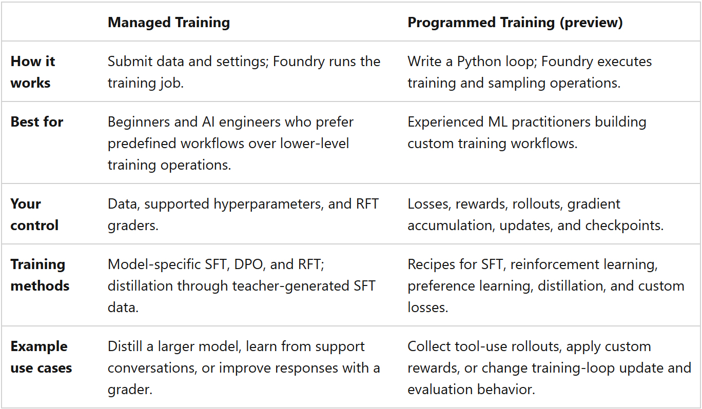
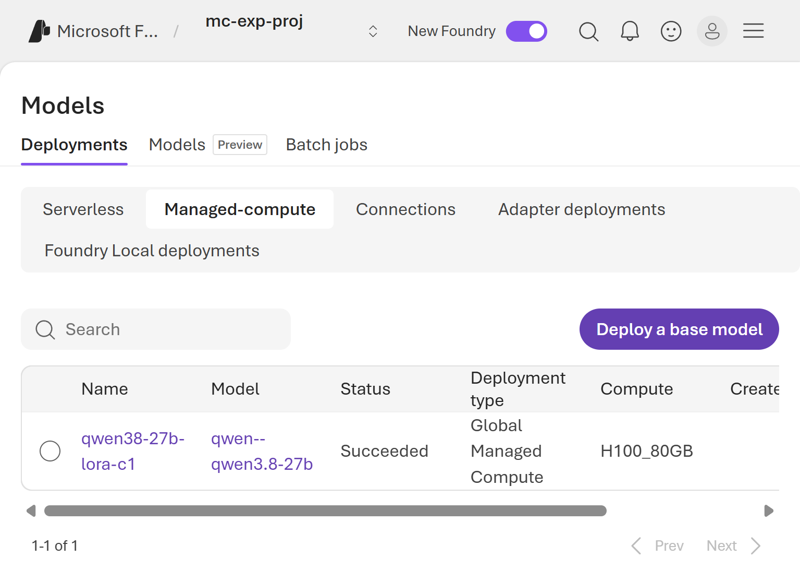
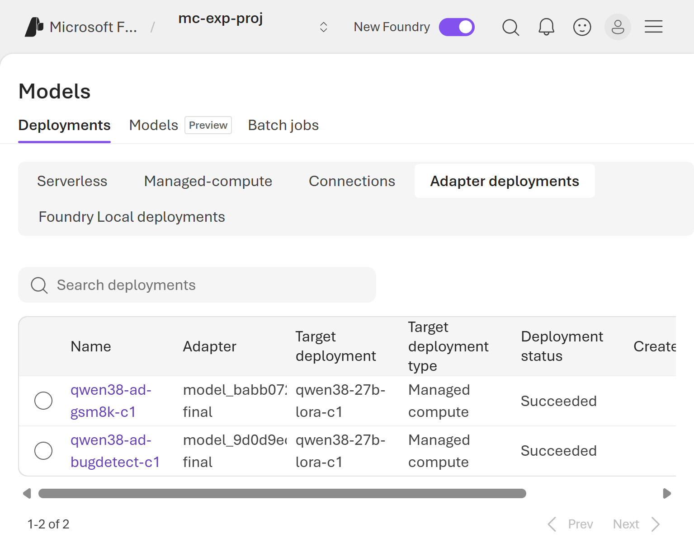
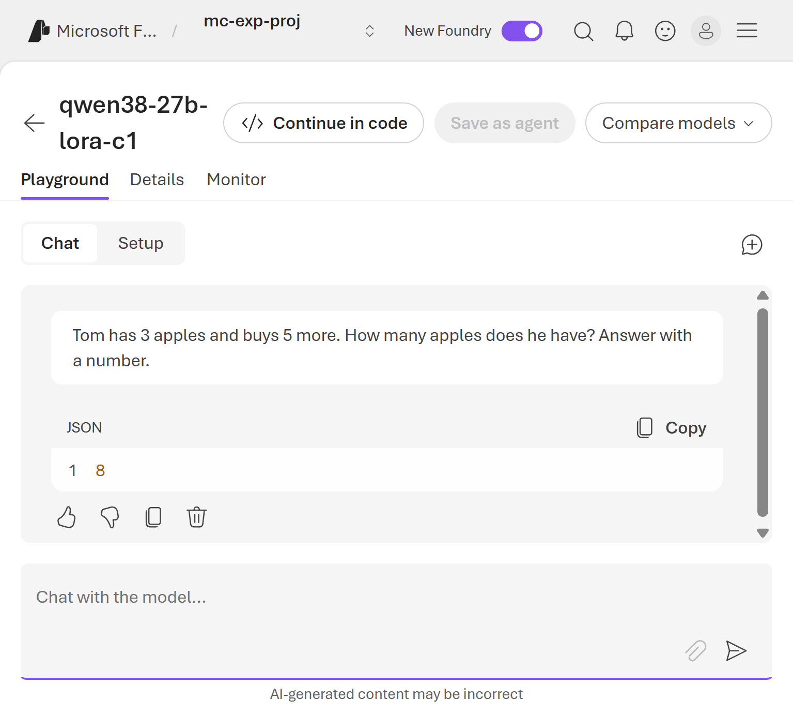

# Qwen3.8-27B LoRA on Microsoft Foundry: Train the Adapter with Managed Training or Programmed Training, Serve It on Managed Compute

[-0078D4)](#purpose)
[](#managed-training-and-programmed-training)
[-0078D4)](#results)
[](#steps)
[](docs/TESTING.md)

Author: Xinyu Wei · [中文](README_CN.md)

> **Draft.** Two runs are still open. `infra/up.py`, `infra/verify.py` and `infra/down.py` have not been executed as one sequence in a new resource group. `training/programmed_training_sft.py` has run its local preparation only: its training functions are the ones that ran the session reported under Results, but this script has not started a session, and `infra/up.py --adapter-model` has not created a deployment. The example outputs under Steps are written from the scripts. This note is removed after those runs.

## Purpose

A team that wants an open-weight model to answer in its own format usually has to find GPUs twice: once to fine-tune the model and once to serve the result. Microsoft Foundry covers both for **Qwen3.8-27B** (preview). **Managed Training** runs a supervised fine-tuning job on GPUs that Microsoft allocates and returns a LoRA adapter. **Programmed Training** (preview) trains the same kind of adapter from a Python loop that you write and run. **Managed compute** serves the base model on dedicated GPUs and attaches adapters to it. The path from training to serving has details that cost money when they go wrong: an adapter has to be registered in the project before it can be deployed, the serving deployment has to use a LoRA-enabled template and the base-model version the adapter was trained on, the GPUs are billed for every hour the deployment exists, and deletion has an order.


What the figure shows: what runs on your machine, what is created in your Azure subscription, and which services Microsoft operates for you. The numbers 1 to 6 are the steps under [How a request moves](#how-a-request-moves). Both training approaches end in the same place: a LoRA adapter listed among the project's models, which an adapter deployment attaches to the target deployment. It is an original explanatory diagram; where the numbers on this page were measured is shown under [Results](#what-the-sample-adapter-changes).

This repository automates that path for both training approaches and makes every billed step explicit:

- **Set up, no GPU.** `infra/up.py` checks your sign-in, region, GPU quota and the current list price, creates a Foundry account and project from `infra/main.bicep` with key authentication disabled, gives you the Foundry User role, and uploads the GSM8K sample files (449 training rows, 50 validation rows).
- **Train, billed per training token.** Two ways to train the sample adapter. With Managed Training you submit one supervised fine-tuning job on the portal's Training page. With Programmed Training, `training/programmed_training_sft.py` runs the training loop on your machine and Foundry executes its 56 optimizer steps in one session; with `--prepare` the script shows the plan and the list price first and starts no session. Either way the project lists the adapter as a LoRA model.
- **Deploy, billed per GPU-hour.** `infra/up.py --deploy` creates one target deployment of Qwen3.8-27B on 2 × H100 80 GB and one adapter deployment for each trained adapter, then calls both. `--adapter-model` names an adapter that a Programmed Training session saved.
- **Call.** One OpenAI-compatible endpoint. The `model` field selects the base model (the target deployment's name) or the base model with an adapter (the adapter deployment's name).
- **Remove.** `infra/down.py` deletes the adapter deployments and the target deployment, which stops the GPU charge.

**Both approaches were run on the same data.** The 449 rows trained one adapter in a Managed Training job and a second one in a Programmed Training session. Each adapter was deployed on Managed compute and compared with the base model on the same 50 validation rows. Methods and numbers: [What the sample adapter changes](#what-the-sample-adapter-changes) and [The same data trained with Programmed Training](#the-same-data-trained-with-programmed-training).

**The repository deploys it for you:** [`infra/up.py`](#2-create-the-foundry-resources-no-gpu) creates the resources and the deployments, [`training/programmed_training_sft.py`](#3-train-the-adapter) trains with Programmed Training, [`infra/verify.py`](#5-check-it) checks the deployment through its public endpoint, and [`infra/down.py`](#7-remove-it) removes it.

| Deliverable | Where | Use it to |
|---|---|---|
| Deployment automation | `infra/up.py`, `infra/main.bicep`, `infra/foundry.py` | create the account, project and role, upload the sample data and, with `--deploy`, create the target and adapter deployments; `--adapter-model` adds an adapter saved by Programmed Training |
| Programmed Training loop | `training/programmed_training_sft.py` | train the sample adapter from a Python loop on your machine; `--prepare` checks the data and prints the plan and the list price without starting a session |
| Deployment check | `infra/verify.py` | confirm that the base model and each adapter answer; `--full` compares them on the 50 validation rows and measures streaming speed |
| Teardown | `infra/down.py` | stop the GPU charge; with `--all`, delete and purge the account |
| Client example | `examples/chat.py` | send your own question to a deployment with the Python standard library |
| Offline tests | `tests/test_offline.py` | check the adapter selection and naming, the reading of a session's result, the scoring and the receipt logic without Azure |
| Test notes | [`docs/TESTING.md`](docs/TESTING.md) | see what each check proves and what was not tested |

What it is not:

- It does not show that fine-tuning makes Qwen3.8-27B better at arithmetic. The sample job takes 6 optimizer steps and the Programmed Training session 56. On the 50 validation rows each adapter changed the style and length of every answer; the difference in correct answers was within noise for both (see [Results](#what-the-sample-adapter-changes)).
- It does not give you access to Programmed Training. That preview needs an [access approval](https://aka.ms/foundry-interactive-training-signup) for your subscription before a session can start, and its script needs the Python environment of the [Foundry fine-tuning cookbook](https://github.com/microsoft-foundry/fine-tuning), which the other scripts do not need.
- Fine-tuning Qwen3.8-27B and [LoRA adapters on Managed compute](https://learn.microsoft.com/en-us/azure/foundry/how-to/deploy-lora-managed-compute) are preview features: no service-level agreement, and Microsoft does not recommend them for production workloads.
- It is not a production network or safety design. The account is reachable from the internet with Microsoft Entra sign-in only, and Managed compute [has no built-in content filtering](https://learn.microsoft.com/en-us/azure/foundry/concepts/managed-compute-overview).
- It is not free to leave on. The target deployment costs 15.82 USD per hour at list price whether or not it receives requests.

| Responsibility | Microsoft Foundry | This repository | You |
|---|---|---|---|
| Training | allocates the GPUs; runs the Managed Training job, or executes each step that a Programmed Training loop sends; lists the adapter in the project | uploads the sample data, provides the Programmed Training loop, finds the adapter | submit the job on the Training page, or run the training script; pay per training token |
| Serving | base weights, LoRA deployment template, GPUs, the endpoint | creates the target and adapter deployments in order and keeps the base-model version fixed | hold the GPU quota; pay per GPU-hour until you remove the target |
| Access | Microsoft Entra ID and Azure roles | disables keys on the account, assigns Foundry User to you | sign in; give your application's identity the same role |
| Safety and network | no built-in content filtering on Managed compute | not included | add the filtering and network isolation your scenario needs |

### How a request moves

1. **Set up.** `infra/up.py` reads your Azure CLI sign-in, the region, the Global managed compute quota for H100 and the list price. It then deploys `infra/main.bicep`: a Foundry account with key authentication disabled, a project, and the Foundry User role for you on the account. It downloads the two GSM8K sample files from a pinned commit of [`microsoft-foundry/fine-tuning`](https://github.com/microsoft-foundry/fine-tuning), checks their SHA-256 and uploads them to the project.
2. **Train.** On the portal's Training page you select Supervised, qwen3.8-27b, Global and the two uploaded files. Managed Training queues the job, trains on GPUs that Microsoft allocates, and registers the result on the project's Models page as a LoRA model (rank 32). The job's `metadata.deployment_options` then carries the adapter's ID. `up.py` looks for exactly this: a succeeded job whose adapter is registered in the project. With Programmed Training, `training/programmed_training_sft.py` opens one session for `Qwen/Qwen3.8-27B`, sends each batch of 16 rows as one optimizer step, saves the final checkpoint and closes the session. The project lists that checkpoint as a LoRA model too, with the session in its tags. No job points to it, so you pass its name to `up.py` with `--adapter-model`.
3. **Deploy.** `infra/up.py --deploy` reads the base-model version from the registered adapter and checks the quota again. It sends `PUT .../managedComputeDeployments/qwen38-lora` with the `GlobalManagedCompute` SKU, the LoRA deployment template, `H100_80GB` and `NoAutoUpgrade`, so that the base model stays at the version the adapter fits. When the target is `Succeeded`, it sends `PUT .../adapterDeployments/<name>` for each adapter with the adapter's ID and the target's name.
4. **Call.** Your application posts to `https://<account>.services.ai.azure.com/openai/v1/chat/completions`. With `"model": "qwen38-lora"` the base model answers. With `"model": "qwen38-lora-gsm8k"` the same GPUs answer with the adapter applied. An unknown name returns HTTP 404 `DeploymentNotFound`.
5. **Sign-in and keys.** Every call carries a Microsoft Entra token: for `https://management.azure.com` when it creates or deletes resources, for `https://ai.azure.com` when it uploads files, lists jobs or asks the model. The scripts take the token from your Azure CLI sign-in. The account has no keys, and the scripts store nothing in the repository.
6. **Remove.** `infra/down.py` deletes the adapter deployments first and the target deployment last, one at a time, and reads each one back until it is gone.

### Managed Training and Programmed Training

Foundry has two training approaches. With **Managed Training** you submit data and settings, and Foundry runs the training job. With **Programmed Training** (preview), your own Python loop decides each sampling and update step, and Foundry executes those operations. [Step 3](#3-train-the-adapter) offers both: option A submits a Managed Training job in the portal, and option B runs the loop in `training/programmed_training_sft.py`. What each produced on the same data is under [Results](#results).



Source: Microsoft Learn, [Training in Microsoft Foundry](https://learn.microsoft.com/en-us/azure/foundry/fine-tuning/overview#choose-your-training-approach), section "Choose your training approach". This is a screenshot of the table as the page showed it on 23 November 2026 (page last updated 17 November 2026).

What to look at: the row **Your control**. Managed Training lets you choose the data and the supported hyperparameters, which is all the sample job in [step 3](#3-train-the-adapter) needs. With Programmed Training the loop sets every step itself: the script of this repository uses batch size 16, which gives 56 optimizer steps on the 449 rows, where the sample job ran with the service's default of 128 and took 6. Programmed Training needs an [access approval](https://aka.ms/foundry-interactive-training-signup) first.

The article goes on to four more choices. For each one, the table gives what the article lists, what it lists for this model, and what this repository uses:

| Choice | What the article lists | For `Qwen3.8-27B` (preview) | In this repository |
|---|---|---|---|
| Training approach | Managed Training and Programmed Training (preview). Both run on training infrastructure that Foundry manages: you provision no training GPU | Both | Both, as options A and B of [step 3](#3-train-the-adapter) |
| Customization method | Three predefined methods, which belong to Managed Training: supervised fine-tuning (SFT), preference fine-tuning (DPO) and reinforcement fine-tuning (RFT). Programmed Training has no predefined method; its samples repository has recipes | SFT and RFT | SFT in the job; the supervised recipe in the session |
| Training type | Standard, Data zone, Global and Developer. The type sets where training runs, the price and the guarantees | Global and Developer | Global for the job; the session's loop has no such setting |
| Deployment option | Serverless, where Foundry hosts the fine-tuned model, or Managed compute, where dedicated GPUs run the base model with one or more LoRA adapters (preview) | Managed compute only | Managed compute: one target deployment, and one adapter deployment for each adapter |
| Region of the Foundry project | 27 regions for Global training | 10 of them for Managed Training, 11 for Programmed Training | East US 2 |

The whole article, with all 18 models, the 27 regions, the serverless deployment types and the limits to plan for, is summarized in [`docs/FOUNDRY_TRAINING.md`](docs/FOUNDRY_TRAINING.md).

### Terms used on this page

| Term | Meaning here |
|---|---|
| Managed Training | Foundry's fine-tuning service: you submit a job, Microsoft runs it on its own GPUs and bills per training token |
| Programmed Training (preview) | Foundry's second training approach: a Python loop on your machine decides each step, Foundry executes the training and sampling operations, and you provision no GPU |
| Session | one Programmed Training run in a project. A checkpoint that the loop saves is listed among the project's models as a LoRA model |
| Supervised fine-tuning (SFT) | training on example conversations, each with the answer you expect |
| Optimizer step | one update of the adapter's weights, computed from one batch of training rows. Smaller batches give more steps on the same data |
| LoRA adapter | a small set of extra weights trained on top of a frozen base model. It works only with the base model and version it was trained on |
| Managed compute | the Foundry deployment type that runs a model on dedicated GPUs and bills per GPU-hour, not per token |
| Target deployment | the Managed compute deployment of the base model that adapters attach to. Here: `qwen38-lora` |
| Adapter deployment | one registered adapter attached to a target deployment under its own name. It adds no GPU. Here: `qwen38-lora-<display name of the training job>`, or `qwen38-lora-<label>` for a model named with `--adapter-model` |
| Global | the `GlobalManagedCompute` SKU of the target deployment and the Global training type of the job. This page does not establish in which region either of them runs |
| GSM8K | grade-school arithmetic word problems. The Foundry sample has 449 training rows and 50 validation rows; every reference answer ends with `#### <number>!!!` |
| Validation rows | the 50 rows the job computes a validation loss on and does not train on. This page uses them to compare the base model with the adapter |
| Completion tokens | the tokens a model generates for one answer, as reported in the `usage` field of the response |

## Results

The screenshots and numbers in this section come from two tests in East US 2. The first test, on 22 and 23 November 2026, used Managed Training: the GSM8K sample data, default training settings with seed 42, one target deployment and two adapter deployments. Its second adapter was trained with the same settings on `Text-Bug-Detection`, another sample set of [`microsoft-foundry/fine-tuning`](https://github.com/microsoft-foundry/fine-tuning); the comparison and the speed test are those of the GSM8K adapter. The second test, on 23 November 2026, trained the same GSM8K data with Programmed Training in another Foundry account and has [its own section](#the-same-data-trained-with-programmed-training). Screenshots and numbers outside that section belong to the first test unless a line names the second.

<table>
<tr>
<td width="50%"></td>
<td width="50%"></td>
</tr>
<tr>
<td>The target deployment: status Succeeded, Global Managed Compute, H100_80GB.</td>
<td>Two adapter deployments on that one target deployment, both Succeeded.</td>
</tr>
</table>



What to look at:

1. The left screenshot lists one Managed compute deployment. That deployment holds the GPUs and is the only item billed per hour.
2. The right screenshot lists two adapters with the same value in the Target deployment column. They share the target's two GPUs and are [not priced separately](https://learn.microsoft.com/en-us/azure/foundry/concepts/adapter-deployment-overview).
3. The Playground screenshot shows the target deployment answering a test question.

These are real portal screenshots, cropped; the subscription name and the values of the Created by column are covered. The deployment names in them belong to the test deployment. Yours are `qwen38-lora` and `qwen38-lora-<display name>` unless you pass `--target`.

### The same question with and without the adapter

Both requests carried the same system turn (`Reply user's question as accurately as possible.`) and the same user turn, row 7 of the validation file:

> Fiona completed 36 math questions in an hour. Shirley was able to complete twice as many math questions within that same time, and Kiana completed half of the sum of Fiona and Shirley's math questions. If they each did the same number of questions the following hour, how many math questions did all three girls complete in 2 hours?

The base model, called by the target deployment's name, answered in 385 completion tokens. Its answer starts and ends like this:

```text
Here is the step-by-step solution:

**Step 1: Calculate the number of questions each girl completed in the first hour.**

*   **Fiona:** Completed 36 questions.
*   **Shirley:** Completed twice as many as Fiona.
    $$36 \times 2 = 72 \text{ questions}$$
[...]
**Answer:**
All three girls completed **324** math questions in 2 hours.
```

The adapter, called by the adapter deployment's name, answered in 65 completion tokens. This is its complete answer:

```text
36*2=72
72+36=108
108/2=54
54+72+36=162
162*2=324
#### 324
The answer is: 324
```

What to look at: both answers are correct (324). The adapter answers in the short calculation style of the training data and uses its `####` marker, which the base model never produced. It does not reproduce the `!!!` that ends every training answer. This row is one of the 6 adapter answers that carry the marker.

### What the sample adapter changes

**Question.** Does the adapter deployment's name reach a different model than the target deployment's name, and what does an adapter trained on 449 rows change?


**Method.** The input is the 50 rows of `chat_validation.jsonl`, the same pinned file that `up.py` uploads. Each row's system and user turns were sent unchanged, and the reference answer was held back. Every row went once to the base model (`model` = the target deployment's name) and once to the GSM8K adapter (`model` = the adapter deployment's name): 100 calls, 4 at a time, with `temperature` 0, `reasoning_effort` `"none"` and `max_tokens` 800. The `model` field was the only difference between the two sides. Answers were scored on the test client in two ways: automatically, by comparing the last number in the answer with the reference answer, and by reading every row that an automatic check marked wrong for either side (12 rows). The speed test sent the same prompt 3 times per side, one streamed request at a time, with reasoning left at its default and `max_tokens` 600.

| Measured on the 50 validation rows | Base model (target deployment's name) | Base model + GSM8K adapter (adapter deployment's name) |
|---|---|---|
| Rows answered with HTTP 200 | 50 of 50 | 50 of 50 |
| Answers identical to the other side's | 0 of 50 | 0 of 50 |
| Mean answer length, completion tokens | 310.2 | 158.7 |
| Answers cut off at the 800-token limit | 2 of 50 | 0 of 50 |
| Answers that contain the training data's `####` marker | 0 of 50 | 6 of 50 |
| Answers that end like the training data (`#### <number>!!!`) | 0 of 50 | 0 of 50 |
| Correct, automatic score (last number in the answer) | 39 of 50 | 45 of 50 |
| Correct, after reading the 12 flagged rows | 44 of 50 | 46 of 50 |

| Streaming speed: the same prompt 3 times per side, one request at a time | Base model | Base model + GSM8K adapter |
|---|---|---|
| Tokens per second after the first token (reasoning and answer tokens) | 72.5 / 72.1 / 72.6 | 53.4 / 53.4 / 53.4 |
| Seconds to the first streamed token (reasoning or answer) | 2.16 / 1.15 / 1.28 | 1.63 / 1.38 / 1.30 |

What the numbers mean:

- **The adapter is active.** No answer is identical between the two sides, the adapter's answers are about half as long (158.7 against 310.2 completion tokens), and only the adapter uses the `####` marker. The response's `model` field differs too: the base model reports `qwen--qwen3.8-27b`, the adapter an internal ID of the form `rp-<hash>-1`, not the deployment name.
- **Accuracy is not shown to differ.** After reading the flagged rows, the base model has 44 correct answers and the adapter 46. The adapter alone is correct on 3 rows and the base model alone on 1; a two-sided sign test on those 4 rows gives p = 0.625. The automatic score of 39 against 45 overstates the gap: it takes the last number in the text, and 5 correct base-model answers end with a sentence that contains another number, as in the example above ("in 2 hours").
- **The format is learned in part.** The sample job takes 6 optimizer steps (449 rows, 2 epochs, batch size 128). The adapter picked up the short style, used the marker in 6 of 50 answers and never produced the complete ending.
- **The adapter costs speed.** On this prompt the same GPUs generated 53.4 tokens per second with the adapter against 72.5 for the base model, about 26% fewer. The first token arrived after 1.15 to 2.16 seconds on both sides.

Limits: one adapter, one training seed, 50 rows, one request per row, one target deployment, one client; the two sides were measured one after the other (base model first), not interleaved. The speed test is a single-user measurement, not a capacity test; its token counts include reasoning tokens, and one of the six answers consisted of reasoning only. Scoring details are in [`docs/TESTING.md`](docs/TESTING.md).

### The same data trained with Programmed Training

**Question.** Does an adapter trained with Programmed Training deploy on Managed compute like one from a Managed Training job, and what changes in the answers when the same 449 rows train the adapter for 56 optimizer steps instead of 6?


**Method.** The second test ran in another Foundry account in East US 2, in a subscription that has Programmed Training access. Training followed the supervised chat-data recipe of the Foundry fine-tuning cookbook ([`programmed_training/docs/custom-data.md`](https://github.com/microsoft-foundry/fine-tuning/blob/0b8bcfe9519ed382a5bc202f0f1b2ce65c22a2c9/programmed_training/docs/custom-data.md)). A Python loop on the test client read the same two pinned GSM8K files, rendered each row with the cookbook's renderer for this model (`qwen3_8_low_reasoning`) and sent the batches to a training session for `Qwen/Qwen3.8-27B`. That loop is published as [`training/programmed_training_sft.py`](training/programmed_training_sft.py): the functions that prepare the data and run the session are the ones that ran here. Settings: LoRA rank 32, 2 epochs, batch size 16, a learning rate that starts at 0.0001 and falls linearly to zero, seed 42, loss on the assistant's answer only. Before the first step, after the first epoch and at the end, the loop computed the loss on the 50 validation rows without updating the adapter. It saved the final checkpoint, which the project then listed as a LoRA model (rank 32) on base-model version 3. The model's ID has the same form as the ID of a Managed Training adapter: `azureai://accounts/<account>/projects/<project>/models/<model name>/versions/1`.

Deployment used the two requests of step 3 in [How a request moves](#how-a-request-moves): a target deployment with the same template, model version and GPUs as in the first test, then one adapter deployment that names the saved model by that ID. In this test a separate script sent the two requests; `infra/up.py --deploy --adapter-model` sends the same two. The cookbook has a deployment script of its own, `scripts/deploy_to_foundry.py`, described in [`docs/deployment-and-inference.md`](https://github.com/microsoft-foundry/fine-tuning/blob/0b8bcfe9519ed382a5bc202f0f1b2ce65c22a2c9/programmed_training/docs/deployment-and-inference.md). At that commit its only target is `Fireworks`, a provisioned deployment that needs a separate preview access; it has no Managed compute target, and this test did not use it.

The comparison repeated the method of the previous section on the same 50 rows with the same request settings: 100 calls, 4 at a time, base model first. The automatic score marked 11 answers of the base model wrong: 8 of them were, character for character, answers already read in the first test and kept that reading, and the other 3 were read. It marked 7 answers of the adapter wrong; each ends with `#### <number>!!!`, so the number compared is the adapter's final answer.

| Training on the 449 rows for 2 epochs | Managed Training job (first test) | Programmed Training session (second test) |
|---|---|---|
| Batch size | 128, the service default | 16, set in the loop |
| Optimizer steps | 6 | 56 |
| Learning rate | starts at 0.0001, falls linearly to zero | starts at 0.0001, falls linearly to zero |
| Validation loss on the 50 validation rows, first value reported | 0.91 | 0.91 |
| Validation loss on the 50 validation rows, last value reported | 0.53 | 0.41 |
| Training tokens | 213,000 billed | 219,652 counted by the loop |
| Cost of those tokens at list price, USD | 0.64 | 0.90, an estimate |
| Duration | 5.3 minutes from created to finished | 6 minutes for the loop, 9 minutes from starting the script to its exit |

| Measured on the 50 validation rows | Base model (second test) | Base model + Programmed Training adapter (second test) | For comparison: base model + Managed Training adapter (first test, from the table above) |
|---|---|---|---|
| Rows answered with HTTP 200 | 50 of 50 | 50 of 50 | 50 of 50 |
| Answers identical to the base model's in the same test | not applicable | 0 of 50 | 0 of 50 |
| Mean answer length, completion tokens | 311.2 | 115.7 | 158.7 |
| Answers cut off at the 800-token limit | 2 of 50 | 0 of 50 | 0 of 50 |
| Answers that contain the training data's `####` marker | 0 of 50 | 50 of 50 | 6 of 50 |
| Answers that end like the training data (`#### <number>!!!`) | 0 of 50 | 50 of 50 | 0 of 50 |
| Correct, automatic score (last number in the answer) | 39 of 50 | 43 of 50 | 45 of 50 |
| Correct, after reading the flagged rows | 44 of 50 | 43 of 50 | 46 of 50 |

Row 7, the question shown [above](#the-same-question-with-and-without-the-adapter), answered by this adapter in 149 completion tokens. The base model's answer to it was the same text as in the first test. This is the adapter's complete answer:

```text
Shirley completed 36*2=<<36*2=72>>72 math questions.
Fiona and Shirley completed 36+72=<<36+72=108>>108 math questions.
Kiana completed 108/2=<<108/2=54>>54 math questions.
All three girls completed 108+54=<<108+54=162>>162 math questions.
In 2 hours, they completed 162*2=<<162*2=324>>324 math questions.
#### 324!!!
```

What to look at: the last line. The Managed Training adapter's answer above stops at `#### 324` and adds a sentence. This answer ends exactly as every training answer does, and it writes each calculation in the training data's `<<...>>` notation.

What the numbers mean:

- **The adapter deploys and is called like a Managed Training adapter.** The adapter deployment reached `Succeeded` in 78 seconds, and its first call returned HTTP 200. The response's `model` field again carried an internal ID of the form `rp-<hash>-1`.
- **This adapter reproduces the training format in every answer.** All 50 answers end with `#### <number>!!!`. The Managed Training adapter used the marker in 6 of 50 answers and never produced the complete ending. The answers average 115.7 completion tokens, a little over one third of the base model's 311.2.
- **Accuracy is not shown to differ.** The base model has 44 correct answers and the adapter 43. The adapter alone is correct on 2 rows and the base model alone on 3; a two-sided sign test on those 5 rows gives p = 1.0. The automatic score of 39 against 43 undercounts the base model for the reason given in the previous section: 5 of its correct answers end with a sentence that contains another number.
- **The validation loss fell further than in the sample job.** It went from 0.91 to 0.42 after the first epoch and to 0.41 after the second; the 6-step job ended at 0.53. Both start at 0.91, as the same base model on the same 50 rows should if the two services compute the loss in the same way; that was not checked beyond this agreement.
- **The difference between the two adapters is not a verdict on the two approaches.** The two runs share the data, the base model and its version, 2 epochs, LoRA rank 32 and the learning-rate schedule. They differ in batch size, 16 against 128, and so in optimizer steps, 56 against 6. What a Managed Training job does inside (optimizer settings, prompt rendering) is not visible from outside, and Managed Training with batch size 16 was not run.

Limits: one session, one seed, 50 rows, one request per row, base model first and not interleaved. The Managed Training adapter was measured on another target deployment in another account, not side by side with this one; at `temperature` 0 the base model's own answers differed between the two tests on 8 of 50 rows. The speed test was not repeated for this adapter. The cost figures of the second test are estimates from token counts and list prices; its bill was not read.

### Time and cost

| Stage | Measured in the first test |
|---|---|
| Training job on the sample data, submitted in the portal | 5.3 minutes from created to finished |
| The same data and settings, submitted through the API | 9.0 minutes from created to finished; its 6 training steps took 77 seconds, the rest was queueing and preprocessing |
| Target deployment, from the request to `Succeeded` | 21 minutes |
| First successful call after `Succeeded` | 8 seconds |
| Each adapter deployment, from the request to `Succeeded` | 64 seconds (2 measured) |
| Deleting 2 adapter deployments and the target deployment | 5 minutes |
| Requests sent to the deployment while it existed | 164, all answered with HTTP 200 |

The second test, with the Programmed Training adapter, differed in one stage that matters when you deploy: the first successful call came 553 seconds after `Succeeded`, not 8 seconds. `up.py` keeps calling for 10 minutes before it stops.

| Stage in the second test | Measured |
|---|---|
| Programmed Training session on the sample data | 6 minutes for the loop's 56 steps; 9 minutes from starting the script to its exit |
| Target deployment, from the request to `Succeeded` | 21 minutes |
| First successful call after `Succeeded` | 553 seconds, about 9 minutes; the 25 calls before it returned HTTP 404 |
| The adapter deployment, from the request to `Succeeded` | 78 seconds |
| Deleting the adapter deployment and the target deployment | 5 minutes |
| Requests sent to the deployment while it existed | 127: 102 answered with HTTP 200, and 25 with HTTP 404 before the first success |

| Item | List price in USD, Azure Retail Prices API, read 23 November 2026 | Charged |
|---|---|---|
| Target deployment | 7.91 per H100 GPU-hour × 2 GPUs = 15.82 per hour, or 379.68 per day | for as long as the target deployment exists, with or without requests |
| Adapter deployments | no separate price | not charged |
| Requests | no price per token on Managed compute | not charged |
| Managed Training job on the sample data | 3.00 per million training tokens; 213,000 tokens billed = 0.64 | once per job |
| Programmed Training session on the sample data | 4.10 per million training tokens; 219,652 tokens counted by the loop = 0.90 | per token that the loop sends. This figure is an estimate: the bill of the second test was not read |
| Account, project, uploaded files | no hourly price | the test resource group's bill showed only GPU-hours and training tokens |

One hour of serving plus one Managed Training job comes to 16.46 USD at list price. `up.py` reads the current list price before it creates anything and prints it.

| You want to | Read |
|---|---|
| Deploy it in your subscription | [Steps](#steps) |
| Know what each check proves, how answers were scored and what was not tested | [`docs/TESTING.md`](docs/TESTING.md) |
| See which models, training types, deployment options and regions Foundry training supports | [`docs/FOUNDRY_TRAINING.md`](docs/FOUNDRY_TRAINING.md) |
| Know where the sample data, the icons and the screenshots come from | [`NOTICE.md`](NOTICE.md) |

| Directory | What it holds |
|---|---|
| `infra/` | `main.bicep` (account, project, role), `up.py`, `verify.py`, `down.py` and the shared helpers in `foundry.py` |
| `training/` | `programmed_training_sft.py`, the Programmed Training loop for the sample data; it runs in the cookbook's Python environment |
| `examples/` | `chat.py`, a minimal client |
| `tests/` | offline tests of the scripts' logic |
| `docs/` | test notes and a summary of the Microsoft Learn article on training in Foundry, each in English and Chinese |
| `images/` | the three diagrams, the three portal screenshots and the Microsoft Learn table, with their provenance in `SOURCES.json` |

## Steps

| Order | Where | What | Command | Takes about |
|---|---|---|---|---|
| 1 | your machine | get the code and sign in | `git clone`, `az login` | 2 minutes |
| 2 | your machine | create the Foundry resources and upload the sample data; no GPU | `python infra/up.py --resource-group <name> --location eastus2` | 5 minutes |
| 3 | Foundry portal, or your machine | train the adapter: A, Managed Training in the portal, or B, Programmed Training from a script | A: Training, then Train. B: `<cookbook python> training/programmed_training_sft.py --resource-group <name>` | A: 5 to 10 minutes. B: 9 minutes, after a one-time install |
| 4 | your machine | deploy the target and the adapter; the GPU charge starts | `python infra/up.py --resource-group <name> --deploy`; after 3B, add `--adapter-model <model name>=gsm8k-pt` | 25 to 35 minutes |
| 5 | your machine | check it | `python infra/verify.py --resource-group <name>` | 1 minute, or 5 minutes with `--full` |
| 6 | your machine | call it | `python examples/chat.py <chat URL> <deployment> "<question>"` | seconds |
| 7 | your machine | remove it; the GPU charge stops | `python infra/down.py --resource-group <name>` | 5 minutes |

In every command, replace `<name>` with the name of your resource group. `<cookbook python>` is the Python of the environment that option B of step 3 installs.

Prerequisites:

- **Roles.** Step 2 creates resources and a role assignment, which needs Owner, or Contributor together with Role Based Access Control Administrator, on the subscription or the resource group. It gives you Foundry User on the account, which the scripts need for files, jobs and model calls. Tested as Owner of the subscription.
- **Quota.** 2 GPUs of Global managed compute quota for `H100_80GB` in the subscription. Step 2 prints how many are used and how many you have. To get more, see [Request more quota](https://learn.microsoft.com/en-us/azure/foundry/how-to/deploy-models-managed#request-more-quota).
- **Region.** A region where [Global Managed Training lists Qwen3.8-27B](https://learn.microsoft.com/en-us/azure/foundry/fine-tuning/overview): Australia East, East US, East US 2, Korea Central, North Central US, Sweden Central, Switzerland North, UAE North, UK South or West US 3. The deployment was tested in East US 2 only.
- **Tools.** Python and the Azure CLI. Apart from option B of step 3, no Python package is installed. Tested with Python 3.13.15, Azure CLI 2.93.0 and Bicep CLI 0.49.2 (the Azure CLI installs Bicep on first use) on Windows 11. Linux and macOS were not tested.
- **Only for option B of step 3 (Programmed Training).** An [access approval](https://aka.ms/foundry-interactive-training-signup) for your subscription: request it through the preview sign-up form and wait for it before you start a session. A second Python environment that holds the [Programmed Training cookbook](https://github.com/microsoft-foundry/fine-tuning/tree/0b8bcfe9519ed382a5bc202f0f1b2ce65c22a2c9/programmed_training); the cookbook asks for Python 3.11 or newer, Git, and access to PyPI and Hugging Face. Tested with Python 3.13.15, as Owner of the subscription with the Foundry User and Azure AI Developer roles on the account. Whether Foundry User alone is enough to start a session was not tested.

### 1. Get the code and sign in

```powershell
git clone --filter=blob:none --sparse https://github.com/david-xinyuwei/david-share.git
cd david-share
git sparse-checkout set Agents/Foundry-Model-Training-and-Inference
cd Agents/Foundry-Model-Training-and-Inference

az login
az account set --subscription "<subscription name or ID>"
python -m unittest discover -s tests
```

The last command runs the offline tests. It needs no Azure access and ends with:

```text
Ran 29 tests in <n>s

OK
```

### 2. Create the Foundry resources (no GPU)

```powershell
python infra/up.py --resource-group <name> --location eastus2
```

You will see lines like these. Values in angle brackets differ for each deployment:

```text
<time> [PASS] 1/7 Preflight: subscription <your subscription>; region eastus2; Global H100_80GB quota: <used> used of <limit> GPUs (the target needs 2); target list price 15.82 USD per hour (2 x 7.91)
<time> deploying infra/main.bicep into resource group <name> (eastus2) ...
<time> waiting for the Foundry User role to take effect (project API answered HTTP <code>) ...
<time> [PASS] 2/7 Azure resources (infra/main.bicep): account ftlora-<hash>, project lora-demo, endpoint https://ftlora-<hash>.services.ai.azure.com
<time> [PASS] 3/7 Sample data: gsm8k-train.jsonl 449 rows (file-<id>); gsm8k-validation.jsonl 50 rows (file-<id>)
<time> [INFO] 4/7 Trained adapter: no registered LoRA adapter: no training job yet

NEXT: train the adapter on the portal's Training page (about 5 to 10 minutes; list price about 0.64 USD).
  [six numbered portal steps, the same as in step 3 below]
Then run:  python infra/up.py --resource-group <name> --deploy
Or train it with Programmed Training (preview): training/programmed_training_sft.py, step 3 of the README.

RESULT: PASS   receipt: <home>/.foundry-lora/<name>/up-receipt.json
```

The line about the Foundry User role can repeat for a few minutes: a new role assignment needs time before the project accepts your token. Nothing created in this step has an hourly price.

| Created | Name | Notes |
|---|---|---|
| Resource group | `<name>` | created when it does not exist, with the tag `solution=foundry-managed-training-lora` |
| Foundry account | `ftlora-<hash>` | kind `AIServices`, key authentication disabled; the name is also the endpoint's subdomain |
| Foundry project | `lora-demo` | holds the files, the training jobs and the registered adapters |
| Role assignment | Foundry User for you, on the account | pass `--principal-id` and `--principal-type` to give it to another identity |
| Two uploaded files | `gsm8k-train.jsonl`, `gsm8k-validation.jsonl` | 449 and 50 rows, checked against a pinned SHA-256 |

The scripts keep their state outside the repository, in `<home>/.foundry-lora/<name>/`: `up-receipt.json`, `verify-report.json`, `down-receipt.json`, `run.log`, `state.json` and the downloaded sample files. Running the command again continues from what exists and changes nothing that is already in place.

| Parameter of `up.py` | Default | Meaning |
|---|---|---|
| `--resource-group` | required | the resource group to create or reuse |
| `--location` | `eastus2` | region of a new deployment; ignored once the resource group holds one |
| `--subscription` | the Azure CLI's current subscription | subscription name or ID |
| `--account-name` | `ftlora-<hash>` | Foundry account name; must be globally unique |
| `--project-name` | `lora-demo` | Foundry project name |
| `--target` | `qwen38-lora` | name of the target deployment; adapter deployments are named `<target>-<display name>` |
| `--deploy` | off | create the target and adapter deployments (step 4) |
| `--adapter-model NAME[=LABEL]` | none | also deploy this LoRA model of the project, such as the adapter that option B of step 3 saves; `LABEL` ends the adapter deployment's name; the option can be repeated |
| `--wait-training MINUTES` | 0 | keep checking for a registered adapter for this long |
| `--train-api` | off | submit the training job through the API (see step 3) |
| `--principal-id`, `--principal-type` | you | the identity that receives Foundry User |
| `--ignore-recent-teardown` | off | skip the waiting period after `down.py` (see step 4) |

### 3. Train the adapter

Choose one option, or do both: one target deployment serves up to 8 adapters.

| What differs | A. Managed Training, in the portal | B. Programmed Training (preview), from a script |
|---|---|---|
| Where the training runs | a job that Foundry runs from start to end on GPUs that Microsoft allocates | a loop on your machine; Foundry executes each step the loop sends, on GPUs that Microsoft operates |
| What you set | the data and the settings that the wizard offers | every step: the script sets batch size 16, 2 epochs, the learning rate and when to validate |
| What it needs beyond step 2 | nothing | the access approval and the cookbook's Python environment, see Prerequisites |
| What to expect for the sample data, as measured under [Results](#the-same-data-trained-with-programmed-training) | 6 optimizer steps; 213,000 training tokens, 0.64 USD at list price; 5.3 minutes | 56 optimizer steps; 219,652 training tokens, about 0.90 USD at list price; 9 minutes |
| How step 4 finds the adapter | through its training job | by the model name that you pass with `--adapter-model` |

#### A. Managed Training, in the portal

1. Open [https://ai.azure.com](https://ai.azure.com), switch on **New Foundry** in the header and select the project `lora-demo`.
2. In the left menu select **Training**, then **Train**. The wizard **Train a model** opens.
3. **Basic details:** make sure **Supervised**, **qwen3.8-27b** and **Global** are selected. Select **Next**.
4. **Datasets:** set **Training data source** to `gsm8k-train.jsonl` and **Validation data source (optional)** to `gsm8k-validation.jsonl`. Select **Next**.
5. **Optional settings:** type `gsm8k` into **Enter a display name**. The numbers on this page were trained with seed `42`; enter it in the seed field to use the same seed. Leave **Number of epochs** and **Learning rate multiplier** on Default. Select **Submit**.
6. Wait until the job has finished. On the **Models** page, the **Models** tab then lists the adapter.

The display name becomes the end of the adapter deployment's name: `gsm8k` gives `qwen38-lora-gsm8k`. To check from your machine, run the command of step 2 again. Step 4 of its output changes to:

```text
<time> [PASS] 4/7 Trained adapter: qwen38-lora-gsm8k <- model_<id>-final/versions/1
```

Why the portal: in our tests a job submitted through the API finished as succeeded but did not register its adapter when the project had never run a job submitted in the portal (3 of 3 jobs, in two regions), so there was nothing to deploy. Jobs submitted in the portal registered their adapter (2 of 2), and so did API jobs submitted later in the same project (3 of 3). The cause is not known. `up.py --train-api` submits the job through the API for that later case; when a job succeeds without a registered adapter, `up.py` says so and starts no GPU.

#### B. Programmed Training, from a script

Install the Programmed Training cookbook once, in a folder outside this repository. The commands are those of its [quickstart](https://github.com/microsoft-foundry/fine-tuning/blob/0b8bcfe9519ed382a5bc202f0f1b2ce65c22a2c9/programmed_training/docs/quickstart.md), at the commit this script was written against:

```powershell
git clone https://github.com/microsoft-foundry/fine-tuning.git
cd fine-tuning
git checkout 0b8bcfe9519ed382a5bc202f0f1b2ce65c22a2c9
cd programmed_training
python -m venv .venv
.\.venv\Scripts\python.exe -m pip install --upgrade pip
.\.venv\Scripts\python.exe -m pip install -e . --index-url https://pypi.org/simple --extra-index-url https://download.pytorch.org/whl/cpu
```

These commands and the next ones are written for PowerShell on Windows; on Linux or macOS the environment's Python is `.venv/bin/python` instead of `.venv\Scripts\python.exe`. Go back to this repository's folder and put the path of that environment's Python into `$py`. Then run the local preparation. It downloads the model's tokenizer from Hugging Face, renders every row and prints the plan. It does not sign in to Azure and starts no session:

```powershell
$py = "<cookbook folder>\programmed_training\.venv\Scripts\python.exe"
& $py training/programmed_training_sft.py --resource-group <name> --prepare
```

```text
<time> [PASS] 1/5 Sample data: gsm8k-train.jsonl 449 rows; gsm8k-validation.jsonl 50 rows; pinned SHA-256 checked
<time> [PASS] 2/5 Local preparation: 28 batches x 16 rows = 448 of 449 rows per epoch, 2 epochs, 56 optimizer steps; about 219768 training tokens, at the list price of 4.10 USD per million training tokens about 0.90 USD; validation: 50 rows, 12014 tokens per pass; longest row 592 tokens

RESULT: PASS   receipt: <home>/.foundry-lora/<name>/train-receipt.json

Nothing was sent to Azure. To train, run the same command without --prepare (billed per training token).
```

For the sample data the plan is always this one. Now train. The command opens one session, which is billed per training token until the script closes it:

```powershell
& $py training/programmed_training_sft.py --resource-group <name>
```

```text
<time> [PASS] 3/5 Project: account ftlora-<hash>, project lora-demo, endpoint https://ftlora-<hash>.services.ai.azure.com/api/projects/lora-demo
<time> starting ONE Programmed Training session on Qwen/Qwen3.8-27B (LoRA rank 32); billed per training token until the session is closed
Session ready: session_id=session_<id>
[progress lines of the cookbook's training loop]
Session closed: session_id=session_<id>
<time> [PASS] 4/5 Training session: session_<id>: 56 of 56 optimizer steps, <n> training tokens; training loss <n> -> <n>; validation loss <n> -> <n>; session closed; run folder <run folder>
<time> [PASS] 5/5 Saved adapter: model_<id>-final (LoRA rank 32) on qwen--qwen3.8-27b/versions/<version>

RESULT: PASS   receipt: <home>/.foundry-lora/<name>/train-receipt.json

Adapter : model_<id>-final  (a LoRA model of project lora-demo)
Deploy  : python infra/up.py --resource-group <name> --deploy --adapter-model model_<id>-final=gsm8k-pt
```

What success looks like: `56 of 56 optimizer steps`, a validation loss that falls (from 0.91 to 0.41 in our session), and the saved model's name in the last two lines. The session saves a checkpoint after each epoch; the project lists both as LoRA models, and step 5/5 names the final one. Copy the `Deploy` line: it is the command of step 4.

The loop is yours to change. Its settings are the `SETTINGS` constants at the top of the script, and `--prepare` shows the plan and the list price of a new setting before you pay for a session. A session is not resumed: running the command again starts a new session, which is billed again.

### 4. Deploy the target and the adapter (the GPU charge starts)

```powershell
python infra/up.py --resource-group <name> --deploy
```

```text
<time> [PASS] 4/7 Trained adapter: qwen38-lora-gsm8k <- model_<id>-final/versions/1
<time> creating target deployment qwen38-lora: 2 x H100_80GB, 15.82 USD per hour at list price, until you run down.py
<time> target deployment qwen38-lora: Creating (<n> min)
<time> target deployment qwen38-lora: Succeeded (<n> min)
<time> [PASS] 5/7 Target deployment: qwen38-lora: base qwen--qwen3.8-27b/versions/<version>, 2 x H100_80GB, Succeeded
<time> adapter deployment qwen38-lora-gsm8k: Succeeded (<n> s)
<time> [PASS] 6/7 Adapter deployments: 1 on qwen38-lora: qwen38-lora-gsm8k
<time> [PASS] 7/7 First calls: qwen38-lora -> '8' (served model qwen--qwen3.8-27b, <n> s); qwen38-lora-gsm8k -> '<answer>' (served model rp-<hash>-1, <n> s)

RESULT: PASS   receipt: <home>/.foundry-lora/<name>/up-receipt.json

Endpoint : https://ftlora-<hash>.services.ai.azure.com/openai/v1/chat/completions
Models   : "qwen38-lora" (base model) and "qwen38-lora-gsm8k" (base model + adapter)
Charge   : 15.82 USD per hour at list price for as long as "qwen38-lora" exists. Adapter deployments add nothing.
Check    : python infra/verify.py --resource-group <name>
Stop     : python infra/down.py --resource-group <name>
```

Steps 1/7 to 3/7 repeat first and change nothing. The command starts no GPU when no adapter is registered, when fewer than 2 GPUs of quota are free, or when `down.py` removed this resource group's target deployment less than 60 minutes earlier. That waiting period is a precaution, not a measured threshold: in our tests two target deployments created 23 and 33 seconds after a deletion reached `Succeeded` and then returned HTTP 404 to model calls, and one created 8 hours after a deletion worked. `--ignore-recent-teardown` skips the wait. While the target is new, step 7/7 can print `first call to qwen38-lora: HTTP 404; retrying in 30 s` for several minutes before the first answer: 8 seconds passed in one of our tests and 553 seconds in the other.

After option B, add the model's name. The training script printed the complete command in its `Deploy` line:

```powershell
python infra/up.py --resource-group <name> --deploy --adapter-model model_<id>-final=gsm8k-pt
```

```text
<time> [PASS] 4/7 Trained adapter: qwen38-lora-gsm8k-pt <- model_<id>-final/versions/1
```

The other lines are the ones shown above, with `qwen38-lora-gsm8k-pt` as the adapter deployment's name; `gsm8k-pt` is a label of your choice. If you trained with both options, this one command deploys both adapters on the same target deployment.

Every adapter that a Managed Training job registered and every model named with `--adapter-model` is deployed when it was trained on the same base-model version, up to 8 on the target deployment. The charge runs until step 7.

### 5. Check it

```powershell
python infra/verify.py --resource-group <name>
```

```text
<time> [PASS] Target deployment is Succeeded: qwen38-lora: Succeeded, model qwen--qwen3.8-27b/versions/<version>, 2 x H100_80GB
<time> [PASS] Adapter deployments are Succeeded: qwen38-lora-gsm8k: Succeeded
<time> [PASS] The base model answers under the target's name: HTTP 200, <n> s, answer '8', served model qwen--qwen3.8-27b
<time> [PASS] Adapter qwen38-lora-gsm8k answers under its own name: HTTP 200, <n> s, served model rp-<hash>-1 (base: qwen--qwen3.8-27b)
<time> [PASS] An unknown deployment name is rejected: HTTP 404 {"error": {"type": "invalid_request_error", "code": "DeploymentNotFound", [...]

RESULT: PASS   report: <home>/.foundry-lora/<name>/verify-report.json
```

`--full` adds the comparison of [Results](#what-the-sample-adapter-changes) on your deployment: the 50 validation rows through the base model and through the adapter, then the streaming speed test.

```text
<time> [PASS] Held-out rows through qwen38-lora: 50/50 answered; correct by last number <n>; mean <n> completion tokens; <n> cut at 800 tokens; <n> with '####'
<time> [PASS] Held-out rows through qwen38-lora-gsm8k: 50/50 answered; correct by last number <n>; mean <n> completion tokens; <n> cut at 800 tokens; <n> with '####'
<time> [PASS] The adapter changes the answers: <n> of 50 outputs identical to the base model's; rows saved to verify-rows-<time>.jsonl
<time> [PASS] Streaming speed of qwen38-lora: tokens per second <n> / <n> / <n>; first token after <n> / <n> / <n> s
<time> [PASS] Streaming speed of qwen38-lora-gsm8k: tokens per second <n> / <n> / <n>; first token after <n> / <n> / <n> s
```

The exit code is 0 when every check passes and 1 otherwise. The report lists each check; with `--full`, every answer is saved next to it so that you can read the rows yourself. "Correct by last number" is the automatic score described under Results and understates long answers.

### 6. Call it from your code

```powershell
python examples/chat.py https://ftlora-<hash>.services.ai.azure.com/openai/v1/chat/completions qwen38-lora-gsm8k "A shop sells 12 pens for 3 dollars. How much do 48 pens cost?"
```

The script prints the answer, then the served model and the number of completion tokens. The request it sends is all an application needs:

```http
POST https://<account>.services.ai.azure.com/openai/v1/chat/completions
Authorization: Bearer <Microsoft Entra token for https://ai.azure.com>
Content-Type: application/json

{"model": "qwen38-lora-gsm8k", "messages": [{"role": "user", "content": "..."}], "max_tokens": 800, "temperature": 0, "reasoning_effort": "none"}
```

- `model` is a deployment name: `qwen38-lora` for the base model, `qwen38-lora-<display name>` for an adapter. No `api-version` and no key.
- `"reasoning_effort": "none"` asks for the answer directly. Without it the model reasons first and the reasoning counts against `max_tokens`: in the speed test, one answer spent its whole 600-token limit on reasoning.
- An application signs in with its own identity. Give that identity Foundry User on the account by running step 2 again with `--principal-id <object ID> --principal-type ServicePrincipal`.
- To serve an adapter trained on your own data, repeat step 3 with your files and another display name, then run step 4 again. The file format is described in [Customize a model with fine-tuning](https://learn.microsoft.com/en-us/azure/foundry/openai/how-to/fine-tuning).

### 7. Remove it

```powershell
python infra/down.py --resource-group <name>
```

```text
<time> to delete: adapter deployments ['qwen38-lora-gsm8k'], managed compute deployments ['qwen38-lora']
<time> adapter deployment qwen38-lora-gsm8k: deletion accepted (HTTP <code>)
<time> adapter deployment qwen38-lora-gsm8k: gone (<n> s)
<time> managed compute deployment qwen38-lora: deletion accepted (HTTP <code>)
<time> managed compute deployment qwen38-lora: gone (<n> s)
<time> [PASS] GPU deployments removed: deleted 1 adapter deployment(s) and 1 managed compute deployment(s); still present: none

RESULT: PASS   receipt: <home>/.foundry-lora/<name>/down-receipt.json
The hourly GPU charge has stopped. Account ftlora-<hash> and its trained adapters are kept; `python infra/down.py --resource-group <name> --all` removes them too.
```

The account, the project, the files and the trained adapters stay and have no hourly price, so step 4 can serve the same adapters again later. To remove everything:

```powershell
python infra/down.py --resource-group <name> --all
```

`--all` also deletes the project and the account, purges the soft-deleted account, and deletes the resource group when `up.py` created it and nothing else is in it. The exit code is 0 only when nothing is left.

### If a step stops

Each script stops with one line that names the cause and the action. The common ones:

| You see | Do |
|---|---|
| `Not signed in to Azure, or the subscription is not visible` | run `az login`, then `az account set --subscription "<name or ID>"` |
| `Global managed compute quota for H100_80GB has <n> free GPUs; the target needs 2` | request quota, or use a subscription that has it |
| `waiting for the Foundry User role to take effect`, repeated | wait; after 10 minutes the script stops and tells you which role to check |
| `job(s) succeeded without registering an adapter in the project` | submit the job on the portal's Training page (step 3, option A) |
| `this script needs the Python environment of the Programmed Training cookbook` | run `training/programmed_training_sft.py` with the Python of the cookbook environment (step 3, option B), not with the Python that runs the other scripts |
| `No Foundry account created by this repository in resource group` | run step 2 first, with the same `--resource-group` |
| `the project has no LoRA model with this name` | copy the model name from the `Deploy` line of step 3, option B; the message lists the project's LoRA models |
| `Two adapters would get the deployment name` | give one of them another label: `--adapter-model <model name>=<label>` |
| `There is no registered adapter to deploy yet, so no GPU was started` | finish step 3, then run step 4 again |
| `is Succeeded but its route answers HTTP` | run step 7, wait an hour, run step 4 again |
