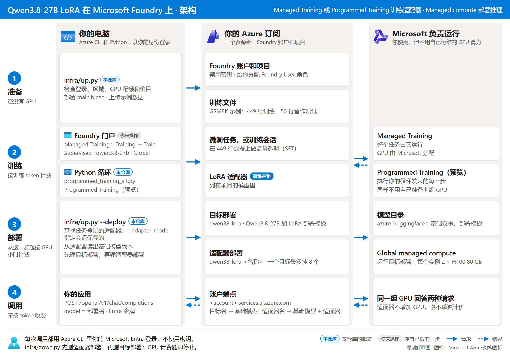
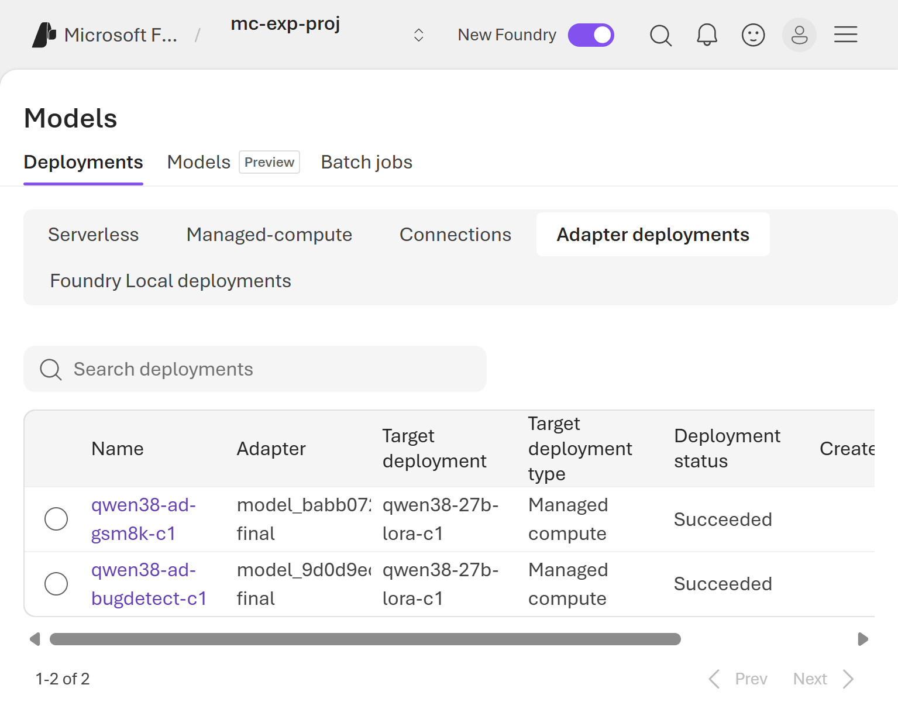

# Qwen3.8-27B LoRA 在 Microsoft Foundry 上：用 Managed Training 或 Programmed Training 训练适配器，用 Managed compute 部署推理

[](#目的)
[](#managed-training-和-programmed-training)
[](#实现效果)
[](#操作步骤)
[](docs/TESTING_CN.md)

作者：魏新宇 · [English](README.md)

> **草稿。** 还有两次运行没做。`infra/up.py`、`infra/verify.py` 和 `infra/down.py` 还没有在一个新资源组里从头到尾连续执行过。`training/programmed_training_sft.py` 只跑过本地准备：它的训练函数就是“实现效果”里那次会话用的函数，但这个脚本本身还没有开过会话，`infra/up.py --adapter-model` 也还没有建过部署。操作步骤里的示例输出是按脚本写出来的。两次运行都完成后，本提示会删除。

## 目的

想让开放权重的模型按自己的格式作答，团队通常要找两次 GPU：一次用来微调，一次用来部署微调结果。对 **Qwen3.8-27B**（预览），Microsoft Foundry 把这两件事都做成了托管服务。**Managed Training**（托管训练）用 Microsoft 分配的 GPU 跑监督微调任务，交回一个 LoRA 适配器。**Programmed Training**（预览）训练的是同一种适配器，训练循环是你自己写、自己运行的 Python 代码。**Managed compute**（托管计算）用独占 GPU 部署基础模型，并把适配器挂到上面。从训练到部署之间有几处细节，出错就要花钱：适配器要先登记到项目里才能部署；推理部署必须用支持 LoRA 的部署模板，基础模型版本要和训练适配器时一致；GPU 从部署建好到删除，每小时都在计费；删除还有先后顺序。

本仓库把两种训练方式的这条路径都做成了脚本，每个计费的步骤都要你明确执行：

- **准备，不开 GPU。** `infra/up.py` 检查登录、区域、GPU 配额和当前目录价，用 `infra/main.bicep` 创建禁用密钥认证的 Foundry 账户和项目，给你分配 Foundry User 角色，并上传 GSM8K 示例文件（449 行训练数据，50 行验证数据）。
- **训练，按训练 token 计费。** 示例适配器有两种训练方法。用 Managed Training，你在门户的 Training 页面提交一个监督微调任务。用 Programmed Training，`training/programmed_training_sft.py` 在你的电脑上运行训练循环，Foundry 在一个会话里执行它的 56 个优化步；加 `--prepare` 时，脚本先给出训练计划和目录价，不开会话。两种方法训练出的适配器，都会作为 LoRA 模型列在项目里。
- **部署，按 GPU 小时计费。** `infra/up.py --deploy` 创建一个目标部署（Qwen3.8-27B，2 × H100 80 GB），再为每个训练好的适配器创建一个适配器部署，然后各调用一次。Programmed Training 会话保存的适配器，用 `--adapter-model` 指定。
- **调用。** 一个 OpenAI 兼容端点。请求里的 `model` 字段决定谁来回答：填目标部署的名称是基础模型，填适配器部署的名称是基础模型加适配器。
- **删除。** `infra/down.py` 删除适配器部署和目标部署，GPU 计费随即停止。

**两种方式都用同一份数据实际跑过。** 449 行数据在一个 Managed Training 任务里训练出一个适配器，又在一个 Programmed Training 会话里训练出第二个。两个适配器都部署到了 Managed compute，并在同样的 50 行验证数据上和基础模型做了对比。方法和数字见[示例适配器改变了什么](#示例适配器改变了什么)和[同一份数据用 Programmed Training 训练](#同一份数据用-programmed-training-训练)。

**部署由本仓库的脚本完成：**[`infra/up.py`](#2-创建-foundry-资源不开-gpu) 创建资源和部署，[`training/programmed_training_sft.py`](#3-训练适配器) 用 Programmed Training 训练，[`infra/verify.py`](#5-检查) 从公网端点检查部署，[`infra/down.py`](#7-删除) 负责删除。

| 交付物 | 位置 | 用途 |
|---|---|---|
| 部署自动化 | `infra/up.py`、`infra/main.bicep`、`infra/foundry.py` | 创建账户、项目和角色，上传示例数据；加 `--deploy` 时创建目标部署和适配器部署；`--adapter-model` 把 Programmed Training 保存的适配器也部署上 |
| Programmed Training 训练循环 | `training/programmed_training_sft.py` | 在你的电脑上用 Python 循环训练示例适配器；加 `--prepare` 时只检查数据、给出训练计划和目录价，不开会话 |
| 部署检查 | `infra/verify.py` | 确认基础模型和每个适配器都能回答；加 `--full` 时在 50 行验证数据上对比两者，并测流式速度 |
| 删除 | `infra/down.py` | 停止 GPU 计费；加 `--all` 时删除并清除账户 |
| 客户端示例 | `examples/chat.py` | 只用 Python 标准库，向某个部署发送你自己的问题 |
| 离线测试 | `tests/test_offline.py` | 不连 Azure，检查选适配器和命名、读取会话结果、判分和回执的逻辑 |
| 测试说明 | [`docs/TESTING_CN.md`](docs/TESTING_CN.md) | 每项检查证明了什么，哪些没有测 |

它不是什么：

- 它不证明微调让 Qwen3.8-27B 的算术更好。示例任务只有 6 个优化步，Programmed Training 会话有 56 个。在 50 行验证数据上，两个适配器都改变了每个回答的风格和长度；答对行数的差别，两个都在随机波动范围内（见[实现效果](#示例适配器改变了什么)）。
- 它不能替你拿到 Programmed Training 的使用资格。这项预览功能要先为订阅[申请访问权限](https://aka.ms/foundry-interactive-training-signup)，获批之后才能开会话；它的脚本还要用 [Foundry 微调 cookbook](https://github.com/microsoft-foundry/fine-tuning) 的 Python 环境，其他脚本不需要。
- Qwen3.8-27B 的微调和 [Managed compute 上的 LoRA 适配器](https://learn.microsoft.com/en-us/azure/foundry/how-to/deploy-lora-managed-compute)都是预览功能：没有服务级别协议，Microsoft 不建议用于生产负载。
- 它不是生产环境的网络和内容安全方案。账户可以从公网访问，只接受 Microsoft Entra 登录；Managed compute [没有内置内容过滤](https://learn.microsoft.com/en-us/azure/foundry/concepts/managed-compute-overview)。
- 它不能一直开着不管。目标部署按目录价每小时 15.82 美元，有没有请求都收。

| 分工 | Microsoft Foundry | 本仓库 | 你 |
|---|---|---|---|
| 训练 | 分配 GPU；运行 Managed Training 任务，或执行 Programmed Training 循环发来的每一步；把适配器列到项目里 | 上传示例数据，提供 Programmed Training 的训练循环，找到适配器 | 在 Training 页面提交任务，或运行训练脚本；按训练 token 付费 |
| 推理 | 基础权重、LoRA 部署模板、GPU、端点 | 按顺序创建目标部署和适配器部署，固定基础模型版本 | 准备 GPU 配额；删除目标部署之前按 GPU 小时付费 |
| 访问控制 | Microsoft Entra ID 和 Azure 角色 | 禁用账户密钥，给你分配 Foundry User | 登录；给你的应用身份分配同一角色 |
| 内容安全与网络 | Managed compute 没有内置内容过滤 | 不包含 | 按业务场景补上内容过滤和网络隔离 |



图里画的是：四个阶段，哪些由本仓库的脚本完成、哪些由你自己操作，你的订阅里创建了什么，哪些由 Microsoft 运行。这是原创解释图；本页数字是在哪里测的，见[实现效果](#示例适配器改变了什么)。“训练”一行画了两种方式：在门户里发起 Managed Training 任务，或者运行 `training/programmed_training_sft.py`，由它在你电脑上的循环驱动一个 Programmed Training 会话。“部署”一行是 `infra/up.py --deploy` 做的事：Managed Training 任务的适配器它自己能找到，Programmed Training 的适配器按你用 `--adapter-model` 传入的名称来取。

### 一次请求怎么走

1. **准备。** `infra/up.py` 读取 Azure CLI 的登录状态、区域、H100 的 Global managed compute 配额和目录价，然后部署 `infra/main.bicep`：一个禁用密钥认证的 Foundry 账户、一个项目，以及你在该账户上的 Foundry User 角色。它从 [`microsoft-foundry/fine-tuning`](https://github.com/microsoft-foundry/fine-tuning) 的固定提交下载两个 GSM8K 示例文件，核对 SHA-256 后上传到项目。
2. **训练。** 你在门户的 Training 页面选择 Supervised、qwen3.8-27b、Global 和上传好的两个文件。Managed Training 让任务排队，用 Microsoft 分配的 GPU 训练，把结果登记到项目的 Models 页面，类型是 LoRA 模型（rank 32）。任务的 `metadata.deployment_options` 里随后会带上适配器的 ID。`up.py` 找的就是这个：一个已成功、适配器已登记到项目的任务。用 Programmed Training 时，`training/programmed_training_sft.py` 为 `Qwen/Qwen3.8-27B` 开一个会话，每批 16 行数据作为一个优化步发过去，保存最后一个检查点，然后关闭会话。项目同样把这个检查点列为 LoRA 模型，标签里记着会话。没有任务指向它，所以要用 `--adapter-model` 把它的名称告诉 `up.py`。
3. **部署。** `infra/up.py --deploy` 从已登记的适配器读出基础模型版本，再查一次配额，然后发送 `PUT .../managedComputeDeployments/qwen38-lora`：SKU 为 `GlobalManagedCompute`，使用 LoRA 部署模板、`H100_80GB` 和 `NoAutoUpgrade`，让基础模型停在适配器对应的版本上。目标部署变为 `Succeeded` 后，再为每个适配器发送 `PUT .../adapterDeployments/<name>`，带上适配器 ID 和目标部署的名称。
4. **调用。** 你的应用向 `https://<账户>.services.ai.azure.com/openai/v1/chat/completions` 发请求。`"model": "qwen38-lora"` 由基础模型回答；`"model": "qwen38-lora-gsm8k"` 由同一组 GPU 加上适配器回答。名称不存在时返回 HTTP 404 `DeploymentNotFound`。
5. **登录与密钥。** 每次调用都带 Microsoft Entra 令牌：创建和删除资源时面向 `https://management.azure.com`，上传文件、列出任务和调用模型时面向 `https://ai.azure.com`。脚本从 Azure CLI 的登录取令牌。账户没有密钥，脚本也不往仓库里写任何东西。
6. **删除。** `infra/down.py` 先删适配器部署，最后删目标部署，一次删一个，并逐个读回确认已经不存在。

### Managed Training 和 Programmed Training

Foundry 有两种训练方式。**Managed Training**（托管训练）：你提交数据和设置，训练任务由 Foundry 运行。**Programmed Training**（预览）：每一步采样和参数更新由你自己的 Python 循环决定，Foundry 负责执行这些操作。[第 3 步](#3-训练适配器)两种都有：选项 A 在门户里提交 Managed Training 任务，选项 B 运行 `training/programmed_training_sft.py` 里的循环。两种方式在同一份数据上各自的结果见[实现效果](#实现效果)。


来源：Microsoft Learn，[Training in Microsoft Foundry](https://learn.microsoft.com/en-us/azure/foundry/fine-tuning/overview#choose-your-training-approach) 的 “Choose your training approach” 一节。这是 2026 年 11 月 23 日该页面上这张表的截图（页面最后更新于 2026 年 11 月 17 日）。表里五行依次是：怎么运作、适合谁、你能控制什么、训练方法、典型用途。

看什么：**Your control**（你能控制什么）一行。用 Managed Training 时，你选数据和它支持的超参数，[第 3 步](#3-训练适配器)的示例任务只需要这些。用 Programmed Training 时，每一步怎么做都由循环自己定：本仓库的脚本把 batch size 设为 16，这样 449 行数据有 56 个优化步；示例任务用的是服务默认值 128，只有 6 个。Programmed Training 要先[申请访问权限](https://aka.ms/foundry-interactive-training-signup)。

文章接下来还有四项选择。下表逐项列出：文章列了什么，对这个模型列了什么，本仓库用的是什么：

| 选项 | 文章列出的 | 对 `Qwen3.8-27B`（预览） | 本仓库 |
|---|---|---|---|
| 训练方式 | Managed Training 和 Programmed Training（预览）。两者都跑在 Foundry 管理的训练基础设施上，你不用准备训练 GPU | 两种都支持 | 两种都有，即[第 3 步](#3-训练适配器)的选项 A 和选项 B |
| 定制方法 | 三种预定义方法，都属于 Managed Training：监督微调（SFT）、偏好微调（DPO）和强化微调（RFT）。Programmed Training 没有预定义方法，它的示例仓库里有各种配方 | SFT 和 RFT | 任务用 SFT；会话用监督训练配方 |
| 训练类型 | Standard、Data zone、Global 和 Developer。训练类型决定训练在哪里运行、价格和保障 | Global 和 Developer | 任务用 Global；会话的循环里没有这一项设置 |
| 部署选项 | Serverless：由 Foundry 托管微调后的模型；或者 Managed compute：独占 GPU 运行基础模型，并挂一个或多个 LoRA 适配器（预览） | 只有 Managed compute | Managed compute：一个目标部署，每个适配器一个适配器部署 |
| Foundry 项目所在区域 | Global 训练有 27 个区域 | 其中 10 个支持 Managed Training，11 个支持 Programmed Training | East US 2 |

整篇文章的内容，包括全部 18 个模型、27 个区域、serverless 的几种部署类型和需要提前考虑的限制，整理在 [`docs/FOUNDRY_TRAINING_CN.md`](docs/FOUNDRY_TRAINING_CN.md)。

### 本页用到的术语

| 术语 | 在本页的含义 |
|---|---|
| Managed Training（托管训练） | Foundry 的微调服务：你提交任务，Microsoft 用自己的 GPU 运行，按训练 token 计费 |
| Programmed Training（预览） | Foundry 的第二种训练方式：每一步由你电脑上的 Python 循环决定，训练和采样操作由 Foundry 执行，你不用准备 GPU |
| 会话（session） | 一次 Programmed Training 运行，建在项目里。循环保存的检查点会出现在项目的模型列表里，类型是 LoRA 模型 |
| 监督微调（SFT） | 用成对的示例对话训练，每条都带着你期望的回答 |
| 优化步（optimizer step） | 用一批训练数据算出来的一次适配器权重更新。同样的数据，每批越小，步数越多 |
| LoRA 适配器 | 在冻结的基础模型之上训练出来的一小组附加权重。它只能和训练时用的那个基础模型及版本配合 |
| Managed compute（托管计算） | Foundry 的一种部署方式：模型跑在独占 GPU 上，按 GPU 小时计费，不按 token 计费 |
| 目标部署（target deployment） | 基础模型的 Managed compute 部署，适配器挂在它上面。本仓库里叫 `qwen38-lora` |
| 适配器部署（adapter deployment） | 把一个已登记的适配器挂到目标部署上，并起一个单独的名称。它不增加 GPU。本仓库里叫 `qwen38-lora-<训练任务的显示名>`；用 `--adapter-model` 指定的模型叫 `qwen38-lora-<标签>` |
| Global | 目标部署的 `GlobalManagedCompute` SKU，以及训练任务的 Global 训练类型。两者实际在哪个区域运行，本页没有确定 |
| GSM8K | 小学水平的算术应用题。Foundry 的示例数据有 449 行训练数据和 50 行验证数据，每个参考答案都以 `#### <数字>!!!` 结尾 |
| 验证数据 | 训练任务用来计算验证损失、但不参与训练的 50 行。本页用它对比基础模型和适配器 |
| completion tokens | 模型为一次回答生成的 token 数，取自响应的 `usage` 字段 |

## 实现效果

本节的截图和数字来自在 East US 2 做的两次测试。第一次测试在 2026 年 11 月 22、23 日，用的是 Managed Training：GSM8K 示例数据、默认训练设置、seed 42、一个目标部署和两个适配器部署。其中第二个适配器用同样的设置训练，数据是 [`microsoft-foundry/fine-tuning`](https://github.com/microsoft-foundry/fine-tuning) 里的另一套示例 `Text-Bug-Detection`；对比和测速针对的都是 GSM8K 适配器。第二次测试在 2026 年 11 月 23 日，在另一个 Foundry 账户里用 Programmed Training 训练同一份 GSM8K 数据，[单独有一节](#同一份数据用-programmed-training-训练)。那一节之外的截图和数字，除非句子里点明是第二次测试，都属于第一次测试。

<table>
<tr>
<td width="50%"></td>
<td width="50%"></td>
</tr>
<tr>
<td>目标部署：状态 Succeeded，Global Managed Compute，H100_80GB。</td>
<td>同一个目标部署上的两个适配器部署，都是 Succeeded。</td>
</tr>
</table>


看什么：

1. 左图只有一个 Managed compute 部署。GPU 在它上面，按小时计费的也只有它。
2. 右图有两个适配器，Target deployment 一列的值相同。它们共用目标部署的两块 GPU，[不单独计价](https://learn.microsoft.com/en-us/azure/foundry/concepts/adapter-deployment-overview)。
3. Playground 截图是目标部署在回答一道测试题。

以上是真实的门户截图，做过裁剪，订阅名和 Created by 一列的值已遮盖。图里的部署名属于那次测试部署。你的部署叫 `qwen38-lora` 和 `qwen38-lora-<显示名>`，除非传了 `--target`。

### 同一道题，带不带适配器的回答

两次请求的 system 消息相同（`Reply user's question as accurately as possible.`），user 消息也相同，是验证文件的第 7 行（题意：三个女生一小时各做了若干道数学题，问两小时一共做了多少道）：

> Fiona completed 36 math questions in an hour. Shirley was able to complete twice as many math questions within that same time, and Kiana completed half of the sum of Fiona and Shirley's math questions. If they each did the same number of questions the following hour, how many math questions did all three girls complete in 2 hours?

用目标部署的名称调用，基础模型的回答有 385 个 completion tokens，开头和结尾如下：

```text
Here is the step-by-step solution:

**Step 1: Calculate the number of questions each girl completed in the first hour.**

*   **Fiona:** Completed 36 questions.
*   **Shirley:** Completed twice as many as Fiona.
    $$36 \times 2 = 72 \text{ questions}$$
[...]
**Answer:**
All three girls completed **324** math questions in 2 hours.
```

用适配器部署的名称调用，适配器的回答有 65 个 completion tokens，全文如下：

```text
36*2=72
72+36=108
108/2=54
54+72+36=162
162*2=324
#### 324
The answer is: 324
```

看什么：两个回答都对（324）。适配器学到了训练数据那种只列算式的写法，还用上了训练数据的 `####` 标记，基础模型一次也没用过这个标记。训练数据每个答案末尾的 `!!!` 它没有学到。带标记的适配器回答一共 6 个，这一行是其中之一。

### 示例适配器改变了什么

**问题。** 用适配器部署的名称调用，到达的是不是和目标部署名称不同的模型？只用 449 行数据训练出来的适配器，改变了什么？


**方法。** 输入是 `chat_validation.jsonl` 的 50 行，也就是 `up.py` 上传的那个固定文件。每行的 system 和 user 消息原样发送，参考答案不发。每一行分别发给基础模型（`model` 填目标部署的名称）和 GSM8K 适配器（`model` 填适配器部署的名称）各一次，共 100 次调用，同时发 4 个，`temperature` 为 0，`reasoning_effort` 为 `"none"`，`max_tokens` 为 800。两边唯一的差别是 `model` 字段。判分在测试客户端上做，有两种：自动判分，把回答里的最后一个数字和参考答案比较；人工判分，把自动检查对任意一边判错的行逐一读一遍（共 12 行）。测速时把同一条提示词每边发 3 次，一次 1 个流式请求，思考（reasoning）保持默认，`max_tokens` 为 600。

| 在 50 行验证数据上测得 | 基础模型（目标部署的名称） | 基础模型 + GSM8K 适配器（适配器部署的名称） |
|---|---|---|
| 返回 HTTP 200 的行数 | 50 行中的 50 行 | 50 行中的 50 行 |
| 与另一边完全相同的回答 | 50 行中的 0 行 | 50 行中的 0 行 |
| 平均回答长度，completion tokens | 310.2 | 158.7 |
| 在 800 token 上限处被截断的回答 | 50 行中的 2 行 | 50 行中的 0 行 |
| 带训练数据 `####` 标记的回答 | 50 行中的 0 行 | 50 行中的 6 行 |
| 结尾与训练数据一致（`#### <数字>!!!`）的回答 | 50 行中的 0 行 | 50 行中的 0 行 |
| 答对，自动判分（回答里的最后一个数字） | 50 行中的 39 行 | 50 行中的 45 行 |
| 答对，人工读过 12 个被标记的行之后 | 50 行中的 44 行 | 50 行中的 46 行 |

| 流式速度：同一条提示词每边发 3 次，一次 1 个请求 | 基础模型 | 基础模型 + GSM8K 适配器 |
|---|---|---|
| 首 token 之后的每秒 token 数（含思考和正文 token） | 72.5 / 72.1 / 72.6 | 53.4 / 53.4 / 53.4 |
| 到第一个流式 token 的秒数（思考或正文） | 2.16 / 1.15 / 1.28 | 1.63 / 1.38 / 1.30 |

这些数字说明什么：

- **适配器确实在起作用。** 两边没有一个回答完全相同；适配器的回答大约短一半（158.7 对 310.2 个 completion tokens）；`####` 标记只有适配器会用。响应里的 `model` 字段也不同：基础模型返回 `qwen--qwen3.8-27b`，适配器返回形如 `rp-<hash>-1` 的内部 ID，不是部署名。
- **不能说准确率有差别。** 人工读过被标记的行之后，基础模型答对 44 行，适配器答对 46 行。只有适配器答对的有 3 行，只有基础模型答对的有 1 行；对这 4 行做双侧符号检验，p = 0.625。自动判分的 39 对 45 夸大了差距：它取的是文本里的最后一个数字，而基础模型有 5 个正确回答的末句里还有别的数字，比如上面例子里的 “in 2 hours”。
- **格式只学到了一部分。** 示例任务只有 6 个优化步（449 行，2 个 epoch，batch size 128）。适配器学到了简短的写法，50 个回答里有 6 个用了标记，完整的结尾一次也没有出现。
- **适配器会降低速度。** 在这条提示词上，同一组 GPU 带适配器时每秒生成 53.4 个 token，基础模型是 72.5 个，少了约 26%。第一个 token 两边都在 1.15 到 2.16 秒之间到达。

局限：一个适配器、一个训练种子、50 行、每行只请求一次、一个目标部署、一台客户端；两边是依次测的（先基础模型），没有交替。测速是单用户测量，不是容量测试；token 数包含思考 token，六个回答里有一个全部是思考。判分细节见 [`docs/TESTING_CN.md`](docs/TESTING_CN.md)。

### 同一份数据用 Programmed Training 训练

**问题。** Programmed Training 训练出来的适配器，能不能像 Managed Training 任务的适配器那样部署到 Managed compute？同样的 449 行数据，优化步从 6 个变成 56 个，回答有什么变化？


**方法。** 第二次测试在 East US 2 的另一个 Foundry 账户里做，所在订阅已获得 Programmed Training 的访问权限。训练按 Foundry 微调 cookbook 里的监督对话数据配方（[`programmed_training/docs/custom-data.md`](https://github.com/microsoft-foundry/fine-tuning/blob/0b8bcfe9519ed382a5bc202f0f1b2ce65c22a2c9/programmed_training/docs/custom-data.md)）进行。测试客户端上的一个 Python 循环读取同样两个固定版本的 GSM8K 文件，用 cookbook 为这个模型提供的渲染器（`qwen3_8_low_reasoning`）把每一行渲染成模型的对话格式，再一批一批发给 `Qwen/Qwen3.8-27B` 的训练会话。这个循环现在就是 [`training/programmed_training_sft.py`](training/programmed_training_sft.py)：准备数据和运行会话的函数，就是这次测试里跑的那些。设置：LoRA rank 32，2 个 epoch，batch size 16，学习率从 0.0001 开始线性降到零，种子 42，只对助手的回答计算损失。第一步之前、第一个 epoch 之后和训练结束时，循环各在 50 行验证数据上算一次损失，不更新适配器。循环保存了最后一个检查点，项目随后把它列为一个 LoRA 模型（rank 32），基础模型版本是 3。这个模型的 ID 和 Managed Training 适配器的 ID 形式相同：`azureai://accounts/<account>/projects/<project>/models/<model name>/versions/1`。

部署用的是[一次请求怎么走](#一次请求怎么走)第 3 步的两个请求：先建目标部署，部署模板、模型版本和 GPU 与第一次测试相同；再建一个适配器部署，用上面那个 ID 指向保存下来的模型。这次测试里，两个请求是另一个脚本发的；`infra/up.py --deploy --adapter-model` 发的是同样的两个请求。cookbook 自带一个部署脚本 `scripts/deploy_to_foundry.py`，说明见 [`docs/deployment-and-inference.md`](https://github.com/microsoft-foundry/fine-tuning/blob/0b8bcfe9519ed382a5bc202f0f1b2ce65c22a2c9/programmed_training/docs/deployment-and-inference.md)。在这个提交上，它唯一的部署目标是 `Fireworks`，这是一种预配置（provisioned）部署，要另外申请预览权限；它没有 Managed compute 这个目标，本次测试也没有用它。

对比沿用上一节的方法，同样的 50 行、同样的请求设置：共 100 次调用，同时发 4 个，先测基础模型。自动判分把基础模型的 11 个回答判为错：其中 8 个的文本和第一次测试里已经人工读过的回答一字不差，沿用当时的结论；另外 3 个重新读过。适配器有 7 个回答被判错；这些回答都以 `#### <数字>!!!` 结尾，所以拿去比较的数字就是适配器的最终答案。

| 在 449 行数据上训练 2 个 epoch | Managed Training 任务（第一次测试） | Programmed Training 会话（第二次测试） |
|---|---|---|
| batch size | 128，服务默认值 | 16，在循环里设定 |
| 优化步数 | 6 | 56 |
| 学习率 | 从 0.0001 开始，线性降到零 | 从 0.0001 开始，线性降到零 |
| 50 行验证数据上的验证损失，报告的第一个值 | 0.91 | 0.91 |
| 50 行验证数据上的验证损失，报告的最后一个值 | 0.53 | 0.41 |
| 训练 token | 计费 213,000 个 | 循环自己统计 219,652 个 |
| 这些 token 按目录价的费用，美元 | 0.64 | 0.90，估算值 |
| 用时 | 从创建到结束 5.3 分钟 | 循环本身 6 分钟，从启动脚本到退出 9 分钟 |

| 在 50 行验证数据上测得 | 基础模型（第二次测试） | 基础模型 + Programmed Training 适配器（第二次测试） | 对照：基础模型 + Managed Training 适配器（第一次测试，取自上一张表） |
|---|---|---|---|
| 返回 HTTP 200 的行数 | 50 行中的 50 行 | 50 行中的 50 行 | 50 行中的 50 行 |
| 与同一次测试里基础模型完全相同的回答 | 不适用 | 50 行中的 0 行 | 50 行中的 0 行 |
| 平均回答长度，completion tokens | 311.2 | 115.7 | 158.7 |
| 在 800 token 上限处被截断的回答 | 50 行中的 2 行 | 50 行中的 0 行 | 50 行中的 0 行 |
| 带训练数据 `####` 标记的回答 | 50 行中的 0 行 | 50 行中的 50 行 | 50 行中的 6 行 |
| 结尾与训练数据一致（`#### <数字>!!!`）的回答 | 50 行中的 0 行 | 50 行中的 50 行 | 50 行中的 0 行 |
| 答对，自动判分（回答里的最后一个数字） | 50 行中的 39 行 | 50 行中的 43 行 | 50 行中的 45 行 |
| 答对，人工读过被标记的行之后 | 50 行中的 44 行 | 50 行中的 43 行 | 50 行中的 46 行 |

第 7 行，也就是[上面](#同一道题带不带适配器的回答)展示的那道题，这个适配器用 149 个 completion tokens 作答。基础模型对这道题的回答和第一次测试一字不差。下面是适配器的完整回答：

```text
Shirley completed 36*2=<<36*2=72>>72 math questions.
Fiona and Shirley completed 36+72=<<36+72=108>>108 math questions.
Kiana completed 108/2=<<108/2=54>>54 math questions.
All three girls completed 108+54=<<108+54=162>>162 math questions.
In 2 hours, they completed 162*2=<<162*2=324>>324 math questions.
#### 324!!!
```

看什么：最后一行。上面 Managed Training 适配器的回答停在 `#### 324`，后面还跟了一句话。这个回答的结尾和训练数据里的每个答案完全一样，每步计算也用了训练数据的 `<<...>>` 写法。

这些数字说明什么：

- **部署和调用的方式与 Managed Training 的适配器相同。** 适配器部署 78 秒后变为 `Succeeded`，第一次调用返回 HTTP 200。响应的 `model` 字段同样是形如 `rp-<hash>-1` 的内部 ID。
- **这个适配器的每个回答都是训练数据的格式。** 50 个回答全部以 `#### <数字>!!!` 结尾。Managed Training 的适配器只有 6 个回答用了标记（共 50 个），完整的结尾一次也没有出现。回答平均 115.7 个 completion tokens，比基础模型 311.2 个的三分之一略多。
- **不能说准确率有差别。** 基础模型答对 44 行，适配器答对 43 行。只有适配器答对的有 2 行，只有基础模型答对的有 3 行；对这 5 行做双侧符号检验，p = 1.0。自动判分的 39 对 43 低估了基础模型，原因和上一节相同：它有 5 个正确回答的末句里还有别的数字。
- **验证损失比示例任务降得更低。** 第一个 epoch 之后从 0.91 降到 0.42，第二个 epoch 之后是 0.41；只有 6 步的示例任务结束时是 0.53。两边都从 0.91 开始：同一个基础模型、同样的 50 行，如果两个服务计算损失的方法相同，起点就应该一样；除了这一点吻合，两者的算法是否相同没有另外核对。
- **两个适配器的差别，不能当成两种训练方式的优劣结论。** 两次训练的数据、基础模型及其版本、2 个 epoch、LoRA rank 32 和学习率的变化方式都相同。不同的是 batch size，16 对 128，优化步数也就不同，56 对 6。Managed Training 任务内部怎么做（优化器设置、提示词渲染），从外部看不到；用 batch size 16 的 Managed Training 也没有跑过。

局限：一个会话、一个种子、50 行、每行只请求一次；先测基础模型，没有交替。Managed Training 的适配器是在另一个账户的另一个目标部署上测的，没有和这个适配器放在一起测；`temperature` 为 0 时，基础模型自己的回答在两次测试之间也有 8 行不同（共 50 行）。这个适配器没有重测速度。第二次测试的费用是按 token 数和目录价估算的，没有读账单。

### 耗时与费用

| 阶段 | 第一次测试的实测值 |
|---|---|
| 示例数据的训练任务，在门户提交 | 从创建到结束 5.3 分钟 |
| 同样的数据和设置，通过 API 提交 | 从创建到结束 9.0 分钟；其中 6 个训练步用了 77 秒，其余是排队和预处理 |
| 目标部署，从发出请求到 `Succeeded` | 21 分钟 |
| `Succeeded` 之后第一次调用成功 | 8 秒 |
| 每个适配器部署，从发出请求到 `Succeeded` | 64 秒（测了 2 个） |
| 删除 2 个适配器部署和目标部署 | 5 分钟 |
| 部署存在期间收到的请求 | 164 个，全部返回 HTTP 200 |

第二次测试用的是 Programmed Training 的适配器，有一个阶段不同，部署时要留意：第一次调用成功是在 `Succeeded` 之后 553 秒，而不是 8 秒。`up.py` 会连续调用 10 分钟才停下。

| 第二次测试的阶段 | 实测 |
|---|---|
| 示例数据的 Programmed Training 会话 | 循环的 56 步用了 6 分钟；从启动脚本到退出 9 分钟 |
| 目标部署，从发出请求到 `Succeeded` | 21 分钟 |
| `Succeeded` 之后第一次调用成功 | 553 秒，约 9 分钟；在这之前的 25 次调用都返回 HTTP 404 |
| 适配器部署，从发出请求到 `Succeeded` | 78 秒 |
| 删除适配器部署和目标部署 | 5 分钟 |
| 部署存在期间收到的请求 | 127 个：102 个返回 HTTP 200，25 个在第一次成功之前返回 HTTP 404 |

| 项目 | 目录价（美元），取自 Azure Retail Prices API，2026 年 11 月 23 日读取 | 何时计费 |
|---|---|---|
| 目标部署 | 每 H100 GPU 小时 7.91 × 2 块 GPU = 每小时 15.82，即每天 379.68 | 只要目标部署存在就计费，有没有请求都一样 |
| 适配器部署 | 不单独计价 | 不计费 |
| 请求 | Managed compute 不按 token 计价 | 不计费 |
| 示例数据的 Managed Training 任务 | 每百万训练 token 3.00；计费 213,000 个 token = 0.64 | 每个任务一次 |
| 示例数据的 Programmed Training 会话 | 每百万训练 token 4.10；循环自己统计 219,652 个 token = 0.90 | 循环每发送一个 token 都计费。这个数是估算值：第二次测试的账单没有读 |
| 账户、项目、上传的文件 | 没有按小时的价格 | 测试资源组的账单里只有 GPU 小时和训练 token 两类 |

部署一小时加一次 Managed Training 训练，按目录价是 16.46 美元。`up.py` 在创建任何资源之前会读取当前目录价并打印出来。

| 你想 | 读这里 |
|---|---|
| 在自己的订阅里部署 | [操作步骤](#操作步骤) |
| 了解每项检查证明了什么、回答怎么判分、哪些没有测 | [`docs/TESTING_CN.md`](docs/TESTING_CN.md) |
| 查 Foundry 训练支持哪些模型、训练类型、部署选项和区域 | [`docs/FOUNDRY_TRAINING_CN.md`](docs/FOUNDRY_TRAINING_CN.md) |
| 了解示例数据、图标和截图的来源 | [`NOTICE.md`](NOTICE.md) |

| 目录 | 内容 |
|---|---|
| `infra/` | `main.bicep`（账户、项目、角色）、`up.py`、`verify.py`、`down.py`，以及公共函数 `foundry.py` |
| `training/` | `programmed_training_sft.py`，用示例数据做 Programmed Training 的训练循环；要在 cookbook 的 Python 环境里运行 |
| `examples/` | `chat.py`，一个最小的客户端 |
| `tests/` | 脚本逻辑的离线测试 |
| `docs/` | 测试说明，以及 Microsoft Learn 上 Foundry 训练一文的摘要，各有中英文两版 |
| `images/` | 三张示意图、三张门户截图和一张 Microsoft Learn 表格截图，来源记录在 `SOURCES.json` |

## 操作步骤

| 顺序 | 在哪里 | 做什么 | 命令 | 大约用时 |
|---|---|---|---|---|
| 1 | 你的电脑 | 获取代码并登录 | `git clone`、`az login` | 2 分钟 |
| 2 | 你的电脑 | 创建 Foundry 资源并上传示例数据；不开 GPU | `python infra/up.py --resource-group <name> --location eastus2` | 5 分钟 |
| 3 | Foundry 门户，或你的电脑 | 训练适配器：A 在门户里用 Managed Training，或 B 用脚本跑 Programmed Training | A：Training，然后 Train。B：`<cookbook python> training/programmed_training_sft.py --resource-group <name>` | A：5 到 10 分钟。B：9 分钟，另加一次性的安装 |
| 4 | 你的电脑 | 部署目标和适配器；开始按 GPU 计费 | `python infra/up.py --resource-group <name> --deploy`；做过 3B 的，加上 `--adapter-model <model name>=gsm8k-pt` | 25 到 35 分钟 |
| 5 | 你的电脑 | 检查 | `python infra/verify.py --resource-group <name>` | 1 分钟；加 `--full` 约 5 分钟 |
| 6 | 你的电脑 | 调用 | `python examples/chat.py <chat URL> <deployment> "<question>"` | 几秒 |
| 7 | 你的电脑 | 删除；GPU 计费停止 | `python infra/down.py --resource-group <name>` | 5 分钟 |

所有命令里的 `<name>` 都换成你的资源组名称。`<cookbook python>` 指第 3 步选项 B 安装的那个环境里的 Python。

前提条件：

- **角色。** 第 2 步要创建资源和角色分配，需要订阅或资源组上的 Owner，或者 Contributor 加 Role Based Access Control Administrator。这一步会给你分配账户上的 Foundry User，脚本读写文件、任务和调用模型都靠它。本仓库是以订阅 Owner 的身份测试的。
- **配额。** 订阅里要有 2 块 `H100_80GB` 的 Global managed compute 配额。第 2 步会打印已用和总量。配额不够时见 [Request more quota](https://learn.microsoft.com/en-us/azure/foundry/how-to/deploy-models-managed#request-more-quota)。
- **区域。** 选一个 [Global Managed Training 支持 Qwen3.8-27B](https://learn.microsoft.com/en-us/azure/foundry/fine-tuning/overview) 的区域：Australia East、East US、East US 2、Korea Central、North Central US、Sweden Central、Switzerland North、UAE North、UK South 或 West US 3。本仓库只在 East US 2 测试过部署。
- **工具。** Python 和 Azure CLI。除了第 3 步的选项 B，不需要安装任何 Python 包。测试环境是 Windows 11 上的 Python 3.13.15、Azure CLI 2.93.0 和 Bicep CLI 0.49.2（Azure CLI 首次使用时会自动安装 Bicep）。Linux 和 macOS 没有测试。
- **只有第 3 步的选项 B（Programmed Training）需要。** 订阅要有[访问权限](https://aka.ms/foundry-interactive-training-signup)：通过预览申请表提交，获批之后才能开会话。另外要有第二个 Python 环境，里面装着 [Programmed Training cookbook](https://github.com/microsoft-foundry/fine-tuning/tree/0b8bcfe9519ed382a5bc202f0f1b2ce65c22a2c9/programmed_training)；cookbook 要求 Python 3.11 或更新版本、Git，并且能访问 PyPI 和 Hugging Face。测试时用的是 Python 3.13.15，身份是订阅 Owner，在账户上有 Foundry User 和 Azure AI Developer 两个角色。只有 Foundry User 能不能开会话，没有测试。

### 1. 获取代码并登录

```powershell
git clone --filter=blob:none --sparse https://github.com/david-xinyuwei/david-share.git
cd david-share
git sparse-checkout set Agents/Foundry-Model-Training-and-Inference
cd Agents/Foundry-Model-Training-and-Inference

az login
az account set --subscription "<subscription name or ID>"
python -m unittest discover -s tests
```

最后一条命令运行离线测试，不需要访问 Azure，结尾是：

```text
Ran 29 tests in <n>s

OK
```

### 2. 创建 Foundry 资源（不开 GPU）

```powershell
python infra/up.py --resource-group <name> --location eastus2
```

你会看到类似下面的输出。尖括号里的值每次部署都不同：

```text
<time> [PASS] 1/7 Preflight: subscription <your subscription>; region eastus2; Global H100_80GB quota: <used> used of <limit> GPUs (the target needs 2); target list price 15.82 USD per hour (2 x 7.91)
<time> deploying infra/main.bicep into resource group <name> (eastus2) ...
<time> waiting for the Foundry User role to take effect (project API answered HTTP <code>) ...
<time> [PASS] 2/7 Azure resources (infra/main.bicep): account ftlora-<hash>, project lora-demo, endpoint https://ftlora-<hash>.services.ai.azure.com
<time> [PASS] 3/7 Sample data: gsm8k-train.jsonl 449 rows (file-<id>); gsm8k-validation.jsonl 50 rows (file-<id>)
<time> [INFO] 4/7 Trained adapter: no registered LoRA adapter: no training job yet

NEXT: train the adapter on the portal's Training page (about 5 to 10 minutes; list price about 0.64 USD).
  [six numbered portal steps, the same as in step 3 below]
Then run:  python infra/up.py --resource-group <name> --deploy
Or train it with Programmed Training (preview): training/programmed_training_sft.py, step 3 of the README.

RESULT: PASS   receipt: <home>/.foundry-lora/<name>/up-receipt.json
```

“waiting for the Foundry User role” 这一行可能重复几分钟：新分配的角色要过一会儿，项目才接受你的令牌。这一步创建的资源都没有按小时的价格。

| 创建的资源 | 名称 | 说明 |
|---|---|---|
| 资源组 | `<name>` | 不存在时创建，并打上标签 `solution=foundry-managed-training-lora` |
| Foundry 账户 | `ftlora-<hash>` | 类型 `AIServices`，禁用密钥认证；名称同时是端点的子域名 |
| Foundry 项目 | `lora-demo` | 存放文件、训练任务和已登记的适配器 |
| 角色分配 | 你在该账户上的 Foundry User | 要分配给别的身份，传 `--principal-id` 和 `--principal-type` |
| 两个上传的文件 | `gsm8k-train.jsonl`、`gsm8k-validation.jsonl` | 449 行和 50 行，已按固定的 SHA-256 核对 |

脚本的状态保存在仓库之外的 `<home>/.foundry-lora/<name>/`：`up-receipt.json`、`verify-report.json`、`down-receipt.json`、`run.log`、`state.json` 和下载的示例文件。再次运行同一条命令，会从已有的资源接着做，已经到位的不会改动。

| `up.py` 的参数 | 默认值 | 含义 |
|---|---|---|
| `--resource-group` | 必填 | 要创建或复用的资源组 |
| `--location` | `eastus2` | 新部署所在区域；资源组里已有部署时忽略 |
| `--subscription` | Azure CLI 当前订阅 | 订阅名称或 ID |
| `--account-name` | `ftlora-<hash>` | Foundry 账户名，必须全局唯一 |
| `--project-name` | `lora-demo` | Foundry 项目名 |
| `--target` | `qwen38-lora` | 目标部署的名称；适配器部署命名为 `<target>-<显示名>` |
| `--deploy` | 关 | 创建目标部署和适配器部署（第 4 步） |
| `--adapter-model NAME[=LABEL]` | 无 | 把项目里的这个 LoRA 模型也部署上，比如第 3 步选项 B 保存的适配器；`LABEL` 是适配器部署名称的后半段；可以重复使用 |
| `--wait-training MINUTES` | 0 | 在这段时间内持续检查适配器是否已登记 |
| `--train-api` | 关 | 通过 API 提交训练任务（见第 3 步） |
| `--principal-id`、`--principal-type` | 你自己 | 获得 Foundry User 的身份 |
| `--ignore-recent-teardown` | 关 | 跳过 `down.py` 之后的等待期（见第 4 步） |

### 3. 训练适配器

选一种，或者两种都做：一个目标部署最多能挂 8 个适配器。

| 区别 | A. Managed Training：在门户里操作 | B. Programmed Training（预览）：运行脚本 |
|---|---|---|
| 训练在哪里跑 | 一个任务，从头到尾由 Foundry 运行，GPU 由 Microsoft 分配 | 循环在你的电脑上；循环发来的每一步由 Foundry 执行，GPU 由 Microsoft 运行 |
| 你能设置什么 | 数据，以及向导里提供的设置 | 每一步：脚本定了 batch size 16、2 个 epoch、学习率和什么时候算验证损失 |
| 除了第 2 步，还需要什么 | 不需要别的 | 访问权限和 cookbook 的 Python 环境，见前提条件 |
| 示例数据会跑成什么样（数字是[实现效果](#同一份数据用-programmed-training-训练)里测到的） | 6 个优化步；213,000 个训练 token，按目录价 0.64 美元；5.3 分钟 | 56 个优化步；219,652 个训练 token，按目录价约 0.90 美元；9 分钟 |
| 第 4 步怎么找到适配器 | 通过它的训练任务 | 按你用 `--adapter-model` 传入的模型名称 |

#### A. Managed Training：在门户里操作

1. 打开 [https://ai.azure.com](https://ai.azure.com)，打开页头的 **New Foundry** 开关，选择项目 `lora-demo`。
2. 在左侧菜单选 **Training**，再点 **Train**，打开向导 **Train a model**。
3. **Basic details：** 确认选中的是 **Supervised**、**qwen3.8-27b** 和 **Global**，点 **Next**。
4. **Datasets：** **Training data source** 选 `gsm8k-train.jsonl`，**Validation data source (optional)** 选 `gsm8k-validation.jsonl`，点 **Next**。
5. **Optional settings：** 在 **Enter a display name** 里输入 `gsm8k`。本页的数字是用 seed `42` 训练出来的；想用同一个 seed，就在 seed 输入框里填它。**Number of epochs** 和 **Learning rate multiplier** 保持 Default。点 **Submit**。
6. 等任务结束。之后在 **Models** 页面的 **Models** 标签页里能看到这个适配器。

显示名会成为适配器部署名称的后半段：`gsm8k` 对应 `qwen38-lora-gsm8k`。想在自己电脑上确认，再运行一次第 2 步的命令，输出的第 4 步会变成：

```text
<time> [PASS] 4/7 Trained adapter: qwen38-lora-gsm8k <- model_<id>-final/versions/1
```

为什么要在门户里提交：我们测试时，如果项目里从未有过在门户提交的任务，通过 API 提交的任务虽然显示成功，却没有登记适配器（3 个任务中的 3 个，分布在两个区域），也就没有东西可部署。在门户提交的任务都登记了适配器（2 个中的 2 个），之后在同一个项目里通过 API 提交的任务也都登记了（3 个中的 3 个）。原因不明。`up.py --train-api` 用于后一种情况，通过 API 提交任务；任务成功却没有登记适配器时，`up.py` 会说明情况，并且不启动 GPU。

#### B. Programmed Training：运行脚本

先把 Programmed Training cookbook 装好，只需要装一次，放在本仓库之外的目录里。命令取自它的[快速入门](https://github.com/microsoft-foundry/fine-tuning/blob/0b8bcfe9519ed382a5bc202f0f1b2ce65c22a2c9/programmed_training/docs/quickstart.md)，提交固定在编写本脚本时用的那一个：

```powershell
git clone https://github.com/microsoft-foundry/fine-tuning.git
cd fine-tuning
git checkout 0b8bcfe9519ed382a5bc202f0f1b2ce65c22a2c9
cd programmed_training
python -m venv .venv
.\.venv\Scripts\python.exe -m pip install --upgrade pip
.\.venv\Scripts\python.exe -m pip install -e . --index-url https://pypi.org/simple --extra-index-url https://download.pytorch.org/whl/cpu
```

上面和下面的命令按 Windows 的 PowerShell 写；在 Linux 或 macOS 上，这个环境的 Python 是 `.venv/bin/python`，不是 `.venv\Scripts\python.exe`。回到本仓库的目录，把那个环境里 Python 的路径放进 `$py`，然后运行本地准备。它从 Hugging Face 下载模型的分词器，渲染每一行数据，给出训练计划。这一步不登录 Azure，也不开会话：

```powershell
$py = "<cookbook folder>\programmed_training\.venv\Scripts\python.exe"
& $py training/programmed_training_sft.py --resource-group <name> --prepare
```

```text
<time> [PASS] 1/5 Sample data: gsm8k-train.jsonl 449 rows; gsm8k-validation.jsonl 50 rows; pinned SHA-256 checked
<time> [PASS] 2/5 Local preparation: 28 batches x 16 rows = 448 of 449 rows per epoch, 2 epochs, 56 optimizer steps; about 219768 training tokens, at the list price of 4.10 USD per million training tokens about 0.90 USD; validation: 50 rows, 12014 tokens per pass; longest row 592 tokens

RESULT: PASS   receipt: <home>/.foundry-lora/<name>/train-receipt.json

Nothing was sent to Azure. To train, run the same command without --prepare (billed per training token).
```

用示例数据时，计划总是上面这一份。接下来开始训练。这条命令会开一个会话，在脚本把它关闭之前按训练 token 计费：

```powershell
& $py training/programmed_training_sft.py --resource-group <name>
```

```text
<time> [PASS] 3/5 Project: account ftlora-<hash>, project lora-demo, endpoint https://ftlora-<hash>.services.ai.azure.com/api/projects/lora-demo
<time> starting ONE Programmed Training session on Qwen/Qwen3.8-27B (LoRA rank 32); billed per training token until the session is closed
Session ready: session_id=session_<id>
[progress lines of the cookbook's training loop]
Session closed: session_id=session_<id>
<time> [PASS] 4/5 Training session: session_<id>: 56 of 56 optimizer steps, <n> training tokens; training loss <n> -> <n>; validation loss <n> -> <n>; session closed; run folder <run folder>
<time> [PASS] 5/5 Saved adapter: model_<id>-final (LoRA rank 32) on qwen--qwen3.8-27b/versions/<version>

RESULT: PASS   receipt: <home>/.foundry-lora/<name>/train-receipt.json

Adapter : model_<id>-final  (a LoRA model of project lora-demo)
Deploy  : python infra/up.py --resource-group <name> --deploy --adapter-model model_<id>-final=gsm8k-pt
```

成功的标志：`56 of 56 optimizer steps`，验证损失下降（我们那次会话从 0.91 降到 0.41），最后两行给出保存下来的模型名称。会话在每个 epoch 结束时各保存一个检查点，项目把两个都列为 LoRA 模型，5/5 这一步给出的是最后那个。把 `Deploy` 那一行复制下来，它就是第 4 步要运行的命令。

循环怎么写由你决定。各项设置是脚本开头的 `SETTINGS` 常量；改完先用 `--prepare` 看新的训练计划和目录价，再决定要不要花钱开会话。会话不能续跑：再运行一次这条命令，开的是一个新会话，会再计一次费。

### 4. 部署目标和适配器（开始按 GPU 计费）

```powershell
python infra/up.py --resource-group <name> --deploy
```

```text
<time> [PASS] 4/7 Trained adapter: qwen38-lora-gsm8k <- model_<id>-final/versions/1
<time> creating target deployment qwen38-lora: 2 x H100_80GB, 15.82 USD per hour at list price, until you run down.py
<time> target deployment qwen38-lora: Creating (<n> min)
<time> target deployment qwen38-lora: Succeeded (<n> min)
<time> [PASS] 5/7 Target deployment: qwen38-lora: base qwen--qwen3.8-27b/versions/<version>, 2 x H100_80GB, Succeeded
<time> adapter deployment qwen38-lora-gsm8k: Succeeded (<n> s)
<time> [PASS] 6/7 Adapter deployments: 1 on qwen38-lora: qwen38-lora-gsm8k
<time> [PASS] 7/7 First calls: qwen38-lora -> '8' (served model qwen--qwen3.8-27b, <n> s); qwen38-lora-gsm8k -> '<answer>' (served model rp-<hash>-1, <n> s)

RESULT: PASS   receipt: <home>/.foundry-lora/<name>/up-receipt.json

Endpoint : https://ftlora-<hash>.services.ai.azure.com/openai/v1/chat/completions
Models   : "qwen38-lora" (base model) and "qwen38-lora-gsm8k" (base model + adapter)
Charge   : 15.82 USD per hour at list price for as long as "qwen38-lora" exists. Adapter deployments add nothing.
Check    : python infra/verify.py --resource-group <name>
Stop     : python infra/down.py --resource-group <name>
```

前面的 1/7 到 3/7 会先重复一遍，不改动任何东西。以下三种情况不会启动 GPU：没有已登记的适配器；空闲配额不足 2 块 GPU；`down.py` 删除这个资源组里的目标部署还不到 60 分钟。这个等待期是预防措施，不是测出来的阈值：我们测试时，有两个目标部署分别是在删除之后 23 秒和 33 秒创建的，它们都到了 `Succeeded`，之后模型调用却返回 HTTP 404；另一个在删除 8 小时之后创建的目标部署工作正常。`--ignore-recent-teardown` 可以跳过等待。目标部署刚建好时，7/7 这一步可能连续几分钟打印 `first call to qwen38-lora: HTTP 404; retrying in 30 s`，之后才有第一个回答：我们的两次测试里，一次等了 8 秒，另一次等了 553 秒。

做过选项 B 的，加上模型名称。完整的命令，训练脚本已经在 `Deploy` 那一行打印出来了：

```powershell
python infra/up.py --resource-group <name> --deploy --adapter-model model_<id>-final=gsm8k-pt
```

```text
<time> [PASS] 4/7 Trained adapter: qwen38-lora-gsm8k-pt <- model_<id>-final/versions/1
```

其余各行和上面一样，只是适配器部署的名称换成 `qwen38-lora-gsm8k-pt`；`gsm8k-pt` 是标签，可以自己取。两个选项都做过的，这一条命令会把两个适配器部署到同一个目标部署上。

Managed Training 任务登记的每个适配器，以及用 `--adapter-model` 指定的每个模型，只要是在同一基础模型版本上训练的，都会被部署，一个目标部署最多 8 个。计费持续到第 7 步。

### 5. 检查

```powershell
python infra/verify.py --resource-group <name>
```

```text
<time> [PASS] Target deployment is Succeeded: qwen38-lora: Succeeded, model qwen--qwen3.8-27b/versions/<version>, 2 x H100_80GB
<time> [PASS] Adapter deployments are Succeeded: qwen38-lora-gsm8k: Succeeded
<time> [PASS] The base model answers under the target's name: HTTP 200, <n> s, answer '8', served model qwen--qwen3.8-27b
<time> [PASS] Adapter qwen38-lora-gsm8k answers under its own name: HTTP 200, <n> s, served model rp-<hash>-1 (base: qwen--qwen3.8-27b)
<time> [PASS] An unknown deployment name is rejected: HTTP 404 {"error": {"type": "invalid_request_error", "code": "DeploymentNotFound", [...]

RESULT: PASS   report: <home>/.foundry-lora/<name>/verify-report.json
```

加 `--full` 会在你的部署上重做[实现效果](#示例适配器改变了什么)里的对比：50 行验证数据分别经过基础模型和适配器，然后测流式速度。

```text
<time> [PASS] Held-out rows through qwen38-lora: 50/50 answered; correct by last number <n>; mean <n> completion tokens; <n> cut at 800 tokens; <n> with '####'
<time> [PASS] Held-out rows through qwen38-lora-gsm8k: 50/50 answered; correct by last number <n>; mean <n> completion tokens; <n> cut at 800 tokens; <n> with '####'
<time> [PASS] The adapter changes the answers: <n> of 50 outputs identical to the base model's; rows saved to verify-rows-<time>.jsonl
<time> [PASS] Streaming speed of qwen38-lora: tokens per second <n> / <n> / <n>; first token after <n> / <n> / <n> s
<time> [PASS] Streaming speed of qwen38-lora-gsm8k: tokens per second <n> / <n> / <n>; first token after <n> / <n> / <n> s
```

所有检查通过时退出码为 0，否则为 1。报告里列出每一项检查；加了 `--full` 时，每个回答都保存在报告旁边，可以自己逐行读。“correct by last number” 就是实现效果里说的自动判分，回答长时会低估正确数。

### 6. 在你的代码里调用

```powershell
python examples/chat.py https://ftlora-<hash>.services.ai.azure.com/openai/v1/chat/completions qwen38-lora-gsm8k "A shop sells 12 pens for 3 dollars. How much do 48 pens cost?"
```

脚本先打印回答，再打印实际提供服务的模型和 completion tokens 数。你的应用发出同样的请求即可：

```http
POST https://<account>.services.ai.azure.com/openai/v1/chat/completions
Authorization: Bearer <Microsoft Entra token for https://ai.azure.com>
Content-Type: application/json

{"model": "qwen38-lora-gsm8k", "messages": [{"role": "user", "content": "..."}], "max_tokens": 800, "temperature": 0, "reasoning_effort": "none"}
```

- `model` 填部署名：基础模型是 `qwen38-lora`，适配器是 `qwen38-lora-<显示名>`。不需要 `api-version`，也不需要密钥。
- `"reasoning_effort": "none"` 让模型直接作答。不加的话模型会先思考，思考也占用 `max_tokens`：测速时有一个回答把 600 个 token 的上限全用在了思考上。
- 应用要用它自己的身份登录。重新运行第 2 步并加上 `--principal-id <对象 ID> --principal-type ServicePrincipal`，就能给这个身份分配账户上的 Foundry User。
- 想部署用自己数据训练的适配器，用你的文件和另一个显示名重做第 3 步，再运行一次第 4 步。文件格式见 [Customize a model with fine-tuning](https://learn.microsoft.com/en-us/azure/foundry/openai/how-to/fine-tuning)。

### 7. 删除

```powershell
python infra/down.py --resource-group <name>
```

```text
<time> to delete: adapter deployments ['qwen38-lora-gsm8k'], managed compute deployments ['qwen38-lora']
<time> adapter deployment qwen38-lora-gsm8k: deletion accepted (HTTP <code>)
<time> adapter deployment qwen38-lora-gsm8k: gone (<n> s)
<time> managed compute deployment qwen38-lora: deletion accepted (HTTP <code>)
<time> managed compute deployment qwen38-lora: gone (<n> s)
<time> [PASS] GPU deployments removed: deleted 1 adapter deployment(s) and 1 managed compute deployment(s); still present: none

RESULT: PASS   receipt: <home>/.foundry-lora/<name>/down-receipt.json
The hourly GPU charge has stopped. Account ftlora-<hash> and its trained adapters are kept; `python infra/down.py --resource-group <name> --all` removes them too.
```

账户、项目、文件和训练好的适配器都会保留，它们没有按小时的价格，所以之后可以再用第 4 步部署同一批适配器。要全部删除：

```powershell
python infra/down.py --resource-group <name> --all
```

`--all` 还会删除项目和账户，清除软删除的账户；资源组如果是 `up.py` 创建的、里面又没有别的资源，也会一并删除。只有什么都没剩下时，退出码才是 0。

### 某一步停下来时

每个脚本停下来时都会打印一行，说明原因和该做什么。常见的几种：

| 你看到 | 怎么办 |
|---|---|
| `Not signed in to Azure, or the subscription is not visible` | 运行 `az login`，再运行 `az account set --subscription "<name or ID>"` |
| `Global managed compute quota for H100_80GB has <n> free GPUs; the target needs 2` | 申请配额，或者换一个有配额的订阅 |
| `waiting for the Foundry User role to take effect` 反复出现 | 等一等；10 分钟后脚本会停下，并告诉你该检查哪个角色 |
| `job(s) succeeded without registering an adapter in the project` | 在门户的 Training 页面提交任务（第 3 步的选项 A） |
| `this script needs the Python environment of the Programmed Training cookbook` | 用 cookbook 环境里的 Python 运行 `training/programmed_training_sft.py`（第 3 步的选项 B），不要用运行其他脚本的那个 Python |
| `No Foundry account created by this repository in resource group` | 先做第 2 步，`--resource-group` 用同一个名称 |
| `the project has no LoRA model with this name` | 从第 3 步选项 B 的 `Deploy` 那一行复制模型名称；这条信息里也列出了项目里有哪些 LoRA 模型 |
| `Two adapters would get the deployment name` | 给其中一个换个标签：`--adapter-model <model name>=<label>` |
| `There is no registered adapter to deploy yet, so no GPU was started` | 先完成第 3 步，再运行第 4 步 |
| `is Succeeded but its route answers HTTP` | 运行第 7 步，等一小时，再运行第 4 步 |
