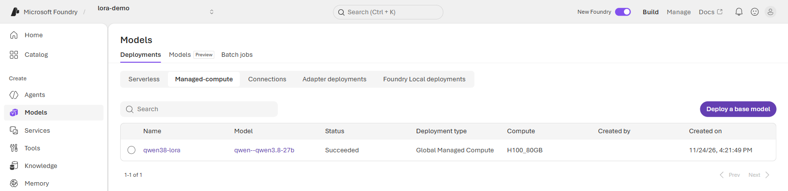
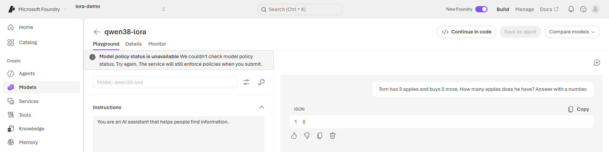
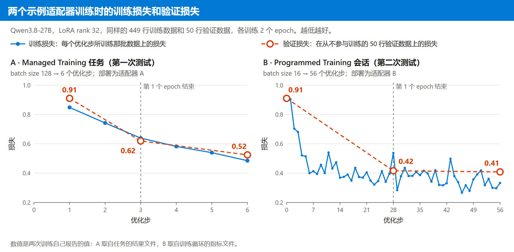
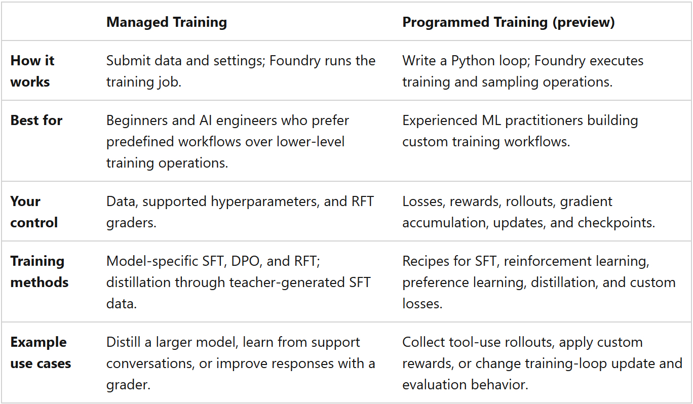

# Qwen3.8-27B LoRA 在 Microsoft Foundry 上：用 Managed Training 或 Programmed Training 训练适配器，用 Managed compute 部署推理

[](#目的)
[](#managed-training-和-programmed-training)
[](#实现效果)
[](#操作步骤)
[](docs/TESTING_CN.md)

作者：魏新宇 · [English](README.md)

## 目的

想让开放权重的模型按自己的格式作答，团队通常要准备两次 GPU：一次用来微调，一次用来部署。这次测试要验证，对 **Qwen3.8-27B**（预览），Microsoft Foundry 能不能把这两件事都接过去：用 **Managed Training**（托管训练）或 **Programmed Training**（预览）训练出 LoRA 适配器，再部署到 **Managed compute**（托管计算）上调用。两种训练方式用同一份数据各跑了一遍，要回答四个问题：

1. Qwen3.8-27B 能不能部署到 Managed compute？要几块 GPU，多久能用？
2. 两种训练方式能不能训练出适配器？训练有没有效果？
3. 适配器能不能挂到同一组 GPU 上，用自己的名称调用？
4. 适配器改变了模型回答的什么？

四个问题的答案在[实现效果](#实现效果)。两种训练方式的区别，包括各自支持的模型、训练的价格和区域、两者都部署到的 Managed compute（区域、Data Zone、价格和折扣），以及能部署哪些适配器，在 [Managed Training 和 Programmed Training](#managed-training-和-programmed-training)。要在自己的订阅里复现，按[操作步骤](#操作步骤)做。


图里画的是整条路径，圆圈里的数字就是[操作步骤](#操作步骤)的序号。第 2 步上传你的训练数据。第 3 步用 Managed Training 或 Programmed Training 训练出 LoRA 适配器，训练用的 GPU 由 Microsoft 提供，按训练 token 计费。第 4 步，`infra/up.py --deploy` 在 Managed compute 上部署基础模型 Qwen3.8-27B，一个实例、2 块 H100 80 GB，再把每个适配器挂到同一组 GPU 上，最多 8 个，不增加 GPU。第 6 步，你的应用用 `model` 字段选择基础模型或某个适配器。第 7 步删除部署，GPU 计费随即停止。这是原创解释图。

开始之前要知道三点：Qwen3.8-27B 的微调和 [Managed compute 上的 LoRA 适配器](https://learn.microsoft.com/en-us/azure/foundry/how-to/deploy-lora-managed-compute)都是预览功能，没有服务级别协议，Microsoft 不建议用于生产负载；Managed compute [没有内置内容过滤](https://learn.microsoft.com/en-us/azure/foundry/concepts/managed-compute-overview)；目标部署从建好到删除，每小时都按 GPU 计费，有没有请求都一样。

## 实现效果

按工作的先后顺序，四个结果：

1. [Qwen3.8-27B 部署到 Managed compute](#结果-1qwen38-27b-部署到-managed-compute)：一个实例、2 × H100 80 GB，请求发出 21 分钟后 `Succeeded`。
2. [两种训练方式都训练出了适配器，损失在下降](#结果-2两种训练方式都训练出了适配器损失在下降)：验证损失用 Managed Training 从 0.91 降到 0.52，用 Programmed Training 从 0.91 降到 0.41。
3. [适配器部署在同一组 GPU 上](#结果-3适配器部署在同一组-gpu-上)：每个适配器部署第一次测试用了 64 秒，第二次 78 秒，不增加 GPU。
4. [适配器改变的是回答方式，不是答对率](#结果-4适配器改变的是回答方式不是答对率)：回答变短，换成训练数据的格式；答对行数的差别在随机波动范围内。

数据来源：2026 年 11 月 22、23 日在 East US 2 做的两次测试，各用一个 Foundry 账户，都用本仓库的 GSM8K 示例数据。适配器 A 是第一次测试里用 Managed Training 训练的，适配器 B 是第二次测试里用 Programmed Training 训练的。测试环境、方法、完整表格和局限见 [`docs/RESULTS_CN.md`](docs/RESULTS_CN.md)。2026 年 11 月 24 日，又在一个新资源组里把下面的[操作步骤](#操作步骤)从头到尾执行了一遍，两种训练各重新做一次，两个适配器挂在同一个目标部署上；各项数字见[按操作步骤完整运行一遍](docs/RESULTS_CN.md#按操作步骤完整运行一遍)，本页的门户截图也来自那次端到端运行。

### 结果 1：Qwen3.8-27B 部署到 Managed compute



端到端运行时 Deployments 页面的 Managed compute 标签页：基础模型 `qwen--qwen3.8-27b` 的目标部署 `qwen38-lora`，状态 Succeeded，Global Managed Compute，H100_80GB。



同一个部署的 Playground：基础模型回答 `infra/verify.py` 用的那道测试题，答案是 8。

基础模型是 Foundry 模型目录里开放权重的 Qwen3.8-27B，按原样部署，没有经过训练。`infra/up.py --deploy` 用支持 LoRA 的部署模板，在一个实例、2 × H100 80 GB 上创建它的部署；适配器就挂在这个目标部署上。部署在请求发出 21 分钟后变为 `Succeeded`，8 秒后第一次调用返回 HTTP 200；第二次测试里，第一次成功调用等了 553 秒（见[耗时与费用](#耗时与费用)）。GPU 在目标部署上，按小时计费的也只有它：按目录价每小时 15.82 美元，有没有请求都一样。

### 结果 2：两种训练方式都训练出了适配器，损失在下降



| 用 GSM8K 示例的 449 行训练 2 个 epoch，LoRA rank 32 | 适配器 A：Managed Training（第一次测试） | 适配器 B：Programmed Training（第二次测试） |
|---|---|---|
| 怎么运行 | 在门户的 Training 页面提交一个监督微调任务，由 Foundry 运行整个任务（[第 3 步选项 A](#3-训练适配器)） | 运行 `training/programmed_training_sft.py`：你的 Python 循环发出每一步，由 Foundry 在它的 GPU 上执行（[第 3 步选项 B](#3-训练适配器)） |
| batch size 和优化步数 | 128，服务默认值；6 步 | 16，在循环里设定；56 步 |
| 50 行验证数据上的验证损失，报告的第一个值 → 最后一个值 | 0.91 → 0.52 | 0.91 → 第一个 epoch 之后 0.42 → 0.41 |
| 训练 token 及其按目录价的费用 | 计费 213,000 个，0.64 美元 | 循环自己统计 219,652 个，约 0.90 美元 |
| 用时 | 从创建到结束 5.3 分钟 | 从启动脚本到退出 9 分钟 |
| 产出 | 一个 LoRA 适配器，作为模型列在项目里，部署为适配器 A | 同上，部署为适配器 B |

看什么：

- **两次训练的验证损失都在下降。** 验证损失是在 50 行验证数据上算的，两次训练都不用这些行训练：训练之后，适配器对没见过的题目的参考答案，预测得比基础模型好。这说明训练起了作用；它在实际回答里改变了什么，见[结果 4](#结果-4适配器改变的是回答方式不是答对率)。
- **两边都从 0.91 开始。** 同一个基础模型、同样的 50 行，在两个服务里得到同一个起点；两个服务计算损失的方法是否相同，除了这一点吻合，没有另外核对。
- **B 降得更低是因为步数多，不说明这种方式更好。** 两次训练的数据、基础模型、2 个 epoch、LoRA rank 32 和学习率的变化方式都相同。不同的是 batch size，16 对 128，优化步数也就不同，56 对 6。用 batch size 16 的 Managed Training 没有跑过；门户训练向导里的 batch size 只能选 32 到 256。
- **训练损失**（蓝线）是每一步所训练那批数据上的损失。B 每批只有 16 行，所以逐步起伏；要比较的是验证损失（橙色）。

### 结果 3：适配器部署在同一组 GPU 上


端到端运行时的 Adapter deployments 标签页：在门户里用 Managed Training 训练的 `qwen38-lora-gsm8k`，和用脚本以 Programmed Training 训练的 `qwen38-lora-gsm8k-pt`，都挂在目标部署 `qwen38-lora` 上，都是 `Succeeded`。

每个适配器部署指定一个训练好的适配器和结果 1 的目标部署。第一次测试里，每个适配器部署在请求发出 64 秒后变为 `Succeeded`；第二次测试里，适配器 B 用了 78 秒；端到端运行时，两个适配器部署分别用了 68 秒和 338 秒。适配器部署不增加 GPU，[不单独计价](https://learn.microsoft.com/en-us/azure/foundry/concepts/adapter-deployment-overview)；一个目标部署最多挂 8 个。之后你的应用在同一个端点上，用 `model` 字段选择基础模型或某个适配器。

结果 1 和结果 3 的截图都是端到端运行时真实的门户截图，做过裁剪，订阅名和 Created by 一列的值已遮盖。图里的部署名就是脚本的默认名称。示例数据、图标和截图的来源见 [`NOTICE.md`](NOTICE.md)。

### 结果 4：适配器改变的是回答方式，不是答对率

同一道题分别发给基础模型和两个适配器，请求里只有 `model` 字段不同。题目是验证文件的第 7 行（题意：三个女生一小时各做了若干道数学题，问两小时一共做了多少道），system 消息用这一行自带的 `Reply user's question as accurately as possible.`：

> Fiona completed 36 math questions in an hour. Shirley was able to complete twice as many math questions within that same time, and Kiana completed half of the sum of Fiona and Shirley's math questions. If they each did the same number of questions the following hour, how many math questions did all three girls complete in 2 hours?

| 第 7 行，作答的是 | 基础模型 Qwen3.8-27B | 适配器 A，Managed Training | 适配器 B，Programmed Training |
|---|---|---|---|
| 答案 | 324，正确 | 324，正确 | 324，正确 |
| 长度，completion tokens | 385 | 65 | 149 |
| 最后一行 | 一句说出 324 的话 | `#### 324` 之后的 `The answer is: 324` | `#### 324!!!`，和每个训练答案一样 |

**基础模型**，回答的开头和结尾：

```text
Here is the step-by-step solution:

**Step 1: Calculate the number of questions each girl completed in the first hour.**

*   **Fiona:** Completed 36 questions.
*   **Shirley:** Completed twice as many as Fiona.
    $$36 \times 2 = 72 \text{ questions}$$
[...]
**Answer:**
All three girls completed **324** math questions in 2 hours.
```

**适配器 A**，完整回答：

```text
36*2=72
72+36=108
108/2=54
54+72+36=162
162*2=324
#### 324
The answer is: 324
```

**适配器 B**，完整回答：

```text
Shirley completed 36*2=<<36*2=72>>72 math questions.
Fiona and Shirley completed 36+72=<<36+72=108>>108 math questions.
Kiana completed 108/2=<<108/2=54>>54 math questions.
All three girls completed 108+54=<<108+54=162>>162 math questions.
In 2 hours, they completed 162*2=<<162*2=324>>324 math questions.
#### 324!!!
```

在全部 50 行验证数据上，`temperature` 为 0，每行发给每一边各一次：

| 在 50 行验证数据上 | 基础模型，第一次测试 | 适配器 A | 基础模型，第二次测试 | 适配器 B |
|---|---|---|---|---|
| 平均回答长度，completion tokens | 310.2 | 158.7 | 311.2 | 115.7 |
| 结尾与训练数据一致（`#### <数字>!!!`）的回答 | 50 行中的 0 行 | 50 行中的 0 行 | 50 行中的 0 行 | 50 行中的 50 行 |
| 带训练数据 `####` 标记的回答 | 50 行中的 0 行 | 50 行中的 6 行 | 50 行中的 0 行 | 50 行中的 50 行 |
| 在 800 token 上限处被截断的回答 | 50 行中的 2 行 | 50 行中的 0 行 | 50 行中的 2 行 | 50 行中的 0 行 |
| 答对，人工读过自动判分判错的每个回答之后 | 50 行中的 44 行 | 50 行中的 46 行 | 50 行中的 44 行 | 50 行中的 43 行 |

这些数字说明什么：

- **两个适配器都在起作用。** 50 行里，没有一行的适配器回答和同一次测试里基础模型的回答相同；`####` 标记也只有适配器会用。
- **优化步越多，学到的训练格式越多。** 适配器 A（6 步）学到了简短的写法，但 50 个回答里只有 6 个用了标记，完整的结尾一次也没有。适配器 B（56 步）50 个回答全部按训练数据的方式结尾；回答平均 115.7 个 completion tokens，比基础模型 311.2 个的三分之一略多。
- **不能说准确率有差别。** 只有适配器 A 答对的有 3 行，只有它的基础模型答对的有 1 行（双侧符号检验，p = 0.625）；适配器 B 是 2 行对 3 行（p = 1.0）。GSM8K 示例教的是回答格式；本页不证明微调能让模型的算术更好。
- **适配器会降低速度。** 带适配器 A 时，同一组 GPU 每秒流式生成 53.4 个 token，基础模型是 72.5 个，少了约 26%（同一条提示词，每边 3 次）。端到端运行时两个适配器挂在同一个目标部署上，每个适配器每秒流式生成 53.1 到 53.2 个 token，基础模型 71.6 到 72.0 个：不论适配器来自哪种训练方式，速度代价都一样。

局限：每种方式一个适配器、一个种子、50 行、每行只请求一次；先测基础模型，没有交替。适配器 A 和 B 在不同账户的不同目标部署上测；`temperature` 为 0 时，基础模型自己的回答在两次测试之间也有 8 行不同（共 50 行）。端到端运行时两种方式各重新训练了一个适配器，放在同一个目标部署上测：Managed Training 的适配器平均每个回答 149.7 个 completion tokens，Programmed Training 的 117.1 个，基础模型 310.8 和 311.3 个；基础模型这两遍的回答也有 13 行不同（共 50 行）。方法、判分和完整表格见 [`docs/RESULTS_CN.md`](docs/RESULTS_CN.md)。

### 耗时与费用

| 阶段 | 第一次测试的实测值 |
|---|---|
| 示例数据的训练任务，在门户提交 | 从创建到结束 5.3 分钟 |
| 同样的数据和设置，通过 API 提交 | 从创建到结束 9.0 分钟；其中 6 个训练步用了 77 秒，其余是排队和预处理 |
| 目标部署，从发出请求到 `Succeeded` | 21 分钟 |
| `Succeeded` 之后第一次调用成功 | 8 秒 |
| 每个适配器部署，从发出请求到 `Succeeded` | 64 秒（测了 2 个） |
| 删除 2 个适配器部署和目标部署 | 5 分钟 |
| 部署存在期间收到的请求 | 164 个，全部返回 HTTP 200 |

第二次测试用的是 Programmed Training 的适配器，有一个阶段不同，部署时要留意：第一次调用成功是在 `Succeeded` 之后 553 秒，而不是 8 秒。`up.py` 会连续调用 10 分钟才停下。

| 第二次测试的阶段 | 实测 |
|---|---|
| 示例数据的 Programmed Training 会话 | 循环的 56 步用了 6 分钟；从启动脚本到退出 9 分钟 |
| 目标部署，从发出请求到 `Succeeded` | 21 分钟 |
| `Succeeded` 之后第一次调用成功 | 553 秒，约 9 分钟；在这之前的 25 次调用都返回 HTTP 404 |
| 适配器部署，从发出请求到 `Succeeded` | 78 秒 |
| 删除适配器部署和目标部署 | 5 分钟 |
| 部署存在期间收到的请求 | 127 个：102 个返回 HTTP 200，25 个在第一次成功之前返回 HTTP 404 |

端到端运行时，目标部署在请求发出 22 分钟后变为 `Succeeded`，68 秒后的第一次调用直接得到了回答；两个适配器部署分别用了 68 秒和 338 秒，`down.py` 删除全部三个部署用了 5.5 分钟。按目录价，整次运行的费用是 7.21 到 13.83 美元：两次训练，加上目标部署的时长，从 `Succeeded` 到发出删除请求是 21.5 分钟，从发出创建请求到删除完成是 46.6 分钟。每一步的用时和费用见[按操作步骤完整运行一遍](docs/RESULTS_CN.md#按操作步骤完整运行一遍)。

费用：部署一小时加一次 Managed Training 训练，按目录价共 16.46 美元；训练的目录价见[训练的价格和区域](#训练的价格和区域)，部署的见[部署到 Managed compute](#部署到-managed-compute)。`up.py` 在创建任何资源之前，会读取当前目录价并打印出来。

## Managed Training 和 Programmed Training

两种训练方式最根本的区别，是训练循环由谁运行。用 **Managed Training**，你提交数据和设置，Foundry 运行整个训练任务。用 **Programmed Training**（预览），循环在你自己的电脑上运行，每一步怎么采样、怎么更新参数，由你的 Python 代码决定，Foundry 在它的 GPU 上执行这些操作。两种方式都不用你准备训练 GPU，产出的都是 LoRA 适配器，部署方法和推理费用也一样。[第 3 步](#3-训练适配器)两种都有：选项 A 在门户里提交 Managed Training 任务，选项 B 运行 `training/programmed_training_sft.py`。



来源：Microsoft Learn，[Training in Microsoft Foundry](https://learn.microsoft.com/en-us/azure/foundry/fine-tuning/overview#choose-your-training-approach) 的 “Choose your training approach” 一节。这是 2026 年 11 月 23 日该页面上这张表的截图（页面最后更新于 2026 年 11 月 17 日）。

### 支持的模型

下表每一行是一种方式现在支持的模型。三份名单都在持续更新，最后一列是各自的最新名单，以那里为准；本页的名单核对于 2026 年 11 月 24 日。Microsoft Learn 列出了 18 个可以在 Foundry 上训练的模型（文章 2026 年 11 月 17 日版），Managed Training 全部支持，Programmed Training 支持其中 5 个；训练后能部署到 Managed compute 的有 4 个，这 4 个两种训练方式都支持。最后一行是不训练、直接部署到 Managed compute 的模型。

| 训练或部署方式 | 支持的模型（2026 年 11 月 24 日核对） | 模型部署到哪里 | 最新名单（持续更新） |
|---|---|---|---|
| Managed Training | 18 个：`MAI-Code-1.1-Flash`、`Muse-Glimmer-30B`、`Llama-3.3-70B-Instruct`、`Qwen3-32B`、`Qwen3.6-35B-A3B`、`Qwen3.8-27B`、`gpt-oss-20b`、`gpt-oss-120b`、`Ministral-3B`、`gpt-4o-mini`、`gpt-4o`、`gpt-4.1`、`gpt-4.1-mini`、`gpt-4.1-nano`、`o4-mini`、`gpt-5`、`MedImageInsight-Premium`、`CXRReportgen-Premium` | `Muse-Glimmer-30B`、`Qwen3.6-35B-A3B`、`Qwen3.8-27B` 和 `gpt-oss-120b` 部署到 Managed compute；其余模型用 Serverless | Microsoft Learn，[Training in Microsoft Foundry 的 Supported models 表](https://learn.microsoft.com/en-us/azure/foundry/fine-tuning/overview#supported-models) |
| Programmed Training（预览） | 5 个：`Muse-Glimmer-30B`、`Qwen3.6-35B-A3B`、`Qwen3.8-27B`、`gpt-oss-20b`、`gpt-oss-120b`。`gpt-oss-20b` 两处来源说法不一，见表下 | 除 `gpt-oss-20b` 外都部署到 Managed compute；`gpt-oss-20b` 用 Serverless | 同一张 Learn 表的 Programmed Training 一列；示例仓库的 [supported_models.md](https://github.com/microsoft-foundry/fine-tuning/blob/main/programmed_training/docs/supported_models.md) |
| Managed compute（只部署，不训练） | 150 个，都是 Foundry 模型目录里 Hugging Face 集合（Hugging Face Collection）的开放模型，名单见表下 | Managed compute，部署的是模型本身 | Foundry 模型目录，[Deployment options 选 Managed compute](https://ai.azure.com/nextgen/goto/discover/models?deployment=managed+compute&availability=All)，要先登录 Foundry |

训练后能部署到 Managed compute 的这 4 个模型都是预览模型，训练类型只有 Global 和 Developer，没有 Data zone。每个模型支持哪些训练方法、训练类型和部署类型，见 [`docs/FOUNDRY_TRAINING_CN.md`](docs/FOUNDRY_TRAINING_CN.md#支持的模型)。

Programmed Training 的名单，两处来源不一致。Learn 的表（2026 年 11 月 17 日更新）把 `gpt-oss-20b` 列为支持；示例仓库的 supported_models.md（2026 年 11 月 11 日最后修改）只把 `Qwen3.8-27B`、`Qwen3.6-35B-A3B`、`gpt-oss-120b` 和 `Muse-Glimmer-30B` 列为现在可用，把 `gpt-oss-20b` 列为 Legacy，写明不再支持新的 Programmed Training。本仓库只用 `Qwen3.8-27B` 测过；打算用 `gpt-oss-20b` 的，先确认能开会话。

Managed compute 这一行的 150 个模型，都来自 Foundry 模型目录的 Hugging Face 集合。Microsoft Learn 写明这个集合每周更新，不断加入新模型（[Managed compute 概述的 Supported models 一节](https://learn.microsoft.com/en-us/azure/foundry/concepts/managed-compute-overview#supported-models)；这一节只说明模型从哪里来，没有列出模型）。2026 年 11 月 24 日，门户的模型目录在 Deployment options 选 Managed compute、Availability 选 All models 时显示 150 个，和这个集合的模型库（registry `azure-huggingface`）里标为 Managed Compute、没有归档的 150 个逐一相同。下面名单里的每个链接，打开的是该模型在 Foundry 模型目录里的公开页面，不用登录。要看你的项目现在能部署哪些，在目录里把 Availability 改成 Available in my project，结果取决于项目所在的区域和你的 GPU 配额（见 [Hugging Face models in Microsoft Foundry](https://learn.microsoft.com/en-us/azure/foundry/foundry-models/how-to/hugging-face-models)）。

<details>
<summary>2026 年 11 月 24 日 Managed compute 上的 150 个模型，按推理任务分组（点开）</summary>

| 推理任务 | 模型个数 | 模型，链接到 Foundry 模型目录里的模型页面 |
|---|---|---|
| 对话补全 `chat-completion` | 100 | [`ALIA-40b-instruct-2601`](https://ai.azure.com/catalog/models/bsc-lt--alia-40b-instruct-2601)、[`ALIA-40b-instruct-2605`](https://ai.azure.com/catalog/models/bsc-lt--alia-40b-instruct-2605)、[`ALIA-40b-instruct-2606`](https://ai.azure.com/catalog/models/bsc-lt--alia-40b-instruct-2606)、[`Beam-1.0-501B-A23B`](https://ai.azure.com/catalog/models/reflection--beam-1.0-501b-a23b)、[`Beam-1.0-501B-A23B-FP8`](https://ai.azure.com/catalog/models/reflection--beam-1.0-501b-a23b-fp8)、[`Beam-1.0-501B-A23B-NVFP4`](https://ai.azure.com/catalog/models/reflection--beam-1.0-501b-a23b-nvfp4)、[`Cosmos-Reason1-7B`](https://ai.azure.com/catalog/models/nvidia--cosmos-reason1-7b)、[`DeepSeek-V4-Flash-0731`](https://ai.azure.com/catalog/models/deepseek-ai--deepseek-v4-flash-0731)、[`DeepSeek-V4.1-Flash`](https://ai.azure.com/catalog/models/deepseek-ai--deepseek-v4.1-flash)、[`DeepSeek-V4.1-Flash-1017`](https://ai.azure.com/catalog/models/deepseek-ai--deepseek-v4.1-flash-1017)、[`Fara1.5-27B`](https://ai.azure.com/catalog/models/microsoft--fara1.5-27b)、[`Fara1.5-4B`](https://ai.azure.com/catalog/models/microsoft--fara1.5-4b)、[`Fara1.5-9B`](https://ai.azure.com/catalog/models/microsoft--fara1.5-9b)、[`gemma-4-26B-A4B-it`](https://ai.azure.com/catalog/models/google--gemma-4-26b-a4b-it)、[`gemma-4-31B-it`](https://ai.azure.com/catalog/models/google--gemma-4-31b-it)、[`gemma-4-31B-it-FP8-dynamic`](https://ai.azure.com/catalog/models/redhatai--gemma-4-31b-it-fp8-dynamic)、[`gemma-4-E2B-it`](https://ai.azure.com/catalog/models/google--gemma-4-e2b-it)、[`gemma-4-E4B-it`](https://ai.azure.com/catalog/models/google--gemma-4-e4b-it)、[`GLM-4.5`](https://ai.azure.com/catalog/models/zai-org--glm-4.5)、[`GLM-4.5-FP8`](https://ai.azure.com/catalog/models/zai-org--glm-4.5-fp8)、[`GLM-4.6`](https://ai.azure.com/catalog/models/zai-org--glm-4.6)、[`GLM-4.7`](https://ai.azure.com/catalog/models/zai-org--glm-4.7)、[`GLM-4.7-Flash`](https://ai.azure.com/catalog/models/zai-org--glm-4.7-flash)、[`GLM-4.7-FP8`](https://ai.azure.com/catalog/models/zai-org--glm-4.7-fp8)、[`GLM-5.2-FP8`](https://ai.azure.com/catalog/models/zai-org--glm-5.2-fp8)、[`GLM-5.3-Flash`](https://ai.azure.com/catalog/models/zai-org--glm-5.3-flash)、[`gpt-oss-120b`](https://ai.azure.com/catalog/models/openai--gpt-oss-120b)、[`gpt-oss-20b`](https://ai.azure.com/catalog/models/openai--gpt-oss-20b)、[`granite-4.0-h-small`](https://ai.azure.com/catalog/models/ibm-granite--granite-4.0-h-small)、[`granite-4.0-h-tiny`](https://ai.azure.com/catalog/models/ibm-granite--granite-4.0-h-tiny)、[`granite-4.0-micro`](https://ai.azure.com/catalog/models/ibm-granite--granite-4.0-micro)、[`granite-4.0-tiny-preview`](https://ai.azure.com/catalog/models/ibm-granite--granite-4.0-tiny-preview)、[`granite-4.2-30b`](https://ai.azure.com/catalog/models/ibm-granite--granite-4.2-30b)、[`Mathstral-7B-v0.1`](https://ai.azure.com/catalog/models/mistralai--mathstral-7b-v0.1)、[`MediPhi`](https://ai.azure.com/catalog/models/microsoft--mediphi)、[`MediPhi-Instruct`](https://ai.azure.com/catalog/models/microsoft--mediphi-instruct)、[`MiniMax-M2`](https://ai.azure.com/catalog/models/minimaxai--minimax-m2)、[`Ministral-3-3B-Instruct-2512`](https://ai.azure.com/catalog/models/mistralai--ministral-3-3b-instruct-2512)、[`Mistral-Nemo-Instruct-2407`](https://ai.azure.com/catalog/models/mistralai--mistral-nemo-instruct-2407)、[`Mistral-Nemo-Instruct-FP8-2407`](https://ai.azure.com/catalog/models/mistralai--mistral-nemo-instruct-fp8-2407)、[`Mistral-Small-3.1-24B-Instruct-2503`](https://ai.azure.com/catalog/models/mistralai--mistral-small-3.1-24b-instruct-2503)、[`Muse-Glimmer-30B`](https://ai.azure.com/catalog/models/meta-models--muse-glimmer-30b)、[`Muse-Glimmer-30B-FP8-block`](https://ai.azure.com/catalog/models/redhatai--muse-glimmer-30b-fp8-block)、[`Muse-Spark-Open-816B-A42B-NVFP4`](https://ai.azure.com/catalog/models/meta-models--muse-spark-open-816b-a42b-nvfp4)、[`Nanbeige4.3-33B`](https://ai.azure.com/catalog/models/nanbeige--nanbeige4.3-33b)、[`Nemotron-Terminal-14B`](https://ai.azure.com/catalog/models/nvidia--nemotron-terminal-14b)、[`Nemotron-Terminal-32B`](https://ai.azure.com/catalog/models/nvidia--nemotron-terminal-32b)、[`Nemotron-Terminal-8B`](https://ai.azure.com/catalog/models/nvidia--nemotron-terminal-8b)、[`North-Mini-Code-1.0`](https://ai.azure.com/catalog/models/coherelabs--north-mini-code-1.0)、[`North-Mini-Code-1.0-fp8`](https://ai.azure.com/catalog/models/coherelabs--north-mini-code-1.0-fp8)、[`NVIDIA-Nemotron-3-Nano-30B-A3B-FP8`](https://ai.azure.com/catalog/models/nvidia--nvidia-nemotron-3-nano-30b-a3b-fp8)、[`NVIDIA-Nemotron-3-Super-120B-A12B-BF16`](https://ai.azure.com/catalog/models/nvidia--nvidia-nemotron-3-super-120b-a12b-bf16)、[`NVIDIA-Nemotron-3-Super-120B-A12B-FP8`](https://ai.azure.com/catalog/models/nvidia--nvidia-nemotron-3-super-120b-a12b-fp8)、[`NVIDIA-Nemotron-3-Ultra-550B-A55B-NVFP4`](https://ai.azure.com/catalog/models/nvidia--nvidia-nemotron-3-ultra-550b-a55b-nvfp4)、[`NVIDIA-Nemotron-3.5-Lightning-30B-A3B-BF16`](https://ai.azure.com/catalog/models/nvidia--nvidia-nemotron-3.5-lightning-30b-a3b-bf16)、[`NVIDIA-Nemotron-3.5-Lightning-30B-A3B-NVFP4`](https://ai.azure.com/catalog/models/nvidia--nvidia-nemotron-3.5-lightning-30b-a3b-nvfp4)、[`NVIDIA-Nemotron-3.5-Super-VL-120B-A12B-BF16`](https://ai.azure.com/catalog/models/nvidia--nvidia-nemotron-3.5-super-vl-120b-a12b-bf16)、[`NVIDIA-Nemotron-3.5-Super-VL-120B-A12B-NVFP4`](https://ai.azure.com/catalog/models/nvidia--nvidia-nemotron-3.5-super-vl-120b-a12b-nvfp4)、[`OpenCodeReasoning-Nemotron-1.1-14B`](https://ai.azure.com/catalog/models/nvidia--opencodereasoning-nemotron-1.1-14b)、[`OpenCodeReasoning-Nemotron-1.1-32B`](https://ai.azure.com/catalog/models/nvidia--opencodereasoning-nemotron-1.1-32b)、[`OptiMind-SFT`](https://ai.azure.com/catalog/models/microsoft--optimind-sft)、[`Ornith-1.0-397B`](https://ai.azure.com/catalog/models/deepreinforce-ai--ornith-1.0-397b)、[`OTel-2.0-LLM-31B-IT`](https://ai.azure.com/catalog/models/farbodtavakkoli--otel-2.0-llm-31b-it)、[`phi-4`](https://ai.azure.com/catalog/models/microsoft--phi-4)、[`Pixtral-12B-2409`](https://ai.azure.com/catalog/models/mistralai--pixtral-12b-2409)、[`Qwen3-0.6B`](https://ai.azure.com/catalog/models/qwen--qwen3-0.6b)、[`Qwen3-14B`](https://ai.azure.com/catalog/models/qwen--qwen3-14b)、[`Qwen3-235B-A22B-Instruct-2507`](https://ai.azure.com/catalog/models/qwen--qwen3-235b-a22b-instruct-2507)、[`Qwen3-235B-A22B-Thinking-2507-FP8`](https://ai.azure.com/catalog/models/qwen--qwen3-235b-a22b-thinking-2507-fp8)、[`Qwen3-30B-A3B-Instruct-2507`](https://ai.azure.com/catalog/models/qwen--qwen3-30b-a3b-instruct-2507)、[`Qwen3-30B-A3B-Instruct-2507-FP8`](https://ai.azure.com/catalog/models/qwen--qwen3-30b-a3b-instruct-2507-fp8)、[`Qwen3-30B-A3B-Thinking-2507`](https://ai.azure.com/catalog/models/qwen--qwen3-30b-a3b-thinking-2507)、[`Qwen3-32B`](https://ai.azure.com/catalog/models/qwen--qwen3-32b)、[`Qwen3-4B-Instruct-2507`](https://ai.azure.com/catalog/models/qwen--qwen3-4b-instruct-2507)、[`Qwen3-Coder-30B-A3B-Instruct`](https://ai.azure.com/catalog/models/qwen--qwen3-coder-30b-a3b-instruct)、[`Qwen3-Coder-30B-A3B-Instruct-FP8`](https://ai.azure.com/catalog/models/qwen--qwen3-coder-30b-a3b-instruct-fp8)、[`Qwen3-Coder-Next`](https://ai.azure.com/catalog/models/qwen--qwen3-coder-next)、[`Qwen3-Coder-Next-FP8`](https://ai.azure.com/catalog/models/qwen--qwen3-coder-next-fp8)、[`Qwen3-VL-235B-A22B-Instruct`](https://ai.azure.com/catalog/models/qwen--qwen3-vl-235b-a22b-instruct)、[`Qwen3-VL-30B-A3B-Instruct`](https://ai.azure.com/catalog/models/qwen--qwen3-vl-30b-a3b-instruct)、[`Qwen3-VL-30B-A3B-Instruct-FP8`](https://ai.azure.com/catalog/models/qwen--qwen3-vl-30b-a3b-instruct-fp8)、[`Qwen3-VL-32B-Instruct-FP8`](https://ai.azure.com/catalog/models/qwen--qwen3-vl-32b-instruct-fp8)、[`Qwen3-VL-4B-Instruct`](https://ai.azure.com/catalog/models/qwen--qwen3-vl-4b-instruct)、[`Qwen3-VL-4B-Thinking`](https://ai.azure.com/catalog/models/qwen--qwen3-vl-4b-thinking)、[`Qwen3-VL-8B-Instruct`](https://ai.azure.com/catalog/models/qwen--qwen3-vl-8b-instruct)、[`Qwen3-VL-8B-Instruct-FP8`](https://ai.azure.com/catalog/models/qwen--qwen3-vl-8b-instruct-fp8)、[`Qwen3.5-0.8B`](https://ai.azure.com/catalog/models/qwen--qwen3.5-0.8b)、[`Qwen3.5-27B-FP8`](https://ai.azure.com/catalog/models/qwen--qwen3.5-27b-fp8)、[`Qwen3.5-2B`](https://ai.azure.com/catalog/models/qwen--qwen3.5-2b)、[`Qwen3.5-35B-A3B`](https://ai.azure.com/catalog/models/qwen--qwen3.5-35b-a3b)、[`Qwen3.5-397B-A17B`](https://ai.azure.com/catalog/models/qwen--qwen3.5-397b-a17b)、[`Qwen3.5-397B-A17B-FP8`](https://ai.azure.com/catalog/models/qwen--qwen3.5-397b-a17b-fp8)、[`Qwen3.5-4B`](https://ai.azure.com/catalog/models/qwen--qwen3.5-4b)、[`Qwen3.5-9B`](https://ai.azure.com/catalog/models/qwen--qwen3.5-9b)、[`Qwen3.6-27B`](https://ai.azure.com/catalog/models/qwen--qwen3.6-27b)、[`Qwen3.6-27B-FP8`](https://ai.azure.com/catalog/models/qwen--qwen3.6-27b-fp8)、[`Qwen3.6-35B-A3B`](https://ai.azure.com/catalog/models/qwen--qwen3.6-35b-a3b)、[`Qwen3.8-27B`](https://ai.azure.com/catalog/models/qwen--qwen3.8-27b)、[`QwQ-32B`](https://ai.azure.com/catalog/models/qwen--qwq-32b)、[`QwQ-32B-Preview`](https://ai.azure.com/catalog/models/qwen--qwq-32b-preview) |
| 嵌入 `embeddings` | 19 | [`all-MiniLM-L6-v2`](https://ai.azure.com/catalog/models/sentence-transformers--all-minilm-l6-v2)、[`bge-large-zh`](https://ai.azure.com/catalog/models/baai--bge-large-zh)、[`bge-large-zh-v1.5`](https://ai.azure.com/catalog/models/baai--bge-large-zh-v1.5)、[`e5-base`](https://ai.azure.com/catalog/models/intfloat--e5-base)、[`e5-large-v2`](https://ai.azure.com/catalog/models/intfloat--e5-large-v2)、[`embeddinggemma-300m-medical`](https://ai.azure.com/catalog/models/sentence-transformers--embeddinggemma-300m-medical)、[`gte-large`](https://ai.azure.com/catalog/models/thenlper--gte-large)、[`msmarco-bert-base-dot-v5`](https://ai.azure.com/catalog/models/sentence-transformers--msmarco-bert-base-dot-v5)、[`multilingual-e5-large`](https://ai.azure.com/catalog/models/intfloat--multilingual-e5-large)、[`multilingual-e5-small`](https://ai.azure.com/catalog/models/maiyad--multilingual-e5-small)、[`Nemotron-3-Embed-1B-BF16`](https://ai.azure.com/catalog/models/nvidia--nemotron-3-embed-1b-bf16)、[`Nemotron-3-Embed-1B-NVFP4`](https://ai.azure.com/catalog/models/nvidia--nemotron-3-embed-1b-nvfp4)、[`Nemotron-3-Embed-8B-BF16`](https://ai.azure.com/catalog/models/nvidia--nemotron-3-embed-8b-bf16)、[`Nemotron-3.5-Embed-1B-BF16`](https://ai.azure.com/catalog/models/nvidia--nemotron-3.5-embed-1b-bf16)、[`Nemotron-3.5-Embed-1B-NVFP4`](https://ai.azure.com/catalog/models/nvidia--nemotron-3.5-embed-1b-nvfp4)、[`Nemotron-3.5-Embed-8B-BF16`](https://ai.azure.com/catalog/models/nvidia--nemotron-3.5-embed-8b-bf16)、[`Qwen3-Embedding-0.6B`](https://ai.azure.com/catalog/models/qwen--qwen3-embedding-0.6b)、[`Qwen3-Embedding-8B`](https://ai.azure.com/catalog/models/qwen--qwen3-embedding-8b)、[`snowflake-arctic-embed-l-v2.0`](https://ai.azure.com/catalog/models/snowflake--snowflake-arctic-embed-l-v2.0) |
| 掩码填充 `fill-mask` | 10 | [`albert-base-v1`](https://ai.azure.com/catalog/models/albert--albert-base-v1)、[`bert-base-cased`](https://ai.azure.com/catalog/models/google-bert--bert-base-cased)、[`bert-base-chinese`](https://ai.azure.com/catalog/models/google-bert--bert-base-chinese)、[`bert-base-german-cased`](https://ai.azure.com/catalog/models/dbmdz--bert-base-german-cased)、[`bert-base-multilingual-cased`](https://ai.azure.com/catalog/models/google-bert--bert-base-multilingual-cased)、[`bert-base-uncased`](https://ai.azure.com/catalog/models/google-bert--bert-base-uncased)、[`bert-large-uncased`](https://ai.azure.com/catalog/models/google-bert--bert-large-uncased)、[`distilbert-base-uncased`](https://ai.azure.com/catalog/models/distilbert--distilbert-base-uncased)、[`ModernBERT-base`](https://ai.azure.com/catalog/models/answerdotai--modernbert-base)、[`norbert2`](https://ai.azure.com/catalog/models/ltg--norbert2) |
| 文生图 `text-to-image` | 6 | [`Chroma1-HD`](https://ai.azure.com/catalog/models/lodestones--chroma1-hd)、[`openjourney`](https://ai.azure.com/catalog/models/prompthero--openjourney)、[`Ovis-Image-7B`](https://ai.azure.com/catalog/models/aidc-ai--ovis-image-7b)、[`Qwen-Image-2512`](https://ai.azure.com/catalog/models/qwen--qwen-image-2512)、[`Z-Image`](https://ai.azure.com/catalog/models/tongyi-mai--z-image)、[`Z-Image-Turbo`](https://ai.azure.com/catalog/models/tongyi-mai--z-image-turbo) |
| 文本分类 `text-classification` | 4 | [`Laya`](https://ai.azure.com/catalog/models/convaiinnovations--laya)、[`Laya Multilingual`](https://ai.azure.com/catalog/models/convaiinnovations--laya-multilingual)、[`Laya Typed-Decisions`](https://ai.azure.com/catalog/models/convaiinnovations--laya-typed-decisions)、[`Nemotron-3.5-Rerank-8B-BF16`](https://ai.azure.com/catalog/models/nvidia--nemotron-3.5-rerank-8b-bf16) |
| 语音识别 `automatic-speech-recognition` | 3 | [`NVIDIA-Nemotron-3.5-Transcribe-30B-A4B`](https://ai.azure.com/catalog/models/nvidia--nvidia-nemotron-3.5-transcribe-30b-a4b)、[`whisper-large`](https://ai.azure.com/catalog/models/openai--whisper-large)、[`whisper-large-v3-turbo`](https://ai.azure.com/catalog/models/openai--whisper-large-v3-turbo) |
| 对话、文生图和视频生成 `chat-completion, text-to-image, video-generation` | 3 | [`Cosmos3-Edge`](https://ai.azure.com/catalog/models/nvidia--cosmos3-edge)、[`Cosmos3-Nano`](https://ai.azure.com/catalog/models/nvidia--cosmos3-nano)、[`Cosmos3-Super`](https://ai.azure.com/catalog/models/nvidia--cosmos3-super) |
| 内容安全 `content-safety` | 1 | [`browsesafe`](https://ai.azure.com/catalog/models/perplexity-ai--browsesafe) |
| 文档解析 `document-analysis` | 1 | [`Nemotron-3.5-Parse`](https://ai.azure.com/catalog/models/nvidia--nemotron-3.5-parse) |
| 图像分割 `image-segmentation` | 1 | [`sam2.1-hiera-large`](https://ai.azure.com/catalog/models/facebook--sam2.1-hiera-large) |
| 目标检测 `object-detection` | 1 | [`grounding-dino-base`](https://ai.azure.com/catalog/models/idea-research--grounding-dino-base) |
| 蛋白质设计 `protein-design` | 1 | [`RFD4-Proteina`](https://ai.azure.com/catalog/models/nvidia--rfd4-proteina-diffusers) |

</details>

### 训练的价格和区域

下表只列 Qwen3.8-27B（预览）。训练方法、训练类型和区域取自上面这篇 Microsoft Learn 文章，2026 年 11 月 24 日又核对过一次，内容没有变化；目录价取自 Azure Retail Prices API，2026 年 11 月 24 日读取，单位是美元。

| 比较项，针对 Qwen3.8-27B（预览） | Managed Training | Programmed Training（预览） |
|---|---|---|
| 训练方法 | SFT 和 RFT。本仓库用 SFT | 没有预定义方法，循环由你自己写；[示例仓库](https://github.com/microsoft-foundry/fine-tuning/tree/0b8bcfe9519ed382a5bc202f0f1b2ce65c22a2c9/programmed_training)里有 SFT、强化学习、偏好学习、蒸馏和自定义损失的配方。本仓库用 SFT |
| 使用条件 | 不需要申请 | 订阅要先[申请访问权限](https://aka.ms/foundry-interactive-training-signup)，获批之后才能开会话 |
| 训练类型 | Global 或 Developer，没有 Standard 和 Data zone。Global 用 Microsoft 的全球容量，不保证数据驻留；Developer 用闲置容量，价格更低，任务可能被抢占后再恢复。本仓库用 Global | 目前只有 Global：示例仓库的 [training.md](https://github.com/microsoft-foundry/fine-tuning/blob/0b8bcfe9519ed382a5bc202f0f1b2ce65c22a2c9/programmed_training/docs/training.md#training-type) 写明 `GlobalStandard` 可用，`DatazoneStandard` 和 `DeveloperTier` 暂不可用 |
| Foundry 项目可以建在哪些区域 | 10 个：Australia East、East US、East US 2、Korea Central、North Central US、Sweden Central、Switzerland North、UAE North、UK South、West US 3 | 11 个：左边这 10 个，加上 Canada East |
| 怎么计费 | SFT 按训练 token 数乘以 epoch 数；RFT 按训练时长，评分模型用的 token 另算 | 四类 token 各按各的价格计费：训练、采样、预填充、命中缓存的预填充 |
| 目录价 | SFT：Global 每百万训练 token 3.00，Developer 1.50。RFT：Global 每训练小时 80 | Global，每百万 token：训练 4.10，采样 5.60，预填充 1.86，命中缓存的预填充 0.37 |
| 本仓库示例数据的训练费用（449 行，2 个 epoch） | 计费 213,000 个训练 token，0.64，取自账单 | 循环统计 219,652 个训练 token，按目录价约 0.90；第二次测试的账单没有读 |
| 部署和推理 | 只能部署到 Managed compute，不能用 Serverless；区域、Data Zone、价格和折扣见[部署到 Managed compute](#部署到-managed-compute) | 同左 |

除了训练和目标部署，测试资源组的账单里没有别的费用：账户、项目和上传的文件都没有按小时的价格。这篇文章的其余内容，包括全部 18 个模型、27 个区域和 Serverless 的几种部署类型，整理在 [`docs/FOUNDRY_TRAINING_CN.md`](docs/FOUNDRY_TRAINING_CN.md)。

### 部署到 Managed compute

两种方式训练出的适配器都部署到 Managed compute。Managed compute 在 2026 年 11 月正式发布（GA），在上面部署 LoRA 适配器仍是预览功能。下表依据 Microsoft Learn 的 [Managed compute 概述](https://learn.microsoft.com/en-us/azure/foundry/concepts/managed-compute-overview)、[正式发布的博客](https://devblogs.microsoft.com/foundry/managed-compute-ga/)、[价格页](https://azure.microsoft.com/en-us/pricing/details/ai-foundry-models/aoai/)和 Azure Retail Prices API，都在 2026 年 11 月 24 日读取，价格单位是美元。

| 比较项 | Managed compute |
|---|---|
| 状态 | 正式发布。在上面部署 LoRA 适配器是预览，没有服务级别协议 |
| 部署范围 | Global（SKU `GlobalManagedCompute`），GPU 容量最大；或 Data Zone（SKU `DataZoneManagedCompute`），流量留在 US 或 EU 的数据驻留边界内，具体是哪一个由 Foundry 账户所在区域决定。两种范围的代码、SDK 和部署流程都一样，只有 SKU 名称不同 |
| 区域 | Learn 的 Managed compute 页面没有列区域。公开价格表里，4 种 GPU 的 Global 价格出现在 39 个 Azure 区域，各区域价格相同；上表里训练支持的 11 个区域都在其中。部署 LoRA 适配器还要求该区域有这个基础模型支持 LoRA 的部署模板 |
| GPU 和 Global 目录价，每块 GPU 每小时 | A100 80 GB 3.95，H100 80 GB 7.91，H200 141 GB 9.10，MI300X 192 GB 7.91 |
| Data Zone 的价格 | 价格页只列了 Global；价格表里也没有按 GPU 计的 Data Zone 价格 |
| 怎么计费 | 每个实例的 GPU 数 × 实例数 × 运行小时数 × 每 GPU 小时单价，每个实例用 1、2、4 或 8 块 GPU，由部署模板决定。部署存在就计费，没有请求也一样；适配器部署不单独计价，请求也不按 token 计价 |
| 配额 | 按订阅、GPU 型号和部署范围（Global，或 Data Zone 的 US、EU）分别计，单位是 GPU 块数；和虚拟机配额分开，虚拟机配额不能挪用 |
| 预留（Azure Reservations）和节省计划（Azure savings plan） | 目前没有。价格表里 Managed compute 的价格都是按小时的即用即付价，没有预留价，也没有节省计划价；Learn 的计费说明只为 Provisioned throughput 写了 Azure Reservations |
| Azure Consumption Discount（ACD）等企业协议折扣 | 公开文档没有写是否适用，请向你的 Microsoft 客户团队确认 |
| 本仓库 | Global，East US 2，一个实例、2 × H100 80 GB，按目录价每小时 15.82；Data Zone 没有测 |

要让数据始终留在一个数据区域内，要看整条路径。训练：Qwen3.8-27B 只有 Global 和 Developer 两种训练类型，Learn 写明两种都不提供数据驻留；Programmed Training 的示例仓库也只开放了 `GlobalStandard`。部署：Managed compute 支持 Data Zone，但 Learn 没有写 Data Zone 的目标部署能不能挂 LoRA 适配器，本仓库也没有测。所以按目前公开的信息，这条路径做不到从头到尾都在一个数据区域内。

选区域时先看训练：适配器部署通过项目里的模型 ID 引用适配器，本仓库都是在训练出适配器的那个账户里部署的，跨账户部署没有测过。

### 能部署哪些适配器

| 适配器从哪里来 | 能不能部署到 Managed compute | 依据 |
|---|---|---|
| 同一个项目里，Managed Training 任务训练出的 LoRA 适配器 | 能。本仓库的适配器 A，rank 32 | 本仓库的测试，见[结果 3](#结果-3适配器部署在同一组-gpu-上) |
| 同一个项目里，Programmed Training 会话保存的 LoRA 检查点 | 能。本仓库的适配器 B，rank 32 | 本仓库的测试，见[结果 3](#结果-3适配器部署在同一组-gpu-上) |
| 在 Foundry 之外训练的 LoRA 适配器，例如用自己的 GPU 训练的 | 现在不能，Foundry 还不能导入在别处训练的适配器。产品组在 Ignite 2026 上说，计划很快开放导入自己训练的 LoRA 适配器，没有给出日期 | Microsoft Learn，[Adapter deployment overview](https://learn.microsoft.com/en-us/azure/foundry/concepts/adapter-deployment-overview)：“You can't yet import your own adapters”；Ignite 2026 分会场 [BRK246](https://ignite.microsoft.com/en-US/sessions/BRK246) 的问答 |
| 完整的模型权重，不是适配器 | 不走适配器部署。BRK246 演示了导入 safetensors 格式的完整权重，部署方法和目录里的模型相同；产品组还说，计划支持把适配器合并进基础模型。这两项本仓库都没有测 | Ignite 2026 分会场 [BRK246](https://ignite.microsoft.com/en-US/sessions/BRK246) |

能部署的适配器还要满足三个条件：基础模型和版本与训练时一致；目标部署用支持 LoRA 的部署模板；适配器的个数、LoRA rank 和显存都在模板的上限之内，一个目标部署最多 8 个适配器部署（见 [Deploy fine-tuned LoRA adapters to managed compute](https://learn.microsoft.com/en-us/azure/foundry/how-to/deploy-lora-managed-compute)）。

## 操作步骤

按下面的步骤，可以在你自己的订阅里复现上面的测试。

| 顺序 | 在哪里 | 做什么 | 命令 | 大约用时 |
|---|---|---|---|---|
| 1 | 你的电脑 | 获取代码并登录 | `git clone`、`az login` | 2 分钟 |
| 2 | 你的电脑 | 创建 Foundry 资源并上传示例数据；不开 GPU | `python infra/up.py --resource-group <name> --location eastus2` | 5 分钟 |
| 3 | Foundry 门户，或你的电脑 | 训练适配器：A 在门户里用 Managed Training，或 B 用脚本跑 Programmed Training | A：Training，然后 Train。B：`<cookbook python> training/programmed_training_sft.py --resource-group <name>` | A：5 到 10 分钟。B：9 分钟，另加一次性的安装 |
| 4 | 你的电脑 | 部署目标和适配器；开始按 GPU 计费 | `python infra/up.py --resource-group <name> --deploy`；做过 3B 的，加上 `--adapter-model <model name>=gsm8k-pt` | 25 到 35 分钟 |
| 5 | 你的电脑 | 检查 | `python infra/verify.py --resource-group <name>` | 1 分钟；加 `--full` 约 5 分钟 |
| 6 | 你的电脑 | 调用 | `python examples/chat.py <chat URL> <deployment> "<question>"` | 几秒 |
| 7 | 你的电脑 | 删除；GPU 计费停止 | `python infra/down.py --resource-group <name>` | 5 分钟 |

所有命令里的 `<name>` 都换成你的资源组名称。`<cookbook python>` 指第 3 步选项 B 安装的那个环境里的 Python。

前提条件：

- **角色。** 第 2 步要创建资源和角色分配，需要订阅或资源组上的 Owner，或者 Contributor 加 Role Based Access Control Administrator。这一步会给你分配账户上的 Foundry User，脚本读写文件、任务和调用模型都靠它。本仓库是以订阅 Owner 的身份测试的。
- **配额。** 订阅里要有 2 块 `H100_80GB` 的 Global managed compute 配额。第 2 步会打印已用和总量。配额不够时见 [Request more quota](https://learn.microsoft.com/en-us/azure/foundry/how-to/deploy-models-managed#request-more-quota)。
- **区域。** 选一个 [Global Managed Training 支持 Qwen3.8-27B](https://learn.microsoft.com/en-us/azure/foundry/fine-tuning/overview) 的区域：Australia East、East US、East US 2、Korea Central、North Central US、Sweden Central、Switzerland North、UAE North、UK South 或 West US 3。本仓库只在 East US 2 测试过部署。
- **工具。** Python 和 Azure CLI。除了第 3 步的选项 B，不需要安装任何 Python 包。测试环境是 Windows 11 上的 Python 3.13.15、Azure CLI 2.93.0 和 Bicep CLI 0.49.2（Azure CLI 首次使用时会自动安装 Bicep）。Linux 和 macOS 没有测试。
- **只有第 3 步的选项 B（Programmed Training）需要。** 订阅要有[访问权限](https://aka.ms/foundry-interactive-training-signup)：通过预览申请表提交，获批之后才能开会话。另外要有第二个 Python 环境，里面装着 [Programmed Training cookbook](https://github.com/microsoft-foundry/fine-tuning/tree/0b8bcfe9519ed382a5bc202f0f1b2ce65c22a2c9/programmed_training)；cookbook 要求 Python 3.11 或更新版本、Git，并且能访问 PyPI 和 Hugging Face。测试时用的是 Python 3.13.15，身份是订阅 Owner，在账户上有 Foundry User 和 Azure AI Developer 两个角色。只有 Foundry User 能不能开会话，没有测试。

### 1. 获取代码并登录

```powershell
git clone --filter=blob:none --sparse https://github.com/david-xinyuwei/david-share.git
cd david-share
git sparse-checkout set Agents/Foundry-Model-Training-and-Inference
cd Agents/Foundry-Model-Training-and-Inference

az login
az account set --subscription "<subscription name or ID>"
python -m unittest discover -s tests
```

最后一条命令运行离线测试，不需要访问 Azure，结尾是：

```text
Ran 30 tests in <n>s

OK
```

### 2. 创建 Foundry 资源（不开 GPU）

```powershell
python infra/up.py --resource-group <name> --location eastus2
```

你会看到类似下面的输出。尖括号里的值每次部署都不同：

```text
<time> [PASS] 1/7 Preflight: subscription <your subscription>; region eastus2; Global H100_80GB quota: <used> used of <limit> GPUs (the target needs 2); target list price 15.82 USD per hour (2 x 7.91)
<time> deploying infra/main.bicep into resource group <name> (eastus2) ...
<time> [PASS] 2/7 Azure resources (infra/main.bicep): account ftlora-<hash>, project lora-demo, endpoint https://ftlora-<hash>.services.ai.azure.com
<time> [PASS] 3/7 Sample data: gsm8k-train.jsonl 449 rows (file-<id>); gsm8k-validation.jsonl 50 rows (file-<id>)
<time> [INFO] 4/7 Trained adapter: no registered LoRA adapter: no training job yet

NEXT: train the adapter on the portal's Training page (about 5 to 10 minutes; list price about 0.64 USD).
  [six numbered portal steps, the same as in step 3 below]
Then run:  python infra/up.py --resource-group <name> --deploy
Or train it with Programmed Training (preview): training/programmed_training_sft.py, step 3 of the README.

RESULT: PASS   receipt: <home>/.foundry-lora/<name>/up-receipt.json
```

角色是新分配的时候，2/7 之前可能出现 `waiting for the Foundry User role to take effect` 这一行，并重复几分钟，直到项目接受你的令牌。这一步创建的资源都没有按小时的价格。

| 创建的资源 | 名称 | 说明 |
|---|---|---|
| 资源组 | `<name>` | 不存在时创建，并打上标签 `solution=foundry-managed-training-lora` |
| Foundry 账户 | `ftlora-<hash>` | 类型 `AIServices`，禁用密钥认证；名称同时是端点的子域名 |
| Foundry 项目 | `lora-demo` | 存放文件、训练任务和已登记的适配器 |
| 角色分配 | 你在该账户上的 Foundry User | 要分配给别的身份，传 `--principal-id` 和 `--principal-type` |
| 两个上传的文件 | `gsm8k-train.jsonl`、`gsm8k-validation.jsonl` | 449 行和 50 行，已按固定的 SHA-256 核对 |

脚本的状态保存在仓库之外的 `<home>/.foundry-lora/<name>/`：`up-receipt.json`、`verify-report.json`、`down-receipt.json`、`run.log`、`state.json` 和下载的示例文件。再次运行同一条命令，会从已有的资源接着做，已经到位的不会改动。

| `up.py` 的参数 | 默认值 | 含义 |
|---|---|---|
| `--resource-group` | 必填 | 要创建或复用的资源组 |
| `--location` | `eastus2` | 新部署所在区域；资源组里已有部署时忽略 |
| `--subscription` | Azure CLI 当前订阅 | 订阅名称或 ID |
| `--account-name` | `ftlora-<hash>` | Foundry 账户名，必须全局唯一 |
| `--project-name` | `lora-demo` | Foundry 项目名 |
| `--target` | `qwen38-lora` | 目标部署的名称；适配器部署命名为 `<target>-<显示名>` |
| `--deploy` | 关 | 创建目标部署和适配器部署（第 4 步） |
| `--adapter-model NAME[=LABEL]` | 无 | 把项目里的这个 LoRA 模型也部署上，比如第 3 步选项 B 保存的适配器；`LABEL` 是适配器部署名称的后半段；可以重复使用 |
| `--wait-training MINUTES` | 0 | 在这段时间内持续检查适配器是否已登记 |
| `--train-api` | 关 | 通过 API 提交训练任务（见第 3 步） |
| `--principal-id`、`--principal-type` | 你自己 | 获得 Foundry User 的身份 |
| `--ignore-recent-teardown` | 关 | 跳过 `down.py` 之后的等待期（见第 4 步） |

### 3. 训练适配器

选一种，或者两种都做：一个目标部署最多能挂 8 个适配器。

| 区别 | A. Managed Training：在门户里操作 | B. Programmed Training（预览）：运行脚本 |
|---|---|---|
| 训练在哪里跑 | 一个任务，从头到尾由 Foundry 运行，GPU 由 Microsoft 分配 | 循环在你的电脑上；循环发来的每一步由 Foundry 执行，GPU 由 Microsoft 运行 |
| 你能设置什么 | 数据，以及向导里提供的设置 | 每一步：脚本定了 batch size 16、2 个 epoch、学习率和什么时候算验证损失 |
| 除了第 2 步，还需要什么 | 不需要别的 | 访问权限和 cookbook 的 Python 环境，见前提条件 |
| 示例数据会跑成什么样（数字是[结果 2](#结果-2两种训练方式都训练出了适配器损失在下降)里测到的） | 6 个优化步；213,000 个训练 token，按目录价 0.64 美元；5.3 分钟 | 56 个优化步；219,652 个训练 token，按目录价约 0.90 美元；9 分钟 |
| 第 4 步怎么找到适配器 | 通过它的训练任务 | 通过会话在训练任务列表里的条目，或者按你用 `--adapter-model` 传入的模型名称，后者同时决定部署名称 |

#### A. Managed Training：在门户里操作

1. 打开 [https://ai.azure.com](https://ai.azure.com)，打开页头的 **New Foundry** 开关，选择项目 `lora-demo`。
2. 在左侧菜单选 **Training**，再点 **Train**，打开向导 **Train a model**。
3. **Basic details：** 确认选中的是 **Supervised**、**qwen3.8-27b** 和 **Global**，点 **Next**。
4. **Datasets：** **Training data source** 选 `gsm8k-train.jsonl`，**Validation data source (optional)** 选 `gsm8k-validation.jsonl`，点 **Next**。
5. **Optional settings：** 在 **Display name** 里输入 `gsm8k`。本页的数字是用 seed `42` 训练出来的；想用同一个 seed，就在 **Seed** 里填它。**Batch size**、**Number of epochs** 和 **Learning rate multiplier** 保持 Default。点 **Submit**。
6. 等任务结束。之后在 **Models** 页面的 **Models** 标签页里能看到这个适配器。

向导显示的预计训练费用是 0.33 美元；示例任务实际计费 213,000 个训练 token，按目录价 0.64 美元，我们两次都是如此。

显示名会成为适配器部署名称的后半段：`gsm8k` 对应 `qwen38-lora-gsm8k`。想在自己电脑上确认，再运行一次第 2 步的命令，输出的第 4 步会变成：

```text
<time> [PASS] 4/7 Trained adapter: qwen38-lora-gsm8k <- model_<id>-final/versions/1
```

为什么要在门户里提交：我们测试时，如果项目里从未有过在门户提交的任务，通过 API 提交的任务虽然显示成功，却没有登记适配器（3 个任务中的 3 个，分布在两个区域），也就没有东西可部署。在门户提交的任务都登记了适配器（2 个中的 2 个），之后在同一个项目里通过 API 提交的任务也都登记了（3 个中的 3 个）。原因不明。`up.py --train-api` 用于后一种情况，通过 API 提交任务；任务成功却没有登记适配器时，`up.py` 会说明情况，并且不启动 GPU。

#### B. Programmed Training：运行脚本

先把 Programmed Training cookbook 装好，只需要装一次，放在本仓库之外的目录里。命令取自它的[快速入门](https://github.com/microsoft-foundry/fine-tuning/blob/0b8bcfe9519ed382a5bc202f0f1b2ce65c22a2c9/programmed_training/docs/quickstart.md)，提交固定在编写本脚本时用的那一个：

```powershell
git clone https://github.com/microsoft-foundry/fine-tuning.git
cd fine-tuning
git checkout 0b8bcfe9519ed382a5bc202f0f1b2ce65c22a2c9
cd programmed_training
python -m venv .venv
.\.venv\Scripts\python.exe -m pip install --upgrade pip
.\.venv\Scripts\python.exe -m pip install -e . --index-url https://pypi.org/simple --extra-index-url https://download.pytorch.org/whl/cpu
```

上面和下面的命令按 Windows 的 PowerShell 写；在 Linux 或 macOS 上，这个环境的 Python 是 `.venv/bin/python`，不是 `.venv\Scripts\python.exe`。回到本仓库的目录，把那个环境里 Python 的路径放进 `$py`，然后运行本地准备。它从 Hugging Face 下载模型的分词器，渲染每一行数据，给出训练计划。这一步不登录 Azure，也不开会话：

```powershell
$py = "<cookbook folder>\programmed_training\.venv\Scripts\python.exe"
& $py training/programmed_training_sft.py --resource-group <name> --prepare
```

```text
<time> [PASS] 1/5 Sample data: gsm8k-train.jsonl 449 rows; gsm8k-validation.jsonl 50 rows; pinned SHA-256 checked
<time> [PASS] 2/5 Local preparation: 28 batches x 16 rows = 448 of 449 rows per epoch, 2 epochs, 56 optimizer steps; about 219768 training tokens, at the list price of 4.10 USD per million training tokens about 0.90 USD; validation: 50 rows, 12014 tokens per pass; longest row 592 tokens

RESULT: PASS   receipt: <home>/.foundry-lora/<name>/train-receipt.json

Nothing was sent to Azure. To train, run the same command without --prepare (billed per training token).
```

用示例数据时，计划总是上面这一份。接下来开始训练。这条命令先重复 1/5 和 2/5 两步，约 2 分钟，然后开一个会话，在脚本把它关闭之前按训练 token 计费：

```powershell
& $py training/programmed_training_sft.py --resource-group <name>
```

```text
<time> [PASS] 3/5 Project: account ftlora-<hash>, project lora-demo, endpoint https://ftlora-<hash>.services.ai.azure.com/api/projects/lora-demo
<time> starting ONE Programmed Training session on Qwen/Qwen3.8-27B (LoRA rank 32); billed per training token until the session is closed
Session ready: session_id=session_<id>
[progress lines of the cookbook's training loop]
Session closed: session_id=session_<id>
<time> [PASS] 4/5 Training session: session_<id>: 56 of 56 optimizer steps, <n> training tokens; training loss <n> -> <n>; validation loss <n> -> <n>; session closed; run folder <run folder>
<time> [PASS] 5/5 Saved adapter: model_<id>-final (LoRA rank 32) on qwen--qwen3.8-27b/versions/<version>

RESULT: PASS   receipt: <home>/.foundry-lora/<name>/train-receipt.json

Adapter : model_<id>-final  (a LoRA model of project lora-demo)
Deploy  : python infra/up.py --resource-group <name> --deploy --adapter-model model_<id>-final=gsm8k-pt
```

成功的标志：`56 of 56 optimizer steps`，验证损失下降（我们的两次会话都是从 0.91 降到 0.41），最后两行给出保存下来的模型名称。会话在每个 epoch 结束时各保存一个检查点，项目把两个都列为 LoRA 模型，5/5 这一步给出的是最后那个。把 `Deploy` 那一行复制下来，它就是第 4 步要运行的命令。

循环怎么写由你决定。各项设置是脚本开头的 `SETTINGS` 常量；改完先用 `--prepare` 看新的训练计划和目录价，再决定要不要花钱开会话。会话不能续跑：再运行一次这条命令，开的是一个新会话，会再计一次费。

### 4. 部署目标和适配器（开始按 GPU 计费）

```powershell
python infra/up.py --resource-group <name> --deploy
```

```text
<time> [PASS] 4/7 Trained adapter: qwen38-lora-gsm8k <- model_<id>-final/versions/1
<time> creating target deployment qwen38-lora: 2 x H100_80GB, 15.82 USD per hour at list price, until you run down.py
<time> target deployment qwen38-lora: Creating (<n> min)
<time> target deployment qwen38-lora: Succeeded (<n> min)
<time> [PASS] 5/7 Target deployment: qwen38-lora: base qwen--qwen3.8-27b/versions/<version>, 2 x H100_80GB, Succeeded
<time> adapter deployment qwen38-lora-gsm8k: Succeeded (<n> s)
<time> [PASS] 6/7 Adapter deployments: 1 on qwen38-lora: qwen38-lora-gsm8k
<time> [PASS] 7/7 First calls: qwen38-lora -> '8' (served model qwen--qwen3.8-27b, <n> s); qwen38-lora-gsm8k -> '<answer>' (served model rp-<hash>-1, <n> s)

RESULT: PASS   receipt: <home>/.foundry-lora/<name>/up-receipt.json

Endpoint : https://ftlora-<hash>.services.ai.azure.com/openai/v1/chat/completions
Models   : "qwen38-lora" (base model) and "qwen38-lora-gsm8k" (base model + adapter)
Charge   : 15.82 USD per hour at list price for as long as "qwen38-lora" exists. Adapter deployments add nothing.
Check    : python infra/verify.py --resource-group <name>
Stop     : python infra/down.py --resource-group <name>
```

前面的 1/7 到 3/7 会先重复一遍，不改动任何东西。以下三种情况不会启动 GPU：没有已登记的适配器；空闲配额不足 2 块 GPU；`down.py` 删除这个资源组里的目标部署还不到 60 分钟。这个等待期是预防措施，不是测出来的阈值：我们测试时，有两个目标部署分别是在删除之后 23 秒和 33 秒创建的，它们都到了 `Succeeded`，之后模型调用却返回 HTTP 404；另一个在删除 8 小时之后创建的目标部署工作正常。`--ignore-recent-teardown` 可以跳过等待。目标部署刚建好时，7/7 这一步可能连续几分钟打印 `first call to qwen38-lora: HTTP 404; retrying in 30 s`，之后才有第一个回答：第一次测试在 `Succeeded` 之后 8 秒得到第一个回答，第二次测试等了 553 秒；端到端运行时，`Succeeded` 之后 68 秒发出的第一次调用直接得到了回答。

做过选项 B 的，加上模型名称。完整的命令，训练脚本已经在 `Deploy` 那一行打印出来了：

```powershell
python infra/up.py --resource-group <name> --deploy --adapter-model model_<id>-final=gsm8k-pt
```

```text
<time> [PASS] 4/7 Trained adapter: qwen38-lora-gsm8k-pt <- model_<id>-final/versions/1
```

其余各行和上面一样，只是适配器部署的名称换成 `qwen38-lora-gsm8k-pt`；`gsm8k-pt` 是标签，可以自己取。端到端运行时，这个会话也出现在项目的训练任务列表里，适配器就是它最后的检查点；不加 `--adapter-model` 时，第 4 步同样会选中它，部署名称是 `qwen38-lora-<会话 ID 的最后 8 个字符>`。两个选项都做过的，这一条命令会把两个适配器部署到同一个目标部署上，4/7 和 6/7 两步会把两个都列出来：

```text
<time> [PASS] 4/7 Trained adapter: qwen38-lora-gsm8k-pt <- model_<id>-final/versions/1; qwen38-lora-gsm8k <- model_<id>-final/versions/1
<time> [PASS] 6/7 Adapter deployments: 2 on qwen38-lora: qwen38-lora-gsm8k-pt, qwen38-lora-gsm8k
```

Managed Training 任务登记的每个适配器，以及用 `--adapter-model` 指定的每个模型，只要是在同一基础模型版本上训练的，都会被部署，一个目标部署最多 8 个。计费持续到第 7 步。

### 5. 检查

```powershell
python infra/verify.py --resource-group <name>
```

```text
<time> [PASS] Target deployment is Succeeded: qwen38-lora: Succeeded, model qwen--qwen3.8-27b/versions/<version>, 2 x H100_80GB
<time> [PASS] Adapter deployments are Succeeded: qwen38-lora-gsm8k: Succeeded
<time> [PASS] The base model answers under the target's name: HTTP 200, <n> s, answer '8', served model qwen--qwen3.8-27b
<time> [PASS] Adapter qwen38-lora-gsm8k answers under its own name: HTTP 200, <n> s, served model rp-<hash>-1 (base: qwen--qwen3.8-27b)
<time> [PASS] An unknown deployment name is rejected: HTTP 404 {"error": {"type": "invalid_request_error", "code": "DeploymentNotFound", [...]

RESULT: PASS   report: <home>/.foundry-lora/<name>/verify-report.json
```

加 `--full` 会在你的部署上重做[结果 4](#结果-4适配器改变的是回答方式不是答对率)里的对比：50 行验证数据分别经过基础模型和适配器，然后测流式速度。有多个适配器时，它比较的是训练任务用了上传示例文件的那个，也就是 Managed Training 的适配器；加 `--adapter qwen38-lora-gsm8k-pt` 改为比较 Programmed Training 的适配器。

```text
<time> [PASS] Held-out rows through qwen38-lora: 50/50 answered; correct by last number <n>; mean <n> completion tokens; <n> cut at 800 tokens; <n> with '####'
<time> [PASS] Held-out rows through qwen38-lora-gsm8k: 50/50 answered; correct by last number <n>; mean <n> completion tokens; <n> cut at 800 tokens; <n> with '####'
<time> [PASS] The adapter changes the answers: <n> of 50 outputs identical to the base model's; rows saved to verify-rows-<time>.jsonl
<time> [PASS] Streaming speed of qwen38-lora: tokens per second <n> / <n> / <n>; first token after <n> / <n> / <n> s
<time> [PASS] Streaming speed of qwen38-lora-gsm8k: tokens per second <n> / <n> / <n>; first token after <n> / <n> / <n> s
```

所有检查通过时退出码为 0，否则为 1。报告里列出每一项检查；加了 `--full` 时，每个回答都保存在报告旁边，可以自己逐行读。“correct by last number” 就是实现效果里说的自动判分，回答长时会低估正确数。每项检查证明了什么、哪些没有测，见 [`docs/TESTING_CN.md`](docs/TESTING_CN.md)。

### 6. 在你的代码里调用

```powershell
python examples/chat.py https://ftlora-<hash>.services.ai.azure.com/openai/v1/chat/completions qwen38-lora-gsm8k "A shop sells 12 pens for 3 dollars. How much do 48 pens cost?"
```

脚本先打印回答，再打印实际提供服务的模型和 completion tokens 数。端到端运行时，适配器 `qwen38-lora-gsm8k` 给出一段解题过程，结论是 12 美元，答对了，用了 247 个 completion tokens。你的应用发出同样的请求即可：

```http
POST https://<account>.services.ai.azure.com/openai/v1/chat/completions
Authorization: Bearer <Microsoft Entra token for https://ai.azure.com>
Content-Type: application/json

{"model": "qwen38-lora-gsm8k", "messages": [{"role": "user", "content": "..."}], "max_tokens": 800, "temperature": 0, "reasoning_effort": "none"}
```

- `model` 填部署名：基础模型是 `qwen38-lora`，适配器是 `qwen38-lora-<显示名>`。不需要 `api-version`，也不需要密钥。
- `"reasoning_effort": "none"` 让模型直接作答。不加的话模型会先思考，思考也占用 `max_tokens`：测速时有一个回答把 600 个 token 的上限全用在了思考上。
- 应用要用它自己的身份登录。重新运行第 2 步并加上 `--principal-id <对象 ID> --principal-type ServicePrincipal`，就能给这个身份分配账户上的 Foundry User。
- 想部署用自己数据训练的适配器，用你的文件和另一个显示名重做第 3 步，再运行一次第 4 步。文件格式见 [Customize a model with fine-tuning](https://learn.microsoft.com/en-us/azure/foundry/openai/how-to/fine-tuning)。

### 7. 删除

```powershell
python infra/down.py --resource-group <name>
```

```text
<time> to delete: adapter deployments ['qwen38-lora-gsm8k'], managed compute deployments ['qwen38-lora']
<time> adapter deployment qwen38-lora-gsm8k: deletion accepted (HTTP <code>)
<time> adapter deployment qwen38-lora-gsm8k: gone (<n> s)
<time> managed compute deployment qwen38-lora: deletion accepted (HTTP <code>)
<time> managed compute deployment qwen38-lora: gone (<n> s)
<time> [PASS] GPU deployments removed: deleted 1 adapter deployment(s) and 1 managed compute deployment(s); still present: none

RESULT: PASS   receipt: <home>/.foundry-lora/<name>/down-receipt.json
The hourly GPU charge has stopped. Account ftlora-<hash> and its trained adapters are kept; `python infra/down.py --resource-group <name> --all` removes them too.
```

账户、项目、文件和训练好的适配器都会保留，它们没有按小时的价格，所以之后可以再用第 4 步部署同一批适配器。要全部删除：

```powershell
python infra/down.py --resource-group <name> --all
```

```text
<time> to delete: adapter deployments none, managed compute deployments none
<time> [PASS] GPU deployments removed: deleted 0 adapter deployment(s) and 0 managed compute deployment(s); still present: none
<time> project ftlora-<hash>/lora-demo: deletion accepted (HTTP <code>)
<time> project ftlora-<hash>/lora-demo: gone (<n> s)
<time> Foundry account ftlora-<hash>: deletion accepted (HTTP <code>)
<time> Foundry account ftlora-<hash>: gone (<n> s)
<time> soft-deleted account ftlora-<hash> (purge): deletion accepted (HTTP <code>)
<time> soft-deleted account ftlora-<hash> (purge): gone (<n> s)
<time> [PASS] Foundry account removed and purged: account ftlora-<hash>: deleted=True, purged=True
<time> [PASS] Resource group removed: az group exists: false

RESULT: PASS   receipt: <home>/.foundry-lora/<name>/down-receipt.json
```

`--all` 还会删除项目和账户，清除软删除的账户；资源组如果是 `up.py` 创建的、里面又没有别的资源，也会一并删除。只有什么都没剩下时，退出码才是 0。

### 某一步停下来时

每个脚本停下来时都会打印一行，说明原因和该做什么。常见的几种：

| 你看到 | 怎么办 |
|---|---|
| `Not signed in to Azure, or the subscription is not visible` | 运行 `az login`，再运行 `az account set --subscription "<name or ID>"` |
| `Global managed compute quota for H100_80GB has <n> free GPUs; the target needs 2` | 申请配额，或者换一个有配额的订阅 |
| `waiting for the Foundry User role to take effect` 反复出现 | 等一等；10 分钟后脚本会停下，并告诉你该检查哪个角色 |
| `job(s) succeeded without registering an adapter in the project` | 在门户的 Training 页面提交任务（第 3 步的选项 A） |
| `this script needs the Python environment of the Programmed Training cookbook` | 用 cookbook 环境里的 Python 运行 `training/programmed_training_sft.py`（第 3 步的选项 B），不要用运行其他脚本的那个 Python |
| `No Foundry account created by this repository in resource group` | 先做第 2 步，`--resource-group` 用同一个名称 |
| `the project has no LoRA model with this name` | 从第 3 步选项 B 的 `Deploy` 那一行复制模型名称；这条信息里也列出了项目里有哪些 LoRA 模型 |
| `Two adapters would get the deployment name` | 给其中一个换个标签：`--adapter-model <model name>=<label>` |
| `There is no registered adapter to deploy yet, so no GPU was started` | 先完成第 3 步，再运行第 4 步 |
| `is Succeeded but its route answers HTTP` | 运行第 7 步，等一小时，再运行第 4 步 |
