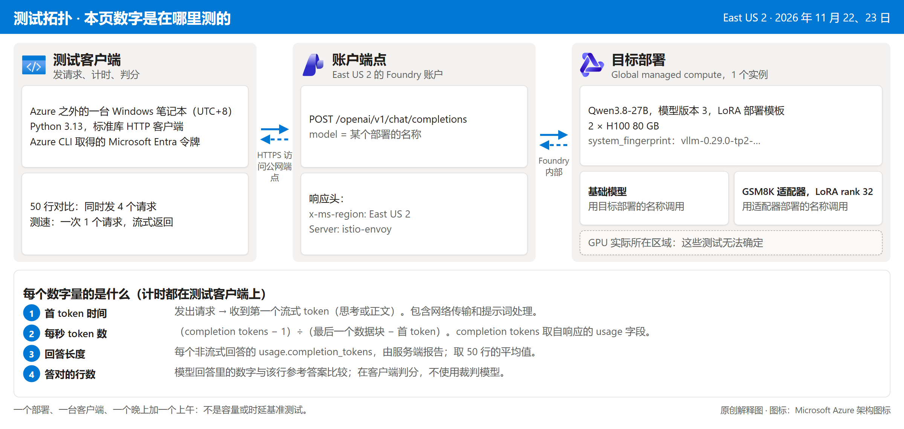

# 实现效果详情：测试环境、方法和完整表格

[English](RESULTS.md) · 返回 [README](../README_CN.md)

本页给出 README [实现效果](../README_CN.md#实现效果)里四个结果背后的测试环境、方法、完整表格和局限。每个数字是怎么取的、重做这些检查的命令，见 [TESTING_CN.md](TESTING_CN.md)。

## 测试环境

在 East US 2 做了两次测试，各用一个 Foundry 账户和各自的目标部署：Qwen3.8-27B 模型版本 3 加 LoRA 部署模板，Global managed compute，一个实例、2 × H100 80 GB。两次都用本仓库的 GSM8K 示例（449 行训练数据，50 行验证数据），LoRA rank 32。

- **第一次测试，2026 年 11 月 22、23 日：适配器 A，Managed Training。** 在门户提交的一个监督微调任务，默认训练设置，种子 42，训练出的就是适配器 A。同样的数据和设置还通过 API 提交过一次，它的用时见[耗时与费用](../README_CN.md#耗时与费用)，它的适配器没有部署。另一个适配器用同样的设置训练，数据是 [`microsoft-foundry/fine-tuning`](https://github.com/microsoft-foundry/fine-tuning) 里的另一套示例 `Text-Bug-Detection`，和适配器 A 部署在同一个目标部署上，没有参与对比。下面的对比和测速针对的都是适配器 A。
- **第二次测试，2026 年 11 月 23 日：适配器 B，Programmed Training。** 训练循环在测试客户端上运行，所在的另一个账户的订阅已获得 Programmed Training 的访问权限。

## 适配器 A：用 Managed Training 训练（第一次测试）

**问题。** 用适配器部署的名称调用，到达的是不是和目标部署名称不同的模型？只用 449 行数据训练出来的适配器，改变了什么？

**方法。** 输入是 `chat_validation.jsonl` 的 50 行，也就是 `up.py` 上传的那个固定文件。每行的 system 和 user 消息原样发送，参考答案不发。每一行分别发给基础模型（`model` 填目标部署的名称）和 GSM8K 适配器（`model` 填适配器部署的名称）各一次，共 100 次调用，同时发 4 个，`temperature` 为 0，`reasoning_effort` 为 `"none"`，`max_tokens` 为 800。两边唯一的差别是 `model` 字段。判分在测试客户端上做，有两种：自动判分，把回答里的最后一个数字和参考答案比较；人工判分，把自动检查对任意一边判错的行逐一读一遍（共 12 行）。测速时把同一条提示词每边发 3 次，一次 1 个流式请求，思考（reasoning）保持默认，`max_tokens` 为 600。

| 在 50 行验证数据上测得 | 基础模型（目标部署的名称） | 基础模型 + GSM8K 适配器（适配器部署的名称） |
|---|---|---|
| 返回 HTTP 200 的行数 | 50 行中的 50 行 | 50 行中的 50 行 |
| 与另一边完全相同的回答 | 50 行中的 0 行 | 50 行中的 0 行 |
| 平均回答长度，completion tokens | 310.2 | 158.7 |
| 在 800 token 上限处被截断的回答 | 50 行中的 2 行 | 50 行中的 0 行 |
| 带训练数据 `####` 标记的回答 | 50 行中的 0 行 | 50 行中的 6 行 |
| 结尾与训练数据一致（`#### <数字>!!!`）的回答 | 50 行中的 0 行 | 50 行中的 0 行 |
| 答对，自动判分（回答里的最后一个数字） | 50 行中的 39 行 | 50 行中的 45 行 |
| 答对，人工读过 12 个被标记的行之后 | 50 行中的 44 行 | 50 行中的 46 行 |

| 流式速度：同一条提示词每边发 3 次，一次 1 个请求 | 基础模型 | 基础模型 + GSM8K 适配器 |
|---|---|---|
| 首 token 之后的每秒 token 数（含思考和正文 token） | 72.5 / 72.1 / 72.6 | 53.4 / 53.4 / 53.4 |
| 到第一个流式 token 的秒数（思考或正文） | 2.16 / 1.15 / 1.28 | 1.63 / 1.38 / 1.30 |

这些数字说明什么：

- **适配器确实在起作用。** 两边没有一个回答完全相同；适配器的回答大约短一半（158.7 对 310.2 个 completion tokens）；`####` 标记只有适配器会用。响应里的 `model` 字段也不同：基础模型返回 `qwen--qwen3.8-27b`，适配器返回形如 `rp-<hash>-1` 的内部 ID，不是部署名。
- **不能说准确率有差别。** 人工读过被标记的行之后，基础模型答对 44 行，适配器答对 46 行。只有适配器答对的有 3 行，只有基础模型答对的有 1 行；对这 4 行做双侧符号检验，p = 0.625。自动判分的 39 对 45 夸大了差距：它取的是文本里的最后一个数字，而基础模型有 5 个正确回答的末句里还有别的数字，比如 README [结果 4](../README_CN.md#结果-4适配器改变的是回答方式不是答对率) 里第 7 行例子的 “in 2 hours”。
- **格式只学到了一部分。** 示例任务只有 6 个优化步（449 行，2 个 epoch，batch size 128）。适配器学到了简短的写法，50 个回答里有 6 个用了标记，完整的结尾一次也没有出现。
- **适配器会降低速度。** 在这条提示词上，同一组 GPU 带适配器时每秒生成 53.4 个 token，基础模型是 72.5 个，少了约 26%。第一个 token 两边都在 1.15 到 2.16 秒之间到达。

局限：一个适配器、一个训练种子、50 行、每行只请求一次、一个目标部署、一台客户端；两边是依次测的（先基础模型），没有交替。测速是单用户测量，不是容量测试；token 数包含思考 token，六个回答里有一个全部是思考。判分细节见 [`TESTING_CN.md`](TESTING_CN.md)。

## 适配器 B：用 Programmed Training 训练（第二次测试）

**问题。** Programmed Training 训练出来的适配器，能不能像 Managed Training 任务的适配器那样部署到 Managed compute？同样的 449 行数据，优化步从 6 个变成 56 个，回答有什么变化？

**方法。** 第二次测试在 East US 2 的另一个 Foundry 账户里做，所在订阅已获得 Programmed Training 的访问权限。训练按 Foundry 微调 cookbook 里的监督对话数据配方（[`programmed_training/docs/custom-data.md`](https://github.com/microsoft-foundry/fine-tuning/blob/0b8bcfe9519ed382a5bc202f0f1b2ce65c22a2c9/programmed_training/docs/custom-data.md)）进行。测试客户端上的一个 Python 循环读取同样两个固定版本的 GSM8K 文件，用 cookbook 为这个模型提供的渲染器（`qwen3_8_low_reasoning`）把每一行渲染成模型的对话格式，再一批一批发给 `Qwen/Qwen3.8-27B` 的训练会话。这个循环现在就是 [`training/programmed_training_sft.py`](../training/programmed_training_sft.py)：准备数据和运行会话的函数，就是这次测试里跑的那些。设置：LoRA rank 32，2 个 epoch，batch size 16，学习率从 0.0001 开始线性降到零，种子 42，只对助手的回答计算损失。第一步之前、第一个 epoch 之后和训练结束时，循环各在 50 行验证数据上算一次损失，不更新适配器。循环保存了最后一个检查点，项目随后把它列为一个 LoRA 模型（rank 32），基础模型版本是 3。这个模型的 ID 和 Managed Training 适配器的 ID 形式相同：`azureai://accounts/<account>/projects/<project>/models/<model name>/versions/1`。

部署发了两个请求：先建目标部署（`PUT .../managedComputeDeployments/<name>`），部署模板、模型版本和 GPU 与第一次测试相同；再建一个适配器部署（`PUT .../adapterDeployments/<name>`），用上面那个 ID 指向保存下来的模型。这次测试里，两个请求是另一个脚本发的；[第 4 步](../README_CN.md#4-部署目标和适配器开始按-gpu-计费)的 `infra/up.py --deploy --adapter-model` 发的是同样的两个请求。cookbook 自带一个部署脚本 `scripts/deploy_to_foundry.py`，说明见 [`docs/deployment-and-inference.md`](https://github.com/microsoft-foundry/fine-tuning/blob/0b8bcfe9519ed382a5bc202f0f1b2ce65c22a2c9/programmed_training/docs/deployment-and-inference.md)。在这个提交上，它唯一的部署目标是 `Fireworks`，这是一种预配置（provisioned）部署，要另外申请预览权限；它没有 Managed compute 这个目标，本次测试也没有用它。

对比沿用[适配器 A 一节](#适配器-a用-managed-training-训练第一次测试)的方法，同样的 50 行、同样的请求设置：共 100 次调用，同时发 4 个，先测基础模型。自动判分把基础模型的 11 个回答判为错：其中 8 个的文本和第一次测试里已经人工读过的回答一字不差，沿用当时的结论；另外 3 个重新读过。适配器有 7 个回答被判错；这些回答都以 `#### <数字>!!!` 结尾，所以拿去比较的数字就是适配器的最终答案。

| 在 449 行数据上训练 2 个 epoch | Managed Training 任务（第一次测试） | Programmed Training 会话（第二次测试） |
|---|---|---|
| batch size | 128，服务默认值 | 16，在循环里设定 |
| 优化步数 | 6 | 56 |
| 学习率 | 从 0.0001 开始，线性降到零 | 从 0.0001 开始，线性降到零 |
| 50 行验证数据上的验证损失，报告的第一个值 | 0.91 | 0.91 |
| 50 行验证数据上的验证损失，报告的最后一个值 | 0.52 | 0.41 |
| 训练 token | 计费 213,000 个 | 循环自己统计 219,652 个 |
| 这些 token 按目录价的费用，美元 | 0.64 | 0.90，估算值 |
| 用时 | 从创建到结束 5.3 分钟 | 循环本身 6 分钟，从启动脚本到退出 9 分钟 |

| 在 50 行验证数据上测得 | 基础模型（第二次测试） | 基础模型 + Programmed Training 适配器（第二次测试） | 对照：基础模型 + Managed Training 适配器（第一次测试，取自上一张表） |
|---|---|---|---|
| 返回 HTTP 200 的行数 | 50 行中的 50 行 | 50 行中的 50 行 | 50 行中的 50 行 |
| 与同一次测试里基础模型完全相同的回答 | 不适用 | 50 行中的 0 行 | 50 行中的 0 行 |
| 平均回答长度，completion tokens | 311.2 | 115.7 | 158.7 |
| 在 800 token 上限处被截断的回答 | 50 行中的 2 行 | 50 行中的 0 行 | 50 行中的 0 行 |
| 带训练数据 `####` 标记的回答 | 50 行中的 0 行 | 50 行中的 50 行 | 50 行中的 6 行 |
| 结尾与训练数据一致（`#### <数字>!!!`）的回答 | 50 行中的 0 行 | 50 行中的 50 行 | 50 行中的 0 行 |
| 答对，自动判分（回答里的最后一个数字） | 50 行中的 39 行 | 50 行中的 43 行 | 50 行中的 45 行 |
| 答对，人工读过被标记的行之后 | 50 行中的 44 行 | 50 行中的 43 行 | 50 行中的 46 行 |

第 7 行这道题，以及基础模型和两个适配器各自的回答，见 README 的[结果 4](../README_CN.md#结果-4适配器改变的是回答方式不是答对率)。

这些数字说明什么：

- **部署和调用的方式与 Managed Training 的适配器相同。** 适配器部署 78 秒后变为 `Succeeded`，第一次调用返回 HTTP 200。响应的 `model` 字段同样是形如 `rp-<hash>-1` 的内部 ID。
- **这个适配器的每个回答都是训练数据的格式。** 50 个回答全部以 `#### <数字>!!!` 结尾。Managed Training 的适配器只有 6 个回答用了标记（共 50 个），完整的结尾一次也没有出现。回答平均 115.7 个 completion tokens，比基础模型 311.2 个的三分之一略多。
- **不能说准确率有差别。** 基础模型答对 44 行，适配器答对 43 行。只有适配器答对的有 2 行，只有基础模型答对的有 3 行；对这 5 行做双侧符号检验，p = 1.0。自动判分的 39 对 43 低估了基础模型，原因和上一节相同：它有 5 个正确回答的末句里还有别的数字。
- **验证损失比示例任务降得更低。** 第一个 epoch 之后从 0.91 降到 0.42，第二个 epoch 之后是 0.41；只有 6 步的示例任务结束时是 0.52。两边都从 0.91 开始：同一个基础模型、同样的 50 行，如果两个服务计算损失的方法相同，起点就应该一样；除了这一点吻合，两者的算法是否相同没有另外核对。
- **两个适配器的差别，不能当成两种训练方式的优劣结论。** 两次训练的数据、基础模型及其版本、2 个 epoch、LoRA rank 32 和学习率的变化方式都相同。不同的是 batch size，16 对 128，优化步数也就不同，56 对 6。Managed Training 任务内部怎么做（优化器设置、提示词渲染），从外部看不到；用 batch size 16 的 Managed Training 也没有跑过。

局限：一个会话、一个种子、50 行、每行只请求一次；先测基础模型，没有交替。Managed Training 的适配器是在另一个账户的另一个目标部署上测的，没有和这个适配器放在一起测；`temperature` 为 0 时，基础模型自己的回答在两次测试之间也有 8 行不同（共 50 行）。这个适配器没有重测速度。第二次测试的费用是按 token 数和目录价估算的，没有读账单。
