# Thermal 3D Modeling Studio: GPT-6 Writes the Model Code, OpenCascade Builds the STEP

[](#purpose)
[](#steps)
[](#terms-used-on-this-page)
[](#results)
[](docs/TESTING.md)

Author: Xinyu Wei · [中文](README_CN.md)

## Purpose

A thermal-management engineer often starts a new part from one sentence or a 2D drawing: "a 320 × 180 × 12 mm aluminium cold plate with six S-shaped channels", an electronic expansion valve body, a manifold module with pumps and valves. Before anyone opens SolidWorks, the team wants to turn the idea around, check its mass and heat-transfer area, compare two versions and show it in a review. Text-to-image and text-to-mesh models return a picture or a mesh with no dimensions, no mass and no STEP file.

This studio asks **GPT-6 Astra** on Microsoft Foundry to write code instead of pixels. In **Track A** it writes a complete three.js page that the browser renders as an interactive concept model. In **Track B** it writes a CadQuery script that the **OpenCascade** kernel turns into a STEP solid whose volume and mass are computed exactly. Image models only make presentation pictures (Tracks C and D).

The repository deploys the studio for you. One script, `infra/up.ps1`, creates the Azure resources (the model deployments, a managed identity with its role, the network and an Ubuntu VM), installs the studio on the VM and serves it over HTTPS; `infra/verify.ps1` checks it from the outside and `infra/down.ps1` removes everything ([Steps](#steps)).

| Deliverable | Where | Use it to |
|---|---|---|
| Deployment automation | `infra/`: `main.bicep`, `up.ps1`, `verify.ps1`, `down.ps1`, `vm-install.sh` | create every Azure resource and the VM, install the studio and serve it over HTTPS, check it from outside, remove it |
| The studio | `studio/`: FastAPI backend, browser front end | the application itself; 15 scenario cards in two groups (thermal parts, notebook manufacturing), English and Chinese UI |
| Prompts and output contracts | `studio/scenarios.py`, `CAD_PROMPT` in `studio/app.py` | see exactly what GPT-6 is told: four marked blocks for the three.js page, `PARTS` / `MATERIALS` for the CadQuery script |
| CAD runner | `studio/cad_runner.py` | run model-written CadQuery safely: allow-list check, separate process, STEP / STL / GLB export, automatic edge break |
| 15 reference CadQuery scripts | `studio/cad_examples/`, `studio/cad_examples_en/` | build 15 STEP solids with no model call; `coldplate.py` is also the worked example inside GPT-6's prompt |
| 30 recorded GPT-6 responses | `studio/cache/` | open every scenario instantly without calling Azure; the Track A numbers in the [Appendix](#appendix) come from these files |
| VM setup scripts | `studio/deploy/` | the host setup and install scripts, nginx and systemd files that `infra/vm-install.sh` runs on the VM; `deploy.ps1` pushes a local working copy to an existing VM over SSH |
| Tests and the recorded runs | `studio/tests/`, `tests/`, `evidence/`, `data/` | check your copy offline and compare it with the runs recorded here ([Appendix](#appendix)) |

What the studio is not:

- The metrics GPT-6 prints next to a Track A model are its own estimates. Track B computes volume, mass, bounding box and surface area exactly, but of a solid that GPT-6 (or a reference script) built from a description: a concept part with no tolerances or drawings, not a checked design.
- gpt-image pictures are illustrations; the model may change proportions and details. The engineering render of Track C is the picture that lines up with the STEP.
- A live call takes minutes and costs tokens (see the [Appendix](#how-the-numbers-were-produced)). Browsing the 15 recorded examples calls no model.

| Responsibility | Microsoft Foundry | This repository | You |
|---|---|---|---|
| Models | runs GPT-6 Astra, gpt-image-2.5 and, optionally, MAI-Image-2.6 | the prompts and output contracts; `infra/main.bicep` creates the model deployments | the quota; you pay for the tokens |
| Running the studio | — | app, CAD runner, the deployment that creates the VM and installs the studio | an Azure subscription in which you can create resources and assign roles; you pay for the VM while it runs |
| Engineering decisions | — | exact B-rep metrics of each generated solid | design review, tolerances, release |


What the figure shows: the four tracks, which code is ours, and which model each track calls; `infra/up.ps1` creates the VM and the Foundry side of it. It is an original explanatory diagram; where each measured number was produced is in the [Appendix](#how-the-numbers-were-produced).

### How a request moves

1. **Track A, 3D model.** The browser posts the conversation to `/api/generate`. The backend adds the system prompt (output contract plus modeling rules for the scenario) and streams GPT-6 Astra's answer back over SSE. GPT-6 writes four marked blocks: `<<<SUMMARY>>>`, a complete three.js page in `<<<HTML>>>`, the metrics as JSON in `<<<METRICS>>>`, and three follow-up ideas. When the HTML block closes, the browser starts rendering it in a sandboxed iframe while the metrics are still streaming. The last three model answers stay in the conversation, so "make the channels 8 instead of 6" edits the previous version.
2. **Track B, CAD solid.** **Generate STEP** sends the same part (your request, GPT-6's summary and the `const P = {...}` parameter block of the three.js page) to `/api/cad`. GPT-6 writes a CadQuery script. `cad_runner.py` parses it and rejects anything outside an allow-list (only `cadquery`, `math` and a few standard modules; no `open`, `exec` or exporters), runs it in a separate Python process without the server's Azure settings, breaks sharp edges with R0.3–1.2 mm fillets, and exports `model.step` (an assembly with part names), `model.stl`, `model.glb` and `parts.json`. OpenCascade computes volume, mass, bounding box and surface area from the exact solid. If the script fails, the error goes back to GPT-6, up to 3 attempts.
3. **Track C, images.** **Photoreal render** sends a WebGL snapshot of the 3D view to gpt-image-2.5 (`images.edit`). The engineering render instead draws the STEP's mesh with three.js, from the same camera as the STEP outline, so the two coincide; no image model is involved.
4. **Track D, concept image.** Before any 3D exists, a sentence becomes a concept picture (gpt-image-2.5, or MAI-Image-2.6 which can search the web first); **Build 3D from this image** attaches it to a Track A request.
5. **Proposal.** **Proposal (.docx)** assembles the request, screenshots, metrics and STEP data with python-docx, plus one GPT-6 call that writes the key points, risks and next steps.
6. **Sign-in and keys.** Visitors sign in to the studio; every model call uses the server's connection. On the VM the backend gets a Microsoft Entra token with its managed identity, locally with `az login`; the browser never receives a key or token.

### Terms used on this page

| Term | Meaning here |
|---|---|
| three.js, WebGL | a JavaScript 3D library and the browser API it draws with; Track A's output is a three.js page |
| B-rep (boundary representation) | how CAD describes a solid: exact faces (planes, cylinders, free-form surfaces) bounded by edges and closed into a volume. A Ø6 mm hole is a cylinder of radius 3 mm, not a ring of triangles |
| OpenCascade (OCCT) | open-source geometry kernel: builds B-rep solids, booleans and fillets; reads and writes STEP |
| CadQuery | Python library that describes a part as code and calls OpenCascade |
| STEP (`.step`, ISO 10303) | the exchange format CAD programs read; it carries the exact B-rep and the part names into SolidWorks, NX or Creo |
| STL, GLB (glTF) | triangle meshes. STL for 3D printing and previews; GLB for the web, with materials and a part tree. The studio shows the STEP through its GLB |
| Engineering render | a picture of the STEP's mesh drawn by three.js with no image model; it lines up with the STEP |
| Reasoning effort | how long GPT-6 thinks before it answers (`none` to `xhigh`). `.env.example` sets `none` as the server default; the selector next to the send button changes it per request |
| SSE (server-sent events) | the stream that carries tokens, progress and heartbeats from the backend to the browser |
| Bicep | Azure's language for declaring resources; `infra/main.bicep` lists every resource the studio needs |
| Managed identity | an identity Azure gives the VM. The studio exchanges it for Microsoft Entra tokens to call the models, so no key is stored anywhere |
| Run Command | runs a script inside a VM through Azure's control plane; `up.ps1` installs the studio with it, so no SSH connection is needed |

## Steps

| Order | Where | What | Command | Time in the recorded run |
|---|---|---|---|---|
| 1 | Your machine | Get the code, sign in to Azure | `git clone ...`, `az login` | — |
| 2 | Your machine → Azure | Create every resource, install the studio on a new VM | `./infra/up.ps1 -ResourceGroup <name> -Location <region>` | 14.0 min |
| 3 | Your machine | Check the deployment through its HTTPS address | `./infra/verify.ps1 -ResourceGroup <name> -Full` | 2.1 min |
| 4 | Browser | Sign in, open the recorded examples, make a live call | `https://thermal-<hash>.<region>.cloudapp.azure.com/` | — |
| 5 | Your machine | Remove everything | `./infra/down.ps1 -ResourceGroup <name>` | 4.4 min |
| 6 | Your machine, optional | Run the studio locally against the deployed models, for development | `python -m uvicorn app:app --env-file .env` | — |

Steps 2, 3 and 5 ran end to end on 2026-11-14, into a new resource group in East US 2; the outputs below are from that run, and its receipts are in [`evidence/deploy-20261114/`](evidence/deploy-20261114/) ([recorded deployment](#recorded-deployment)). Step 6 was not run against that deployment; its install and build commands were replayed on the test laptop on 2026-11-13 and 2026-11-14 ([offline run](docs/TESTING.md#recorded-run)).

**Prerequisites.**

- An Azure subscription in which you can create resource groups and assign roles: Owner, or Contributor plus Role Based Access Control Administrator. The template gives the VM's identity a role on the model resource.
- Quota in the region: `gpt-6-astra` 100K tokens per minute (Global Standard or Data Zone Standard; `up.ps1` takes the one with free quota), `gpt-image-2.5-sunburst` 2 units (or pass `-SkipImageModel`, which turns Tracks C and D off), and 4 vCPUs for the VM. `up.ps1` checks all three before it creates anything.
- The Azure CLI (tested with 2.92.0; Bicep is installed on first use), PowerShell 7.3 or later (tested with 7.7.0) and `ssh-keygen` from the OpenSSH client for the VM's key pair. The recorded run used Windows 11; the scripts use no Windows-only command, but macOS and Linux were not tested.
- Nothing else on your machine: the VM downloads the studio from this repository and builds everything itself.

### 1. Get the code and sign in

```powershell
git clone --filter=blob:none --sparse https://github.com/david-xinyuwei/david-share.git
cd david-share
git sparse-checkout set Agents/Thermal-3D-Modeling-Studio
cd Agents/Thermal-3D-Modeling-Studio
az login
az account set --subscription <subscription name or id>
```

Expected: `az account show -o table` shows the subscription you want to deploy into.

### 2. Deploy

```powershell
./infra/up.ps1 -ResourceGroup rg-thermal-studio -Location eastus2
```

Expected output (the recorded run; the subscription line is left out; `up.ps1` prints this machine's time, the indented lines from the VM are in UTC):

```text
[15:08:49] 1/5 preflight: Azure CLI, sign-in, model quota
   models offered in eastus2: gpt-6-astra 2026-09-03, gpt-image-2.5-sunburst 2026-09-08
   gpt-6-astra GlobalStandard in eastus2: 0 K tokens/min free, 100 needed
   gpt-6-astra DataZoneStandard in eastus2: 333 K tokens/min free, 100 needed
   gpt-image-2.5-sunburst GlobalStandard in eastus2: 2 free, 2 needed
   VM sizes offered to this subscription in eastus2 (about a minute)
   VM size Standard_D4as_v6, disk controller NVMe
[15:11:33] 2/5 resource group rg-thermal-studio
   created in eastus2
[15:11:44] 3/5 Azure resources (infra/main.bicep): AI resource and models, identity and role, network, VM
   thermal-vm at thermal-<hash>.eastus2.cloudapp.azure.com; models on https://thermal-ai-<hash>.openai.azure.com: gpt-6-astra (DataZoneStandard), gpt-image-2.5-sunburst
[15:12:31] 4/5 install on the VM through Run Command (infra/vm-install.sh): the longest step, silent until it ends
   [07:12:43] install log: /var/log/thermal-install.log
   [07:12:43] 1/7 waiting for the first-boot package jobs
   [07:12:44] 2/7 fetching Agents/Thermal-3D-Modeling-Studio/studio from https://github.com/david-xinyuwei/david-share.git at master
   [07:12:45]    commit d32e1e6ea9193dff81180a8105e5081b4d8da4da
   [07:12:45] 3/7 host setup: packages, Python venv with pinned packages, nginx, certificate for thermal-<hash>.eastus2.cloudapp.azure.com
   [07:14:23]    Python 3.12.3, cadquery 2.8.0
   [07:14:23] 4/7 settings: /opt/thermal-3d-studio/.env
   [07:14:23] 5/7 code, three.js and the systemd service
   [07:14:27] 6/7 building the 15 reference STEP solids with OpenCascade (no model call)
   [07:21:25]    failed in the edge-break pass: nb_thermal; building them again without the edge break
   [07:21:32]    Chinese part names: done in 425 s
   [07:22:45]    English part names: done in 73 s
   [07:22:45] 7/7 restart and health checks
   [07:22:47] THERMAL_INSTALL=PASS commit=d32e1e6ea9193dff81180a8105e5081b4d8da4da solids_zh=15 solids_en=15 no_edge_break=nb_thermal https_from_vm=200 seconds=604
[15:22:50] 5/5 HTTPS check from this machine: https://thermal-<hash>.eastus2.cloudapp.azure.com/healthz
   {"ok":true,"deployment":"gpt-6-astra","uptime_s":3}

Thermal 3D Modeling Studio is running
  Open      https://thermal-<hash>.eastus2.cloudapp.azure.com/
  Sign in   user studio; password in ~/.thermal-3d-studio/rg-thermal-studio/portal-password.txt
  Check     ./infra/verify.ps1 -ResourceGroup rg-thermal-studio
  Remove    ./infra/down.ps1 -ResourceGroup rg-thermal-studio
  The VM bills while it runs; the model deployments bill per token.
receipt: ~/.thermal-3d-studio/rg-thermal-studio/up-20261114-150849.json (PASS)
```

What it creates, all in the one resource group:

| Resource | Name | Why |
|---|---|---|
| Azure AI resource with two model deployments | `thermal-ai-<hash>`: `gpt-6-astra` (version 2026-09-03), `gpt-image-2.5-sunburst` (2026-09-08) | the models; Microsoft Entra sign-in only, local keys are disabled |
| User-assigned managed identity and its role | `thermal-vm-identity`, **Cognitive Services OpenAI User** on the AI resource | lets the VM call the models without a key |
| Network | `thermal-vnet`, `thermal-nsg` (inbound 443 and 80 only), `thermal-ip` with the DNS name `thermal-<hash>.<region>.cloudapp.azure.com` | HTTPS from anywhere; port 80 for the Let's Encrypt certificate and the redirect to HTTPS |
| VM | `thermal-vm`: Ubuntu 24.04, 4 vCPUs, 64 GB disk, Trusted Launch | runs nginx and the studio; the size is the first one the region offers you from `Standard_D4as_v5`, `Standard_D4s_v5`, `Standard_D4ads_v5`, `Standard_D4ds_v5`, `Standard_D4as_v6`, `Standard_D4ads_v6`, `Standard_D4s_v6`, `Standard_D4as_v4`, `Standard_D4s_v4` |

On the VM, Run Command runs [`infra/vm-install.sh`](infra/vm-install.sh) as root. It downloads `studio/` from this repository at `-RepoRef` (default `master`), runs `studio/deploy/bootstrap_vm.sh` (packages, the unprivileged `studio` user, a Python environment with the pinned packages, nginx and a Let's Encrypt certificate) and `studio/deploy/remote_install.sh` (the code, three.js and the systemd service), writes `/opt/thermal-3d-studio/.env` from the deployment outputs, and builds the 15 reference STEP solids in Chinese and English with no model call. OpenCascade 7.9.3 on Linux crashes in the edge-break pass of the notebook dual-fan module, with a segmentation fault at the same place every time; the install then builds that solid again without the edge break, so its edges stay sharp, and reports `no_edge_break=nb_thermal`. Its full log stays on the VM in `/var/log/thermal-install.log`.

`up.ps1` keeps its state in `~/.thermal-3d-studio/<resource group>/`, outside the repository: `outputs.json` (address and resource names), `portal-password.txt` (the generated sign-in password), the VM's SSH key pair and a receipt of each run. Run it again with the same resource group to update the VM to the current `-RepoRef`; the password and the solids are kept. A failed step stops with its reason; fix it and run the same command again.

| Parameter | Default | Use it to |
|---|---|---|
| `-Gpt6Capacity` | `100` | set the gpt-6-astra capacity in thousands of tokens per minute |
| `-SkipImageModel` | off | deploy no image model; Tracks C and D are then hidden |
| `-VmSize` | first size offered from the list above | pick a VM size yourself |
| `-PortalPassword` | generated | choose the sign-in password: `-PortalPassword (Read-Host -AsSecureString)` |
| `-AllowSshFrom` | none | open SSH (port 22) to one address, for example `203.0.113.7/32` |
| `-GrantDeployerAccess` | off | give your own account model access too, for step 6 |
| `-RepoUrl`, `-RepoRef` | this repository, `master` | install your own fork or branch |
| `-SkipReferenceSolids` | off | skip building the 15 reference solids |

### 3. Check it

```powershell
./infra/verify.ps1 -ResourceGroup rg-thermal-studio          # one 64-token GPT-6 reply, no other model output
./infra/verify.ps1 -ResourceGroup rg-thermal-studio -Full    # plus a live Generate STEP and one concept image
```

Expected output of `-Full` (the recorded run):

```text
PASS  healthz over HTTPS                 {"deployment":"gpt-6-astra","uptime_s":4}
PASS  HTTP redirects to HTTPS            {"status":308,"location":"https://thermal-<hash>.eastus2.cloudapp.azure.com/"}
PASS  wrong password is rejected         {"status":401}
PASS  sign in                            {"user":"studio","role":"visitor"}
PASS  15 scenarios                       {"scenarios":15}
PASS  pre-generated STEP solids (zh)     {"solids":15}
PASS  pre-generated STEP solids (en)     {"solids":15}
PASS  GPT-6 round trip (managed identity) {"deployment":"gpt-6-astra","actual_model":"gpt-6-astra-2026-09-03","latency_s":2.1}
PASS  Generate STEP live (GPT-6 + OCCT)  {"attempts":1,"latency_s":91.5,"occt_s":6.7,"solids":4,"faces":315,"mass_kg":"1.580","step_bytes":1106781,"reasoning_effort":null,"prompt_tokens":4583,"completion_tokens":4248,"reasoning_tokens":1472,"saved":"~/.thermal-3d-studio/rg-thermal-studio/verify-live.step"}
PASS  concept image (gpt-image)          {"png_bytes":1408063,"latency_s":13.6,"model":"gpt-image-2.5-sunburst","saved":"~/.thermal-3d-studio/rg-thermal-studio/verify-concept.png"}

10 of 10 checks passed; report: ~/.thermal-3d-studio/rg-thermal-studio/verify-20261114-152251.json
```

The checks go through the public HTTPS address: health, the redirect from HTTP, a wrong password refused, sign-in, the 15 scenarios, the pre-generated solid of every scenario in both languages, one GPT-6 call through the VM's managed identity and, with `-Full`, a live **Generate STEP** whose STEP file is downloaded and one gpt-image concept picture. The report `verify-<time>.json` goes next to the other state files; the exit code is 0 when every check passes.

### 4. Use it

1. Open the address from `outputs.json` and sign in with the user `studio` and the password from `portal-password.txt`.
2. Pick a scenario card. The badge says **Pre-generated example**, then **Pre-generated B-rep solid (matches STEP)** once the reference solid is on screen, and the source bar says "Current model: saved example (no GPT-6 call this time)": a recorded GPT-6 answer and the reference STEP solid open with no model call.
3. Click **Call GPT-6 live**. The source bar switches to the live request ID once the answer arrives. The wait depends on the reasoning effort chosen in the page (the default is `none`, from `.env.example`); a value the model deployment refuses is dropped and the deployment's own default applies, as `none` was in the [recorded deployment](#recorded-deployment). The [Appendix](#how-the-numbers-were-produced) shows how long the recorded runs took.
4. Click **Generate STEP**. The **CAD solid** tab shows the attempts, the OCCT time and the B-rep metrics, with downloads for STEP, STL and the CadQuery script.

The VM bills while it runs. `az vm deallocate -g <resource group> -n thermal-vm` stops the billing for its compute and `az vm start` brings it back with the same address; the studio starts by itself. The model deployments bill per token, so an idle studio costs nothing on the model side.

### 5. Remove it

```powershell
./infra/down.ps1 -ResourceGroup rg-thermal-studio
```

It asks you to type the resource group name (`-Yes` skips the question), deletes the group, purges the soft-deleted AI resource so that its name and quota are free again, checks that nothing is left, and deletes the password and the key pair from the state directory. Expected output (the recorded run, with `-Yes`):

```text
deleting resource group rg-thermal-studio (several minutes)
[15:30:38] resource group deleted: rg-thermal-studio
[15:31:26] AI resource purged: thermal-ai-<hash> (eastus2)
[15:31:40] nothing left: group rg-thermal-studio gone, no soft-deleted AI resource of it
receipt: ~/.thermal-3d-studio/rg-thermal-studio/down-20261114-152717.json (PASS)
```

### 6. Optional: run the studio on your own machine

For development against the models deployed in step 2. Run `up.ps1` once with `-GrantDeployerAccess` first: it gives your own account the **Cognitive Services OpenAI User** role on the AI resource.

You need Python 3.11 or 3.12 and about 1.4 GB of disk for the virtual environment (1,324 MiB in the recorded offline run, with the optional tools). CadQuery's kernel package `cadquery-ocp` 7.9.3.1.1 has wheels for Windows x64, macOS (Intel and Apple silicon) and Linux (x64 and Arm64); on Windows on Arm, use the x64 Python, which runs under emulation. The recorded offline run used x64 Python 3.11.9 on Windows 11 on Arm; the VM uses the Python 3.12 of Ubuntu 24.04.

```powershell
cd studio
py -3.11 -m venv .venv                      # Linux/macOS: python3.11 -m venv .venv
.\.venv\Scripts\Activate.ps1                # Linux/macOS: source .venv/bin/activate
python -m pip install --upgrade pip
python -m pip install -r requirements.txt -c deploy/constraints.txt
python ../tools/vendor_three.py             # three.js r160, checked against pinned hashes
python pregen_cad.py                        # the 15 reference solids, no model call
python pregen_cad.py --lang en              # the same solids with English part names
$o = Get-Content ~/.thermal-3d-studio/rg-thermal-studio/outputs.json | ConvertFrom-Json
(Get-Content .env.example) -replace '^AOAI_ENDPOINT=.*', "AOAI_ENDPOINT=$($o.aiEndpoint)" `
  -replace '^AOAI_IMAGE_DEPLOYMENT=.*', "AOAI_IMAGE_DEPLOYMENT=$($o.imageDeployment)" | Set-Content .env
# edit .env: PORTAL_PASSWORD and PORTAL_SESSION_SECRET
python -m uvicorn app:app --host 127.0.0.1 --port 3005 --env-file .env
```

Expected: pip ends with `Successfully installed ... cadquery-2.8.0 ... fastapi-0.141.1 ...`; `three.js 0.160.0: 15/15 files verified in ...`; one `[<id>] OK` line per scenario and `done. failed: none` from each build; then `Uvicorn running on http://127.0.0.1:3005`. On Linux the first build meets the crash of step 2 for `nb_thermal`; build that one with the edge break off (`CAD_EDGE_FINISH=0 python pregen_cad.py nb_thermal`) before the English build. Open `http://127.0.0.1:3005` and use it as in step 4. Without `AZURE_CLIENT_ID` the backend takes its Entra token from your `az login`. `.env` stays out of Git; the browser never receives it.

## Results

**Videos.** Two narrated walkthroughs in English, 7:22 and 6:21 long. Both are edited screen recordings of the studio with narration and captions added.

*Recorded examples.* The architecture, then saved GPT-6 pages and pre-generated STEP solids opened with no model call: the electronic expansion valve as the three.js page and the code GPT-6 wrote, its OCCT solid cut by a section, the gpt-image render with the STEP outline laid over it next to the engineering render, the cost comparison for the four-way valve, and a drawing rebuilt in 3D. The video covers the thermal-management cards; the architecture figure is cut in between the recordings.

https://github.com/user-attachments/assets/66148365-f3aa-44a7-a129-cef898e68cb3

*Live generation.* One request sent live to the studio on its Azure VM: the EV battery cold plate with eight channels instead of six. GPT-6 Astra streams the three.js page, **Generate STEP** has it write the CadQuery script that OpenCascade builds, and **Photoreal render** calls gpt-image-2.5. The waits are shown in real time, uncut. It is a demonstration, not one of the measured runs in the [Appendix](#how-the-numbers-were-produced).

https://github.com/user-attachments/assets/7ee81aaa-a5f8-46e3-aae7-0410739226ed

The integrated thermal-management module, one of the 15 scenarios, as the studio shows it. The screenshots and the engineering render come from this repository's recorded run (2026-11-14) with no model call; the gpt-image picture comes from one call through the studio page on 2026-11-10. None of them is retouched.

| Track A: the three.js page GPT-6 wrote (recorded answer) | Track B: the OCCT solid of the same part, quad view |
|---|---|
| 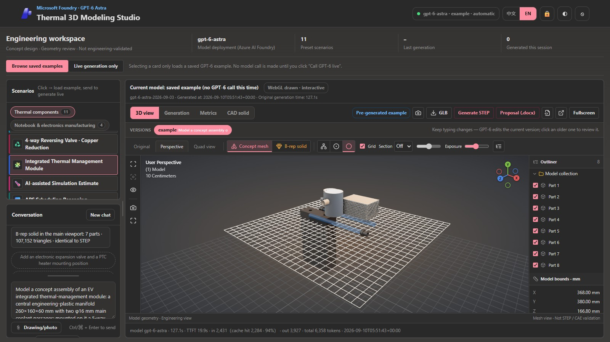 | 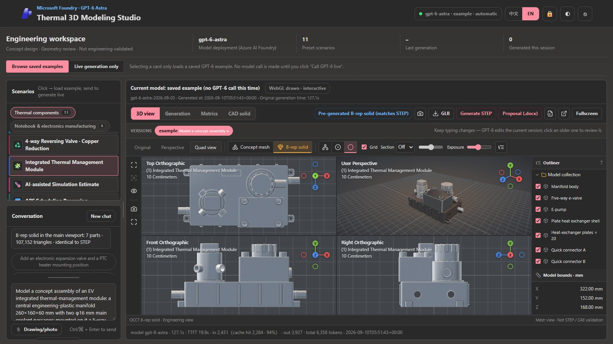 |

| Track C: gpt-image-2.5 redraws a 3D snapshot (illustration) | Track C: engineering render of the STEP mesh, STEP outline and edges in cyan |
|---|---|
| 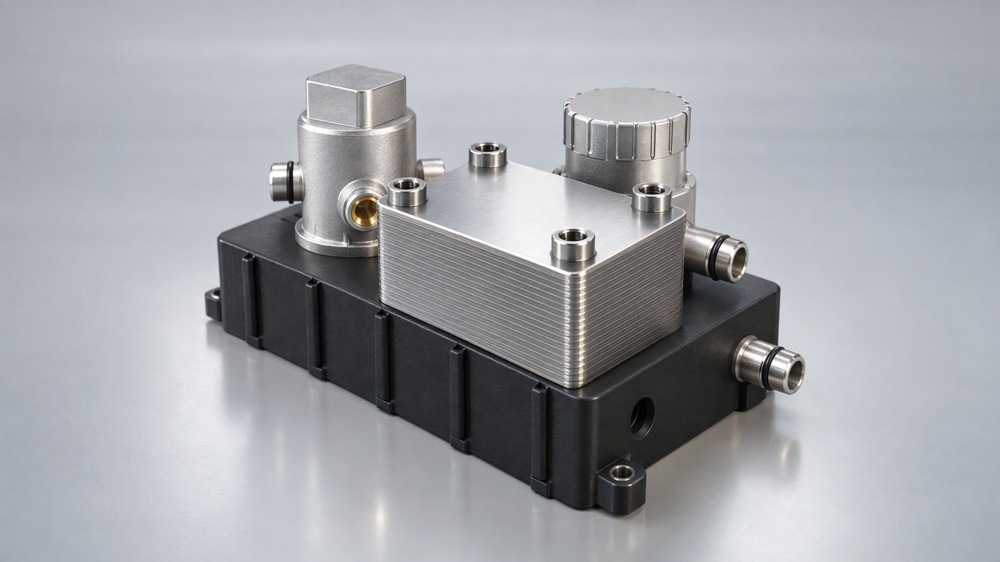 | 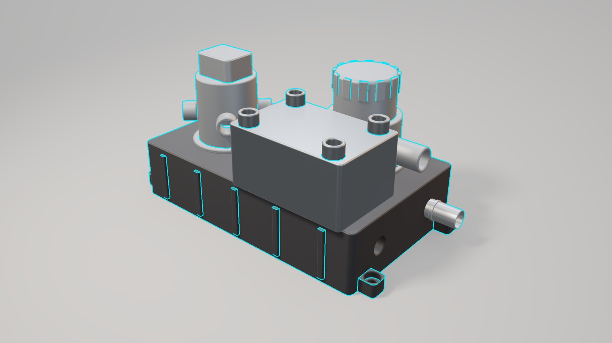 |

**What to look at.** The top row shows one part twice. On the left is the page GPT-6 wrote: its shapes and the metrics it prints are the model's own. On the right is the exact solid of the reference script, measured by OCCT. In the bottom row, gpt-image-2.5 turns a snapshot of the 3D view into a photograph-like picture, but the model redraws the part, so details can differ from the STEP. The engineering render is drawn from the STEP's own mesh, which is why the cyan STEP outline lies on it.

### More scenarios

Six of the other scenarios, from the same recorded run. On the left is the page GPT-6 wrote for the scenario card, shown as written: the scene, the panel of figures and the buttons are the model's own. On the right is the OCCT solid of the reference script in the studio's viewport. All 15 scenarios, each with its gpt-image picture, are in [docs/RESULTS.md](docs/RESULTS.md#every-scenario-at-a-glance).

| Scenario | Track A: the page GPT-6 wrote (recorded answer) | Track B: the OCCT solid of the reference script |
|---|---|---|
| EV Battery Cold Plate | 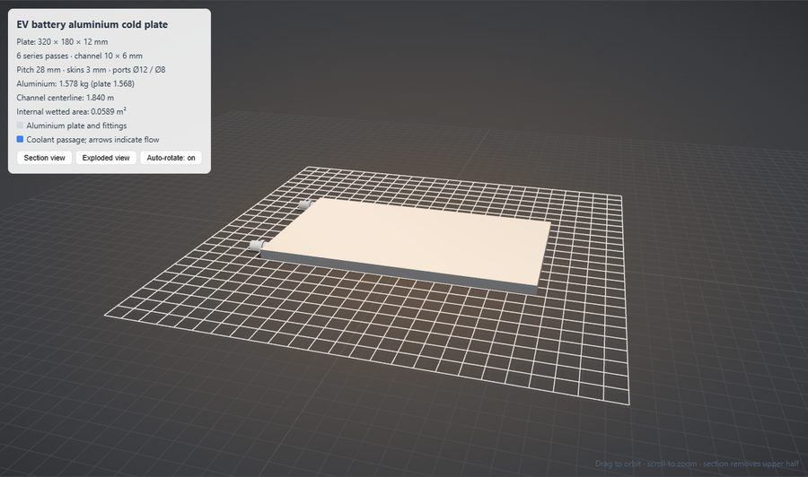 | 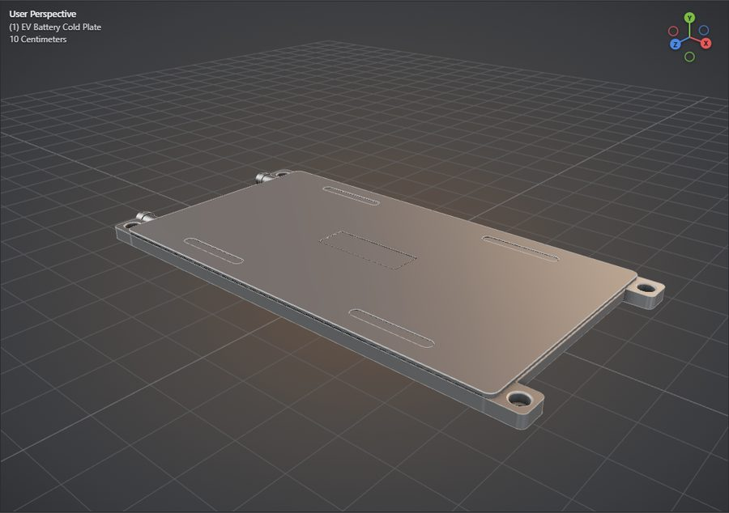 |
| Electronic Expansion Valve Body | 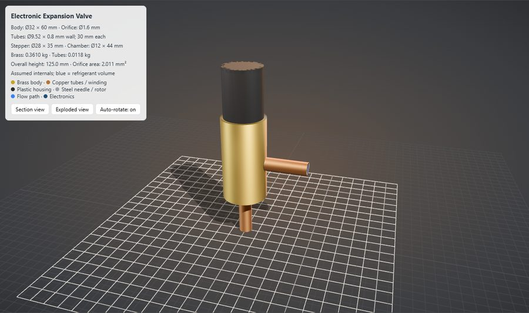 | 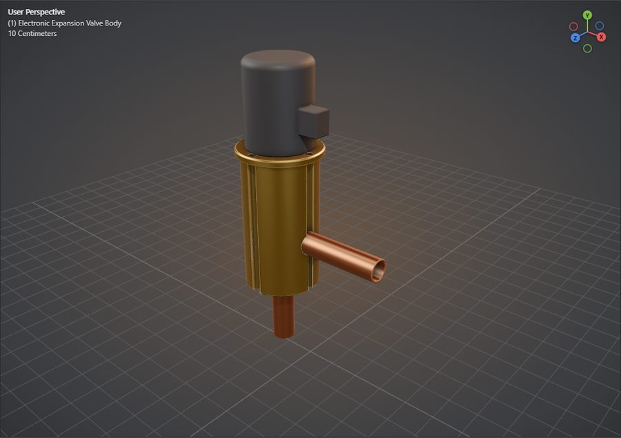 |
| Micro-channel Heat Exchanger | 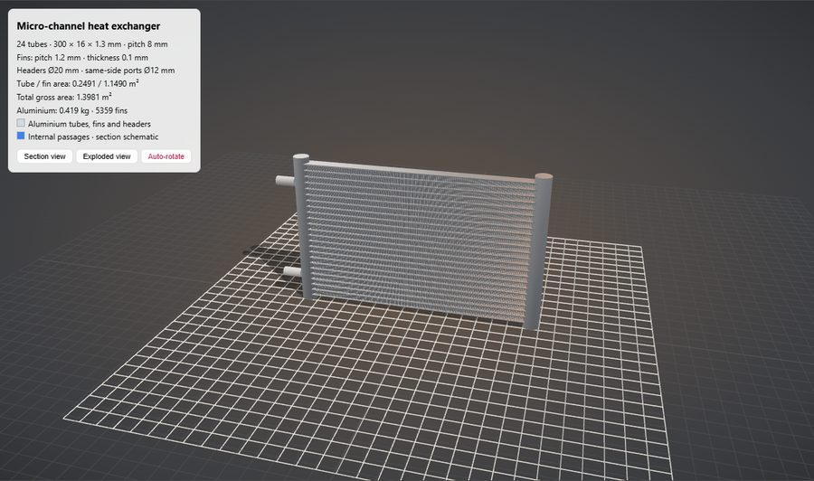 | 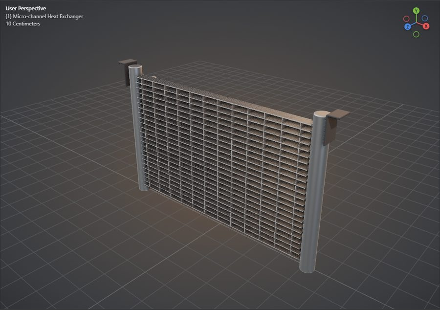 |
| AIDC Coolant Distribution Unit | 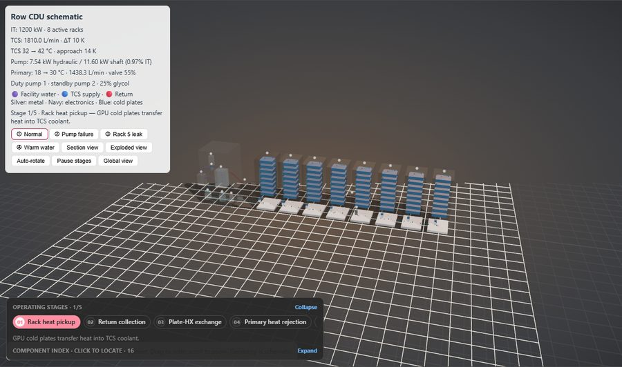 | 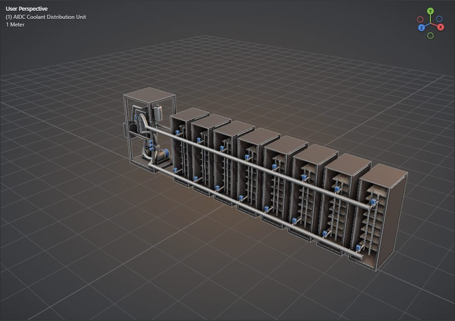 |
| Vehicle Thermal Management System | 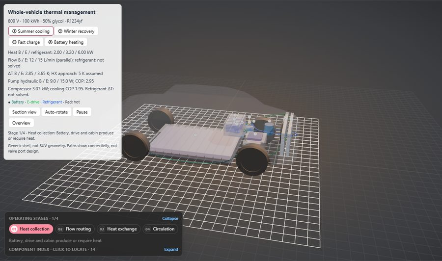 | 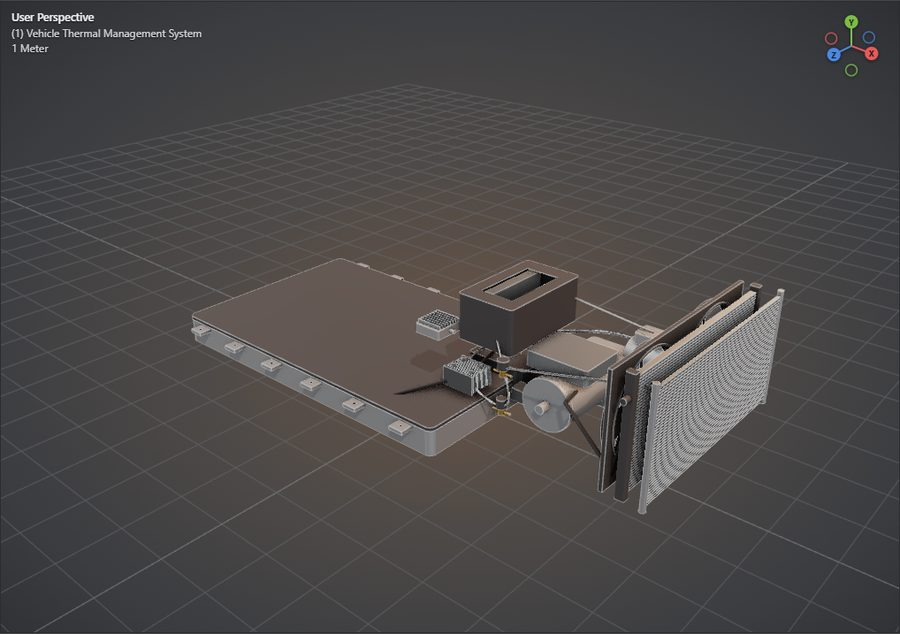 |
| Notebook Dual-Fan Thermal Module | 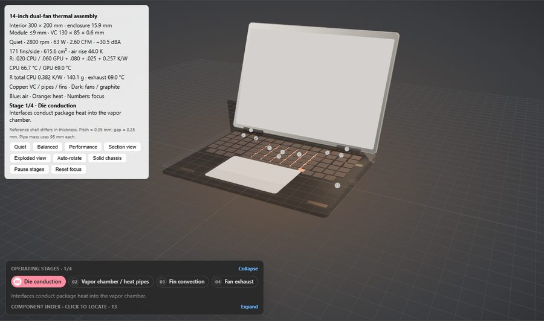 | 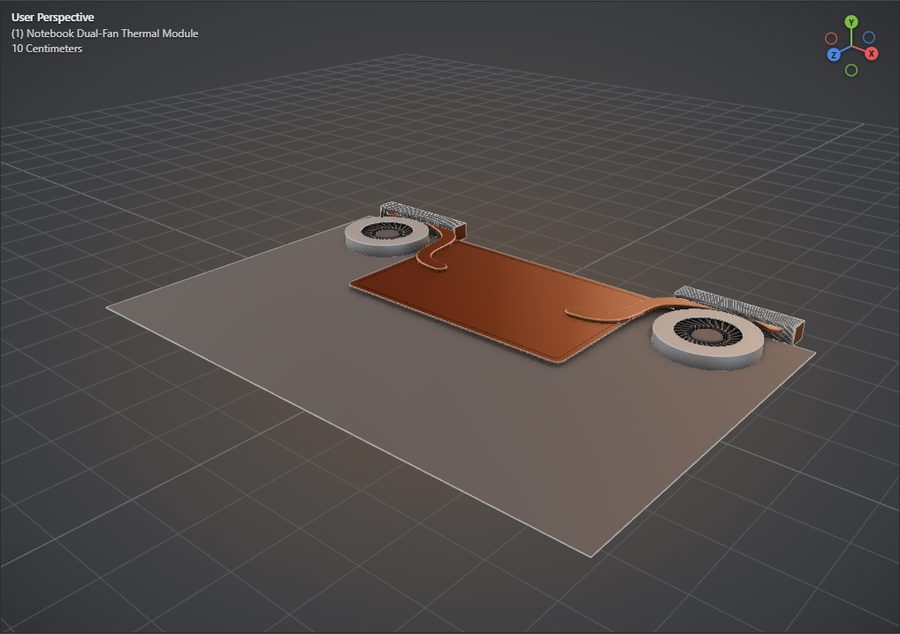 |

### Working with the solid

The viewport shows the B-rep solid through the mesh exported with its STEP, so the viewer's tools act on the real part geometry, not on GPT-6's scene.

| Section: a plane normal to Y, quad view | Isolate selection: one part of the solid alone |
|---|---|
| 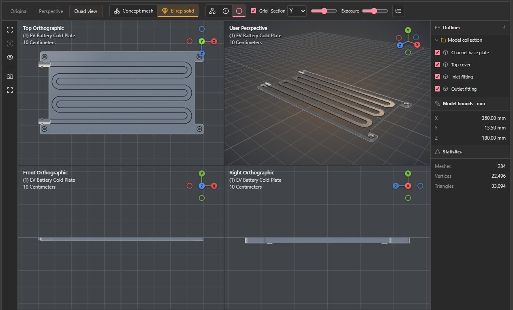 | 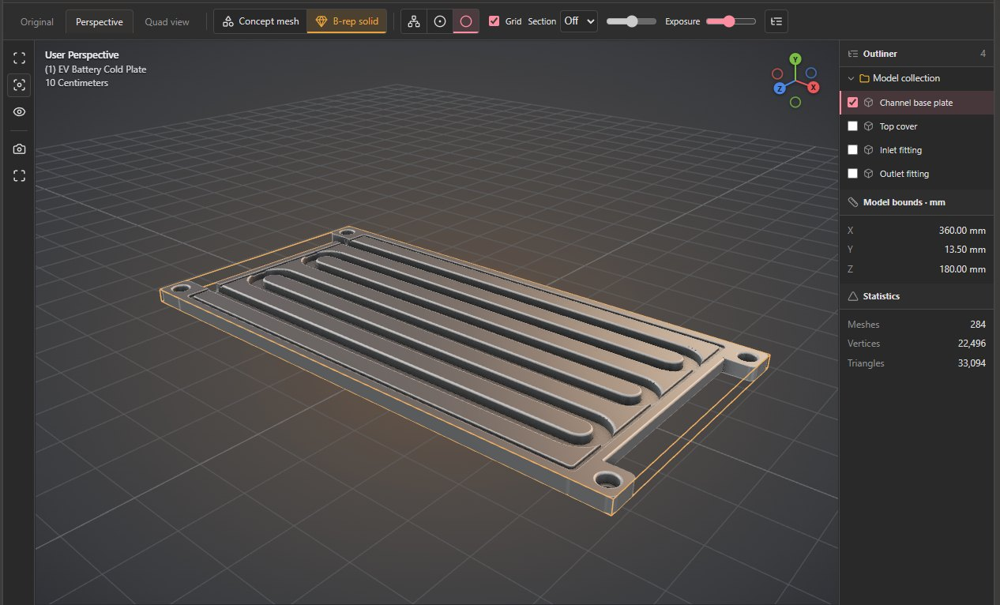 |

With **Section** set to Y, a horizontal plane cuts the EV battery cold plate, and the top and perspective views look into its serpentine coolant channel. With **Isolate selection**, the part selected in the outliner, here the channel base plate, is the only one left, so the channel grooves in it are in plain view.

| You want to | Read |
|---|---|
| see every scenario's numbers, the inputs and the limits | [docs/RESULTS.md](docs/RESULTS.md) |
| know what each test layer checks and what it does not | [docs/TESTING.md](docs/TESTING.md) |
| inspect the recorded deployment: what each step printed and how long it took | [evidence/deploy-20261114/](evidence/deploy-20261114/) |
| inspect the recorded offline run: logs, per-solid metadata, render checks, machine | [evidence/run-20261113/](evidence/run-20261113/) |
| reuse the numbers | [data/results.json](data/results.json), built by `tools/build_results.py` |
| check where a picture or icon comes from | [images/SOURCES.json](images/SOURCES.json), [NOTICE.md](NOTICE.md) |

| Directory | What it holds |
|---|---|
| `infra/` | the deployment: `main.bicep` (every Azure resource), `up.ps1` (create and install), `vm-install.sh` (what runs on the VM), `verify.ps1` (check from outside), `down.ps1` (remove) |
| `studio/` | the app: FastAPI backend (`app.py`), front end (`static/`), CAD runner, prompts (`scenarios.py`), recorded GPT-6 responses (`cache/`), reference CadQuery scripts, VM setup scripts (`deploy/`) and its own tests (`tests/`) |
| `tools/` | three.js download with pinned hashes, the figure renderer and its HTML sources, the screenshot tool, the results builder, the segmentation check for engineering renders |
| `tests/` | repository checks: page layout in both languages, links, images, numbers, figures, private data |
| `data/` | `results.json`: every number quoted in the Appendix and docs/RESULTS |
| `evidence/` | `deploy-20261114/`: the recorded deployment; `run-20261113/`: the recorded clean offline run (logs, `pip freeze`, OCCT metadata per solid, render checks, browser check, machine facts) |
| `images/` | screenshots, renders, the two figures and the Azure icons, each listed in `images/SOURCES.json` |
| `docs/` | results per scenario and the test guide, English and Chinese |

## Appendix

The author's own validation. Nothing here is needed to deploy or use the studio.

### Recorded deployment

On 2026-11-14 the three scripts ran from a Windows 11 laptop into a new resource group in East US 2, with nothing prepared beforehand but `az login`. The receipts and the output of each script are in [`evidence/deploy-20261114/`](evidence/deploy-20261114/); [docs/TESTING.md](docs/TESTING.md#recorded-deployment) has every step and the defects that the earlier passes of that day found and that the scripts now fix.

| Script | Result | Time (min) |
|---|---|---|
| `up.ps1`: create every resource, install the studio, check HTTPS | PASS: `Standard_D4as_v6`, gpt-6-astra as Data Zone Standard (the subscription's Global Standard quota was used up) | 14.0 |
| of which the install on the VM (`vm-install.sh`) | 15 reference solids with Chinese and 15 with English part names; the notebook dual-fan module without the edge break | 10.3 |
| `verify.ps1 -Full` | 10 of 10 checks passed | 2.1 |
| `down.ps1 -Yes` | PASS: nothing left | 4.4 |

The VM installed `studio/` from `master` at `d32e1e6e`; its `studio/` equals this revision's except `studio/deploy/deploy.ps1`, which this path does not run. The live **Generate STEP** of `verify.ps1 -Full` took 1 attempt and 91.5 s, of which 6.7 s in OpenCascade, and returned 4 solids, 315 faces, 1.580 kg and a 1.1 MB STEP file; it is one request that shows the path works, not a measurement. It asked for reasoning effort `none`, which this deployment did not take, so GPT-6 reasoned at the deployment's default. Between `verify.ps1` and `down.ps1`, headless Microsoft Edge also went through the start of step 4 on the deployed address: the page's own sign-in form, then the cold plate in English and in Chinese and the notebook dual-fan module as pre-generated examples, with no model call and no page error ([details](docs/TESTING.md#recorded-deployment)).

### How the numbers were produced


What the figure shows: where each measured interval ran, what it called and what its clock includes. It is an original explanatory diagram; the machine facts come from [`evidence/run-20261113/machine.json`](evidence/run-20261113/machine.json), the Track A facts from the recorded responses in `studio/cache/`.

- **Inputs.** Track A: each scenario card's prompt in `studio/scenarios.py`, sent once per scenario and language, 30 requests from 2026-09-09 to 2026-09-12; the module prompt is quoted [verbatim](docs/RESULTS.md#track-a-gpt-6-writes-the-threejs-page). Track B: the 15 hand-written reference scripts in `studio/cad_examples/`, not GPT-6 output. Track C: the `model.glb` of each solid from that build.
- **One run per cell.** Each scenario ran once (Track A once per language), so the median and range below are across scenarios, not repeats of one request. A repeat gives a different page and a different time.
- **Not measured here:** a live Track B request, where GPT-6 writes the CadQuery script and OCCT then runs it. **Generate STEP** shows its attempts and OCCT time in the CAD tab; the [recorded deployment](#recorded-deployment) made one such request as a check, not as a measurement.

| Track | Measured (unit) | Runs | Median | Range (min–max) |
|---|---|---|---|---|
| A · GPT-6 writes the page | Total time per page (s) | 30 | 149.8 | 76.1–356.2 |
| A · GPT-6 writes the page | First visible token (s) | 30 | 13.8 | 4.8–182.8 |
| A · GPT-6 writes the page | Output tokens per page | 30 | 4,900 | 3,347–8,463 |
| A · GPT-6 writes the page | Output speed after the first token (tokens/s) | 30 | 34.1 | 24.0–71.6 |
| B · OCCT builds the solid | OCCT time per scenario (s) | 15 | 59.1 | 12.0–199.2 |
| B · OCCT builds the solid | Parts per solid | 15 | 11 | 4–32 |
| C · engineering render vs STEP | Silhouette IoU with the STEP (%) | 15 | 94.1 | 15.1–97.7 |
| C · engineering render vs STEP | Render time (s) | 15 | 4.5 | 2.1–30.0 |

- **A live 3D page takes minutes.** The median page took 149.8 s and 4,900 output tokens. The recorded examples open without that wait and call no model; a live call pays off when you change the request.
- **The STEP is built locally, with no model and no network.** On this laptop one solid took 12.0–199.2 s; in the slowest, the notebook dual-fan module, the edge break took 131.6 s of it ([details](docs/RESULTS.md#track-b-opencascade-builds-the-reference-solids)).
- **The engineering render lines up with the STEP by construction, and IoU confirms it for twelve of the 15 renders (90.2–97.7 %).** The cold plate, the cold plate of the simulation estimate and the assembly line score lower because the check's segmentation misses large smooth surfaces or takes in area between thin frames; their STEP outlines still lie on the part ([details](docs/RESULTS.md#track-c-the-engineering-render-against-the-step)).

### Tests

With the virtual environment of step 6:

```powershell
$env:AOAI_ENDPOINT = 'https://example.invalid'; $env:PORTAL_PASSWORD = 'x'; $env:AOAI_REASONING_EFFORT = 'none'
python -m unittest discover -s tests -p "test_*.py"                    # in studio/
node --test tests/test_connection.cjs tests/test_viewer_bridge.cjs    # in studio/; Node.js 18 or later
cd ..; python -m unittest discover -s tests -v; cd studio              # repository checks
python ../tools/build_results.py --compare-local                       # your 15 solids against the recorded run
```

Expected: `OK` from both Python runs, `fail 0` from Node, and `parts, solids, bounding boxes and densities match run-20261113`. Model calls and OCCT runs inside the unit tests are mocks; [docs/TESTING.md](docs/TESTING.md) lists what each layer checks and what it does not, and records the [offline run](docs/TESTING.md#recorded-run) of 2026-11-13 and 2026-11-14.
