# 热管理 3D 建模工坊：GPT-6 写建模代码，OpenCascade 出 STEP

[](#目的)
[](#本页用到的术语)
[](#实现效果)
[](docs/TESTING_CN.md)

作者：Xinyu Wei · [English](README.md)

## 目的

热管理研发工程师开一个新零件，手里往往只有一句话或一张二维图纸：「320 × 180 × 12 mm 的铝制水冷板，6 道 S 形流道」、一个电子膨胀阀阀体、一个带泵和阀的集成模块。打开 SolidWorks 之前，团队想先把这个想法转起来看看，估一下质量和换热面积，对比两个版本，再拿去评审。文生图、文生网格模型给出的是一张图或一个网格，没有尺寸、没有质量，也没有 STEP 文件。

这个工坊换了个做法：让 Microsoft Foundry 上的 **GPT-6 Astra** 写代码，而不是画图。**轨 A** 里它写一整页 three.js 代码，浏览器渲染成可交互的概念模型；**轨 B** 里它写一段 CadQuery 脚本，由 **OpenCascade** 内核建成 STEP 实体，体积和质量按精确几何算出。图像模型只用来出展示图（轨 C、轨 D）。

| 交付内容 | 位置 | 用途 |
|---|---|---|
| 工坊应用 | `studio/`：FastAPI 后端 + 浏览器前端 | 在本机或虚拟机上运行演示；15 张场景卡片分两组（热管理部件、笔记本制造），中英文界面 |
| 提示词与输出契约 | `studio/scenarios.py`、`studio/app.py` 里的 `CAD_PROMPT` | 看清 GPT-6 收到的规则：three.js 网页分四个标记区块输出，CadQuery 脚本要定义 `PARTS` / `MATERIALS` |
| CAD 执行器 | `studio/cad_runner.py` | 安全执行模型写的 CadQuery：白名单检查、单独进程、导出 STEP / STL / GLB、自动锐边倒钝 |
| 15 个 CadQuery 参考脚本 | `studio/cad_examples/`、`studio/cad_examples_en/` | 不调用模型就能建出 15 个 STEP 实体；`coldplate.py` 同时是 GPT-6 提示词里的示例 |
| 30 份已记录的 GPT-6 回答 | `studio/cache/` | 不调用 Azure 也能秒开每个场景；「实现效果」里轨 A 的数字就来自这些文件 |
| 部署脚本 | `studio/deploy/` | 在 Ubuntu 24.04 虚拟机上用 nginx + Let's Encrypt 对外服务，用托管身份而不是密钥调用模型 |
| 测试与已记录的运行 | `studio/tests/`、`tests/`、`evidence/`、`data/` | 离线检查你的副本，并和这里记录的运行逐项对比 |

这个工坊不是什么：

- 轨 A 模型旁边的工程量是 GPT-6 自己估的。轨 B 的体积、质量、包络和表面积是精确计算的，但算的是 GPT-6（或参考脚本）按描述重建的实体：没有公差和图纸的概念件，不是经过校核的设计。
- gpt-image 出的图是示意图，模型可能改动比例和细节。轨 C 里和 STEP 对得上的是工程渲染图。
- 一次实时调用要等几分钟，并消耗 token（见[实现效果](#实现效果)）。浏览 15 个已记录的示例不调用任何模型。

| 职责 | Microsoft Foundry | 本仓库 | 你 |
|---|---|---|---|
| 模型 | 运行 GPT-6 Astra、gpt-image-2.5，以及可选的 MAI-Image-2.6 | 提示词和输出契约 | 创建模型部署、申请配额、支付 token 费用 |
| 运行工坊 | — | 应用、CAD 执行器、部署脚本 | 一台电脑或虚拟机、登录密码、资源上的 Entra 角色 |
| 工程决策 | — | 生成实体的精确 B-rep 数据 | 设计评审、公差、发布 |

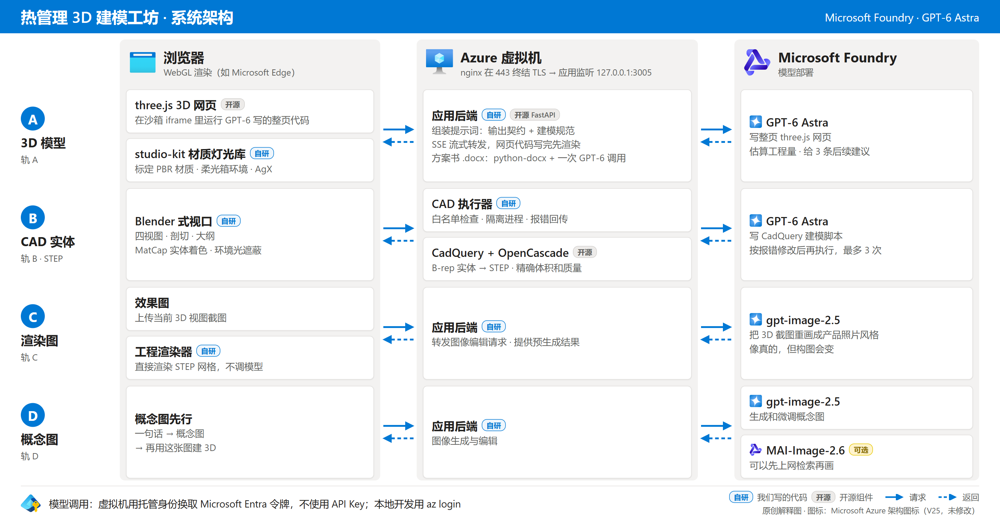

图上画的是：四条轨各经过哪些组件、哪些代码是我们写的、各调用哪个模型。这是原创解释图；每个实测数字在哪台机器上测得，见[这些数字是怎么测的](#这些数字是怎么测的)。

### 一次请求怎么走

1. **轨 A：3D 模型。** 浏览器把对话发到 `/api/generate`。后端加上系统提示词（输出契约 + 该场景的建模规范），通过 SSE 把 GPT-6 Astra 的回答流式转给浏览器。GPT-6 按四个标记区块输出：`<<<SUMMARY>>>` 摘要、`<<<HTML>>>` 里一整页 three.js 代码、`<<<METRICS>>>` 里 JSON 格式的工程量，以及 3 条后续建议。HTML 区块一结束，浏览器就在沙箱 iframe 里开始渲染，工程量接着往下流。对话里保留最近 3 轮模型回答，所以说「流道改成 8 道」就是在上一版上改。
2. **轨 B：CAD 实体。** 点 **生成 STEP**，同一个零件（你的需求、GPT-6 的摘要、three.js 网页里的 `const P = {...}` 参数块）发到 `/api/cad`。GPT-6 写一段 CadQuery 脚本。`cad_runner.py` 先解析，白名单之外的一律拒绝（只允许 `cadquery`、`math` 等少数标准模块，不允许 `open`、`exec` 和导出函数），再放进一个不带服务器 Azure 配置的单独 Python 进程执行，用 R0.3–1.2 mm 圆角给锐边倒钝，导出 `model.step`（带部件名的装配体）、`model.stl`、`model.glb` 和 `parts.json`。体积、质量、包络和表面积由 OpenCascade 按精确几何计算。脚本报错时，错误信息回传给 GPT-6 改写，最多 3 次。
3. **轨 C：渲染图。** **生成渲染图** 把当前 3D 视图的 WebGL 截图交给 gpt-image-2.5（`images.edit`）重画。工程渲染图则用 three.js 直接画 STEP 的网格，和 STEP 轮廓线用的是同一个相机，所以两者重合，全程不经过图像模型。
4. **轨 D：概念图。** 还没有 3D 的时候，一句话先变成一张概念图（gpt-image-2.5，或可以先上网检索再画的 MAI-Image-2.6）；点 **用这张图建 3D** 就把它作为参考图附到轨 A 的请求里。
5. **方案书。** **生成方案书** 用 python-docx 把需求、截图、工程量和 STEP 信息排成 Word 文档，再调用一次 GPT-6 写方案要点、风险和下一步。
6. **登录与密钥。** 访客登录工坊后，所有模型调用都走服务器自己的连接。虚拟机上，后端用托管身份换取 Microsoft Entra 令牌；本机用 `az login`。浏览器拿不到任何密钥或令牌。

### 本页用到的术语

| 术语 | 在这里的意思 |
|---|---|
| three.js、WebGL | 一个 JavaScript 3D 库，以及它调用的浏览器绘图接口；轨 A 的产出就是一页 three.js 代码 |
| B-rep（边界表示） | CAD 描述实体的方法：用精确的面（平面、圆柱面、自由曲面）围成一个封闭的体，面与面相交得到边。一个 Ø6 mm 的孔是半径 3 mm 的圆柱面，而不是一圈三角形 |
| OpenCascade（OCCT） | 开源几何内核：构建 B-rep 实体，做布尔运算和圆角，读写 STEP |
| CadQuery | 用 Python 代码描述零件的库，底层调用 OpenCascade |
| STEP（`.step`，ISO 10303） | CAD 软件之间交换模型的标准格式；把精确的 B-rep 和部件名带进 SolidWorks、NX、Creo |
| STL、GLB（glTF） | 三角网格格式。STL 用于 3D 打印和预览；GLB 用于网页，带材质和部件树。工坊通过 STEP 导出的 GLB 来显示 STEP |
| 工程渲染图 | 用 three.js 直接画出的 STEP 网格图片，不经过图像模型，和 STEP 对得上 |
| 推理强度（reasoning effort） | GPT-6 回答前思考多久（`none` 到 `xhigh`）。`.env.example` 把服务器默认值设为 `none`；发送按钮旁的下拉框可以按次修改 |
| SSE（服务器推送事件） | 后端把 token、进度和心跳持续推给浏览器的通道 |

## 实现效果

下面是 15 个场景之一「热管理集成模块」在工坊里的样子。截图和工程渲染图来自本仓库已记录的运行（2026-11-14），没有调用模型；gpt-image 效果图是 2026-11-10 通过工坊页面调用一次生成的。所有图片都没有修过。

| 轨 A：GPT-6 写的 three.js 网页（已记录的回答） | 轨 B：同一个零件的 OCCT 实体，四视图 |
|---|---|
| 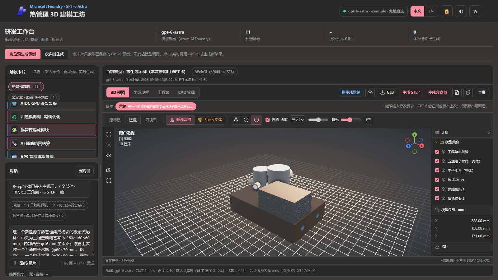 | 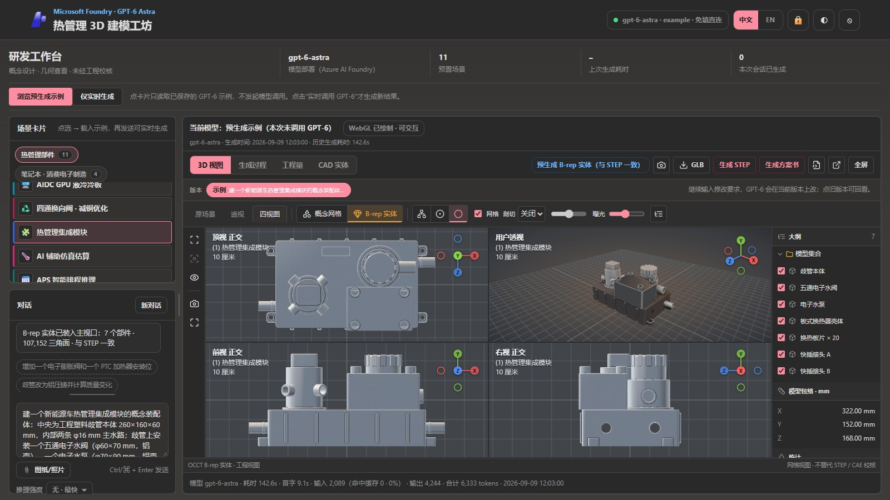 |

| 轨 C：gpt-image-2.5 重画的 3D 截图（示意） | 轨 C：STEP 网格的工程渲染图，青色线是 STEP 的轮廓和棱线 |
|---|---|
| 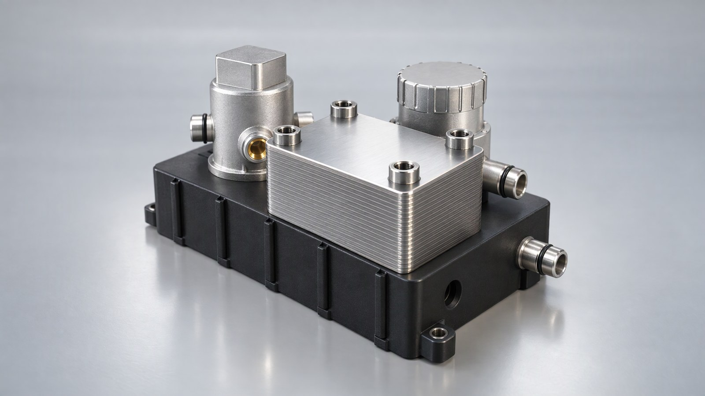 | 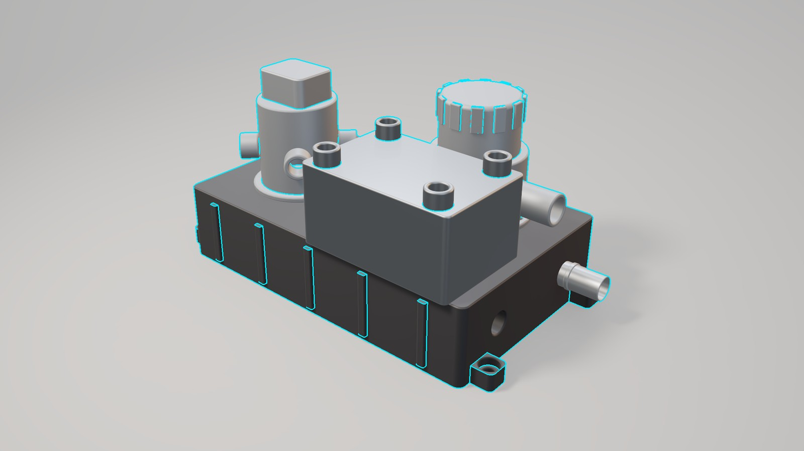 |

**怎么看这几张图。** 上面一行是同一个零件的两种形态：左边是 GPT-6 写的网页，形状和它给出的工程量都是模型自己的；右边是参考脚本建出的精确实体，由 OCCT 计量。下面一行，gpt-image-2.5 把 3D 视图的截图变成照片一样的图片，但零件是模型重画的，细节可能和 STEP 不一样；工程渲染图直接画 STEP 自己的网格，所以青色的 STEP 轮廓正好落在零件上。

### 更多场景

另外六个场景，同样来自这次已记录的运行。左边是 GPT-6 为场景卡片写的网页，按原样显示：场景、数据面板和按钮都是模型自己写的；右边是参考脚本建出的 OCCT 实体，显示在工坊的视口里。全部 15 个场景及各自的 gpt-image 效果图见 [docs/RESULTS_CN.md](docs/RESULTS_CN.md#15-个场景一览)。

| 场景 | 轨 A：GPT-6 写的网页（已记录的回答） | 轨 B：参考脚本建出的 OCCT 实体 |
|---|---|---|
| 电池水冷板 | 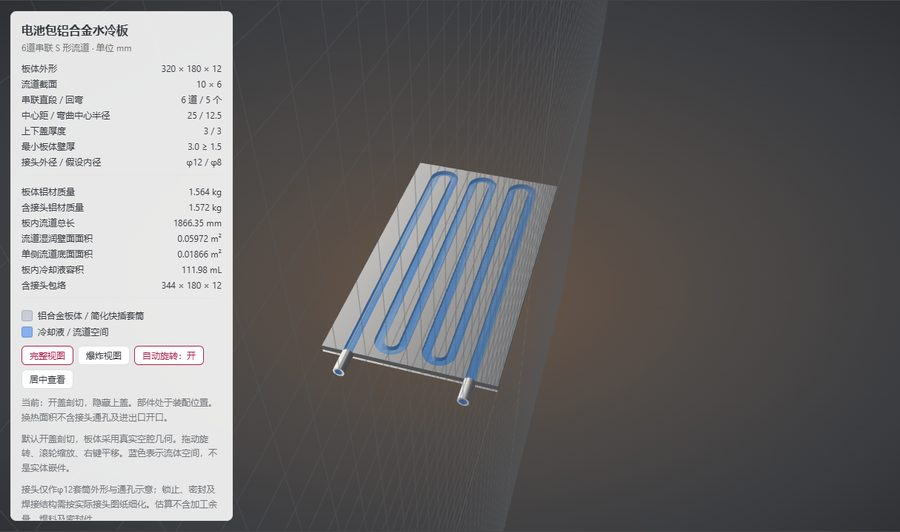 | 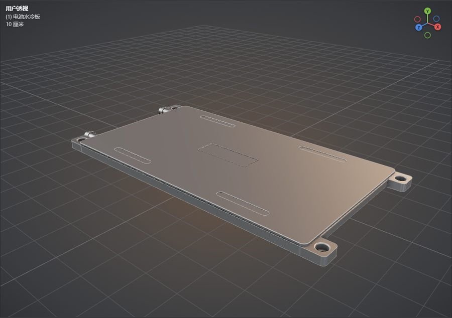 |
| 电子膨胀阀阀体 | 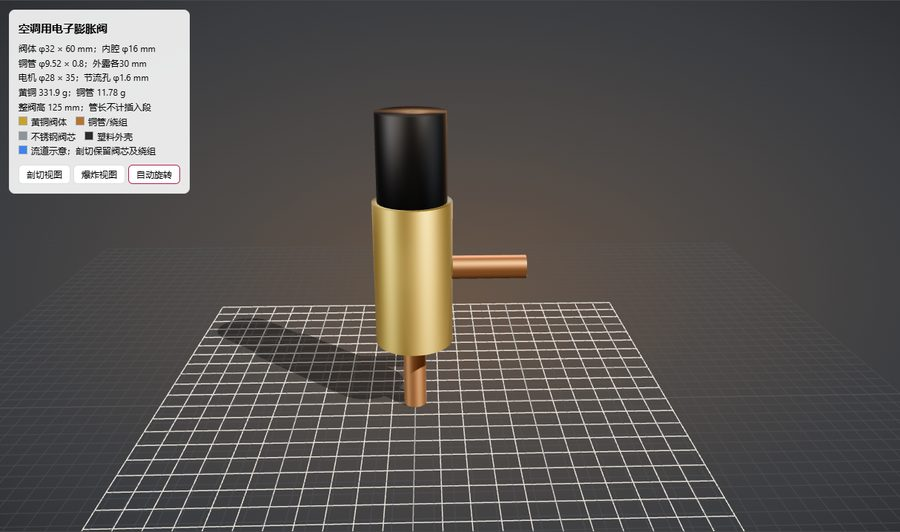 | 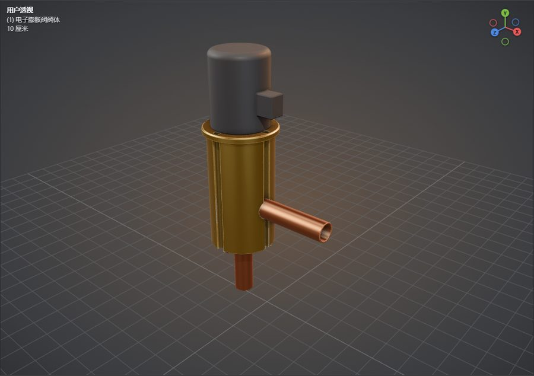 |
| 微通道换热器 | 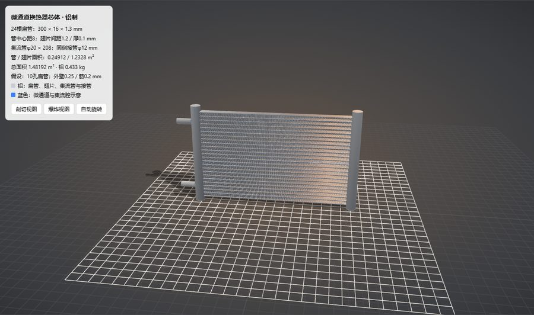 | 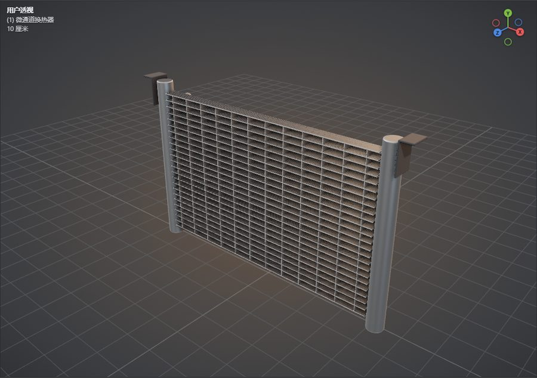 |
| AIDC CDU 液冷分配单元 | 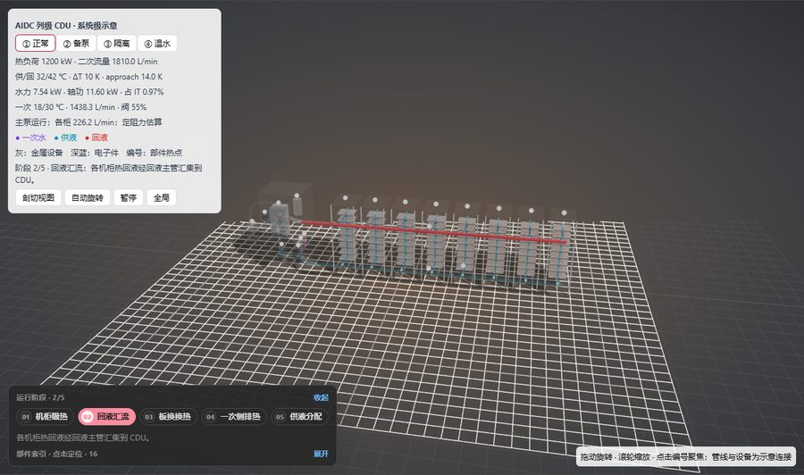 | 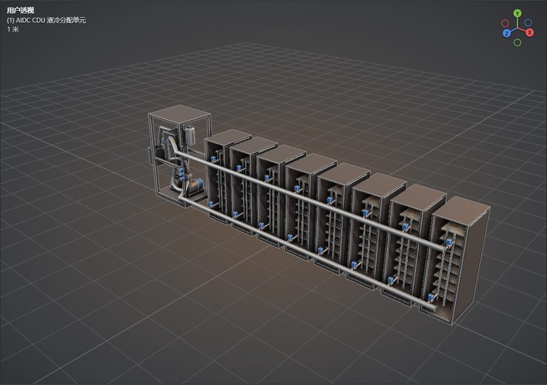 |
| 整车热管理系统回路 | 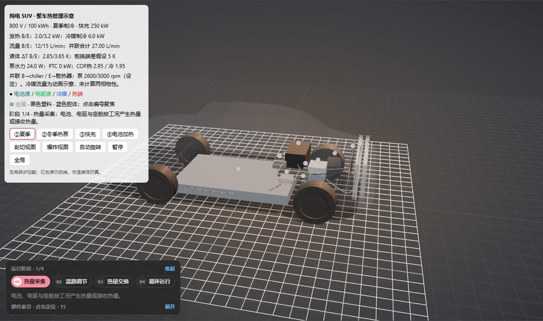 | 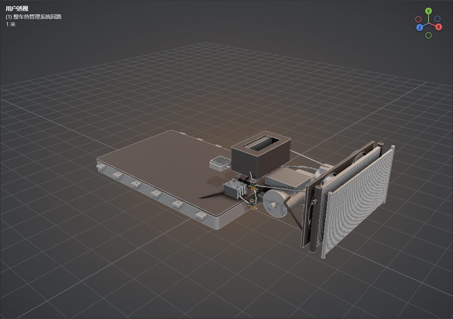 |
| 笔记本双风扇散热模组 | 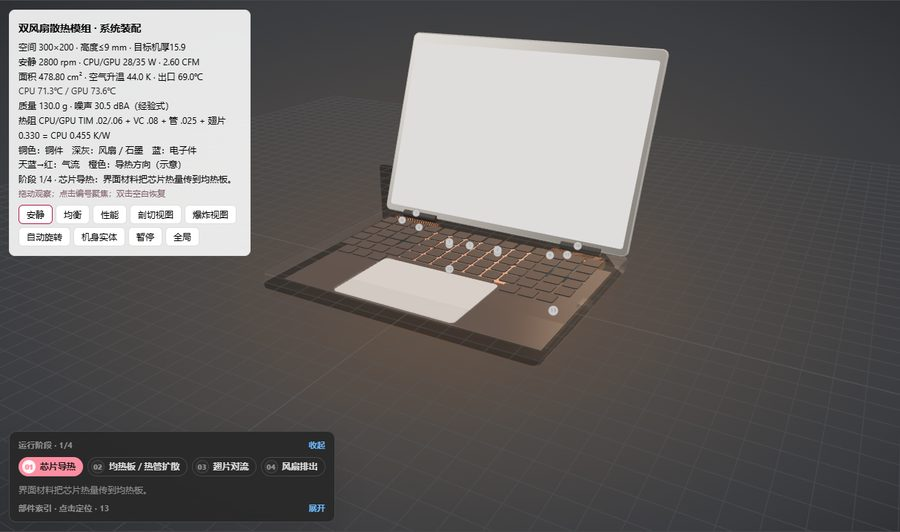 | 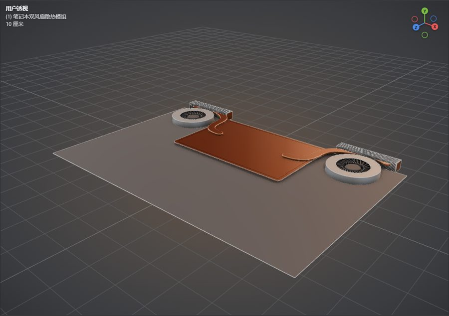 |

### 实体可以怎么看

视口通过和 STEP 一起导出的网格显示 B-rep 实体，所以查看器的工具作用在真实的零件几何上，而不是 GPT-6 写的场景上。

| 剖切：法向为 Y 的平面，四视图 | 独显选中：只显示实体的一个部件 |
|---|---|
| 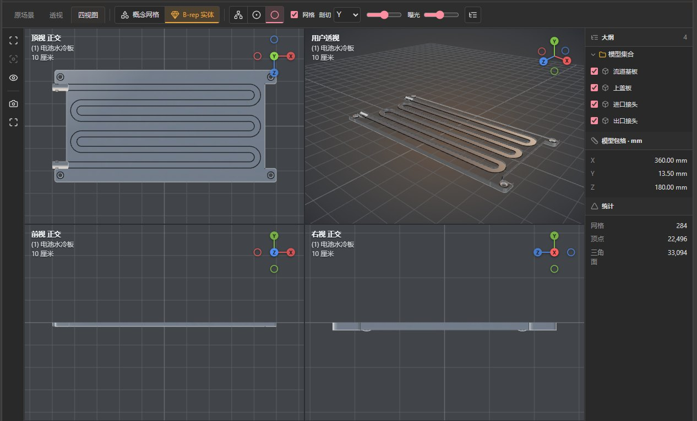 | 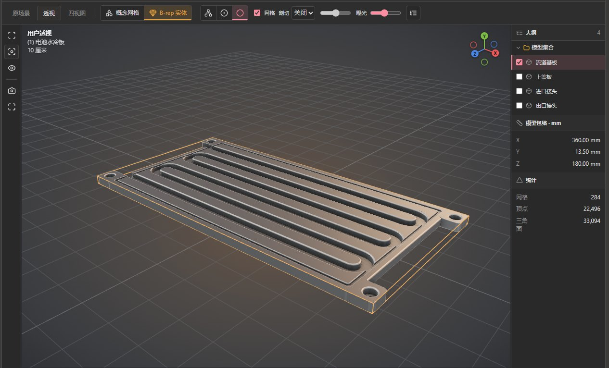 |

**剖切** 选 Y 时，一个水平面切开电池水冷板，顶视图和透视图能看进板内的蛇形流道。**独显选中** 时，只剩在大纲里选中的部件，这里是流道基板，基板上的流道槽一目了然。

### 这些数字是怎么测的

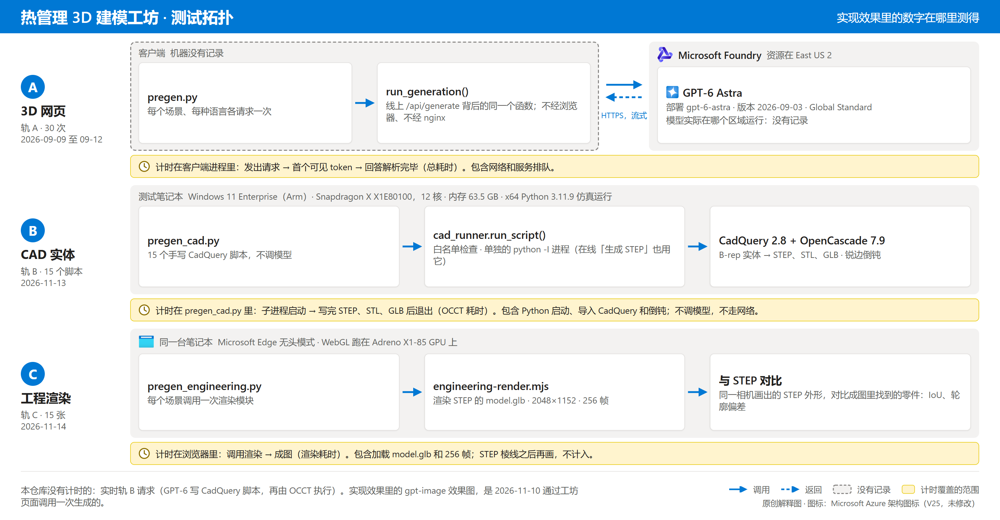

图上画的是：每段计时在哪里运行、调用了什么、计时包含哪些环节。这是原创解释图；机器信息来自 [`evidence/run-20261113/machine.json`](evidence/run-20261113/machine.json)，轨 A 的信息来自 `studio/cache/` 里已记录的回答。

- **输入。** 轨 A：`studio/scenarios.py` 里每张场景卡片的提示词，每个场景、每种语言各发一次，2026-09-09 至 2026-09-12 共 30 次请求；集成模块的提示词[原文](docs/RESULTS_CN.md#轨-agpt-6-写-threejs-网页)。轨 B：`studio/cad_examples/` 里 15 个手写参考脚本，不是 GPT-6 写的。轨 C：上一步每个实体的 `model.glb`。
- **每格只有一次运行。** 每个场景只跑一次（轨 A 每种语言一次），所以下表的中位数和范围是跨场景统计的，不是同一请求的重复。再请求一次，网页和耗时都会不同。
- **这里没有测：** 实时轨 B 请求，也就是 GPT-6 写 CadQuery 脚本、再由 OCCT 执行。点 **生成 STEP** 后，「CAD 实体」页会显示那次的尝试次数和 OCCT 耗时。

| 轨 | 测的是什么（单位） | 次数 | 中位数 | 范围（最小–最大） |
|---|---|---|---|---|
| A · GPT-6 写网页 | 每页总耗时（s） | 30 | 149.8 | 76.1–356.2 |
| A · GPT-6 写网页 | 首个可见 token（s） | 30 | 13.8 | 4.8–182.8 |
| A · GPT-6 写网页 | 每页输出 token | 30 | 4,900 | 3,347–8,463 |
| A · GPT-6 写网页 | 首 token 之后的输出速度（token/s） | 30 | 34.1 | 24.0–71.6 |
| B · OCCT 建实体 | 每个场景的 OCCT 耗时（s） | 15 | 59.1 | 12.0–199.2 |
| B · OCCT 建实体 | 每个实体的部件数 | 15 | 11 | 4–32 |
| C · 工程渲染图对 STEP | 与 STEP 的外形重合度 IoU（%） | 15 | 94.1 | 15.1–97.7 |
| C · 工程渲染图对 STEP | 渲染耗时（s） | 15 | 4.5 | 2.1–30.0 |

- **实时生成一页 3D 网页要几分钟。** 中位数是每页 149.8 s、4,900 个输出 token。已记录的示例打开时不用等，也不调用模型；要改需求时，实时调用才值得。
- **STEP 在本地建，不调模型，也不走网络。** 在这台笔记本上，一个实体用时 12.0–199.2 s；最慢的笔记本双风扇散热模组里，倒钝占了 131.6 s（[详情](docs/RESULTS_CN.md#轨-bopencascade-建出参考实体)）。
- **工程渲染图天然与 STEP 对齐，15 张里有十二张的 IoU 在 90.2–97.7 %，印证了这一点。** 电池水冷板、仿真估算的冷板和总装线读数偏低，是因为检查用的分割算法会漏掉大面积光滑表面，或把细框架之间的区域也算进去；它们的 STEP 轮廓同样落在零件上（[详情](docs/RESULTS_CN.md#轨-c工程渲染图与-step-的对照)）。

| 你想 | 去看 |
|---|---|
| 看每个场景的数字、输入和局限 | [docs/RESULTS_CN.md](docs/RESULTS_CN.md) |
| 了解每层测试查什么、不查什么 | [docs/TESTING_CN.md](docs/TESTING_CN.md) |
| 查看已记录的运行：日志、每个实体的元数据、渲染检查、机器信息 | [evidence/run-20261113/](evidence/run-20261113/) |
| 复用这些数字 | [data/results.json](data/results.json)，由 `tools/build_results.py` 生成 |
| 查图片或图标的来源 | [images/SOURCES.json](images/SOURCES.json)、[NOTICE.md](NOTICE.md) |

| 目录 | 内容 |
|---|---|
| `studio/` | 应用本体：FastAPI 后端（`app.py`）、前端（`static/`）、CAD 执行器、提示词（`scenarios.py`）、已记录的 GPT-6 回答（`cache/`）、CadQuery 参考脚本、部署脚本（`deploy/`）和应用自己的测试（`tests/`） |
| `tools/` | 按固定哈希下载 three.js、两张图的渲染脚本及其 HTML 源文件、截图脚本、结果汇总脚本、工程渲染图的分割检查脚本 |
| `tests/` | 仓库检查：中英文页面结构、链接、图片、数字、两张图、私有信息 |
| `data/` | `results.json`：「实现效果」和 docs/RESULTS 里引用的每个数字 |
| `evidence/run-20261113/` | 已记录的干净运行：日志、`pip freeze`、每个实体的 OCCT 元数据、渲染检查、浏览器检查、机器信息 |
| `images/` | 截图、渲染图、两张图和 Azure 图标，每个都登记在 `images/SOURCES.json` |
| `docs/` | 逐场景结果和测试说明，中英文各一份 |

## 操作步骤

| 顺序 | 在哪里 | 做什么 | 命令或脚本 |
|---|---|---|---|
| 1 | 你的电脑 | 安装 Python 依赖 | `pip install -r requirements.txt -c deploy/constraints.txt` |
| 2 | 你的电脑 | 下载 three.js r160 并校验哈希 | `python ../tools/vendor_three.py` |
| 3 | 你的电脑 | 建出 15 个参考 STEP 实体，不调用模型 | `python pregen_cad.py`、`python pregen_cad.py --lang en` |
| 4 | 你的电脑 | 跑离线测试 | `python -m unittest ...`、`node --test ...` |
| 5 | Azure | 部署模型，给自己分配数据面角色 | `az cognitiveservices ...`、`az role assignment create ...` |
| 6 | 你的电脑 | 配置 `.env`、登录 Azure、启动工坊 | `python -m uvicorn app:app --env-file .env` |
| 7 | 浏览器 | 先看已记录的示例，再做一次实时调用 | `http://127.0.0.1:3005` |
| 8 | Azure 虚拟机（可选） | 用托管身份通过 HTTPS 对外服务 | `deploy/bootstrap_vm.sh`、`deploy/deploy.ps1` |

第 1–4 步不需要 Azure 账号，也不花钱，2026-11-13 和 2026-11-14 在一个新建的虚拟环境里完整重跑过（[运行记录](docs/TESTING_CN.md#运行记录)）；重跑发现第 3 步英文部件名构建有一个缺陷，已在 `pregen_cad.py` 里修复，修复后重跑通过。第 5、8 步没有为本仓库重跑：已记录的 GPT-6 运行用的是现成的部署，虚拟机脚本就是工坊自己那台虚拟机的安装脚本。

**准备条件。** x64 版 Python 3.11 或 3.12（CadQuery 的内核 wheel 是 x64 的；本次记录用的是 Windows 11 上的 3.11.9）、Git、虚拟环境约 1.4 GB 磁盘（本次记录为 1,324 MiB，含可选工具）；前端测试需要 Node.js 18 及以上；浏览器检查和工程渲染图需要 Microsoft Edge；第 5–8 步需要 Azure CLI，并且订阅里能用 GPT-6 Astra。

### 1. 获取代码并安装

```powershell
git clone --filter=blob:none --sparse https://github.com/david-xinyuwei/david-share.git
cd david-share
git sparse-checkout set Agents/Thermal-3D-Modeling-Studio
cd Agents/Thermal-3D-Modeling-Studio/studio
py -3.11 -m venv .venv                      # Linux/macOS：python3.11 -m venv .venv
.\.venv\Scripts\Activate.ps1                # Linux/macOS：source .venv/bin/activate
python -m pip install --upgrade pip
python -m pip install -r requirements.txt -c deploy/constraints.txt
python -m pip install -r ../requirements-dev.txt   # 可选：浏览器检查和工程渲染图要用
```

预期：pip 最后输出 `Successfully installed ... cadquery-2.8.0 ... fastapi-0.141.1 ...`。`deploy/constraints.txt` 锁定了工坊直接导入的 10 个包，它们的依赖从 PyPI 解析。

### 2. 下载 three.js

```powershell
python ../tools/vendor_three.py
```

预期：`three.js 0.160.0: 15/15 files verified in ...`。文件下载到 `studio/static/vendor/three/`（不进 Git）；SHA-256 与锁定值不一致的文件会被拒绝。

### 3. 建出 15 个参考实体

```powershell
python pregen_cad.py              # cad_examples/<id>.py  -> cad_cache/<id>/
python pregen_cad.py --lang en    # 英文部件名            -> cad_cache_en/<id>/
python ../tools/build_results.py --compare-local
```

预期：每个场景输出一行 `[<id>] OK`，两次构建都以 `done. failed: none` 结束；对比命令最后输出 `parts, solids, bounding boxes and densities match run-20261113`。面数、质量和耗时可能与记录略有出入：锐边倒钝有时间预算，慢一些的机器可能少倒几条棱。整个过程不调用模型，用的就是在线 **生成 STEP** 时同一个 `cad_runner.run_script`。

### 4. 跑离线测试

```powershell
$env:AOAI_ENDPOINT = 'https://example.invalid'; $env:PORTAL_PASSWORD = 'x'; $env:AOAI_REASONING_EFFORT = 'none'
python -m unittest discover -s tests -p "test_*.py"
node --test tests/test_connection.cjs tests/test_viewer_bridge.cjs
cd ..; python -m unittest discover -s tests -v; cd studio
```

预期：两次 Python 测试都输出 `OK`，Node 测试 `fail 0`。这些测试里的模型调用和 OCCT 执行都是模拟的；每一层测什么、不测什么，见 [docs/TESTING_CN.md](docs/TESTING_CN.md)。

### 5. 部署模型

按 [创建并部署 Azure OpenAI 资源](https://learn.microsoft.com/azure/foundry-classic/openai/how-to/create-resource)（Azure CLI 选项卡）创建 Azure OpenAI 资源和 `gpt-6-astra` 部署。已记录的运行用的是模型版本 `2026-09-03`、部署类型 Global Standard、每分钟 500K token：

```bash
az cognitiveservices account deployment create --name <resource> --resource-group <group> \
  --deployment-name gpt-6-astra --model-name gpt-6-astra --model-version 2026-09-03 \
  --model-format OpenAI --sku-name GlobalStandard --sku-capacity 500
az role assignment create --role "Cognitive Services OpenAI User" \
  --assignee "$(az ad signed-in-user show --query id -o tsv)" \
  --scope "$(az cognitiveservices account show --name <resource> --resource-group <group> --query id -o tsv)"
```

可选：在同一资源上部署 `gpt-image-2.5-sunburst`（或 `-flare`）供轨 C、轨 D 使用；在一个 Foundry 资源上部署 MAI-Image-2.6，作为概念图的第二个模型。预期：`az cognitiveservices account deployment list --name <resource> --resource-group <group> -o table` 里能看到 `gpt-6-astra`、`GlobalStandard`。角色分配可能要几分钟才生效。[Cognitive Services OpenAI User](https://learn.microsoft.com/azure/foundry-classic/openai/how-to/role-based-access-control) 就是允许用 Microsoft Entra ID 做推理调用的角色。

### 6. 配置并启动

```powershell
Copy-Item .env.example .env       # Linux/macOS：cp .env.example .env
# 编辑 .env：AOAI_ENDPOINT=https://<resource>.openai.azure.com、PORTAL_PASSWORD、PORTAL_SESSION_SECRET
#            要用轨 C、轨 D 时再设 AOAI_IMAGE_DEPLOYMENT=gpt-image-2.5-sunburst
az login
python -m uvicorn app:app --host 127.0.0.1 --port 3005 --env-file .env
```

预期：输出 `Uvicorn running on http://127.0.0.1:3005`；`curl http://127.0.0.1:3005/healthz` 返回 `{"ok":true,"deployment":"gpt-6-astra",...}`。不设 `AZURE_CLIENT_ID` 时，后端从 Azure CLI 取 Entra 令牌。`.env` 已被 `.gitignore` 排除，浏览器也拿不到它。

### 7. 使用

1. 打开 `http://127.0.0.1:3005`，用 `PORTAL_USERNAME`（默认 `studio`）和你设的 `PORTAL_PASSWORD` 登录。
2. 点一张场景卡片。徽标显示 **预生成示例**，来源栏写着「本次未调用 GPT-6」：已记录的 GPT-6 回答和参考 STEP 实体直接打开，不调用模型。
3. 点 **实时调用 GPT-6**。回答返回后，来源栏换成本次实时请求的 ID；已记录的运行等了多久，见[实现效果](#实现效果)。
4. 点 **生成 STEP**。「CAD 实体」页显示尝试次数、OCCT 耗时和 B-rep 数据，可以下载 STEP、STL 和 CadQuery 脚本。

`Ctrl+C` 停止工坊。Global Standard 部署按 token 计费，工坊空闲时模型侧不产生费用。

### 8. 可选：用 Azure 虚拟机通过 HTTPS 对外服务

脚本要求：Ubuntu 24.04；虚拟机有 DNS 名称；入站放行 80 和 443（Let's Encrypt 与 HTTPS），SSH 只放行你的地址；虚拟机挂一个用户分配的托管身份，并在你的资源上具有 **Cognitive Services OpenAI User** 角色。

```bash
# 把安装文件复制到虚拟机，再以 root 身份执行一次性初始化
scp deploy/bootstrap_vm.sh deploy/constraints.txt deploy/nginx-thermal-3d-studio.conf requirements.txt azureuser@<vm-fqdn>:~/setup/
ssh azureuser@<vm-fqdn> "sudo bash ~/setup/bootstrap_vm.sh <vm-fqdn>"
# 把 .env 放到虚拟机上：AZURE_CLIENT_ID=<托管身份的 client id>、PUBLIC_BASE_URL=https://<vm-fqdn>
scp .env azureuser@<vm-fqdn>:~/setup/.env
ssh azureuser@<vm-fqdn> "sudo install -o studio -g studio -m 600 ~/setup/.env /opt/thermal-3d-studio/.env && rm ~/setup/.env"
```

```powershell
.\deploy\deploy.ps1 -SshHost azureuser@<vm-fqdn> -PublicUrl https://<vm-fqdn>/
```

预期：`bootstrap_vm.sh` 以 `BOOTSTRAP_DONE` 结束；`deploy.ps1` 先输出虚拟机上的 `>> healthy: {"ok":true,...}`，再输出 `>> done: https://<vm-fqdn>/`。服务以非特权用户 `studio` 运行在 `127.0.0.1:3005`；nginx 在 443 终结 TLS，并且不缓冲 SSE 流。虚拟机开着就计费，不用时用 `az vm deallocate` 释放。
