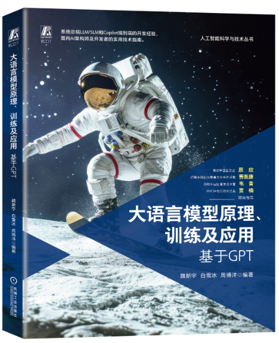

# The-Principles-Training-and-Applications-of-Large-Language-Models
This repo contains the source code, demo videos, and other related materials for the corresponding experiments featured in the book "The Principles, Training, and Applications of Large Language Models"

