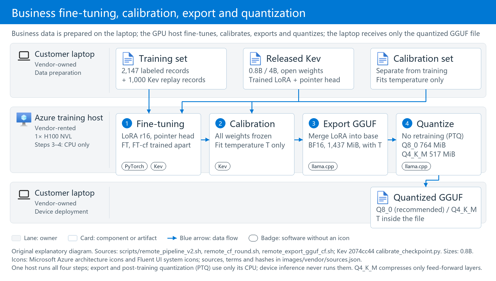
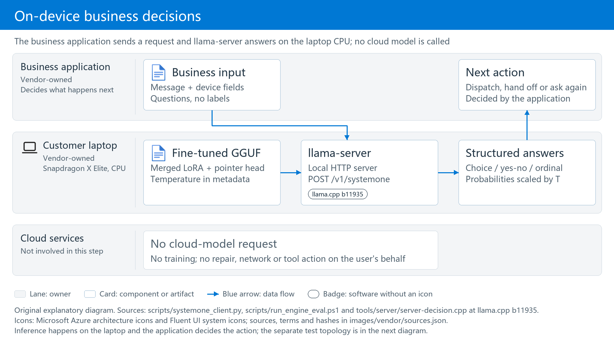
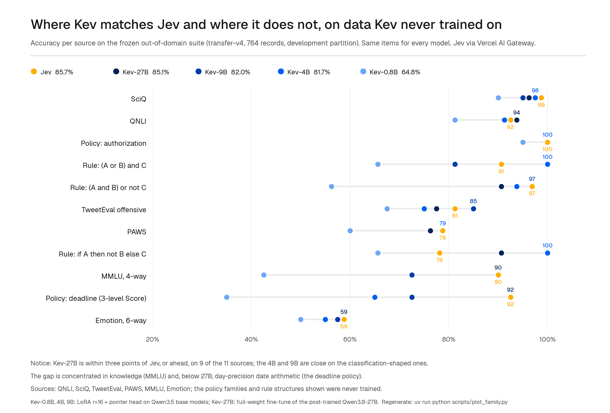
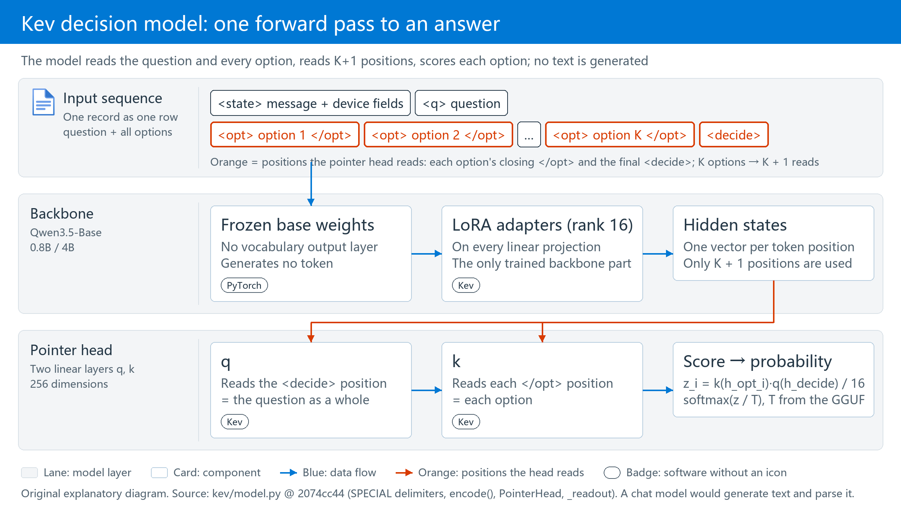
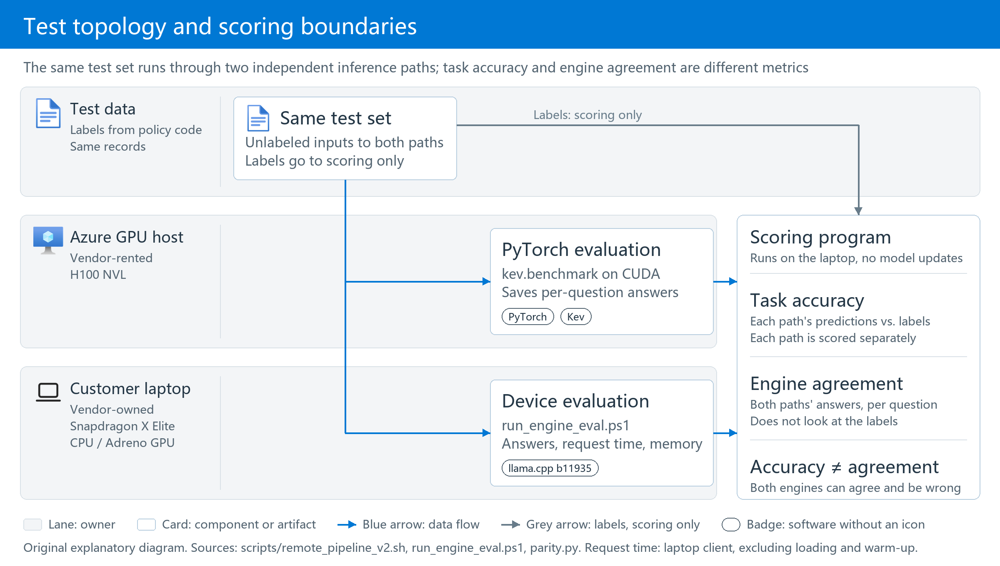
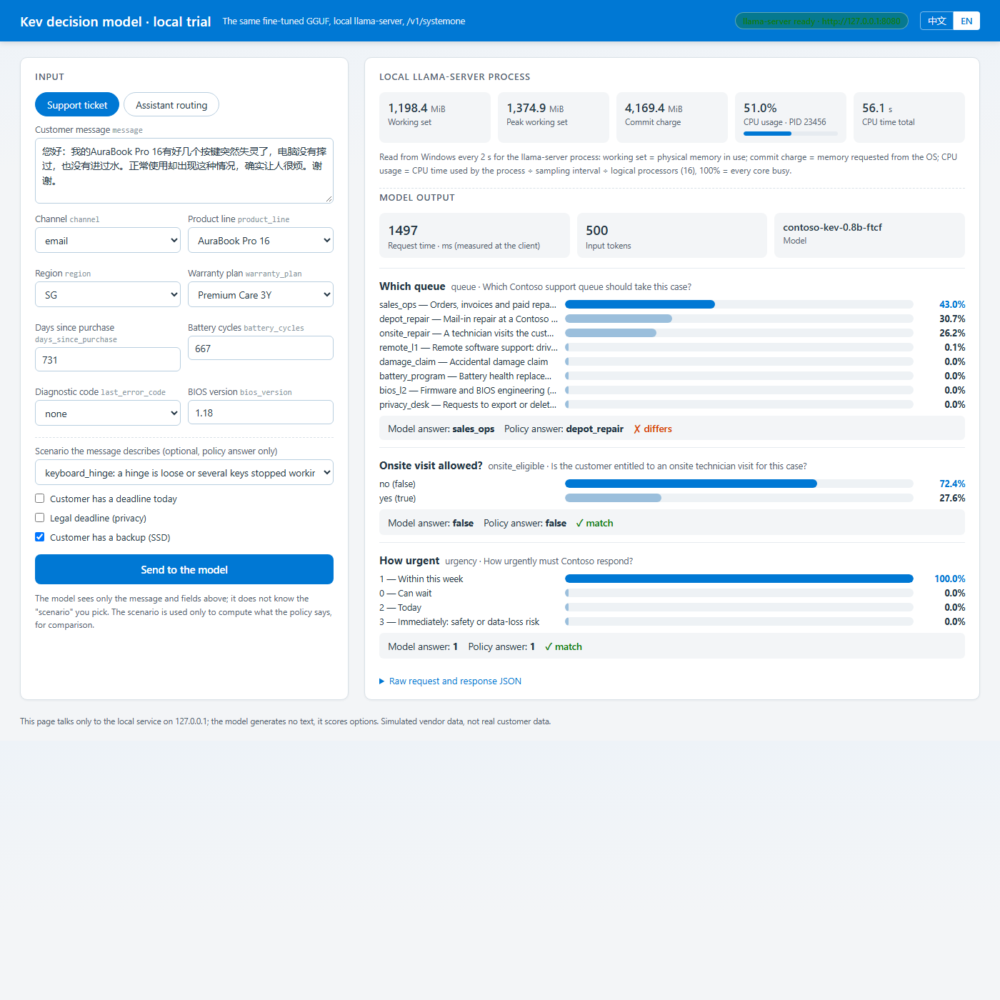

# Decision Model on the Edge: Fine-Tuning and Inference Optimization

[English](README.md) | [中文](README_CN.md)

[](https://github.com/jaredpalmer/kev)
[](#5-laptop-inference-engine)
[](#results)
[](https://github.com/david-xinyuwei/david-share/blob/master/LICENSE)

> **Author**: Xinyu Wei - Senior Systems Engineer, Microsoft AI GBB

[Purpose](#purpose) · [Results](#results) · [Steps](#steps)

## Purpose

**Dedicated decision models are becoming a model class of their own**: TypeSafe's hosted Jev, the open-weight [Kev](https://github.com/jaredpalmer/kev) released in September 2026 (1.0 on October 1), and the dozen or so similar models that the current llama.cpp already serves. They generate no text; they pick an answer from the given options and return a probability, so one forward pass completes a routing, triage or grading decision — faster, steadier and cheaper than asking a chat model to write a paragraph and parsing it. But if such a model can only live in the cloud, it does not suit edge devices, offline scenarios or customers whose data must stay on site. So it has to meet two requirements:

1. **Run locally** — on a laptop's CPU and memory, with no cloud-model call.
2. **Accept business data for fine-tuning** — the customer's rules, fields and vocabulary must train into the model, and the model must be updatable when the rules change.

This project tests both with Kev (an open-weight decision model on Qwen3.5, 0.8B / 4B): fine-tune on business data on a GPU host, measure accuracy, latency and memory on a Snapdragon laptop, measure the inference-optimization levers one at a time — quantization, context length, compute backend, prompt length and model size — and then confirm that the same model file runs unchanged on an x86-64 virtual machine. **Training runs on a GPU host; routine inference stays on the laptop without cloud-model calls.** The data is fictional Contoso PC data, not customer data; there is no proprietary-cloud comparison and no production-readiness guarantee.

### Architecture: Training and Inference Are Separate

Four recipes are compared throughout; their names are fixed here. **B0** is the released Kev model without training. **B0-policy** is the same released model with the full vendor policy text written into every question's prompt. **FT** is supervised fine-tuning of the released model on business data. **FT-cf** adds counterfactual variants to FT's data: the same message with one device field changed. FT and FT-cf both start from the same release and are trained independently; FT-cf is the final recommendation.

#### 1. Fine-Tune, Calibrate, Export, Quantize: Business Data to a Model File

Data preparation scripts run on the laptop. Large models A and B only help write simulated customer messages; business-policy code computes the labels. Neither generator is the Kev model being fine-tuned, and neither participates in subsequent device inference. The GPU host runs four steps in order: (1) supervised fine-tuning, which trains only the LoRA adapters and the pointer head; (2) temperature calibration, which leaves the weights unchanged and fits one scalar; (3) GGUF export, which merges the LoRA into the base in BF16; (4) quantization to Q8_0 or Q4_K_M. Steps 3 and 4 use only that host's CPU. The product is one quantized GGUF file, the single-file model format used by llama.cpp, holding weights, tokenizer, pointer head and calibration temperature together; everything that runs on the laptop and every device figure below uses this quantized file.



*Original explanatory diagram. Training data updates model parameters; a separate calibration set fits the probability temperature, the scaling factor applied when raw model scores become probabilities, explained in [section 3](#3-calibration-correct-ranking-does-not-guarantee-reliable-probabilities). Quantization is post-training and needs no retraining; the effect of each variant is in [section 5](#5-laptop-inference-engine). The laptop receives the quantized GGUF file. Sources: [FT pipeline](scripts/remote_pipeline_v2.sh), [FT-cf pipeline](scripts/remote_cf_round.sh), [export and quantization script](scripts/remote_export_gguf_cf.sh). Official Microsoft icon sources and usage terms are recorded in [the icon ledger](images/vendor/sources.json).*

#### 2. Device Inference: A Model File to a Business Decision

The laptop loads the exported GGUF. The business application sends a message, device fields and questions, and receives structured answers and probabilities. **This step does not train, call a cloud model, perform a repair, contact customer support or change device settings.**



*Original explanatory diagram. Inference happens on the laptop; the application decides whether to take action. Sources: [client](scripts/systemone_client.py), [device evaluation entry](scripts/run_engine_eval.ps1). The separate test topology is next to [the evaluation method](#how-the-tests-work).*

<a id="criteria"></a>

**Five criteria for judging a decision model.** For every question the model returns two things: an answer, and its confidence in that answer (a percentage). The two are checked separately; add how it runs on the laptop and how it holds up on data it has never seen, and every number in this document has a home:

<!-- SOURCE:TABLE:1 -->
| Dimension| Criterion| Questions to answer| How it is measured| Measured here: 0.8B FT-cf, laptop Q8_0| What the result does not establish| 
| ---| ---| ---| ---| ---| ---| 
| Accuracy| ① Is the answer right?| Does the chosen queue, grade or yes/no match the reference answer?| Accuracy; also broken down on paired questions where one field changes and the answer must follow| Support 86.9%, assistant 97.5%; paired questions that change the region only 36.2% ([section 1](#same-questions), [headroom analysis](#headroom))| High simulated-data scores do not establish real-business accuracy| 
| Accuracy| ② Is the confidence honest?| On the questions where it says 90%, is it right about nine times in ten?| ECE (lower is better); for the business, coverage and accuracy of the part auto-approved at confidence ≥ 90%| ECE 0.030; at a 90% threshold 73.1% of questions are auto-approved, and that part is 100% accurate ([section 3](#3-calibration-correct-ranking-does-not-guarantee-reliable-probabilities))| A change of data distribution requires refitting the calibration parameter| 
| Performance| ③ Latency| How long one request takes| Median time per request (ms), one request at a time| Support 646 ms, assistant 984 ms, Snapdragon X Elite CPU ([section 5](#5-laptop-inference-engine))| One run on one machine does not cover every laptop; concurrency does not raise throughput, see section 5| 
| Performance| ④ Resource use| How big a machine it needs| Peak process working set, CPU utilization during inference, model file size, load time in seconds| 2,314 MiB; CPU 50% (8 of 16 threads); file 764 MiB; load 2.6 s ([section 5](#5-laptop-inference-engine), [section 6](#6-hardware-requirements))| 4B needs about 3× the memory| 
| Generalization| ⑤ Generalization| How much of ① and ② survives on data it has never seen| Re-measure ① and ② on out-of-distribution questions with a different message generator and field distribution, and read the drop; then check 656 public questions to confirm prior capability is retained| Support accuracy 86.9% → 82.5% (down 4.4 points); ECE 0.030 → 0.064, of which 0.048 is recovered by refitting calibration alone; public questions 64.8% → 64.8% ([section 1](#same-questions), [section 2](#2-retention-of-general-capability))| Out-of-distribution questions are still simulated business data, not real customer data| 
<!-- /SOURCE:TABLE:1 -->

Three sentences fix how they relate: **accuracy and performance are parallel dimensions and are never traded off against each other**; **quantization is the exchange between them** — file and memory halve, possibly at a small cost to ① and ②, which is why section 5 measures per-question answer agreement after quantization; **calibration moves only ②, retraining is what moves ①** — changing the calibration parameter changes no answer. The customer's own path for iterating on these five (data generation and splits, fine-tuning, calibration, evaluation, GGUF export and update) is in [Steps](#steps); this repository does not implement online learning or automatic publication.

### Why Kev Is a Candidate

The candidate is **Kev; its 0.8B and 4B variants use Qwen3.5 bases**. It supports multiple-choice, yes/no and ordinal questions, returning answers and probabilities for business routing rather than long-form chat. Selection considers accuracy, parameter scale and open weights.



*Unmodified producer figure: [Jared Palmer / Kev, What to Expect](https://github.com/jaredpalmer/kev/blob/2074cc44256200bb37540103fa4572901faa10f3/README.md#what-to-expect), commit `2074cc44`. Read the overall legend scores, then the differences between knowledge and policy tasks. These are the author's public benchmark results, not this project's vendor-task measurements.*

<!-- SOURCE:TABLE:2 -->
| Model in the author's evaluation| Nominal base-model parameter scale| transfer-v4 development accuracy| Weights and this project's scope| 
| ---| ---| ---| ---| 
| Jev| Not disclosed by the author| 85.7%| TypeSafe hosted API; not tested in this project| 
| Kev-27B| 27B| 85.1%| Open weights; not deployed in this project| 
| Kev-9B| 9B| 82.0%| Open weights; not deployed in this project| 
| Kev-4B| 4B| 81.7%| Open weights; fine-tuned and deployed on-device in this project| 
| Kev-0.8B| 0.8B| 64.8%| Open weights; fine-tuned and deployed on-device in this project| 
<!-- /SOURCE:TABLE:2 -->

- **Accuracy: 4B approaches the hosted reference, but does not rank first.** In the author's figure, Kev-4B is 4.0 percentage points below Jev; Kev-0.8B is 20.9 points below. The caption lists 764 records. In this project's reproduction, the published 0.8B and 4B scores correspond to 656 original questions, with another 108 variant records. The author does not know Jev's training data, so this is not a controlled comparison and does not establish customer-support accuracy. See the [author's explanation](https://github.com/jaredpalmer/kev/blob/2074cc44256200bb37540103fa4572901faa10f3/README.md) and [public-baseline reproduction](验证结果/公开基线复现_20261027-123403).
- **Scale: 0.8B and 4B test the trade-off between accuracy and device overhead.** The author suggests starting with 4B when accuracy matters, and 0.8B when size matters more. These are nominal parameter scales, not file sizes. GGUF size, process memory and latency come from [device measurements](#5-laptop-inference-engine), not parameter-count estimates.
- **Open weights: download, fine-tune on business data and export to your own devices.** The [Kev code](https://github.com/jaredpalmer/kev/blob/2074cc44256200bb37540103fa4572901faa10f3/README.md#license), [Kev-0.8B](https://huggingface.co/jaredpalmer/kev-0.8b), [Kev-4B](https://huggingface.co/jaredpalmer/kev-4b) and corresponding [Qwen3.5-0.8B-Base](https://huggingface.co/Qwen/Qwen3.5-0.8B-Base) and [Qwen3.5-4B-Base](https://huggingface.co/Qwen/Qwen3.5-4B-Base) use Apache-2.0. Labeled JSONL and `--init_from` continue training from the release (mechanism in the next section). Individual dataset licenses still apply.

This justifies evaluation, not guaranteed customer suitability. FT and FT-cf are separate recipes trained from the same release, **not sequential FT-to-FT-cf continuation**. Repeated business updates are a way to use the workflow, not a measured long-term outcome.

### Core Technique: How the Kev Decision Model Is Fine-Tuned

**Decision model versus chat model.** A chat model generates text token by token; Kev generates no text. It uses Qwen3.5-Base as a read-only encoder, appends every option plus one `<decide>` marker to the input, and scores each option with a small **pointer head** (two small linear layers that give each option one score, like a finger pointing at one entry in the option list); a softmax over the scores gives the option probabilities. One 8-way question costs one forward pass, and the answer can never fall outside the option list.

 position and k reads each </opt> position, a dot product scores each option and softmax gives the probabilities; no text is generated.">

*Original explanatory diagram. Orange marks the K + 1 positions whose hidden states the pointer head reads; the other positions are read only by attention inside the forward pass and do not score directly. Source: `SPECIAL` delimiters, `encode()`, `PointerHead` and `_readout` in [kev/model.py](https://github.com/jaredpalmer/kev/blob/2074cc44256200bb37540103fa4572901faa10f3/kev/model.py), commit `2074cc44`.*

**Supervised fine-tuning (SFT).** The loss is cross-entropy on the correct option — no reinforcement learning, no extra loss terms.

**Which parameters move.** The base is frozen; only the LoRA adapters (rank 16, on every linear projection) and the pointer head train: 11.3M trainable parameters for 0.8B, about 1.4%; 33.8M for 4B, about 0.8%.

**Continue from the release, not from the base.** `--init_from` first loads the LoRA and pointer head already trained in the Kev release, then learns only the vendor-rule delta; the learning rate is therefore lowered to 2e-5, one tenth of the from-scratch default.

**Against forgetting.** `--replay 1000` mixes 1,000 original Kev training records into training so the model does not remember only vendor data; [section 2](#2-retention-of-general-capability) checks the effect with 656 public questions.

**FT-cf: counterfactual augmentation.** Keep the message, change one device field (region, warranty plan, days since purchase and so on), let the policy code recompute the label; this forces the model to read the fields rather than only the message. The training set grows from 2,147 to 3,832 records. FT-cf and FT are both trained independently from the release; FT-cf is not a continuation of FT.

**Temperature calibration is a separate step.** After training, the weights are frozen and one scalar T is fitted on the calibration set and carried to the device inside the GGUF metadata. It never changes the answer ranking, only how sharp or flat the probabilities are. Details in [section 3](#3-calibration-correct-ranking-does-not-guarantee-reliable-probabilities).

*Mechanism details and evidence*: the pointer head is two 256-dimensional linear layers q and k; option i scores `z_i = k(h_opt_i) · q(h_decide) / 16`, with q reading the hidden state at the `<decide>` position and k at each option's closing `</opt>`; loss `F.cross_entropy(z, label)`, optimizer AdamW, OneCycleLR, gradient clipping 1.0; LoRA alpha 32, dropout 0.05, `--lora_targets all` covering attention, feed-forward and the Qwen3.5 DeltaNet projections. Training logs: `delta: warm start … 372 lora tensors and the pointer head load`, `trainable params=11.3M` (33.8M for 4B), `replay: 1000 of 12576 suite training records mixed with 2147`. Source: [kev/model.py](https://github.com/jaredpalmer/kev/blob/2074cc44256200bb37540103fa4572901faa10f3/kev/model.py), [kev/train.py](https://github.com/jaredpalmer/kev/blob/2074cc44256200bb37540103fa4572901faa10f3/kev/train.py) (commit `2074cc44`), this run's [training_config.json](验证结果/微调评测_20261027-220226/runs/0.8b/ft/training_config.json).

**The training command is this one line** (taken from [scripts/remote_pipeline_v2.sh](scripts/remote_pipeline_v2.sh) with the variables replaced by the actual 0.8B FT values; the step B4 script runs exactly this, then calibration and evaluation):

<!-- SOURCE:FENCE:1 -->
```bash
# GPU host, Kev repository root (commit 2074cc44), python from its .venv
/mnt/aipc/kev/.venv/bin/python -m kev.train \
  --data /mnt/aipc/data/contoso/train.jsonl \
  --suite evals/v7/decision-v7 --replay 1000 \
  --base Qwen/Qwen3.5-0.8B-Base --base_revision dc7cdfe2ee4154fa7e30f5b51ca41bfa40174e68 \
  --init_from jaredpalmer/kev-0.8b@v1.0 \
  --epochs 2 --lr 2e-5 --batch 1 --accum 8 \
  --dtype bf16 --checkpointing 1 --max_state 768 --device cuda --seed 1 \
  --out /mnt/aipc/runs/0.8b/ft
```
<!-- /SOURCE:FENCE:1 -->

For 4B, swap in `--base Qwen/Qwen3.5-4B-Base --base_revision 1001bb4d… --init_from jaredpalmer/kev-4b@v1.0 --batch 4 --accum 2`; for FT-cf, `--data …/train_cf.jsonl --batch 4 --accum 2 --out …/ft_cf` ([remote_cf_round.sh](scripts/remote_cf_round.sh)). Every other argument is identical. The training code is Kev's own [`kev/train.py`](https://github.com/jaredpalmer/kev/blob/2074cc44256200bb37540103fa4572901faa10f3/kev/train.py); this project does not modify it, only passes arguments.

**What each argument means** (0.8B FT; 4B and FT-cf differ only in micro-batch and data file):

<!-- SOURCE:TABLE:3 -->
| Setting (`kev.train` argument)| Value in this run| Meaning| 
| ---| ---| ---| 
| `--init_from`| `jaredpalmer/kev-{0.8b,4b}@v1.0`| Continue from the release's LoRA and pointer head (delta mode)| 
| `--lora` / `--lora_targets`| 16 / `all`| LoRA rank 16 (alpha 32) on every linear projection of attention, feed-forward and DeltaNet| 
| `--head_dim`| 256| Output dimension of the pointer head's q and k| 
| `--lr` / `--head_lr`| 2e-5 / 0 (0 means the same as `--lr`)| Learning rates for LoRA and the pointer head| 
| `--epochs` / effective batch| 2 / 8 (1 × 8 for 0.8B FT, 4 × 2 for the others)| Each record is seen twice; one parameter update every 8 records| 
| `--replay`| 1,000| Mix in 1,000 original Kev training records against forgetting| 
| `--dtype` / `--weights_dtype`| bf16 / fp32| bf16 autocast forward pass, fp32 master weights| 
| `--max_state`| 768| At most 768 state tokens per record| 
| `--checkpointing`| 1| Gradient checkpointing: less GPU memory, more compute| 
| `--seed`| 1| Only one random seed was run| 
| `ord_w`, `perm_kl`, `brier_w`, `focal_gamma`, `anchor_w`| 0| Plain cross-entropy, no extra loss terms| 
<!-- /SOURCE:TABLE:3 -->

### Core Technique: How It Runs on the Laptop

**What llama-server is.** llama.cpp is a C/C++ inference engine and `llama-server` is its bundled local HTTP server. This project uses the official b11935 Windows ARM64 release unchanged; that build recognizes the decision-model marker inside the GGUF and serves Kev as a decision model rather than a text generator.

**What is inside the GGUF.** One file, four things: the base weights with the LoRA already merged in (so no `--lora` at startup), the pointer head, the three calibration temperatures, and the tokenizer. File sizes for 0.8B FT-cf: BF16 1,437 MiB, Q8_0 764 MiB, Q4_K_M 517 MiB.

**0.8B is already small; why quantize at all?** "0.8B" counts parameters, not bytes. Fine-tuning leaves the parameter count unchanged and every parameter is still a 16-bit BF16 value: 0.8B × 16 bits ≈ 1.4 GB, which is not a small file. Quantization changes how many bits each parameter takes: at 8 bits the file is 0.76 GB, half the size, and the measured answers agree with BF16 on 99.2% or more of the questions; llama.cpp's CPU kernels also have dedicated matrix multiplication for 8-bit integer weights and move half the memory bandwidth, which is exactly the bottleneck of laptop CPU inference. Quantization is therefore a required step after fine-tuning, not a reaction to 0.8B being large; both sizes were quantized to 8-bit and 4-bit, compared in [section 5](#from-the-released-model-to-the-quantized-fine-tuned-model-accuracy-speed-and-resources-in-one-table).

**What Q8_0 and Q4_K_M are.** Both are llama.cpp block-wise integer quantization: Q8_0 keeps 8 bits per weight and is nearly lossless; Q4_K_M is mainly 4-bit and less precise. This project's Q4_K_M export keeps attention, DeltaNet, the pointer head and the output layer at 8 bits and compresses only the feed-forward layers, more conservative than llama.cpp's default mix. Measured effects are in [section 5](#5-laptop-inference-engine).

**How long is the context?** Three numbers that must not be confused: the Qwen3.5 base architecture window is 262,144 tokens (GGUF metadata `qwen35.context_length`); the Kev server accepts a state of up to 65,536 tokens plus 8,192 per question and rejects longer input instead of truncating (`SERVE_MAX_STATE` in `kev/model.py`); but Kev-0.8B / 4B **trained mostly on states of at most 384 tokens, and the length the author validated as still accurate is 8,192** — at 16k and above an accuracy drop can no longer be ruled out (Kev README, "Length"). This project's inputs are 430–540 tokens, training used `--max_state 768`, and llama-server's `-c 8192` equals the author's validated ceiling. Feeding a whole contract or a long log into the state means validating 0.8B / 4B accuracy above 8k first; 262k is not a usable length.

**`/v1/systemone` is a decision endpoint, not chat completion.** One request = the customer message + device fields + a few questions; the response carries each question's answer and probabilities and generates no token (`usage.output_tokens` is always 0). Probabilities are already scaled with the temperature inside the GGUF. The endpoint follows the TypeSafe System One API and does not support streaming.

The endpoint in one sentence: **the input is a situation plus a few multiple-choice questions; the output is the model's probability for every option, and the highest one is the answer.** Below is one real local call (complete file: [local trial record](验证结果/本机试用_20261028-201046/support-us/result.json)):

<!-- SOURCE:TABLE:4 -->
| | Contents| 
| ---| ---| 
| Input: situation| Customer e-mail: several keys on an AuraBook Pro 16 stopped working; no drop, no spill. Device record: US, Premium Care 3-year warranty, 731 days since purchase| 
| Input: question 1| Which queue? 8 options: remote software support, mail-in repair, onsite repair, battery program, BIOS second line, accidental-damage claim, orders/quotes, privacy request| 
| Input: question 2| Is an onsite visit allowed? yes / no| 
| Input: question 3| How urgent? 4 levels: can wait, within this week, today, immediately| 
| Output: question 1| orders/quotes 42%, mail-in repair 31%, onsite repair 26%, the rest near 0 → answer "orders/quotes"| 
| Output: question 2| probability of "yes" 29% → answer "no"| 
| Output: question 3| "within this week" 100%, the rest near 0 → answer "within this week"| 
<!-- /SOURCE:TABLE:4 -->

The corresponding JSON (excerpt):

<!-- SOURCE:FENCE:2 -->
```jsonc
// request (excerpt): what the business application sends
{"state": {"channel": "email",
           "message": "您好：我的AuraBook Pro 16有好几个按键突然失灵了，电脑没有摔过，也没有进过水。……",
           "device": {"product_line": "AuraBook Pro 16", "region": "US", "warranty_plan": "Premium Care 3Y",
                      "days_since_purchase": 731, "battery_cycles": 667, "last_error_code": "none", "bios_version": "1.18"}},
 "questions": {"queue": {"type": "choice", "instructions": "Which Contoso support queue should take this case?",
                         "criteria": {"remote_l1": "Remote software support: drivers, Windows, Contoso apps and settings",
                                      "depot_repair": "Mail-in repair at a Contoso service center",
                                      "onsite_repair": "A technician visits the customer", "...": "5 more options"}},
               "onsite_eligible": {"type": "noul", "instructions": "Is the customer entitled to an onsite technician visit for this case?"},
               "urgency": {"type": "score", "instructions": "How urgently must Contoso respond?",
                           "criteria": ["Can wait", "Within this week", "Today", "Immediately: safety or data-loss risk"]}}}
// response (excerpt, probabilities rounded to 3 decimals): client_latency_ms = 783.8
{"model": "contoso-kev-0.8b-ftcf",
 "answers": {"queue": {"type": "choice", "choice": "sales_ops",
                       "probabilities": {"sales_ops": 0.423, "depot_repair": 0.313, "onsite_repair": 0.262, "remote_l1": 0.001, "...": "..."},
                       "confidence": 0.341},
             "onsite_eligible": {"type": "noul", "noul": 0.286},
             "urgency": {"type": "score", "score": 1.000,
                         "legend": {"0": "Can wait", "1": "Within this week", "2": "Today", "3": "Immediately: safety or data-loss risk"},
                         "probabilities": {"0": 0.000, "1": 1.000, "2": 0.000, "3": 0.000}, "confidence": 1.000}},
 "usage": {"input_tokens": 500, "output_tokens": 0}}
```
<!-- /SOURCE:FENCE:2 -->

By the rules this ticket should go to "onsite repair"; the model got it wrong. This example is only for understanding the endpoint; model accuracy is in [section 7](#local-result).

**Startup arguments one by one** (matching the command in step A1; defaults from the [llama-server b11935 documentation](https://github.com/ggml-org/llama.cpp/blob/b11935/tools/server/README.md), measured values from [section 5](#5-laptop-inference-engine)):

<!-- SOURCE:TABLE:5 -->
| Startup argument| Value in this run| What it does| What changes if you change it| 
| ---| ---| ---| ---| 
| `-m` / `--alias`| Path of the fine-tuned GGUF / `contoso-kev-0.8b-ftcf`| Model file to load / model name reported in API responses| Changing the file changes the model; the alias only affects the `model` field in responses| 
| `--host` / `--port`| `127.0.0.1` / `8080`| Listen on the loopback address only| `0.0.0.0` exposes the server to the network; not recommended here| 
| `-c` (`--ctx-size`)| 8192| Context-token limit per slot (default 0 = read from the model)| Drives memory. Inputs here are about 500 tokens; at 2048 the commit charge fell from 5,014 to 2,119 MiB, accuracy was unchanged, and one support decision went from 669 to 1,163 ms| 
| `-b` (`--batch-size`) / `-ub` (`--ubatch-size`)| 2048 / 2048| Logical / physical batch size per forward pass (defaults 2048 / 512)| Larger values process more tokens per pass and need more scratch memory; `-ub 512` is part of the low-memory setting| 
| `-ngl` (`--gpu-layers`)| 0| Number of layers placed on the GPU (default auto)| 0 = everything on the CPU. The Adreno OpenCL build uses 99 (all layers on the GPU) and measured slower on this laptop| 
| `--cache-ram`| 0| Prompt-cache limit in MiB (b11935 default: 8192 for ordinary models, 0 for decision models)| Set to 0 explicitly: every request is recomputed and results are reproducible| 
| `--offline`| On| Never download models from the network| Local files only| 
| `-np` (`--parallel`)| Not set (auto; the local log shows `n_slots = 4`)| Number of parallel slots| Slots cap how many requests are admitted at once; they are not compute. On x86-64, 4 and 8 slots gave the same throughput and extra requests simply queued (section 5, "Concurrency")| 
| `--temp` and other sampling arguments| Not used| Sampling settings for text generation| The decision endpoint generates no text; the probability temperature comes from GGUF metadata, not `--temp`| 
<!-- /SOURCE:TABLE:5 -->

**Why CPU rather than GPU or NPU.** The Adreno GPU through the OpenCL build measured slower than CPU (0.8B FT support median 1,035 ms versus 669 ms) and used about 3,400 MiB of additional shared GPU memory; the Hexagon NPU was not tested because Windows requires driver test-signing for it, which was not enabled on the company laptop. The recommended configuration is therefore Q8_0 on CPU with 12 threads.

*Mechanism details and evidence*: b11935 reads the GGUF metadata key `qwen35.decision.type = kev` (startup log `decision model type: kev`, `n_threads = 12`); the converter `convert_hf_to_gguf.py` logs `detected Kev checkpoint` / `Model architecture: KevModel`, stores the pointer head as the tensors `cls.output.weight` (1024 × 512, the q and k 256-dimensional projections side by side) and `cls.output.bias`, and the temperatures as `qwen35.decision.temperature.{choice,score,noul}` (all 1.1487 for 0.8B FT-cf); Q8_0 averages 8.52 bits per weight and Q4_K_M 5.76, with `--pure` plus `--tensor-type` pinning `attn_`, `ssm_`, `cls` and `output.weight` to q8_0. Request fields: `state` may be a JSON object; each question has a `type` (`choice` / `noul` / `score`), `instructions` and `criteria`, and questions are answered independently. Sources: [conversion and quantization logs](验证结果/微调评测_20261027-220226/gguf/0.8b-cf), [export script](scripts/remote_export_gguf_cf.sh), [llama-server b11935 documentation](https://github.com/ggml-org/llama.cpp/blob/b11935/tools/server/README.md).

### Validation Scenarios

Support-ticket triage and assistant routing are two evaluation scenarios, not the complete business requirement. Both require understanding the message and applying policies to device fields.

<!-- SOURCE:TABLE:6 -->
| Scenario| Model input| Questions to answer| 
| ---| ---| ---| 
| Support-ticket triage| Customer message + device record (product line, region, warranty, purchase age, battery cycles, diagnostic code)| Queue (8 choices), onsite eligibility (yes/no), urgency (4 levels)| 
| On-device assistant routing| User message + device state (network, enterprise management, power/battery, foreground application)| Tool (14 choices), entirely local action (yes/no), confirmation before execution (yes/no)| 
<!-- /SOURCE:TABLE:6 -->

Many answers depend on fields absent from the message. For the same loose-hinge complaint, Premium Care 3Y, an in-warranty device and a CN/JP/DE/US region imply onsite service. Singapore or an expired warranty changes the answer to mail-in service or a paid quote. Released Kev does not know these vendor rules.

The repository answers four questions:

1. **Fine-tuning**: does continued training on vendor data improve released Kev?
2. **Quality**: how much better is it than no training or policy text in the prompt? Can confidence inform automation versus human review, and is general capability retained?
3. **Resources**: how much GPU time and memory does training need, and what are model size, process memory and decision latency on the laptop?
4. **Runtime**: can llama.cpp run the fine-tuned model on Snapdragon X Elite, with results matching PyTorch, and does it still run on an x86-64 CPU?

## Results

### How the Tests Work

**Each pipeline step moves only one or two of the [five criteria](#criteria); the others must be re-checked for damage.** This is also why calibration has no pass/fail of its own: it owns only ②, and the verdict “good enough, or back to which step” comes from the evaluation that follows it.

<!-- SOURCE:TABLE:7 -->
| Pipeline step| Criterion it moves| What must be re-checked| Measured here (0.8B FT-cf)| 
| ---| ---| ---| ---| 
| Data generation and splits (with counterfactual variants)| ① what can be learned; ⑤ forces the model to read fields instead of memorizing messages| Training, calibration and test sets do not overlap| Training set 2,147 → 3,832 records| 
| Fine-tuning (LoRA + pointer head)| ① answer correctness; side effect: sharper confidence| ⑤ public-question accuracy must not drop (threshold 2 percentage points)| Support 44.7% → 86.9%; public questions 64.8% → 64.8%| 
| Calibration (fit one temperature T)| Only ②, confidence honesty| ① no answer changes| ECE 0.011 → 0.008; 16 combinations × 71 values of T give identical answers| 
| Export GGUF (BF16)| Must change nothing| Per-question agreement with PyTorch| Agreement 99.2% / 99.8%| 
| Quantization (Q8_0 / Q4_K_M)| ③ latency, ④ resource use| How much ① and ② were given up| File 1,437 → 764 / 517 MiB; 8-bit answer agreement 99.2–100%, 4-bit 94.9–98.2%| 
| Evaluation (`kev.benchmark`, on-device runs)| Moves nothing; measures only| All five| ① ② ⑤ on the GPU; ③ ④ and agreement on the laptop| 
| Post-launch monitoring| Moves nothing| Sample ① ② ⑤ and decide: leave / refit T only / retrain| [The rule in section 3](#3-calibration-correct-ranking-does-not-guarantee-reliable-probabilities)| 
<!-- /SOURCE:TABLE:7 -->

GPU time and memory spent on training are a cost of the pipeline, not a criterion of the model; they are listed separately in [section 4](#4-training-resources).

**Compared configurations** use the same records and the same `kev.benchmark` evaluator:

<!-- SOURCE:TABLE:8 -->
| Name| Method| 
| ---| ---| 
| B0| Released Kev (`jaredpalmer/kev-{0.8b,4b}@v1.0`), one-sentence question instructions, no training| 
| B0-policy| The same release with full vendor policy in each question (the support question section grows from about 950 to 4,600 characters per record)| 
| FT| Continue from the release with supervised fine-tuning (SFT): cross-entropy on the correct answer, not reinforcement learning; other loss weights are 0 in the [training configuration](验证结果/微调评测_20261027-220226/runs/0.8b/ft/training_config.json). Rank-16 LoRA + pointer head, 2 epochs, lr 2e-5, effective batch 8, bf16, seed 1; mix in 1,000 Kev replay records; fit temperature on calibration data| 
| FT-cf| Add counterfactual variants to FT data: keep the training message, change one policy field and recompute labels (2,147 → 3,832 training records). This recipe addresses FT's poor field-change pairs; the selection rule was written into the [protocol](文档/Experiment-Protocol.md) before its results| 
<!-- /SOURCE:TABLE:8 -->

**Test data** uses policy-computed labels. An original case and its field variants stay in one split. Group isolation does not guarantee distinct short messages across unrelated cases: 19 assistant test records have text also seen in training. The report includes a comparison excluding them.

<!-- SOURCE:TABLE:9 -->
| Test set| Records / questions| Message author| Purpose| 
| ---| ---| ---| ---| 
| Support and assistant: in-distribution| 170 / 510, 159 / 477| Model A, also used for training messages| Main results| 
| Support and assistant: out-of-distribution| 337 / 1,011, 317 / 951| Another provider's model B; more Singapore, offline and metered-network cases, with two intents in one message| Effect after changing generator and field distribution| 
| Support and assistant: test variants| 126 / 378, 70 / 210| Keep the test message and change one policy field| Whether the model applies policy to device fields| 
| Kev transfer-v4 development set| 656 questions| Kev author's public tasks| General-capability retention| 
<!-- /SOURCE:TABLE:9 -->

One support test record is shown below, with option descriptions abbreviated. The model sees `state`; policy code derives `label` from the device record, and the model never receives it. The Chinese message is retained verbatim because it is the actual test input, not untranslated documentation.

<!-- SOURCE:FENCE:3 -->
```json
{"state": {"channel": "email",
           "message": "您好：\n请问我的 Contoso Nimbus 2-in-1 订单目前是什么状态？麻烦告知最新进度。\n谢谢\n李明",
           "device": {"product_line": "Nimbus 2-in-1", "region": "SG", "warranty_plan": "Accidental Damage 2Y",
                      "days_since_purchase": 749, "battery_cycles": 202, "last_error_code": "none", "bios_version": "1.11"}},
 "questions": {"queue": {"type": "choice", "instructions": "Which Contoso support queue should take this case?", "label": "sales_ops"},
               "onsite_eligible": {"type": "noul", "label": false},
               "urgency": {"type": "score", "label": 0}}}
```
<!-- /SOURCE:FENCE:3 -->

The two diagrams in Purpose show the system as the customer runs it; the diagram below only shows how we measured: the same test set runs through both the PyTorch path and the laptop path. The PyTorch path and the ground-truth labels exist only during testing; routine device inference needs neither.



*Original explanatory diagram. Accuracy against ground truth and agreement between engines are different metrics. PyTorch evaluation runs on the H100 VM; llama.cpp evaluation and request timing run on the Snapdragon laptop. Sources: [training/evaluation pipeline](scripts/remote_pipeline_v2.sh), [device evaluation](scripts/run_engine_eval.ps1), [per-question comparison](scripts/parity.py). This test topology is not a dependency of routine device inference.*

The following results are **historical measurements from 2026-10-27**, separate from the later single-request trial.

**Measurement boundaries**:

<!-- SOURCE:TABLE:10 -->
| Metric| Measurement location| Measurement start and end| Excludes| 
| ---| ---| ---| ---| 
| Accuracy, Brier, ECE and coverage at the error budget| GPU VM, `kev.benchmark --device cuda`| Score each question once and aggregate by question| Latency| 
| 95% interval of paired differences| Laptop, `summarize_results.py` (10,000 message-group bootstrap samples); protocol `kev.compare` macro-average listed separately| Difference between two configurations on the same questions| Variation across random seeds| 
| Training time| GPU VM, bash `$SECONDS`| Training-process start → checkpoint saved, including base and released-checkpoint loading| Calibration and evaluation| 
| Training GPU memory| GPU VM: maximum `nvidia-smi` sample every 2 seconds and Kev's PyTorch allocation peak| While the training process runs| —| 
| Device request latency| Laptop, `systemone_client.py` → `127.0.0.1:8080`| Client sends one record → receives all 3 answers; sequential, not concurrent| First 2 warm-up requests and model loading| 
| Device process memory| Laptop: read `llama-server` process counters after evaluation| Peak working set (physical process memory) and committed process memory| —| 
| Agreement with PyTorch| Laptop, `parity.py`| Compare answers and probabilities question by question on the same file| —| 
<!-- /SOURCE:TABLE:10 -->

<a id="same-questions"></a>

### 1. Same Questions: Before and After Fine-Tuning

**The customer-facing comparison answers three questions: are business decisions more accurate, do improvements carry over to new questions, and does laptop execution cost change?** Every main-table row compares the same-size released model with the final recommended FT-cf recipe, trained on business data plus field variants. The candidate is not changed to whichever model wins each metric. Policy prompting and the first FT recipe remain separate experimental controls.

Accuracy in the first two tables comes from the same H100 NVL / PyTorch evaluation path. The third table measures laptop CPU latency and memory. These measurement locations are separate: PyTorch accuracy is not the quantized model's device accuracy. [Section 5](#5-laptop-inference-engine) retains the complete on-device results.

**Before and after use the same questions, options, labels and short question instructions for each accuracy or generalization comparison.** Support and assistant routing are different tasks, each compared within its own test set. Generalization uses out-of-distribution questions excluded from weight training, not training questions. The message generator and field distribution change, but the data remains simulated rather than real customer production data. Request hashes and question-level labels are retained in the [original evaluation records](验证结果/微调评测_20261027-220226/runs).

<!-- TABLE:README_ACC -->
**Accuracy: the same business test questions**

<!-- SOURCE:TABLE:11 -->
| Parameter scale| Test set (questions)| Before fine-tuning: released accuracy| After fine-tuning: final-recipe accuracy| Gain (percentage points)| 
| ---| ---| ---| ---| ---| 
| 0.8B| Support: in-distribution (510 questions)| 44.7%| 86.9%| +42.2| 
| 0.8B| Assistant: in-distribution (477 questions)| 67.1%| 97.5%| +30.4| 
| 4B| Support: in-distribution (510 questions)| 60.8%| 95.9%| +35.1| 
| 4B| Assistant: in-distribution (477 questions)| 81.8%| 99.8%| +18.0| 
<!-- /SOURCE:TABLE:11 -->

**Generalization: the same out-of-distribution questions**

<!-- SOURCE:TABLE:12 -->
| Parameter scale| Test set (questions)| Before fine-tuning: released accuracy| After fine-tuning: final-recipe accuracy| Gain (percentage points)| 
| ---| ---| ---| ---| ---| 
| 0.8B| Support: out-of-distribution (1,011 questions)| 43.0%| 82.5%| +39.5| 
| 0.8B| Assistant: out-of-distribution (951 questions)| 65.7%| 94.4%| +28.7| 
| 4B| Support: out-of-distribution (1,011 questions)| 60.7%| 91.4%| +30.7| 
| 4B| Assistant: out-of-distribution (951 questions)| 81.9%| 98.8%| +16.9| 
<!-- /SOURCE:TABLE:12 -->
<!-- /TABLE:README_ACC -->

**Performance: the same laptop and requests, comparing latency and memory**

Both sides use Snapdragon X Elite X1E80100, llama.cpp b11935 CPU and `-c 8192 -b 2048 -ub 2048 --cache-ram 0`. Both 0.8B models use Q8_0; both 4B models use Q4_K_M. Performance effects are not attributed across model sizes. Each side completes the same 170 support requests and 159 assistant requests, with 3 questions per request. Request timing excludes model loading and warm-up; memory is the process peak working set across the run.

<!-- TABLE:README_PERFORMANCE -->
<!-- SOURCE:TABLE:13 -->
| Fixed model configuration| Performance metric (unit)| Before fine-tuning: released measurement| After fine-tuning: final-recipe measurement| 
| ---| ---| ---| ---| 
| 0.8B / Q8_0 / CPU| Support median request time (ms)| 666| 646| 
| 0.8B / Q8_0 / CPU| Assistant median request time (ms)| 843| 984| 
| 0.8B / Q8_0 / CPU| Peak process working set (MiB)| 2,323| 2,314| 
| 4B / Q4_K_M / CPU| Support median request time (ms)| 3,022| 3,615| 
| 4B / Q4_K_M / CPU| Assistant median request time (ms)| 3,790| 4,751| 
| 4B / Q4_K_M / CPU| Peak process working set (MiB)| 6,849| 6,842| 
<!-- /SOURCE:TABLE:13 -->
<!-- /TABLE:README_PERFORMANCE -->

These are [recorded device runs](验证结果/端侧引擎_20261027-124700), not GPU evaluation timings. Case IDs, order, labels, input token counts and recorded core settings have been paired. The older device records lack per-request content hashes, so that comparison is not independent proof of byte-identical requests. Each configuration ran once and timing varies between runs: **the observations establish better accuracy, not faster inference caused by fine-tuning, nor that fine-tuning explains the entire latency difference.**

#### Experimental Analysis: All Controls and Remaining Errors

The full released, policy-prompted, FT and FT-cf matrix remains in [report section 3.1](文档/Finetuning-and-On-Device-Validation-Report.md#accuracy). [Section 3.3](文档/Finetuning-and-On-Device-Validation-Report.md#policy-following) retains all field-variant results. Those controls explain the recipe choice rather than replacing the main before/after comparison. The field-variant metric counts questions whose correct answer changes with the field: 172 support questions and 72 assistant questions.

- **Both sizes improve on these tests.** Across four main test sets, FT exceeds B0 by 14.7-41.8 percentage points per question; every 95% interval has a lower bound above 0. FT-cf adds 0.4-4.0 points over FT, although the intervals for the two 0.8B support sets include 0. See [report section 3.1](文档/Finetuning-and-On-Device-Validation-Report.md#accuracy) for intervals and the protocol's `kev.compare` definition.
- **Policy prompting is substantially below fine-tuning.** B0-policy is 10.5-30.2 points below FT. On the 0.8B out-of-distribution assistant set, it is worse than B0: 63.6% versus 65.7%.
- **Field-dependent policy application remains the main weakness.** For changed-answer questions, FT-to-FT-cf support/assistant accuracy rises from 48.3%/48.6% to 57.6%/81.9% for 0.8B, and from 72.1%/86.1% to 84.9%/100.0% for 4B. Combining test and out-of-distribution variants, 0.8B still scores only 41.9% on purchase age, 36.2% on region and 49.2% on battery cycles. See [report section 3.3](文档/Finetuning-and-On-Device-Validation-Report.md#policy-following).
- **Selection was specified before the second recipe's results.** Recommend FT-cf only when development-variant accuracy improves and original development accuracy drops by no more than 1 percentage point. Both sizes qualify. On all development-variant questions, support/assistant scores change from 78.9%/82.9% to 82.2%/92.8% for 0.8B, and from 89.1%/96.4% to 95.9%/100.0% for 4B. Neither loses accuracy on original development questions.

### 2. Retention of General Capability

This is the second question under [criterion ⑤](#criteria): the previous section's out-of-distribution questions ask “does it still work on new business data”; this section asks whether, after adapting to the business, the model lost its prior general-task capability. Each before/after pair uses the same 656 public Kev questions. Both FT and FT-cf recipes are retained below; the main comparison uses the FT-cf rows.

<!-- TABLE:PUBLIC -->
<!-- SOURCE:TABLE:14 -->
| Model and recipe| General questions| Released accuracy| Fine-tuned accuracy| Change (percentage points)| 
| ---| ---| ---| ---| ---| 
| 0.8B FT| 656| 64.8%| 64.8%| 0.0| 
| 0.8B FT-cf| 656| 64.8%| 64.8%| 0.0| 
| 4B FT| 656| 81.7%| 80.9%| -0.8| 
| 4B FT-cf| 656| 81.7%| 82.6%| +0.9| 
<!-- /SOURCE:TABLE:14 -->

**Confidence on general questions: lower Brier is better.**

<!-- SOURCE:TABLE:15 -->
| Model and recipe| Released Brier| Fine-tuned Brier| 
| ---| ---| ---| 
| 0.8B FT| 0.430| 0.560| 
| 0.8B FT-cf| 0.430| 0.574| 
| 4B FT| 0.243| 0.299| 
| 4B FT-cf| 0.243| 0.269| 
<!-- /SOURCE:TABLE:15 -->
<!-- /TABLE:PUBLIC -->

- **The predefined forgetting threshold was not triggered.** The threshold is an accuracy drop greater than 2 percentage points. Both 0.8B recipes remain at the released model's 64.8%. FT corrects 20 answers but breaks 20 others; FT-cf corrects 22 and breaks 22. The 4B FT score falls from 81.7% to 80.9%, or 5 fewer correct answers out of 656; FT-cf reaches 82.6%, or 6 more. This does not mean every general task is unchanged.
- **Confidence quality on general questions worsens.** Business calibration changes 0.8B's temperature from 2.35 to 1.26, making probabilities sharper. Recomputing 0.8B FT at the released temperature of 2.35 gives Brier 0.490, still worse than 0.430 before fine-tuning. Weight changes therefore also contribute. For 4B, FT at temperature 1.66 changes Brier from 0.243 to 0.299; FT-cf at 2.35 scores 0.269. A model serving both vendor and general decisions should be calibrated on mixed data.

### 3. Calibration: Correct Ranking Does Not Guarantee Reliable Probabilities

**Fine-tuning learns which answer to choose; calibration adjusts the probabilities assigned to those answers.** The model produces logits (the pointer-head scores z of the previous section) and converts them with `softmax(logits / T)`. T is a dimensionless positive number, not accuracy or a business threshold. An already-trained model can keep all its weights while T is refitted; repeating the same training run is unnecessary for a probability-only adjustment.

Calibration data supplies inputs, questions, candidate options and correct labels, not a target probability table. Vendor-policy code computes the labels here; a language model only generates simulated messages and does not judge calibration. Training data updates weights, development data selects a recipe, calibration data fits T, and data excluded from selection is used for acceptance. Inference applies the saved T without refitting it.

As a mathematical illustration, three options at 80% / 10% / 10% with T = 1 become approximately 58.6% / 20.7% / 20.7% with T = 2. This is not a measurement. Positive T preserves option ranking within a question and cannot repair a wrong first choice. It can change probabilities, expected ordinal scores and threshold decisions. Summing to 100% proves normalization, not calibration; one wrong prediction does not by itself establish failed calibration either.

The recorded 0.8B FT-cf fit uses **984 calibration questions** and reports T approximately 1.15. Fit-set accuracy stays at 93.0%, while ECE changes from 0.011 to 0.008. The five-fold cross-validation interval for the ECE difference includes zero, so **a statistically significant improvement is not established**. The 121 candidate temperatures recompute probabilities from saved scores and compare mean NLL; they are not 121 training runs. [Report section 3.4](文档/Finetuning-and-On-Device-Validation-Report.md#calibration-guide) contains the examples, actual command and raw evidence.

**Customers receive a GGUF with calibration parameters inside it.** The engine applies that temperature after loading the file; no separate calibration service is required. Requests for clarification or human review belong to the business application; this repository provides no automatic handoff or model fallback. If answer quality is inadequate, improve the data and training rather than just changing T. For a probability-only adjustment, use the [calibration-only update workflow](#calibration-update).

#### When Re-Calibrating Is Enough and When Retraining Is Required: The Rule and the Measured Boundary

The decision rests on two facts, both computable offline from saved per-question results without re-running the model:

1. **Are the answers right (accuracy)?** Changing T changes no answer — a mathematical property, also checked numerically here: for all 16 model × test-set combinations, accuracy is identical to every digit at 71 temperatures between 0.5 and 4.0. So when accuracy is insufficient, or has fallen outside its earlier 95% interval on new data, **calibration can do nothing; only data and retraining can**.
2. **Are the probabilities right (ECE), and how much of the error can one scalar T remove?** Sweep T from 0.5 to 4.0 over the new data's per-question scores and take the T with the lowest ECE: the drop from the current T to that optimum is the part "re-calibration fixes"; the ECE left at the optimum is the part "calibration cannot fix". If the current T's ECE still lies inside its own 95% bootstrap interval, it is noise and nothing should change.

The table below is that boundary computed for both FT-cf sizes of this project ([scripts/calibration_boundary.py](scripts/calibration_boundary.py), input = the raw scores saved by the GPU evaluation; the "best T" is chosen on the same test set, so it is an upper bound, not a deployable value):

<!-- SOURCE:TABLE:16 -->
| Model and test set| Accuracy (identical at every T; 95% interval)| ECE: uncalibrated, T = 1| ECE: shipped T (95% interval)| ECE: best T for this set| Most that re-calibration can remove| Not fixable by calibration| 
| ---| ---| ---| ---| ---| ---| ---| 
| 0.8B FT-cf, support · in distribution (510 questions)| 86.9% (83.7–89.8%)| 0.032| 0.030 (T = 1.15; 0.021–0.055)| 0.021 (T = 1.35)| 0.009| 0.021| 
| 0.8B FT-cf, assistant · in distribution (477 questions)| 97.5% (95.8–98.7%)| 0.005| 0.013 (T = 1.15; 0.008–0.025)| 0.005 (T = 1.0)| 0.007| 0.005| 
| 0.8B FT-cf, support · out of distribution (1,011 questions)| 82.5% (80.1–84.8%)| 0.074| **0.064** (T = 1.15; 0.051–0.086)| 0.016 (T = 2.15)| **0.048**| 0.016| 
| 0.8B FT-cf, assistant · out of distribution (951 questions)| 94.4% (92.8–95.8%)| 0.022| 0.018 (T = 1.15; 0.011–0.032)| 0.005 (T = 1.65)| 0.012| 0.005| 
| 4B FT-cf, support · in distribution (510 questions)| 95.9% (94.1–97.5%)| 0.023| 0.019 (T = 2.35; 0.012–0.035)| 0.012 (T = 1.65)| 0.007| 0.012| 
| 4B FT-cf, support · out of distribution (1,011 questions)| 91.4% (89.6–93.1%)| 0.057| 0.023 (T = 2.35; 0.016–0.040)| 0.015 (T = 2.8)| 0.008| 0.015| 
<!-- /SOURCE:TABLE:16 -->

Four conclusions for this project:

- **In distribution, the shipped T is already good enough; do not tune it.** In all six rows the shipped T's ECE lies inside its own 95% interval, and even the set's own optimal T would lower it by only 0.007–0.009, less than the interval width. The calibration lever is already inside the noise.
- **After a distribution shift, most of the support probability error is what calibration can fix.** Of the 0.8B out-of-distribution support ECE of 0.064, 0.048 disappears by refitting T from 1.15 to about 2.15, leaving 0.016 — the in-distribution level. This is the typical "the model is as accurate as before on the new data, merely over-confident" case: **the calibration-only update is the right move**. The price is flatter probabilities: at the same 90% automation threshold, coverage falls from 71.7% to 60.9% while accuracy of the automated part rises from 94.3% to 97.4%.
- **But the 4.4-point accuracy drop from 86.9% to 82.5% is untouched by calibration.** 82.5% already lies outside the in-distribution 95% interval (83.7–89.8%); that is the "must retrain" signal, and what retraining has to learn is what the out-of-distribution data adds — more Singapore, offline and metered-network cases and two requests in one message (see [the test data](#how-the-tests-work)). Calibration and retraining are not alternatives: in this case do both, retrain first, then refit T on the new data.
- **One scalar T cannot serve two distributions.** The optimal T for 0.8B support is 1.35 in distribution and 2.15 out of distribution; applied back to the in-distribution set, 2.15 gives ECE 0.031 (0.030 at the shipped T, 0.021 at the optimum 1.35) — no worse, but it also cannot reach the in-distribution optimum. Fit T on a calibration set from the same distribution as production traffic, and refit when that distribution changes. By question type, the 0.8B out-of-distribution support error concentrates in the urgency grade (ECE 0.107) and the queue choice (0.070); yes/no questions are better (0.042).

Operationally: after go-live, periodically sample a labeled batch of new data, run `kev.benchmark` once for per-question scores, then run `scripts/calibration_boundary.py`. Accuracy inside its interval and ECE inside its interval → change nothing; accuracy inside, ECE outside and mostly removable by T → refit T only ([steps](#calibration-update)); accuracy outside its interval → add data and retrain, then calibrate. These thresholds are this project's simulated-data numbers; recompute them the same way on your own data.

### 4. Training Resources

<!-- TABLE:TRAIN -->
<!-- SOURCE:TABLE:17 -->
| Model and recipe| micro-batch × accum| Records processed (2 epochs)| Optimizer steps| 
| ---| ---| ---| ---| 
| 0.8B FT| 1 × 8| 6,294| 788| 
| 0.8B FT-cf| 4 × 2| 9,664| 1,208| 
| 4B FT| 4 × 2| 6,294| 788| 
| 4B FT-cf| 4 × 2| 9,664| 1,208| 
<!-- /SOURCE:TABLE:17 -->

<!-- SOURCE:TABLE:18 -->
| Model and recipe| Wall-clock time| Whole-device GPU peak (nvidia-smi)| PyTorch allocation peak| Calibration temperature| 
| ---| ---| ---| ---| ---| 
| 0.8B FT| 26.9 minutes| 4,555 MiB| 3,460 MiB| 1.26| 
| 0.8B FT-cf| 11.6 minutes| 7,573 MiB| 5,326 MiB| 1.15| 
| 4B FT| 15.7 minutes| 33,359 MiB| 22,581 MiB| 1.66| 
| 4B FT-cf| 20.1 minutes| 26,215 MiB| 22,641 MiB| 2.35| 
<!-- /SOURCE:TABLE:18 -->
<!-- /TABLE:TRAIN -->

- 0.8B FT takes about 27 minutes with micro-batch 1. FT-cf uses micro-batch 4, sees 54% more training records and takes about 12 minutes. Data and micro-batch both change, so the entire time difference cannot be attributed to one parameter. At micro-batch 4 and 9,664 processed records, 4B FT-cf takes 20.1 minutes versus 11.6 minutes for 0.8B. Effective batch is 8 throughout.
- Here `nvidia-smi` samples whole-device memory, potentially including framework caches and other processes. PyTorch's allocation peak also excludes some runtime overhead. The two 4B allocation peaks are almost equal, 22,581/22,641 MiB, while whole-device peaks differ by 7,144 MiB. Caching is a possibility, not an established cause; tensor allocations alone are not a sufficient GPU-sizing rule.
- **Micro-batch 1 reduces memory demand.** An 8-step probe on the 64 longest vendor records, with bf16, gradient checkpointing, `max_state 768`, micro-batch 1 and accumulation 8, ran with no other GPU process. Whole-device peaks were 4,213 MiB for 0.8B and 18,547 MiB for 4B; PyTorch allocations were 3,365/17,375 MiB. The probe omitted Kev replay records. Full 0.8B FT at micro-batch 1 allocated 3,460 MiB, about 3% above its probe. Leave headroom.
- At this VM's list price of USD 9.07 per hour, one 0.8B training run costs approximately USD 1.8-4.1 and one 4B run USD 2.4-3.0. Source: Azure Retail Prices API, Spain Central, 2026-10-27. Actual subscription discounts were not checked.

### 5. Laptop Inference Engine

Test hardware: Snapdragon X Elite X1E80100, 12 CPU cores, 64 GB RAM, Adreno X1-85 GPU with driver 31.0.133.1, and Windows 11 Enterprise. Runtime: official llama.cpp b11935 Windows ARM64 CPU and Adreno OpenCL packages.

<!-- TABLE:ENGINE -->
<!-- SOURCE:TABLE:19 -->
| Model, quantization and runtime settings| Support accuracy: device (PyTorch)| Assistant accuracy: device (PyTorch)| Support agreement: device vs. PyTorch| Assistant agreement: device vs. PyTorch| 
| ---| ---| ---| ---| ---| 
| Released 0.8B<br>Q8_0 · CPU, default settings| 45.7% (44.7%)| 66.9% (67.1%)| 97.6%| 99.0%| 
| Released 0.8B<br>Q8_0 · CPU, defaults; full policy prompt (B0-policy)| 60.6% (60.8%)| 71.7% (71.9%)| 98.6%| 99.8%| 
| Released 0.8B<br>Q8_0 · Adreno GPU (OpenCL), default settings| 43.7% (44.7%)| 66.5% (67.1%)| 94.9%| 96.4%| 
| Released 4B<br>Q4_K_M · CPU, default settings| 59.0% (60.8%)| 82.0% (81.8%)| 93.1%| 97.3%| 
| Fine-tuned FT 0.8B<br>Q4_K_M · CPU, default settings| 87.5% (86.5%)| 93.9% (93.5%)| 94.9%| 97.9%| 
| Fine-tuned FT 0.8B<br>Q8_0 · CPU, default settings| 86.5% (86.5%)| 93.5% (93.5%)| 99.2%| 99.6%| 
| Fine-tuned FT 0.8B<br>Q8_0 · CPU, -c 2048 -ub 512| 86.5% (86.5%)| 93.5% (93.5%)| 99.2%| 99.6%| 
| Fine-tuned FT 0.8B<br>Q8_0 · Adreno GPU (OpenCL), default settings| 85.7% (86.5%)| 93.7% (93.5%)| 97.6%| 99.0%| 
| Fine-tuned FT-cf 0.8B<br>Q8_0 · CPU, default settings| 86.9% (86.9%)| 97.7% (97.5%)| 99.2%| 99.8%| 
| Fine-tuned FT-cf 4B<br>Q4_K_M · CPU, default settings| 95.3% (95.9%)| 99.6% (99.8%)| 98.2%| 99.8%| 
| Fine-tuned FT-cf 4B<br>Q8_0 · CPU, default settings| 96.1% (95.9%)| 99.8% (99.8%)| 99.4%| 100.0%| 
<!-- /SOURCE:TABLE:19 -->

<!-- SOURCE:TABLE:20 -->
| Model, quantization and runtime settings| Model file (MiB)| Peak working set (MiB)| Committed memory (MiB)| 
| ---| ---| ---| ---| 
| Released 0.8B<br>Q8_0 · CPU, default settings| 775| 2,323| 5,016| 
| Released 0.8B<br>Q8_0 · CPU, defaults; full policy prompt (B0-policy)| 775| 3,446| 5,899| 
| Released 0.8B<br>Q8_0 · Adreno GPU (OpenCL), default settings| 775| 4,118| 5,809| 
| Released 4B<br>Q4_K_M · CPU, default settings| 2,893| 6,849| 7,497| 
| Fine-tuned FT 0.8B<br>Q4_K_M · CPU, default settings| 528| 1,819| 4,766| 
| Fine-tuned FT 0.8B<br>Q8_0 · CPU, default settings| 775| 2,314| 5,014| 
| Fine-tuned FT 0.8B<br>Q8_0 · CPU, -c 2048 -ub 512| 775| 2,196| 2,119| 
| Fine-tuned FT 0.8B<br>Q8_0 · Adreno GPU (OpenCL), default settings| 775| 4,105| 5,801| 
| Fine-tuned FT-cf 0.8B<br>Q8_0 · CPU, default settings| 775| 2,314| 5,014| 
| Fine-tuned FT-cf 4B<br>Q4_K_M · CPU, default settings| 2,893| 6,842| 7,495| 
| Fine-tuned FT-cf 4B<br>Q8_0 · CPU, default settings| 4,276| 9,609| 8,884| 
<!-- /SOURCE:TABLE:20 -->

<!-- SOURCE:TABLE:21 -->
| Model, quantization and runtime settings| Support median request time (ms)| Assistant median request time (ms)| 
| ---| ---| ---| 
| Released 0.8B<br>Q8_0 · CPU, default settings| 666| 843| 
| Released 0.8B<br>Q8_0 · CPU, defaults; full policy prompt (B0-policy)| 4,353| 2,435| 
| Released 0.8B<br>Q8_0 · Adreno GPU (OpenCL), default settings| 1,171| 1,378| 
| Released 4B<br>Q4_K_M · CPU, default settings| 3,022| 3,790| 
| Fine-tuned FT 0.8B<br>Q4_K_M · CPU, default settings| 812| 909| 
| Fine-tuned FT 0.8B<br>Q8_0 · CPU, default settings| 669| 822| 
| Fine-tuned FT 0.8B<br>Q8_0 · CPU, -c 2048 -ub 512| 1,163| 1,184| 
| Fine-tuned FT 0.8B<br>Q8_0 · Adreno GPU (OpenCL), default settings| 1,035| 1,221| 
| Fine-tuned FT-cf 0.8B<br>Q8_0 · CPU, default settings| 646| 984| 
| Fine-tuned FT-cf 4B<br>Q4_K_M · CPU, default settings| 3,615| 4,751| 
| Fine-tuned FT-cf 4B<br>Q8_0 · CPU, default settings| 3,649| 4,115| 
<!-- /SOURCE:TABLE:21 -->

Incomplete runs excluded from the tables: `ft-kev-0.8b-Q8_0-cpu-ctx2048` (144 support records, no summary) and `ft-kev-4b-Q4_K_M-cpu` (36 support records, no summary).
<!-- /TABLE:ENGINE -->

#### From the Released Model to the Quantized Fine-Tuned Model: Accuracy, Speed and Resources in One Table

The three tables above are ordered by runtime configuration. Here the same runs are reordered by what happened to the model: released model (no training) → fine-tuned, not yet quantized (BF16) → quantized to 8 bits (Q8_0) → quantized to 4 bits (Q4_K_M). The released model was measured only as the official llama.cpp quantized packages (Q8_0 for 0.8B, Q4_K_M for 4B), never as BF16; the fine-tuned BF16 file was scored only with PyTorch on the GPU host and never ran on the laptop. So the BF16 row's latency, memory and load time are "not measured", not zero.

<!-- SOURCE:TABLE:22 -->
| Model (0.8B, Snapdragon X Elite CPU, default settings)| Weight precision (bits per weight)| File (MiB)| Support / assistant accuracy| Per-question agreement with the fine-tuned BF16 model| Support / assistant median request time (ms)| Peak working set (MiB)| Model load (s)| 
| ---| ---| ---| ---| ---| ---| ---| ---| 
| Released B0, official Q8_0 package| 8.5| 775| 45.7% / 66.9%| N/A (not a fine-tuned model; agreement with its own BF16: 97.6% / 99.0%)| 666 / 843| 2,323| Not recorded| 
| Fine-tuned FT-cf, BF16 (not quantized)| 16.0| 1,437| 86.9% / 97.5% (PyTorch on the GPU host)| Reference| Not run on the laptop| Not run on the laptop| Not run on the laptop| 
| Fine-tuned FT-cf, Q8_0| 8.5| 775| 86.9% / 97.7%| 99.2% / 99.8%| 646 / 984| 2,314| 2.6| 
| Fine-tuned FT, Q4_K_M (the FT-cf 4-bit file was not brought to the laptop; same-architecture FT stands in)| 5.8| 528| 87.5% / 93.9% (its BF16: 86.5% / 93.5%)| 94.9% / 97.9%| 812 / 909| 1,819| 2.5| 
<!-- /SOURCE:TABLE:22 -->

<!-- SOURCE:TABLE:23 -->
| Model (4B, Snapdragon X Elite CPU, default settings)| Weight precision (bits per weight)| File (MiB)| Support / assistant accuracy| Per-question agreement with the fine-tuned BF16 model| Support / assistant median request time (ms)| Peak working set (MiB)| Model load (s)| 
| ---| ---| ---| ---| ---| ---| ---| ---| 
| Released B0, official Q4_K_M package| 5.8| 2,893| 59.0% / 82.0%| N/A (agreement with its own BF16: 93.1% / 97.3%)| 3,022 / 3,790| 6,849| Not recorded| 
| Fine-tuned FT-cf, BF16 (not quantized)| 16.0| 8,026| 95.9% / 99.8% (PyTorch on the GPU host)| Reference| Not run on the laptop| Not run on the laptop| Not run on the laptop| 
| Fine-tuned FT-cf, Q8_0| 8.5| 4,276| 96.1% / 99.8%| 99.4% / 100.0%| 3,649 / 4,115| 9,609| 10.7| 
| Fine-tuned FT-cf, Q4_K_M| 5.8| 2,893| 95.3% / 99.6%| 98.2% / 99.8%| 3,615 / 4,751| 6,842| 6.7| 
<!-- /SOURCE:TABLE:23 -->

- **Fine-tuning gains far outweigh quantization losses.** 0.8B: fine-tuning lifts support accuracy from 45.7% to 86.9% (+41.2 points); 8-bit quantization moves it by 0.0 / +0.2 points relative to BF16, and 506 of 510 support answers stay the same. 4B likewise: +37.1 points versus +0.2 / 0.0.
- **8-bit is near-lossless; 4-bit shows a visible loss.** Per-question agreement with BF16 is 99.2%–100% at 8 bits and 94.9%–98.2% at 4 bits, i.e. 2%–5% of the questions change their answer. The 0.8B 4-bit accuracy being 1 point above BF16 means a few changed answers happened to become correct, not that the model got better.
- **Quantization saves file size and memory, not time.** Files 1,437 → 775 → 528 MiB; peak working set 2,314 → 1,819 MiB; but a 4-bit request is not faster than 8-bit (812 vs. 646 ms), because llama.cpp's CPU kernels unpack 4-bit weights before computing.
- **"0.8B is small" refers to the parameter count, not the file.** 0.8B × 16 bits is a 1.4 GB file; only at 8 bits does it become 0.76 GB. Everything that runs on the laptop, and every device figure on this page, is the quantized file.
- **Load time**: Q8_0 0.8B 2.6 s, 4B 10.7 s; Q4_K_M 4B 6.7 s; smaller files load faster. The three released-model runs were the earliest manual runs and did not record load time.
- **Not done**: neither the released model's BF16 nor the fine-tuned BF16 ran on the laptop (the BF16 files stayed on the GPU host as quantization sources; the host has been released); As for the fine-tuning method, both this project and the Kev author's recipe train only the LoRA adapters and the pointer head; under the same LoRA recipe, 4B lifts the "change one field, the answer must follow" questions from 0.8B's 57.6% / 81.9% to 84.9% / 100% (section 1), so 0.8B's weakness is model capacity, not the adapter.

#### Inference Optimization: Which Levers Were Measured

The table below gathers the inference-side variables already measured in the three tables above. Each row changes one variable; values are taken directly from those tables (0.8B uses the FT rows, which cover the most configurations). "Not tested" marks a combination that was not run, not a conclusion. Each configuration ran once, and paired latency between two runs of the same architecture differed by up to 24% (see "Single-run latency varies" below), so latency differences within 20% are not interpreted. The last row, "CPU architecture", changes the whole machine; its values come from the next subsection and only answer whether the answers stay the same.

<!-- SOURCE:TABLE:24 -->
| Optimization lever| Comparison (baseline → change)| Accuracy (support / assistant)| Median support decision (ms)| Peak working set (MiB)| One-line conclusion| 
| ---| ---| ---| ---| ---| ---| 
| Weight quantization| 0.8B FT Q8_0 → Q4_K_M (CPU, default arguments)| 86.5% / 93.5% → 87.5% / 93.9%| 669 → 812| 2,314 → 1,819| File 247 MiB smaller and memory 495 MiB lower, but not faster; agreement with PyTorch fell from 99.2% / 99.6% to 94.9% / 97.9%. The 1-point higher accuracy is quantization noise that happened to favor correct answers, not an improvement| 
| Weight quantization| 4B FT-cf Q8_0 → Q4_K_M (CPU, default arguments)| 96.1% / 99.8% → 95.3% / 99.6%| 3,649 → 3,615| 9,609 → 6,842| File 1,383 MiB smaller and memory 2,767 MiB lower; support accuracy 0.6 points below PyTorch. Usable when 4B memory is tight| 
| Context and batch size| 0.8B FT Q8_0 `-c 8192 -ub 2048` → `-c 2048 -ub 512`| 86.5% / 93.5% → unchanged| 669 → 1,163| 2,314 → 2,196 (commit charge 5,014 → 2,119)| Commit charge 2,895 MiB lower; the cost is 74% slower on support and 44% slower on assistant, accuracy unchanged. Inputs are only about 500 tokens, so most of the 8192 context was unused| 
| Compute backend| 0.8B FT Q8_0 CPU → Adreno GPU (OpenCL, `-ngl 99`)| 86.5% / 93.5% → 85.7% / 93.7%| 669 → 1,035| 2,314 → 4,105| The GPU is slower, the process working set is 1,791 MiB higher, about 3,400 MiB of shared GPU memory is used in addition, and agreement fell to 97.6% / 99.0%. Not the choice on this laptop| 
| Prompt length| Released 0.8B Q8_0, short description → full policy text in the prompt (B0-policy)| 45.7% / 66.9% → 60.6% / 71.7%| 666 → 4,353| 2,323 → 3,446| Median input tokens per record 488 → 1,505, 6.5× slower and 1.1 GB more memory; accuracy still far below fine-tuning (FT-cf 86.9% / 97.7%). Rules belong in the weights, not in every prompt| 
| Model size| Released 4B Q4_K_M → fine-tuned 0.8B FT-cf Q8_0 (both CPU, default arguments)| 59.0% / 82.0% → 86.9% / 97.7%| 3,022 → 646| 6,849 → 2,314| A fine-tuned small model beats an untuned larger one: 27.9 / 15.7 points more accurate, 3.9–4.7× faster, about one third of the memory| 
| Concurrent requests| 0.8B FT-cf Q8_0, x86-64 VM, client requests in flight 1 → 8 (server: 4 slots)| 87.1% / 97.9% → 87.1% / 97.7%| 1,183 → 9,086| 1,399 → 1,401| Throughput does not grow (0.79 → 0.81 requests per second) while latency queues linearly with requests in flight; one request already saturates the 8 compute threads. `-np 8` does not add throughput either. See "Concurrency" below| 
| NPU (Hexagon)| Not tested| —| —| —| Requires driver test-signing on Windows, which was not enabled on the company laptop| 
| Speculative decoding, KV-cache reuse| Not applicable| —| —| —| The decision endpoint generates no tokens, so there is no decode phase; `--cache-ram 0` disables the prompt cache| 
| CPU architecture| 0.8B FT-cf Q8_0, Snapdragon X Elite laptop (ARM64 package) → AMD EPYC 7763 Azure VM (x64 package), both CPU with default settings| 86.9% / 97.7% → 87.1% / 97.9%| 646 → 1,168–1,255| 2,314 → 1,400–1,552| The same model file, llama.cpp release and arguments run unchanged on an x86-64 CPU: 983 of 987 answers are identical and two runs gave exactly the same results. The whole machine changed (processor, OS, 8 vs. 12 threads), so latency and memory differences are not attributed to the architecture| 
<!-- /SOURCE:TABLE:24 -->

- **The device runs the fine-tuned model.** Export merges LoRA into the base and writes the calibrated temperature into GGUF: 1.2599 for 0.8B FT, 1.1487 for 0.8B FT-cf and 2.3511 for 4B FT-cf, each equal to its calibration result.
- **Q8_0 agrees with PyTorch almost question by question.** For 0.8B FT Q8_0 on CPU, accuracy matches PyTorch; 506/510 support and 475/477 assistant answers agree. FT-cf has 506 and 476 agreements; its sole assistant disagreement is close to 0.5 in both runtimes, 0.528 versus 0.572. For 4B FT-cf Q8_0, 507 support and all 477 assistant answers agree; the three support disagreements have selected-answer probabilities of only 0.48-0.51, and llama.cpp gets one additional question right, 96.1% versus 95.9%.
- **Prefer Q8_0 on CPU; consider Q4_K_M for 4B when memory is tight.** The reasons are the quantization and backend rows of the table above.
- **Memory can be traded for latency.** Defaults are `-c 8192 -b 2048 -ub 2048`, with 4 parallel slots. Changing to `-c 2048 -ub 512` reduces committed memory from 5,014 to 2,119 MiB without changing accuracy, but raises request time to about 1.2 seconds.
- **Policy prompts cost more on the device.** Median input tokens increase from 488 to 1,505 for support, and from 456 to 813 for assistant routing. One decision takes about 4.4 seconds and 2.4 seconds, respectively.
- **An untuned 4B model is not a substitute for tuning 0.8B.** On the same laptop CPU, released 4B Q4_K_M scores 59.0%/82.0%, versus 86.9%/97.7% for 0.8B FT-cf Q8_0, a deficit of 27.9/15.7 points. Median latency is 3,022/3,790 ms versus 646/984 ms, or 3.9-4.7 times as long. Peak working set is 6,849 versus 2,314 MiB, roughly 3 times as much.
- **Single-run latency varies; differences within 20% are not interpreted.** 0.8B FT and FT-cf have the same architecture and identical input-token counts per record. Paired by record, FT-cf is 53 ms faster on support and 166 ms slower on assistant, approximately -8%/+20%. Each configuration was measured once. Q4_K_M-versus-Q8_0 differences of +21% on support and +11% on assistant are of similar size, unlike Adreno (+49% to +76%), the smaller context/micro-batch (+74% support, +44% assistant) or policy prompting (2.9-6.5 times the latency).
- **For 4B, interpret only the order of magnitude: about 3-5 seconds per decision.** Across three 4B runs (released Q4_K_M, FT-cf Q8_0, FT-cf Q4_K_M), tokens also match per record, but paired medians differ by 7-24%; even released versus fine-tuned Q4_K_M differs by 23-24%. At assistant record 139 in the 4B FT-cf Q8_0 run, the laptop entered standby for 5.4 hours; including that request gives a 4,115 ms median, excluding it 4,113 ms. Q4_K_M ran after resume. This experiment cannot rank the two quantizations by speed.

#### On an x86-64 CPU: The Same Model File Runs Unchanged

The laptop above has an ARM processor. To answer "does it still run on an x86-64 CPU", the same model file (`Contoso-Kev-0.8B-FTcf-Q8_0.gguf`, SHA-256 identical to the laptop copy) was loaded on an Azure virtual machine: AMD EPYC 7763, 8 vCPU (16 threads, 2.45 GHz), 64 GB RAM, Windows Server 2025, no GPU. The runtime was `llama-b11935-bin-win-cpu-x64.zip` from the same release page, with unchanged server arguments (`-c 8192 -b 2048 -ub 2048 --cache-ram 0`). The same 170 support and 159 assistant requests ran twice and were compared with the same PyTorch per-question results. The client script on the same VM sent the requests to `127.0.0.1:8080` and timed them at the client, as on the laptop.

<!-- SOURCE:TABLE:25 -->
| Metric| Snapdragon X Elite laptop (ARM64 package; the FT-cf 0.8B row above)| AMD EPYC 7763 Azure VM (x64 package): run 1 / run 2| 
| ---| ---| ---| 
| Support accuracy (PyTorch on the same test set: 86.9%)| 86.9%| 87.1% / 87.1%| 
| Assistant accuracy (PyTorch on the same test set: 97.5%)| 97.7%| 97.9% / 97.9%| 
| Support agreement: device vs. PyTorch| 99.2%| 99.0% / 99.0%| 
| Assistant agreement: device vs. PyTorch| 99.8%| 99.6% / 99.6%| 
| Questions with the same answer as Snapdragon: support 510 / assistant 477| —| 507 / 476 (99.4% / 99.8%), identical in both runs| 
| Questions with the same answer across the two runs (987 total)| Single run| 987, probabilities identical to every digit| 
| Peak working set (MiB)| 2,314| 1,552 / 1,400| 
| Committed memory (MiB)| 5,014| 4,254 / 4,254| 
| Support median request time (ms)| 646| 1,255 / 1,168| 
| Assistant median request time (ms)| 984| 1,401 / 1,332| 
| Engine threads (llama-server default)| 12| 8| 
<!-- /SOURCE:TABLE:25 -->

- **The answers agree.** 983 of 987 questions get the same answer on both machines; the 4 that differ are all questions whose top two options have close probabilities (selected-answer probability 0.32–0.62). x86-64 gets 3 more right and 1 fewer, hence an accuracy 0.2 points higher — these are flips near 0.5, not a more accurate x86-64. The median per-question probability difference is 0.00003, the maximum 0.151. Agreement with PyTorch is 99.0% / 99.6%, the same level as Snapdragon's 99.2% / 99.8%.
- **Two runs on the same machine are exactly identical.** Answers and probabilities of all 987 questions match to every digit; only latency moves (support median 1,255 → 1,168 ms, a 7% difference).
- **Latency is not compared with the laptop.** This is an 8-vCPU virtual machine at 2.45 GHz against a 12-core laptop at 3.4 GHz, with 8 versus 12 engine threads; the only statement is that one decision takes about 1.2–1.4 seconds on this VM.
- **Memory is lower than on the laptop.** Peak working set 1,400–1,552 MiB versus 2,314 MiB, commitment 4,254 MiB versus 5,014 MiB, same arguments; the cause of the difference was not broken down.
- **Raw records**: [验证结果/端侧引擎_x64_20261030-234858](验证结果/端侧引擎_x64_20261030-234858) — `machine.json` describes the machine and runtime, `ftcf-kev-0.8b-Q8_0-cpu-run1` and `-run2` hold each run's per-request results, server log, memory and per-question comparison, and `summary/` holds the summary tables. The 3 single requests of section 7 were also re-sent on this machine, with identical answers.

#### Concurrency: What Happens When Several Requests Arrive at Once

Every latency above was measured one request at a time. To answer "what if several people submit at once", the same x86-64 VM (AMD EPYC 7763, 8 vCPU / 16 threads; llama-server defaults to 8 compute threads) served the client with 1 / 2 / 4 / 8 requests kept in flight, each level completing the same 170 support + 159 assistant requests; the server kept its default 4 slots, and a final level repeated 8 in flight against 8 slots (`-np 8`). Per-request latency is still measured at the client from send to full answer, so it includes time queued at the server; throughput = completed requests ÷ wall time from the first send to the last answer. Model, runtime and server arguments are those of the previous subsection.

<!-- SOURCE:TABLE:26 -->
| Client requests in flight| Server slots (`-np`)| Support request time, median / p90 (ms)| Assistant request time, median / p90 (ms)| Throughput (completed requests per second, both test sets)| Server process CPU utilisation (16 threads busy = 100%)| Peak working set / commitment (MiB)| Support / assistant accuracy| Same answer as 1 in flight, per question (987 questions)| 
| ---| ---| ---| ---| ---| ---| ---| ---| ---| 
| 1| 4 (default)| 1,183 / 1,257| 1,329 / 1,394| 0.79| 50%| 1,399 / 4,253| 87.1% / 97.9%| Reference (answers and probabilities of all 987 questions identical to the sequential run in the previous subsection)| 
| 2| 4 (default)| 2,344 / 2,930| 2,654 / 3,227| 0.77| 50%| 1,552 / 4,253| 86.9% / 97.9%| 984 (99.7%)| 
| 4| 4 (default)| 2,811 / 6,966| 2,984 / 7,878| 0.82| 50%| 1,552 / 4,254| 87.1% / 97.9%| 981 (99.4%)| 
| 8| 4 (default)| 9,086 / 11,747| 10,492 / 13,132| 0.81| 50%| 1,401 / 4,254| 87.1% / 97.7%| 984 (99.7%)| 
| 8| 8| 6,704 / 18,084| 7,748 / 20,643| 0.82| 50%| 1,743 / 4,417| 87.5% / 97.9%| 981 (99.4%)| 
<!-- /SOURCE:TABLE:26 -->

- **Concurrency adds queueing, not throughput.** From 1 to 8 in flight, completed requests per second stay at 0.77–0.82; the per-request median rises from 1.2 s to 9.1 s (support), roughly "requests in flight × single-request time". One request's forward pass already saturates the engine's 8 compute threads (CPU utilisation is 50% at every level, i.e. 8 of the 16 logical processors), so several requests only take turns on the same CPU. This machine's ceiling is about 0.8 decisions per second, about 48 per minute.
- **More server slots do not help.** `-np 8` with 8 in flight gives the same throughput as `-np 4` (0.82 vs. 0.81 per second), a lower median but a higher p90 (18.1 s vs. 11.7 s): 8 requests admitted together contend for the same CPU, some finish early and some last, which is less even than queueing first and processing four at a time. Slots cap parallel admission; they are not compute.
- **Answers essentially unchanged, probabilities shift.** Under concurrency the server batches several requests together, which changes floating-point accumulation order, so most of the 987 probabilities differ from the sequential run in later decimals (maximum difference 0.10) and 3–6 answers flip; every flip is a question whose top two options sit near 0.50 (selected-answer probability 0.34–0.55), some flip right and some wrong, and accuracy moves within ±0.4 points. Sequential runs, by contrast, are identical to every digit.
- **Memory barely moves.** Peak working set 1,399–1,743 MiB, commitment 4,253–4,417 MiB; slots are reserved at start-up by `-c 8192`, so concurrency adds nothing.
- **Deployment implication:** plan an on-device decision service at about one request per second per machine, with extra requests queued rather than parallel; to serve more people from one machine, more cores or smaller inputs help, `-np` does not. These are 8-vCPU VM figures; the Snapdragon laptop was not measured under concurrency and absolute numbers on 12 cores will differ, but the mechanism — one request already using every thread — is the same.
- **Raw records**: [验证结果/端侧引擎_x64并发_20261031-013937](验证结果/端侧引擎_x64并发_20261031-013937), one folder per level (`-c1` to `-c8np8`); `summary/concurrency.json` is the source of this table. How to run it: `-Concurrency` and `-Parallel` in step C1.

### 6. Hardware Requirements

<!-- SOURCE:TABLE:27 -->
| Stage| GPU required?| Measured hardware and usage (GPU memory is nvidia-smi peak)| Estimated minimum from memory measurements; these cards were not tested| 
| ---| ---| ---| ---| 
| Train 0.8B| 1 GPU required; these scripts use NVIDIA CUDA| H100 NVL; 4,555 MiB GPU memory (micro-batch 1), 7,573 MiB (micro-batch 4)| 8 GB GPU memory (micro-batch 1)| 
| Train 4B| 1 GPU required; these scripts use NVIDIA CUDA| H100 NVL; 18,547 MiB (micro-batch 1, probe only), 26,215–33,359 MiB (micro-batch 4)| 24 GB GPU memory (micro-batch 1); over 40 GB for micro-batch 4| 
| GGUF export| No; CPU only| GPU host's CPU| —| 
| Laptop inference 0.8B (Q8_0)| No discrete GPU or NPU; CPU inference| 12-core Snapdragon X Elite; 2,314 MiB peak working set, 5,014 MiB commitment (defaults) or 2,119 MiB (`-c 2048 -ub 512`)| Size total RAM for this process plus the OS and other applications| 
| Laptop inference 4B FT-cf (Q8_0 / Q4_K_M)| No discrete GPU or NPU; CPU inference| 12-core Snapdragon X Elite; peak working set 9,609 / 6,842 MiB and commitment 8,884 / 7,495 MiB| Same sizing principle| 
| x86-64 CPU inference 0.8B FT-cf (Q8_0), cross-check| No GPU; CPU inference| AMD EPYC 7763 Azure VM, 8 vCPU; peak working set 1,400–1,552 MiB, commitment 4,254 MiB (defaults, two runs)| Same sizing principle| 
<!-- /SOURCE:TABLE:27 -->

- **Why the 24 GB estimate for 4B?** The micro-batch 1 result of 18,547 MiB is only a probe on 64 long vendor records, not a full run. Full 0.8B training used about 8% more whole-device memory than its probe, 4,555 versus 4,213 MiB. Applying that margin suggests about 20 GB for 4B, leaving roughly 4 GB on a 24 GB GPU. This is an estimate, not a tested minimum.
- **The recipe uses bf16**, through `--dtype bf16`; check hardware support. Training time was measured only on H100 NVL in section 4. Smaller, slower GPUs will take longer, but their duration was not measured.
- **PyTorch evaluation through `kev.benchmark` also ran on GPU.** Its memory was not recorded separately. It is not required for routine device inference.
- **The NPU was not tested.** Adreno GPU was slower than CPU, as described in section 5.

<a id="local-result"></a>

### 7. A Real Local Trial: A Response Is Not Necessarily Correct

On 2026-10-28, UTC-07:00, the Snapdragon X Elite X1E80100 laptop with about 64 GB RAM loaded **0.8B FT-cf Q8_0** with llama.cpp b11935 CPU. Single requests went to `127.0.0.1:8080/v1/systemone`. The server used `--offline`; each request answered 3 questions, without extra warm-up or calls to other models.

[Environment and model hashes](验证结果/本机试用_20261028-201046/environment.public.json) match the historical FT-cf artifact. After 3 trial requests, sampled working set was 2,288.6 MiB and committed memory 4,988.7 MiB. These process samples do not replace the historical batch-memory measurements above. Public records retain measured values; original service logs stay local.

The support message was “我的AuraBook Pro 16有好几个按键突然失灵了，电脑没有摔过，也没有进过水。” It reports failed keys without a drop or liquid spill. The device had Premium Care 3Y and was purchased 731 days earlier. The second request changed only region US to SG. The assistant message was “帮我联系人工客服咨询保修。” Complete unlabeled inputs are in [data/contoso/examples](data/contoso/examples); the quoted Chinese is the actual input.

<!-- SOURCE:TABLE:28 -->
| Trial request| Policy-required result| Actual model output| This single request (ms)| Raw request and response| 
| ---| ---| ---| ---| ---| 
| Support, region US| Onsite repair; eligible; urgency 1| `sales_ops` (orders/quotes); ineligible; most likely urgency 1. Wrong queue and onsite eligibility| 783.8| [support-us/result.json](验证结果/本机试用_20261028-201046/support-us/result.json)| 
| Same support case, region SG| Mail-in repair; ineligible; urgency 1| `sales_ops`; ineligible; most likely urgency 1. Wrong queue| 617.2| [support-sg/result.json](验证结果/本机试用_20261028-201046/support-sg/result.json)| 
| Assistant: contact human support| `support_chat`; subsequent action is not entirely local; no prior confirmation| All three answers match policy| 774.2| [assistant/result.json](验证结果/本机试用_20261028-201046/assistant/result.json)| 
<!-- /SOURCE:TABLE:28 -->

**Local invocation works, but 0.8B is still unreliable on these warranty rules.** The region change reached the request and changed probabilities, but did not produce the correct queue change. The business scenario is simulated; the model output is real. For the assistant request, “not entirely local” describes the subsequent support-contact action. Decision inference itself stayed local and the client did not actually contact support.

These inputs reuse historical records `support-g1-11-00311` and `assistant-g1-12-00003`; they are not a new independent quality evaluation. The table reports single client timings, not a speed ranking or latency guarantee. Use [the local trial steps](#local-try) to change inputs and inspect errors yourself.

The same 3 requests were re-sent on the x86-64 Azure virtual machine (AMD EPYC 7763, section 5): every answer is identical (`sales_ops`, `sales_ops`, `support_chat`, with the same onsite-eligibility and confirmation decisions) and probabilities differ by at most 0.016; the single-request times of 1,633–1,823 ms are VM figures and are not compared with the laptop. Records: [验证结果/本机试用_x64_20261030-135532](验证结果/本机试用_x64_20261030-135532).

<a id="headroom"></a>

### How Much More Accuracy Is Available: What the Next Fine-Tuning Round Should Change

"More epochs" will not help; "different data" and "a larger size" will. The evidence is already in the results above:

<!-- SOURCE:TABLE:29 -->
| Clue| Metric| What it shows| 
| ---| ---| ---| 
| Development set versus test set| 0.8B FT-cf support: development set 88.4%, test set 86.9%| Neither over- nor under-fitting; converged after 2 epochs. More epochs on the same data are expected to add at most 1 point| 
| Where the errors are| "Change one field, the answer must follow" questions, 0.8B FT-cf by field: battery cycles 49.2%, days since purchase 41.9%, region 36.2% (below FT); onsite eligibility balanced accuracy about 55% (89% of the test answers are "no" and the model mostly answers "no")| Errors cluster on numeric thresholds (day 365 / 730 / 1095, 500 cycles) and multi-field rules, not random noise| 
| Larger size| Same LoRA recipe: 4B scores 84.9% / 100% on field-following questions, 84.8% on days since purchase and 66.1% on battery cycles| 0.8B is at its capacity limit; the weakness is model size, not the adapter| 
<!-- /SOURCE:TABLE:29 -->

Three paths follow, ordered by cost:

1. **Add data for the weak fields and train once more** (cheapest: one 0.8B run is about 12 minutes on an H100). The training set has 2,147 records plus 1,685 counterfactual variants; add a few hundred samples per field for region, days since purchase and battery cycles that **sit near the thresholds** (for example 700–760 days, SG versus US) and oversample the positive onsite cases. Expected: those fields rise from around 40% to 60–70% and overall support accuracy by 2–4 points; it will not bring 0.8B up to 4B. This is an expectation, not a measurement.
2. **A 4-epoch control** (also cheap): the development set will show whether there is headroom; by the first clue, expect at most 1 point.
3. **Move to 4B** (most effective, highest device cost): 95.9% / 99.8% accuracy, but a 4.3 GB Q8_0 file, 3.6–4.1 s per decision and a 9.6 GB peak working set. That is a product trade-off, not a training problem.

The fine-tuning method is not among the candidates: both this project and the Kev author's recipe train only the LoRA (rank 16) and the pointer head, and moving 1.4% of 0.8B's parameters lifted support accuracy from 45.7% to 86.9% with no sign of under-fitting, so LoRA is the default and sufficient choice. If real customer data is available, the next round should be run on it rather than on more simulated data.

### Limits of the Conclusions

- **Simulated data**: policies, fields and messages represent a fictional vendor. Model-generated messages follow fact lists and are more regular than real customer text. Absolute production accuracy will differ; this experiment establishes a working method, observed improvement and resource measurements for its scope.
- **One training run per recipe, seed 1**: the 95% intervals describe test-sample uncertainty, not variability across seeds or newly generated datasets.
- **In-distribution temperature calibration** uses `calibrate_checkpoint.py --allow-in-distribution`, which emits a warning for this choice. Out-of-distribution ECE tests the result of that choice.
- **A missing out-of-distribution assistant class**: the message generator refused 13 of 300 cases involving policy-bypassing or other-account actions, even after two retries. That class is absent from the assistant out-of-distribution test.
- **One Snapdragon laptop and one x86-64 virtual machine**: every laptop run is one request at a time; concurrency was measured only on the x86-64 VM for one configuration (0.8B FT-cf Q8_0). Sustained thermal behavior, battery operation and NPU execution were not tested. Only recommended 4B FT-cf configurations completed; 4B FT stopped after 36 records and is excluded. On the laptop each configuration has one measured run, and paired latencies for identical architectures can differ by up to 24%. On x86-64 only 0.8B FT-cf Q8_0 was measured (two runs), on an Azure VM rather than a customer laptop; 4B, Q4_K_M and Intel processors were not tested.

## Steps

### Use and Deployment Order

<!-- SOURCE:TABLE:30 -->
| Your task| Start here| Execution order| Expected result| 
| ---| ---| ---| ---| 
| Try an existing fine-tuned GGUF locally| [A. Local trial](#local-try)| Start runtime → send one request → edit a field and repeat| Real model response, measured timing and raw output files| 
| Produce a model or adapt to new business data| [B. Train and update](#train-update)| Data → train → calibrate → evaluate → export → update local model| A new checkpoint, evaluation and GGUF; not old-directory overwrite with skipped stages| 
| Recheck the reported results| [C. Verification](#verify)| Run offline tests or start a real model for full device evaluation| Keep code checks, historical evidence replay and fresh model execution distinct| 
<!-- /SOURCE:TABLE:30 -->

This README is the single owner of executable steps. The report explains results; the protocol retains the original decision rules. Run laptop commands from **this project root**, the directory containing this README. After cloning the repository, enter `Deep-Learning/AIPC-Decision-Model-Finetune`.

<a id="local-try"></a>

### A. Try the Fine-Tuned Model Locally

**Prerequisites**: Windows on Arm or x86-64 Windows, PowerShell 7, Python 3.11+, and a fine-tuned model already exported to GGUF. The laptop does not need PyTorch, CUDA or a training environment. Fine-tuned weights are not published in this repository. Use an existing artifact or complete section B; do not substitute released weights and call them fine-tuned.

Download `llama-b11935-bin-win-cpu-arm64.zip` from [llama.cpp b11935](https://github.com/ggml-org/llama.cpp/releases/tag/b11935), SHA-256 `fe9db0136dd8f7e39240c90cd1c1107ff59a8ef27c5517472e9d2c4c0dc9511f`, and extract to `C:\Tools\llama.cpp\b11935-cpu\`. The example model directory is `C:\Tools\models\contoso-kev\`; substitute your own path. On x86-64 Windows use `llama-b11935-bin-win-cpu-x64.zip` from the same release page (SHA-256 `d13e3d617a724eef10a533b18d1178b5292f7f1395965adf4e83b1ab4e9fc4b6`), extract to `C:\Tools\llama.cpp\b11935-cpu-x64\` and point `$Engine` below at that folder; this path was validated on an AMD EPYC 7763 (section 5). Linux, macOS and other architectures were not validated here.

Customer delivery should include the following, rather than asking the customer to run a training pipeline on the laptop:

- **A calibrated model file**, such as `Contoso-Kev-0.8B-FTcf-Q8_0.gguf`, with its version, SHA-256, applicable data scope and acceptance results. Temperature is already inside GGUF; customers do not fill in a separate probability table.
- **The matching runtime:** the b11935 CPU package for the customer's architecture (ARM64 or x64), including its DLLs. Python is used by this repository's request client, not for laptop training.
- **Startup and request instructions:** run A1-A3, send unlabeled business input to `/v1/systemone`, and read structured answers and probabilities. The application owns subsequent actions.

**A1. Start the local server in one PowerShell terminal.**

<!-- SOURCE:FENCE:4 -->
```powershell
$Engine = 'C:\Tools\llama.cpp\b11935-cpu\llama-server.exe'
$Model = 'C:\Tools\models\contoso-kev\Contoso-Kev-0.8B-FTcf-Q8_0.gguf'
if (-not (Test-Path -LiteralPath $Engine)) { throw '找不到 llama-server' }
if (-not (Test-Path -LiteralPath $Model)) { throw '找不到微调 GGUF，请先取得模型' }
& $Engine -m $Model --alias contoso-kev-0.8b-ftcf --host 127.0.0.1 --port 8080 `
    -c 8192 -b 2048 -ub 2048 -ngl 0 --cache-ram 0 --offline
```
<!-- /SOURCE:FENCE:4 -->

Successful logs include `decision model type: kev`, `model loaded` and `listening on http://127.0.0.1:8080`. Keep that terminal running. If the port is occupied, identify its owner rather than closing another process. Change both server and client ports when necessary. This server is for trusted local trials; do not expose it directly to a LAN or the internet.

**The temperature is loaded with the model.** For decision requests, b11935 uses GGUF's `qwen35.decision.temperature.choice`, `.score` and `.noul` to scale scores before calculating probabilities. Customers do not submit an additional calibration request. Missing temperature metadata falls back to T = 1, so check it before delivery as described in B6. Ordinary text-sampling `--temp` is not a substitute for these fields.

**A2. Send one request from a second PowerShell terminal.**

<!-- SOURCE:FENCE:5 -->
```powershell
Invoke-RestMethod -Uri http://127.0.0.1:8080/health
$Run = Join-Path '验证结果' ('本机试用_' + (Get-Date -Format 'yyyyMMdd-HHmmss'))
python -B scripts\systemone_client.py --url http://127.0.0.1:8080/v1/systemone `
    --request data\contoso\examples\support.json --out "$Run\support-us"
```
<!-- /SOURCE:FENCE:5 -->

Health should be normal. A successful invocation writes `request`, the unmodified model `response`, `input_sha256` and `client_latency_ms` to the terminal and `$Run\support-us\result.json`. Without ground truth, it does not report accuracy. Connection failures or missing answers cause a nonzero exit, with no cloud fallback. Use a new output directory for every run.

Real customer requests and responses may be sensitive. Store them privately; do not overwrite and commit the repository examples or upload real business results to this public repository.

**A3. Keep the message fixed, change only the region, and send again.**

<!-- SOURCE:FENCE:6 -->
```powershell
python -B scripts\systemone_client.py --url http://127.0.0.1:8080/v1/systemone `
    --request data\contoso\examples\support-sg.json --out "$Run\support-sg"
```
<!-- /SOURCE:FENCE:6 -->

[support.json](data/contoso/examples/support.json) and [support-sg.json](data/contoso/examples/support-sg.json) differ only in `state.device.region`. The policy requires onsite service for US and mail-in for SG. In this trial, 0.8B gets both queues wrong; see the real trial above. Edit messages, fields and questions as needed, with a new output directory each time. The client does not correct model answers.

The assistant scenario uses the same runtime:

<!-- SOURCE:FENCE:7 -->
```powershell
python -B scripts\systemone_client.py --url http://127.0.0.1:8080/v1/systemone `
    --request data\contoso\examples\assistant.json --out "$Run\assistant"
```
<!-- /SOURCE:FENCE:7 -->

`choice` is the selected option and `probabilities` contains option probabilities. `noul` is the probability of yes; this project uses 0.5 for binary decisions. `score` is the expected ordinal value; take the maximum in `probabilities` for the most likely level. API `confidence` is neither accuracy nor the maximum option probability: the US support example above has a maximum probability of 42.3% but `confidence` approximately 34.1%. Specify the field used by a business threshold, select it, then validate on independent data. [Report section 3.4](文档/Finetuning-and-On-Device-Validation-Report.md#calibration-guide) gives the calculation.

**A4. Inspect local memory or change the model.**

<!-- SOURCE:FENCE:8 -->
```powershell
$ServerPid = (Get-NetTCPConnection -LocalPort 8080 -State Listen).OwningProcess
Get-Process -Id $ServerPid | Select-Object Id,
    @{Name='WorkingSetMiB';Expression={[math]::Round($_.WorkingSet64 / 1MB,1)}},
    @{Name='PeakWorkingSetMiB';Expression={[math]::Round($_.PeakWorkingSet64 / 1MB,1)}},
    @{Name='PrivateMiB';Expression={[math]::Round($_.PrivateMemorySize64 / 1MB,1)}}
```
<!-- /SOURCE:FENCE:8 -->

To try 4B, stop the current service yourself with Ctrl+C, point `$Model` to your 4B FT-cf GGUF, update `--alias`, and repeat A1-A3. The client never calls 4B automatically because 0.8B is wrong. This is manual model selection, not a fallback cascade.

**A5. Trial in a browser: change fields, submit, read probabilities.** When editing JSON files is inconvenient, use the local page. It sends the same request as A2, but as a form, and draws every option's probability as a bar; optionally pick "the scenario the message describes" and the page computes what the policy says with `scripts/vendor_policy.py` and shows it next to the model's answer (the model never sees that choice). The top-right panel also reads the llama-server process every 2 s: working set, commit charge and CPU usage (Windows API, normalised by logical processors). Chinese/English switch; Python standard library only; binds to 127.0.0.1 only.

<!-- SOURCE:FENCE:9 -->
```powershell
# Either reuse the server from A1, or let the page start and stop it (--start-server; set --engine / --model for your paths)
python -B scripts\try_ui.py --start-server
# then open http://127.0.0.1:8090 in a browser on this machine; Ctrl+C in this terminal stops the page (and the server it started)
```
<!-- /SOURCE:FENCE:9 -->



*Real page screenshot (2026-10-31, x86-64 VM, 0.8B FT-cf Q8_0), region changed to SG. The policy requires mail-in repair; the model answered "orders/quotes" (43.0%) with mail-in at 30.7% — consistent with section 7; the page shows the error as it is. One screenshot per language: [Chinese (region US)](截图/TryUI_zh_support_US_1400_20261031-171647.png), [English (region SG)](截图/TryUI_en_support_SG_1400_20261031-171647.png).*

<a id="train-update"></a>

### B. Train and Update with Business Data

An existing model needs only A. This section produces a new model from data. Training runs on a Linux GPU host; the laptop prepares data and retrieves files. Initial reproduction uses the supplied simulated data. For real business data, define questions, labels and independent training, calibration, development and test splits first.

**First-reproduction order**:

<!-- SOURCE:TABLE:31 -->
| Order| Execution location| Action| Script| 
| ---| ---| ---| ---| 
| 1| GPU host (Linux, NVIDIA GPU)| Set up the Kev training environment| `scripts/remote_setup.sh`| 
| 2| GPU host| Reproduce released public-task scores to validate the environment| `scripts/remote_public_baseline.sh`| 
| 3| Laptop → GPU host| Upload data and verify hashes| `scp` + `sha256sum`| 
| 4| GPU host| Baselines, FT, calibration, evaluation and comparison| `scripts/remote_pipeline_v2.sh`| 
| 5| GPU host| FT-cf training and evaluation| `scripts/remote_cf_round.sh`| 
| 6| GPU host (CPU only)| Export GGUF (BF16, Q8_0, Q4_K_M)| `scripts/remote_llama_prep.sh`, `scripts/remote_export_gguf.sh`| 
| 7| Laptop| Retrieve result archive and GGUF; verify hashes| `scripts/pull_results.ps1`, `scripts/pull_gguf.ps1`| 
| 8| Laptop| Evaluate and time device inference; compare with PyTorch| `scripts/run_engine_eval.ps1`| 
| 9| Laptop| Generate all tables| `scripts/summarize_results.py`, `scripts/summarize_engine.py`| 
<!-- /SOURCE:TABLE:31 -->

#### Training Prerequisites

- **GPU host**: Ubuntu 24.04, NVIDIA driver (615.71.10 and CUDA 12.8 in this experiment), memory as described above, access to GitHub and Hugging Face, and about 50 GB of free space on a large disk such as `/mnt`. This run used Azure `Standard_NC40ads_H100_v5`, one H100 NVL with 95,830 MiB GPU memory. Scripts write status and logs to `META` in [remote_env.sh](scripts/remote_env.sh); adapt its paths for your host.
- **Laptop**: the environment from A plus OpenSSH. Adreno comparisons need an appropriate GPU driver; the historical version was 31.0.133.1.
- **SSH**: key-based access to the GPU host. Replace `$SSH_TARGET`, for example `user@host`, and `$SSH_PORT`. Host addresses are not embedded in the scripts. Pass `-SshTarget` and `-SshPort`, or set `AIPC_SSH_TARGET` and `AIPC_SSH_PORT`.

#### B1. Set Up Training

Upload this project's `scripts/` to a working directory on the GPU host and connect there through SSH. Run GPU commands in that host's Bash; laptop commands remain in PowerShell at this project root.

<!-- SOURCE:FENCE:10 -->
```bash
bash scripts/remote_setup.sh
```
<!-- /SOURCE:FENCE:10 -->

Success ends with `SETUP_DONE ... kev_commit=2074cc44256200bb37540103fa4572901faa10f3`; the import check prints `triton 3.7.1 fla 0.5.2`. The environment is under `/mnt/aipc`, on Azure temporary storage that may be cleared after VM deallocation; rerun setup to restore it. Use `/mnt/aipc/kev/.venv/bin/python` afterward. Do not use `uv run`, which downgrades triton to 3.4 and is incompatible with fla 0.5.2.

#### B2. Reproduce the Public Baseline on GPU

<!-- SOURCE:FENCE:11 -->
```bash
bash scripts/remote_public_baseline.sh
```
<!-- /SOURCE:FENCE:11 -->

Expected transfer-v4 development accuracy on 656 questions is 0.6479 for Kev-0.8B and 0.8171 for Kev-4B, matching the author's published values.

#### B3. Upload Data from the Laptop

Use PowerShell 7 at this project root:

<!-- SOURCE:FENCE:12 -->
```powershell
$files = @((Get-ChildItem -LiteralPath data\contoso\final -Filter *.jsonl).FullName) + (Resolve-Path -LiteralPath data\contoso\final\manifest.json).Path
ssh -n -p $SSH_PORT $SSH_TARGET "mkdir -p /mnt/aipc/data/contoso"
scp -P $SSH_PORT $files "${SSH_TARGET}:/mnt/aipc/data/contoso/"
ssh -n -p $SSH_PORT $SSH_TARGET "cd /mnt/aipc/data/contoso && sha256sum *.jsonl"
```
<!-- /SOURCE:FENCE:12 -->

Compare every returned hash with the corresponding `sha256` in [manifest.json](data/contoso/final/manifest.json). All must match.

#### B4. Baselines and FT on the GPU Host

<!-- SOURCE:FENCE:13 -->
```bash
BATCH=1 ACCUM=8 bash scripts/remote_pipeline_v2.sh 0.8b
BATCH=4 ACCUM=2 bash scripts/remote_pipeline_v2.sh 4b
```
<!-- /SOURCE:FENCE:13 -->

Progress goes to `$META/state/pipeline-<size>.status`. `META` defaults to `~/remote-workspaces/aipc-decision` in `scripts/remote_env.sh`. Expected stages are `BENCH b0-...`, `TRAIN_DONE wall_s=...`, `CALIBRATED ... T=...`, `BENCH ft-...` and `PIPELINE_DONE`. A rerun skips stages that already contain `report.json`.

Calibration first scores `calib.jsonl` once with the fixed checkpoint, saving question-level scores to `ft-calib-raw/rows.json`. Kev's `scripts/calibrate_checkpoint.py` selects T and writes it into checkpoint `head.pt` metadata; base, LoRA and pointer-head weights stay unchanged. FT-cf uses `ftcf-calib-raw/rows.json` and writes `calibrate_cf.log`. A `CALIBRATED` marker establishes that fitting and saving completed, not that business accuracy or independent calibration acceptance passed.

#### B5. FT-cf: Create Variants Locally, Train on GPU

<!-- SOURCE:FENCE:14 -->
```powershell
python scripts\augment_counterfactual.py --root data\contoso --out data\contoso\final --per-case 2 --per-case-train 3 --seed 11
```
<!-- /SOURCE:FENCE:14 -->

Expected output includes `"train_cf.jsonl": 3832`. Upload the new `*_cf*.jsonl` files and manifest as in B3, then run on the GPU host:

<!-- SOURCE:FENCE:15 -->
```bash
bash scripts/remote_cf_round.sh 0.8b
bash scripts/remote_cf_round.sh 4b
```
<!-- /SOURCE:FENCE:15 -->

`pipeline-cf-<size>.status` records `TRAIN_CF_DONE`, `CALIBRATED_CF` and `PIPELINE_CF_DONE`.

Optional memory probe, only when the GPU has no other workload:

<!-- SOURCE:FENCE:16 -->
```bash
bash scripts/remote_memory_probe.sh
```
<!-- /SOURCE:FENCE:16 -->

`state/memory-probe.status` contains a `PROBE <size> batch=1 accum=8 records=64 rc=0 ... peak_gpu_mib=...` line for each size and ends with `PROBE_DONE`. Detailed logs and per-second GPU-memory samples are under `/mnt/aipc/runs/memory-probe/`.

#### B6. Export GGUF on the GPU Host's CPU

First verify that training and calibration of the selected checkpoint are complete. Export can overlap unrelated training, but must not read a checkpoint still being written.

<!-- SOURCE:FENCE:17 -->
```bash
bash scripts/remote_llama_prep.sh
bash scripts/remote_export_gguf.sh 0.8b 4b
bash scripts/remote_export_gguf_cf.sh 0.8b 4b
```
<!-- /SOURCE:FENCE:17 -->

Both `/mnt/aipc/gguf/<size>/` and `/mnt/aipc/gguf/<size>-cf/` should contain BF16, Q8_0 and Q4_K_M files plus `gguf.sha256`. Conversion merges LoRA into the base and includes the pointer head and calibration parameters, so the resulting file can run without the training environment.

**Inspect temperature metadata before delivery.** The export script runs llama.cpp's `gguf_dump.py --no-tensors` on Q8_0 and saves the result in `metadata.txt`. Its `qwen35.decision.temperature.choice`, `qwen35.decision.temperature.score` and `qwen35.decision.temperature.noul` values must match the source `head.pt` temperature within storage precision. The saved [0.8B FT-cf metadata](验证结果/微调评测_20261027-220226/gguf/0.8b-cf/metadata.txt) has all three at 1.148698329925537, approximately 1.15. If delivering Q4_K_M or another file, inspect that actual file too; a Q8_0 record does not validate it. Missing or mismatched values block delivery until a wrong or stale export is ruled out.

#### B7. Retrieve Results and Models

<!-- SOURCE:FENCE:18 -->
```powershell
.\scripts\pull_results.ps1 -SshTarget $SSH_TARGET -SshPort $SSH_PORT
.\scripts\pull_gguf.ps1 -Size 0.8b-cf -SshTarget $SSH_TARGET -SshPort $SSH_PORT
```
<!-- /SOURCE:FENCE:18 -->

`-Size` accepts `0.8b`, `0.8b-cf`, `4b` or `4b-cf`, retrieving Q8_0 and Q4_K_M for each. A single scp connection to the VM may deliver less than 1 MiB/s, so both scripts split files across 8 concurrent connections and verify SHA-256 afterward. Success prints `sha256 OK`, then `__PULL_RESULTS_DONE__ <directory>` or `__PULL_GGUF_DONE__`. Results extract to `验证结果\微调评测_<timestamp>\`; large GGUF files go outside the repository, to `C:\Tools\models\contoso-kev\`.

<a id="calibration-update"></a>

#### Update Calibration Without Retraining

Use this route when answer quality meets requirements but representative new data shows over- or underconfidence. These are version-update instructions, not a claim that another customer calibration run has been executed.

1. **Preserve the original and separate the data.** Place the complete checkpoint in a new version directory. Prepare labeled calibration data and acceptance data excluded from fitting. Generate calibration scores with that fixed checkpoint; do not reuse scores from a different model.
2. **Fit T only.** In the Kev environment, run `scripts/calibrate_checkpoint.py` with `--run` identifying the new checkpoint and `--rows` identifying this calibration output. It updates that directory's `head.pt` temperature metadata without weight training. Retain the fit log, data scope and cross-validation results; command success alone does not establish better probabilities.
3. **Export a new GGUF.** Use B6's converter and quantizer versions with the new checkpoint as input and new versioned output paths. Historical export scripts skip existing files; rerunning against an old output directory does not prove an update. Check all three temperature fields and SHA-256 in the new artifact.
4. **Accept on the target laptop.** Evaluate answers, ECE/Brier and error/coverage at the proposed threshold for the final GGUF. Quantization or engine changes can alter scores. Cloud results and answer agreement do not substitute for device-side probability acceptance. C1 collects device outputs and compares answers; it does not select business thresholds or implement automatic handoff.
5. **Switch files and reload on the customer's device.** Verify the delivered SHA-256, manually point `$Model` at the new GGUF using A4, then repeat A1-A3. Keep the prior file for rollback. Editing the training host's `head.pt` cannot change a GGUF already delivered to or loaded by a customer.

#### Updating for New Business Requirements

Use versioned steps: new business data, new checkpoint, independent calibration and evaluation, new GGUF, local validation, then a manual switch. Retain the old model for comparison and rollback. Select on development data and accept on an untouched test set, not training loss or a few trial requests.

**Do not put new data into the old directory and rerun the historical pipeline.** `remote_env.sh` uses fixed `/mnt/aipc` paths, and the original scripts skip existing `head.pt` or `report.json`. That is experiment resumption, not a new business update.

Use native Kev `--init_from <existing-checkpoint>` and a new `--out <new-directory>`, record data/checkpoint versions, and rerun calibration, evaluation and export on that directory. This experiment validates separate released-to-FT and released-to-FT-cf recipes, **not automatic feedback training, repeated business-update cycles or automatic publication**. See [Kev's own-data fine-tuning contract](https://github.com/jaredpalmer/kev/blob/2074cc44256200bb37540103fa4572901faa10f3/README.md#fine-tune-on-your-own-data).

<a id="verify"></a>

### C. Verify and Reproduce Measurements

Offline tests require no model. New device evaluation requires real GGUF weights and the runtime. Passing offline tests does not turn historical scores into a new experiment.

#### C1. Batch Evaluation on the Laptop

Use the CPU runtime from A. For Adreno comparison, download `llama-b11935-bin-win-opencl-adreno-arm64.zip` from the same release, SHA-256 `03495082010595c4d20c50b5d06fc44c0e03c57db5d573fae1727a92cca6a4c8`, and extract to `C:\Tools\llama.cpp\b11935-opencl-adreno\`. The batch script starts and stops its own service. First stop A's trial service yourself or choose a different port.

Use a new `-Label` every time. The script's default output root is the laptop campaign's `验证结果\端侧引擎_20261027-124700`; a new label prevents overwriting old results. That directory name is not the new run date; the new `run.json` records actual time. To rerun on another machine, add `-Bin <that machine's llama.cpp folder>` and `-OutRoot 验证结果\端侧引擎_<machine>_<time>`: results go to the new root and the recorded paths are repository-relative. The x86-64 cross-check in section 5 was run this way.

<!-- SOURCE:FENCE:19 -->
```powershell
$Label = 'ft-kev-0.8b-Q8_0-cpu-' + (Get-Date -Format 'yyyyMMdd-HHmmss')
.\scripts\run_engine_eval.ps1 -Model C:\Tools\models\contoso-kev\Contoso-Kev-0.8B-FT-Q8_0.gguf -Label $Label `
    -TorchPrefix 验证结果\端侧引擎_20261027-124700\pytorch-ft-0.8b\
```
<!-- /SOURCE:FENCE:19 -->

For 4B FT-cf, this experiment completed one Q8_0 and one Q4_K_M run:

<!-- SOURCE:FENCE:20 -->
```powershell
$Label = 'ftcf-kev-4b-Q8_0-cpu-' + (Get-Date -Format 'yyyyMMdd-HHmmss')
.\scripts\run_engine_eval.ps1 -Model C:\Tools\models\contoso-kev\Contoso-Kev-4B-FTcf-Q8_0.gguf -Label $Label `
    -TorchPrefix 验证结果\端侧引擎_20261027-124700\pytorch-ftcf-4b\
```
<!-- /SOURCE:FENCE:20 -->

`-TorchPrefix` points to PyTorch predictions for the same test set: `<prefix><workload>\rows.json`, copied from `runs\<size>\ft-test_<workload>\rows.json`, or `ftcf-test_<workload>` for FT-cf. Each test prints accuracy and latency, followed by `__ENGINE_EVAL_DONE__ <Label>`. Use `-Backend opencl` for Adreno, `-Ctx 2048 -UBatch 512` for the lower-memory case, and `-DataPrefix policy_test_` for B0-policy. First OpenCL startup compiles kernels and can take over a minute. For concurrency use `-Concurrency N` (the client keeps N requests in flight; default 1) and `-Parallel N` when the server slot count should change (passed as `-np`); concurrent runs add `wall_seconds` and `requests_per_second` to `summary.json`, and `run.json` records the server process's CPU seconds per test set. The concurrency table in section 5 was produced this way.

#### C2. Generate Tables on the Laptop

<!-- SOURCE:FENCE:21 -->
```powershell
python scripts\summarize_results.py --runs 验证结果\微调评测_<时间>\runs --data data\contoso\final --out 验证结果\微调评测_<时间>\summary
python scripts\summarize_engine.py --root 验证结果\端侧引擎_20261027-124700 --output-dir 验证结果\微调评测_<时间>\summary
python scripts\fill_report_tables.py --report README_CN.md --blocks 验证结果\微调评测_<时间>\summary\report_blocks.json --block ENGINE=验证结果\微调评测_<时间>\summary\engine_brief.md --block README_PERFORMANCE=验证结果\微调评测_<时间>\summary\engine_comparison.md
```
<!-- /SOURCE:FENCE:21 -->

`summary.md` contains all tables; `report_blocks.json` contains blocks for the README and report. `engine_comparison.md` supplies the main performance before/after table; `engine_brief.md` retains every device configuration. These commands produce derived summaries without changing raw results. Rerunning the fill step replaces previous generated Chinese blocks. The diagram/document renderer uses the shared table-localization function for English; measured values are not translated or recalculated. Synchronize the English source-backed blocks after updating their Chinese counterparts:

Run `python scripts\render_diagrams.py --sync-english --preview`.

#### C3. Offline Tests

<!-- SOURCE:FENCE:22 -->
```powershell
python -m unittest discover -s tests -v
```
<!-- /SOURCE:FENCE:22 -->

[tests/test_data_and_scoring.py](tests/test_data_and_scoring.py) needs neither the GPU VM nor the device engine. Success ends with `OK`. Existing data/scoring checks are retained, including visible-input transmission, raw response preservation and failure behavior:

<!-- SOURCE:TABLE:32 -->
| Check| Failure detected| 
| ---| ---| 
| Send visible business inputs without labels; preserve the raw model response| Ground-truth leakage or fabricated local-inference output| 
| Do not save success after connection/missing-answer failures; reject reused output directories| Silent fallback, false success or overwritten evidence| 
| Each manifest file's SHA-256, record count and question count in `manifest.json`| Data changed without a manifest update; historical input identity needs request hashes| 
| Recompute every label from its own device fields, including paired and counterfactual records| Stale labels after policy or field changes| 
| Original cases and field variants stay in the same split by group ID| Within-group leakage; text duplication across different groups needs a separate check| 
| B0-policy and test files have identical records and labels, differing only in policy text| Prompt baseline evaluated on different questions| 
| Every counterfactual changes at least one correct answer| Variants whose answers did not change| 
| `parity.py`: identical answers give agreement 1; changing one answer reduces agreements by 1| Misaligned questions or option ordering in engine comparison| 
| `temperature_whatif.py` reproduces Kev's Brier 0.6413 at the released temperature| Incorrect probability rescaling for temperature| 
| `summarize_results.py` gives correct paired-bootstrap differences and intervals for all-correct, all-wrong and half-correct cases| Incorrect paired difference or interval| 
<!-- /SOURCE:TABLE:32 -->

Not covered: GPU training/evaluation itself, which needs B4-B5 logs and results; real llama-server startup and model behavior, which need A or C1; or the large-model API used to generate data. Substitute responses in transport tests validate client logic, not model capability.

Reproduction boundary: current out-of-distribution data files have different byte hashes from historical `suite_sha256` values; the reason has not been established. Historical released, FT and FT-cf request hashes and labels match, supporting the within-run comparison shown here. A consistent current `manifest.json` does not prove byte-identical historical inputs. Verify input versions before a new experiment rather than calling it a strict reproduction of the old run.

#### C4. Regenerate the Diagrams

The four diagrams (training, inference, validation, decision model) in both languages and all local previews share [scripts/render_diagrams.py](scripts/render_diagrams.py). [requirements-docs.txt](requirements-docs.txt) pins documentation dependencies, not model-runtime dependencies. Windows defaults to the installed `C:\Windows\Fonts\msyh.ttc`; elsewhere provide a CJK font with `--font`. Figure sources and hashes are in [images/provenance.json](images/provenance.json). Official icon originals, licenses and raster hashes are in [images/vendor/sources.json](images/vendor/sources.json).

<!-- SOURCE:FENCE:23 -->
```powershell
python -m pip install -r requirements-docs.txt
python -B scripts\render_diagrams.py --preview
```
<!-- /SOURCE:FENCE:23 -->

Do not reinstall matching dependencies. `--preview` checks local links/anchors and writes ignored `*.preview.html` files next to the source documents for Edge. It does not publish or replace Markdown sources. The language switch links the actual English and Chinese pages.

### Stop and Restore

- Stop the local trial with Ctrl+C in its server terminal. Models and saved responses remain. Repeat A1 to load again without retraining.
- The training VM bills by the hour. Before stopping, finish B7 and verify hashes, then obtain the resource owner's approval for deallocation. An OS-only stop, `stopped`, still bills. This page does not automatically stop or delete cloud resources.
- Do not depend on temporary `/mnt` data surviving deallocation. Restore with B1 after restarting; retrieved checkpoints/results can be uploaded again without retraining.

### Repository Deliverables

<!-- SOURCE:TABLE:33 -->
| Deliverable| Location| Purpose| 
| ---| ---| ---| 
| Simulated vendor data with policy-computed labels| [data/contoso/final](data/contoso/final); manifest and SHA-256: [manifest.json](data/contoso/final/manifest.json)| Training, calibration, development, in-distribution, out-of-distribution and variant evaluation| 
| Vendor policy and data generation| [scripts/vendor_policy.py](scripts/vendor_policy.py), [scripts/gen_vendor_data.py](scripts/gen_vendor_data.py), [scripts/augment_counterfactual.py](scripts/augment_counterfactual.py)| Adapt policies and fields to reuse the workflow with real business data| 
| GPU-host training and evaluation pipelines| [scripts/remote_setup.sh](scripts/remote_setup.sh), [scripts/remote_pipeline_v2.sh](scripts/remote_pipeline_v2.sh), [scripts/remote_cf_round.sh](scripts/remote_cf_round.sh), [scripts/remote_export_gguf.sh](scripts/remote_export_gguf.sh)| Baselines, fine-tuning, temperature calibration, evaluation, paired comparison and GGUF export| 
| Laptop device validation| [scripts/run_engine_eval.ps1](scripts/run_engine_eval.ps1), [scripts/systemone_client.py](scripts/systemone_client.py), [scripts/parity.py](scripts/parity.py)| Start llama-server, score and time request by request (including concurrency), compare with PyTorch per question| 
| Local browser trial page| [scripts/try_ui.py](scripts/try_ui.py)| Edit inputs in a browser form, see every option's probability, compare with the policy answer, watch process memory and CPU; Chinese/English| 
| Summaries and tests| [scripts/summarize_results.py](scripts/summarize_results.py), [scripts/summarize_engine.py](scripts/summarize_engine.py), [scripts/calibration_boundary.py](scripts/calibration_boundary.py), [tests/](tests/)| Every table is generated from raw results; offline "re-calibrate or retrain" decision; offline checks of data and scoring code| 
| Raw evidence| [Evidence directory](验证结果/)| Evaluation reports, predictions, training logs, GPU-memory samples and device records. Checkpoints and full result archives contain files above GitHub's 100 MB limit and are not included; reproduce them with the training steps| 
| Detailed report| [Detailed validation report](文档/Finetuning-and-On-Device-Validation-Report.md)| Full tables, per-question analysis and claim boundaries| 
<!-- /SOURCE:TABLE:33 -->

#### Responsibilities

<!-- SOURCE:TABLE:34 -->
| Component| Owner| This repository's approach| 
| ---| ---| ---| 
| Kev decision model (Qwen3.5-Base + LoRA + pointer head + calibration temperature)| Open-source project [jaredpalmer/kev](https://github.com/jaredpalmer/kev)| Pinned to commit `2074cc44`; native `--init_from` continuation, with upstream code unchanged| 
| llama.cpp inference runtime| [ggml-org/llama.cpp](https://github.com/ggml-org/llama.cpp)| Official b11935 packages and matching `convert_hf_to_gguf.py`, with upstream code unchanged| 
| Business policies, real data and labels| Vendor| Fictional Contoso PC policies stand in for the vendor; code computes every label| 
| Training host and laptop| Vendor| Azure `Standard_NC40ads_H100_v5` (1× H100 NVL) and one Snapdragon X Elite X1E80100 laptop; the x86-64 cross-check used an AMD EPYC 7763 Azure VM| 
<!-- /SOURCE:TABLE:34 -->

**Not included**: real customer data; multiple random seeds; Hexagon NPU testing, which required Windows test-signing changes not made on the managed corporate laptop; concurrency on the laptop (measured only on the x86-64 VM), long-duration or battery-powered device tests.

#### Evidence and Report Navigation

<!-- SOURCE:TABLE:35 -->
| You want to| Read here| 
| ---| ---| 
| Send a business request on your laptop| [Local trial](#local-try); no retraining required| 
| Train and update with your data| [Train and update](#train-update); note the historical pipeline's resume/skip behavior| 
| Check data/scoring or rerun device evaluation| [Verification](#verify); distinguish offline checks from real model invocation| 
| Complete tables: per-question, calibration, field-level policy following and all device runs| [Detailed validation report](文档/Finetuning-and-On-Device-Validation-Report.md)| 
| Predeclared decision rules and recorded deviations| [Experimental protocol](文档/Experiment-Protocol.md)| 
| Raw training/evaluation reports, predictions, logs and GPU-memory samples| [Training and evaluation evidence](验证结果/微调评测_20261027-220226) (`summary/summary.md` contains all summary tables; the archive SHA-256 is in `archive.sha256`)| 
| Per-run device records, server logs, memory and answer comparisons| [Device-runtime evidence](验证结果/端侧引擎_20261027-124700)| 
| Two batch runs, per-question comparison and 3 single requests of the same model on an x86-64 VM| [验证结果/端侧引擎_x64_20261030-234858](验证结果/端侧引擎_x64_20261030-234858), [验证结果/本机试用_x64_20261030-135532](验证结果/本机试用_x64_20261030-135532)| 
| 并发压测：客户端在途 1 / 2 / 4 / 8 条, 服务端 4 和 8 槽位| [验证结果/端侧引擎_x64并发_20261031-013937](验证结果/端侧引擎_x64并发_20261031-013937) (`summary/concurrency.json` 是汇总)| 
| Released-model public-task reproduction, matching the author's scores| [Public-baseline reproduction](验证结果/公开基线复现_20261027-123403)| 
| Policy-code label verification, 0 mismatches| [Policy-label verification](验证结果/数据标签复核_20261027-130518.txt)| 
<!-- /SOURCE:TABLE:35 -->

#### Directories

<!-- SOURCE:TABLE:36 -->
| Directory| Contents| 
| ---| ---| 
| `data/contoso/`| Cases (`*.cases.jsonl`), generated messages (`*.texts.jsonl`) and usage (`*.usage.json`); `final/` holds training/evaluation files. Public records replace generator names with `llm-A` and `llm-B`; other content is unchanged, so SHA-256 values in `manifest.json` differ from experiment-time values| 
| `data/contoso/examples/`| Three editable, unlabeled trial requests from existing test cases and a region-only variant; not training data| 
| `scripts/`| Current, auxiliary and historical script roles are listed below; historical entries are preserved| 
| `tests/`| Offline tests requiring neither GPU nor device runtime| 
| `images/`| Four explanatory diagrams generated by `scripts/render_diagrams.py` (training, inference, validation, decision model), the author's unchanged ranking figure, and source/hash ledgers| 
| `验证结果/`| Raw results and evidence by run time. Public `run.json`, `summary.json` and `parity_vs_pytorch.json` use repository-relative paths| 
| `文档/`| Detailed report and experimental protocol| 
<!-- /SOURCE:TABLE:36 -->

#### Script Navigation

<!-- SOURCE:TABLE:37 -->
| Purpose| Primary entry| Auxiliary or historical scripts| 
| ---| ---| ---| 
| Routine single-request inference| `systemone_client.py --request`, `try_ui.py` (browser page)| Sends the input and saves/shows the response; no grading, no business action| 
| Batch device validation| `run_engine_eval.ps1`, `systemone_client.py --data`, `parity.py`| `refresh_parity.ps1` recomputes historical parity; `latency_profile.py` inspects latency stages| 
| Data preparation| `vendor_policy.py`, `gen_vendor_data.py`, `augment_counterfactual.py`| Large models generate text; policy code computes labels| 
| Initial training reproduction| `remote_setup.sh`, `remote_public_baseline.sh`, `remote_pipeline_v2.sh`, `remote_cf_round.sh`| `remote_pipeline.sh` is the historical fixed-micro-batch version; `remote_run_all.sh`, `remote_after_08b.sh` and `remote_after_chain.sh` are original sequential orchestration entries| 
| Model export and retrieval| `remote_llama_prep.sh`, `remote_export_gguf.sh`, `remote_export_gguf_cf.sh`, `pull_gguf.ps1`, `pull_results.ps1`| `remote_pack_results.sh` packages results; `fetch_parallel.ps1` transfers chunks; `remote_env.sh` defines remote paths| 
| Analysis and documentation| `summarize_results.py`, `summarize_engine.py`, `calibration_boundary.py`, `fill_report_tables.py`| `temperature_whatif.py` diagnoses temperature; `remote_memory_probe.sh` only probes memory; `render_diagrams.py` renders diagrams| 
<!-- /SOURCE:TABLE:37 -->
