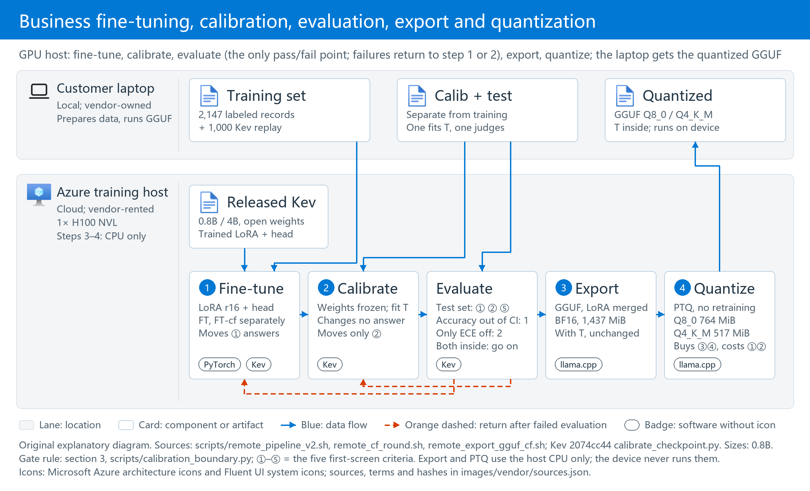
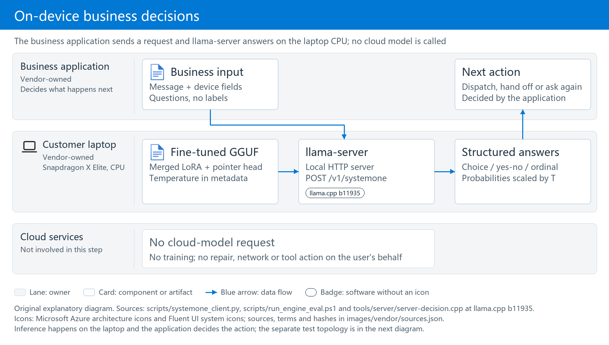

# Decision Model on the Edge: Fine-Tuning and Inference Optimization

[English](README.md) | [中文](README_CN.md)

[](https://github.com/jaredpalmer/kev)
[](文档/Evaluation-Results.md#5-laptop-inference-engine)
[](#results)
[](https://github.com/david-xinyuwei/david-share/blob/master/LICENSE)

> **Author**: Xinyu Wei - Senior Systems Engineer, Microsoft AI GBB

[Results at a Glance](#results-at-a-glance) · [Architecture](#architecture) · [Results](#results) · [Steps](#steps)

## Purpose

**Dedicated decision models are becoming a model class of their own**: TypeSafe's hosted Jev, the open-weight [Kev](https://github.com/jaredpalmer/kev) released in September 2026 (1.0 on October 1), and the dozen or so similar models that the current llama.cpp already serves. They generate no text; they pick an answer from the given options and return a probability, so one forward pass completes a routing, triage or grading decision — faster, steadier and cheaper than asking a chat model to write a paragraph and parsing it. But if such a model can only live in the cloud, it does not suit edge devices, offline scenarios or customers whose data must stay on site. So it has to meet two requirements:

1. **Run locally** — on a laptop's CPU and memory, with no cloud-model call.
2. **Accept business data for fine-tuning** — the customer's rules, fields and vocabulary must train into the model, and the model must be updatable when the rules change.

This project tests both with Kev (an open-weight decision model on Qwen3.5, 0.8B / 4B): fine-tune on business data on a GPU host, measure accuracy, latency and memory on a Snapdragon laptop, measure the inference-optimization levers one at a time — quantization, context length, compute backend, prompt length and model size — and then confirm that the same model file runs unchanged on an x86-64 virtual machine. **Training runs on a GPU host; routine inference stays on the laptop without cloud-model calls.** The data is fictional Contoso PC data, not customer data; there is no proprietary-cloud comparison and no production-readiness guarantee.

## Results at a Glance

### Training: Accuracy on the Same Questions

Inputs are simulated Contoso PC support and assistant records: a user message, device fields and three questions. Labels come from business-rule code. The table holds the H100 NVL / PyTorch evaluation path and questions fixed while comparing training recipes. Out-of-distribution sets change the text generator and field distribution. [Actual input example and test method](文档/Evaluation-Results.md#how-the-tests-work)

<!-- OVERVIEW:ACCURACY -->
<!-- SOURCE:TABLE:1 -->
| Parameter scale| Test set (questions)| GPU accuracy: released| GPU accuracy: FT-cf<br>3,832 business records, 2 epochs| GPU accuracy: C<br>4,038 business records, 4 epochs| Final recipe gain over released (percentage points)| 
| ---| ---| ---| ---| ---| ---| 
| 0.8B| Support: in-distribution (510 questions)| 44.7%| 86.9%| **96.3%**| +51.6| 
| 0.8B| Assistant: in-distribution (477 questions)| 67.1%| 97.5%| **100.0%**| +32.9| 
| 0.8B| Support: out-of-distribution (1,011 questions)| 43.0%| 82.5%| **88.4%**| +45.4| 
| 0.8B| Assistant: out-of-distribution (951 questions)| 65.7%| 94.4%| **97.3%**| +31.5| 
| 4B| Support: in-distribution (510 questions)| 60.8%| 95.9%| Not run| +35.1| 
| 4B| Assistant: in-distribution (477 questions)| 81.8%| 99.8%| Not run| +18.0| 
| 4B| Support: out-of-distribution (1,011 questions)| 60.7%| 91.4%| Not run| +30.7| 
| 4B| Assistant: out-of-distribution (951 questions)| 81.9%| 98.8%| Not run| +16.9| 
<!-- /SOURCE:TABLE:1 -->
<!-- /OVERVIEW:ACCURACY -->

Released means no business fine-tuning. FT-cf uses 3,832 business records for 2 epochs; C adds 206 variants and uses 4,038 records for 4 epochs. Both also mix in 1,000 Kev replay records and train independently from the same released checkpoint; C does not continue from the FT-cf checkpoint. The 4B model has no C run, so its final gain uses FT-cf; 0.8B uses C. Gains are calculated from unrounded correct-answer counts.

### Inference: Accuracy, Measured Processing Time and Calibration

The two tables retain real Snapdragon measurements for all seven deployment configurations. Processing time is the median from sending a complete support or assistant request to receiving its answers after the model is loaded, in seconds. Each request contains three decisions. This is neither model-loading time nor the median for a standalone classification, and dividing it by three does not measure that latency. Each configuration uses llama.cpp b11935 CPU, default settings and concurrency 1, with 170 support and 159 assistant requests, excluding loading and two warm-ups. Accuracy, processing time and ECE are recalculated from each configuration's same recorded Snapdragon run. ECE uses 10 equal-width confidence bins and is better closer to 0; it is not the Microsoft-Decision-1 website's percentage-scale score. Full standalone single-question evaluation is still incomplete and is not mixed into this table. [Timing units, calibration and the single-question boundary](文档/Evaluation-Results.md#single-question).

<!-- OVERVIEW:INFERENCE -->
<!-- SOURCE:TABLE:2 -->
| Model (0.8B, Snapdragon X Elite CPU, default settings)| Test set (questions)| Per-question accuracy (%, failures included)| Median processing time per complete request (seconds, 3 decisions each)| Calibration error ECE (0-1, lower is better)| Valid-probability coverage (%)| 
| ---| ---| ---| ---| ---| ---| 
| Released B0, official Q8_0 package| Support: in-distribution (510 questions)| 45.7%| **0.666**| 0.030| 100.0%| 
| Released B0, official Q8_0 package| Assistant: in-distribution (477 questions)| 66.9%| **0.843**| 0.093| 100.0%| 
| Fine-tuned FT-cf, Q8_0| Support: in-distribution (510 questions)| 86.9%| **0.646**| 0.028| 100.0%| 
| Fine-tuned FT-cf, Q8_0| Assistant: in-distribution (477 questions)| 97.7%| **0.984**| 0.014| 100.0%| 
| Fine-tuned FT, Q4_K_M (separate FT recipe, not FT-cf)| Support: in-distribution (510 questions)| 87.5%| **0.812**| 0.021| 100.0%| 
| Fine-tuned FT, Q4_K_M (separate FT recipe, not FT-cf)| Assistant: in-distribution (477 questions)| 93.9%| **0.909**| 0.014| 100.0%| 
| Round-2 C, Q8_0 (delivered)| Support: in-distribution (510 questions)| 96.9%| **0.635**| 0.032| 100.0%| 
| Round-2 C, Q8_0 (delivered)| Assistant: in-distribution (477 questions)| 99.6%| **0.905**| 0.010| 100.0%| 
<!-- /SOURCE:TABLE:2 -->

<!-- SOURCE:TABLE:3 -->
| Model (4B, Snapdragon X Elite CPU, default settings)| Test set (questions)| Per-question accuracy (%, failures included)| Median processing time per complete request (seconds, 3 decisions each)| Calibration error ECE (0-1, lower is better)| Valid-probability coverage (%)| 
| ---| ---| ---| ---| ---| ---| 
| Released B0, official Q4_K_M package| Support: in-distribution (510 questions)| 59.0%| **3.022**| 0.047| 100.0%| 
| Released B0, official Q4_K_M package| Assistant: in-distribution (477 questions)| 82.0%| **3.790**| 0.134| 100.0%| 
| Fine-tuned FT-cf, Q8_0| Support: in-distribution (510 questions)| 96.1%| **3.649**| 0.019| 100.0%| 
| Fine-tuned FT-cf, Q8_0| Assistant: in-distribution (477 questions)| 99.8%| **4.115**| 0.008| 100.0%| 
| Fine-tuned FT-cf, Q4_K_M| Support: in-distribution (510 questions)| 95.3%| **3.615**| 0.018| 100.0%| 
| Fine-tuned FT-cf, Q4_K_M| Assistant: in-distribution (477 questions)| 99.6%| **4.751**| 0.009| 100.0%| 
<!-- /SOURCE:TABLE:3 -->
<!-- /OVERVIEW:INFERENCE -->

**In this recorded Snapdragon run, delivered C takes a median of about 0.635 seconds for a complete support request and 0.905 seconds for an assistant request, each containing three decisions.** These are full-run measurements, not the local smoke samples, and exclude model loading. Loading, memory, file size and repeats remain in the [device results](文档/Evaluation-Results.md#5-laptop-inference-engine) and [C regression](文档/Evaluation-Results.md#round2-device). The 0.8B Q4_K_M configuration is the separate FT recipe, not FT-cf or C. Q8_0 is W8; this project's custom Q4_K_M mixes W4/W8, while the official package name does not establish each layer's bit width.

- **Fine-tuning improves business accuracy.** This does not show that fine-tuning accelerates an unchanged model architecture; individual timing differences do not establish causation.
- **Q8_0 stays closer to its own PyTorch answers.** Q4_K_M reduces file size but has lower per-question agreement. Unrun cells remain visible.
- **Keep the limits with the headline.** Data is simulated. Of 160 long-history records, 7 exceed the context window and are rejected. On the remaining 153 records, C answers 206/459 questions correctly (44.9%, excluding rejected requests). This test ran only on x86-64, and short-input accuracy cannot substitute for it. [Long-input cases and results](文档/Evaluation-Results.md#long-real)

## Architecture

The model and recipe names are fixed here. **B0** is the released Kev model without training. **B0-policy** is the same released model with the full vendor policy text written into every question's prompt. **FT** is supervised fine-tuning of the released model on business data. **FT-cf** adds counterfactual variants to FT's data: the same message with one device field changed. **Round-2 C** is the FT-cf recipe plus 206 variants aimed at the weak fields, trained for 4 epochs. FT, FT-cf and round-2 A/B/C start from the same release and are trained independently; **the final recommendation and delivered file is round-2 C** (`Contoso-Kev-0.8B-FTcf-R2C-Q8_0.gguf`). FT-cf is its previous version: sections 1–7 retain measurements of the first-round recipes; C's GPU figures are in [the second round](文档/Evaluation-Results.md#round2), and its on-device figures on the x86-64 VM and the Snapdragon laptop in the [device regression](文档/Evaluation-Results.md#round2-device).

### Training: Business Data to a Model File

The laptop prepares separate training, calibration and test sets; released Kev is loaded on the Azure training host. Fine-tuning, calibration and evaluation precede export and quantization. The laptop receives the GGUF. [Parameters and return paths](文档/Core-Technology.md)



*Original workflow illustration: blue lines carry data and dashed lines show human-led development feedback, not completed independent customer acceptance. Sources and hashes: [images/provenance.json](images/provenance.json).*

#### Core Code: Fine-Tuning, Calibration and Quantization

These core calls use the delivered **0.8B C recipe**. Complete the [training environment, data upload and export-tool setup](文档/Operations-Guide.md#train-update) first, then execute the blocks in order in the same Bash session on the Linux training host. The first two stages need a GPU; export and quantization use CPU only. Paths match this project: **do not rerun these calls over existing checkpoints or result directories**. Use the linked pipelines for full reproduction, including evaluation, error handling and delivery checks.

**1. Fine-tune: business records → LoRA and pointer-head checkpoint.** C uses 4,038 business records plus 1,000 replay records for 4 epochs, with base weights frozen. [Complete training script](scripts/remote_round2.sh)

<!-- SOURCE:FENCE:1 -->
```bash
set -euo pipefail
cd /mnt/aipc/kev
PY="$PWD/.venv/bin/python"
CK=/mnt/aipc/runs/0.8b/r2-C
"$PY" -m kev.train \
    --data /mnt/aipc/data/contoso/train_cf2.jsonl --suite evals/v7/decision-v7 --replay 1000 \
    --base Qwen/Qwen3.5-0.8B-Base --base_revision dc7cdfe2ee4154fa7e30f5b51ca41bfa40174e68 \
    --init_from jaredpalmer/kev-0.8b@v1.0 --epochs 4 --lr 2e-5 --batch 4 --accum 2 \
    --dtype bf16 --checkpointing 1 --max_state 768 --device cuda --seed 1 --out "$CK"
```
<!-- /SOURCE:FENCE:1 -->

**2. Calibrate: calibration-set scores → temperature T in the checkpoint.** First save per-question scores from the fixed model, then fit temperature. This updates neither model weights nor answer ranking and does not select temperature on the test set. [Calibration and update details](文档/Operations-Guide.md#calibration-update)

<!-- SOURCE:FENCE:2 -->
```bash
ROWS=/mnt/aipc/runs/0.8b/r2-C-calib-raw
"$PY" -m kev.benchmark --run "$CK" \
    --data /mnt/aipc/data/contoso/calib.jsonl --out "$ROWS" --device cuda
"$PY" scripts/calibrate_checkpoint.py --run "$CK" \
    --rows "$ROWS/rows.json" --allow-in-distribution
```
<!-- /SOURCE:FENCE:2 -->

**3. Export and quantize: calibrated checkpoint → BF16 GGUF → Q8_0 GGUF.** Conversion merges LoRA and includes the pointer head and temperature; quantization does not retrain. Check the resulting file's temperatures and run target-device regression: successful export alone does not establish unchanged quality. [Complete export script](scripts/remote_export_round2.sh)

<!-- SOURCE:FENCE:3 -->
```bash
LLAMA=/mnt/aipc/llama.cpp
OUT=/mnt/aipc/gguf/0.8b-r2C
NAME=Contoso-Kev-0.8B-FTcf-R2C
mkdir -p "$OUT"
/mnt/aipc/llama-venv/bin/python "$LLAMA/convert_hf_to_gguf.py" "$CK" \
    --outtype bf16 --outfile "$OUT/$NAME-BF16.gguf.part" --model-name "$NAME"
mv "$OUT/$NAME-BF16.gguf.part" "$OUT/$NAME-BF16.gguf"
"$LLAMA/build/bin/llama-quantize" "$OUT/$NAME-BF16.gguf" "$OUT/$NAME-Q8_0.gguf.part" Q8_0
mv "$OUT/$NAME-Q8_0.gguf.part" "$OUT/$NAME-Q8_0.gguf"
```
<!-- /SOURCE:FENCE:3 -->

### Everyday Inference: Decisions Stay on the Laptop

The business application sends the message, device fields and questions; llama-server returns option probabilities. This path neither trains nor calls a cloud model, and it does not execute business actions.



*Original explanatory diagram: the model returns answers and probabilities; the application owns subsequent actions. Source: [systemone_client.py](scripts/systemone_client.py).*

<a id="criteria"></a>

**The main table reports per-question correctness, the time for a complete three-question request, and probability reliability.** It is not a standalone single-question latency table. Calibration checks whether answers assigned about 90% confidence are correct about 90% of the time. Fitting temperature adjusts probabilities; ECE measures the outcome. [Complete timing definitions](文档/Evaluation-Results.md#single-question).

### Why Kev

Kev has downloadable decision-model weights that can be fine-tuned on business data. This project tests only 0.8B and 4B. Producer evaluations and product information below are not this project's business scores. [Selection evidence, original figure and limits](文档/Core-Technology.md#why-kev-is-a-candidate)

<!-- SOURCE:TABLE:4 -->
| Model| Nominal base-model parameter scale| transfer-v4 development accuracy (author's evaluation)| Training state limit (tokens)| Validated input length (tokens)| Weights and this project's scope| 
| ---| ---| ---| ---| ---| ---| 
| Microsoft-Decision-1| 9B (Qwen3.5-9B, post-trained by Microsoft)| Not evaluated on this suite| Not disclosed| Product commitment: 32,768 per request| Hosted in Microsoft Foundry, Preview; not tested in this project| 
| Jev| Not disclosed by the author| 85.7%| Not disclosed| Not disclosed| TypeSafe hosted API; not tested in this project| 
| Kev-27B| 27B| 85.1%| 32,768| 65,536| Open weights; not deployed in this project| 
| Kev-9B| 9B| 82.0%| 7,552| 8,192| Open weights; not deployed in this project| 
| Kev-4B| 4B| 81.7%| 7,552| 8,192| Open weights; fine-tuned and deployed on-device in this project| 
| Kev-0.8B| 0.8B| 64.8%| 7,552| 8,192| Open weights; fine-tuned and deployed on-device in this project| 
<!-- /SOURCE:TABLE:4 -->

## Results

### What Goes In and Comes Out

Three real single-question examples use round-2 C 0.8B / Q8_0 on x64. **They are neither Snapdragon benchmarks nor median-latency measurements:**

- An order-status enquiry returns `sales_ops`, matching the policy label.
- The request “帮我联系人工客服咨询保修。” asks to contact human support about warranty; the model returns `support_chat`, matching the label.
- A German device with accidental-damage coverage has liquid-damaged keys. The model returns `sales_ops`; the correct label is `damage_claim`, so this example is incorrect.

[Complete inputs, complete outputs, correctness and each observed processing time](文档/Evaluation-Results.md#request-examples). The model classifies; it does not perform repairs or contact anyone.

### What the Long-Context Tests Establish

**Long inputs were tested; the absolute maximum context was not established.** With C 0.8B on x64 and `-c 8192`, seven of 160 simulated long-history records returned no answers. On the other 153 records, 206 of 459 decisions were correct: 44.9%, with 26.395 seconds median per complete request. The largest successful request reports 24,155 input tokens across three questions, averaging about 8,052 each; that is not an exact single-question limit. Larger windows were not swept, and maximum-length testing on Snapdragon or 4B is incomplete. [Raw records, refusals and limits](文档/Evaluation-Results.md#long-input).

### Findings and Evidence

- **Fine-tuning and generalization:** the overview matrices lead this page; all released, prompt-only, FT, FT-cf and round-2 A/B/C comparisons and remaining errors are in the [complete results](文档/Evaluation-Results.md#same-questions).
- **General capability:** 656 public questions check forgetting; probability quality is reported separately from accuracy. [Public-suite results](文档/Evaluation-Results.md#2-retention-of-general-capability)
- **Calibration:** temperature changes probabilities, not answer ranking. Probability drift and errors requiring retraining are separate. [Calibration boundary](文档/Evaluation-Results.md#3-calibration-correct-ranking-does-not-guarantee-reliable-probabilities)
- **Training resources:** round-2 C takes 22 min 42 s with 7,475 MiB peak device VRAM; multiple training seeds were not tested. [Training cost](文档/Evaluation-Results.md#4-training-resources)
- **CPU architectures:** the same C file agrees on 982/987 questions across Snapdragon and x86-64, not every question. The two machines are not a speed comparison. [Device regression](文档/Evaluation-Results.md#round2-device)
- **Concurrency and long inputs:** the five Snapdragon concurrency settings did not increase throughput with concurrency. Long-history accuracy is a separate limitation. [Concurrency](文档/Evaluation-Results.md#concurrency-laptop) · [Long inputs](文档/Evaluation-Results.md#long-real)
- **Local trial and second round:** earlier wrong answers, later corrections and disproved predictions remain visible; a response is not necessarily correct. [Local trial](文档/Evaluation-Results.md#local-result) · [Full second round](文档/Evaluation-Results.md#round2)

### Inference Optimization: Measured Levers

The full matrix of quantization, context size, compute backend, prompt length, model size, long inputs, concurrency and CPU architectures remains in [methods and individual runs](文档/Evaluation-Results.md#inference-optimization-which-levers-were-measured). These timings describe complete requests, not standalone single-question latency.


### Hardware Requirements

Training VRAM, laptop memory and model file sizes are in the [measured hardware table](文档/Evaluation-Results.md#6-hardware-requirements). Values describe the specified workloads, not minimum supported configurations for every device.


### Limits

Simulated data, one training seed, one Snapdragon laptop and one x86-64 VM; no customer-production acceptance, long-term stability or battery-power conclusion. Test errors already informed recipe iterations, so these scores are not independent blind acceptance. Out-of-distribution sets remain simulated, and short-input scores are not long-input guarantees. [Complete limits](文档/Evaluation-Results.md#limits-of-the-conclusions)

## Steps

<!-- SOURCE:TABLE:5 -->
| Your task| Start here| Execution order| Expected result| 
| ---| ---| ---| ---| 
| Try an existing fine-tuned GGUF locally| [A. Local trial](文档/Operations-Guide.md#local-try)| Start runtime → send one request → edit a field and repeat| Real model response, measured timing and raw output files| 
| Produce a model or adapt to new business data| [B. Train and update](文档/Operations-Guide.md#train-update)| Data → train → calibrate → evaluate → export → update local model| A new checkpoint, evaluation and GGUF; not old-directory overwrite with skipped stages| 
| Recheck the reported results| [C. Verification](文档/Operations-Guide.md#verify)| Run offline tests or start a real model for full device evaluation| Keep code checks, historical evidence replay and fresh model execution distinct| 
<!-- /SOURCE:TABLE:5 -->

Run all commands from the project root, not the directory containing a detail document. First obtain the architecture-matched llama.cpp package and calibrated GGUF through [Operations A](文档/Operations-Guide.md#local-try). Large model files are not included in this repository.

### With a Model: Start and Send One Request

Start the service in the first PowerShell terminal and send the request in a second. Receiving option probabilities establishes a working call; correctness still needs comparison with the business rules.

<!-- SOURCE:FENCE:4 -->
```powershell
$Engine = 'C:\Tools\llama.cpp\b11935-cpu\llama-server.exe'
$Model = 'C:\Tools\models\contoso-kev\Contoso-Kev-0.8B-FTcf-R2C-Q8_0.gguf'   # 交付的第二轮 C；上一版改用 Contoso-Kev-0.8B-FTcf-Q8_0.gguf
if (-not (Test-Path -LiteralPath $Engine)) { throw '找不到 llama-server' }
if (-not (Test-Path -LiteralPath $Model)) { throw '找不到微调 GGUF，请先取得模型' }
& $Engine -m $Model --alias contoso-kev-0.8b-r2c --host 127.0.0.1 --port 8080 `
    -c 8192 -b 2048 -ub 2048 -ngl 0 --cache-ram 0 --offline
```
<!-- /SOURCE:FENCE:4 -->

<!-- SOURCE:FENCE:5 -->
```powershell
Invoke-RestMethod -Uri http://127.0.0.1:8080/health
$Run = Join-Path '验证结果' ('本机试用_' + (Get-Date -Format 'yyyyMMdd-HHmmss'))
python -B scripts\systemone_client.py --url http://127.0.0.1:8080/v1/systemone `
    --request data\contoso\examples\support.json --out "$Run\support-us"
```
<!-- /SOURCE:FENCE:5 -->

Region changes, the graphical trial, training, updates, offline tests and stop/restore instructions are in the [operations guide](文档/Operations-Guide.md). Offline checks do not invoke a model or establish a fresh training/performance run.

## Repository Deliverables

<!-- SOURCE:TABLE:6 -->
| Deliverable| Location| Purpose| 
| ---| ---| ---| 
| Simulated vendor data with policy-computed labels| [data/contoso/final](data/contoso/final); manifest and SHA-256: [manifest.json](data/contoso/final/manifest.json)| Training, calibration, development, in-distribution, out-of-distribution and variant evaluation| 
| Vendor policy and data generation| [scripts/vendor_policy.py](scripts/vendor_policy.py), [scripts/gen_vendor_data.py](scripts/gen_vendor_data.py), [scripts/augment_counterfactual.py](scripts/augment_counterfactual.py)| Adapt policies and fields to reuse the workflow with real business data| 
| GPU-host training and evaluation pipelines| [scripts/remote_setup.sh](scripts/remote_setup.sh), [scripts/remote_pipeline_v2.sh](scripts/remote_pipeline_v2.sh), [scripts/remote_cf_round.sh](scripts/remote_cf_round.sh), [scripts/remote_export_gguf.sh](scripts/remote_export_gguf.sh)| Baselines, fine-tuning, temperature calibration, evaluation, paired comparison and GGUF export| 
| Laptop device validation| [scripts/run_engine_eval.ps1](scripts/run_engine_eval.ps1), [scripts/systemone_client.py](scripts/systemone_client.py), [scripts/parity.py](scripts/parity.py)| Start llama-server, score and time request by request (including concurrency), compare with PyTorch per question| 
| Local browser trial page| [scripts/try_ui.py](scripts/try_ui.py)| Edit inputs in a browser form, see every option's probability, compare with the policy answer, watch process memory and CPU; Chinese/English| 
| Summaries and tests| [scripts/summarize_results.py](scripts/summarize_results.py), [scripts/summarize_engine.py](scripts/summarize_engine.py), [scripts/calibration_boundary.py](scripts/calibration_boundary.py), [tests/](tests/)| Generate tables and probability diagnostics from raw results; no automatic retraining decision; offline checks of data and scoring code| 
| Raw evidence| [Evidence directory](验证结果/)| Evaluation reports, predictions, training logs, GPU-memory samples and device records. Checkpoints and full result archives contain files above GitHub's 100 MB limit and are not included; reproduce them with the training steps| 
| Detailed report| [Detailed validation report](文档/Finetuning-and-On-Device-Validation-Report.md)| Full tables, per-question analysis and claim boundaries| 
<!-- /SOURCE:TABLE:6 -->

### Documentation

- [Core technology](文档/Core-Technology.md): model choice, algorithms, parameters and interface.
- [Complete evaluation results](文档/Evaluation-Results.md): method, every configuration, individual runs and failure boundaries.
- [Operations guide](文档/Operations-Guide.md): setup, use, training, updates, verification and script navigation.
- [First-round detailed report](文档/Finetuning-and-On-Device-Validation-Report.md) and [experiment protocol](文档/Experiment-Protocol.md): question-level breakdowns, original decision rules and deviations.
