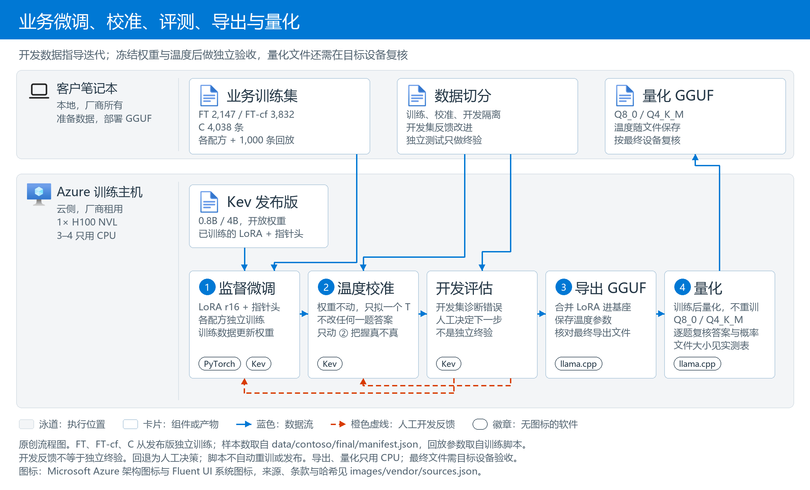
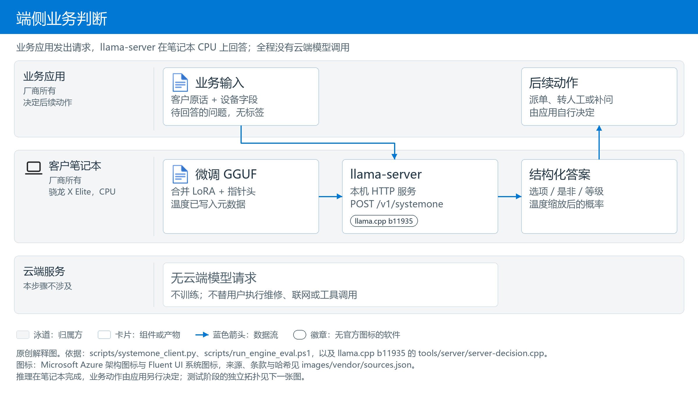

# 端侧决策模型：微调与推理优化

<!-- REPORT:SOURCES
{
    "first_summary": "验证结果/微调评测_20261027-220226/summary/summary.json",
    "round2_summary": "验证结果/第二轮微调评测_20261101-101948/summary/round2_summary.json",
    "device_results": "验证结果/端侧引擎_20261027-124700",
    "round2_device_results": "验证结果/端侧引擎_骁龙第二轮C_20261101-203702",
    "single_question_results": "验证结果/单题端侧评测_骁龙_20261103-111934/公开",
    "cloud_capacity_results": "验证结果/云机单题并发容量_20261103-130933/公开"
}
-->

[English](README.md) | [中文](README_CN.md)

[](https://github.com/jaredpalmer/kev)
[](文档/评测与端侧结果全集.md#5-笔记本端推理引擎)
[](#实现效果)
[](https://github.com/david-xinyuwei/david-share/blob/master/LICENSE)

> **作者**: 魏新宇 (Xinyu Wei) — 微软 AI GBB 高级系统工程师

[成果一览](#成果一览) · [架构](#架构) · [实现效果](#实现效果) · [操作步骤](#操作步骤)

## 目的

**专用决策模型（decision model）正在成为一类独立的模型**：TypeSafe 的托管模型 Jev、2026 年 9 月开源的 [Kev](https://github.com/jaredpalmer/kev)（10 月 1 日发布 1.0），以及 llama.cpp 当前版本已能服务的十来个同类模型。它们不生成文字，只在给定选项里选答案并给出概率：一次前向就完成路由、分诊、判级这类业务判断，比让聊天模型写一段再解析更快、更稳、更便宜。但如果这类模型只能放在云上，对边缘设备、离线场景和数据不出本地的客户并不友好。所以它要满足两点：

1. **能在本地运行**——笔记本的 CPU 和内存就要跑得动，不调用云端模型。
2. **能接入业务数据微调**——客户的规则、字段和术语要能训进模型，规则变了还能更新。

本项目用 Kev（基于 Qwen3.5 的开放权重决策模型，0.8B / 4B）验证这两点：在 GPU 主机上用业务数据微调，在骁龙笔记本上测准确率、时延和内存，逐项测量量化、上下文长度、计算后端、提示词长度和模型规模这些推理优化杠杆的效果，再把同一个模型文件放到一台 x86-64 虚拟机上确认照常运行。**训练在 GPU 主机完成，日常推理留在笔记本，不调用云端模型。** 数据是 Contoso PC 模拟数据，不是真实客户数据；不含云端闭源模型对比，不作生产可用性承诺。

## 成果一览

### 训练成果：同题比较准确率

输入为 Contoso PC 模拟工单与助手请求，包含用户原话、设备字段和三道问题；标签由业务规则代码计算。下表固定 H100 NVL / PyTorch 评测路径与同一批题，只比较训练方案；同分布题与训练数据使用相同生成模型，分布外题更换生成模型和字段分布。[真实输入示例与测试方法](文档/评测与端侧结果全集.md#测试怎么做的)

<!-- OVERVIEW:ACCURACY -->
| 参数规模 | 测试集（题数） | GPU 准确率：发布版 | GPU 准确率：FT-cf<br>业务样本 3,832 条，训练 2 遍 | GPU 准确率：C<br>业务样本 4,038 条，训练 4 遍 | 最终方案相对发布版提升（百分点） |
|---|---|---|---|---|---|
| 0.8B | 工单·同分布（510 题） | 44.7% | 86.9% | **96.3%** | +51.6 |
| 0.8B | 助手·同分布（477 题） | 67.1% | 97.5% | **100.0%** | +32.9 |
| 0.8B | 工单·分布外（1,011 题） | 43.0% | 82.5% | **88.4%** | +45.4 |
| 0.8B | 助手·分布外（951 题） | 65.7% | 94.4% | **97.3%** | +31.5 |
| 4B | 工单·同分布（510 题） | 60.8% | 95.9% | 未做 | +35.1 |
| 4B | 助手·同分布（477 题） | 81.8% | 99.8% | 未做 | +18.0 |
| 4B | 工单·分布外（1,011 题） | 60.7% | 91.4% | 未做 | +30.7 |
| 4B | 助手·分布外（951 题） | 81.9% | 98.8% | 未做 | +16.9 |
<!-- /OVERVIEW:ACCURACY -->

发布版不做业务微调；FT-cf 用 3,832 条业务样本训练 2 遍，C 增加 206 条变体后用 4,038 条训练 4 遍。两者都额外混入 1,000 条 Kev 通用回放，从同一个发布版独立训练，不是接着第一轮模型续训。4B 没做 C，最终提升以 FT-cf 计；0.8B 以 C 计。提升从未取整的答对题数计算。

### 推理成果：每请求一道题的骁龙实测

<!-- SINGLE:METHOD -->
**每次请求只回答一道题。** 下表只列已回传并逐条核验的单题结果：1/7 个配置、4/28 组，共 2,949 次正式请求。未回传配置不填入历史三题数字，也不表示它们不受支持。

固定条件：骁龙 X Elite CPU、llama.cpp b11935、并发 1、每个数据集预热 2 次，`-c 8192 -b 2048 -ub 2048 --cache-ram 0`。单题耗时从客户端发出请求到完整收到 JSON，单位毫秒，不含加载和预热。准确率、ECE 和耗时来自同一批请求，错误保留在准确率分母。

**内存与并发前提：** 同一个模型服务进程连续处理所有请求，峰值工作集是整轮最高值（含加载、预热、模型常驻权重和运行缓冲），不是每个请求新增的内存，也不是恒定占用或内存上限。顺序处理 100 次不能乘以 100；100 个同时在途请求则是另一种负载。本轮只测并发 1，不能从峰值内存反推最大并发；骁龙上尚未测单题并发，云机 x64 实测见下文。同配置各数据集重复显示整轮峰值，不是分别测出的数据集峰值。
<!-- /SINGLE:METHOD -->

<!-- OVERVIEW:INFERENCE -->
| 模型（0.8B，骁龙 X Elite CPU，默认参数） | 测试集（题数） | 单题准确率（%，含失败题） | 单题耗时中位数（毫秒，每请求1题） | 整轮进程峰值工作集（MiB） | 校准误差 ECE（0–1，越低越好） | 有效概率覆盖率（%） |
|---|---|---|---|---|---|---|
| 第二轮 C，Q8_0（交付） | 工单·同分布（510 题） | 97.06% | 386.34 | 2,585 | 0.034 | 100.0% |
| 第二轮 C，Q8_0（交付） | 助手·同分布（477 题） | 99.58% | 409.32 | 2,585 | 0.007 | 100.0% |
| 第二轮 C，Q8_0（交付） | 工单·分布外（1,011 题） | 88.72% | 635.37 | 2,585 | 0.047 | 100.0% |
| 第二轮 C，Q8_0（交付） | 助手·分布外（951 题） | 96.95% | 448.31 | 2,585 | 0.007 | 100.0% |
<!-- /OVERVIEW:INFERENCE -->

本轮四套数据集均无请求错误，不代表每道题都答对。其余六个配置的单题结果尚未回传，当前不是七个配置的完整单题对比。[本轮原始请求与响应](验证结果/单题端侧评测_骁龙_20261103-111934/公开) · [方法、指标与内存边界](文档/评测与端侧结果全集.md#single-question) · [历史三题对照，勿与本表混算](文档/评测与端侧结果全集.md#historical-three-question)。

- **微调改善业务准确率。** 不证明微调能让同一结构推理更快；单次计时差异不能作因果归因。
- **Q8_0 更接近各自的 PyTorch 答案。** Q4_K_M 文件更小，但逐题答案一致率较低；未跑的单元格如实保留。
- **边界必须一起看。** 数据是模拟的；160 条长历史工单中，7 条超窗口被拒；其余 153 条的 459 道题仅答对 206 道（44.9%，不含被拒请求）。这组长输入只在 x86-64 测过，不能用上面的短输入成绩替代。[长输入原题与结果](文档/评测与端侧结果全集.md#long-real)

### 并发与内存：云机 x64 单题实测（不是骁龙）

同一个 C 文件（`Contoso-Kev-0.8B-FTcf-R2C-Q8_0.gguf`）在一台 Azure 云机上测并发：Standard_D16as_v5，AMD EPYC 7763，16 个逻辑处理器，约 64 GiB 内存，llama.cpp b11935 x64 CPU 包，8 个推理线程。每档客户端保持 N 个请求同时在途，服务端开 N 个槽位、每槽 8,192 token；每档发同一批 384 个单题请求（四套测试数据各前 32 条，每条 3 道题），从并发 1 加到 32，某档出现失败后不再加档。

<!-- OVERVIEW:CAPACITY -->
| 同时在途请求数（= 服务端槽位，每槽 8,192 token） | 成功请求 / 总请求 | 答对 / 总请求（同一 384 题，失败计答错） | 耗时中位数（秒，成功请求） | p95 耗时（秒，成功请求，最近秩） | 吞吐（成功请求/秒，墙钟） | 整轮进程峰值工作集（MiB） | 私有提交峰值（MiB，每 0.5 秒采样） | 整机最低可用物理内存（MiB，含其他进程） |
|---|---|---|---|---|---|---|---|---|
| 1 | 384 / 384 | 360 / 384 | 0.92 | 1.85 | 0.923 | 1,674 | 4,263 | 32,845 |
| 2 | 384 / 384 | 360 / 384 | 2.32 | 2.81 | 0.929 | 1,790 | 4,378 | 33,750 |
| 4 | 384 / 384 | 360 / 384 | 4.21 | 5.30 | 0.930 | 2,238 | 4,827 | 33,467 |
| 8 | 384 / 384 | 360 / 384 | 8.48 | 10.83 | 0.925 | 3,756 | 6,349 | 32,101 |
| 16 | 384 / 384 | 360 / 384 | 16.57 | 20.04 | 0.927 | 5,033 | 7,648 | 30,893 |
| 32 | 375 / 384 | 353 / 384 | 26.20 | 41.08 | 0.919 | 6,906 | 9,505 | 29,011 |
<!-- /OVERVIEW:CAPACITY -->

<!-- CAPACITY:NOTES -->
- **内存随并发上涨，不是固定值。** 整轮进程峰值工作集从并发 1 的 1,674 MiB 升到并发 32 的 6,906 MiB。已测档位里不超过 3 GiB（3,072 MiB）的最高档是并发 4（2,238 MiB），下一档并发 8 为 3,756 MiB，并发 5–7 未测。
- **先到上限的是处理速度，不是内存。** 各档吞吐都在 0.919–0.930 成功请求/秒，并发增加只拉长等待：耗时中位数从 0.92 秒升到 26.20 秒。
- **并发 32 出现失败。** 9 个请求在客户端等满 180 秒超时，其余请求耗时中位数 26.20 秒；服务日志没有内存分配失败，整机最低仍有 29,011 MiB 可用物理内存、33,760 MiB 剩余可提交内存。个别请求为何远慢于中位数，本次未单独查明。
- **边界。** 无错误的最高档是并发 16，这是本次已测下界，不是容量上限；按协议在首个失败档停止，并发 64、128、256 未运行，内存耗尽点未测到。每档运行一次，只用 384 题子集，不替代主表的全量准确率；这是 AMD EPYC 云机结果，不能换算到骁龙。[方法与原始证据](文档/评测与端侧结果全集.md#concurrency-single-question)
<!-- /CAPACITY:NOTES -->

## 架构

配方名称：**B0** 是不训练的 Kev 发布版；**B0-policy** 是同一个发布版，但把厂商规则全文写进每个问题的提示词；**FT** 是用业务数据在发布版上做监督微调；**FT-cf** 是 FT 的数据再加"只改一个设备字段"的反事实变体；**第二轮 C** 是 FT-cf 的配方再加 206 条针对薄弱字段的变体、训 4 个 epoch。FT、FT-cf 和第二轮 A/B/C 都从同一个发布版出发、各自独立训练；**最终推荐和交付的是第二轮 C**（`Contoso-Kev-0.8B-FTcf-R2C-Q8_0.gguf`），FT-cf 是它的上一版，第 1–7 节保留第一轮各配方的测量；C 的 GPU 数字见[第二轮](文档/评测与端侧结果全集.md#round2)，在 x86-64 虚拟机和骁龙笔记本上的端侧数字见[端侧回归](文档/评测与端侧结果全集.md#round2-device)。

### 训练：业务数据变成模型文件

笔记本准备独立的训练、校准与测试集；Kev 发布版在 Azure 训练主机加载。微调、校准和验收通过后导出、量化，笔记本接收 GGUF。各步骤的参数与回退条件见[核心技术](文档/核心技术_微调与端侧运行.md)。



*原创流程解释图：蓝线为数据流，虚线为人工依据开发数据迭代；不表示已完成独立客户验收。来源与哈希见 [images/provenance.json](images/provenance.json)。*

<a id="model-composition"></a>

#### 模型组成：本次微调改哪些部件

本段指本项目使用的 **`jaredpalmer/kev-0.8b@v1.0` LoRA 检查点**，不泛指所有 Kev 版本或格式。它保存已训练的 adapter、决策头、配置和分词器文件，**不是独立的全量基座权重包**，需要配合指定版本的 Qwen 基座加载。

**运行中的 Kev-0.8B = Qwen3.5-0.8B 基座 + Kev 已训练的 LoRA adapter + 已训练的决策头。** `0.8B` 是基座的规模档位，不是 adapter 也有 0.8B；`v1.0` 是发布版本，不是第二个模型。

- **Qwen 基座：冻结，不更新。** `--base` 和 `--base_revision` 指定主干权重及其版本。
- **Kev LoRA adapter：继续训练，更新参数。** `--init_from` 加载 v1.0 已有的 LoRA；本次在这同一套参数上继续学习业务数据，**不叠加第二套业务 adapter**。
- **Kev 决策头：继续训练，更新参数。** 它也由 `--init_from` 加载，用于给输入中的候选选项打分；不是重新随机初始化一个头。

**微调阶段更新的是后两项。** 随后的校准阶段冻结权重，只拟合温度 T。导出 GGUF 时，将更新后的 LoRA 合并进基座，并打包决策头、分词器与温度；客户拿到的最终 GGUF 已包含独立加载所需内容，**不需要再单独加载 Qwen 基座或 adapter**，但仍需 llama.cpp 运行时。

依据：[本次 C 训练配置](验证结果/第二轮微调评测_20261101-101948/runs/0.8b/r2-C/training_config.json)中的 `lora=16`、`full_ft=0`、`init_source`，以及 [Kev `Checkpoint.warm_start()`](https://github.com/jaredpalmer/kev/blob/2074cc44256200bb37540103fa4572901faa10f3/kev/checkpoint.py) 的已有 adapter 与决策头加载逻辑。

#### 核心代码示例：微调、校准、量化

以下按当前交付的 **0.8B C 配方**展开核心调用。先完成[训练环境、数据上传与导出工具准备](文档/操作步骤全本.md#train-update)，在 Linux 训练主机的同一个 Bash 会话中顺序执行；前两步需要 GPU，导出与量化只用 CPU。示例使用本项目的实际路径，**不要在已有检查点或结果目录上重复执行**。完整复现仍使用链接中的流水线，它还包含评测、错误处理和交付校验。

**1. 微调：业务样本 → LoRA 与指针头检查点。** C 使用 4,038 条业务记录、1,000 条通用回放，训练 4 个 epoch；基座权重冻结。[完整训练脚本](scripts/remote_round2.sh)

```bash
set -euo pipefail
cd /mnt/aipc/kev
PY="$PWD/.venv/bin/python"
CK=/mnt/aipc/runs/0.8b/r2-C
"$PY" -m kev.train \
    --data /mnt/aipc/data/contoso/train_cf2.jsonl --suite evals/v7/decision-v7 --replay 1000 \
    --base Qwen/Qwen3.5-0.8B-Base --base_revision dc7cdfe2ee4154fa7e30f5b51ca41bfa40174e68 \
    --init_from jaredpalmer/kev-0.8b@v1.0 --epochs 4 --lr 2e-5 --batch 4 --accum 2 \
    --dtype bf16 --checkpointing 1 --max_state 768 --device cuda --seed 1 --out "$CK"
```

**2. 校准：校准集分数 → 检查点中的温度 T。** 先保存固定模型的逐题分数，再拟合温度；不更新模型权重，不改变答案排序，也不使用测试集挑温度。[校准与更新说明](文档/操作步骤全本.md#calibration-update)

```bash
ROWS=/mnt/aipc/runs/0.8b/r2-C-calib-raw
"$PY" -m kev.benchmark --run "$CK" \
    --data /mnt/aipc/data/contoso/calib.jsonl --out "$ROWS" --device cuda
"$PY" scripts/calibrate_checkpoint.py --run "$CK" \
    --rows "$ROWS/rows.json" --allow-in-distribution
```

**3. 导出并量化：已校准检查点 → BF16 GGUF → Q8_0 GGUF。** 转换器合并 LoRA 并写入指针头与温度；量化不重训。生成的 Q8_0 文件仍需温度核对和目标设备回归，不能仅凭导出成功认定效果不变。[完整导出脚本](scripts/remote_export_round2.sh)

```bash
LLAMA=/mnt/aipc/llama.cpp
OUT=/mnt/aipc/gguf/0.8b-r2C
NAME=Contoso-Kev-0.8B-FTcf-R2C
mkdir -p "$OUT"
/mnt/aipc/llama-venv/bin/python "$LLAMA/convert_hf_to_gguf.py" "$CK" \
    --outtype bf16 --outfile "$OUT/$NAME-BF16.gguf.part" --model-name "$NAME"
mv "$OUT/$NAME-BF16.gguf.part" "$OUT/$NAME-BF16.gguf"
"$LLAMA/build/bin/llama-quantize" "$OUT/$NAME-BF16.gguf" "$OUT/$NAME-Q8_0.gguf.part" Q8_0
mv "$OUT/$NAME-Q8_0.gguf.part" "$OUT/$NAME-Q8_0.gguf"
```

### 日常推理：只在笔记本作判断

业务程序提交原话、设备信息和问题，llama-server 返回选项概率。这里不训练、不调用云端模型，也不代替业务应用执行后续动作。



*原创解释图：模型输出答案与概率，业务动作由应用负责。依据 [systemone_client.py](scripts/systemone_client.py)。*

<a id="criteria"></a>

**主表分别回答：单题准不准、一道题多久返回、整个服务进程用了多少内存、概率是否可靠。** 单题耗时不等于三题总耗时，进程峰值内存也不等于每请求独占内存或最大并发能力。拟合温度是调整方法，ECE 是效果指标。[完整计量定义](文档/评测与端侧结果全集.md#single-question)。

### 为什么选择 Kev

Kev 是可下载、可用业务数据微调的决策模型。本项目只实测 0.8B 与 4B；下面的作者评测和产品信息不是本项目的业务成绩。[选型依据、官方原图与边界](文档/核心技术_微调与端侧运行.md#为什么选择-kev-作为候选)

| 模型 | 基座标称参数规模 | transfer-v4 开发集准确率（作者评测） | 训练时 state 上限（token） | 验证过仍准的输入长度（token） | 权重与本项目范围 |
|---|---|---|---|---|---|
| Microsoft-Decision-1 | 9B（Qwen3.5-9B，微软后训练） | 未在此套件评测 | 未披露 | 产品承诺单次输入 32,768 | Microsoft Foundry 托管，Preview；本项目未测试 |
| Jev | 作者未披露 | 85.7% | 未披露 | 未披露 | TypeSafe 托管 API；本项目未测试 |
| Kev-27B | 27B | 85.1% | 32,768 | 65,536 | 开放权重；本项目未部署 |
| Kev-9B | 9B | 82.0% | 7,552 | 8,192 | 开放权重；本项目未部署 |
| Kev-4B | 4B | 81.7% | 7,552 | 8,192 | 开放权重；本项目微调并部署到端侧 |
| Kev-0.8B | 0.8B | 64.8% | 7,552 | 8,192 | 开放权重；本项目微调并部署到端侧 |

## 实现效果

### 输入什么，输出什么

仓库保留三个真实单题调用例子，使用 0.8B C / Q8_0，在 x64 上运行；**不是骁龙基准，也不是中位耗时**：

- 订单进度询问，输出 `sales_ops`，与规则标签一致。
- “帮我联系人工客服咨询保修。”，输出 `support_chat`，与规则标签一致。
- 德国设备有意外损坏保修、键盘进液，模型输出 `sales_ops`，正确标签是 `damage_claim`，该题答错。

[查看每个例子的完整输入、完整输出、对错与当次处理时间](文档/评测与端侧结果全集.md#request-examples)。模型只做分类，不实际执行维修或联系操作。

### 长上下文测到什么

**测过长输入，没有测出绝对最大上下文。** 在 x64 的 0.8B C、`-c 8192` 配置下，160 条长历史模拟工单有 7 条未返回答案；其余 153 条共 459 道判断答对 206 道，准确率 44.9%，完整请求中位耗时 26.395 秒。最长成功请求的输入总量为 24,155 token（三道题合计，均摊约 8,052），不是精确测出的单题上限。没有逐档扩大窗口，也没有完成骁龙或 4B 的最大长度测试。[原始记录、拒绝原因与边界](文档/评测与端侧结果全集.md#long-input)。

### 各项结果与证据

- **微调与泛化：** 主矩阵在上方；完整的发布版、提示词对照、FT、FT-cf、第二轮 A/B/C 及剩余错误见[评测全集](文档/评测与端侧结果全集.md#same-questions)。
- **通用能力：** 656 道公开题用于检查遗忘；概率质量单列，不用准确率代替。[通用题结果](文档/评测与端侧结果全集.md#2-通用能力有没有丢)
- **校准：** 调温度只改概率，不改答案排序；概率偏差与需要重训的错误分别处理。[校准边界](文档/评测与端侧结果全集.md#3-校准答案排名正确概率仍可能不准)
- **训练资源：** 第二轮 C 训练耗时 22 分 42 秒，整卡显存峰值 7,475 MiB；没有重测多个随机种子。[训练成本](文档/评测与端侧结果全集.md#4-训练要多少资源)
- **跨架构：** 同一 C 文件在骁龙和 x86-64 上有 982/987 题答案相同，不是完全相同；不比较两台机器谁更快。[端侧回归](文档/评测与端侧结果全集.md#round2-device)
- **并发与长输入：** 骁龙的五档并发未显示吞吐随并发增长；长历史准确率不足是另一项限制。[并发](文档/评测与端侧结果全集.md#concurrency-laptop) · [长输入](文档/评测与端侧结果全集.md#long-real)
- **本机试用与第二轮：** 保留早期错误、后续修正和不成立的预判，不把成功响应当正确答案。[本机试用](文档/评测与端侧结果全集.md#local-result) · [第二轮完整对照](文档/评测与端侧结果全集.md#round2)

### 推理优化：测过哪些杠杆

量化、上下文长度、计算后端、提示词长度、模型规模、长输入、并发与 CPU 架构的原有完整矩阵保留在[方法与每次运行](文档/评测与端侧结果全集.md#推理优化测过哪些杠杆)。这些时延按完整请求统计，不当作独立单题耗时。


### 硬件要求

训练显存、笔记本内存和模型文件大小见[实测硬件表](文档/评测与端侧结果全集.md#6-需要什么硬件)。表中是指定负载的实际占用，不是所有设备的最低可用配置。


### 结论边界

模拟数据、单个训练 seed、一台骁龙笔记本和一台 x86-64 虚拟机；没有客户生产验收、长期稳定性或电池功耗结论。测试集错误已用于配方迭代，因此现有分数不是独立盲测终验。分布外结果仍是模拟业务，长输入不能采用短输入准确率承诺。[完整边界](文档/评测与端侧结果全集.md#这些结论的边界)

## 操作步骤

| 你要做什么 | 从哪里开始 | 执行顺序 | 完成时看到什么 |
|---|---|---|---|
| 已有微调 GGUF，想在本机试用 | [A. 本机试用](文档/操作步骤全本.md#local-try) | 启动本机引擎 → 发送单条请求 → 修改字段再试 | 真实模型响应、本次耗时和原始结果文件 |
| 还没有微调模型，或要适配新业务 | [B. 训练与更新](文档/操作步骤全本.md#train-update) | 数据 → 训练 → 校准 → 评测 → 导出 → 更新本机模型 | 新版本检查点、评测结果和 GGUF；不是覆盖旧目录后继续跳过 |
| 要复核文中结论 | [C. 验证与复核](文档/操作步骤全本.md#verify) | 离线测试，或另行启动模型做完整端侧评测 | 明确区分代码检查、历史证据复核和新模型实跑 |

所有命令从本项目根目录运行，不是在子文档所在目录。先按[完整操作指南 A](文档/操作步骤全本.md#local-try)取得匹配 CPU 架构的 llama.cpp 与已校准 GGUF；仓库不包含大模型文件。

### 已有模型：启动并发一条请求

第一个 PowerShell 终端启动服务；第二个终端发送请求。看到每道题的候选概率才算调用成立，正确性仍须与业务规则核对。

```powershell
$Engine = 'C:\Tools\llama.cpp\b11935-cpu\llama-server.exe'
$Model = 'C:\Tools\models\contoso-kev\Contoso-Kev-0.8B-FTcf-R2C-Q8_0.gguf'   # 交付的第二轮 C；上一版改用 Contoso-Kev-0.8B-FTcf-Q8_0.gguf
if (-not (Test-Path -LiteralPath $Engine)) { throw '找不到 llama-server' }
if (-not (Test-Path -LiteralPath $Model)) { throw '找不到微调 GGUF，请先取得模型' }
& $Engine -m $Model --alias contoso-kev-0.8b-r2c --host 127.0.0.1 --port 8080 `
    -c 8192 -b 2048 -ub 2048 -ngl 0 --cache-ram 0 --offline
```

```powershell
Invoke-RestMethod -Uri http://127.0.0.1:8080/health
$Run = Join-Path '验证结果' ('本机试用_' + (Get-Date -Format 'yyyyMMdd-HHmmss'))
python -B scripts\systemone_client.py --url http://127.0.0.1:8080/v1/systemone `
    --request data\contoso\examples\support.json --out "$Run\support-us"
```

更换地区、图形界面、训练更新、离线测试与停止恢复分别见[完整操作指南](文档/操作步骤全本.md)。离线验证不调用模型，也不构成新一轮训练或性能测量。

## 本仓库交付什么

| 交付物 | 位置 | 用途 |
|---|---|---|
| 模拟厂商数据（标签由策略代码算出） | [data/contoso/final](data/contoso/final)，清单与 SHA-256 在 [manifest.json](data/contoso/final/manifest.json) | 训练、校准、开发、同分布测试、分布外测试、变体测试 |
| 厂商规则与数据生成 | [scripts/vendor_policy.py](scripts/vendor_policy.py)、[scripts/gen_vendor_data.py](scripts/gen_vendor_data.py)、[scripts/augment_counterfactual.py](scripts/augment_counterfactual.py) | 换成真实业务时，改规则和字段即可复用整套流程 |
| GPU 主机上的训练与评测流水线 | [scripts/remote_setup.sh](scripts/remote_setup.sh)、[scripts/remote_pipeline_v2.sh](scripts/remote_pipeline_v2.sh)、[scripts/remote_cf_round.sh](scripts/remote_cf_round.sh)、[scripts/remote_export_gguf.sh](scripts/remote_export_gguf.sh) | 基线、微调、温度校准、评测、配对比较、导出 GGUF |
| 笔记本上的端侧验证 | [scripts/run_engine_eval.ps1](scripts/run_engine_eval.ps1)、[scripts/systemone_client.py](scripts/systemone_client.py)、[scripts/parity.py](scripts/parity.py) | 启动 llama-server、逐条打分计时（含并发）、与 PyTorch 逐题比对 |
| 本机图形界面试用 | [scripts/try_ui.py](scripts/try_ui.py) | 浏览器表单改输入、看每个选项概率、与规则答案对照、看进程内存和 CPU；中英文 |
| 汇总与测试 | [scripts/summarize_results.py](scripts/summarize_results.py)、[scripts/summarize_engine.py](scripts/summarize_engine.py)、[scripts/calibration_boundary.py](scripts/calibration_boundary.py)、[tests/](tests/) | 从原始结果生成表格并诊断概率；不自动决定重训；离线检查数据和打分代码 |
| 原始证据 | [验证结果/](验证结果/) | 评测报告、逐题预测、训练日志、显存曲线、端侧逐条结果。模型检查点和完整结果包里有超过 GitHub 100 MB 上限的文件，没有放进仓库，按操作步骤重新训练即可得到 |
| 详细报告 | [文档/微调与端侧验证报告_20261027-130700.md](文档/微调与端侧验证报告_20261027-130700.md) | 每个结论的完整表格、逐题分析和边界 |

### 文档导航

- [核心技术：微调与端侧运行](文档/核心技术_微调与端侧运行.md)：模型选择、算法、参数与接口。
- [评测与端侧结果全集](文档/评测与端侧结果全集.md)：测试方法、全部配置、各次运行和失败边界。
- [操作步骤全本](文档/操作步骤全本.md)：准备、运行、训练、更新、复核和脚本导航。
- [第一轮详细报告](文档/微调与端侧验证报告_20261027-130700.md)与[实验协议](文档/[NOTES]_实验协议_20261027-124000.md)：逐题拆分、原判定线与协议偏差。
