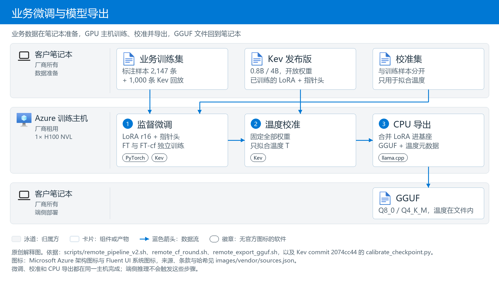
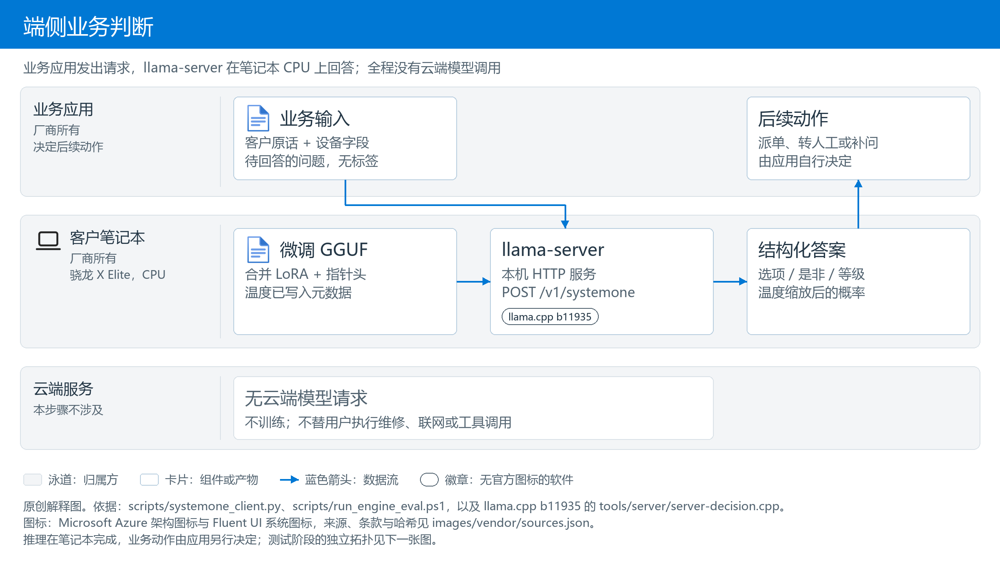
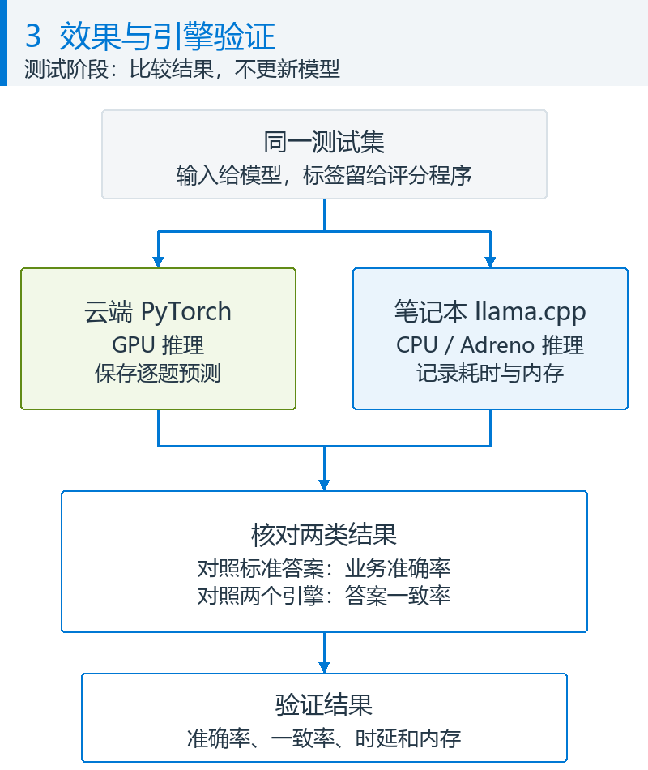

# 端侧决策模型：微调与推理优化

[English](README.md) | [中文](README_CN.md)

[](https://github.com/jaredpalmer/kev)
[](#5-笔记本端推理引擎)
[](#实现效果)
[](https://github.com/david-xinyuwei/david-share/blob/master/LICENSE)

> **作者**: 魏新宇 (Xinyu Wei) — 微软 AI GBB 高级系统工程师

[目的](#目的) · [实现效果](#实现效果) · [操作步骤](#操作步骤)

## 目的

**专用决策模型（decision model）正在成为一类独立的模型**：TypeSafe 的托管模型 Jev、2026 年 9 月开源的 [Kev](https://github.com/jaredpalmer/kev)（10 月 1 日发布 1.0），以及 llama.cpp 当前版本已能服务的十来个同类模型。它们不生成文字，只在给定选项里选答案并给出概率：一次前向就完成路由、分诊、判级这类业务判断，比让聊天模型写一段再解析更快、更稳、更便宜。但如果这类模型只能放在云上，对边缘设备、离线场景和数据不出本地的客户并不友好。所以它要满足两点：

1. **能在本地运行**——笔记本的 CPU 和内存就要跑得动，不调用云端模型。
2. **能接入业务数据微调**——客户的规则、字段和术语要能训进模型，规则变了还能更新。

本项目用 Kev（基于 Qwen3.5 的开放权重决策模型，0.8B / 4B）验证这两点：在 GPU 主机上用业务数据微调，在骁龙笔记本上测准确率、时延和内存，并逐项测量量化、上下文长度、计算后端、提示词长度和模型规模这些推理优化杠杆的效果。**训练在 GPU 主机完成，日常推理留在笔记本，不调用云端模型。** 数据是 Contoso PC 模拟数据，不是真实客户数据；不含云端闭源模型对比，不作生产可用性承诺。

### 架构：训练与日常推理是两件事

全文比较四种做法，名字先在这里定下：**B0** 是不训练的 Kev 发布版；**B0-policy** 是同一个发布版，但把厂商规则全文写进每个问题的提示词；**FT** 是用业务数据在发布版上做监督微调；**FT-cf** 是 FT 的数据再加"只改一个设备字段"的反事实变体。FT 和 FT-cf 都从同一个发布版出发、各自独立训练，最终推荐的是 FT-cf。

#### 1. 训练与导出：把业务数据变成模型文件

数据准备脚本在笔记本上运行。大模型 A/B 只帮助生成模拟原话，标签由业务规则代码计算；它们既不是被微调的 Kev，也不参与后续端侧推理。训练、校准和导出在 GPU 主机上完成，其中导出只使用该主机的 CPU，产物是一个 GGUF 文件——llama.cpp 使用的单文件模型格式，权重、分词器和元数据都在同一个文件里。



*原创解释图。训练集更新参数，独立校准集拟合概率的温度（把模型原始分数变成概率时的缩放系数，详见[第 3 节](#3-校准答案排名正确概率仍可能不准)）；笔记本最终接收的是 GGUF 模型文件。依据：[FT 流水线](scripts/remote_pipeline_v2.sh)、[FT-cf 流水线](scripts/remote_cf_round.sh)、[导出脚本](scripts/remote_export_gguf.sh)。*

#### 2. 端侧推理：模型文件变成一次业务判断

笔记本加载已导出的 GGUF。业务程序发送原话、设备信息和待回答的问题，模型返回结构化答案及概率。**这一步不训练，不调用云端模型，也不会替用户执行维修、联系人工客服或修改设备设置。**



*原创解释图。推理在笔记本完成，业务动作由应用另行决定。依据：[本机客户端](scripts/systemone_client.py)、[端侧运行入口](scripts/run_engine_eval.ps1)。测试阶段的独立拓扑见[测试方法](#测试怎么做的)。*

| 模型要求 | 本项目用什么验证 | 不能据此推出什么 |
|---|---|---|
| 业务判断准确 | 同一批数据上比较发布版、提示词加规则、微调与反事实增强微调，并检查少数类别和字段变化 | 模拟数据高分不等于真实业务准确率 |
| 响应快、资源占用低 | 笔记本上的单次请求耗时、模型文件大小、进程内存；另测 GPU 训练时间与显存 | 一台机器的一次运行不等于所有笔记本或并发场景 |
| 客户可持续迭代 | 业务数据生成与切分、微调、校准、评测、GGUF 导出与更新路径 | 本仓库没有实现线上自动学习或自动发布 |

### 为什么选择 Kev 作为候选

选择的是 **Kev 决策模型，0.8B 和 4B 版本基于 Qwen3.5**。它支持选择题、是非题和等级题，输出答案及概率，适合业务路由；不是以生成长篇回复为目标的聊天模型。选型看准确率、参数规模和开放权重三点。


*生产方原图：[Jared Palmer / Kev，What to Expect](https://github.com/jaredpalmer/kev/blob/2074cc44256200bb37540103fa4572901faa10f3/README.md#what-to-expect)，commit `2074cc44`，未修改。先看图例总准确率，再看知识题与规则题的差距。这是作者的公开评测，不是本仓库的厂商场景结果。*

| 模型（作者评测） | 基座标称参数规模 | transfer-v4 开发集准确率 | 权重与本项目范围 |
|---|---|---|---|
| Jev | 作者未披露 | 85.7% | TypeSafe 托管 API；本项目未测试 |
| Kev-27B | 27B | 85.1% | 开放权重；本项目未部署 |
| Kev-9B | 9B | 82.0% | 开放权重；本项目未部署 |
| Kev-4B | 4B | 81.7% | 开放权重；本项目微调并部署到端侧 |
| Kev-0.8B | 0.8B | 64.8% | 开放权重；本项目微调并部署到端侧 |

- **准确率：4B 用更小的规模接近托管参考模型，但并非第一。** 作者图中 Kev-4B 比 Jev 低 4.0 个百分点，Kev-0.8B 低 20.9 个百分点。图注共 764 条记录；本仓库复现时，公布的 0.8B / 4B 准确率对应其中 656 道原始题，另有 108 条变体。作者不知道 Jev 的训练数据，所以这不是受控对比，也不代表真实售后准确率。边界见[作者说明](https://github.com/jaredpalmer/kev/blob/2074cc44256200bb37540103fa4572901faa10f3/README.md)和[本仓库公开基线复现](验证结果/公开基线复现_20261027-123403)。
- **参数规模：用 0.8B 和 4B 验证准确率与端侧开销的取舍。** 作者建议准确率优先时从 4B 开始，尺寸更重要时用 0.8B。名称是标称规模，不是模型文件大小。GGUF 文件、进程内存和时延由[端侧实测](#5-笔记本端推理引擎)回答，不由参数量推算。
- **开放权重：可以下载、用业务数据微调，再导出到自己的设备。** [Kev 代码](https://github.com/jaredpalmer/kev/blob/2074cc44256200bb37540103fa4572901faa10f3/README.md#license)、[Kev-0.8B](https://huggingface.co/jaredpalmer/kev-0.8b)、[Kev-4B](https://huggingface.co/jaredpalmer/kev-4b)及相应 [Qwen3.5-0.8B-Base](https://huggingface.co/Qwen/Qwen3.5-0.8B-Base)、[Qwen3.5-4B-Base](https://huggingface.co/Qwen/Qwen3.5-4B-Base)采用 Apache-2.0。带标签 JSONL 通过 `--init_from` 从发布版继续微调（机制见下一节）。数据集仍需遵守各自许可证。

这些依据说明 Kev 值得验证，并不预先保证达到客户要求。FT 和 FT-cf 是从同一发布版分别训练的两种配方，**不是 FT → FT-cf 连续续训**；持续业务迭代是这套流程的使用方式，不是已经测过的长期运行结论。

### 核心技术：Kev 决策模型怎么微调

**决策模型和聊天模型的区别。** 聊天模型逐个生成文字；Kev 不生成文字。它把 Qwen3.5-Base 当只读编码器，在输入末尾拼上全部选项和一个 `<decide>` 标记，再用一个很小的**指针头**（pointer head）给每个选项打分，softmax 后就是各选项概率。一道 8 选 1 的题只需一次前向，答案不可能落在选项之外。

**监督微调（SFT）。** 损失就是正确选项上的交叉熵，没有强化学习，也没有附加损失项。

**哪些参数在动。** 基座冻结，只训练 LoRA 适配器（秩 16，挂在全部线性投影上）和指针头：0.8B 可训练 11.3M 参数，约占 1.4%；4B 为 33.8M，约 0.8%。

**在发布版上续训，不是从基座重训。** `--init_from` 先加载 Kev 发布版已训好的 LoRA 和指针头，再学厂商规则这部分差量；学习率因此压到 2e-5，是从头训练默认值的十分之一。

**防遗忘。** `--replay 1000` 把 1,000 条 Kev 原训练记录混进训练，防止模型只记得厂商数据；[第 2 节](#2-通用能力有没有丢)用 656 道公开题检验效果。

**FT-cf：反事实增强。** 原话不变，只改一个设备字段（地区、保修类型、购买天数等），让规则代码重算标签，逼模型读字段而不是只读原话；训练集从 2,147 条增加到 3,832 条。它和 FT 都从发布版独立训练，不是 FT 之后再续训。

**温度校准单独一步。** 训练完冻结权重，只在校准集上拟合一个标量 T，并随 GGUF 元数据带到端侧。它不改答案排序，只改概率的"尖"与"平"。详见[第 3 节](#3-校准答案排名正确概率仍可能不准)。

*机制细节与证据*：指针头是两个 256 维线性层 q、k，选项 i 的分数 `z_i = k(h_opt_i) · q(h_decide) / 16`，q 读 `<decide>` 位置、k 读各选项结尾 `</opt>` 位置的隐状态；损失 `F.cross_entropy(z, label)`，优化器 AdamW、OneCycleLR、梯度裁剪 1.0；LoRA alpha 32、dropout 0.05，`--lora_targets all` 覆盖注意力、前馈和 Qwen3.5 DeltaNet 层的全部投影。训练日志：`delta: warm start … 372 lora tensors and the pointer head load`、`trainable params=11.3M`（4B 为 33.8M）、`replay: 1000 of 12576 suite training records mixed with 2147`。源码 [kev/model.py](https://github.com/jaredpalmer/kev/blob/2074cc44256200bb37540103fa4572901faa10f3/kev/model.py)、[kev/train.py](https://github.com/jaredpalmer/kev/blob/2074cc44256200bb37540103fa4572901faa10f3/kev/train.py)（commit `2074cc44`），本次 [training_config.json](验证结果/微调评测_20261027-220226/runs/0.8b/ft/training_config.json)。

**本次训练配方一览**（0.8B FT；4B 与 FT-cf 只有 micro-batch 和数据文件不同）：

| 配置项（`kev.train` 参数） | 本次取值 | 含义 |
|---|---|---|
| `--init_from` | `jaredpalmer/kev-{0.8b,4b}@v1.0` | 从发布版的 LoRA 和指针头续训（delta 模式） |
| `--lora` / `--lora_targets` | 16 / `all` | LoRA 秩 16（alpha 32），覆盖注意力、前馈和 DeltaNet 的全部线性投影 |
| `--head_dim` | 256 | 指针头 q、k 的输出维度 |
| `--lr` / `--head_lr` | 2e-5 / 0（0 表示与 `--lr` 相同） | LoRA 与指针头的学习率 |
| `--epochs` / 有效 batch | 2 / 8（0.8B FT 为 1 × 8，其余为 4 × 2） | 每条记录看 2 遍；每 8 条更新一次参数 |
| `--replay` | 1,000 | 混入 1,000 条 Kev 原训练记录防遗忘 |
| `--dtype` / `--weights_dtype` | bf16 / fp32 | bf16 自动混合精度前向，fp32 主权重 |
| `--max_state` | 768 | 每条记录的状态部分最多 768 token |
| `--checkpointing` | 1 | 梯度检查点：省显存，换更多计算 |
| `--seed` | 1 | 只跑了一个随机种子 |
| `ord_w`、`perm_kl`、`brier_w`、`focal_gamma`、`anchor_w` | 0 | 纯交叉熵，没有附加损失项 |

### 核心技术：笔记本上怎么跑

**llama-server 是什么。** llama.cpp 是一个 C/C++ 推理引擎，`llama-server` 是它自带的本机 HTTP 服务。本项目用官方 b11935 Windows ARM64 包，不改代码；这个版本认得 GGUF 里的决策模型标记，把 Kev 当决策模型服务，而不是文本生成模型。

**GGUF 里装的是什么。** 一个文件，四样东西：合并了 LoRA 的基座权重（所以启动时不需要 `--lora`）；指针头；三类题型的校准温度；分词器。0.8B FT-cf 的文件大小：BF16 原始 1,437 MiB，Q8_0 量化后 764 MiB，Q4_K_M 517 MiB。

**Q8_0 和 Q4_K_M 是什么。** 都是 llama.cpp 的分块整数量化：Q8_0 每个权重 8 bit，几乎无损；Q4_K_M 主体 4 bit，精度更低。本项目导出 Q4_K_M 时把注意力、DeltaNet、指针头和输出层保留为 8 bit，只压前馈层，比 llama.cpp 默认配比更保守。实测效果见[第 5 节](#5-笔记本端推理引擎)。

**`/v1/systemone` 是决策接口，不是聊天补全。** 一次请求 = 客户原话 + 设备字段 + 几道题；返回每道题的答案和概率，不生成任何 token（`usage.output_tokens` 恒为 0）。概率已按 GGUF 内的温度缩放。接口遵循 TypeSafe System One API，不支持流式。字段细节看下面这次本机真实请求与响应的摘录，完整文件见[本机试用记录](验证结果/本机试用_20261028-201046/support-us/result.json)：

```jsonc
// request (excerpt): what the business application sends
{"state": {"channel": "email",
           "message": "您好：我的AuraBook Pro 16有好几个按键突然失灵了，电脑没有摔过，也没有进过水。……",
           "device": {"product_line": "AuraBook Pro 16", "region": "US", "warranty_plan": "Premium Care 3Y",
                      "days_since_purchase": 731, "battery_cycles": 667, "last_error_code": "none", "bios_version": "1.18"}},
 "questions": {"queue": {"type": "choice", "instructions": "Which Contoso support queue should take this case?",
                         "criteria": {"remote_l1": "Remote software support: drivers, Windows, Contoso apps and settings",
                                      "depot_repair": "Mail-in repair at a Contoso service center",
                                      "onsite_repair": "A technician visits the customer", "...": "5 more options"}},
               "onsite_eligible": {"type": "noul", "instructions": "Is the customer entitled to an onsite technician visit for this case?"},
               "urgency": {"type": "score", "instructions": "How urgently must Contoso respond?",
                           "criteria": ["Can wait", "Within this week", "Today", "Immediately: safety or data-loss risk"]}}}
// response (excerpt, probabilities rounded to 3 decimals): client_latency_ms = 783.8
{"model": "contoso-kev-0.8b-ftcf",
 "answers": {"queue": {"type": "choice", "choice": "sales_ops",
                       "probabilities": {"sales_ops": 0.423, "depot_repair": 0.313, "onsite_repair": 0.262, "remote_l1": 0.001, "...": "..."},
                       "confidence": 0.341},
             "onsite_eligible": {"type": "noul", "noul": 0.286},
             "urgency": {"type": "score", "score": 1.000,
                         "legend": {"0": "Can wait", "1": "Within this week", "2": "Today", "3": "Immediately: safety or data-loss risk"},
                         "probabilities": {"0": 0.000, "1": 1.000, "2": 0.000, "3": 0.000}, "confidence": 1.000}},
 "usage": {"input_tokens": 500, "output_tokens": 0}}
```

**启动参数逐项**（对应操作步骤 A1 的命令；默认值来自 [llama-server b11935 文档](https://github.com/ggml-org/llama.cpp/blob/b11935/tools/server/README.md)，实测数值来自[第 5 节](#5-笔记本端推理引擎)）：

| 启动参数 | 本次取值 | 作用 | 改了会怎样 |
|---|---|---|---|
| `-m` / `--alias` | 微调 GGUF 路径 / `contoso-kev-0.8b-ftcf` | 加载的模型文件 / API 响应里报告的模型名 | 换文件即换模型；别名只影响响应里的 `model` 字段 |
| `--host` / `--port` | `127.0.0.1` / `8080` | 只监听本机回环地址 | 改成 `0.0.0.0` 会暴露到网络，本项目不建议 |
| `-c`（`--ctx-size`） | 8192 | 每个槽位的上下文 token 上限（默认 0 = 读模型值） | 决定内存。本项目输入约 500 token，压到 2048 后提交内存 5,014 → 2,119 MiB，准确率不变，工单单次决策 669 → 1,163 毫秒 |
| `-b`（`--batch-size`） / `-ub`（`--ubatch-size`） | 2048 / 2048 | 一次送入模型的逻辑 / 物理批大小（默认 2048 / 512） | 越大一次处理的 token 越多、临时内存越大；`-ub 512` 是省内存配置的一部分 |
| `-ngl`（`--gpu-layers`） | 0 | 放到 GPU 的层数（默认 auto） | 0 = 全在 CPU。Adreno OpenCL 版用 99 全放 GPU，本机实测更慢 |
| `--cache-ram` | 0 | 提示词缓存上限 MiB（b11935 默认：普通模型 8192，决策模型 0） | 显式写 0，每次请求重新计算，结果可复现 |
| `--offline` | 开 | 禁止联网下载模型 | 只用本地文件 |
| `-np`（`--parallel`） | 未指定（auto；本机日志 `n_slots = 4`） | 并行槽位数 | 本项目一次一条请求，没有测并发 |
| `--temp` 等采样参数 | 不用 | 文本生成的采样设置 | 决策接口不生成文本；概率温度来自 GGUF 元数据，不是 `--temp` |

**为什么跑 CPU，不跑 GPU 或 NPU。** Adreno GPU 走 OpenCL 版实测比 CPU 慢（0.8B FT 工单中位数 1,035 对 669 毫秒），还多占约 3,400 MiB 共享显存；Hexagon NPU 没有测，Windows 上需要打开驱动测试签名，公司电脑上没有做。所以推荐配置是 Q8_0 + CPU，12 线程。

*机制细节与证据*：b11935 读 GGUF 元数据 `qwen35.decision.type = kev`（启动日志 `decision model type: kev`、`n_threads = 12`）；转换器 `convert_hf_to_gguf.py` 日志 `detected Kev checkpoint` / `Model architecture: KevModel`，指针头存为张量 `cls.output.weight`（1024 × 512，q、k 两个 256 维投影拼接）和 `cls.output.bias`，温度存为 `qwen35.decision.temperature.{choice,score,noul}`（0.8B FT-cf 三项都是 1.1487）；Q8_0 平均 8.52 bit/权重、Q4_K_M 5.76 bit/权重，Q4_K_M 用 `--pure` 加 `--tensor-type` 把 `attn_`、`ssm_`、`cls`、`output.weight` 固定为 q8_0。请求字段：`state` 可以是 JSON 对象，每题有 `type`（`choice` / `noul` / `score`）、`instructions`、`criteria`，各题独立作答。来源：[转换与量化日志](验证结果/微调评测_20261027-220226/gguf/0.8b-cf)、[导出脚本](scripts/remote_export_gguf_cf.sh)、[llama-server b11935 文档](https://github.com/ggml-org/llama.cpp/blob/b11935/tools/server/README.md)。

### 用什么场景验证

售后工单和助手路由是两种验证载体，不是全部业务需求。它们同时需要理解用户原话，并使用设备字段套用业务规则。

| 场景 | 模型读到什么 | 要回答的问题 |
|---|---|---|
| 售后工单分诊 | 客户原话 + 设备档案（产品线、地区、保修类型、购买天数、电池循环、诊断代码） | 分派到哪个队列（8 选 1）、能否上门维修（是/否）、紧急度（4 级） |
| 端侧助手意图路由 | 用户原话 + 设备状态（网络、是否企业管理、电源与电量、前台应用） | 调用哪个工具（14 选 1）、是否只在本机处理（是/否）、执行前是否要用户确认（是/否） |

难点在于很多答案取决于原话里没有写的字段。同一句"铰链松了"：保修类型是 Premium Care 3Y、地区在中日德美、仍在保修期内，就该派上门维修；换成新加坡或过了保修期，就该寄修或付费报价。发布版 Kev 不知道这些厂商规则。

本仓库回答四个问题：

1. **微调**：用厂商数据在 Kev 发布版上续训，能不能调好。
2. **性能**：比不训练、比把规则写进提示词好多少；置信度能否用来决定"自动处理还是转人工"；通用能力有没有丢。
3. **资源**：训练要多少 GPU 时间和显存；笔记本上模型多大、占多少内存、一次决策多久。
4. **推理引擎**：llama.cpp 能否在骁龙 X Elite 笔记本上运行微调后的模型，结果是否与 PyTorch 一致。

## 实现效果

### 测试怎么做的

**比较对象**（同一批记录、同一个评测程序 `kev.benchmark`）：

| 名称 | 做法 |
|---|---|
| B0 | 发布版 Kev（`jaredpalmer/kev-{0.8b,4b}@v1.0`），问题描述只有一句话，不训练 |
| B0-policy | 同一个发布版，把厂商策略全文写进每个问题的描述（工单场景每条记录的问题部分从约 950 字符变成约 4,600 字符） |
| FT | 在发布版上续训，方法是监督微调（SFT）：损失是每道题正确选项上的交叉熵，没有用强化学习（[训练配置](验证结果/微调评测_20261027-220226/runs/0.8b/ft/training_config.json)里其他损失项的权重都是 0）。LoRA r16 + 指针头，2 个 epoch，lr 2e-5，有效 batch 8，bf16，seed 1；混入 1,000 条 Kev 原训练集防遗忘；在校准集上拟合温度 |
| FT-cf | FT 的数据再加"反事实"变体：训练原话不变，只改一个策略字段，标签由规则代码重算（训练集 2,147 → 3,832 条）。因为 FT 在"只改一个字段"的配对题上大多答不对才加了这一轮，选择规则在结果出来前写进了[实验协议](文档/%5BNOTES%5D_实验协议_20261027-124000.md) |

**测试数据**（标签全部由策略代码计算，原用例和它的字段变体按组放在同一切分）。组隔离不保证不同用例生成的短文本绝不重复：助手测试集有 19 条原话与训练集相同，报告另给去掉这些记录后的对照。

| 测试集 | 记录 / 题数 | 原话由谁写 | 用途 |
|---|---|---|---|
| 工单·同分布、助手·同分布 | 170 / 510，159 / 477 | 大模型 A（与训练集同一个模型） | 主要结果 |
| 工单·分布外、助手·分布外 | 337 / 1,011，317 / 951 | 大模型 B（另一家厂商的模型）；新加坡、离线、按流量计费网络更多，一条消息里说两件事 | 换生成模型、换字段分布后是否还有效 |
| 工单·测试变体、助手·测试变体 | 126 / 378，70 / 210 | 测试集原话不变，只改一个策略字段 | 模型是否真的按字段套用规则 |
| Kev transfer-v4 开发集 | 656 题 | Kev 作者的公开题 | 通用能力有没有丢 |

一条工单测试记录（选项说明有删节）：模型看到的是 `state`，`label` 由策略代码根据设备档案算出，模型看不到。

```json
{"state": {"channel": "email",
           "message": "您好：\n请问我的 Contoso Nimbus 2-in-1 订单目前是什么状态？麻烦告知最新进度。\n谢谢\n李明",
           "device": {"product_line": "Nimbus 2-in-1", "region": "SG", "warranty_plan": "Accidental Damage 2Y",
                      "days_since_purchase": 749, "battery_cycles": 202, "last_error_code": "none", "bios_version": "1.11"}},
 "questions": {"queue": {"type": "choice", "instructions": "Which Contoso support queue should take this case?", "label": "sales_ops"},
               "onsite_eligible": {"type": "noul", "label": false},
               "urgency": {"type": "score", "label": 0}}}
```

目的里的两张图是客户上线后的样子；下面这张图只描述我们怎么测：同一测试集同时走 PyTorch 和笔记本两条路，PyTorch 路径和标准答案只在测试阶段存在，客户日常推理不需要它们。



*原创解释图。模型准确率与两个引擎的答案一致率是不同指标。PyTorch 评测在 H100 VM 上，llama.cpp 评测和请求计时在骁龙笔记本上；依据：[训练评测流水线](scripts/remote_pipeline_v2.sh)、[端侧评测](scripts/run_engine_eval.ps1)、[逐题比对](scripts/parity.py)。这是一条测试链，不是用户日常推理的依赖。*

以下为 **2026-10-27 的历史评测**，与后面的本机单条试用分开记录。

**测量点**：

| 数字 | 在哪测 | 从哪里算到哪里 | 不包含 |
|---|---|---|---|
| 准确率、Brier、ECE、可自动处理比例 | GPU VM，`kev.benchmark --device cuda` | 一条记录的每道题各算一次，按题汇总 | 时延 |
| 配对差值的 95% 区间 | 笔记本，`summarize_results.py`（按原话分组重抽样 10,000 次）；协议指定的 `kev.compare`（宏平均）另列 | 同一批题上两个做法的差 | 换随机种子带来的波动 |
| 训练时间 | GPU VM，bash `$SECONDS` | 训练进程启动 → 检查点保存完毕（含加载基座和发布版检查点） | 校准、评测 |
| 训练显存 | GPU VM，`nvidia-smi` 每 2 秒采样的最大值；kev 记录的 PyTorch 分配峰值 | 训练进程运行期间 | — |
| 端侧单次决策时延 | 笔记本，`systemone_client.py` → `127.0.0.1:8080` | 客户端发出一条记录 → 收到该记录 3 道题的全部答案；一次一条，不并发 | 前 2 条预热请求、模型加载 |
| 端侧内存 | 笔记本，测完后读 `llama-server` 进程计数器 | 峰值工作集（实际占用的物理内存）、提交内存（向系统申请的内存） | — |
| 与 PyTorch 一致率 | 笔记本，`parity.py` | 同一测试文件逐题比较答案和概率 | — |

### 1. 同一批问题：微调前后

**客户首先看三件事：业务题更准了吗，新问题还能答对吗，笔记本运行代价变了吗。** 下列主表固定比较同一规模的发布版与最终推荐微调版 FT-cf（业务数据加字段变体增强），不按指标临时挑选表现最好的模型。提示词加规则和第一版 FT 是实验对照，不混入主表的“微调前／后”。

前两张表的准确率来自同一条 H100 NVL / PyTorch 评测路径；第三张表测的是笔记本 CPU 的耗时和内存。两种测量位置分别标明，不能把 PyTorch 准确率当成量化模型的端侧准确率，完整端侧结果见[第 5 节](#5-笔记本端推理引擎)。

**准确率与泛化的前后列使用同一批问题、相同选项、相同标准答案和相同简短问题描述。** 工单与助手是两个不同任务，各自在同一测试集内比较。泛化表采用没有进入权重训练的分布外题，不是拿训练题验收；它更换了原话生成模型和字段分布，仍是模拟业务，不代表真实客户生产准确率。逐请求哈希与逐题标签来自[原始评测记录](验证结果/微调评测_20261027-220226/runs)。

<!-- TABLE:README_ACC -->
**准确率：同一批业务测试题**

| 参数规模 | 测试集（题数） | 微调前准确率：发布版 | 微调后准确率：最终方案 | 提升（百分点） |
|---|---|---|---|---|
| 0.8B | 工单·同分布（510 题） | 44.7% | 86.9% | +42.2 |
| 0.8B | 助手·同分布（477 题） | 67.1% | 97.5% | +30.4 |
| 4B | 工单·同分布（510 题） | 60.8% | 95.9% | +35.1 |
| 4B | 助手·同分布（477 题） | 81.8% | 99.8% | +18.0 |

**泛化能力：同一批分布外新问题**

| 参数规模 | 测试集（题数） | 微调前准确率：发布版 | 微调后准确率：最终方案 | 提升（百分点） |
|---|---|---|---|---|
| 0.8B | 工单·分布外（1,011 题） | 43.0% | 82.5% | +39.5 |
| 0.8B | 助手·分布外（951 题） | 65.7% | 94.4% | +28.7 |
| 4B | 工单·分布外（1,011 题） | 60.7% | 91.4% | +30.7 |
| 4B | 助手·分布外（951 题） | 81.9% | 98.8% | +16.9 |
<!-- /TABLE:README_ACC -->

**性能：同一台笔记本、同一批请求，比较耗时和内存**

两侧均为骁龙 X Elite X1E80100、llama.cpp b11935 CPU，参数 `-c 8192 -b 2048 -ub 2048 --cache-ram 0`。0.8B 两侧均用 Q8_0，4B 两侧均用 Q4_K_M；不同规模之间不作性能归因。每侧均完成 170 条工单请求和 159 条助手请求，每条回答 3 道题；请求时延排除模型加载及预热，内存是整轮进程的峰值工作集。

<!-- TABLE:README_PERFORMANCE -->
| 固定模型配置 | 性能指标（单位） | 微调前测量值：发布版 | 微调后测量值：最终方案 |
|---|---|---|---|
| 0.8B / Q8_0 / CPU | 工单请求耗时中位数（毫秒） | 666 | 646 |
| 0.8B / Q8_0 / CPU | 助手请求耗时中位数（毫秒） | 843 | 984 |
| 0.8B / Q8_0 / CPU | 进程峰值工作集（MiB） | 2,323 | 2,314 |
| 4B / Q4_K_M / CPU | 工单请求耗时中位数（毫秒） | 3,022 | 3,615 |
| 4B / Q4_K_M / CPU | 助手请求耗时中位数（毫秒） | 3,790 | 4,751 |
| 4B / Q4_K_M / CPU | 进程峰值工作集（MiB） | 6,849 | 6,842 |
<!-- /TABLE:README_PERFORMANCE -->

数据依据是[端侧原始运行记录](验证结果/端侧引擎_20261027-124700)，不是 GPU 上的评测耗时。案例编号、顺序、标准答案、输入 token 数和记录中的核心参数已配对核对；旧端侧记录没有逐请求内容哈希，因此不能把这项核对说成请求字节的独立证明。每个配置只跑一次，不同运行间存在波动：**本次能说明准确率改善，不证明微调使推理加速，也不能把全部耗时差归因于微调。**

#### 实验分析：完整方案与剩余错误

发布版、提示词加规则、第一版 FT、最终 FT-cf 的完整矩阵保留在[报告 3.1](文档/微调与端侧验证报告_20261027-130700.md#31-准确率微调前后对比)；字段变体矩阵保留在[报告 3.3](文档/微调与端侧验证报告_20261027-130700.md#33-规则跟随只改一个设备字段答案会不会跟着变)。这些对照解释方案为何这样选择，不替代上面的同题前后比较。字段变体统计的是答案确实随字段改变的题，工单 172 题、助手 72 题。

- **两个尺寸在本次模拟业务测试上都提高了准确率。** 四个测试集上，FT 比 B0 高 14.7–41.8 个百分点（按题计），每一项的 95% 区间下界都大于 0；FT-cf 又比 FT 高 0.4–4.0 个百分点，其中 0.8B 工单两个测试集的 95% 区间包含 0。区间和协议指定的 `kev.compare` 口径见[报告 3.1](文档/微调与端侧验证报告_20261027-130700.md#31-准确率微调前后对比)。
- **把规则写进提示词（B0-policy）远不如微调。** 它比 FT 低 10.5–30.2 个百分点，在 0.8B 助手分布外测试集上还比不加更低（63.6% 对 65.7%）。
- **FT 的短板是"按字段套规则"，FT-cf 补上了大部分。** 只看答案因字段改变的题，0.8B 从 FT 的 48.3% / 48.6% 提到 57.6% / 81.9%，4B 从 72.1% / 86.1% 提到 84.9% / 100.0%。按字段拆开（0.8B，测试变体与分布外变体合计），购买天数 41.9%、地区 36.2%、电池循环次数 49.2%，仍不到一半；详见[报告 3.3](文档/微调与端侧验证报告_20261027-130700.md#33-规则跟随只改一个设备字段答案会不会跟着变)。
- **选择规则在结果出来前写定**：FT-cf 在开发集变体上比 FT 准，且开发集原题准确率下降不超过 1 个百分点。两个尺寸都满足：开发集变体（全部题）0.8B 从 78.9% / 82.9% 到 82.2% / 92.8%，4B 从 89.1% / 96.4% 到 95.9% / 100.0%；开发集原题都没有下降。

### 2. 通用能力有没有丢

这是与上面业务泛化不同的问题：微调业务之后，原有通用任务是否退化。每个前后对比都使用相同的 656 道 Kev 公开题；保留 FT 和 FT-cf 两种配方，主结果对应 FT-cf 行。

<!-- TABLE:PUBLIC -->
| 模型与训练方案 | 通用题数 | 发布版准确率 | 微调后准确率 | 变化（百分点） |
|---|---|---|---|---|
| 0.8B FT | 656 | 64.8% | 64.8% | 0.0 |
| 0.8B FT-cf | 656 | 64.8% | 64.8% | 0.0 |
| 4B FT | 656 | 81.7% | 80.9% | -0.8 |
| 4B FT-cf | 656 | 81.7% | 82.6% | +0.9 |

**通用题的置信度：Brier 越低越好**

| 模型与训练方案 | 发布版 Brier | 微调后 Brier |
|---|---|---|
| 0.8B FT | 0.430 | 0.560 |
| 0.8B FT-cf | 0.430 | 0.574 |
| 4B FT | 0.243 | 0.299 |
| 4B FT-cf | 0.243 | 0.269 |
<!-- /TABLE:PUBLIC -->

- **未触发预设的遗忘判定线。** 协议的判定线是下降超过 2 个百分点。0.8B 的 FT 和 FT-cf 都是 64.8%，与发布版相同：逐题看，FT 有 20 题从错变对、20 题从对变错，FT-cf 是 22 题和 22 题，正好抵消。4B 的 FT 从 81.7% 降到 80.9%（656 题里少对 5 题），FT-cf 升到 82.6%（多对 6 题），都没有触发。这不等于每个通用任务的能力不变。
- **通用题上的置信度变差了。** 微调后的温度是按厂商校准集拟合的（0.8B 从发布版的 2.35 变成 1.26），概率更"尖"，Brier 随之变差。用发布版温度 2.35 重算，0.8B FT 的 Brier 是 0.490，仍比发布版的 0.430 差，说明微调本身也让通用题上的置信度略有变差。4B 也一样：FT（温度 1.66）的 Brier 从 0.243 变成 0.299，FT-cf（温度 2.35）是 0.269。同一个模型如果还要处理厂商业务以外的通用决策，应在混合数据上校准温度。

### 3. 校准：答案排名正确，概率仍可能不准

**微调学习选哪个答案；校准调整这些答案的概率。** 模型先产生原始分数（logits，即上一节指针头输出的 z），再用 `softmax(logits / T)` 得到概率。温度 T 是无量纲的正数，不是准确率或业务阈值。训练好了以后，可以固定全部模型权重，只重新拟合 T，不需要把模型原样重训一遍。

校准数据提供“输入、问题、候选项、正确标签”，不需要每个选项的标准概率。这里的标签由厂商规则代码生成，大模型只生成模拟原话，不充当校准裁判。训练集用于更新权重，开发集用于选方案，校准集用于拟合 T，未参与选择的测试数据用于验收。线上推理只使用保存好的 T，不重新拟合。

例如，三个选项在 T = 1 时为 80% / 10% / 10%，T = 2 时约为 58.6% / 20.7% / 20.7%；这是数学示例，不是实测。正 T 保持同题的选项排名，因此不能纠正排错的第一名。它会改变概率，也可能改变等级期望值或是否跨过业务阈值。概率合计 100% 只说明归一化，不说明它们可信；单题答错也不等于整体校准失效。

本次 0.8B FT-cf 用 **984 道校准题**拟合 T，日志显示约 1.15；拟合集准确率保持 93.0%，ECE 从 0.011 变为 0.008。五折交叉验证的 ECE 差值区间包含零，**不能宣称显著改善**。121 个候选 T 只对已保存的分数重算概率并比较平均 NLL，不是训练 121 次。完整例子、实际命令和原始证据见[报告第 3.4 节](文档/微调与端侧验证报告_20261027-130700.md#calibration-guide)。

**给客户用的是内置校准参数的 GGUF。** 引擎加载文件后使用其中的温度；客户不需要校准服务。是否补问或转人工要由业务应用实现，本仓库没有自动接管或模型兜底。若答案能力不足，应针对数据与错误改进训练，而不是只调 T；若只是概率偏差，走[仅更新校准参数](#calibration-update)。

### 4. 训练要多少资源

<!-- TABLE:TRAIN -->
**训练配方：每个配置运行一次，有效 batch 均为 8**

| 模型与训练方案 | micro-batch × accum | 训练记录（2 个 epoch 合计） | 优化步数 |
|---|---|---|---|
| 0.8B FT | 1 × 8 | 6,294 | 788 |
| 0.8B FT-cf | 4 × 2 | 9,664 | 1,208 |
| 4B FT | 4 × 2 | 6,294 | 788 |
| 4B FT-cf | 4 × 2 | 9,664 | 1,208 |

**训练消耗：1 张 H100 NVL，时间包含模型加载与保存**

| 模型与训练方案 | 墙钟时间 | 整卡显存峰值（nvidia-smi） | PyTorch 分配峰值 | 校准温度 |
|---|---|---|---|---|
| 0.8B FT | 26.9 分钟 | 4,555 MiB | 3,460 MiB | 1.26 |
| 0.8B FT-cf | 11.6 分钟 | 7,573 MiB | 5,326 MiB | 1.15 |
| 4B FT | 15.7 分钟 | 33,359 MiB | 22,581 MiB | 1.66 |
| 4B FT-cf | 20.1 分钟 | 26,215 MiB | 22,641 MiB | 2.35 |
<!-- /TABLE:TRAIN -->

- 0.8B 的 FT 用 micro-batch 1 训了约 27 分钟；FT-cf 使用 micro-batch 4，训练记录多了 54%，用时约 12 分钟。由于数据和 micro-batch 同时变化，不能把全部时长差归因于单个参数。同样使用 micro-batch 4、训练 9,664 条记录时，4B FT-cf 用时 20.1 分钟，0.8B 用时 11.6 分钟。有效 batch 都是 8。
- nvidia-smi 这里记录整卡显存，可能包括框架缓存和其他进程，并非仅当前进程的张量；PyTorch 分配峰值也不代表全部运行开销。4B 两次训练的 PyTorch 分配峰值几乎相同（22,581 / 22,641 MiB），整卡峰值却相差 7,144 MiB。缓存可能是原因，但这些采样不足以证明归因，选卡不能只看张量分配量。
- **显存不够时用 micro-batch 1。** 同一配方（bf16、梯度检查点、`max_state 768`）改成 micro-batch 1 × accum 8，在原话加设备档案最长的 64 条厂商训练记录上训 8 步（GPU 上没有其他进程）：nvidia-smi 峰值 0.8B 4,213 MiB、4B 18,547 MiB，PyTorch 分配 3,365 / 17,375 MiB。这次探测没有混入 Kev 原训练集记录；0.8B 正式训练同样用 micro-batch 1，PyTorch 峰值 3,460 MiB，比探测高约 3%，按探测值选卡要留余量。
- 按这台 VM 的列表价每小时 9.07 美元（Azure Retail Prices API，Spain Central，2026-10-27；订阅的实际折扣价没有核对），一次 0.8B 训练约 1.8–4.1 美元，一次 4B 训练约 2.4–3.0 美元。

### 5. 笔记本端推理引擎

测试机：骁龙 X Elite X1E80100（12 核），64 GB 内存，Adreno X1-85 GPU（驱动 31.0.133.1），Windows 11 企业版；llama.cpp b11935 官方 Windows ARM64 发布包（CPU 版、Adreno OpenCL 版）。

<!-- TABLE:ENGINE -->
**准确率与引擎一致率**

| 模型、量化与运行参数 | 工单准确率：端侧（PyTorch） | 助手准确率：端侧（PyTorch） | 工单答案一致率：端侧对 PyTorch | 助手答案一致率：端侧对 PyTorch |
|---|---|---|---|---|
| 发布版 0.8B<br>Q8_0 · CPU，默认参数 | 45.7%（44.7%） | 66.9%（67.1%） | 97.6% | 99.0% |
| 发布版 0.8B<br>Q8_0 · CPU，默认参数，提示词含策略全文（B0-policy） | 60.6%（60.8%） | 71.7%（71.9%） | 98.6% | 99.8% |
| 发布版 0.8B<br>Q8_0 · Adreno GPU（OpenCL），默认参数 | 43.7%（44.7%） | 66.5%（67.1%） | 94.9% | 96.4% |
| 发布版 4B<br>Q4_K_M · CPU，默认参数 | 59.0%（60.8%） | 82.0%（81.8%） | 93.1% | 97.3% |
| 微调 FT 0.8B<br>Q4_K_M · CPU，默认参数 | 87.5%（86.5%） | 93.9%（93.5%） | 94.9% | 97.9% |
| 微调 FT 0.8B<br>Q8_0 · CPU，默认参数 | 86.5%（86.5%） | 93.5%（93.5%） | 99.2% | 99.6% |
| 微调 FT 0.8B<br>Q8_0 · CPU，-c 2048 -ub 512 | 86.5%（86.5%） | 93.5%（93.5%） | 99.2% | 99.6% |
| 微调 FT 0.8B<br>Q8_0 · Adreno GPU（OpenCL），默认参数 | 85.7%（86.5%） | 93.7%（93.5%） | 97.6% | 99.0% |
| 微调 FT-cf 0.8B<br>Q8_0 · CPU，默认参数 | 86.9%（86.9%） | 97.7%（97.5%） | 99.2% | 99.8% |
| 微调 FT-cf 4B<br>Q4_K_M · CPU，默认参数 | 95.3%（95.9%） | 99.6%（99.8%） | 98.2% | 99.8% |
| 微调 FT-cf 4B<br>Q8_0 · CPU，默认参数 | 96.1%（95.9%） | 99.8%（99.8%） | 99.4% | 100.0% |

**模型文件与进程内存**

| 模型、量化与运行参数 | 模型文件（MiB） | 峰值工作集（MiB） | 提交内存（MiB） |
|---|---|---|---|
| 发布版 0.8B<br>Q8_0 · CPU，默认参数 | 775 | 2,323 | 5,016 |
| 发布版 0.8B<br>Q8_0 · CPU，默认参数，提示词含策略全文（B0-policy） | 775 | 3,446 | 5,899 |
| 发布版 0.8B<br>Q8_0 · Adreno GPU（OpenCL），默认参数 | 775 | 4,118 | 5,809 |
| 发布版 4B<br>Q4_K_M · CPU，默认参数 | 2,893 | 6,849 | 7,497 |
| 微调 FT 0.8B<br>Q4_K_M · CPU，默认参数 | 528 | 1,819 | 4,766 |
| 微调 FT 0.8B<br>Q8_0 · CPU，默认参数 | 775 | 2,314 | 5,014 |
| 微调 FT 0.8B<br>Q8_0 · CPU，-c 2048 -ub 512 | 775 | 2,196 | 2,119 |
| 微调 FT 0.8B<br>Q8_0 · Adreno GPU（OpenCL），默认参数 | 775 | 4,105 | 5,801 |
| 微调 FT-cf 0.8B<br>Q8_0 · CPU，默认参数 | 775 | 2,314 | 5,014 |
| 微调 FT-cf 4B<br>Q4_K_M · CPU，默认参数 | 2,893 | 6,842 | 7,495 |
| 微调 FT-cf 4B<br>Q8_0 · CPU，默认参数 | 4,276 | 9,609 | 8,884 |

**单次请求时延**

| 模型、量化与运行参数 | 工单请求耗时中位数（毫秒） | 助手请求耗时中位数（毫秒） |
|---|---|---|
| 发布版 0.8B<br>Q8_0 · CPU，默认参数 | 666 | 843 |
| 发布版 0.8B<br>Q8_0 · CPU，默认参数，提示词含策略全文（B0-policy） | 4,353 | 2,435 |
| 发布版 0.8B<br>Q8_0 · Adreno GPU（OpenCL），默认参数 | 1,171 | 1,378 |
| 发布版 4B<br>Q4_K_M · CPU，默认参数 | 3,022 | 3,790 |
| 微调 FT 0.8B<br>Q4_K_M · CPU，默认参数 | 812 | 909 |
| 微调 FT 0.8B<br>Q8_0 · CPU，默认参数 | 669 | 822 |
| 微调 FT 0.8B<br>Q8_0 · CPU，-c 2048 -ub 512 | 1,163 | 1,184 |
| 微调 FT 0.8B<br>Q8_0 · Adreno GPU（OpenCL），默认参数 | 1,035 | 1,221 |
| 微调 FT-cf 0.8B<br>Q8_0 · CPU，默认参数 | 646 | 984 |
| 微调 FT-cf 4B<br>Q4_K_M · CPU，默认参数 | 3,615 | 4,751 |
| 微调 FT-cf 4B<br>Q8_0 · CPU，默认参数 | 3,649 | 4,115 |

没有跑完、不计入上表的运行：ft-kev-0.8b-Q8_0-cpu-ctx2048（support 144 条，无汇总）；ft-kev-4b-Q4_K_M-cpu（support 36 条，无汇总）。
<!-- /TABLE:ENGINE -->

#### 推理优化：测过哪些杠杆

下表把上面三张表里已测过的推理侧变量归纳到一起。每一行只改一个变量，数值直接取自上表（0.8B 用 FT 行，因为 FT 测了最多的配置）；"未测"是本次没有运行的组合，不是结论。每个配置只测一次，同结构模型两次运行的配对时延差可达 24%（见下面"单次运行的时延有波动"），所以 20% 以内的时延差不作结论。

| 优化杠杆 | 对照（基线 → 变化） | 准确率（工单 / 助手） | 工单单次决策中位数（毫秒） | 峰值工作集（MiB） | 一句话结论 |
|---|---|---|---|---|---|
| 权重量化 | 0.8B FT Q8_0 → Q4_K_M（CPU，默认参数） | 86.5% / 93.5% → 87.5% / 93.9% | 669 → 812 | 2,314 → 1,819 | 文件小 247 MiB、内存少 495 MiB，但没有更快；与 PyTorch 一致率从 99.2% / 99.6% 降到 94.9% / 97.9%。准确率高 1 个百分点是量化噪声恰好偏向正确答案，不是更好 |
| 权重量化 | 4B FT-cf Q8_0 → Q4_K_M（CPU，默认参数） | 96.1% / 99.8% → 95.3% / 99.6% | 3,649 → 3,615 | 9,609 → 6,842 | 文件小 1,383 MiB、内存少 2,767 MiB；工单准确率比 PyTorch 低 0.6 个百分点。4B 内存紧时可用 |
| 上下文与批大小 | 0.8B FT Q8_0 `-c 8192 -ub 2048` → `-c 2048 -ub 512` | 86.5% / 93.5% → 不变 | 669 → 1,163 | 2,314 → 2,196（提交内存 5,014 → 2,119） | 提交内存少 2,895 MiB，代价是工单慢 74%、助手慢 44%；准确率不变。输入只有约 500 token，8192 的上下文大部分没用上 |
| 计算后端 | 0.8B FT Q8_0 CPU → Adreno GPU（OpenCL，`-ngl 99`） | 86.5% / 93.5% → 85.7% / 93.7% | 669 → 1,035 | 2,314 → 4,105 | GPU 更慢，进程工作集多 1,791 MiB，另占约 3,400 MiB 共享显存，一致率降到 97.6% / 99.0%。这台机器上不选 GPU |
| 提示词长度 | 0.8B 发布版 Q8_0 简短描述 → 规则全文写进提示词（B0-policy） | 45.7% / 66.9% → 60.6% / 71.7% | 666 → 4,353 | 2,323 → 3,446 | 每条记录输入 token 中位数 488 → 1,505，慢 6.5 倍、内存多 1.1 GB；准确率仍远不如微调（FT-cf 86.9% / 97.7%）。规则该学进权重，不该每次放进提示词 |
| 模型规模 | 发布版 4B Q4_K_M → 微调 0.8B FT-cf Q8_0（都是 CPU 默认参数） | 59.0% / 82.0% → 86.9% / 97.7% | 3,022 → 646 | 6,849 → 2,314 | 不微调直接换大模型不如微调小模型：准确率高 27.9 / 15.7 个百分点，快 3.9–4.7 倍，内存约三分之一 |
| 并发请求 | 未测 | — | — | — | 本项目一次一条请求；`llama-server` 默认开 4 个槽位但没有压测 |
| NPU（Hexagon） | 未测 | — | — | — | Windows 上需要打开驱动测试签名，公司电脑上没有做 |
| 投机解码、KV 缓存复用 | 不适用 | — | — | — | 决策接口不生成 token，没有解码阶段；`--cache-ram 0` 关闭了提示词缓存 |

- **端侧跑的就是微调后的模型。** 转换器把 LoRA 合并进基座，并把校准温度写进 GGUF 元数据：0.8B FT 写入 1.2599、FT-cf 写入 1.1487，4B FT-cf 写入 2.3511，与各自校准得到的温度相同。
- **Q8_0 与 PyTorch 逐题几乎一致。** 0.8B FT 的 Q8_0 在 CPU 上的准确率与 PyTorch 相同：510 道工单题里 506 道答案一致，477 道助手题里 475 道一致。FT-cf 是 506 道和 476 道；唯一不同的那道助手题，两边概率都在 0.5 附近（0.528 对 0.572）。4B FT-cf 的 Q8_0 是 507 道和 477 道；不一致的 3 道工单题，两边所选答案的概率都只有 0.48–0.51，引擎多答对 1 道（96.1% 对 95.9%）。
- **推荐 Q8_0 + CPU；4B 内存紧时可用 Q4_K_M。** 理由见上表的量化、后端两行。
- **内存可以按场景压。** 默认参数（`-c 8192 -b 2048 -ub 2048`，4 个并行槽位）提交内存 5,014 MiB；改成 `-c 2048 -ub 512` 降到 2,119 MiB，准确率不变，单次决策变慢到约 1.2 秒。
- **把规则写进提示词在端侧更贵。** 每条记录输入 token 的中位数，工单从 488 变成 1,505，助手从 456 变成 813；一次决策工单 4.4 秒、助手 2.4 秒。
- **不微调直接换 4B，不如微调 0.8B。** 同在笔记本 CPU 上，发布版 4B Q4_K_M 的准确率 59.0% / 82.0%，比 FT-cf 0.8B Q8_0（86.9% / 97.7%）低 27.9 / 15.7 个百分点。单次决策时延中位数 3,022 / 3,790 毫秒，是 0.8B（646 / 984 毫秒）的 3.9–4.7 倍。峰值工作集 6,849 MiB，约是 0.8B（2,314 MiB）的 3 倍。
- **单次运行的时延有波动，20% 以内的差别不作结论。** 0.8B FT 和 FT-cf 结构相同、每条记录的输入 token 也相同；按同一条记录配对比较，FT-cf 在工单上快 53 毫秒、在助手上慢 166 毫秒（中位数，约 −8% 和 +20%）。每个配置只测了一次。0.8B Q4_K_M 与 Q8_0 的差（工单 +21%、助手 +11%）和这个波动同一量级；Adreno GPU（+49% 到 +76%）、`-c 2048 -ub 512`（工单 +74%、助手 +44%）和 B0-policy（2.9–6.5 倍）的差远大于它。
- **4B 的时延只看量级：一次决策约 3–5 秒。** 4B 的三次运行（发布版 Q4_K_M、FT-cf Q8_0、FT-cf Q4_K_M）输入 token 逐条相同；两两按同一条记录配对，时延中位数相差 7–24%，结构相同的发布版和 FT-cf Q4_K_M 也差 23–24%。FT-cf Q8_0 测到助手集第 139 条时笔记本进入待机 5.4 小时；中位数不受影响（含这一条 4,115 毫秒、去掉 4,113 毫秒），Q4_K_M 在恢复后测。所以 Q4_K_M 和 Q8_0 哪个更快，这次测不出来。

### 6. 需要什么硬件

| 环节 | 需不需要 GPU | 本次实测的硬件与占用（显存是 nvidia-smi 峰值） | 最低配置（按实测显存推算，没在这些卡上跑过） |
|---|---|---|---|
| 训练 0.8B | 需要 1 张 GPU（本次脚本用 NVIDIA CUDA） | H100 NVL；显存 4,555 MiB（micro-batch 1）、7,573 MiB（micro-batch 4） | 8 GB 显存（micro-batch 1） |
| 训练 4B | 需要 1 张 GPU（本次脚本用 NVIDIA CUDA） | H100 NVL；显存 18,547 MiB（micro-batch 1，只做了探测）、26,215–33,359 MiB（micro-batch 4） | 24 GB 显存（micro-batch 1）；micro-batch 4 要 40 GB 以上 |
| 转 GGUF | 不需要，只用 CPU | GPU 主机的 CPU | — |
| 笔记本推理 0.8B（Q8_0） | 不需要独立显卡或 NPU，用 CPU | 骁龙 X Elite 12 核；进程峰值工作集 2,314 MiB，提交内存 5,014 MiB（默认参数）或 2,119 MiB（`-c 2048 -ub 512`） | 整机内存按进程占用加上系统和其他程序来定 |
| 笔记本推理 4B FT-cf（Q8_0 / Q4_K_M） | 不需要独立显卡或 NPU，用 CPU | 骁龙 X Elite 12 核；进程峰值工作集 9,609 / 6,842 MiB，提交内存 8,884 / 7,495 MiB | 同上 |

- **4B 的 24 GB 怎么来的。** 4B 用 micro-batch 1 只在最长的 64 条训练记录上做了显存探测（18,547 MiB），没有正式训练过。0.8B 正式训练用 micro-batch 1 时，nvidia-smi 峰值比探测高约 8%（4,555 对 4,213 MiB）；按同样比例，4B 约需 20 GB，24 GB 的卡还剩约 4 GB。
- **本次配方用 bf16**（`--dtype bf16`），选卡时要确认支持 bf16。训练时间只在 H100 NVL 上测过（第 4 节），换显存小、算力低的卡会更慢，具体多久没测。
- **PyTorch 评测（`kev.benchmark`）也在 GPU 上跑，显存没有单独记录。** 端侧上线不需要这一步。
- **端侧没测 NPU；**Adreno GPU 比 CPU 慢（第 5 节）。

<a id="local-result"></a>

### 7. 本机实际试用：有返回，也要看答得对不对

2026-10-28（UTC-07:00），在骁龙 X Elite X1E80100、约 64 GB 内存的笔记本上，用 llama.cpp b11935 的 CPU 版加载 **0.8B FT-cf Q8_0**，通过 `127.0.0.1:8080/v1/systemone` 发送单条请求。服务启用 `--offline`；每条请求回答 3 道题，不额外预热，不调用其他模型。

[环境与模型哈希](验证结果/本机试用_20261028-201046/environment.public.json)确认加载的文件与历史 FT-cf 记录一致。3 条试用请求后采样的进程工作集为 2,288.6 MiB，提交内存为 4,988.7 MiB；这是本次进程采样，不替换前面的历史批量评测内存值。公开记录保留测量值，原始服务日志留在本地。

工单输入摘录：“我的AuraBook Pro 16有好几个按键突然失灵了，电脑没有摔过，也没有进过水。”设备为 Premium Care 3Y、购买 731 天。第二次保持其余输入完全相同，只把地区从 US 改成 SG。助手输入为：“帮我联系人工客服咨询保修。”完整无标签输入在 [data/contoso/examples](data/contoso/examples)。

| 试用请求 | 策略要求的结果 | 模型实际返回 | 本次单条请求耗时（毫秒） | 原始请求与响应 |
|---|---|---|---|---|
| 工单，地区 US | 上门维修；可以上门；紧急度 1 | `sales_ops`（订单/报价）；不可上门；紧急度最可能为 1。队列和上门资格错误 | 783.8 | [support-us/result.json](验证结果/本机试用_20261028-201046/support-us/result.json) |
| 同一工单，地区 SG | 寄修；不可上门；紧急度 1 | `sales_ops`；不可上门；紧急度最可能为 1。队列错误 | 617.2 | [support-sg/result.json](验证结果/本机试用_20261028-201046/support-sg/result.json) |
| 助手，联系人工客服 | `support_chat`；业务动作不是纯本地；不需先确认 | 三项与策略一致 | 774.2 | [assistant/result.json](验证结果/本机试用_20261028-201046/assistant/result.json) |

**本机调用已经成立，但 0.8B 在这组保修规则上仍不可靠。** 地区变化确实进入了请求，概率也发生变化，但队列没有正确改变。这里模拟的是业务场景，不是模型输出。助手返回“业务动作不是纯本地”，指联系人工客服这个后续动作；本次决策推理本身仍在本地，客户端没有真的联系人工客服。

这些输入复用了历史测试记录 `support-g1-11-00311` 和 `assistant-g1-12-00003`，不是新的独立质量评测。表中是单次客户端耗时，不是性能排名或时延保证。可用下面的[本机试用入口](#local-try)自行修改输入、复跑并观察错误。

### 这些结论的边界

- **数据是模拟的。** 规则、字段和客户原话都是为虚构厂商设计的，原话由大模型按事实清单生成，比真实客户的话更规整。真实数据上的绝对准确率会不同；本仓库能说明的是方法可行、提升的量级和资源需求。
- **每种做法只训练了一次（seed 1）。** 95% 区间只反映测试集抽样的不确定性，不包括换随机种子、换一批数据的波动。
- **温度用同分布的校准集拟合**（`calibrate_checkpoint.py --allow-in-distribution`，脚本会对这种用法给出警告）。分布外测试的 ECE 是这一选择的检验。
- **分布外助手测试缺一类。** 300 条用例中 13 条"应拒绝"类请求（绕过公司安全、登录他人账号），生成模型拒绝写原话，两轮重试仍失败。
- **端侧只测了一台笔记本、一次一条请求。** 没有测并发、发热降频、电池供电，也没有测 NPU。4B 只完整测了推荐的 FT-cf（4B FT 跑了 36 条后停止，不计入）；每个配置只测了一次，同结构模型两次运行的配对时延差可达 24%。

## 操作步骤

### 使用与部署顺序

| 你要做什么 | 从哪里开始 | 执行顺序 | 完成时看到什么 |
|---|---|---|---|
| 已有微调 GGUF，想在本机试用 | [A. 本机试用](#local-try) | 启动本机引擎 → 发送单条请求 → 修改字段再试 | 真实模型响应、本次耗时和原始结果文件 |
| 还没有微调模型，或要适配新业务 | [B. 训练与更新](#train-update) | 数据 → 训练 → 校准 → 评测 → 导出 → 更新本机模型 | 新版本检查点、评测结果和 GGUF；不是覆盖旧目录后继续跳过 |
| 要复核文中结论 | [C. 验证与复核](#verify) | 离线测试，或另行启动模型做完整端侧评测 | 明确区分代码检查、历史证据复核和新模型实跑 |

本页是操作命令的唯一入口；详细报告解释结果，实验协议保存原判定规则。下面均从 **本项目根目录（此 README 所在目录）** 执行。尚未获取代码时，可先克隆本仓库，再进入 `Deep-Learning/AIPC-Decision-Model-Finetune`。

<a id="local-try"></a>

### A. 本机试用微调模型

**前提**：Windows on Arm、PowerShell 7、Python 3.11+，以及一个已经训练并导出的 GGUF。不需要在笔记本安装 PyTorch、CUDA 或训练环境。微调权重没有发布在本仓库中：已有模型直接使用；没有模型时先完成 B，不能拿发布版权重代替并称作微调版。

从 [llama.cpp b11935 发布页](https://github.com/ggml-org/llama.cpp/releases/tag/b11935)取得 `llama-b11935-bin-win-cpu-arm64.zip`，SHA-256 为 `fe9db0136dd8f7e39240c90cd1c1107ff59a8ef27c5517472e9d2c4c0dc9511f`，解压到 `C:\Tools\llama.cpp\b11935-cpu\`。模型示例位置为 `C:\Tools\models\contoso-kev\`，可以改成自己的路径。其他 CPU 架构必须使用对应引擎，本次未验证其运行效果。

交付给客户时应包含以下内容，而不是让客户在笔记本上跑训练流水线：

- **已校准的模型文件**：如 `Contoso-Kev-0.8B-FTcf-Q8_0.gguf`，连同版本、SHA-256、数据适用范围及验收结果。温度已在 GGUF 内，不需要再传一个由客户手工填写的概率表。
- **匹配的运行时**：上面的 b11935 ARM64 CPU 包及随包 DLL。Python 只用于本仓库的调用客户端，不用于本机训练。
- **启动与调用约定**：执行 A1–A3，向 `/v1/systemone` 提交无标签业务输入，读取结构化答案和概率。业务应用自己决定后续动作。

**A1. 在一个 PowerShell 终端启动本机服务。**

```powershell
$Engine = 'C:\Tools\llama.cpp\b11935-cpu\llama-server.exe'
$Model = 'C:\Tools\models\contoso-kev\Contoso-Kev-0.8B-FTcf-Q8_0.gguf'
if (-not (Test-Path -LiteralPath $Engine)) { throw '找不到 llama-server' }
if (-not (Test-Path -LiteralPath $Model)) { throw '找不到微调 GGUF，请先取得模型' }
& $Engine -m $Model --alias contoso-kev-0.8b-ftcf --host 127.0.0.1 --port 8080 `
    -c 8192 -b 2048 -ub 2048 -ngl 0 --cache-ram 0 --offline
```

成功时日志包含 `decision model type: kev`、`model loaded` 和 `listening on http://127.0.0.1:8080`。这个终端保持运行。端口占用时先确认占用者，不要直接关闭其他进程；需要时同时修改服务端和客户端端口。服务只供可信本机试用，不应直接暴露到局域网或公网。

**此时温度已经随模型加载。** b11935 在处理决策请求时读取 GGUF 中的 `qwen35.decision.temperature.choice`、`.score`、`.noul`，先缩放分数再计算概率，不需要客户再发一次“校准请求”。元数据缺失时引擎会回退到 T = 1，所以交付前必须按 B6 核对它；不要拿普通文本采样的 `--temp` 代替这些字段。

**A2. 在第二个 PowerShell 终端发送一条请求。**

```powershell
Invoke-RestMethod -Uri http://127.0.0.1:8080/health
$Run = Join-Path '验证结果' ('本机试用_' + (Get-Date -Format 'yyyyMMdd-HHmmss'))
python -B scripts\systemone_client.py --url http://127.0.0.1:8080/v1/systemone `
    --request data\contoso\examples\support.json --out "$Run\support-us"
```

`health` 应返回正常状态。真实调用成功后，终端和 `$Run\support-us\result.json` 中都有 `request`、模型原始 `response`、`input_sha256` 和 `client_latency_ms`。没有标准答案时不输出准确率；连接失败或答案缺失时非零退出，不调用云端兜底。输出目录必须是新的，避免覆盖上一次结果。

实际客户的请求与响应可能含敏感信息，应保存在私有目录，不要覆盖并提交仓库示例，也不要把真实业务结果提交到公共仓库。

**A3. 保持原话不变，只改地区，再发送一次。**

```powershell
python -B scripts\systemone_client.py --url http://127.0.0.1:8080/v1/systemone `
    --request data\contoso\examples\support-sg.json --out "$Run\support-sg"
```

[support.json](data/contoso/examples/support.json) 与 [support-sg.json](data/contoso/examples/support-sg.json) 仅有 `state.device.region` 不同。按本项目策略，US 应上门、SG 应寄修；本次 0.8B 的两个队列都答错，见上面的真实试用记录。可以直接编辑原话、设备字段和问题再试，每次使用新输出目录，模型不会自动替你改正答案。

助手场景使用同一个引擎：

```powershell
python -B scripts\systemone_client.py --url http://127.0.0.1:8080/v1/systemone `
    --request data\contoso\examples\assistant.json --out "$Run\assistant"
```

`choice` 是选中的选项，`probabilities` 是各选项概率；`noul` 是“是”的概率，本项目以 0.5 为二值判定界限；`score` 是等级期望值，最可能的等级要从 `probabilities` 取最大值。API 的 `confidence` 不等于准确率，也不等于最高选项概率：上面的 US 工单最高选项概率为 42.3%，`confidence` 约为 34.1%。业务阈值必须注明所用字段，在选定后用独立数据验收；计算定义见[报告第 3.4 节](文档/微调与端侧验证报告_20261027-130700.md#calibration-guide)。

**A4. 查看本机内存，或更换模型。**

```powershell
$ServerPid = (Get-NetTCPConnection -LocalPort 8080 -State Listen).OwningProcess
Get-Process -Id $ServerPid | Select-Object Id,
    @{Name='WorkingSetMiB';Expression={[math]::Round($_.WorkingSet64 / 1MB,1)}},
    @{Name='PeakWorkingSetMiB';Expression={[math]::Round($_.PeakWorkingSet64 / 1MB,1)}},
    @{Name='PrivateMiB';Expression={[math]::Round($_.PrivateMemorySize64 / 1MB,1)}}
```

要试 4B，先由你在服务终端按 Ctrl+C 停止当前服务，再将 `$Model` 换成自己的 4B FT-cf GGUF、同步修改 `--alias`，重新执行 A1–A3。客户端不会因为 0.8B 答错而自动调用 4B。这里是模型选择与人工试用，不是自动级联路由。

<a id="train-update"></a>

### B. 用业务数据训练与更新

已有模型只需 A。本节是从数据得到新模型的流程，训练在 Linux GPU 主机上，本地只做数据准备和文件取回。以下首次复现步骤使用仓库随附的模拟数据；换成真实业务时，先确定问题、标签和独立的训练、校准、开发、测试切分。

**首次复现的部署顺序**：

| 顺序 | 在哪执行 | 做什么 | 脚本 |
|---|---|---|---|
| 1 | GPU 主机（Linux，NVIDIA GPU） | 搭建 Kev 训练环境 | `scripts/remote_setup.sh` |
| 2 | GPU 主机 | 复现发布版在公开题上的分数，确认环境正确 | `scripts/remote_public_baseline.sh` |
| 3 | 笔记本 → GPU 主机 | 上传数据并核对哈希 | `scp` + `sha256sum` |
| 4 | GPU 主机 | 基线、FT 微调、校准、评测、比较 | `scripts/remote_pipeline_v2.sh` |
| 5 | GPU 主机 | FT-cf 微调与评测 | `scripts/remote_cf_round.sh` |
| 6 | GPU 主机（只用 CPU） | 导出 GGUF（BF16、Q8_0、Q4_K_M） | `scripts/remote_llama_prep.sh`、`scripts/remote_export_gguf.sh` |
| 7 | 笔记本 | 拉回结果包和 GGUF，核对哈希 | `scripts/pull_results.ps1`、`scripts/pull_gguf.ps1` |
| 8 | 笔记本 | 端侧打分、计时、与 PyTorch 比对 | `scripts/run_engine_eval.ps1` |
| 9 | 笔记本 | 生成全部表格 | `scripts/summarize_results.py`、`scripts/summarize_engine.py` |

#### 训练前提

- **GPU 主机**：Ubuntu 24.04，NVIDIA 驱动（本次 615.71.10，CUDA 12.8），显存需求见上面第 4 节；能访问 GitHub 和 Hugging Face；`/mnt` 一类的大容量盘留出约 50 GB。本次用 Azure `Standard_NC40ads_H100_v5`（1× H100 NVL，95,830 MiB 显存）。训练脚本把状态和日志写在 [scripts/remote_env.sh](scripts/remote_env.sh) 里的 `META` 目录，换主机时按需要改。
- **笔记本**：A 中的本机环境和 OpenSSH 客户端；Adreno 对照测试需要较新的 GPU 驱动（历史测试为 31.0.133.1）。
- **SSH**：笔记本能用密钥登录 GPU 主机。下面的命令用 `$SSH_TARGET`（例如 `user@host`）和 `$SSH_PORT` 表示，按你的主机替换。脚本里没有内置主机地址：传 `-SshTarget`、`-SshPort` 参数，或先设置环境变量 `AIPC_SSH_TARGET`、`AIPC_SSH_PORT`。

#### B1. 搭建训练环境

先将本项目 `scripts/` 目录上传到 GPU 主机上的工作目录，并通过 SSH 进入该目录。以下 GPU 命令均在该主机的 Bash 中执行，笔记本命令仍在本项目目录的 PowerShell 中执行。

```bash
bash scripts/remote_setup.sh
```

成功时最后一行是 `SETUP_DONE ... kev_commit=2074cc44256200bb37540103fa4572901faa10f3`，前面的 import 检查打印 `triton 3.7.1 fla 0.5.2`。环境装在 `/mnt/aipc`（Azure 临时盘，VM 释放后清空，重新运行这一步即可恢复）。之后一律用 `/mnt/aipc/kev/.venv/bin/python`，不要用 `uv run`（它会把 triton 退回 3.4，与 fla 0.5.2 不兼容）。

#### B2. 复现公开基线（GPU 主机）

```bash
bash scripts/remote_public_baseline.sh
```

成功时 transfer-v4 开发集（656 题）准确率：Kev-0.8B 0.6479、Kev-4B 0.8171，与 Kev 作者公布值一致。

#### B3. 上传数据（笔记本，PowerShell 7，本项目根目录）

```powershell
$files = @((Get-ChildItem -LiteralPath data\contoso\final -Filter *.jsonl).FullName) + (Resolve-Path -LiteralPath data\contoso\final\manifest.json).Path
ssh -n -p $SSH_PORT $SSH_TARGET "mkdir -p /mnt/aipc/data/contoso"
scp -P $SSH_PORT $files "${SSH_TARGET}:/mnt/aipc/data/contoso/"
ssh -n -p $SSH_PORT $SSH_TARGET "cd /mnt/aipc/data/contoso && sha256sum *.jsonl"
```

把输出与 `data/contoso/final/manifest.json` 里的 `sha256` 逐个比对，应全部一致。

#### B4. 基线 + FT（GPU 主机）

```bash
BATCH=1 ACCUM=8 bash scripts/remote_pipeline_v2.sh 0.8b
BATCH=4 ACCUM=2 bash scripts/remote_pipeline_v2.sh 4b
```

进度写在 `$META/state/pipeline-<size>.status`（`META` 默认是 `~/remote-workspaces/aipc-decision`，在 `scripts/remote_env.sh` 里设置），依次出现 `BENCH b0-...`、`TRAIN_DONE wall_s=...`、`CALIBRATED ... T=...`、`BENCH ft-...`、`PIPELINE_DONE`。重新运行会跳过已经有 `report.json` 的步骤。

其中校准阶段先由固定检查点跑一遍 `calib.jsonl`，保存逐题分数到 `ft-calib-raw/rows.json`，再由 Kev 的 `scripts/calibrate_checkpoint.py` 选择 T，并写回检查点 `head.pt` 的元数据。这个阶段不更新基座、LoRA 或指针头权重。FT-cf 使用对应的 `ftcf-calib-raw/rows.json`，日志写入 `calibrate_cf.log`。看到 `CALIBRATED` 只证明拟合与保存完成，不等于业务准确率或独立校准验收通过。

#### B5. FT-cf（笔记本生成变体，GPU 主机训练）

```powershell
python scripts\augment_counterfactual.py --root data\contoso --out data\contoso\final --per-case 2 --per-case-train 3 --seed 11
```

成功时打印 `"train_cf.jsonl": 3832`。上传新增的 `*_cf*.jsonl` 和 `manifest.json`（同 B3），然后在 GPU 主机上：

```bash
bash scripts/remote_cf_round.sh 0.8b
bash scripts/remote_cf_round.sh 4b
```

状态文件 `pipeline-cf-<size>.status` 依次出现 `TRAIN_CF_DONE`、`CALIBRATED_CF`、`PIPELINE_CF_DONE`。

显存探测（可选，在 GPU 上没有其他任务时运行）：

```bash
bash scripts/remote_memory_probe.sh
```

`state/memory-probe.status` 里每个尺寸一行 `PROBE <size> batch=1 accum=8 records=64 rc=0 ... peak_gpu_mib=...`，最后是 `PROBE_DONE`；详细日志和每秒的显存曲线在 `/mnt/aipc/runs/memory-probe/`。

#### B6. 导出 GGUF（GPU 主机，只用 CPU）

先确认目标检查点训练、校准已完成。导出可与其他独立训练并行，但不能读取仍在写入的同一个检查点。

```bash
bash scripts/remote_llama_prep.sh
bash scripts/remote_export_gguf.sh 0.8b 4b
bash scripts/remote_export_gguf_cf.sh 0.8b 4b
```

成功时 `/mnt/aipc/gguf/<size>/` 和 `/mnt/aipc/gguf/<size>-cf/` 下各有 BF16、Q8_0、Q4_K_M 三个文件和 `gguf.sha256`。转换器将 LoRA 合并进基座，并携带指针头与校准参数；导出的文件可以脱离训练环境运行。

**交付前核对温度元数据。** 导出脚本用 llama.cpp 的 `gguf_dump.py --no-tensors` 检查 Q8_0 文件，并把结果保存到 `metadata.txt`。其中 `qwen35.decision.temperature.choice`、`qwen35.decision.temperature.score`、`qwen35.decision.temperature.noul` 应与源检查点 `head.pt` 的温度在存储精度内一致。已保存的 [0.8B FT-cf 元数据](验证结果/微调评测_20261027-220226/gguf/0.8b-cf/metadata.txt)三项都是 1.148698329925537，约为 1.15。实际交付 Q4_K_M 或其他文件时，也要检查那个文件，不能拿 Q8_0 的记录替它验收。缺项或值不一致时停止交付，检查是否导出了错误或陈旧检查点。

#### B7. 拉回结果和模型（笔记本）

```powershell
.\scripts\pull_results.ps1 -SshTarget $SSH_TARGET -SshPort $SSH_PORT
.\scripts\pull_gguf.ps1 -Size 0.8b-cf -SshTarget $SSH_TARGET -SshPort $SSH_PORT
```

`-Size` 可选 `0.8b`、`0.8b-cf`、`4b`、`4b-cf`，每次拉 Q8_0 和 Q4_K_M 两个文件。单个 scp 连接到远端 VM 可能只有不到 1 MiB/s，两个脚本都把文件切块后用 8 个并行连接下载，再按 SHA-256 核对。成功时打印 `sha256 OK` 和 `__PULL_RESULTS_DONE__ <目录>` / `__PULL_GGUF_DONE__`。结果包解压到 `验证结果\微调评测_<时间>\`，GGUF 放在 `C:\Tools\models\contoso-kev\`（模型文件较大，放在仓库目录之外）。

<a id="calibration-update"></a>

#### 只更新校准参数，不重训

适用于答案能力已经满足要求、但代表性新数据表明概率偏高或偏低的情况。下面是版本更新的操作要求，不代表本次已执行过新一轮客户校准。

1. **保留原版，准备独立数据。** 将完整检查点保存在新的版本目录；准备有标准答案的校准集与未参与拟合的验收集。使用同一固定模型生成校准集的逐题分数，不混用其他检查点的输出。
2. **只拟合 T。** 在 Kev 环境中调用 `scripts/calibrate_checkpoint.py`，将 `--run` 指向新版本检查点、`--rows` 指向本次校准输出。它会修改该目录的 `head.pt` 温度元数据，不进行权重训练。保留拟合日志、适用数据范围和交叉验证结果；不能因为命令成功就认定概率已改善。
3. **导出新 GGUF。** 使用 B6 相同版本的转换和量化工具，输入指向新检查点，输出使用新的版本目录与文件名。历史导出脚本会跳过已有文件，不能在旧输出目录重跑后声称已更新。核对新文件内的三类温度和 SHA-256。
4. **在目标笔记本验收。** 对最终 GGUF 检查答案、ECE/Brier 及拟采用阈值下的错误率和覆盖率。量化或引擎变化可能改变分数；云端结果和答案一致率不能替代端侧概率验收。C1 提供端侧采集与答案比对，不实现业务阈值选择或自动接管。
5. **客户切换文件并重新加载。** 核对收到的 SHA-256，按 A4 人工将 `$Model` 指向新 GGUF 并重新执行 A1–A3，保留旧文件用于回退。只修改训练机的 `head.pt`，不会改变客户已经拿到或正在加载的 GGUF。

#### 业务变化后怎样迭代

采用“新业务数据 → 新检查点 → 独立校准与评测 → 新 GGUF → 本机复核 → 人工切换”的版本流程。保留旧模型用于对照和回退；用开发集选候选，用未参与选择的测试集验收，不能仅凭训练损失或这几个试用请求决定上线。

**不要把新数据直接放进旧目录后重跑原流水线。** `remote_env.sh` 固定使用 `/mnt/aipc`，原脚本会跳过已有 `head.pt`、`report.json` 的步骤。这是原实验的断点续跑，不是新的业务迭代。

新版本应使用 Kev 原生 `--init_from <已有检查点>` 和全新的 `--out <新目录>`，记录数据与检查点版本，随后对该新目录重新执行校准、评测和导出。本次验证了发布版到 FT、发布版到 FT-cf 两个独立配方，**未验证自动反馈训练、连续多轮业务更新或自动发布**。具体数据转换和 CLI 约定见 [Kev 自有数据微调说明](https://github.com/jaredpalmer/kev/blob/2074cc44256200bb37540103fa4572901faa10f3/README.md#fine-tune-on-your-own-data)。

<a id="verify"></a>

### C. 验证与复核

离线测试不需要模型；新端侧评测需要真实 GGUF 和运行环境。历史报告的数值不会因为离线测试通过而变成一轮新实验。

#### C1. 端侧批量打分（笔记本）

CPU 引擎使用 A 中的版本。需要重做 Adreno 对照时，从同一发布页取得 `llama-b11935-bin-win-opencl-adreno-arm64.zip`（SHA-256 `03495082010595c4d20c50b5d06fc44c0e03c57db5d573fae1727a92cca6a4c8`），解压到 `C:\Tools\llama.cpp\b11935-opencl-adreno\`。批量脚本会自行启动并结束它创建的服务，先手动退出 A 的试用服务或选用其他端口。

每次使用新的 `-Label`。该历史脚本的输出根目录固定为 `验证结果\端侧引擎_20261027-124700`，新 Label 才能避免覆盖已有结果；目录名不代表新运行日期，实际时间见新 `run.json`。

```powershell
$Label = 'ft-kev-0.8b-Q8_0-cpu-' + (Get-Date -Format 'yyyyMMdd-HHmmss')
.\scripts\run_engine_eval.ps1 -Model C:\Tools\models\contoso-kev\Contoso-Kev-0.8B-FT-Q8_0.gguf -Label $Label `
    -TorchPrefix 验证结果\端侧引擎_20261027-124700\pytorch-ft-0.8b\
```

微调后的 4B FT-cf 同理（本次 Q8_0 和 Q4_K_M 各测一次）：

```powershell
$Label = 'ftcf-kev-4b-Q8_0-cpu-' + (Get-Date -Format 'yyyyMMdd-HHmmss')
.\scripts\run_engine_eval.ps1 -Model C:\Tools\models\contoso-kev\Contoso-Kev-4B-FTcf-Q8_0.gguf -Label $Label `
    -TorchPrefix 验证结果\端侧引擎_20261027-124700\pytorch-ftcf-4b\
```

`-TorchPrefix` 指向同一测试集的 PyTorch 逐题结果（`<前缀><workload>\rows.json`，从结果包的 `runs\<size>\ft-test_<workload>\rows.json` 复制，FT-cf 用 `ftcf-test_<workload>`）。成功时每个测试集打印一行准确率和时延，结尾 `__ENGINE_EVAL_DONE__ <Label>`。Adreno GPU 加 `-Backend opencl`；压内存的参数用 `-Ctx 2048 -UBatch 512`；测 B0-policy 用 `-DataPrefix policy_test_`。第一次用 OpenCL 版启动时会编译 GPU 内核，加载可能要一分多钟。

#### C2. 生成表格（笔记本）

```powershell
python scripts\summarize_results.py --runs 验证结果\微调评测_<时间>\runs --data data\contoso\final --out 验证结果\微调评测_<时间>\summary
python scripts\summarize_engine.py --root 验证结果\端侧引擎_20261027-124700 --output-dir 验证结果\微调评测_<时间>\summary
python scripts\fill_report_tables.py --report README_CN.md --blocks 验证结果\微调评测_<时间>\summary\report_blocks.json --block ENGINE=验证结果\微调评测_<时间>\summary\engine_brief.md --block README_PERFORMANCE=验证结果\微调评测_<时间>\summary\engine_comparison.md
```

`summary.md` 是全部表格，`report_blocks.json` 是填进 README 和报告的表格；`engine_comparison.md` 是主结果的性能前后表，`engine_brief.md` 保留全部端侧配置。以上只生成派生汇总，不改原始结果；重新填表会替换原标记内的内容。

更新中文表格后，运行 `python scripts\render_diagrams.py --sync-english --preview`，从同一来源同步英文表格和原始代码块，并刷新双语预览。英文主入口是 [README.md](README.md)，中文入口是本页；数值不经翻译或重算。

#### C3. 离线测试

```powershell
python -m unittest discover -s tests -v
```

[tests/test_data_and_scoring.py](tests/test_data_and_scoring.py) 不需要 GPU 和笔记本引擎，成功时结尾是 `OK`。保留原有数据与评分检查，另验证单次业务请求的输入传递、响应保存和失败行为：

| 检查什么 | 防的是什么问题 |
|---|---|
| 单次请求只发送可见业务输入，不发送标签；原样保存模型响应 | 把标准答案或伪造结果当作本机推理 |
| 连接失败、答案缺失时不写成功结果；输出目录重复时报错 | 静默兜底、假成功或覆盖前一轮证据 |
| `manifest.json` 里每个文件的 SHA-256、记录数、题数 | 当前数据被修改却未更新清单；历史运行输入另查请求哈希 |
| 每条记录的标签都等于策略代码按它自己的设备字段重算的结果（含配对和反事实记录） | 改了规则或字段后标签没有跟着变 |
| 原用例和字段变体的组 ID 不跨训练等切分 | 同组变体泄漏；不同组的文字重复需要另行检查 |
| B0-policy 文件与对应测试文件是同一批记录、同样的标签，只多了策略文本 | 提示词基线和其他做法比的不是同一批题 |
| 每条反事实记录至少有一道题的答案与原话那条不同 | 变体集里混进了答案没变的记录 |
| `parity.py`：答案完全相同时一致率为 1；改掉一道题的答案后少 1 题 | 端侧与 PyTorch 的比对代码对错了题或对错了选项顺序 |
| `temperature_whatif.py` 在发布版温度下重算的 Brier 等于 kev 报告的 0.6413 | 换温度重算概率的公式有误 |
| `summarize_results.py` 的配对 bootstrap 在全对、全错、一半对时给出正确的差值和区间 | 配对差值或区间算错 |

没有覆盖：GPU 上的训练和评测本身（需 B4–B5 的日志与结果）、llama-server 实际启动和模型效果（需 A 或 C1 的真实调用）、数据生成调用的大模型 API。请求传输测试使用的替身响应只证明客户端逻辑，不证明模型能力。

数据复现边界：当前分布外数据文件的字节哈希与历史报告的 `suite_sha256` 不同，差异原因尚未确认。历史发布版、FT、FT-cf 的逐请求哈希及逐题标签一致，支持本页的当次前后对照；当前 `manifest.json` 自洽不等于文件已字节级复现历史输入。重新实验前还需核对输入版本，不能直接把新运行视为旧实验的严格复现。

#### C4. 图形重生成

三张图的中英文版本及双语文档预览统一由 [scripts/render_diagrams.py](scripts/render_diagrams.py) 生成。依赖版本在 [requirements-docs.txt](requirements-docs.txt)，只用于文档，不是模型运行依赖。Windows 默认使用已安装的 `C:\Windows\Fonts\msyh.ttc`；其他系统通过 `--font` 指定中文字体。来源和生成图像 SHA-256 在 [images/provenance.json](images/provenance.json)。官方图标原件、使用条款和转换件哈希在 [images/vendor/sources.json](images/vendor/sources.json)。

```powershell
python -m pip install -r requirements-docs.txt
python -B scripts\render_diagrams.py --preview
```

已安装相同依赖时不必重复安装。`--preview` 检查文档本地链接和锚点，在各文档旁生成已被 Git 忽略的 `*.preview.html`，可用 Edge 打开；不发布、不替换 Markdown 原文件。

### 停止与恢复

- 本机试用结束时，由你在服务终端按 Ctrl+C；模型文件和已保存结果保留。重新执行 A1 即可再次加载，无需重训。
- 训练机按小时计费。需要停止时，先完成 B7 并核对哈希，再由资源所有者明确批准释放 VM；只关操作系统（`stopped`）仍会计费。本页不会自动关闭或删除云资源。
- 释放后不能依赖 `/mnt` 中的临时数据仍存在。重新开机后按 B1 恢复环境；已取回的检查点和结果可以重新上传，不必重训。

### 本仓库交付什么

| 交付物 | 位置 | 用途 |
|---|---|---|
| 模拟厂商数据（标签由策略代码算出） | [data/contoso/final](data/contoso/final)，清单与 SHA-256 在 [manifest.json](data/contoso/final/manifest.json) | 训练、校准、开发、同分布测试、分布外测试、变体测试 |
| 厂商规则与数据生成 | [scripts/vendor_policy.py](scripts/vendor_policy.py)、[scripts/gen_vendor_data.py](scripts/gen_vendor_data.py)、[scripts/augment_counterfactual.py](scripts/augment_counterfactual.py) | 换成真实业务时，改规则和字段即可复用整套流程 |
| GPU 主机上的训练与评测流水线 | [scripts/remote_setup.sh](scripts/remote_setup.sh)、[scripts/remote_pipeline_v2.sh](scripts/remote_pipeline_v2.sh)、[scripts/remote_cf_round.sh](scripts/remote_cf_round.sh)、[scripts/remote_export_gguf.sh](scripts/remote_export_gguf.sh) | 基线、微调、温度校准、评测、配对比较、导出 GGUF |
| 笔记本上的端侧验证 | [scripts/run_engine_eval.ps1](scripts/run_engine_eval.ps1)、[scripts/systemone_client.py](scripts/systemone_client.py)、[scripts/parity.py](scripts/parity.py) | 启动 llama-server、逐条打分计时、与 PyTorch 逐题比对 |
| 汇总与测试 | [scripts/summarize_results.py](scripts/summarize_results.py)、[scripts/summarize_engine.py](scripts/summarize_engine.py)、[tests/](tests/) | 所有表格都从原始结果生成；离线检查数据和打分代码 |
| 原始证据 | [验证结果/](验证结果/) | 评测报告、逐题预测、训练日志、显存曲线、端侧逐条结果。模型检查点和完整结果包里有超过 GitHub 100 MB 上限的文件，没有放进仓库，按操作步骤重新训练即可得到 |
| 详细报告 | [文档/微调与端侧验证报告_20261027-130700.md](文档/微调与端侧验证报告_20261027-130700.md) | 每个结论的完整表格、逐题分析和边界 |

#### 谁负责什么

| 部分 | 负责方 | 本仓库的做法 |
|---|---|---|
| 决策模型 Kev（Qwen3.5-Base + LoRA + 指针头 + 校准温度） | 开源项目 [jaredpalmer/kev](https://github.com/jaredpalmer/kev) | 固定在 commit `2074cc44`，按其 README 的 `--init_from` 方式续训，没有改代码 |
| 推理引擎 llama.cpp | [ggml-org/llama.cpp](https://github.com/ggml-org/llama.cpp) | 用官方 b11935 发布包和同版本的 `convert_hf_to_gguf.py`，没有改代码 |
| 业务规则、真实数据、标签 | 厂商 | 本仓库用虚构的 Contoso PC 规则代替，标签全部由规则代码计算 |
| 训练机、笔记本 | 厂商 | 本次用 Azure `Standard_NC40ads_H100_v5`（1× H100 NVL）和一台骁龙 X Elite X1E80100 笔记本 |

**不包括**：真实客户数据；多个随机种子；Hexagon NPU（Windows 上需要打开驱动测试签名，公司电脑上没有做）；并发请求、长时间运行、电池供电下的端侧测试。

#### 证据与报告导航

| 你想要 | 读这里 |
|---|---|
| 在自己的笔记本上发送一条业务请求 | [本机试用](#local-try)，不需要先重训 |
| 用自己的数据训练并更新模型 | [训练与更新](#train-update)，留意旧流水线的断点跳过行为 |
| 检查数据、评分或重新做端侧评测 | [验证与复核](#verify)，区分离线检查与真实模型调用 |
| 每个结论的完整表格（每道题、校准、按字段拆开的规则跟随、端侧全部运行） | [文档/微调与端侧验证报告_20261027-130700.md](文档/微调与端侧验证报告_20261027-130700.md) |
| 结果出来前写定的判定规则，以及执行中的偏差 | [文档/[NOTES]_实验协议_20261027-124000.md](文档/%5BNOTES%5D_实验协议_20261027-124000.md) |
| 训练与评测的原始结果（报告、逐题预测、日志、显存曲线） | [验证结果/微调评测_20261027-220226](验证结果/微调评测_20261027-220226)（`summary/summary.md` 是全部汇总表；结果包的 SHA-256 在 `archive.sha256`） |
| 端侧每次运行的逐条结果、服务日志、内存、逐题比对 | [验证结果/端侧引擎_20261027-124700](验证结果/端侧引擎_20261027-124700) |
| 发布版在公开题上的复现（与 Kev 作者公布值一致） | [验证结果/公开基线复现_20261027-123403](验证结果/公开基线复现_20261027-123403) |
| 数据标签复核（策略代码重算，0 处不一致） | [验证结果/数据标签复核_20261027-130518.txt](验证结果/数据标签复核_20261027-130518.txt) |

#### 目录

| 目录 | 内容 |
|---|---|
| `data/contoso/` | 用例（`*.cases.jsonl`）、生成的原话（`*.texts.jsonl`）、生成用量（`*.usage.json`）；`final/` 是训练和评测用的文件。公开版把记录里的生成模型名换成了代号 `llm-A`、`llm-B`，其余内容与实验所用数据相同，所以 `manifest.json` 里的 SHA-256 与实验时不同 |
| `data/contoso/examples/` | 三个可编辑、无标签的试用请求。来源是已有测试记录及只改变地区的变体，不参与训练 |
| `scripts/` | 正式入口和辅助脚本的分工见下面的脚本导航；没有删除历史入口 |
| `tests/` | 不需要 GPU 和笔记本引擎的离线测试 |
| `images/` | 三张由 `scripts/render_diagrams.py` 生成的流程图、Kev 作者排名原图，以及来源/哈希清单 |
| `验证结果/` | 原始结果与证据，按运行时间命名。端侧运行目录里的 `run.json`、`summary.json`、`parity_vs_pytorch.json` 记录的文件路径在公开版里改成了相对本仓库的路径 |
| `文档/` | 详细报告、实验协议 |

#### 脚本导航

| 用途 | 正式入口 | 辅助或历史脚本 |
|---|---|---|
| 日常单次推理 | `systemone_client.py --request` | 只发送输入并保存响应，不评分、不执行业务动作 |
| 批量端侧验证 | `run_engine_eval.ps1`、`systemone_client.py --data`、`parity.py` | `refresh_parity.ps1` 重算历史逐题比对；`latency_profile.py` 分段检查时延 |
| 数据准备 | `vendor_policy.py`、`gen_vendor_data.py`、`augment_counterfactual.py` | 大模型生成文本，策略代码计算标签 |
| 首次复现训练 | `remote_setup.sh`、`remote_public_baseline.sh`、`remote_pipeline_v2.sh`、`remote_cf_round.sh` | `remote_pipeline.sh` 是固定 micro-batch 的历史版本；`remote_run_all.sh`、`remote_after_08b.sh`、`remote_after_chain.sh` 是原实验的串行调度入口 |
| 模型导出与取回 | `remote_llama_prep.sh`、`remote_export_gguf.sh`、`remote_export_gguf_cf.sh`、`pull_gguf.ps1`、`pull_results.ps1` | `remote_pack_results.sh` 打包；`fetch_parallel.ps1` 分块传输；`remote_env.sh` 定义远端路径 |
| 分析与文档 | `summarize_results.py`、`summarize_engine.py`、`fill_report_tables.py` | `temperature_whatif.py` 做温度诊断；`remote_memory_probe.sh` 仅做显存探测；`render_diagrams.py` 生成图 |
