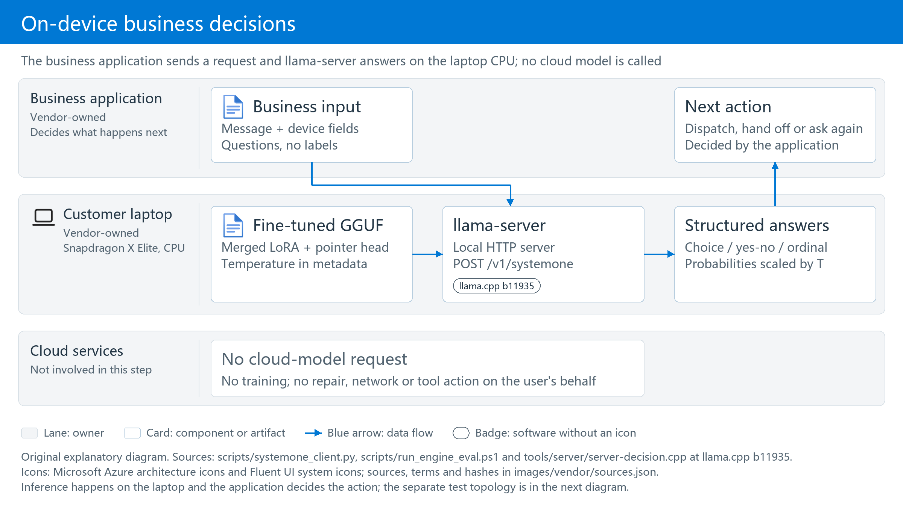
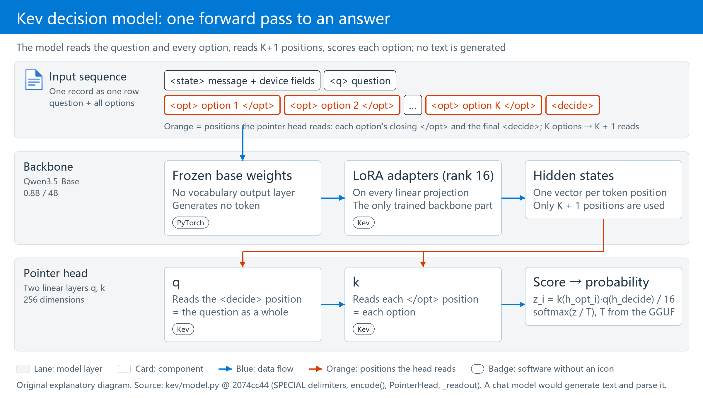

# Core Technology: Fine-Tuning and Device Inference

[English](Core-Technology.md) | [中文](核心技术_微调与端侧运行.md)

[Project overview](../README.md) · [Evaluation results](Evaluation-Results.md) · [Operations](Operations-Guide.md)

### Why Kev Is a Candidate

The candidate is **Kev; its 0.8B and 4B variants use Qwen3.5 bases**. It supports multiple-choice, yes/no and ordinal questions, returning answers and probabilities for business routing rather than long-form chat. Selection considers accuracy, parameter scale, open weights and context length.


*Unmodified producer figure: [Jared Palmer / Kev, What to Expect](https://github.com/jaredpalmer/kev/blob/2074cc44256200bb37540103fa4572901faa10f3/README.md#what-to-expect), commit `2074cc44`. Read the overall legend scores, then the differences between knowledge and policy tasks. These are the author's public benchmark results, not this project's vendor-task measurements.*

<!-- SOURCE:TABLE:1 -->
| Model| Nominal base-model parameter scale| transfer-v4 development accuracy (author's evaluation)| Training state limit (tokens)| Validated input length (tokens)| Weights and this project's scope| 
| ---| ---| ---| ---| ---| ---| 
| Microsoft-Decision-1| 9B (Qwen3.5-9B, post-trained by Microsoft)| Not evaluated on this suite| Not disclosed| Product commitment: 32,768 per request| Hosted in Microsoft Foundry, Preview; not tested in this project| 
| Jev| Not disclosed by the author| 85.7%| Not disclosed| Not disclosed| TypeSafe hosted API; not tested in this project| 
| Kev-27B| 27B| 85.1%| 32,768| 65,536| Open weights; not deployed in this project| 
| Kev-9B| 9B| 82.0%| 7,552| 8,192| Open weights; not deployed in this project| 
| Kev-4B| 4B| 81.7%| 7,552| 8,192| Open weights; fine-tuned and deployed on-device in this project| 
| Kev-0.8B| 0.8B| 64.8%| 7,552| 8,192| Open weights; fine-tuned and deployed on-device in this project| 
<!-- /SOURCE:TABLE:1 -->

- **Accuracy: 4B approaches the hosted reference, but does not rank first.** In the author's figure, Kev-4B is 4.0 percentage points below Jev; Kev-0.8B is 20.9 points below. The caption lists 764 records. In this project's reproduction, the published 0.8B and 4B scores correspond to 656 original questions, with another 108 variant records. The author does not know Jev's training data, so this is not a controlled comparison and does not establish customer-support accuracy. See the [author's explanation](https://github.com/jaredpalmer/kev/blob/2074cc44256200bb37540103fa4572901faa10f3/README.md) and [public-baseline reproduction](../验证结果/公开基线复现_20261027-123403).
- **Scale: 0.8B and 4B test the trade-off between accuracy and device overhead.** The author suggests starting with 4B when accuracy matters, and 0.8B when size matters more. These are nominal parameter scales, not file sizes. GGUF size, process memory and latency come from [device measurements](Evaluation-Results.md#5-laptop-inference-engine), not parameter-count estimates.
- **Open weights: download, fine-tune on business data and export to your own devices.** The [Kev code](https://github.com/jaredpalmer/kev/blob/2074cc44256200bb37540103fa4572901faa10f3/README.md#license), [Kev-0.8B](https://huggingface.co/jaredpalmer/kev-0.8b), [Kev-4B](https://huggingface.co/jaredpalmer/kev-4b) and corresponding [Qwen3.5-0.8B-Base](https://huggingface.co/Qwen/Qwen3.5-0.8B-Base) and [Qwen3.5-4B-Base](https://huggingface.co/Qwen/Qwen3.5-4B-Base) use Apache-2.0. Labeled JSONL and `--init_from` continue training from the release (mechanism in the next section). Individual dataset licenses still apply.
- **Context length: choosing a model size is also choosing how long an input it can read.** Keep three numbers apart: the architecture window (262,144 for Qwen3.5) is what fits; the length seen in training and the length the author validated are what is judged correctly. With the same architecture and recipe, 27B trained to 32,768 and validated to 65,536, while 0.8B / 4B / 9B stop at 8,192 (about 5,000 English words): the short limit is a training choice, not an architectural ceiling. This project's inputs are 430–540 tokens, far inside 8,192; inputs of tens of thousands of tokens such as whole contracts or long logs call for Kev-27B or the hosted Microsoft-Decision-1, and a device CPU cannot keep up anyway: the author measured 21.2 s for 0.8B to read a 65k-token document on an Apple M5, and this project measured about 40 s per 7,760-token ticket on x86-64 — and slowness is not even the main problem: on 160 real tickets with 3k–8k tokens of business history the delivered 0.8B gets only 44.9% right (96.5% on short inputs), failing to pick the decisive fact out of the history even inside the window ([long-input subsection, section 5](Evaluation-Results.md#long-input), [real long inputs](Evaluation-Results.md#long-real)). Sources: [Kev README, "Models" and "Kev 1.0"](https://github.com/jaredpalmer/kev/blob/2074cc44256200bb37540103fa4572901faa10f3/README.md#models), [Foundry model catalog](https://ai.azure.com/catalog/models/Microsoft-Decision-1).

This justifies evaluation, not guaranteed customer suitability. FT and FT-cf are separate recipes trained from the same release, **not sequential FT-to-FT-cf continuation**. Repeated business updates are a way to use the workflow, not a measured long-term outcome.

### Architecture: Training and Inference Are Separate

Four recipes are compared throughout; their names are fixed here. **B0** is the released Kev model without training. **B0-policy** is the same released model with the full vendor policy text written into every question's prompt. **FT** is supervised fine-tuning of the released model on business data. **FT-cf** adds counterfactual variants to FT's data: the same message with one device field changed. **Round-2 C** is the FT-cf recipe plus 206 variants aimed at the weak fields, trained for 4 epochs. All four fine-tuned recipes start from the same release and are trained independently; **the final recommendation and delivered file is round-2 C** (`Contoso-Kev-0.8B-FTcf-R2C-Q8_0.gguf`). FT-cf is its previous version: the full measurement campaign in sections 1–7 was run on FT-cf; C's GPU figures are in [the second round](Evaluation-Results.md#round2), and its on-device figures on the x86-64 VM and the Snapdragon laptop in the [device regression](Evaluation-Results.md#round2-device).

#### 1. Fine-Tune, Calibrate, Export, Quantize: Business Data to a Model File

Data preparation scripts run on the laptop. Large models A and B only help write simulated customer messages; business-policy code computes the labels. Neither generator is the Kev model being fine-tuned, and neither participates in subsequent device inference. The GPU host runs four steps in order: (1) supervised fine-tuning, which trains only the LoRA adapters and the pointer head; (2) temperature calibration, which leaves the weights unchanged and fits one scalar; (3) GGUF export, which merges the LoRA into the base in BF16; (4) quantization to Q8_0 or Q4_K_M. Steps 3 and 4 use only that host's CPU. Between (2) and (3) sits one evaluation gate, the pipeline's only pass/fail point: it measures accuracy and probability error on the test set; accuracy outside its interval goes back to step (1) for more data and retraining, probability error alone goes back to step (2) to refit T, and only when both are inside does the pipeline continue (rule and thresholds in [section 3](Evaluation-Results.md#3-calibration-correct-ranking-does-not-guarantee-reliable-probabilities)). Calibration itself has no pass/fail; it always produces a T. The product is one quantized GGUF file, the single-file model format used by llama.cpp, holding weights, tokenizer, pointer head and calibration temperature together; everything that runs on the laptop and every device figure below uses this quantized file.


*Original explanatory diagram. Training data updates model parameters; a separate calibration set fits the probability temperature, the scaling factor applied when raw model scores become probabilities, explained in [section 3](Evaluation-Results.md#3-calibration-correct-ranking-does-not-guarantee-reliable-probabilities). The evaluation gate is the only pass/fail point; ① ② ⑤ on its card are [the five criteria on the first screen](../README.md#criteria). Quantization is post-training and needs no retraining; the effect of each variant is in [section 5](Evaluation-Results.md#5-laptop-inference-engine). The laptop receives the quantized GGUF file. Sources: [FT pipeline](../scripts/remote_pipeline_v2.sh), [FT-cf pipeline](../scripts/remote_cf_round.sh), [export and quantization script](../scripts/remote_export_gguf_cf.sh). Official Microsoft icon sources and usage terms are recorded in [the icon ledger](../images/vendor/sources.json).*

#### 2. Device Inference: A Model File to a Business Decision

The laptop loads the exported GGUF. The business application sends a message, device fields and questions, and receives structured answers and probabilities. **This step does not train, call a cloud model, perform a repair, contact customer support or change device settings.**



*Original explanatory diagram. Inference happens on the laptop; the application decides whether to take action. Sources: [client](../scripts/systemone_client.py), [device evaluation entry](../scripts/run_engine_eval.ps1). The separate test topology is next to [the evaluation method](Evaluation-Results.md#how-the-tests-work).*


### Core Technique: How the Kev Decision Model Is Fine-Tuned

**Decision model versus chat model.** A chat model generates text token by token; Kev generates no text. It uses Qwen3.5-Base as a read-only encoder, appends every option plus one `<decide>` marker to the input, and scores each option with a small **pointer head** (two small linear layers that give each option one score, like a finger pointing at one entry in the option list); a softmax over the scores gives the option probabilities. One 8-way question costs one forward pass, and the answer can never fall outside the option list.

 position and k reads each </opt> position, a dot product scores each option and softmax gives the probabilities; no text is generated.">

*Original explanatory diagram. Orange marks the K + 1 positions whose hidden states the pointer head reads; the other positions are read only by attention inside the forward pass and do not score directly. Source: `SPECIAL` delimiters, `encode()`, `PointerHead` and `_readout` in [kev/model.py](https://github.com/jaredpalmer/kev/blob/2074cc44256200bb37540103fa4572901faa10f3/kev/model.py), commit `2074cc44`.*

**Supervised fine-tuning (SFT).** The loss is cross-entropy on the correct option — no reinforcement learning, no extra loss terms.

**Which parameters move.** The base is frozen; only the LoRA adapters (rank 16, on every linear projection) and the pointer head train: 11.3M trainable parameters for 0.8B, about 1.4%; 33.8M for 4B, about 0.8%.

**Continue from the release, not from the base.** `--init_from` first loads the LoRA and pointer head already trained in the Kev release, then learns only the vendor-rule delta; the learning rate is therefore lowered to 2e-5, one tenth of the from-scratch default.

**Against forgetting.** `--replay 1000` mixes 1,000 original Kev training records into training so the model does not remember only vendor data; [section 2](Evaluation-Results.md#2-retention-of-general-capability) checks the effect with 656 public questions.

**FT-cf: counterfactual augmentation.** Keep the message, change one device field (region, warranty plan, days since purchase and so on), let the policy code recompute the label; this forces the model to read the fields rather than only the message. The training set grows from 2,147 to 3,832 records. FT-cf and FT are both trained independently from the release; FT-cf is not a continuation of FT.

**Temperature calibration is a separate step.** After training, the weights are frozen and one scalar T is fitted on the calibration set and carried to the device inside the GGUF metadata. It never changes the answer ranking, only how sharp or flat the probabilities are. Details in [section 3](Evaluation-Results.md#3-calibration-correct-ranking-does-not-guarantee-reliable-probabilities).

*Mechanism details and evidence*: the pointer head is two 256-dimensional linear layers q and k; option i scores `z_i = k(h_opt_i) · q(h_decide) / 16`, with q reading the hidden state at the `<decide>` position and k at each option's closing `</opt>`; loss `F.cross_entropy(z, label)`, optimizer AdamW, OneCycleLR, gradient clipping 1.0; LoRA alpha 32, dropout 0.05, `--lora_targets all` covering attention, feed-forward and the Qwen3.5 DeltaNet projections. Training logs: `delta: warm start … 372 lora tensors and the pointer head load`, `trainable params=11.3M` (33.8M for 4B), `replay: 1000 of 12576 suite training records mixed with 2147`. Source: [kev/model.py](https://github.com/jaredpalmer/kev/blob/2074cc44256200bb37540103fa4572901faa10f3/kev/model.py), [kev/train.py](https://github.com/jaredpalmer/kev/blob/2074cc44256200bb37540103fa4572901faa10f3/kev/train.py) (commit `2074cc44`), this run's [training_config.json](../验证结果/微调评测_20261027-220226/runs/0.8b/ft/training_config.json).

**The training command is this one line** (taken from [scripts/remote_pipeline_v2.sh](../scripts/remote_pipeline_v2.sh) with the variables replaced by the actual 0.8B FT values; the step B4 script runs exactly this, then calibration and evaluation):

<!-- SOURCE:FENCE:1 -->
```bash
# GPU host, Kev repository root (commit 2074cc44), python from its .venv
/mnt/aipc/kev/.venv/bin/python -m kev.train \
  --data /mnt/aipc/data/contoso/train.jsonl \
  --suite evals/v7/decision-v7 --replay 1000 \
  --base Qwen/Qwen3.5-0.8B-Base --base_revision dc7cdfe2ee4154fa7e30f5b51ca41bfa40174e68 \
  --init_from jaredpalmer/kev-0.8b@v1.0 \
  --epochs 2 --lr 2e-5 --batch 1 --accum 8 \
  --dtype bf16 --checkpointing 1 --max_state 768 --device cuda --seed 1 \
  --out /mnt/aipc/runs/0.8b/ft
```
<!-- /SOURCE:FENCE:1 -->

For 4B, swap in `--base Qwen/Qwen3.5-4B-Base --base_revision 1001bb4d… --init_from jaredpalmer/kev-4b@v1.0 --batch 4 --accum 2`; for FT-cf, `--data …/train_cf.jsonl --batch 4 --accum 2 --out …/ft_cf` ([remote_cf_round.sh](../scripts/remote_cf_round.sh)). Every other argument is identical. The training code is Kev's own [`kev/train.py`](https://github.com/jaredpalmer/kev/blob/2074cc44256200bb37540103fa4572901faa10f3/kev/train.py); this project does not modify it, only passes arguments.

**What each argument means** (0.8B FT; 4B and FT-cf differ only in micro-batch and data file):

<!-- SOURCE:TABLE:2 -->
| Setting (`kev.train` argument)| Value in this run| Meaning| 
| ---| ---| ---| 
| `--init_from`| `jaredpalmer/kev-{0.8b,4b}@v1.0`| Continue from the release's LoRA and pointer head (delta mode)| 
| `--lora` / `--lora_targets`| 16 / `all`| LoRA rank 16 (alpha 32) on every linear projection of attention, feed-forward and DeltaNet| 
| `--head_dim`| 256| Output dimension of the pointer head's q and k| 
| `--lr` / `--head_lr`| 2e-5 / 0 (0 means the same as `--lr`)| Learning rates for LoRA and the pointer head| 
| `--epochs` / effective batch| 2 / 8 (1 × 8 for 0.8B FT, 4 × 2 for the others)| Each record is seen twice; one parameter update every 8 records| 
| `--replay`| 1,000| Mix in 1,000 original Kev training records against forgetting| 
| `--dtype` / `--weights_dtype`| bf16 / fp32| bf16 autocast forward pass, fp32 master weights| 
| `--max_state`| 768| At most 768 state tokens per record| 
| `--checkpointing`| 1| Gradient checkpointing: less GPU memory, more compute| 
| `--seed`| 1| Only one random seed was run| 
| `ord_w`, `perm_kl`, `brier_w`, `focal_gamma`, `anchor_w`| 0| Plain cross-entropy, no extra loss terms| 
<!-- /SOURCE:TABLE:2 -->

### Core Technique: How It Runs on the Laptop

**What llama-server is.** llama.cpp is a C/C++ inference engine and `llama-server` is its bundled local HTTP server. This project uses the official b11935 Windows ARM64 release unchanged; that build recognizes the decision-model marker inside the GGUF and serves Kev as a decision model rather than a text generator.

**What is inside the GGUF.** One file, four things: the base weights with the LoRA already merged in (so no `--lora` at startup), the pointer head, the three calibration temperatures, and the tokenizer. File sizes for 0.8B FT-cf: BF16 1,437 MiB, Q8_0 764 MiB, Q4_K_M 517 MiB.

**0.8B is already small; why quantize at all?** "0.8B" counts parameters, not bytes. Fine-tuning leaves the parameter count unchanged and every parameter is still a 16-bit BF16 value: 0.8B × 16 bits ≈ 1.4 GB, which is not a small file. Quantization changes how many bits each parameter takes: at 8 bits the file is 0.76 GB, half the size, and the measured answers agree with BF16 on 99.2% or more of the questions; llama.cpp's CPU kernels also have dedicated matrix multiplication for 8-bit integer weights and move half the memory bandwidth, which is exactly the bottleneck of laptop CPU inference. Quantization is therefore a required step after fine-tuning, not a reaction to 0.8B being large; both sizes were quantized to 8-bit and 4-bit, compared in [section 5](Evaluation-Results.md#from-the-released-model-to-the-quantized-fine-tuned-model-accuracy-speed-and-resources-in-one-table).

**What Q8_0 and Q4_K_M are.** Both are llama.cpp block-wise integer quantization: Q8_0 keeps 8 bits per weight and is nearly lossless; Q4_K_M is mainly 4-bit and less precise. This project's Q4_K_M export keeps attention, DeltaNet, the pointer head and the output layer at 8 bits and compresses only the feed-forward layers, more conservative than llama.cpp's default mix. Measured effects are in [section 5](Evaluation-Results.md#5-laptop-inference-engine).

**How long is the context?** Three numbers that must not be confused: the Qwen3.5 base architecture window is 262,144 tokens (GGUF metadata `qwen35.context_length`); the Kev server accepts a state of up to 65,536 tokens plus 8,192 per question and rejects longer input instead of truncating (`SERVE_MAX_STATE` in `kev/model.py`); but Kev-0.8B / 4B **trained mostly on states of at most 384 tokens, and the length the author validated as still accurate is 8,192** — at 16k and above an accuracy drop can no longer be ruled out (Kev README, "Length"). This project's inputs are 430–540 tokens, training used `--max_state 768`, and llama-server's `-c 8192` equals the author's validated ceiling. Feeding a whole contract or a long log into the state means validating 0.8B / 4B accuracy above 8k first; 262k is not a usable length. For reference, Microsoft's hosted Microsoft-Decision-1 (post-trained Qwen3.5-9B) promises 32,768 tokens per request and Kev-27B is validated to 65,536; how context length drives memory is the next paragraph.

**Memory = weights + KV cache, and the KV cache is pre-allocated by context length.** llama-server allocates the KV cache once at start-up as `-c × slots`, regardless of how long the actual inputs are. Every device memory figure in this document must therefore be read together with its `-c`: 0.8B Q8_0 at the default `-c 8192` (4 slots) commits 5,014 MiB; at `-c 2048` it commits 2,119 MiB, **2.9 GB less with accuracy unchanged to the digit**, because the inputs are only 500 tokens and most of an 8192 context sits empty; the cost is the matching smaller `-ub`, which makes each request 74% slower ([lever table](Evaluation-Results.md#5-laptop-inference-engine)). Conversely, reading 8k inputs requires keeping `-c 8192`, and memory returns to the 5 GB class; each step up in model size grows both the weights and the per-token KV (4B Q4_K_M with the same parameters: 7,495 MiB). Choosing the model size and setting the context length are one memory budget.

**`/v1/systemone` is a decision endpoint, not chat completion.** One request = the customer message + device fields + a few questions; the response carries each question's answer and probabilities and generates no token (`usage.output_tokens` is always 0). Probabilities are already scaled with the temperature inside the GGUF. The endpoint follows the TypeSafe System One API and does not support streaming.

The endpoint in one sentence: **the input is a situation plus a few multiple-choice questions; the output is the model's probability for every option, and the highest one is the answer.** Below is one real local call (complete file: [local trial record](../验证结果/本机试用_20261028-201046/support-us/result.json)):

<!-- SOURCE:TABLE:3 -->
| | Contents| 
| ---| ---| 
| Input: situation| Customer e-mail: several keys on an AuraBook Pro 16 stopped working; no drop, no spill. Device record: US, Premium Care 3-year warranty, 731 days since purchase| 
| Input: question 1| Which queue? 8 options: remote software support, mail-in repair, onsite repair, battery program, BIOS second line, accidental-damage claim, orders/quotes, privacy request| 
| Input: question 2| Is an onsite visit allowed? yes / no| 
| Input: question 3| How urgent? 4 levels: can wait, within this week, today, immediately| 
| Output: question 1| orders/quotes 42%, mail-in repair 31%, onsite repair 26%, the rest near 0 → answer "orders/quotes"| 
| Output: question 2| probability of "yes" 29% → answer "no"| 
| Output: question 3| "within this week" 100%, the rest near 0 → answer "within this week"| 
<!-- /SOURCE:TABLE:3 -->

The corresponding JSON (excerpt):

<!-- SOURCE:FENCE:2 -->
```jsonc
// request (excerpt): what the business application sends
{"state": {"channel": "email",
           "message": "您好：我的AuraBook Pro 16有好几个按键突然失灵了，电脑没有摔过，也没有进过水。……",
           "device": {"product_line": "AuraBook Pro 16", "region": "US", "warranty_plan": "Premium Care 3Y",
                      "days_since_purchase": 731, "battery_cycles": 667, "last_error_code": "none", "bios_version": "1.18"}},
 "questions": {"queue": {"type": "choice", "instructions": "Which Contoso support queue should take this case?",
                         "criteria": {"remote_l1": "Remote software support: drivers, Windows, Contoso apps and settings",
                                      "depot_repair": "Mail-in repair at a Contoso service center",
                                      "onsite_repair": "A technician visits the customer", "...": "5 more options"}},
               "onsite_eligible": {"type": "noul", "instructions": "Is the customer entitled to an onsite technician visit for this case?"},
               "urgency": {"type": "score", "instructions": "How urgently must Contoso respond?",
                           "criteria": ["Can wait", "Within this week", "Today", "Immediately: safety or data-loss risk"]}}}
// response (excerpt, probabilities rounded to 3 decimals): client_latency_ms = 783.8
{"model": "contoso-kev-0.8b-ftcf",
 "answers": {"queue": {"type": "choice", "choice": "sales_ops",
                       "probabilities": {"sales_ops": 0.423, "depot_repair": 0.313, "onsite_repair": 0.262, "remote_l1": 0.001, "...": "..."},
                       "confidence": 0.341},
             "onsite_eligible": {"type": "noul", "noul": 0.286},
             "urgency": {"type": "score", "score": 1.000,
                         "legend": {"0": "Can wait", "1": "Within this week", "2": "Today", "3": "Immediately: safety or data-loss risk"},
                         "probabilities": {"0": 0.000, "1": 1.000, "2": 0.000, "3": 0.000}, "confidence": 1.000}},
 "usage": {"input_tokens": 500, "output_tokens": 0}}
```
<!-- /SOURCE:FENCE:2 -->

By the rules this ticket should go to "onsite repair"; the model got it wrong. This example is only for understanding the endpoint; model accuracy is in [section 7](Evaluation-Results.md#local-result).

**Startup arguments one by one** (matching the command in step A1; defaults from the [llama-server b11935 documentation](https://github.com/ggml-org/llama.cpp/blob/b11935/tools/server/README.md), measured values from [section 5](Evaluation-Results.md#5-laptop-inference-engine)):

<!-- SOURCE:TABLE:4 -->
| Startup argument| Value in this run| What it does| What changes if you change it| 
| ---| ---| ---| ---| 
| `-m` / `--alias`| Path of the fine-tuned GGUF / `contoso-kev-0.8b-ftcf`| Model file to load / model name reported in API responses| Changing the file changes the model; the alias only affects the `model` field in responses| 
| `--host` / `--port`| `127.0.0.1` / `8080`| Listen on the loopback address only| `0.0.0.0` exposes the server to the network; not recommended here| 
| `-c` (`--ctx-size`)| 8192| Context-token limit per slot (default 0 = read from the model)| Drives memory. Inputs here are about 500 tokens; at 2048 the commit charge fell from 5,014 to 2,119 MiB, accuracy was unchanged, and one support decision went from 669 to 1,163 ms| 
| `-b` (`--batch-size`) / `-ub` (`--ubatch-size`)| 2048 / 2048| Logical / physical batch size per forward pass (defaults 2048 / 512)| Larger values process more tokens per pass and need more scratch memory; `-ub 512` is part of the low-memory setting| 
| `-ngl` (`--gpu-layers`)| 0| Number of layers placed on the GPU (default auto)| 0 = everything on the CPU. The Adreno OpenCL build uses 99 (all layers on the GPU) and measured slower on this laptop| 
| `--cache-ram`| 0| Prompt-cache limit in MiB (b11935 default: 8192 for ordinary models, 0 for decision models)| Set to 0 explicitly: every request is recomputed and results are reproducible| 
| `--offline`| On| Never download models from the network| Local files only| 
| `-np` (`--parallel`)| Not set (auto; the local log shows `n_slots = 4`)| Number of parallel slots| Slots cap how many requests are admitted at once; they are not compute. On x86-64, 4 and 8 slots gave the same throughput and extra requests simply queued (section 5, "Concurrency")| 
| `--temp` and other sampling arguments| Not used| Sampling settings for text generation| The decision endpoint generates no text; the probability temperature comes from GGUF metadata, not `--temp`| 
<!-- /SOURCE:TABLE:4 -->

**Why CPU rather than GPU or NPU.** The Adreno GPU through the OpenCL build measured slower than CPU (0.8B FT support median 1,035 ms versus 669 ms) and used about 3,400 MiB of additional shared GPU memory; the Hexagon NPU was not tested because Windows requires driver test-signing for it, which was not enabled on the company laptop. The recommended configuration is therefore Q8_0 on CPU with 12 threads.

*Mechanism details and evidence*: b11935 reads the GGUF metadata key `qwen35.decision.type = kev` (startup log `decision model type: kev`, `n_threads = 12`); the converter `convert_hf_to_gguf.py` logs `detected Kev checkpoint` / `Model architecture: KevModel`, stores the pointer head as the tensors `cls.output.weight` (1024 × 512, the q and k 256-dimensional projections side by side) and `cls.output.bias`, and the temperatures as `qwen35.decision.temperature.{choice,score,noul}` (all 1.1487 for 0.8B FT-cf); Q8_0 averages 8.52 bits per weight and Q4_K_M 5.76, with `--pure` plus `--tensor-type` pinning `attn_`, `ssm_`, `cls` and `output.weight` to q8_0. Request fields: `state` may be a JSON object; each question has a `type` (`choice` / `noul` / `score`), `instructions` and `criteria`, and questions are answered independently. Sources: [conversion and quantization logs](../验证结果/微调评测_20261027-220226/gguf/0.8b-cf), [export script](../scripts/remote_export_gguf_cf.sh), [llama-server b11935 documentation](https://github.com/ggml-org/llama.cpp/blob/b11935/tools/server/README.md).
