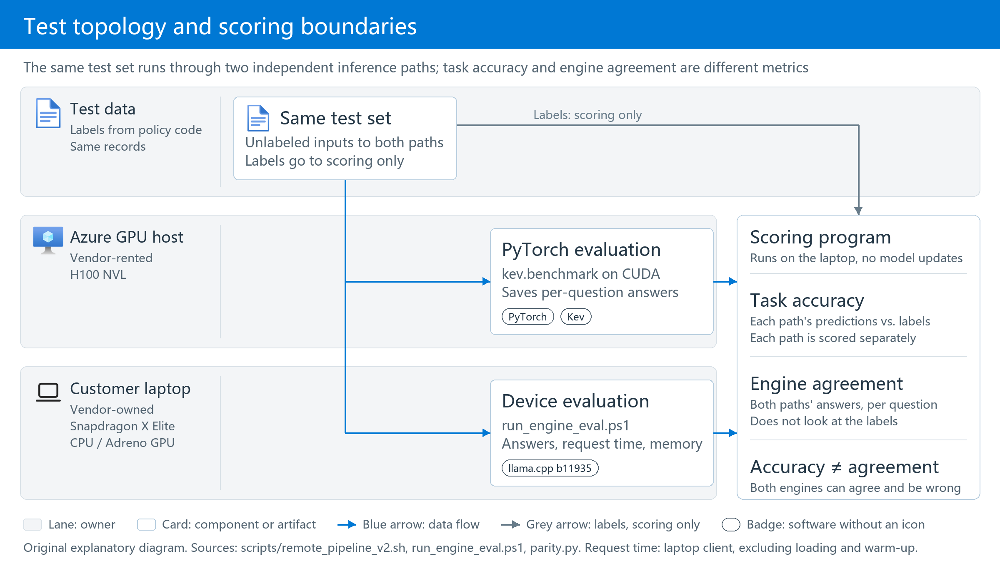

# Complete Evaluation and Device Results

[English](Evaluation-Results.md) | [中文](评测与端侧结果全集.md)

[Project overview](../README.md) · [Core technology](Core-Technology.md) · [Operations](Operations-Guide.md)

### Validation Scenarios

Support-ticket triage and assistant routing are two evaluation scenarios, not the complete business requirement. Both require understanding the message and applying policies to device fields.

<!-- SOURCE:TABLE:1 -->
| Scenario| Model input| Questions to answer| 
| ---| ---| ---| 
| Support-ticket triage| Customer message + device record (product line, region, warranty, purchase age, battery cycles, diagnostic code)| Queue (8 choices), onsite eligibility (yes/no), urgency (4 levels)| 
| On-device assistant routing| User message + device state (network, enterprise management, power/battery, foreground application)| Tool (14 choices), entirely local action (yes/no), confirmation before execution (yes/no)| 
<!-- /SOURCE:TABLE:1 -->

Many answers depend on fields absent from the message. For the same loose-hinge complaint, Premium Care 3Y, an in-warranty device and a CN/JP/DE/US region imply onsite service. Singapore or an expired warranty changes the answer to mail-in service or a paid quote. Released Kev does not know these vendor rules.

The repository answers four questions:

1. **Fine-tuning**: does continued training on vendor data improve released Kev?
2. **Quality**: how much better is it than no training or policy text in the prompt? Can confidence inform automation versus human review, and is general capability retained?
3. **Resources**: how much GPU time and memory does training need, and what are model size, process memory and decision latency on the laptop?
4. **Runtime**: can llama.cpp run the fine-tuned model on Snapdragon X Elite, with results matching PyTorch, and does it still run on an x86-64 CPU?

## Results

<a id="request-examples"></a>

### Actual Inputs and Outputs: Two Correct Answers and One Error

These are saved single-question calls from 2026-11-02: round-2 C 0.8B, Q8_0 and llama.cpp b11935 on the AMD EPYC 7763 x64 VM. Each example is the first question of the first record in the in-distribution support, in-distribution assistant or out-of-distribution support set. **Inputs were not rewritten and examples were not restricted to correct answers.** Original Chinese messages remain verbatim; actual requests include device fields, instructions and all options.

Each example is one request: its elapsed time is an observation, not a median or a Snapdragon performance result. The model returns a classification; it does not contact a customer, repair a device or invoke the chosen tool. `probabilities` gives option probabilities. Policy labels are retained by the client and are not sent to the model.

<!-- REQUEST:EXAMPLES -->
#### Example 1: Order enquiry: correct queue

Question `queue`; prediction `sales_ops`, policy label `sales_ops`: correct. This single request took **1.302 seconds**, not a median. [Complete raw record](../验证结果/单题接口验收_20261102-161257/test_support/rows.jsonl) (first row).

Actual request (labels excluded):

<!-- SOURCE:FENCE:1 -->
```json
{
  "state": {
    "channel": "email",
    "message": "您好：\n请问我的 Contoso Nimbus 2-in-1 订单目前是什么状态？麻烦告知最新进度。\n谢谢\n李明",
    "device": {
      "product_line": "Nimbus 2-in-1",
      "region": "SG",
      "warranty_plan": "Accidental Damage 2Y",
      "days_since_purchase": 749,
      "battery_cycles": 202,
      "last_error_code": "none",
      "bios_version": "1.11"
    }
  },
  "questions": {
    "queue": {
      "type": "choice",
      "instructions": "Which Contoso support queue should take this case?",
      "criteria": {
        "remote_l1": "Remote software support: drivers, Windows, Contoso apps and settings",
        "depot_repair": "Mail-in repair at a Contoso service center",
        "onsite_repair": "A technician visits the customer",
        "battery_program": "Battery health replacement program",
        "bios_l2": "Firmware and BIOS engineering (second line)",
        "damage_claim": "Accidental damage claim",
        "sales_ops": "Orders, invoices and paid repair quotes",
        "privacy_desk": "Requests to export or delete personal data"
      }
    }
  }
}
```
<!-- /SOURCE:FENCE:1 -->

Actual output (complete response):

<!-- SOURCE:FENCE:2 -->
```json
{
  "model": "contoso-kev-0.8b-r2c-single-check",
  "answers": {
    "queue": {
      "type": "choice",
      "choice": "sales_ops",
      "probabilities": {
        "remote_l1": 0.0006115767199941937,
        "depot_repair": 0.0003931018170842656,
        "onsite_repair": 1.3003979530846931e-05,
        "battery_program": 4.991326586368505e-05,
        "bios_l2": 7.837347784228804e-06,
        "damage_claim": 4.242419694772982e-06,
        "sales_ops": 0.9989151873888784,
        "privacy_desk": 5.137061169574683e-06
      },
      "confidence": 0.9987602141587182
    }
  },
  "usage": {
    "input_tokens": 218,
    "output_tokens": 0
  }
}
```
<!-- /SOURCE:FENCE:2 -->

#### Example 2: Warranty enquiry: correct assistant tool

Question `tool`; prediction `support_chat`, policy label `support_chat`: correct. This single request took **1.708 seconds**, not a median. [Complete raw record](../验证结果/单题接口验收_20261102-161257/test_assistant/rows.jsonl) (first row).

Actual request (labels excluded):

<!-- SOURCE:FENCE:3 -->
```json
{
  "state": {
    "utterance": "帮我联系人工客服咨询保修。",
    "context": {
      "foreground_app": "Outlook",
      "power_source": "battery",
      "battery_pct": 17,
      "network": "wifi",
      "enterprise_managed": true,
      "camera_in_use": false,
      "external_display": false
    }
  },
  "questions": {
    "tool": {
      "type": "choice",
      "instructions": "Which Contoso Assistant tool should handle this request?",
      "criteria": {
        "smart_power": "Performance, quiet and battery-saver power modes",
        "display_eye_care": "Brightness, blue-light filter and eye-care reminders",
        "audio_enhance": "Microphone noise suppression and voice clarity",
        "camera_studio": "Background blur, auto framing and lighting correction",
        "meeting_assist": "Meeting transcripts, recordings, summaries and action items",
        "file_search": "Find local files by what they contain",
        "screen_translate": "Translate text or speech on the screen",
        "driver_update": "Check and install drivers and firmware",
        "system_diagnose": "Health checks for battery, fans, disk and performance",
        "privacy_shield": "Screen privacy, auto-lock and hiding notifications",
        "smart_connect": "Phone link: transfer files and photos, mirror notifications",
        "support_chat": "Contact Contoso support about warranty or repairs",
        "general_chat": "General questions, writing help and chit-chat",
        "none_reject": "Out of scope or not allowed; decline politely"
      }
    }
  }
}
```
<!-- /SOURCE:FENCE:3 -->

Actual output (complete response):

<!-- SOURCE:FENCE:4 -->
```json
{
  "model": "contoso-kev-0.8b-r2c-single-check",
  "answers": {
    "tool": {
      "type": "choice",
      "choice": "support_chat",
      "probabilities": {
        "smart_power": 5.348102219370642e-11,
        "display_eye_care": 3.690997341767029e-11,
        "audio_enhance": 3.3477543491804924e-10,
        "camera_studio": 5.0773794652031343e-11,
        "meeting_assist": 9.983230347587084e-10,
        "file_search": 6.855754160557059e-10,
        "screen_translate": 3.5691295765771294e-09,
        "driver_update": 4.116040301779958e-10,
        "system_diagnose": 2.3122058986233137e-10,
        "privacy_shield": 4.0467567231294726e-11,
        "smart_connect": 5.973676309072766e-10,
        "support_chat": 0.999999467190284,
        "general_chat": 4.7425158113612017e-07,
        "none_reject": 5.1548506841318276e-08
      },
      "confidence": 0.9999994262049212
    }
  },
  "usage": {
    "input_tokens": 268,
    "output_tokens": 0
  }
}
```
<!-- /SOURCE:FENCE:4 -->

#### Example 3: Accidental damage: incorrect queue

Question `queue`; prediction `sales_ops`, policy label `damage_claim`: incorrect. This single request took **1.831 seconds**, not a median. [Complete raw record](../验证结果/单题接口验收_20261102-161257/ood_support/rows.jsonl) (first row).

Actual request (labels excluded):

<!-- SOURCE:FENCE:5 -->
```json
{
  "state": {
    "channel": "phone_transcript",
    "message": "喂，你好，嗯……我这台Contoso AuraBook Pro 16，昨天早上喝咖啡的时候不小心把半杯咖啡洒到键盘上了。我当时就把它倒过来擦干了，然后放了一天没开机。今天开机是能开，屏幕也正常，就是键盘上有几个键没反应，像是回车、空格还有右边那一排字母，按下去什么都没有。其他键是好的，触摸板也能用。嗯，我想问一下这种情况要怎么处理，是要送修还是你们有别的办法。",
    "device": {
      "product_line": "AuraBook Pro 16",
      "region": "DE",
      "warranty_plan": "Accidental Damage 2Y",
      "days_since_purchase": 729,
      "battery_cycles": 237,
      "last_error_code": "none",
      "bios_version": "1.13"
    }
  },
  "questions": {
    "queue": {
      "type": "choice",
      "instructions": "Which Contoso support queue should take this case?",
      "criteria": {
        "remote_l1": "Remote software support: drivers, Windows, Contoso apps and settings",
        "depot_repair": "Mail-in repair at a Contoso service center",
        "onsite_repair": "A technician visits the customer",
        "battery_program": "Battery health replacement program",
        "bios_l2": "Firmware and BIOS engineering (second line)",
        "damage_claim": "Accidental damage claim",
        "sales_ops": "Orders, invoices and paid repair quotes",
        "privacy_desk": "Requests to export or delete personal data"
      }
    }
  }
}
```
<!-- /SOURCE:FENCE:5 -->

Actual output (complete response):

<!-- SOURCE:FENCE:6 -->
```json
{
  "model": "contoso-kev-0.8b-r2c-single-check",
  "answers": {
    "queue": {
      "type": "choice",
      "choice": "sales_ops",
      "probabilities": {
        "remote_l1": 0.00044497075395787204,
        "depot_repair": 0.006448147013819811,
        "onsite_repair": 1.2753946434896826e-05,
        "battery_program": 2.6953356015821716e-05,
        "bios_l2": 1.4696974122990704e-05,
        "damage_claim": 0.13557084723467783,
        "sales_ops": 0.8574775106950964,
        "privacy_desk": 4.12002587432088e-06
      },
      "confidence": 0.8371171550801101
    }
  },
  "usage": {
    "input_tokens": 295,
    "output_tokens": 0
  }
}
```
<!-- /SOURCE:FENCE:6 -->
<!-- /REQUEST:EXAMPLES -->

<a id="single-question"></a>

### Measured on Snapdragon: Accuracy, Complete-Request Time and Calibration

**These 14 rows are completed Snapdragon measurements for seven deployment configurations. Each request supplies one support or assistant record and asks three questions together.** Accuracy and calibration are counted per question; time is measured per complete request. This is not standalone single-question latency and cannot be converted to it by dividing by three.

Inputs are [test_support](../data/contoso/final/test_support.jsonl) and [test_assistant](../data/contoso/final/test_assistant.jsonl): 170 support and 159 assistant requests per configuration, containing 510 and 477 questions. The model receives the full `state`, all three question instructions and options, but no `label`. Accuracy, timing and ECE are recomputed from the same recorded `rows.jsonl` for each configuration, without combining GPU, x64 or other campaigns.

**Fixed conditions:** Snapdragon X Elite CPU, llama.cpp b11935, `-c 8192 -b 2048 -ub 2048 --cache-ram 0`, client concurrency 1, and two warm-up requests per set. Default slot behavior remains; these settings do not mean every internal state has been cleared. Each model and test set is aggregated separately, without mixing devices or averaging rounded per-type accuracies. The served calibration temperature is retained, not refitted on test data.

- **Accuracy:** correct answers divided by all test questions; failed records do not contribute correct answers. `choice` uses the returned option, `noul` the 0.5 threshold, and `score` the highest-probability level. Invalid saved probabilities stop report generation rather than produce an invented score.
- **Median complete-request time:** client HTTP send through complete response reading and JSON parsing, in seconds, with three questions per request. Only requests that returned answers enter the latency statistic; read it with failure counts and coverage. Loading and two warm-ups are excluded. One run's median is not a production latency guarantee.
- **Expected calibration error, ECE:** the report consistently uses the 0-1 error scale, lower is better. Selected-answer confidence is grouped into 10 equal-width bins, left-closed/right-open except the final bin, which includes 1. Weight each bin's absolute mean-confidence/accuracy gap by valid-answer count. ECE is not calibration accuracy or `1 - ECE`. Coverage is valid answers divided by all test questions; values are recomputed from saved responses.

The interpretation is whether answers assigned about 90% confidence are correct about 90% of the time. ECE depends on the dataset and binning and must be read with accuracy and coverage. **Temperature fitting is an adjustment; ECE measures its outcome.** This report uses the definition above, not another product's percentage-scale calibration score or a cross-benchmark ranking.

<!-- SOURCE:TABLE:2 -->
| Model (0.8B, Snapdragon X Elite CPU, default settings)| Test set (questions)| Per-question accuracy (%, failures included)| Median processing time per complete request (seconds, 3 decisions each)| Calibration error ECE (0-1, lower is better)| Valid-probability coverage (%)| 
| ---| ---| ---| ---| ---| ---| 
| Released B0, official Q8_0 package| Support: in-distribution (510 questions)| 45.7%| **0.666**| 0.030| 100.0%| 
| Released B0, official Q8_0 package| Assistant: in-distribution (477 questions)| 66.9%| **0.843**| 0.093| 100.0%| 
| Fine-tuned FT-cf, Q8_0| Support: in-distribution (510 questions)| 86.9%| **0.646**| 0.028| 100.0%| 
| Fine-tuned FT-cf, Q8_0| Assistant: in-distribution (477 questions)| 97.7%| **0.984**| 0.014| 100.0%| 
| Fine-tuned FT, Q4_K_M (separate FT recipe, not FT-cf)| Support: in-distribution (510 questions)| 87.5%| **0.812**| 0.021| 100.0%| 
| Fine-tuned FT, Q4_K_M (separate FT recipe, not FT-cf)| Assistant: in-distribution (477 questions)| 93.9%| **0.909**| 0.014| 100.0%| 
| Round-2 C, Q8_0 (delivered)| Support: in-distribution (510 questions)| 96.9%| **0.635**| 0.032| 100.0%| 
| Round-2 C, Q8_0 (delivered)| Assistant: in-distribution (477 questions)| 99.6%| **0.905**| 0.010| 100.0%| 
<!-- /SOURCE:TABLE:2 -->

<!-- SOURCE:TABLE:3 -->
| Model (4B, Snapdragon X Elite CPU, default settings)| Test set (questions)| Per-question accuracy (%, failures included)| Median processing time per complete request (seconds, 3 decisions each)| Calibration error ECE (0-1, lower is better)| Valid-probability coverage (%)| 
| ---| ---| ---| ---| ---| ---| 
| Released B0, official Q4_K_M package| Support: in-distribution (510 questions)| 59.0%| **3.022**| 0.047| 100.0%| 
| Released B0, official Q4_K_M package| Assistant: in-distribution (477 questions)| 82.0%| **3.790**| 0.134| 100.0%| 
| Fine-tuned FT-cf, Q8_0| Support: in-distribution (510 questions)| 96.1%| **3.649**| 0.019| 100.0%| 
| Fine-tuned FT-cf, Q8_0| Assistant: in-distribution (477 questions)| 99.8%| **4.115**| 0.008| 100.0%| 
| Fine-tuned FT-cf, Q4_K_M| Support: in-distribution (510 questions)| 95.3%| **3.615**| 0.018| 100.0%| 
| Fine-tuned FT-cf, Q4_K_M| Assistant: in-distribution (477 questions)| 99.6%| **4.751**| 0.009| 100.0%| 
<!-- /SOURCE:TABLE:3 -->

**Scope:** the table covers Snapdragon runs with three questions per request. The earlier x64 single-question calls are separate interface examples, not the same performance benchmark. Other collection modes belong in the [operations guide](Operations-Guide.md#single-question-run). Updates must select evidence through the [source configuration](Operations-Guide.md#report-sources), without filling gaps from an older campaign.

<a id="criteria-history"></a>

#### Historical Five-Criterion Summary

This summarizes GPU training and three-question device runs. GPU calibration, Snapdragon timing and x64 accuracy have separate sources and cannot be combined into one run or represented as standalone single-question results.

<!-- SOURCE:TABLE:4 -->
| Dimension| Criterion| Questions to answer| How it is measured| Measured summary (recipe and measurement location identified separately)| Scope and limits| 
| ---| ---| ---| ---| ---| ---| 
| Accuracy| ① Is the answer right?| Does the chosen queue, grade or yes/no match the reference answer?| Accuracy, reported separately by dataset| GPU: C support 96.3%, assistant 100.0%; FT-cf 86.9% / 97.5%. Out-of-distribution region variants: C 69.0%, FT-cf 35.7%. x64 C Q8_0: 96.5% / 99.8% ([same questions](#same-questions), [second round](#round2), [device regression](#round2-device))| High simulated-data scores do not establish real-business accuracy| 
| Accuracy| ② Is the confidence honest?| Whether selected-answer confidence matches correctness| ECE (0-1, lower is better), coverage and accuracy at a fixed threshold| GPU in-distribution support: C ECE 0.025, FT-cf 0.030. At threshold 0.9, C coverage/accepted accuracy are 80.4%/99.8%; FT-cf 73.1%/100.0% ([probability diagnostics](#3-calibration-correct-ranking-does-not-guarantee-reliable-probabilities))| In-sample threshold statistics are not a production error-rate guarantee| 
| Performance| ③ Latency| How long one request takes| Median time per request (ms), one request at a time| Snapdragon X Elite CPU: support 635 ms, assistant 905 ms (FT-cf 646 / 984); on the x86-64 VM C equals FT-cf (support 1,260 / 1,255 ms) ([section 5](#5-laptop-inference-engine), [device regression](#round2-device))| One run on one machine does not cover every laptop; concurrency does not raise throughput, see section 5| 
| Performance| ④ Resource use| How big a machine it needs| Peak process working set, CPU time, model file size and service-readiness wait| C Q8_0: Snapdragon default peak/commit 2,314/5,014 MiB; lean 2,196/2,119 MiB. x64 default peak 1,552 MiB and average CPU utilization about 50%; file about 775 MiB ([device](#5-laptop-inference-engine), [hardware](#6-hardware-requirements))| Usage depends on the model, quantization, inputs and settings| 
| Generalization| ⑤ Generalization| Accuracy and probability quality after changing the data distribution| Report business out-of-distribution data and 656 public questions separately| GPU support: C in/out-of-distribution accuracy 96.3%/88.4%, ECE 0.025/0.055; FT-cf accuracy 86.9%/82.5%. Public questions: released 64.8%, C 65.2% ([same questions](#same-questions), [public questions](#2-retention-of-general-capability))| Distributions are different datasets; their difference is not a single-factor causal effect| 
<!-- /SOURCE:TABLE:4 -->

### How the Tests Work

**These test sets are not an independent blind acceptance set.** Case groups are separated across training, calibration and testing, but test errors already informed FT-cf and second-round recipe changes. The recorded scores describe this project's iterations, not a new customer acceptance test excluded from model selection. Future selection should use development data; freeze weights, rules and temperature before acceptance on untouched data. This documentation correction did not perform that independent acceptance run.

**Each pipeline step moves only one or two of the [five criteria](../README.md#criteria); the others must be re-checked for damage.** This is also why calibration has no pass/fail of its own: it owns only ②, and the verdict “good enough, or back to which step” comes from the evaluation that follows it.

<!-- SOURCE:TABLE:5 -->
| Pipeline step| Criterion it moves| What must be re-checked| Measured in this project (0.8B; delivered round-2 C, previous FT-cf in parentheses)| 
| ---| ---| ---| ---| 
| Data generation and splits (with counterfactual variants)| ① what can be learned; ⑤ forces the model to read fields instead of memorizing messages| Training, calibration and test sets do not overlap| Training set 2,147 → 3,832 → 4,038 records| 
| Fine-tuning (LoRA + pointer head)| ① answer correctness; side effect: sharper confidence| ⑤ public-question accuracy must not drop (threshold 2 percentage points)| Support 44.7% → 96.3% (FT-cf 86.9%); public questions 64.8% → 65.2% (FT-cf 64.8%)| 
| Calibration (fit one temperature T)| Only ②, confidence honesty| ① no answer changes| C: T = 2.83, calibration-set ECE 0.025 → 0.010 (FT-cf: T = 1.15, 0.011 → 0.008); 16 groups × 71 temperatures, answers identical to the digit| 
| Device checks after export and quantization| Predictions and probabilities from the quantized file| Compare each question against the same-recipe PyTorch model| Q8_0 agreement: FT-cf on Snapdragon 99.2% / 99.8%; C on x64 99.0% / 99.8%. These are not isolated BF16-conversion agreement rates| 
| Quantization (Q8_0 / Q4_K_M)| ③ latency, ④ resource use| How much ① and ② were given up| File 1,447 → 775 / 528 MiB; 8-bit answer agreement 99.0–100%, 4-bit 94.9–98.2% (FT / FT-cf)| 
| Evaluation (`kev.benchmark`, on-device runs)| Moves nothing; measures only| All five| ① ② ⑤ on the GPU; ③ ④ and agreement on the laptop| 
| Post-launch monitoring| Moves nothing| Sample ① ② ⑤ and decide: leave / refit T only / retrain| [The rule in section 3](#3-calibration-correct-ranking-does-not-guarantee-reliable-probabilities)| 
<!-- /SOURCE:TABLE:5 -->

GPU time and memory spent on training are a cost of the pipeline, not a criterion of the model; they are listed separately in [section 4](#4-training-resources).

**Compared configurations** use the same records and the same `kev.benchmark` evaluator:

<!-- SOURCE:TABLE:6 -->
| Name| Method| 
| ---| ---| 
| B0| Released Kev (`jaredpalmer/kev-{0.8b,4b}@v1.0`), one-sentence question instructions, no training| 
| B0-policy| The same release with full vendor policy in each question (the support question section grows from about 950 to 4,600 characters per record)| 
| FT| Continue from the release with supervised fine-tuning (SFT): cross-entropy on the correct answer, not reinforcement learning; other loss weights are 0 in the [training configuration](../验证结果/微调评测_20261027-220226/runs/0.8b/ft/training_config.json). Rank-16 LoRA + pointer head, 2 epochs, lr 2e-5, effective batch 8, bf16, seed 1; mix in 1,000 Kev replay records; fit temperature on calibration data| 
| FT-cf| Add counterfactual variants to FT data: keep the training message, change one policy field and recompute labels (2,147 → 3,832 training records). This recipe addresses FT's poor field-change pairs; the selection rule was written into the [protocol](Experiment-Protocol.md) before its results| 
<!-- /SOURCE:TABLE:6 -->

**Test data** uses policy-computed labels. An original case and its field variants stay in one split. Group isolation does not guarantee distinct short messages across unrelated cases: 19 assistant test records have text also seen in training. The report includes a comparison excluding them.

<!-- SOURCE:TABLE:7 -->
| Test set| Records / questions| Message author| Purpose| 
| ---| ---| ---| ---| 
| Support and assistant: in-distribution| 170 / 510, 159 / 477| Model A, also used for training messages| Main results| 
| Support and assistant: out-of-distribution| 337 / 1,011, 317 / 951| Another provider's model B; more Singapore, offline and metered-network cases, with two intents in one message| Effect after changing generator and field distribution| 
| Support and assistant: test variants| 126 / 378, 70 / 210| Keep the test message and change one policy field| Whether the model applies policy to device fields| 
| Kev transfer-v4 development set| 656 questions| Kev author's public tasks| General-capability retention| 
<!-- /SOURCE:TABLE:7 -->

One support test record is shown below, with option descriptions abbreviated. The model sees `state`; policy code derives `label` from the device record, and the model never receives it. The Chinese message is retained verbatim because it is the actual test input, not untranslated documentation.

<!-- SOURCE:FENCE:7 -->
```json
{"state": {"channel": "email",
           "message": "您好：\n请问我的 Contoso Nimbus 2-in-1 订单目前是什么状态？麻烦告知最新进度。\n谢谢\n李明",
           "device": {"product_line": "Nimbus 2-in-1", "region": "SG", "warranty_plan": "Accidental Damage 2Y",
                      "days_since_purchase": 749, "battery_cycles": 202, "last_error_code": "none", "bios_version": "1.11"}},
 "questions": {"queue": {"type": "choice", "instructions": "Which Contoso support queue should take this case?", "label": "sales_ops"},
               "onsite_eligible": {"type": "noul", "label": false},
               "urgency": {"type": "score", "label": 0}}}
```
<!-- /SOURCE:FENCE:7 -->

The two diagrams in Purpose show the system as the customer runs it; the diagram below only shows how we measured: the same test set runs through both the PyTorch path and the laptop path. The PyTorch path and the ground-truth labels exist only during testing; routine device inference needs neither.



*Original explanatory diagram. Accuracy against ground truth and agreement between engines are different metrics. PyTorch evaluation runs on the H100 VM; llama.cpp evaluation and request timing run on the Snapdragon laptop. Sources: [training/evaluation pipeline](../scripts/remote_pipeline_v2.sh), [device evaluation](../scripts/run_engine_eval.ps1), [per-question comparison](../scripts/parity.py). This test topology is not a dependency of routine device inference.*

The following results are **historical measurements from 2026-10-27**, separate from the later single-request trial.

**Measurement boundaries**:

<!-- SOURCE:TABLE:8 -->
| Metric| Measurement location| Measurement start and end| Excludes| 
| ---| ---| ---| ---| 
| Accuracy, Brier, ECE and coverage at the error budget| GPU VM, `kev.benchmark --device cuda`| Score each question once and aggregate by question| Latency| 
| 95% interval of paired differences| Laptop, `summarize_results.py` (10,000 message-group bootstrap samples); protocol `kev.compare` macro-average listed separately| Difference between two configurations on the same questions| Variation across random seeds| 
| Training time| GPU VM, bash `$SECONDS`| Training-process start → checkpoint saved, including base and released-checkpoint loading| Calibration and evaluation| 
| Training GPU memory| GPU VM: maximum `nvidia-smi` sample every 2 seconds and Kev's PyTorch allocation peak| While the training process runs| —| 
| Device request latency| Laptop, `systemone_client.py` → `127.0.0.1:8080`| Client sends one record → receives all 3 answers; sequential, not concurrent| First 2 warm-up requests and model loading| 
| Device process memory| Laptop: read `llama-server` process counters after evaluation| Peak working set (physical process memory) and committed process memory| —| 
| Agreement with PyTorch| Laptop, `parity.py`| Compare answers and probabilities question by question on the same file| —| 
<!-- /SOURCE:TABLE:8 -->

<a id="same-questions"></a>

### 1. Same Questions: Before and After Fine-Tuning

**The customer-facing comparison answers three questions: are business decisions more accurate, do improvements carry over to new questions, and does laptop execution cost change?** Every main-table row compares the same-size released model with the first-round FT-cf recipe, trained on business data plus field variants; the candidate is not changed to whichever model wins each metric. The delivered round-2 C (same recipe plus 206 variants, 4 epochs) gets its own table right after, on the same questions. Policy prompting and the first FT recipe remain separate experimental controls.

Accuracy in the first two tables comes from the same H100 NVL / PyTorch evaluation path. The third table measures laptop CPU latency and memory. These measurement locations are separate: PyTorch accuracy is not the quantized model's device accuracy. [Section 5](#5-laptop-inference-engine) retains the complete on-device results.

**Before and after use the same questions, options, labels and short question instructions for each accuracy or generalization comparison.** Support and assistant routing are different tasks, each compared within its own test set. Generalization uses out-of-distribution questions excluded from weight training, not training questions. The message generator and field distribution change, but the data remains simulated rather than real customer production data. Request hashes and question-level labels are retained in the [original evaluation records](../验证结果/微调评测_20261027-220226/runs).

<!-- TABLE:README_ACC -->
**Accuracy: the same business test questions**

<!-- SOURCE:TABLE:9 -->
| Parameter scale| Test set (questions)| Before fine-tuning: released accuracy| After fine-tuning: first-round FT-cf accuracy| Gain (percentage points)| 
| ---| ---| ---| ---| ---| 
| 0.8B| Support: in-distribution (510 questions)| 44.7%| 86.9%| +42.2| 
| 0.8B| Assistant: in-distribution (477 questions)| 67.1%| 97.5%| +30.4| 
| 4B| Support: in-distribution (510 questions)| 60.8%| 95.9%| +35.1| 
| 4B| Assistant: in-distribution (477 questions)| 81.8%| 99.8%| +18.0| 
<!-- /SOURCE:TABLE:9 -->

**Generalization: the same out-of-distribution questions**

<!-- SOURCE:TABLE:10 -->
| Parameter scale| Test set (questions)| Before fine-tuning: released accuracy| After fine-tuning: first-round FT-cf accuracy| Gain (percentage points)| 
| ---| ---| ---| ---| ---| 
| 0.8B| Support: out-of-distribution (1,011 questions)| 43.0%| 82.5%| +39.5| 
| 0.8B| Assistant: out-of-distribution (951 questions)| 65.7%| 94.4%| +28.7| 
| 4B| Support: out-of-distribution (1,011 questions)| 60.7%| 91.4%| +30.7| 
| 4B| Assistant: out-of-distribution (951 questions)| 81.9%| 98.8%| +16.9| 
<!-- /SOURCE:TABLE:10 -->
<!-- /TABLE:README_ACC -->

**Delivered model, round-2 C: the same questions, how much more it adds on top of FT-cf** (GPU / PyTorch evaluation, the same path as the table above; paired-difference 95% intervals use the cluster bootstrap over messages, 10,000 resamples; full comparison in [the second round](#round2))

<!-- SOURCE:TABLE:11 -->
| Parameter scale| Test set (questions)| Released| First-round FT-cf| Delivered round-2 C| C − FT-cf (points, 95% interval)| 
| ---| ---| ---| ---| ---| ---| 
| 0.8B| Support: in-distribution (510 questions)| 44.7%| 86.9%| **96.3%**| +9.4 (+6.3 ~ +12.6)| 
| 0.8B| Assistant: in-distribution (477 questions)| 67.1%| 97.5%| **100.0%**| +2.5 (+1.3 ~ +3.9)| 
| 0.8B| Support: out-of-distribution (1,011 questions)| 43.0%| 82.5%| **88.4%**| +5.9 (+3.8 ~ +8.1)| 
| 0.8B| Assistant: out-of-distribution (951 questions)| 65.7%| 94.4%| **97.3%**| +2.8 (+1.5 ~ +4.2)| 
<!-- /SOURCE:TABLE:11 -->

4B had no second round; 0.8B C's in-distribution support accuracy of 96.3% passes 4B FT-cf's 95.9%, while its out-of-distribution 88.4% stays below 4B's 91.4%.

**Performance: the same laptop and requests, comparing latency and memory**

Both sides use Snapdragon X Elite X1E80100, llama.cpp b11935 CPU and `-c 8192 -b 2048 -ub 2048 --cache-ram 0`. Both 0.8B models use Q8_0; both 4B models use Q4_K_M. Performance effects are not attributed across model sizes. Each side completes the same 170 support requests and 159 assistant requests, with 3 questions per request. Request timing excludes model loading and warm-up; memory is the process peak working set across the run.

<!-- TABLE:README_PERFORMANCE -->
<!-- SOURCE:TABLE:12 -->
| Fixed model configuration| Performance metric (unit)| Before fine-tuning: released measurement| After fine-tuning: first-round FT-cf measurement| 
| ---| ---| ---| ---| 
| 0.8B / Q8_0 / CPU| Support median request time (ms)| 666| 646| 
| 0.8B / Q8_0 / CPU| Assistant median request time (ms)| 843| 984| 
| 0.8B / Q8_0 / CPU| Peak process working set (MiB)| 2,323| 2,314| 
| 4B / Q4_K_M / CPU| Support median request time (ms)| 3,022| 3,615| 
| 4B / Q4_K_M / CPU| Assistant median request time (ms)| 3,790| 4,751| 
| 4B / Q4_K_M / CPU| Peak process working set (MiB)| 6,849| 6,842| 
<!-- /SOURCE:TABLE:12 -->
<!-- /TABLE:README_PERFORMANCE -->

These are [recorded device runs](../验证结果/端侧引擎_20261027-124700), not GPU evaluation timings. Case IDs, order, labels, input token counts and recorded core settings have been paired. The older device records lack per-request content hashes, so that comparison is not independent proof of byte-identical requests. Each configuration ran once and timing varies between runs: **the observations establish better accuracy, not faster inference caused by fine-tuning, nor that fine-tuning explains the entire latency difference.** The after column of this laptop table is FT-cf; the delivered C, measured on the same laptop, has a peak working set of 2,314 MiB and a commit charge of 5,014 MiB — both equal to FT-cf — and a support median of 635 ms ([device regression](#round2-device)).

#### Experimental Analysis: All Controls and Remaining Errors

The full released, policy-prompted, FT and FT-cf matrix remains in [report section 3.1](Finetuning-and-On-Device-Validation-Report.md#accuracy). [Section 3.3](Finetuning-and-On-Device-Validation-Report.md#policy-following) retains all field-variant results. Those controls explain the recipe choice rather than replacing the main before/after comparison. The field-variant metric counts questions whose correct answer changes with the field: 172 support questions and 72 assistant questions.

- **Both sizes improve on these tests.** Across four main test sets, FT exceeds B0 by 14.7-41.8 percentage points per question; every 95% interval has a lower bound above 0. FT-cf adds 0.4-4.0 points over FT, although the intervals for the two 0.8B support sets include 0. See [report section 3.1](Finetuning-and-On-Device-Validation-Report.md#accuracy) for intervals and the protocol's `kev.compare` definition.
- **Policy prompting is substantially below fine-tuning.** B0-policy is 10.5-30.2 points below FT. On the 0.8B out-of-distribution assistant set, it is worse than B0: 63.6% versus 65.7%.
- **Field-dependent policy application remains the main weakness.** For changed-answer questions, FT-to-FT-cf support/assistant accuracy rises from 48.3%/48.6% to 57.6%/81.9% for 0.8B, and from 72.1%/86.1% to 84.9%/100.0% for 4B. Combining test and out-of-distribution variants, 0.8B still scores only 41.9% on purchase age, 36.2% on region and 49.2% on battery cycles. See [report section 3.3](Finetuning-and-On-Device-Validation-Report.md#policy-following).
- **Selection was specified before the second recipe's results.** Recommend FT-cf only when development-variant accuracy improves and original development accuracy drops by no more than 1 percentage point. Both sizes qualify. On all development-variant questions, support/assistant scores change from 78.9%/82.9% to 82.2%/92.8% for 0.8B, and from 89.1%/96.4% to 95.9%/100.0% for 4B. Neither loses accuracy on original development questions.

### 2. Retention of General Capability

This is the second question under [criterion ⑤](../README.md#criteria): the previous section's out-of-distribution questions ask “does it still work on new business data”; this section asks whether, after adapting to the business, the model lost its prior general-task capability. Each before/after pair uses the same 656 public Kev questions. Both FT and FT-cf recipes are retained below; the delivered round-2 C scores 65.2% on the same set (+0.5 points over the release, below the trigger line; [second round](#round2)).

<!-- TABLE:PUBLIC -->
<!-- SOURCE:TABLE:13 -->
| Model and recipe| General questions| Released accuracy| Fine-tuned accuracy| Change (percentage points)| 
| ---| ---| ---| ---| ---| 
| 0.8B FT| 656| 64.8%| 64.8%| 0.0| 
| 0.8B FT-cf| 656| 64.8%| 64.8%| 0.0| 
| 4B FT| 656| 81.7%| 80.9%| -0.8| 
| 4B FT-cf| 656| 81.7%| 82.6%| +0.9| 
<!-- /SOURCE:TABLE:13 -->

**Confidence on general questions: lower Brier is better.**

<!-- SOURCE:TABLE:14 -->
| Model and recipe| Released Brier| Fine-tuned Brier| 
| ---| ---| ---| 
| 0.8B FT| 0.430| 0.560| 
| 0.8B FT-cf| 0.430| 0.574| 
| 4B FT| 0.243| 0.299| 
| 4B FT-cf| 0.243| 0.269| 
<!-- /SOURCE:TABLE:14 -->
<!-- /TABLE:PUBLIC -->

- **The predefined forgetting threshold was not triggered.** The threshold is an accuracy drop greater than 2 percentage points. Both 0.8B recipes remain at the released model's 64.8%. FT corrects 20 answers but breaks 20 others; FT-cf corrects 22 and breaks 22. The 4B FT score falls from 81.7% to 80.9%, or 5 fewer correct answers out of 656; FT-cf reaches 82.6%, or 6 more. This does not mean every general task is unchanged.
- **Confidence quality on general questions worsens.** Business calibration changes 0.8B's temperature from 2.35 to 1.26, making probabilities sharper. Recomputing 0.8B FT at the released temperature of 2.35 gives Brier 0.490, still worse than 0.430 before fine-tuning. Weight changes therefore also contribute. For 4B, FT at temperature 1.66 changes Brier from 0.243 to 0.299; FT-cf at 2.35 scores 0.269. A model serving both vendor and general decisions should be calibrated on mixed data.

### 3. Calibration: Correct Ranking Does Not Guarantee Reliable Probabilities

**Fine-tuning learns which answer to choose; calibration adjusts the probabilities assigned to those answers.** The model produces logits (the pointer-head scores z of the previous section) and converts them with `softmax(logits / T)`. T is a dimensionless positive number, not accuracy or a business threshold. An already-trained model can keep all its weights while T is refitted; repeating the same training run is unnecessary for a probability-only adjustment.

Calibration data supplies inputs, questions, candidate options and correct labels, not a target probability table. Vendor-policy code computes the labels here; a language model only generates simulated messages and does not judge calibration. Training data updates weights, development data selects a recipe, calibration data fits T, and data excluded from selection is used for acceptance. Inference applies the saved T without refitting it.

As a mathematical illustration, three options at 80% / 10% / 10% with T = 1 become approximately 58.6% / 20.7% / 20.7% with T = 2. This is not a measurement. Positive T preserves option ranking within a question and cannot repair a wrong first choice. It can change probabilities, expected ordinal scores and threshold decisions. Summing to 100% proves normalization, not calibration; one wrong prediction does not by itself establish failed calibration either.

The 0.8B FT-cf fit uses **984 calibration questions** and T about 1.15. Fit-set accuracy remains 93.0% and ECE changes from 0.011 to 0.008; the five-fold interval for the ECE difference includes zero, so significance is not established. C fits T = 2.83 on the same calibration set, with unchanged accuracy 96.6% and ECE 0.025 to 0.010. C changes both data and epochs; a larger T cannot be attributed only to two more epochs. The producer fits mean NLL over 121 candidate temperatures, distinct from the ECE diagnostic grid below and from training 121 times. [Fitting method and raw evidence](Finetuning-and-On-Device-Validation-Report.md#calibration-guide).

**Customers receive a GGUF with calibration parameters inside it.** The engine applies that temperature after loading the file; no separate calibration service is required. Requests for clarification or human review belong to the business application; this repository provides no automatic handoff or model fallback. If answer quality is inadequate, improve the data and training rather than just changing T. For a probability-only adjustment, use the [calibration-only update workflow](Operations-Guide.md#calibration-update).

#### Fixed-Model Probability Diagnostics: Grouped Intervals and a Finite Temperature Grid

**This section describes saved scores; it does not automatically decide whether to retrain.** Positive temperature preserves within-question option ranking, so it cannot repair an incorrect argmax. That does not make retraining the only possible intervention: inputs, rules, labels and model selection also require business-specific analysis.

Inputs are the GPU runs' `rows.json`, checked against the question types and option labels in the data. After restoring raw logits, ECE is recomputed over 71 temperatures from 0.5 to 4.0 in steps of 0.05. The lowest grid value applies only to that sample and grid; it is not a global optimum or a calibration-capability bound, especially when the best point is at a grid boundary.

The 95% intervals use source-stratified original-case-group bootstrap, 1,000 resamples and seed 1. Sibling questions and field variants move together; original groups come from input `_meta.group`, rather than treating each question independently. These intervals represent fixed-model sampling uncertainty, not training-seed or new-business-distribution variability. [Calculation code](../scripts/calibration_boundary.py); [first-round scores](../验证结果/微调评测_20261027-220226/runs); [second-round scores](../验证结果/第二轮微调评测_20261101-101948/runs).

<!-- SOURCE:TABLE:15 -->
| Model and test set (GPU / PyTorch)| Accuracy (%, 95% case-group interval)| ECE at current temperature (0-1, 95% case-group interval)| Current temperature T| Lowest ECE on the grid (0-1, in-sample)| Corresponding T| ECE decrease on the grid (in-sample)| 
| ---| ---| ---| ---| ---| ---| ---| 
| 0.8B FT-cf, support · in distribution (510 questions)| 86.9% (83.5%–90.3%)| 0.030 (0.017–0.055)| 1.15| 0.021| 1.35| 0.009| 
| 0.8B FT-cf, assistant · in distribution (477 questions)| 97.5% (96.2%–98.7%)| 0.013 (0.007–0.025)| 1.15| 0.005| 1.00| 0.007| 
| 0.8B FT-cf, support · out of distribution (1,011 questions)| 82.5% (80.1%–85.0%)| 0.064 (0.050–0.086)| 1.15| 0.016| 2.15| 0.048| 
| 0.8B FT-cf, assistant · out of distribution (951 questions)| 94.4% (93.0%–95.7%)| 0.018 (0.011–0.032)| 1.15| 0.005| 1.65| 0.012| 
| 4B FT-cf, support · in distribution (510 questions)| 95.9% (93.8%–97.8%)| 0.019 (0.011–0.037)| 2.35| 0.012| 1.65| 0.007| 
| 4B FT-cf, Assistant: in-distribution (477 questions)| 99.8% (99.4%–100.0%)| 0.008 (0.005–0.012)| 2.35| 0.002| 0.70| 0.006| 
| 4B FT-cf, support · out of distribution (1,011 questions)| 91.4% (89.5%–93.2%)| 0.023 (0.015–0.040)| 2.35| 0.015| 2.80| 0.008| 
| 4B FT-cf, Assistant: out-of-distribution (951 questions)| 98.8% (98.0%–99.6%)| 0.009 (0.007–0.015)| 2.35| 0.005| 1.80| 0.004| 
| 0.8B round-2 C, Support: in-distribution (510 questions)| 96.3% (94.6%–97.8%)| 0.025 (0.014–0.040)| 2.83| 0.009| 1.55| 0.016| 
| 0.8B round-2 C, Assistant: in-distribution (477 questions)| 100.0% (100.0%–100.0%)| 0.009 (0.006–0.013)| 2.83| 0.001| 0.50 (grid boundary)| 0.009| 
| 0.8B round-2 C, Support: out-of-distribution (1,011 questions)| 88.4% (86.3%–90.8%)| 0.055 (0.039–0.073)| 2.83| 0.026| 4.00 (grid boundary)| 0.029| 
| 0.8B round-2 C, Assistant: out-of-distribution (951 questions)| 97.3% (96.2%–98.2%)| 0.008 (0.005–0.019)| 2.83| 0.007| 2.95| 0.001| 
<!-- /SOURCE:TABLE:15 -->

**What the table cannot establish.** An estimate lying inside its own bootstrap interval does not test drift between datasets. Interval width is not an interval for a paired difference. Selecting temperature or thresholds on test data creates selection bias, so those settings are not deployment recommendations. Different datasets preferring different grid temperatures also does not prove that no shared temperature can meet a business target.

**Use in subsequent decisions.** Define accuracy, error-cost, coverage and latency requirements first. Select temperature and thresholds on separate calibration or development data, then evaluate the fixed policy on data excluded from selection. Retraining decisions depend on error types and business requirements, not a single interval in this table. This offline diagnosis changes neither checkpoints nor GGUF files. [Version-update steps](Operations-Guide.md#calibration-update).

<a id="gpu-bf16-baseline"></a>

### GPU Accuracy Baseline: Before Quantization

Accuracy below comes from GPU/PyTorch. Storage values are BF16 tensor totals in quantization logs, not complete GGUF file sizes or laptop measurements. See the [device comparison](#from-the-released-model-to-the-quantized-fine-tuned-model-accuracy-speed-and-resources-in-one-table).

<!-- SOURCE:TABLE:16 -->
| Model and recipe| Weight format| Weight precision (bits per weight)| Tensor storage (MiB, quantization log)| Support / assistant accuracy (GPU / PyTorch)| 
| ---| ---| ---| ---| ---| 
| 0.8B FT-cf| BF16| 16.0| 1,437| 86.9% / 97.5%| 
| 4B FT-cf| BF16| 16.0| 8,026| 95.9% / 99.8%| 
<!-- /SOURCE:TABLE:16 -->

Device agreement is measured against the PyTorch model of the same size and recipe: released against released, FT against FT, FT-cf against FT-cf, and round-2 C against round-2 C. Different fine-tuning versions do not share one reference model.

### 4. Training Resources

<!-- TABLE:TRAIN -->
<!-- SOURCE:TABLE:17 -->
| Model and recipe| micro-batch × accum| Records processed (2 epochs)| Optimizer steps| 
| ---| ---| ---| ---| 
| 0.8B FT| 1 × 8| 6,294| 788| 
| 0.8B FT-cf| 4 × 2| 9,664| 1,208| 
| 4B FT| 4 × 2| 6,294| 788| 
| 4B FT-cf| 4 × 2| 9,664| 1,208| 
<!-- /SOURCE:TABLE:17 -->

<!-- SOURCE:TABLE:18 -->
| Model and recipe| Wall-clock time| Whole-device GPU peak (nvidia-smi)| PyTorch allocation peak| Calibration temperature| 
| ---| ---| ---| ---| ---| 
| 0.8B FT| 26.9 minutes| 4,555 MiB| 3,460 MiB| 1.26| 
| 0.8B FT-cf| 11.6 minutes| 7,573 MiB| 5,326 MiB| 1.15| 
| 4B FT| 15.7 minutes| 33,359 MiB| 22,581 MiB| 1.66| 
| 4B FT-cf| 20.1 minutes| 26,215 MiB| 22,641 MiB| 2.35| 
<!-- /SOURCE:TABLE:18 -->
<!-- /TABLE:TRAIN -->

The delivered **0.8B C** uses the same training timing boundary: micro-batch 4 with accumulation 2, 20,152 processed records over 4 epochs, 2,520 steps, 22 min 42 s wall time, 7,475 MiB whole-device peak, 5,311 MiB PyTorch allocation peak and T = 2.83 ([second round](#round2)). Memory is close to FT-cf's; single runs of these configurations do not establish linear time scaling with record count.

- 0.8B FT takes about 27 minutes with micro-batch 1. FT-cf uses micro-batch 4, sees 54% more training records and takes about 12 minutes. Data and micro-batch both change, so the entire time difference cannot be attributed to one parameter. At micro-batch 4 and 9,664 processed records, 4B FT-cf takes 20.1 minutes versus 11.6 minutes for 0.8B. Effective batch is 8 throughout.
- Here `nvidia-smi` samples whole-device memory, potentially including framework caches and other processes. PyTorch's allocation peak also excludes some runtime overhead. The two 4B allocation peaks are almost equal, 22,581/22,641 MiB, while whole-device peaks differ by 7,144 MiB. Caching is a possibility, not an established cause; tensor allocations alone are not a sufficient GPU-sizing rule.
- **Micro-batch 1 reduces memory demand.** An 8-step probe on the 64 longest vendor records, with bf16, gradient checkpointing, `max_state 768`, micro-batch 1 and accumulation 8, ran with no other GPU process. Whole-device peaks were 4,213 MiB for 0.8B and 18,547 MiB for 4B; PyTorch allocations were 3,365/17,375 MiB. The probe omitted Kev replay records. Full 0.8B FT at micro-batch 1 allocated 3,460 MiB, about 3% above its probe. Leave headroom.
- At this VM's list price of USD 9.07 per hour, one 0.8B training run costs approximately USD 1.8-4.1 and one 4B run USD 2.4-3.0. Source: Azure Retail Prices API, Spain Central, 2026-10-27. Actual subscription discounts were not checked.

### 5. Laptop Inference Engine

Test hardware: Snapdragon X Elite X1E80100, 12 CPU cores, 64 GB RAM, Adreno X1-85 GPU with driver 31.0.133.1, and Windows 11 Enterprise. Runtime: official llama.cpp b11935 Windows ARM64 CPU and Adreno OpenCL packages.

<!-- TABLE:ENGINE -->
<!-- SOURCE:TABLE:19 -->
| Model, quantization and runtime settings| Support accuracy: device (PyTorch)| Assistant accuracy: device (PyTorch)| Support agreement: device vs. PyTorch| Assistant agreement: device vs. PyTorch| 
| ---| ---| ---| ---| ---| 
| Released 0.8B<br>Q8_0 · CPU, default settings| 45.7% (44.7%)| 66.9% (67.1%)| 97.6%| 99.0%| 
| Released 0.8B<br>Q8_0 · CPU, defaults; full policy prompt (B0-policy)| 60.6% (60.8%)| 71.7% (71.9%)| 98.6%| 99.8%| 
| Released 0.8B<br>Q8_0 · Adreno GPU (OpenCL), default settings| 43.7% (44.7%)| 66.5% (67.1%)| 94.9%| 96.4%| 
| Released 4B<br>Q4_K_M · CPU, default settings| 59.0% (60.8%)| 82.0% (81.8%)| 93.1%| 97.3%| 
| Fine-tuned FT 0.8B<br>Q4_K_M · CPU, default settings| 87.5% (86.5%)| 93.9% (93.5%)| 94.9%| 97.9%| 
| Fine-tuned FT 0.8B<br>Q8_0 · CPU, default settings| 86.5% (86.5%)| 93.5% (93.5%)| 99.2%| 99.6%| 
| Fine-tuned FT 0.8B<br>Q8_0 · CPU, -c 2048 -ub 512| 86.5% (86.5%)| 93.5% (93.5%)| 99.2%| 99.6%| 
| Fine-tuned FT 0.8B<br>Q8_0 · Adreno GPU (OpenCL), default settings| 85.7% (86.5%)| 93.7% (93.5%)| 97.6%| 99.0%| 
| Fine-tuned FT-cf 0.8B<br>Q8_0 · CPU, default settings| 86.9% (86.9%)| 97.7% (97.5%)| 99.2%| 99.8%| 
| Fine-tuned FT-cf 4B<br>Q4_K_M · CPU, default settings| 95.3% (95.9%)| 99.6% (99.8%)| 98.2%| 99.8%| 
| Fine-tuned FT-cf 4B<br>Q8_0 · CPU, default settings| 96.1% (95.9%)| 99.8% (99.8%)| 99.4%| 100.0%| 
<!-- /SOURCE:TABLE:19 -->

<!-- SOURCE:TABLE:20 -->
| Model, quantization and runtime settings| Model file (MiB)| Peak working set (MiB)| Committed memory (MiB)| 
| ---| ---| ---| ---| 
| Released 0.8B<br>Q8_0 · CPU, default settings| 775| 2,323| 5,016| 
| Released 0.8B<br>Q8_0 · CPU, defaults; full policy prompt (B0-policy)| 775| 3,446| 5,899| 
| Released 0.8B<br>Q8_0 · Adreno GPU (OpenCL), default settings| 775| 4,118| 5,809| 
| Released 4B<br>Q4_K_M · CPU, default settings| 2,893| 6,849| 7,497| 
| Fine-tuned FT 0.8B<br>Q4_K_M · CPU, default settings| 528| 1,819| 4,766| 
| Fine-tuned FT 0.8B<br>Q8_0 · CPU, default settings| 775| 2,314| 5,014| 
| Fine-tuned FT 0.8B<br>Q8_0 · CPU, -c 2048 -ub 512| 775| 2,196| 2,119| 
| Fine-tuned FT 0.8B<br>Q8_0 · Adreno GPU (OpenCL), default settings| 775| 4,105| 5,801| 
| Fine-tuned FT-cf 0.8B<br>Q8_0 · CPU, default settings| 775| 2,314| 5,014| 
| Fine-tuned FT-cf 4B<br>Q4_K_M · CPU, default settings| 2,893| 6,842| 7,495| 
| Fine-tuned FT-cf 4B<br>Q8_0 · CPU, default settings| 4,276| 9,609| 8,884| 
<!-- /SOURCE:TABLE:20 -->

<!-- SOURCE:TABLE:21 -->
| Model, quantization and runtime settings| Support median request time (ms)| Assistant median request time (ms)| 
| ---| ---| ---| 
| Released 0.8B<br>Q8_0 · CPU, default settings| 666| 843| 
| Released 0.8B<br>Q8_0 · CPU, defaults; full policy prompt (B0-policy)| 4,353| 2,435| 
| Released 0.8B<br>Q8_0 · Adreno GPU (OpenCL), default settings| 1,171| 1,378| 
| Released 4B<br>Q4_K_M · CPU, default settings| 3,022| 3,790| 
| Fine-tuned FT 0.8B<br>Q4_K_M · CPU, default settings| 812| 909| 
| Fine-tuned FT 0.8B<br>Q8_0 · CPU, default settings| 669| 822| 
| Fine-tuned FT 0.8B<br>Q8_0 · CPU, -c 2048 -ub 512| 1,163| 1,184| 
| Fine-tuned FT 0.8B<br>Q8_0 · Adreno GPU (OpenCL), default settings| 1,035| 1,221| 
| Fine-tuned FT-cf 0.8B<br>Q8_0 · CPU, default settings| 646| 984| 
| Fine-tuned FT-cf 4B<br>Q4_K_M · CPU, default settings| 3,615| 4,751| 
| Fine-tuned FT-cf 4B<br>Q8_0 · CPU, default settings| 3,649| 4,115| 
<!-- /SOURCE:TABLE:21 -->

Incomplete runs excluded from the tables: `ft-kev-0.8b-Q8_0-cpu-ctx2048` (144 support records, no summary) and `ft-kev-4b-Q4_K_M-cpu` (36 support records, no summary).
<!-- /TABLE:ENGINE -->

#### From the Released Model to the Quantized Fine-Tuned Model: Accuracy, Speed and Resources in One Table

The two tables below contain only configurations actually run on the Snapdragon laptop: the released and fine-tuned Q8_0 / Q4_K_M models. Pre-quantization BF16 results are listed separately in the [GPU accuracy baseline](#gpu-bf16-baseline), not as laptop runs. Each agreement value compares the row with its own same-size, same-recipe PyTorch model; FT Q4_K_M must not use FT-cf as its reference.

<!-- SOURCE:TABLE:22 -->
| Model (0.8B, Snapdragon X Elite CPU, default settings)| Weight quantization format| File (MiB)| Laptop accuracy (support / assistant)| Per-question agreement with its own PyTorch model| Time per task (support / assistant, ms, median)| Peak working set (MiB)| Model-loading stage (s, server log)| 
| ---| ---| ---| ---| ---| ---| ---| ---| 
| Released B0, official Q8_0 package| W8 (Q8_0)| 775| 45.7% / 66.9%| 97.6% / 99.0%| 666 / 843| 2,323| 3.981| 
| Fine-tuned FT-cf, Q8_0| W8 (Q8_0)| 775| 86.9% / 97.7%| 99.2% / 99.8%| 646 / 984| 2,314| 1.483| 
| Fine-tuned FT, Q4_K_M (separate FT recipe, not FT-cf)| W4/W8 mix (custom Q4_K_M)| 528| 87.5% / 93.9%| 94.9% / 97.9%| 812 / 909| 1,819| 1.642| 
<!-- /SOURCE:TABLE:22 -->

<!-- SOURCE:TABLE:23 -->
| Model (4B, Snapdragon X Elite CPU, default settings)| Weight quantization format| File (MiB)| Laptop accuracy (support / assistant)| Per-question agreement with its own PyTorch model| Time per task (support / assistant, ms, median)| Peak working set (MiB)| Model-loading stage (s, server log)| 
| ---| ---| ---| ---| ---| ---| ---| ---| 
| Released B0, official Q4_K_M package| Q4_K_M (official mixed format)| 2,893| 59.0% / 82.0%| 93.1% / 97.3%| 3,022 / 3,790| 6,849| 7.820| 
| Fine-tuned FT-cf, Q8_0| W8 (Q8_0)| 4,276| 96.1% / 99.8%| 99.4% / 100.0%| 3,649 / 4,115| 9,609| 8.552| 
| Fine-tuned FT-cf, Q4_K_M| W4/W8 mix (custom Q4_K_M)| 2,893| 95.3% / 99.6%| 98.2% / 99.8%| 3,615 / 4,751| 6,842| 5.014| 
<!-- /SOURCE:TABLE:23 -->

**The two accuracy measurements serve different purposes.** GPU / PyTorch accuracy compares business fine-tuning recipes; laptop accuracy checks the quantized file deployed through llama.cpp. The same recipe uses the same test questions, but weight representation, engine and hardware differ, so the scores need not be equal and the whole difference cannot be attributed to quantization. For 0.8B FT-cf, GPU and laptop scores are 86.9% / 97.5% and 86.9% / 97.7%; for C they are 96.3% / 100.0% and 96.9% / 99.6%. The GPU reference for FT Q4_K_M is its own FT score, 86.5% / 93.5%, not FT-cf; its laptop score is 87.5% / 93.9%.

**Storage detail: BPW is not quantization bit width.** W8 means the main weights use 8-bit quantization. Q8_0 stores 32 eight-bit weights plus one shared 16-bit scale, giving `(32 × 8 + 16) / 32 = 8.5` bits per weight for a block. The [llama.cpp b11935 format definition](https://github.com/ggml-org/llama.cpp/blob/b11935/ggml/src/ggml-common.h) specifies `block_q8_0`. The actual quantization logs report 8.52 BPW for 0.8B FT-cf Q8_0, 5.76 BPW for custom 0.8B FT Q4_K_M, and 5.75 BPW for custom 4B FT-cf Q4_K_M; the old table rounded these to 8.5 / 5.8. This measures weight-tensor storage including block metadata, not "8.5-bit / 5.8-bit precision" and not the average size of the whole GGUF file.

The custom Q4_K_M recipe uses `--pure` and `--tensor-type` to quantize feed-forward matrices to W4 while retaining attention, SSM, output and classification-head matrices in W8; other unquantized small tensors retain their own types. The official released Q4_K_M package was not produced by these commands, so the table labels its official mixed format without inferring each layer's bit width. [Export command](../scripts/remote_export_gguf.sh) · [FT-cf export command](../scripts/remote_export_gguf_cf.sh) · [0.8B Q8_0 log](../验证结果/微调评测_20261027-220226/gguf/0.8b-cf/quantize-Q8_0.log) · [0.8B FT Q4 log](../验证结果/微调评测_20261027-220226/gguf/0.8b/quantize-Q4_K_M.log) · [4B FT-cf Q4 log](../验证结果/微调评测_20261027-220226/gguf/4b-cf/quantize-Q4_K_M.log)

- **Separate training gains from deployment differences.** On the same GPU/PyTorch path, 0.8B released-to-FT-cf support accuracy changes from 44.7% to 86.9%. Deploying that recipe as Q8_0 through llama.cpp on Snapdragon gives 86.9%. The latter changes representation, runtime and hardware, so the whole difference is not a quantization effect.
- **Agreement is not accuracy.** First-round Q8_0 agrees with its own PyTorch reference on 99.2%-100% of questions; Q4_K_M agrees on 94.9%-98.2%. The 0.8B FT Q4_K_M run really answers more of this set correctly, but one run establishes neither universal superiority nor a random-noise explanation for that gain.
- **Compare quantization latency within one recipe.** Snapdragon 0.8B FT has support medians of 669 ms for Q8_0 and 812 ms for Q4_K_M, files about 775/528 MiB and peak working sets 2,314/1,819 MiB. FT-cf's 646 ms is not the FT Q4_K_M baseline. These timings do not identify kernel unpacking as the bottleneck.
- **Parameter count, tensor storage and file size differ.** File tables use disk sizes; tensor tables explicitly use log totals. 774.8 MiB is approximately 0.812 GB, not the same numeric value expressed as decimal MB or GB.
- **Effects also depend on device and configuration.** On x64, C Q4_K_M scores 95.3% on support versus 96.5% for Q8_0. The file is smaller but process memory is not, unlike first-round Snapdragon FT. Read the conditions separately. [Device regression](#round2-device).
<a id="model-loading-method"></a>

**Task processing and loading are different measurements.** One support or assistant task is one request returning three answers. Median time per task runs from client send to receipt of all answers, excluding model loading and the first two warm-up requests. Subsequent tasks reuse the loaded model. Delivered C has support / assistant medians of 635 / 905 ms, or about 0.635 / 0.905 seconds per task. [Throughput is measured separately](#concurrency-laptop); the reciprocal of median latency is not throughput.

**The model-loading stage is reconstructed consistently from logs.** Every row uses its recorded server interval from `load_model: loading model` to `server_run_i: model loaded`. Timestamps follow [llama.cpp b11935's M.s.ms.us definition](https://github.com/ggml-org/llama.cpp/blob/b11935/common/log.cpp), and the difference is shown to 0.001 s. The released runs lack standardized `run.json` files but retain these log events: their 0.8B / 4B loading stages are 3.981 / 7.820 s. Model lookup, downloads, startup preparation and health-check waiting outside this interval are excluded; it is not full service startup. Each value uses one retained run with uncontrolled filesystem-cache state, so it neither attributes a speed difference to fine-tuning/quantization nor guarantees repeat timing. Sources: [first-round device logs](../验证结果/端侧引擎_20261027-124700) and [C's first default-settings Snapdragon run](../验证结果/端侧引擎_骁龙第二轮C_20261101-203702/r2c-kev-0.8b-Q8_0-cpu/server.log).

**The old values remain as service-readiness waiting time.** `load_seconds` in `run.json` measures the script's wait for a successful `/health` response after process launch, including health-check waiting, not the model-loading interval above. Historical FT-cf Q8_0 values are 2.6 / 10.7 s for 0.8B / 4B, 4B Q4_K_M is 6.7 s, and FT 0.8B Q4_K_M is 2.5 s; C's first default-settings run is also 2.6 s. These values are unchanged and are labeled as service-readiness waiting time in the device-regression tables. Only this client-side timing field is missing for the two released runs; their log-derived loading stages cannot substitute for it.
- **Comparison scope.** Laptop runs cover quantized files; BF16 supplies GPU references and conversion inputs. The tested training method is rank-16 LoRA plus the pointer head. Cross-size observations do not rule out adapter, data-coverage or training-setting effects and do not compare other training methods.

#### Inference Optimization: Which Levers Were Measured

The table includes executed comparisons and identifies what actually changed. Lean settings change context, logical batch and physical batch sizes together; the cross-size pair also changes recipe and quantization; the cross-architecture pair changes the entire machine. These are configuration comparisons, not uniformly single-factor causal ablations. A universal "20% noise band" cannot determine significance from single runs.

<!-- SOURCE:TABLE:24 -->
| Optimization lever| Comparison (baseline → change)| Accuracy (support / assistant)| Median support decision (ms)| Peak working set (MiB)| One-line conclusion| 
| ---| ---| ---| ---| ---| ---| 
| Weight quantization| 0.8B FT Q8_0 → Q4_K_M (CPU, default arguments)| 86.5% / 93.5% → 87.5% / 93.9%| 669 → 812| 2,314 → 1,819| File 247 MiB smaller and peak memory 495 MiB lower in this run; timing and accuracy are single observations, not a universal ranking or kernel attribution| 
| Weight quantization| 4B FT-cf Q8_0 → Q4_K_M (CPU, default arguments)| 96.1% / 99.8% → 95.3% / 99.6%| 3,649 → 3,615| 9,609 → 6,842| File 1,383 MiB smaller and memory 2,767 MiB lower; support accuracy 0.6 points below PyTorch. Usable when 4B memory is tight| 
| Context length (`-c`) and batch size| 0.8B FT Q8_0 `-c 8192 -ub 2048` → `-c 2048 -ub 512`| 86.5% / 93.5% → unchanged| 669 → 1,163| 2,314 → 2,196 (commit charge 5,014 → 2,119)| Commit charge 2,895 MiB lower; the cost is 74% slower on support and 44% slower on assistant, accuracy unchanged. Inputs are only about 500 tokens, so most of the 8192 context was unused| 
| Compute backend| 0.8B FT Q8_0 CPU → Adreno GPU (OpenCL, `-ngl 99`)| 86.5% / 93.5% → 85.7% / 93.7%| 669 → 1,035| 2,314 → 4,105| The GPU is slower, the process working set is 1,791 MiB higher, about 3,400 MiB of shared GPU memory is used in addition, and agreement fell to 97.6% / 99.0%. Not the choice on this laptop| 
| Prompt content and length| Released 0.8B Q8_0, short description → full policy text in the prompt (B0-policy)| 45.7% / 66.9% → 60.6% / 71.7%| 666 → 4,353| 2,323 → 3,446| Rule content and input length both change; this run is slower and more accurate, still below fine-tuning, not proof that all rules belong in weights| 
| Model, recipe and quantization combination| Released 4B Q4_K_M → fine-tuned 0.8B FT-cf Q8_0 (both CPU, default arguments)| 59.0% / 82.0% → 86.9% / 97.7%| 3,022 → 646| 6,849 → 2,314| The two measured configurations differ in accuracy, time and memory while changing three conditions; not a pure model-size effect| 
| Input length| 0.8B FT-cf Q8_0, x64, the same 40 tickets plus synthetic logs; median request input 494 to 23,124.5 tokens| Processing-cost comparison only, not an answer-quality comparison| 1,450 → 40,706| 1,552 → 5,061 (commit charge 4,254 → 5,970)| Mean input per question 164.7 to 7,708.2 tokens; long-run total tokens divided by accumulated client time is about 545 tokens/s; two lengths do not establish a linear law| 
| Real long inputs| 0.8B round-2 C Q8_0, x86-64 VM, 160 history-bearing tickets, mean input per question 3,034–8,052 tokens; history determines the answer| **44.9%** (same 160 records without history 63.1%; original short inputs 96.5%); 7 records over the window refused| 26,395 (without history 2,578)| 5,060 (commit charge 5,970)| Controls 0 / 53; refusals under the fixed 8,192-token window, not a measured absolute model limit. See [long-input cases](#long-real)| 
| Concurrent requests| 0.8B FT-cf Q8_0, x86-64 VM, client requests in flight 1 → 8 (server: 4 slots)| 87.1% / 97.9% → 87.1% / 97.7%| 1,183 → 9,086| 1,399 → 1,401| Request time rises for this configuration; sequential throughput uses summed-latency estimation and concurrency uses wall time, not a hardware ceiling or linear queueing law| 
| CPU architecture| 0.8B FT-cf Q8_0, Snapdragon X Elite laptop (ARM64 package) → AMD EPYC 7763 Azure VM (x64 package), both CPU with default settings| 86.9% / 97.7% → 87.1% / 97.9%| 646 → 1,168–1,255| 2,314 → 1,400–1,552| The same model file, llama.cpp release and arguments run unchanged on an x86-64 CPU: 983 of 987 answers are identical and two runs gave exactly the same results. The whole machine changed (processor, OS, 8 vs. 12 threads), so latency and memory differences are not attributed to the architecture| 
<!-- /SOURCE:TABLE:24 -->

- **The device runs the fine-tuned model.** Export merges LoRA into the base and writes the calibrated temperature into GGUF: 1.2599 for 0.8B FT, 1.1487 for 0.8B FT-cf and 2.3511 for 4B FT-cf, each equal to its calibration result.
- **Q8_0 agrees with PyTorch almost question by question.** For 0.8B FT Q8_0 on CPU, accuracy matches PyTorch; 506/510 support and 475/477 assistant answers agree. FT-cf has 506 and 476 agreements; its sole assistant disagreement is close to 0.5 in both runtimes, 0.528 versus 0.572. For 4B FT-cf Q8_0, 507 support and all 477 assistant answers agree; the three support disagreements have selected-answer probabilities of only 0.48-0.51, and llama.cpp gets one additional question right, 96.1% versus 95.9%.
- **Prefer Q8_0 on CPU; consider Q4_K_M for 4B when memory is tight.** The reasons are the quantization and backend rows of the table above.
- **Memory can be traded for latency.** Defaults are `-c 8192 -b 2048 -ub 2048`, with 4 parallel slots. Changing to `-c 2048 -ub 512` reduces committed memory from 5,014 to 2,119 MiB without changing accuracy, but raises request time to about 1.2 seconds.
- **Policy prompts cost more on the device.** Median input tokens increase from 488 to 1,505 for support, and from 456 to 813 for assistant routing. One decision takes about 4.4 seconds and 2.4 seconds, respectively.
- **An untuned 4B model is not a substitute for tuning 0.8B.** On the same laptop CPU, released 4B Q4_K_M scores 59.0%/82.0%, versus 86.9%/97.7% for 0.8B FT-cf Q8_0, a deficit of 27.9/15.7 points. Median latency is 3,022/3,790 ms versus 646/984 ms, or 3.9-4.7 times as long. Peak working set is 6,849 versus 2,314 MiB, roughly 3 times as much.
- **Timing differences remain observations, not a universal noise threshold.** FT and FT-cf share an architecture but differ in weights, run time and environment state. Their paired differences are not the noise distribution of every configuration. Stable performance comparison requires matched repeated runs; these single observations do not establish a universal speed effect or mechanism.
- **For 4B, interpret only the order of magnitude: about 3-5 seconds per decision.** Across three 4B runs (released Q4_K_M, FT-cf Q8_0, FT-cf Q4_K_M), tokens also match per record, but paired medians differ by 7-24%; even released versus fine-tuned Q4_K_M differs by 23-24%. At assistant record 139 in the 4B FT-cf Q8_0 run, the laptop entered standby for 5.4 hours; including that request gives a 4,115 ms median, excluding it 4,113 ms. Q4_K_M ran after resume. This experiment cannot rank the two quantizations by speed.

#### On an x86-64 CPU: The Same Model File Runs Unchanged

The laptop above has an ARM processor. To answer "does it still run on an x86-64 CPU", the same model file (`Contoso-Kev-0.8B-FTcf-Q8_0.gguf`, SHA-256 identical to the laptop copy) was loaded on an Azure virtual machine: AMD EPYC 7763, 8 vCPU (16 threads, 2.45 GHz), 64 GB RAM, Windows Server 2025, no GPU. The runtime was `llama-b11935-bin-win-cpu-x64.zip` from the same release page, with unchanged server arguments (`-c 8192 -b 2048 -ub 2048 --cache-ram 0`). The same 170 support and 159 assistant requests ran twice and were compared with the same PyTorch per-question results. The client script on the same VM sent the requests to `127.0.0.1:8080` and timed them at the client, as on the laptop.

<!-- SOURCE:TABLE:25 -->
| Metric| Snapdragon X Elite laptop (ARM64 package; the FT-cf 0.8B row above)| AMD EPYC 7763 Azure VM (x64 package): run 1 / run 2| 
| ---| ---| ---| 
| Support accuracy (PyTorch on the same test set: 86.9%)| 86.9%| 87.1% / 87.1%| 
| Assistant accuracy (PyTorch on the same test set: 97.5%)| 97.7%| 97.9% / 97.9%| 
| Support agreement: device vs. PyTorch| 99.2%| 99.0% / 99.0%| 
| Assistant agreement: device vs. PyTorch| 99.8%| 99.6% / 99.6%| 
| Questions with the same answer as Snapdragon: support 510 / assistant 477| —| 507 / 476 (99.4% / 99.8%), identical in both runs| 
| Questions with the same answer across the two runs (987 total)| Single run| 987, probabilities identical to every digit| 
| Peak working set (MiB)| 2,314| 1,552 / 1,400| 
| Committed memory (MiB)| 5,014| 4,254 / 4,254| 
| Support median request time (ms)| 646| 1,255 / 1,168| 
| Assistant median request time (ms)| 984| 1,401 / 1,332| 
| Engine threads (llama-server default)| 12| 8| 
<!-- /SOURCE:TABLE:25 -->

- **Cross-machine answers are not identical.** Of 987 questions, 983 agree; x64 fixes three answers and breaks one. Multiclass decisions select the largest probability, not a universal 0.5 threshold. These differences establish neither a more accurate CPU architecture nor a specific kernel cause.
- **Two runs on the same machine are exactly identical.** Answers and probabilities of all 987 questions match to every digit; only latency moves (support median 1,255 → 1,168 ms, a 7% difference).
- **Latency is not compared with the laptop.** This is an 8-vCPU virtual machine at 2.45 GHz against a 12-core laptop at 3.4 GHz, with 8 versus 12 engine threads; the only statement is that one decision takes about 1.2–1.4 seconds on this VM.
- **Memory is lower than on the laptop.** Peak working set 1,400–1,552 MiB versus 2,314 MiB, commitment 4,254 MiB versus 5,014 MiB, same arguments; the cause of the difference was not broken down.
<a id="round2-device"></a>

**The round-2 C model on the same machine: the accuracy gained on the GPU survives quantization and the engine.** The C model from the [second fine-tuning round](#round2) (more data + 4 epochs, calibration temperature T = 2.83) was exported as `Contoso-Kev-0.8B-FTcf-R2C-Q8_0.gguf` (775 MiB, SHA-256 `c427ed7a…08ad05`, full value in the [export manifest](../验证结果/第二轮微调评测_20261101-101948/gguf/0.8b-r2C/gguf.sha256)) and loaded on the same VM as the table above, with the same engine package, the same server arguments and the same 329 requests, compared per question with the published FT-cf; then run once more with `-c 2048 -b 512 -ub 512` to see whether the lean arguments change any answer.

<!-- SOURCE:TABLE:26 -->
| Metric (same AMD EPYC 7763 VM, llama.cpp b11935 x64, CPU)| Published FT-cf Q8_0, default arguments| Round-2 C Q8_0, default arguments: run 1 / run 2| Round-2 C Q8_0, `-c 2048 -ub 512`| 
| ---| ---| ---| ---| 
| Support accuracy (510 questions; PyTorch on the GPU: FT-cf 86.9%, C 96.3%)| 87.1%| **96.5%** / 96.5%| 96.5%| 
| Assistant accuracy (477 questions; PyTorch on the GPU: FT-cf 97.5%, C 100.0%)| 97.9%| **99.8%** / 99.8%| 99.8%| 
| Support by question type: queue / onsite eligibility / urgency (170 questions each)| 71.8% / 90.0% / 99.4%| 92.9% / 98.2% / 98.2%| Same as left| 
| Onsite-eligible positives answered correctly (18)| 2| **17**| 17| 
| Agreement: device vs. each model's own PyTorch rows, support / assistant| 99.0% / 99.6%| 99.0% / 99.8%| 99.0% / 99.8%| 
| Per question against FT-cf: fixed / broken (987 questions)| Reference| 68 fixed, 11 broken| Same as left| 
| Questions with the same answer across the two runs and across the two argument sets (987 total)| —| 987, probabilities identical to every digit| 987, probabilities identical to every digit| 
| Peak working set (MiB)| 1,552| 1,552 / 1,553| **1,421**| 
| Committed memory (MiB)| 4,254| 4,253 / 4,254| **1,360**| 
| Support / assistant median request time (ms)| 1,255 / 1,401| 1,260 / 1,430; 1,236 / 1,401| 1,238 / 1,411| 
| Server-process CPU utilization (16 logical processors)| 50%| 50% / 50%| 50%| 
| Model file (MiB) / service-readiness wait (s)| 775 / 2.6| 775 / 2.6| 775 / 2.5| 
<!-- /SOURCE:TABLE:26 -->

- **Device and GPU scores are close, not equal.** C on x64 Q8_0/llama.cpp scores 96.5%/99.8%; GPU/PyTorch scores 96.3%/100.0%, with per-question agreement of 99.0%/99.8%. Against FT-cf on the same machine, C fixes 68 and breaks 11 of 987 questions. Accuracy, agreement and runtime differences remain separate metrics.
- **Overhead is close in these runs.** With defaults, C has roughly 1,552 MiB peak working set, 4,253 MiB commit charge and a 1.24-1.26 s support median. This is similar in scale to FT-cf's observations, not proof that changing weights can never affect performance.
- **This lean configuration preserves the recorded answers.** x64 C with `-c 2048 -b 512 -ub 512` matches all 987 saved answers and probability vectors; commit charge falls from 4,253 to 1,360 MiB and peak working set from 1,552 to 1,421 MiB. Three settings change together. This applies to the tested short inputs, not an isolated `-c` effect or a deployment setting for every input.
- **Raw records**: [验证结果/端侧引擎_x64第二轮C_20261101-171344](../验证结果/端侧引擎_x64第二轮C_20261101-171344) (`machine.json`; per-request results, server log and per-question comparison for the three runs `r2c-kev-0.8b-Q8_0-cpu`, `-run2`, `-c2048-ub512`; `summary/`).
- **Three runs reproduce to the digit**: two with default arguments and one lean, all 987 answers and probabilities identical; only latency moves (support median 1,236–1,260 ms).

**The same C file back on the Snapdragon laptop: same machine, package and arguments as FT-cf, run again.** On 2026-11-01, on the Surface Laptop 7 of the table above (Snapdragon X Elite X1E80100, 12 cores, llama.cpp b11935 ARM64 CPU package), `Contoso-Kev-0.8B-FTcf-R2C-Q8_0.gguf` (same SHA-256 as the x86-64 copy) was run the same three times ([script](../scripts/laptop_round2c_eval.ps1)):

<!-- SOURCE:TABLE:27 -->
| Metric (Snapdragon X Elite laptop, llama.cpp b11935 ARM64, CPU)| FT-cf Q8_0, default arguments (the 2026-10-27 run)| Round-2 C Q8_0, default arguments: run 1 / run 2| Round-2 C Q8_0, `-c 2048 -ub 512`| 
| ---| ---| ---| ---| 
| Support accuracy (510 questions; PyTorch on the GPU: FT-cf 86.9%, C 96.3%)| 86.9%| **96.9%** / 96.9%| 96.9%| 
| Assistant accuracy (477 questions; PyTorch on the GPU: FT-cf 97.5%, C 100.0%)| 97.7%| **99.6%** / 99.6%| 99.6%| 
| Agreement: device vs. each model's own PyTorch rows, support / assistant| 99.2% / 99.8%| 98.6% / 99.6%| 98.6% / 99.6%| 
| Per question against FT-cf: fixed / broken (987 questions)| Reference| 68 fixed, 8 broken| Same as left| 
| Questions with the same answer as the same file on x86-64 (987 total)| —| 982 (99.5%)| 982| 
| Questions with the same answer across the two runs and across the two argument sets (987 total)| —| 987, probabilities identical to every digit| 987, probabilities identical to every digit| 
| Peak working set (MiB)| 2,314| 2,314 / 2,313| **2,196**| 
| Committed memory (MiB)| 5,014| 5,014 / 5,014| **2,119**| 
| Support / assistant median request time (ms)| 646 / 984| 635 / 905; 626 / 907| 851 / 1,023| 
| Model file (MiB) / service-readiness wait (s)| 775 / 2.6| 775 / 2.6| 775 / 4.7| 
<!-- /SOURCE:TABLE:27 -->

- **Report Snapdragon and x64 separately.** C scores 96.9%/99.6% on Snapdragon, fixing 68 and breaking eight answers against FT-cf on that machine. The same file agrees on 982/987 answers across machines. Differing answers have top probabilities of 0.48-0.58, but multiclass decisions compare options rather than use a universal 0.5 threshold. The records do not establish a more accurate CPU architecture.
- **Memory is identical to FT-cf**: peak working set 2,314 MiB and commit charge 5,014 MiB, both figures equal to FT-cf's on 2026-10-27; with `-c 2048 -ub 512`, 2,196 / 2,119 MiB, matching FT's lean run on this laptop, with no answer changed. **The second round cost no memory — and that now holds on the customer's device class too.**
- **Latency belongs to its recorded conditions.** C support medians are 635/626 ms with defaults and 851 ms with lean settings; FT's lean run is 1,163 ms. The latter pair differs by about 26.8%, not within 20%. Recipe and run state differ, so the whole gap is not attributed to C or parameter optimization.
- **Three runs reproduce to the digit**, as on x86-64. The second default-argument run was interrupted externally after 135 records (the evaluation process disappeared; cause not established); its partial output is kept under `interrupted/` and not counted; the same script and file were then rerun in full, which is the "run 2" in the table.
- **Raw records**: [验证结果/端侧引擎_骁龙第二轮C_20261101-203702](../验证结果/端侧引擎_骁龙第二轮C_20261101-203702) (`machine.json`, per-request results, server logs and per-question comparisons for the three runs, `summary/`, interruption and recovery records).
- **C Q4_K_M on x64 has a smaller file, but no process-memory saving.** Same machine and settings: about 528 MiB, SHA-256 `26c04cab…2419e865`, support/assistant accuracy 95.3%/99.4% versus Q8_0's 96.5%/99.8%. Agreement with its PyTorch reference is 97.1%/99.4%, versus 99.0%/99.8% for Q8_0. The formats agree on 969/987 answers; Q4_K_M breaks 13 and fixes five. Peak working set/commit charge are 1,583/4,532 MiB versus 1,552/4,253 MiB; median latency is 925/1,076 ms versus 1,260/1,430 ms. The memory change differs from first-round Snapdragon FT and is not one shared conclusion. Raw records: `r2c-kev-0.8b-Q4_K_M-cpu/`.
- **Snapdragon concurrency is in the [next section](#concurrency-laptop).** Five C Q8_0 tiers record throughput and answer differences separately. One slot comparison does not establish that `-np 8` is universally ineffective, and the x64 FT-cf results are not pooled for attribution. Snapdragon C coverage is Q8_0 only.
- **Raw records**: [验证结果/端侧引擎_x64_20261030-234858](../验证结果/端侧引擎_x64_20261030-234858) — `machine.json` describes the machine and runtime, `ftcf-kev-0.8b-Q8_0-cpu-run1` and `-run2` hold each run's per-request results, server log, memory and per-question comparison, and `summary/` holds the summary tables. The 3 single requests of section 7 were also re-sent on this machine, with identical answers.

#### Concurrency: What Happens When Several Requests Arrive at Once

This group fixes **0.8B FT-cf Q8_0 on the x64 VM**, not the preceding C model. The AMD EPYC 7763 runtime uses eight compute threads; clients hold 1/2/4/8 requests in flight with four slots, plus eight in flight with eight slots. Every tier uses the same 170 support and 159 assistant requests, three questions each. Client timing includes queueing. Concurrent throughput uses completed requests divided by measured wall time; sequential throughput is estimated from the sum of saved latencies and is not the same wall-clock measurement. CPU utilization divides process CPU time by wall time including warm-up and logical processor count, not an exact count of active cores.

<!-- SOURCE:TABLE:28 -->
| Client requests in flight| Server slots (`-np`)| Support request time, median / p90 (ms)| Assistant request time, median / p90 (ms)| Throughput (requests/s; sequential is estimated)| Server process CPU utilisation (16 threads busy = 100%)| Peak working set / commitment (MiB)| Support / assistant accuracy| Same answer as 1 in flight, per question (987 questions)| 
| ---| ---| ---| ---| ---| ---| ---| ---| ---| 
| 1| 4 (default)| 1,183 / 1,257| 1,329 / 1,394| 0.79| 50%| 1,399 / 4,253| 87.1% / 97.9%| Reference (answers and probabilities of all 987 questions identical to the sequential run in the previous subsection)| 
| 2| 4 (default)| 2,344 / 2,930| 2,654 / 3,227| 0.77| 50%| 1,552 / 4,253| 86.9% / 97.9%| 984 (99.7%)| 
| 4| 4 (default)| 2,811 / 6,966| 2,984 / 7,878| 0.82| 50%| 1,552 / 4,254| 87.1% / 97.9%| 981 (99.4%)| 
| 8| 4 (default)| 9,086 / 11,747| 10,492 / 13,132| 0.81| 50%| 1,401 / 4,254| 87.1% / 97.7%| 984 (99.7%)| 
| 8| 8| 6,704 / 18,084| 7,748 / 20,643| 0.82| 50%| 1,743 / 4,417| 87.5% / 97.9%| 981 (99.4%)| 
<!-- /SOURCE:TABLE:28 -->

- **Within the measured range, request latency rises with concurrency.** Concurrent tiers give about 0.77-0.82 requests/s; sequential estimation gives 0.79. Support median time rises from about 1.2 to 9.1 s. This describes the tested configuration and inputs, not a hardware throughput ceiling or linear queueing law.
- **Slot comparisons describe these runs only.** With eight requests in flight, eight/four slots give 0.82/0.81 requests/s, lower median and higher p90. One run per tier cannot establish that more slots are universally useless or locate a CPU, bandwidth or scheduler bottleneck.
- **Most answers agree; probabilities differ.** Three to six answers change relative to sequential execution, with accuracy moving about plus or minus 0.4 points. These are output differences, not proof of a particular accumulation order; multiclass decisions also have no universal 0.5 threshold.
- **Read memory by configuration.** Peak working set is 1,399-1,743 MiB and commit charge 4,253-4,417 MiB. Different slot configurations are not identical, so concurrency is not described as adding no memory.
- **Capacity-planning scope.** Use target-device business inputs and service requirements, not a universal one-request-per-second rule. The Snapdragon group below uses C, a different recipe, so it is not a pure CPU-architecture speed comparison.
- **Raw records**: [验证结果/端侧引擎_x64并发_20261031-013937](../验证结果/端侧引擎_x64并发_20261031-013937), one folder per level (`-c1` to `-c8np8`); `summary/concurrency.json` is the source of this table. How to run it: `-Concurrency` and `-Parallel` in step C1.

<a id="concurrency-laptop"></a>

**The same five tiers on the Snapdragon laptop, with the delivered round-2 C.** Same Snapdragon X Elite laptop (12 cores / 12 threads, llama-server's default 12 compute threads), same `Contoso-Kev-0.8B-FTcf-R2C-Q8_0.gguf`, exactly the same five tiers as the table above, the same 170 support + 159 assistant requests and the same measurement ([script](../scripts/laptop_round2c_concurrency.ps1)). The laptop carried no other foreground load during the test; the gap between the round-14 sequential latency (support 635 / 626 ms) and this table's concurrency-1 value of 624 ms is the normal run-to-run spread of one laptop.

<!-- SOURCE:TABLE:29 -->
| Client requests in flight| Server slots (`-np`)| Support request time, median / p90 (ms)| Assistant request time, median / p90 (ms)| Throughput (requests/s; sequential is estimated)| Server process CPU utilisation (12 threads busy = 100%)| Peak working set / commitment (MiB)| Support / assistant accuracy| Same answer as 1 in flight, per question (987 questions)| 
| ---| ---| ---| ---| ---| ---| ---| ---| ---| 
| 1| 4 (default)| 624 / 755| 997 / 1,516| 1.15| 59%| 2,314 / 5,014| 96.9% / 99.6%| Baseline (every one of the 987 answers equals the round-14 sequential run)| 
| 2| 4 (default)| 1,820 / 2,737| 2,082 / 3,292| 0.92| 55%| 2,314 / 5,014| 96.5% / 100.0%| 981 (99.4%)| 
| 4| 4 (default)| 2,893 / 7,491| 3,486 / 7,746| 0.90| 59%| 2,314 / 5,014| 96.9% / 99.8%| 984 (99.7%)| 
| 8| 4 (default)| 7,959 / 11,893| 9,487 / 16,800| 0.85| 54%| 2,316 / 5,014| 96.9% / 100.0%| 985 (99.8%)| 
| 8| 8| 5,619 / 16,186| 5,972 / 16,685| 0.97| 60%| 2,497 / 5,169| 96.9% / 99.8%| 984 (99.7%)| 
<!-- /SOURCE:TABLE:29 -->

- **These are observations, not one established mechanism.** Concurrent throughput is 0.85-0.97 requests/s; sequential estimation from total latency is 1.15 requests/s, not the inverse of median latency. Support median time rises from about 0.6 to 8.0 s. Average process CPU percentages do not identify exactly how many cores were active or explain the x64 difference by themselves.
- **Eight and four slots produce different observations.** At eight in flight, throughput is 0.97/0.85 requests/s, median 5.6/8.0 s, p90 16.2/11.9 s and peak working set 181 MiB higher. Each was measured once; no universal performance ranking is inferred.
- **Answers are not identical.** Relative to sequential execution, 981-985 of 987 answers agree, with two to six changes in both directions; only 74-113 probability vectors are bit-identical. These observations do not prove one numerical operation is the sole cause.
- **Boundaries.** One run per tier; the concurrency-1 script does not record wall-clock throughput, so the table's 1.15 is derived from the sum of latencies; concurrency under Q4_K_M and under `-c 2048` was not measured; other laptops, battery power and thermal throttling were not measured.
- **Raw records**: [验证结果/端侧引擎_骁龙并发第二轮C_20261101-225349](../验证结果/端侧引擎_骁龙并发第二轮C_20261101-225349), one directory per tier (`r2c-kev-0.8b-Q8_0-cpu-c1` to `-c8np8`, each with `run.json`, `server.log`, and `rows.jsonl`, `summary.json`, `parity_vs_pytorch.json` under `support/` and `assistant/`); `summary/concurrency.json` is the source of this table, `machine.json` the machine and scope.

<a id="long-input"></a>

#### Long Inputs: How the Cost Grows, and Whether 0.8B Reads the History

**Long inputs were measured, but the model's absolute maximum context was not established.** Existing runs use x64, 0.8B models and `-c 8192`; they are not maximum-length acceptance tests for Snapdragon or 4B. Forty log-padded records measured processing cost, and 160 simulated history-bearing tickets measured accuracy. The runs did not sweep larger `-c` settings, bisect a boundary with exact tokenizer lengths or repeat a boundary stability test. The 8,192 setting is not a measured model capability limit.

**Token accounting matters.** Here `usage.input_tokens` sums the inputs of all three questions in one request. The [summarizer](../scripts/summarize_long.py) divides by the question count, producing mean input per question rather than the exact length of each question. The largest successful history-bearing request reports 24,155 tokens, averaging about 8,052 over three questions. This proves that request returned under the recorded configuration, not that every 8k input succeeds or that its answers are reliable.

On-device decision questions are normally a few hundred tokens: in this project each support question (message + 7 device fields + one question) is 77–291 tokens, median 158, and across 999 requests the KV cache was purged 0 times (`server.log` of the first x86-64 run). This subsection answers the ceiling question: "if an input approaches the author's validated 8,192 tokens, how long does the laptop take and how much memory does it use". Method: take the first 40 support test records, keep message, device fields and questions unchanged, and add a `device_log` field to the state filled with synthetic device-log lines until each question's input is about 7,700 tokens ([generator](../scripts/make_long_state.py)), then run exactly the same script and parameters as the other device rows on the same x86-64 VM. **This measures cost, not accuracy, and it cannot be used to say how long inputs affect the answers**: the padding is not a real question (there are no labels for an 8k-long case) and it is not neutral either (the model treats "heartbeat ok" log lines as evidence), so the fact that this run's answers differ from the short-input run shows neither that the model got worse nor that it did not. Knowing whether 0.8B is accurate at 8k requires real questions whose length itself carries information (tickets with repair history, conversation history or a diagnostic report, labels computed from the whole text) — which is what the "real questions" subsection below does.

<!-- SOURCE:TABLE:30 -->
| Configuration (0.8B FT-cf Q8_0, x86-64 VM, `-c 8192` × 4 slots)| Median input tokens (request total / mean per question)| Support request time, median / p90 (ms)| Peak working set (MiB)| Committed memory (MiB)| Server-process CPU utilization| 
| ---| ---| ---| ---| ---| ---| 
| Short input (original test set, first 40 records)| 494 / 164.7| 1,450 / —| 1,552| 4,254| 50%| 
| Long input (same 40 records + device log)| 23,124.5 / 7,708.2| **40,706 / 46,224**| **5,061**| **5,970**| 49%| 
<!-- /SOURCE:TABLE:30 -->

- **Complete requests became substantially slower on these longer inputs.** For the same 40 records, median request time rises from 1.450 to 40.706 seconds, still with three questions per request. Token figures come from those 40 raw records; mean per question is the request total divided by three, not an individual tokenizer measurement. Total input tokens divided by accumulated client time gives about 545 tokens/second for the long run, including client and service overhead, not kernel throughput. Two length conditions do not establish a linear law. Short-input memory comes from the full short-input process run, not an isolated peak over the first 40 records.
- **Both memory counters increase.** Commit charge rises from 4,254 to 5,970 MiB, about 40%; peak working set rises from 1,552 to 5,061 MiB, about 226%. They describe committed private memory and resident physical pages respectively, not interchangeable quantities. These process counters alone do not attribute every added byte to KV cache.
- **The log records 41 KV purges and all 40 requests returned.** `purging slot` establishes cache cleanup in this run, not an absolute model window or a universal "longest input times question count" sizing rule. Capacity must be checked with the actual engine version, slot configuration and complete request.
- **Laptop deployment advice: size `-c` to the real inputs.** Typical decision questions are ≤ 1,000 tokens; `-c 2048` is enough and cuts the commit charge from 5.0 GB to 2.1 GB (laptop, FT) and, for round-2 C on x86-64, from 4,253 to 1,360 MiB, with accuracy unchanged to the digit in both places ([lever table](#5-laptop-inference-engine), [C's comparison table](#round2-device)). Open 8192 only when long documents really must be read, and accept tens of seconds per request and the 5 GB class of memory. The other device rows in this document use 8192 to stay comparable with the first measurements, not as a recommendation.
- **Raw records**: [验证结果/端侧引擎_x64长输入_20261101-101318](../验证结果/端侧引擎_x64长输入_20261101-101318) (`run.json`, `server.log`, `support/rows.jsonl`); the short-input row is the same 40 records from the [first x86-64 run](../验证结果/端侧引擎_x64_20261030-234858).

<a id="long-real"></a>

**Simulated history-bearing tickets: does this configuration follow the historical facts?** Three added rules govern the labels: H1 routes an already-replaced battery to `sales_ops`; H2 treats overheating after a failed remote fan reset as a hardware fault, then uses warranty and region for routing; H3 assigns urgency 3 when a disk report says no backup, otherwise 2 or 1. These rules are appended verbatim to each question's `instructions`. The `case_history` text contains 5,350-30,379 characters, median 10,541; returned requests average 3,034-8,052 input tokens per question, median 4,869.

There are 80 decisive-history records and 80 controls. Labels differ from the short-record policy on 54 decisive records; control facts are absent or reversed. A large model wrote the history from fact lists, while `long_labels()` computed labels, not the text generator ([script](../scripts/gen_long_cases.py), file hashes in `manifest.json`). All runs use the same x64 VM, C Q8_0 file and `-c 8192` four-slot configuration. The two diagnostic variants remove history but retain rules ([longshort](../data/contoso/final/longshort_test_support.jsonl)), or remove both ([longplain](../data/contoso/final/longplain_test_support.jsonl)); those variants use short-record labels. They are not three equivalent-label runs differing only in length.

<!-- SOURCE:TABLE:31 -->
| Same model, same machine, three runs| Input| Records / questions| All questions correct| Queue / onsite / urgency| Support request time, median / p90 (ms)| Mean input per question (tokens, request total divided by 3, median / maximum)| Peak working set / commitment (MiB)| 
| ---| ---| ---| ---| ---| ---| ---| ---| 
| Real long inputs (labels from the whole text)| Short record + history + the three clauses| 160 (7 refused by the server) / 459| **44.9%** (206/459)| 26.1% / 77.1% / 31.4%| 26,395 / 37,560| 4,869 / 8,052| 5,060 / 5,970| 
| History removed, clause text kept (labels from the short record)| Short record + the three clauses| 160 / 480| 63.1% (303/480)| 36.9% / 79.4% / 73.1%| 2,578 / 2,792| 256 / 287| 1,722 / 4,427| 
| History and clause text removed = training format (labels from the short record)| Short record| 160 / 480| 84.0% (403/480)| 73.1% / 95.6% / 83.1%| 1,338 / 1,445| 166 / 197| 1,403 / 4,170| 
| Reference: the original short-input test set (section 1)| Short record| 170 / 510| 96.5%| 92.9% / 98.2% / 98.2%| 1,260 / —| 158 / 291| 1,552 / 4,253| 
<!-- /SOURCE:TABLE:31 -->

<!-- SOURCE:TABLE:32 -->
| Clause (the decisive fact appears only in the history)| Decisive records · affected question correct (the answer must change)| Control records · same question correct (the answer must not change)| Decisive records · the other two questions| Control records · the other two questions| 
| ---| ---| ---| ---| ---| 
| H1 battery already replaced → `sales_ops` (queue question)| 40.0% (10/25)| 0.0% (0/26)| 54.0% (27/50)| 57.7% (30/52)| 
| H2 reset already tried → hardware fault (queue question)| 52.0% (13/25)| 0.0% (0/27)| 46.0% (23/50)| 59.3% (32/54)| 
| H3 report says no backup → urgency 3 (urgency question)| 26.9% (7/26)| 83.3% (20/24)| 34.6% (18/52)| 54.2% (26/48)| 
| Total| **39.5% (30/76)**| **26.0% (20/77)**| 44.7% (68/152)| 57.1% (88/154)| 
<!-- /SOURCE:TABLE:32 -->

- **Quality is inadequate on this set of simulated history-bearing tickets.** The 153 returned records contain 459 questions, with 206 correct (44.9%); seven additional records were refused. The 0/53 H1/H2 control score demonstrates unreliable policy following on these questions, not inability on every 2k-8k business history. The queue prediction is `sales_ops` on 112/153 records versus 53 labels; urgency 0 is predicted 66 times although absent from labels. These are output errors, not proof of an internal reasoning mechanism.
- **The three diagnostic variants do not isolate a pure length effect.** On the same 160 short records and short-record labels, appended clauses yield 303/480 (63.1%), versus 403/480 (84.0%) without them, showing prompt sensitivity on this set. Adding history changes available facts and some labels and removes seven returned records. Its 44.9% therefore has different labels and a different denominator; the original 170-record short test is also a different sample. The short-policy strategy scores 88.5% on scored long questions and matches model answers on 42.9%, but does not separate length, rule and distribution effects.
- **The configured 8,192-token window produced refusals; this is not an absolute model limit.** Seven of 160 records returned no answers: two `400 request (… tokens) exceeds the available context size (8192 tokens)` errors and five `500 Context size has been exceeded` errors. Their histories contain 7,858–24,681 characters, but characters are not tokens and KV usage from all three questions matters. Larger `-c` settings, standalone single-question inputs and other engine configurations were not tested in this run. These refusals do not establish that the model cannot accept longer input under any configuration.
- **Latency and memory agree with the padded measurement above.** Median 26,395 ms per request (about 4,869 tokens per question), peak working set 5,060 MiB, commit charge 5,970 MiB, 146 KV purges — reading the history costs 20–40 s per request, and the result is still wrong.
- **Candidate improvements, not verified solutions.** Consider extracting historical facts before classification or fine-tuning on history-bearing samples. The former needs end-to-end validation of extraction and classification and cannot inherit the original short-input 96.5%. The latter requires new training, calibration and independent acceptance. Neither complete path was tested here.
- **Boundaries.** 160 records, one run and one x86-64 machine; histories were model-generated from fact lists and the three rules were project extensions, not customer requirements. Returned requests average 3,034-8,052 tokens per question. The result establishes poor quality for this configuration and dataset, not failure on all long-context tasks or success of a proposed fix.
- **Raw records**: [验证结果/端侧引擎_x64长输入真题_20261101-224312](../验证结果/端侧引擎_x64长输入真题_20261101-224312) (`r2c-kev-0.8b-Q8_0-cpu-longreal/` long run, `…-longshort/` history-removed control, `…-longplain/` training-format control, each with `run.json`, `server.log`, `support/rows.jsonl`; `summary/long_summary.md` is the per-clause source, `summary/long_numbers.json` every number in this subsection, `machine.json` the machine and scope).

### 6. Hardware Requirements

<!-- SOURCE:TABLE:33 -->
| Stage| GPU required?| Measured hardware and usage (GPU memory is nvidia-smi peak)| 
| ---| ---| ---| 
| Train 0.8B| 1 GPU required; these scripts use NVIDIA CUDA| H100 NVL; 4,555 MiB GPU memory (micro-batch 1), 7,573 MiB (micro-batch 4)| 
| Train 4B| 1 GPU required; these scripts use NVIDIA CUDA| H100 NVL: 18,547 MiB (micro-batch 1, short 64-record probe); 26,215-33,359 MiB (micro-batch 4, full training)| 
| GGUF export| No; CPU only| GPU host's CPU| 
| Snapdragon 0.8B Q8_0 (FT-cf / C)| CPU inference| Default peak working set about 2,314 MiB and commit charge about 5,014 MiB for both; C lean settings 2,196 / 2,119 MiB| 
| Snapdragon 4B FT-cf (Q8_0 / Q4_K_M)| CPU inference| Peak working set 9,609 / 6,842 MiB; commit charge 8,884 / 7,495 MiB| 
| x64 0.8B Q8_0 (FT-cf / C)| CPU inference| Default peak working set 1,400-1,553 MiB and commit charge 4,253-4,254 MiB; C lean settings 1,421 / 1,360 MiB| 
<!-- /SOURCE:TABLE:33 -->

The table reports observed usage; it does not convert a short probe or another model's margin into a minimum supported GPU. System load, other processes, operator compatibility and the actual workload also enter capacity planning.
- **The recipe uses bf16**, through `--dtype bf16`; check hardware support. Training time was measured only on H100 NVL in section 4. Smaller, slower GPUs will take longer, but their duration was not measured.
- **PyTorch evaluation through `kev.benchmark` also ran on GPU.** Its memory was not recorded separately. It is not required for routine device inference.
- **The NPU was not tested.** Adreno GPU was slower than CPU, as described in section 5.

<a id="local-result"></a>

### 7. A Real Local Trial: A Response Is Not Necessarily Correct

On 2026-10-28, UTC-07:00, the Snapdragon X Elite X1E80100 laptop with about 64 GB RAM loaded **0.8B FT-cf Q8_0** with llama.cpp b11935 CPU. Single requests went to `127.0.0.1:8080/v1/systemone`. The server used `--offline`; each request answered 3 questions, without extra warm-up or calls to other models.

[Environment and model hashes](../验证结果/本机试用_20261028-201046/environment.public.json) match the historical FT-cf artifact. After 3 trial requests, sampled working set was 2,288.6 MiB and committed memory 4,988.7 MiB. These process samples do not replace the historical batch-memory measurements above. Public records retain measured values; original service logs stay local.

The support message was “我的AuraBook Pro 16有好几个按键突然失灵了，电脑没有摔过，也没有进过水。” It reports failed keys without a drop or liquid spill. The device had Premium Care 3Y and was purchased 731 days earlier. The second request changed only region US to SG. The assistant message was “帮我联系人工客服咨询保修。” Complete unlabeled inputs are in [data/contoso/examples](../data/contoso/examples); the quoted Chinese is the actual input.

<!-- SOURCE:TABLE:34 -->
| Trial request| Policy-required result| Actual model output| This single request (ms)| Raw request and response| 
| ---| ---| ---| ---| ---| 
| Support, region US| Onsite repair; eligible; urgency 1| `sales_ops` (orders/quotes); ineligible; most likely urgency 1. Wrong queue and onsite eligibility| 783.8| [support-us/result.json](../验证结果/本机试用_20261028-201046/support-us/result.json)| 
| Same support case, region SG| Mail-in repair; ineligible; urgency 1| `sales_ops`; ineligible; most likely urgency 1. Wrong queue| 617.2| [support-sg/result.json](../验证结果/本机试用_20261028-201046/support-sg/result.json)| 
| Assistant: contact human support| `support_chat`; subsequent action is not entirely local; no prior confirmation| All three answers match policy| 774.2| [assistant/result.json](../验证结果/本机试用_20261028-201046/assistant/result.json)| 
<!-- /SOURCE:TABLE:34 -->

**Local invocation works, but 0.8B is still unreliable on these warranty rules.** The region change reached the request and changed probabilities, but did not produce the correct queue change. The business scenario is simulated; the model output is real. For the assistant request, “not entirely local” describes the subsequent support-contact action. Decision inference itself stayed local and the client did not actually contact support.

These inputs reuse historical records `support-g1-11-00311` and `assistant-g1-12-00003`; they are not a new independent quality evaluation. The table reports single client timings, not a speed ranking or latency guarantee. Use [the local trial steps](Operations-Guide.md#local-try) to change inputs and inspect errors yourself.

The same 3 requests were re-sent on the x86-64 Azure virtual machine (AMD EPYC 7763, section 5): every answer is identical (`sales_ops`, `sales_ops`, `support_chat`, with the same onsite-eligibility and confirmation decisions) and probabilities differ by at most 0.016; the single-request times of 1,633–1,823 ms are VM figures and are not compared with the laptop. Records: [验证结果/本机试用_x64_20261030-135532](../验证结果/本机试用_x64_20261030-135532).

**C answers this ticket correctly.** On the same x64 input, FT-cf predicts `sales_ops` (42.3%) and no onsite eligibility; C predicts `onsite_repair` (87.6%), onsite eligibility (69.5%) and urgency 1, matching the policy ([raw record](../验证结果/端侧引擎_x64第二轮C_20261101-171344/r2c-kev-0.8b-Q8_0-cpu/support/rows.jsonl)). C changes data and epochs together; this example does not separate the contribution of added onsite records from other changes. [Overall second-round comparison](#round2).

<a id="headroom"></a>

### How Much More Accuracy Is Available: What the Next Fine-Tuning Round Should Change

This section records the prediction first and the measurement second; they differ, and both are kept. The prediction was "more epochs will not help; different data and a larger size will", on this evidence:

<!-- SOURCE:TABLE:35 -->
| Clue| Metric| Reading at the time| 
| ---| ---| ---| 
| Development set versus test set| 0.8B FT-cf support: development set 88.4%, test set 86.9%| Neither over- nor under-fitting; converged after 2 epochs. More epochs on the same data are expected to add at most 1 point| 
| Where the errors are| "Change one field, the answer must follow" questions, 0.8B FT-cf by field: battery cycles 49.2%, days since purchase 41.9%, region 36.2% (below FT); onsite eligibility balanced accuracy about 55% (89% of the test answers are "no" and the model mostly answers "no")| Errors cluster on numeric thresholds (day 365 / 730 / 1095, 500 cycles) and multi-field rules, not random noise| 
| Larger size| Same LoRA recipe: 4B scores 84.9% / 100% on field-following questions, 84.8% on days since purchase and 66.1% on battery cycles| 0.8B is at its capacity limit; the weakness is model size, not the adapter| 
<!-- /SOURCE:TABLE:35 -->

<a id="round2"></a>

#### Second Round, Measured: More Data, More Epochs, Both

All three recipes train independently from the same Kev release. A adds business records, B adds epochs, and C changes both; they are not all single-factor comparisons:

- **A: more data, 2 epochs.** Training set 3,832 → 4,038 records ([generator](../scripts/augment_round2.py): 116 region-flip variants and 90 variants turned into onsite-repair positives; messages unchanged, labels recomputed by the policy code; onsite positives 186 → 308).
- **B: same data, 4 epochs.**
- **C: more data and 4 epochs.**

All trained and calibrated on the same H100 NVL and scored on the same test sets as section 1; paired-difference 95% intervals use the cluster bootstrap over messages, 10,000 resamples ([summary script](../scripts/summarize_round2.py)).

<!-- SOURCE:TABLE:36 -->
| Metric (0.8B)| FT-cf (published), 2 epochs| A: more data, 2 epochs| B: same data, 4 epochs| C: more data, 4 epochs| 
| ---| ---| ---| ---| ---| 
| Support · in-distribution accuracy (510 questions)| 86.9%| 88.0% (+1.2, interval −0.6 ~ +2.9)| 92.2% (+5.3, +2.3 ~ +8.2)| **96.3%** (+9.4, +6.3 ~ +12.6)| 
| Support · out-of-distribution accuracy (1,011 questions)| 82.5%| 83.3% (+0.8, −0.8 ~ +2.3)| 84.8% (+2.3, +0.6 ~ +4.0)| **88.4%** (+5.9, +3.8 ~ +8.1)| 
| Assistant · in / out of distribution| 97.5% / 94.4%| 97.5% / 94.7%| 99.8% / 97.5%| **100.0% / 97.3%**| 
| Support · out-of-distribution ECE| 0.064| 0.061| 0.073| **0.055**| 
| "Change one field, the answer must follow", 316 out-of-distribution questions| 48.4%| 52.5%| 66.8%| **76.9%**| 
| — of which the region field| 35.7%| 52.4%| 52.4%| **69.0%** (100% in distribution)| 
| — of which days since purchase| 37.4%| 38.2%| 67.9%| **78.6%**| 
| Onsite-eligible positives answered correctly: 18 in-distribution / 26 out-of-distribution| 2 / 3| 3 / 2| 7 / 1| **17 / 10**| 
| 656 public questions (prior capability; threshold: a 2-point drop)| 64.8%| 65.9% (+1.1)| 63.7% (−1.1)| 65.2% (+0.5)| 
| Training time / peak GPU memory (MiB)| 11.6 minutes / 7,573 MiB| 14 min 15 s / 13,589 MiB| 21 min 58 s / 7,495 MiB| 22 min 42 s / 7,475 MiB| 
| Calibration temperature T| 1.15| 1.20| 2.41| 2.83| 
<!-- /SOURCE:TABLE:36 -->

The results support these bounded conclusions:

- **B is more accurate than FT-cf in this training run.** In-distribution support improves by 5.3 points; similar development and test scores do not establish convergence or absence of overfitting.
- **An interval for A that includes zero is inconclusive, not proof that data is useless or was never learned.** C has a higher point estimate. The table reports each recipe's difference from FT-cf, not an established additive law or interaction mechanism.
- **These are independent recipes, not successive fine-tuning calls.** FT-cf, A, B and C all start from the release. The compared epoch counts are 2 and 4. The 65.2% public-suite score stays within the preset forgetting criterion; it does not prove absence of overfitting.
- **Report benefits and costs together.** C's out-of-distribution support ECE is 0.055 versus FT-cf's 0.064. C trains for 22 min 42 s, B for 21 min 58 s and FT-cf for 11.6 minutes, not identical times or no cost. Each new checkpoint needs its own probability-quality evaluation.
- **Cross-size rows remain different configurations.** C/4B FT-cf support point estimates are 96.3%/95.9% in distribution and 88.4%/91.4% out of distribution. Scale, training records and epochs are not fully matched and do not isolate model capacity or adapter limitations.
- **Still open:** the battery-cycles field remains at 47.6% for C out of distribution, and only 10/26 out-of-distribution onsite positives are correct. Future training data should follow independent business requirements and development-set analysis, not the proportions of this test set followed by reuse of that set as independent acceptance.
- **C has been regressed on device and is now the delivered model.** `Contoso-Kev-0.8B-FTcf-R2C-Q8_0.gguf` (T = 2.83) scores 96.5% on support and 99.8% on assistant on the x86-64 VM, with 99.0% / 99.8% agreement against its GPU-side PyTorch rows, at the same memory and latency as FT-cf ([comparison table in section 5](#round2-device)); on that basis it replaces FT-cf as the file this project recommends and delivers ([first-screen table](../README.md#criteria), [steps A](Operations-Guide.md#local-try)). It was then re-measured on the Snapdragon laptop: support 96.9%, assistant 99.6%, memory identical to FT-cf to the digit (same comparison table). Raw records: [验证结果/第二轮微调评测_20261101-101948](../验证结果/第二轮微调评测_20261101-101948) (`runs/0.8b/r2-{A,B,C}-*`, `summary/round2_summary.md`, and the export logs and SHA-256 under `gguf/0.8b-r2{A,B,C}/`).

Rank-16 LoRA plus the pointer head is the executed recipe, not a demonstrated ranking of all training methods. On the same GPU/PyTorch path, released 0.8B support accuracy rises from 44.7% to C's 96.3%, a 51.6-point gain. The corresponding Snapdragon values are 45.7% and 96.9%; the paths cannot be mixed. The 4B FT-cf Q8_0 file is about 4,276 MiB and peak working set 9,609 MiB, approximately 10.08 GB rather than 9.6 GB. Customer selection should use the customer's tasks and acceptance criteria.

### Limits of the Conclusions

- **Simulated data**: policies, fields and messages represent a fictional vendor. Model-generated messages follow fact lists and are more regular than real customer text. Absolute production accuracy will differ; this experiment establishes a working method, observed improvement and resource measurements for its scope.
- **One training run per recipe, seed 1**: the 95% intervals describe test-sample uncertainty, not variability across seeds or newly generated datasets.
- **In-distribution temperature calibration** uses `calibrate_checkpoint.py --allow-in-distribution`, which emits a warning for this choice. Out-of-distribution ECE tests the result of that choice.
- **A missing out-of-distribution assistant class**: the message generator refused 13 of 300 cases involving policy-bypassing or other-account actions, even after two retries. That class is absent from the assistant out-of-distribution test.
- **One Snapdragon laptop and one x86-64 VM.** Five concurrency tiers were tested once each on FT-cf Q8_0 and round-2 C Q8_0 respectively. x86-64 includes 0.8B FT-cf Q8_0 and C in Q8_0 and Q4_K_M, but not 4B or Intel processors. Snapdragon C has three sequential Q8_0 runs (two default, one lean) and five concurrency tiers, but no C Q4_K_M run; other laptop configurations remain the first-round FT/FT-cf measurements. Sustained heat, battery operation and NPU execution were not accepted. The incomplete 36-record 4B FT run is not a full result; paired timing differences between runs of identical architectures reach 24%.
- **Short-input scores do not transfer to long histories.** The long-history group scores 206/459 (44.9%) on 153 returned records, with seven refusals. This describes the model, configuration and simulated questions tested. Rules, data distribution and scoring denominators also change, so the difference is not a pure length effect and does not establish success or failure on all long-context tasks. Independent customer acceptance has not been performed.
