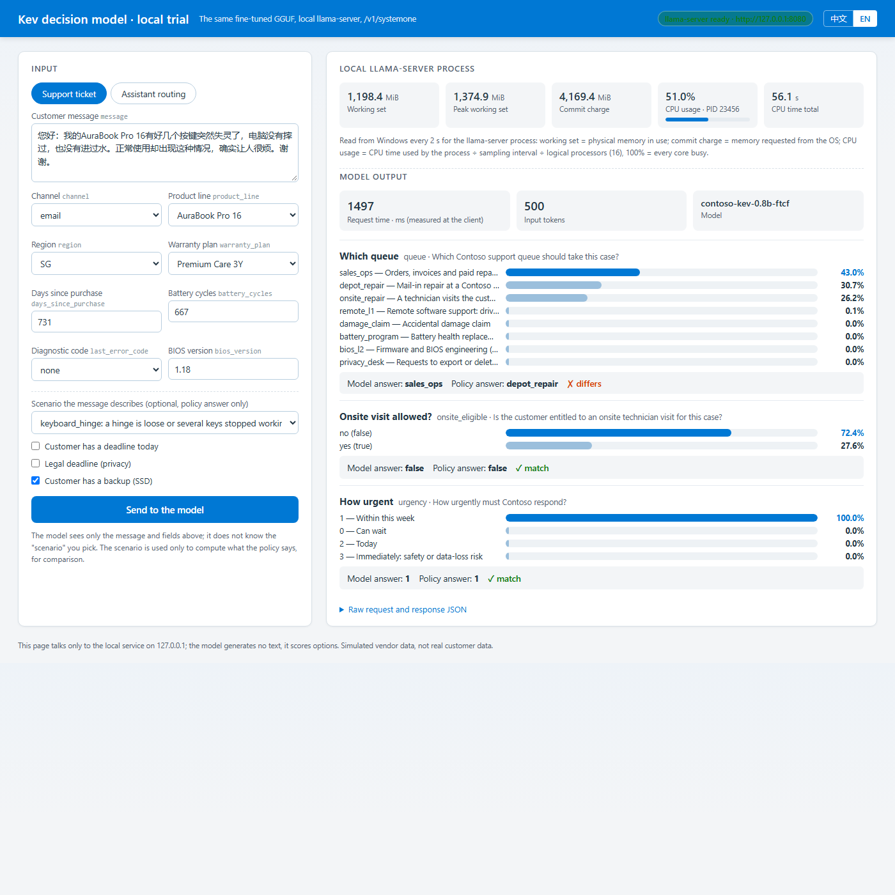

# Operations Guide

[English](Operations-Guide.md) | [中文](操作步骤全本.md)

[Project overview](../README.md) · [Core technology](Core-Technology.md) · [Evaluation results](Evaluation-Results.md)

## Steps

### Use and Deployment Order

<!-- SOURCE:TABLE:1 -->
| Your task| Start here| Execution order| Expected result| 
| ---| ---| ---| ---| 
| Try an existing fine-tuned GGUF locally| [A. Local trial](#local-try)| Start runtime → send one request → edit a field and repeat| Real model response, measured timing and raw output files| 
| Produce a model or adapt to new business data| [B. Train and update](#train-update)| Data → train → calibrate → evaluate → export → update local model| A new checkpoint, evaluation and GGUF; not old-directory overwrite with skipped stages| 
| Recheck the reported results| [C. Verification](#verify)| Run offline tests or start a real model for full device evaluation| Keep code checks, historical evidence replay and fresh model execution distinct| 
<!-- /SOURCE:TABLE:1 -->

This guide contains the complete executable steps; the project overview keeps the shortest local trial. The report explains results, and the protocol retains the original decision rules. Run laptop commands from **the project root containing README.md**, not this document's `文档` directory. After cloning the repository, enter `Deep-Learning/AIPC-Decision-Model-Finetune`.

<a id="local-try"></a>

### A. Try the Fine-Tuned Model Locally

**Prerequisites**: Windows on Arm or x86-64 Windows, PowerShell 7, Python 3.11+, and a fine-tuned model already exported to GGUF. The laptop does not need PyTorch, CUDA or a training environment. Fine-tuned weights are not published in this repository. Use an existing artifact or complete section B; do not substitute released weights and call them fine-tuned.

Download `llama-b11935-bin-win-cpu-arm64.zip` from [llama.cpp b11935](https://github.com/ggml-org/llama.cpp/releases/tag/b11935), SHA-256 `fe9db0136dd8f7e39240c90cd1c1107ff59a8ef27c5517472e9d2c4c0dc9511f`, and extract to `C:\Tools\llama.cpp\b11935-cpu\`. The example model directory is `C:\Tools\models\contoso-kev\`; substitute your own path. On x86-64 Windows use `llama-b11935-bin-win-cpu-x64.zip` from the same release page (SHA-256 `d13e3d617a724eef10a533b18d1178b5292f7f1395965adf4e83b1ab4e9fc4b6`), extract to `C:\Tools\llama.cpp\b11935-cpu-x64\` and point `$Engine` below at that folder; this path was validated on an AMD EPYC 7763 (section 5). Linux, macOS and other architectures were not validated here.

Customer delivery should include the following, rather than asking the customer to run a training pipeline on the laptop:

- **A calibrated model file**: this project delivers `Contoso-Kev-0.8B-FTcf-R2C-Q8_0.gguf` (775 MiB, SHA-256 `c427ed7a8e797e1f6b6a838a80d4c32d8735b85dfa742f2dafba89307808ad05`, calibration temperature 2.83; [export manifest](../验证结果/第二轮微调评测_20261101-101948/gguf/0.8b-r2C/gguf.sha256)) with its version, applicable data scope and acceptance results; the previous `Contoso-Kev-0.8B-FTcf-Q8_0.gguf` (SHA-256 `5a647379764fcad21d12e06bc7fcb1663dd52e15587f8854d9f417d1f96d65d3`) is kept for rollback. Temperature is already inside GGUF; customers do not fill in a separate probability table.
- **The matching runtime:** the b11935 CPU package for the customer's architecture (ARM64 or x64), including its DLLs. Python is used by this repository's request client, not for laptop training.
- **Startup and request instructions:** run A1-A3, send unlabeled business input to `/v1/systemone`, and read structured answers and probabilities. The application owns subsequent actions.

**A1. Start the local server in one PowerShell terminal.**

<!-- SOURCE:FENCE:1 -->
```powershell
$Engine = 'C:\Tools\llama.cpp\b11935-cpu\llama-server.exe'
$Model = 'C:\Tools\models\contoso-kev\Contoso-Kev-0.8B-FTcf-R2C-Q8_0.gguf'   # 交付的第二轮 C；上一版改用 Contoso-Kev-0.8B-FTcf-Q8_0.gguf
if (-not (Test-Path -LiteralPath $Engine)) { throw '找不到 llama-server' }
if (-not (Test-Path -LiteralPath $Model)) { throw '找不到微调 GGUF，请先取得模型' }
& $Engine -m $Model --alias contoso-kev-0.8b-r2c --host 127.0.0.1 --port 8080 `
    -c 8192 -b 2048 -ub 2048 -ngl 0 --cache-ram 0 --offline
```
<!-- /SOURCE:FENCE:1 -->

Successful logs include `decision model type: kev`, `model loaded` and `listening on http://127.0.0.1:8080`. Keep that terminal running. If the port is occupied, identify its owner rather than closing another process. Change both server and client ports when necessary. This server is for trusted local trials; do not expose it directly to a LAN or the internet.

**The temperature is loaded with the model.** For decision requests, b11935 uses GGUF's `qwen35.decision.temperature.choice`, `.score` and `.noul` to scale scores before calculating probabilities. Customers do not submit an additional calibration request. Missing temperature metadata falls back to T = 1, so check it before delivery as described in B6. Ordinary text-sampling `--temp` is not a substitute for these fields.

**A2. Send one request from a second PowerShell terminal.**

<!-- SOURCE:FENCE:2 -->
```powershell
Invoke-RestMethod -Uri http://127.0.0.1:8080/health
$Run = Join-Path '验证结果' ('本机试用_' + (Get-Date -Format 'yyyyMMdd-HHmmss'))
python -B scripts\systemone_client.py --url http://127.0.0.1:8080/v1/systemone `
    --request data\contoso\examples\support.json --out "$Run\support-us"
```
<!-- /SOURCE:FENCE:2 -->

Health should be normal. A successful invocation writes `request`, the unmodified model `response`, `input_sha256` and `client_latency_ms` to the terminal and `$Run\support-us\result.json`. Without ground truth, it does not report accuracy. Connection failures or missing answers cause a nonzero exit, with no cloud fallback. Use a new output directory for every run.

Real customer requests and responses may be sensitive. Store them privately; do not overwrite and commit the repository examples or upload real business results to this public repository.

**A3. Keep the message fixed, change only the region, and send again.**

<!-- SOURCE:FENCE:3 -->
```powershell
python -B scripts\systemone_client.py --url http://127.0.0.1:8080/v1/systemone `
    --request data\contoso\examples\support-sg.json --out "$Run\support-sg"
```
<!-- /SOURCE:FENCE:3 -->

[support.json](../data/contoso/examples/support.json) and [support-sg.json](../data/contoso/examples/support-sg.json) differ only in `state.device.region`. The policy requires onsite service for US and mail-in for SG. In this trial, 0.8B gets both queues wrong; see the real trial above. Edit messages, fields and questions as needed, with a new output directory each time. The client does not correct model answers.

The assistant scenario uses the same runtime:

<!-- SOURCE:FENCE:4 -->
```powershell
python -B scripts\systemone_client.py --url http://127.0.0.1:8080/v1/systemone `
    --request data\contoso\examples\assistant.json --out "$Run\assistant"
```
<!-- /SOURCE:FENCE:4 -->

`choice` is the selected option and `probabilities` contains option probabilities. `noul` is the probability of yes; this project uses 0.5 for binary decisions. `score` is the expected ordinal value; take the maximum in `probabilities` for the most likely level. API `confidence` is neither accuracy nor the maximum option probability: the US support example above has a maximum probability of 42.3% but `confidence` approximately 34.1%. Specify the field used by a business threshold, select it, then validate on independent data. [Report section 3.4](Finetuning-and-On-Device-Validation-Report.md#calibration-guide) gives the calculation.

**A4. Inspect local memory or change the model.**

<!-- SOURCE:FENCE:5 -->
```powershell
$ServerPid = (Get-NetTCPConnection -LocalPort 8080 -State Listen).OwningProcess
Get-Process -Id $ServerPid | Select-Object Id,
    @{Name='WorkingSetMiB';Expression={[math]::Round($_.WorkingSet64 / 1MB,1)}},
    @{Name='PeakWorkingSetMiB';Expression={[math]::Round($_.PeakWorkingSet64 / 1MB,1)}},
    @{Name='PrivateMiB';Expression={[math]::Round($_.PrivateMemorySize64 / 1MB,1)}}
```
<!-- /SOURCE:FENCE:5 -->

To try 4B, stop the current service yourself with Ctrl+C, point `$Model` to your 4B FT-cf GGUF, update `--alias`, and repeat A1-A3. The client never calls 4B automatically because 0.8B is wrong. This is manual model selection, not a fallback cascade.

**A5. Trial in a browser: change fields, submit, read probabilities.** When editing JSON files is inconvenient, use the local page. It sends the same request as A2, but as a form, and draws every option's probability as a bar; optionally pick "the scenario the message describes" and the page computes what the policy says with `scripts/vendor_policy.py` and shows it next to the model's answer (the model never sees that choice). The top-right panel also reads the llama-server process every 2 s: working set, commit charge and CPU usage (Windows API, normalised by logical processors). Chinese/English switch; Python standard library only; binds to 127.0.0.1 only.

<!-- SOURCE:FENCE:6 -->
```powershell
# Either reuse the server from A1, or let the page start and stop it (--start-server; set --engine / --model for your paths)
python -B scripts\try_ui.py --start-server
# then open http://127.0.0.1:8090 in a browser on this machine; Ctrl+C in this terminal stops the page (and the server it started)
```
<!-- /SOURCE:FENCE:6 -->



*Real page screenshot (2026-10-31, x86-64 VM, 0.8B FT-cf Q8_0), region changed to SG. The policy requires mail-in repair; the model answered "orders/quotes" (43.0%) with mail-in at 30.7% — consistent with section 7; the page shows the error as it is. One screenshot per language: [Chinese (region US)](../截图/TryUI_zh_support_US_1400_20261031-171647.png), [English (region SG)](../截图/TryUI_en_support_SG_1400_20261031-171647.png).*

<a id="train-update"></a>

### B. Train and Update with Business Data

An existing model needs only A. This section produces a new model from data. Training runs on a Linux GPU host; the laptop prepares data and retrieves files. Initial reproduction uses the supplied simulated data. For real business data, define questions, labels and independent training, calibration, development and test splits first.

**First-reproduction order**:

<!-- SOURCE:TABLE:2 -->
| Order| Execution location| Action| Script| 
| ---| ---| ---| ---| 
| 1| GPU host (Linux, NVIDIA GPU)| Set up the Kev training environment| `scripts/remote_setup.sh`| 
| 2| GPU host| Reproduce released public-task scores to validate the environment| `scripts/remote_public_baseline.sh`| 
| 3| Laptop → GPU host| Upload data and verify hashes| `scp` + `sha256sum`| 
| 4| GPU host| Baselines, FT, calibration, evaluation and comparison| `scripts/remote_pipeline_v2.sh`| 
| 5| GPU host| FT-cf training and evaluation| `scripts/remote_cf_round.sh`| 
| 6| GPU host (CPU only)| Export GGUF (BF16, Q8_0, Q4_K_M)| `scripts/remote_llama_prep.sh`, `scripts/remote_export_gguf.sh`| 
| 7| Laptop| Retrieve result archive and GGUF; verify hashes| `scripts/pull_results.ps1`, `scripts/pull_gguf.ps1`| 
| 8| Laptop| Evaluate and time device inference; compare with PyTorch| `scripts/run_engine_eval.ps1`| 
| 9| Laptop| Generate all tables| `scripts/summarize_results.py`, `scripts/summarize_engine.py`| 
<!-- /SOURCE:TABLE:2 -->

#### Training Prerequisites

- **GPU host**: Ubuntu 24.04, NVIDIA driver (615.71.10 and CUDA 12.8 in this experiment), memory as described above, access to GitHub and Hugging Face, and about 50 GB of free space on a large disk such as `/mnt`. This run used Azure `Standard_NC40ads_H100_v5`, one H100 NVL with 95,830 MiB GPU memory. Scripts write status and logs to `META` in [remote_env.sh](../scripts/remote_env.sh); adapt its paths for your host.
- **Laptop**: the environment from A plus OpenSSH. Adreno comparisons need an appropriate GPU driver; the historical version was 31.0.133.1.
- **SSH**: key-based access to the GPU host. Replace `$SSH_TARGET`, for example `user@host`, and `$SSH_PORT`. Host addresses are not embedded in the scripts. Pass `-SshTarget` and `-SshPort`, or set `AIPC_SSH_TARGET` and `AIPC_SSH_PORT`.

#### B1. Set Up Training

Upload this project's `scripts/` to a working directory on the GPU host and connect there through SSH. Run GPU commands in that host's Bash; laptop commands remain in PowerShell at this project root.

<!-- SOURCE:FENCE:7 -->
```bash
bash scripts/remote_setup.sh
```
<!-- /SOURCE:FENCE:7 -->

Success ends with `SETUP_DONE ... kev_commit=2074cc44256200bb37540103fa4572901faa10f3`; the import check prints `triton 3.7.1 fla 0.5.2`. The environment is under `/mnt/aipc`, on Azure temporary storage that may be cleared after VM deallocation; rerun setup to restore it. Use `/mnt/aipc/kev/.venv/bin/python` afterward. Do not use `uv run`, which downgrades triton to 3.4 and is incompatible with fla 0.5.2.

#### B2. Reproduce the Public Baseline on GPU

<!-- SOURCE:FENCE:8 -->
```bash
bash scripts/remote_public_baseline.sh
```
<!-- /SOURCE:FENCE:8 -->

Expected transfer-v4 development accuracy on 656 questions is 0.6479 for Kev-0.8B and 0.8171 for Kev-4B, matching the author's published values.

#### B3. Upload Data from the Laptop

Use PowerShell 7 at this project root:

<!-- SOURCE:FENCE:9 -->
```powershell
$files = @((Get-ChildItem -LiteralPath data\contoso\final -Filter *.jsonl).FullName) + (Resolve-Path -LiteralPath data\contoso\final\manifest.json).Path
ssh -n -p $SSH_PORT $SSH_TARGET "mkdir -p /mnt/aipc/data/contoso"
scp -P $SSH_PORT $files "${SSH_TARGET}:/mnt/aipc/data/contoso/"
ssh -n -p $SSH_PORT $SSH_TARGET "cd /mnt/aipc/data/contoso && sha256sum *.jsonl"
```
<!-- /SOURCE:FENCE:9 -->

Compare every returned hash with the corresponding `sha256` in [manifest.json](../data/contoso/final/manifest.json). All must match.

#### B4. Baselines and FT on the GPU Host

<!-- SOURCE:FENCE:10 -->
```bash
BATCH=1 ACCUM=8 bash scripts/remote_pipeline_v2.sh 0.8b
BATCH=4 ACCUM=2 bash scripts/remote_pipeline_v2.sh 4b
```
<!-- /SOURCE:FENCE:10 -->

Progress goes to `$META/state/pipeline-<size>.status`. `META` defaults to `~/remote-workspaces/aipc-decision` in `scripts/remote_env.sh`. Expected stages are `BENCH b0-...`, `TRAIN_DONE wall_s=...`, `CALIBRATED ... T=...`, `BENCH ft-...` and `PIPELINE_DONE`. A rerun skips stages that already contain `report.json`.

Calibration first scores `calib.jsonl` once with the fixed checkpoint, saving question-level scores to `ft-calib-raw/rows.json`. Kev's `scripts/calibrate_checkpoint.py` selects T and writes it into checkpoint `head.pt` metadata; base, LoRA and pointer-head weights stay unchanged. FT-cf uses `ftcf-calib-raw/rows.json` and writes `calibrate_cf.log`. A `CALIBRATED` marker establishes that fitting and saving completed, not that business accuracy or independent calibration acceptance passed.

#### B5. FT-cf: Create Variants Locally, Train on GPU

<!-- SOURCE:FENCE:11 -->
```powershell
python scripts\augment_counterfactual.py --root data\contoso --out data\contoso\final --per-case 2 --per-case-train 3 --seed 11
```
<!-- /SOURCE:FENCE:11 -->

Expected output includes `"train_cf.jsonl": 3832`. Upload the new `*_cf*.jsonl` files and manifest as in B3, then run on the GPU host:

<!-- SOURCE:FENCE:12 -->
```bash
bash scripts/remote_cf_round.sh 0.8b
bash scripts/remote_cf_round.sh 4b
```
<!-- /SOURCE:FENCE:12 -->

`pipeline-cf-<size>.status` records `TRAIN_CF_DONE`, `CALIBRATED_CF` and `PIPELINE_CF_DONE`.

Optional memory probe, only when the GPU has no other workload:

<!-- SOURCE:FENCE:13 -->
```bash
bash scripts/remote_memory_probe.sh
```
<!-- /SOURCE:FENCE:13 -->

`state/memory-probe.status` contains a `PROBE <size> batch=1 accum=8 records=64 rc=0 ... peak_gpu_mib=...` line for each size and ends with `PROBE_DONE`. Detailed logs and per-second GPU-memory samples are under `/mnt/aipc/runs/memory-probe/`.

#### B6. Export GGUF on the GPU Host's CPU

First verify that training and calibration of the selected checkpoint are complete. Export can overlap unrelated training, but must not read a checkpoint still being written.

<!-- SOURCE:FENCE:14 -->
```bash
bash scripts/remote_llama_prep.sh
bash scripts/remote_export_gguf.sh 0.8b 4b
bash scripts/remote_export_gguf_cf.sh 0.8b 4b
```
<!-- /SOURCE:FENCE:14 -->

Both `/mnt/aipc/gguf/<size>/` and `/mnt/aipc/gguf/<size>-cf/` should contain BF16, Q8_0 and Q4_K_M files plus `gguf.sha256`. Conversion merges LoRA into the base and includes the pointer head and calibration parameters, so the resulting file can run without the training environment.

**Inspect temperature metadata before delivery.** The export script runs llama.cpp's `gguf_dump.py --no-tensors` on Q8_0 and saves the result in `metadata.txt`. Its `qwen35.decision.temperature.choice`, `qwen35.decision.temperature.score` and `qwen35.decision.temperature.noul` values must match the source `head.pt` temperature within storage precision. The saved [0.8B FT-cf metadata](../验证结果/微调评测_20261027-220226/gguf/0.8b-cf/metadata.txt) has all three at 1.148698329925537, approximately 1.15. If delivering Q4_K_M or another file, inspect that actual file too; a Q8_0 record does not validate it. Missing or mismatched values block delivery until a wrong or stale export is ruled out.

#### B7. Retrieve Results and Models

<!-- SOURCE:FENCE:15 -->
```powershell
.\scripts\pull_results.ps1 -SshTarget $SSH_TARGET -SshPort $SSH_PORT
.\scripts\pull_gguf.ps1 -Size 0.8b-cf -SshTarget $SSH_TARGET -SshPort $SSH_PORT
```
<!-- /SOURCE:FENCE:15 -->

`-Size` accepts `0.8b`, `0.8b-cf`, `4b` or `4b-cf`, retrieving Q8_0 and Q4_K_M for each. A single scp connection to the VM may deliver less than 1 MiB/s, so both scripts split files across 8 concurrent connections and verify SHA-256 afterward. Success prints `sha256 OK`, then `__PULL_RESULTS_DONE__ <directory>` or `__PULL_GGUF_DONE__`. Results extract to `验证结果\微调评测_<timestamp>\`; large GGUF files go outside the repository, to `C:\Tools\models\contoso-kev\`.

<a id="calibration-update"></a>

#### Update Calibration Without Retraining

Use this route when answer quality meets requirements but representative new data shows over- or underconfidence. These are version-update instructions, not a claim that another customer calibration run has been executed.

1. **Preserve the original and separate the data.** Place the complete checkpoint in a new version directory. Prepare labeled calibration data and acceptance data excluded from fitting. Generate calibration scores with that fixed checkpoint; do not reuse scores from a different model.
2. **Fit T only.** In the Kev environment, run `scripts/calibrate_checkpoint.py` with `--run` identifying the new checkpoint and `--rows` identifying this calibration output. It updates that directory's `head.pt` temperature metadata without weight training. Retain the fit log, data scope and cross-validation results; command success alone does not establish better probabilities.
3. **Export a new GGUF.** Use B6's converter and quantizer versions with the new checkpoint as input and new versioned output paths. Historical export scripts skip existing files; rerunning against an old output directory does not prove an update. Check all three temperature fields and SHA-256 in the new artifact.
4. **Accept on the target laptop.** Evaluate answers, ECE/Brier and error/coverage at the proposed threshold for the final GGUF. Quantization or engine changes can alter scores. Cloud results and answer agreement do not substitute for device-side probability acceptance. C1 collects device outputs and compares answers; it does not select business thresholds or implement automatic handoff.
5. **Switch files and reload on the customer's device.** Verify the delivered SHA-256, manually point `$Model` at the new GGUF using A4, then repeat A1-A3. Keep the prior file for rollback. Editing the training host's `head.pt` cannot change a GGUF already delivered to or loaded by a customer.

#### Updating for New Business Requirements

Use versioned steps: new business data, new checkpoint, independent calibration and evaluation, new GGUF, local validation, then a manual switch. Retain the old model for comparison and rollback. Select on development data and accept on an untouched test set, not training loss or a few trial requests.

**Do not put new data into the old directory and rerun the historical pipeline.** `remote_env.sh` uses fixed `/mnt/aipc` paths, and the original scripts skip existing `head.pt` or `report.json`. That is experiment resumption, not a new business update.

Use native Kev `--init_from <existing-checkpoint>` and a new `--out <new-directory>`, record data/checkpoint versions, and rerun calibration, evaluation and export on that directory. This experiment validates three separate recipes, released-to-FT, released-to-FT-cf and released-to-round-2 C (C is also retrained from the release, not continued from FT-cf; script [scripts/remote_round2.sh](../scripts/remote_round2.sh)), **not automatic feedback training, repeated business-update cycles or automatic publication**. See [Kev's own-data fine-tuning contract](https://github.com/jaredpalmer/kev/blob/2074cc44256200bb37540103fa4572901faa10f3/README.md#fine-tune-on-your-own-data).

<a id="verify"></a>

### C. Verify and Reproduce Measurements

Offline tests require no model. New device evaluation requires real GGUF weights and the runtime. Passing offline tests does not turn historical scores into a new experiment.

<a id="single-question-run"></a>

#### C1. Single-Question Evaluation on the Laptop

Use the CPU runtime from A. For Adreno comparison, download `llama-b11935-bin-win-opencl-adreno-arm64.zip` from the same release, SHA-256 `03495082010595c4d20c50b5d06fc44c0e03c57db5d573fae1727a92cca6a4c8`, and extract to `C:\Tools\llama.cpp\b11935-opencl-adreno\`. The batch script starts and stops its own service. First stop A's trial service yourself or choose a different port.

The new main table uses `-SingleQuestion`: one question per request over all four test sets by default, collecting accuracy, latency and ECE together. Omitting the switch retains the historical three-question mode. Start a batch with a new timestamp and use the fixed model labels below within it, without overwriting an older batch. Completion is determined by the result table and its raw records.

<!-- SOURCE:FENCE:16 -->
```powershell
$Run = Join-Path '验证结果' ('单题端侧评测_骁龙_' + (Get-Date -Format 'yyyyMMdd-HHmmss'))
pwsh -NoProfile -ExecutionPolicy Bypass -File scripts\run_engine_eval.ps1 `
    -Model C:\Tools\models\contoso-kev\Contoso-Kev-0.8B-FTcf-R2C-Q8_0.gguf `
    -Label r2c-kev-0.8b-Q8_0-cpu -SingleQuestion -OutRoot $Run -Port 8118
```
<!-- /SOURCE:FENCE:16 -->

Continue with 4B FT-cf Q8_0 in the same batch. For the other configurations change the model file and fixed label, retaining all test sets and settings:

<!-- SOURCE:FENCE:17 -->
```powershell
pwsh -NoProfile -ExecutionPolicy Bypass -File scripts\run_engine_eval.ps1 `
    -Model C:\Tools\models\contoso-kev\Contoso-Kev-4B-FTcf-Q8_0.gguf `
    -Label ftcf-kev-4b-Q8_0-cpu -SingleQuestion -OutRoot $Run -Port 8118
```
<!-- /SOURCE:FENCE:17 -->

The seven fixed labels are `released-kev-0.8b-Q8_0-cpu`, `ftcf-kev-0.8b-Q8_0-cpu`, `ft-kev-0.8b-Q4_K_M-cpu`, `r2c-kev-0.8b-Q8_0-cpu`, `released-kev-4b-Q4_K_M-cpu`, `ftcf-kev-4b-Q8_0-cpu` and `ftcf-kev-4b-Q4_K_M-cpu`. Each must use its own model file; renaming a label while loading the same weights is not another configuration. Reuse the official released packages and each fine-tuned model's calibrated GGUF. This protocol neither retrains nor refits temperature.

Each completed model leaves `run.json`, `server.log`, and `rows.jsonl` plus `summary.json` per test set. Request counts must be 510, 477, 1,011 and 951, with `questions_answered + errors = questions = requests`. ECE has a separate denominator and valid-probability coverage. A `--limit` smoke sample cannot enter the main table. New output directories are required; existing ones fail instead of being overwritten. Retain interrupted evidence as incomplete, never as a full run.

Single-question mode does not compare against historical three-question PyTorch results: it skips `-TorchPrefix` with a warning. Without `-SingleQuestion`, the legacy `-TorchPrefix`, `-Backend opencl`, `-Ctx`, `-UBatch`, `-DataPrefix policy_test_`, `-Concurrency` and `-Parallel` options remain available. Such changed conditions do not belong in the default single-question table. x64 runs require their matching `-Bin` and a separately named result directory, never a Snapdragon batch name.

#### C2. Generate Tables on the Laptop

<!-- SOURCE:FENCE:18 -->
```powershell
python scripts\summarize_results.py --runs 验证结果\微调评测_<时间>\runs --data data\contoso\final --out 验证结果\微调评测_<时间>\summary
python scripts\summarize_engine.py --root 验证结果\端侧引擎_20261027-124700 --output-dir 验证结果\微调评测_<时间>\summary
python scripts\fill_report_tables.py --report 文档/评测与端侧结果全集.md --blocks 验证结果\微调评测_<时间>\summary\report_blocks.json --block ENGINE=验证结果\微调评测_<时间>\summary\engine_brief.md --block README_PERFORMANCE=验证结果\微调评测_<时间>\summary\engine_comparison.md
```
<!-- /SOURCE:FENCE:18 -->

`summary.md` contains all tables; `report_blocks.json` contains blocks for the README and report. `engine_comparison.md` supplies the main performance before/after table; `engine_brief.md` retains every device configuration. These commands produce derived summaries without changing raw results. Rerunning the fill step replaces previous generated Chinese blocks. The diagram/document renderer uses the shared table-localization function for English; measured values are not translated or recalculated. Synchronize the English source-backed blocks after updating their Chinese counterparts:

The three commands above remain for historical GPU and three-question results, not single-question aggregation. The client writes new single-question metrics directly to each run's `summary.json`. Run `python scripts\render_diagrams.py --sync-english --preview`: it selects the name-sorted latest `验证结果/单题端侧评测_骁龙_*` batch, checks device, input hash, full question count and raw-output hash, and writes the same table to the overview and detailed results in both languages. Missing configurations remain unmeasured rather than being filled from other batches. Numbers are not translated.

#### C3. Offline Tests

<!-- SOURCE:FENCE:19 -->
```powershell
python -m unittest discover -s tests -v
```
<!-- /SOURCE:FENCE:19 -->

[tests/test_data_and_scoring.py](../tests/test_data_and_scoring.py) needs neither the GPU VM nor the device engine. Success ends with `OK`. Existing data/scoring checks are retained, including visible-input transmission, raw response preservation and failure behavior:

<!-- SOURCE:TABLE:3 -->
| Check| Failure detected| 
| ---| ---| 
| Send visible business inputs without labels; preserve the raw model response| Ground-truth leakage or fabricated local-inference output| 
| Do not save success after connection/missing-answer failures; reject reused output directories| Silent fallback, false success or overwritten evidence| 
| Each manifest file's SHA-256, record count and question count in `manifest.json`| Data changed without a manifest update; historical input identity needs request hashes| 
| Recompute every label from its own device fields, including paired and counterfactual records| Stale labels after policy or field changes| 
| Original cases and field variants stay in the same split by group ID| Within-group leakage; text duplication across different groups needs a separate check| 
| B0-policy and test files have identical records and labels, differing only in policy text| Prompt baseline evaluated on different questions| 
| Every counterfactual changes at least one correct answer| Variants whose answers did not change| 
| `parity.py`: identical answers give agreement 1; changing one answer reduces agreements by 1| Misaligned questions or option ordering in engine comparison| 
| `temperature_whatif.py` reproduces Kev's Brier 0.6413 at the released temperature| Incorrect probability rescaling for temperature| 
| `summarize_results.py` gives correct paired-bootstrap differences and intervals for all-correct, all-wrong and half-correct cases| Incorrect paired difference or interval| 
<!-- /SOURCE:TABLE:3 -->

Not covered: GPU training/evaluation itself, which needs B4-B5 logs and results; real llama-server startup and model behavior, which need A or C1; or the large-model API used to generate data. Substitute responses in transport tests validate client logic, not model capability.

Reproduction boundary: current out-of-distribution data files have different byte hashes from historical `suite_sha256` values; the reason has not been established. Historical released, FT and FT-cf request hashes and labels match, supporting the within-run comparison shown here. A consistent current `manifest.json` does not prove byte-identical historical inputs. Verify input versions before a new experiment rather than calling it a strict reproduction of the old run.

#### C4. Regenerate the Diagrams

The four diagrams (training, inference, validation, decision model) in both languages and all local previews share [scripts/render_diagrams.py](../scripts/render_diagrams.py). [requirements-docs.txt](../requirements-docs.txt) pins documentation dependencies, not model-runtime dependencies. Windows defaults to the installed `C:\Windows\Fonts\msyh.ttc`; elsewhere provide a CJK font with `--font`. Figure sources and hashes are in [images/provenance.json](../images/provenance.json). Official icon originals, licenses and raster hashes are in [images/vendor/sources.json](../images/vendor/sources.json).

<!-- SOURCE:FENCE:20 -->
```powershell
python -m pip install -r requirements-docs.txt
python -B scripts\render_diagrams.py --preview
```
<!-- /SOURCE:FENCE:20 -->

Do not reinstall matching dependencies. `--preview` checks local links/anchors and writes ignored `*.preview.html` files next to the source documents for Edge. It does not publish or replace Markdown sources. The language switch links the actual English and Chinese pages.

### Stop and Restore

- Stop the local trial with Ctrl+C in its server terminal. Models and saved responses remain. Repeat A1 to load again without retraining.
- The training VM bills by the hour. Before stopping, finish B7 and verify hashes, then obtain the resource owner's approval for deallocation. An OS-only stop, `stopped`, still bills. This page does not automatically stop or delete cloud resources.
- Do not depend on temporary `/mnt` data surviving deallocation. Restore with B1 after restarting; retrieved checkpoints/results can be uploaded again without retraining.

### Repository Deliverables

<!-- SOURCE:TABLE:4 -->
| Deliverable| Location| Purpose| 
| ---| ---| ---| 
| Simulated vendor data with policy-computed labels| [data/contoso/final](../data/contoso/final); manifest and SHA-256: [manifest.json](../data/contoso/final/manifest.json)| Training, calibration, development, in-distribution, out-of-distribution and variant evaluation| 
| Vendor policy and data generation| [scripts/vendor_policy.py](../scripts/vendor_policy.py), [scripts/gen_vendor_data.py](../scripts/gen_vendor_data.py), [scripts/augment_counterfactual.py](../scripts/augment_counterfactual.py)| Adapt policies and fields to reuse the workflow with real business data| 
| GPU-host training and evaluation pipelines| [scripts/remote_setup.sh](../scripts/remote_setup.sh), [scripts/remote_pipeline_v2.sh](../scripts/remote_pipeline_v2.sh), [scripts/remote_cf_round.sh](../scripts/remote_cf_round.sh), [scripts/remote_export_gguf.sh](../scripts/remote_export_gguf.sh)| Baselines, fine-tuning, temperature calibration, evaluation, paired comparison and GGUF export| 
| Laptop device validation| [scripts/run_engine_eval.ps1](../scripts/run_engine_eval.ps1), [scripts/systemone_client.py](../scripts/systemone_client.py), [scripts/parity.py](../scripts/parity.py)| Start llama-server, score and time request by request (including concurrency), compare with PyTorch per question| 
| Local browser trial page| [scripts/try_ui.py](../scripts/try_ui.py)| Edit inputs in a browser form, see every option's probability, compare with the policy answer, watch process memory and CPU; Chinese/English| 
| Summaries and tests| [scripts/summarize_results.py](../scripts/summarize_results.py), [scripts/summarize_engine.py](../scripts/summarize_engine.py), [scripts/calibration_boundary.py](../scripts/calibration_boundary.py), [tests/](../tests)| Every table is generated from raw results; offline "re-calibrate or retrain" decision; offline checks of data and scoring code| 
| Raw evidence| [Evidence directory](../验证结果)| Evaluation reports, predictions, training logs, GPU-memory samples and device records. Checkpoints and full result archives contain files above GitHub's 100 MB limit and are not included; reproduce them with the training steps| 
| Detailed report| [Detailed validation report](Finetuning-and-On-Device-Validation-Report.md)| Full tables, per-question analysis and claim boundaries| 
<!-- /SOURCE:TABLE:4 -->

#### Responsibilities

<!-- SOURCE:TABLE:5 -->
| Component| Owner| This repository's approach| 
| ---| ---| ---| 
| Kev decision model (Qwen3.5-Base + LoRA + pointer head + calibration temperature)| Open-source project [jaredpalmer/kev](https://github.com/jaredpalmer/kev)| Pinned to commit `2074cc44`; native `--init_from` continuation, with upstream code unchanged| 
| llama.cpp inference runtime| [ggml-org/llama.cpp](https://github.com/ggml-org/llama.cpp)| Official b11935 packages and matching `convert_hf_to_gguf.py`, with upstream code unchanged| 
| Business policies, real data and labels| Vendor| Fictional Contoso PC policies stand in for the vendor; code computes every label| 
| Training host and laptop| Vendor| Azure `Standard_NC40ads_H100_v5` (1× H100 NVL) and one Snapdragon X Elite X1E80100 laptop; the x86-64 cross-check used an AMD EPYC 7763 Azure VM| 
<!-- /SOURCE:TABLE:5 -->

**Not included**: real customer data; multiple random seeds; Hexagon NPU testing, which required Windows test-signing changes not made on the managed corporate laptop; concurrency on the laptop (measured only on the x86-64 VM), long-duration or battery-powered device tests.

#### Evidence and Report Navigation

<!-- SOURCE:TABLE:6 -->
| You want to| Read here| 
| ---| ---| 
| Send a business request on your laptop| [Local trial](#local-try); no retraining required| 
| Train and update with your data| [Train and update](#train-update); note the historical pipeline's resume/skip behavior| 
| Check data/scoring or rerun device evaluation| [Verification](#verify); distinguish offline checks from real model invocation| 
| Complete tables: per-question, calibration, field-level policy following and all device runs| [Detailed validation report](Finetuning-and-On-Device-Validation-Report.md)| 
| Predeclared decision rules and recorded deviations| [Experimental protocol](Experiment-Protocol.md)| 
| Raw training/evaluation reports, predictions, logs and GPU-memory samples| [Training and evaluation evidence](../验证结果/微调评测_20261027-220226) (`summary/summary.md` contains all summary tables; the archive SHA-256 is in `archive.sha256`)| 
| Per-run device records, server logs, memory and answer comparisons| [Device-runtime evidence](../验证结果/端侧引擎_20261027-124700)| 
| Two batch runs, per-question comparison and 3 single requests of the same model on an x86-64 VM| [验证结果/端侧引擎_x64_20261030-234858](../验证结果/端侧引擎_x64_20261030-234858), [验证结果/本机试用_x64_20261030-135532](../验证结果/本机试用_x64_20261030-135532)| 
| Concurrency load test: 1 / 2 / 4 / 8 client requests in flight, 4 and 8 server slots| x86-64 FT-cf: [验证结果/端侧引擎_x64并发_20261031-013937](../验证结果/端侧引擎_x64并发_20261031-013937); Snapdragon round-2 C: [验证结果/端侧引擎_骁龙并发第二轮C_20261101-225349](../验证结果/端侧引擎_骁龙并发第二轮C_20261101-225349) (each `summary/concurrency.json` is the roll-up)| 
| Long-input cost: 40 tickets padded to 7,700 tokens per question| [验证结果/端侧引擎_x64长输入_20261101-101318](../验证结果/端侧引擎_x64长输入_20261101-101318) (`run.json` has latency and memory, `server.log` the KV purge records)| 
| Real long inputs: 160 tickets with a case history (the history decides the answer) and two history-removed controls| [验证结果/端侧引擎_x64长输入真题_20261101-224312](../验证结果/端侧引擎_x64长输入真题_20261101-224312) (summary/long_summary.md split by clause, summary/long_numbers.json every number; data [long](../data/contoso/final/long_test_support.jsonl) / [longshort](../data/contoso/final/longshort_test_support.jsonl) / [longplain](../data/contoso/final/longplain_test_support.jsonl), generator [gen_long_cases.py](../scripts/gen_long_cases.py))| 
| Released-model public-task reproduction, matching the author's scores| [Public-baseline reproduction](../验证结果/公开基线复现_20261027-123403)| 
| Policy-code label verification, 0 mismatches| [Policy-label verification](../验证结果/数据标签复核_20261027-130518.txt)| 
<!-- /SOURCE:TABLE:6 -->

#### Directories

<!-- SOURCE:TABLE:7 -->
| Directory| Contents| 
| ---| ---| 
| `data/contoso/`| Cases (`*.cases.jsonl`), generated messages (`*.texts.jsonl`) and usage (`*.usage.json`); `final/` holds training/evaluation files. Public records replace generator names with `llm-A` and `llm-B`; other content is unchanged, so SHA-256 values in `manifest.json` differ from experiment-time values| 
| `data/contoso/examples/`| Three editable, unlabeled trial requests from existing test cases and a region-only variant; not training data| 
| `scripts/`| Current, auxiliary and historical script roles are listed below; historical entries are preserved| 
| `tests/`| Offline tests requiring neither GPU nor device runtime| 
| `images/`| Four explanatory diagrams generated by `scripts/render_diagrams.py` (training, inference, validation, decision model), the author's unchanged ranking figure, and source/hash ledgers| 
| `验证结果/`| Raw results and evidence by run time. Public `run.json`, `summary.json` and `parity_vs_pytorch.json` use repository-relative paths| 
| `文档/`| Detailed report and experimental protocol| 
<!-- /SOURCE:TABLE:7 -->

#### Script Navigation

<!-- SOURCE:TABLE:8 -->
| Purpose| Primary entry| Auxiliary or historical scripts| 
| ---| ---| ---| 
| Routine single-request inference| `systemone_client.py --request`, `try_ui.py` (browser page)| Sends the input and saves/shows the response; no grading, no business action| 
| Batch device validation| `run_engine_eval.ps1`, `systemone_client.py --data`, `parity.py`| `refresh_parity.ps1` recomputes historical parity; `latency_profile.py` inspects latency stages| 
| Data preparation| `vendor_policy.py`, `gen_vendor_data.py`, `augment_counterfactual.py`| Large models generate text; policy code computes labels| 
| Initial training reproduction| `remote_setup.sh`, `remote_public_baseline.sh`, `remote_pipeline_v2.sh`, `remote_cf_round.sh`| `remote_pipeline.sh` is the historical fixed-micro-batch version; `remote_run_all.sh`, `remote_after_08b.sh` and `remote_after_chain.sh` are original sequential orchestration entries| 
| Model export and retrieval| `remote_llama_prep.sh`, `remote_export_gguf.sh`, `remote_export_gguf_cf.sh`, `pull_gguf.ps1`, `pull_results.ps1`| `remote_pack_results.sh` packages results; `fetch_parallel.ps1` transfers chunks; `remote_env.sh` defines remote paths| 
| Analysis and documentation| `summarize_results.py`, `summarize_engine.py`, `calibration_boundary.py`, `fill_report_tables.py`| `temperature_whatif.py` diagnoses temperature; `remote_memory_probe.sh` only probes memory; `render_diagrams.py` renders diagrams| 
<!-- /SOURCE:TABLE:8 -->
