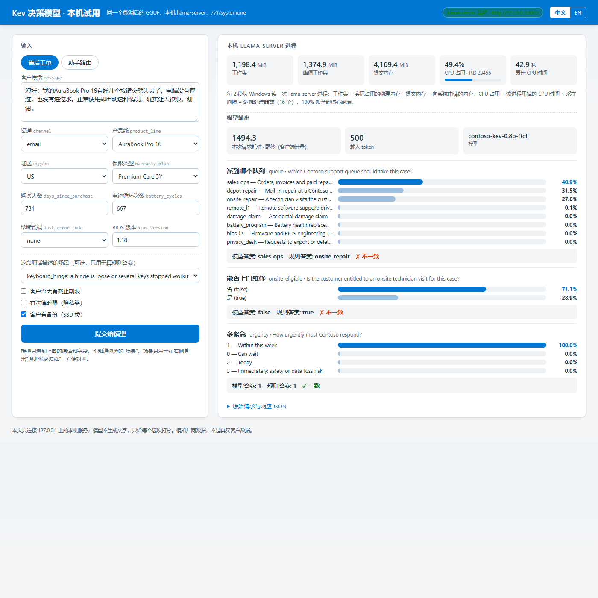

# 操作步骤全本

[English](Operations-Guide.md) | [中文](操作步骤全本.md)

[项目首页](../README_CN.md) · [核心技术](核心技术_微调与端侧运行.md) · [评测全集](评测与端侧结果全集.md)

## 操作步骤

### 使用与部署顺序

| 你要做什么 | 从哪里开始 | 执行顺序 | 完成时看到什么 |
|---|---|---|---|
| 已有微调 GGUF，想在本机试用 | [A. 本机试用](#local-try) | 启动本机引擎 → 发送单条请求 → 修改字段再试 | 真实模型响应、本次耗时和原始结果文件 |
| 还没有微调模型，或要适配新业务 | [B. 训练与更新](#train-update) | 数据 → 训练 → 校准 → 评测 → 导出 → 更新本机模型 | 新版本检查点、评测结果和 GGUF；不是覆盖旧目录后继续跳过 |
| 要复核文中结论 | [C. 验证与复核](#verify) | 离线测试，或另行启动模型做完整端侧评测 | 明确区分代码检查、历史证据复核和新模型实跑 |

本页承接全部操作命令，首页保留最短试用路径；详细报告解释结果，实验协议保存原判定规则。下面均从 **本项目根目录（根 README 所在目录，不是本文件所在的文档目录）** 执行。尚未获取代码时，可先克隆本仓库，再进入 `Deep-Learning/AIPC-Decision-Model-Finetune`。

<a id="local-try"></a>

### A. 本机试用微调模型

**前提**：Windows on Arm 或 x86-64 Windows、PowerShell 7、Python 3.11+，以及一个已经训练并导出的 GGUF。不需要在笔记本安装 PyTorch、CUDA 或训练环境。微调权重没有发布在本仓库中：已有模型直接使用；没有模型时先完成 B，不能拿发布版权重代替并称作微调版。

从 [llama.cpp b11935 发布页](https://github.com/ggml-org/llama.cpp/releases/tag/b11935)取得 `llama-b11935-bin-win-cpu-arm64.zip`，SHA-256 为 `fe9db0136dd8f7e39240c90cd1c1107ff59a8ef27c5517472e9d2c4c0dc9511f`，解压到 `C:\Tools\llama.cpp\b11935-cpu\`。模型示例位置为 `C:\Tools\models\contoso-kev\`，可以改成自己的路径。x86-64 的 Windows 机器用同一发布页的 `llama-b11935-bin-win-cpu-x64.zip`（SHA-256 `d13e3d617a724eef10a533b18d1178b5292f7f1395965adf4e83b1ab4e9fc4b6`），解压到 `C:\Tools\llama.cpp\b11935-cpu-x64\`，下面的 `$Engine` 改指该目录；这条路径已在 AMD EPYC 7763 上验证（第 5 节）。Linux、macOS 和其他架构本次未验证。

交付给客户时应包含以下内容，而不是让客户在笔记本上跑训练流水线：

- **已校准的模型文件**：本项目交付 `Contoso-Kev-0.8B-FTcf-R2C-Q8_0.gguf`（775 MiB，SHA-256 `c427ed7a8e797e1f6b6a838a80d4c32d8735b85dfa742f2dafba89307808ad05`，校准温度 2.83；[导出清单](../验证结果/第二轮微调评测_20261101-101948/gguf/0.8b-r2C/gguf.sha256)），连同版本、数据适用范围及验收结果；上一版 `Contoso-Kev-0.8B-FTcf-Q8_0.gguf`（SHA-256 `5a647379764fcad21d12e06bc7fcb1663dd52e15587f8854d9f417d1f96d65d3`）保留作回退。温度已在 GGUF 内，不需要再传一个由客户手工填写的概率表。
- **匹配的运行时**：与客户机器架构对应的 b11935 CPU 包（ARM64 或 x64）及随包 DLL。Python 只用于本仓库的调用客户端，不用于本机训练。
- **启动与调用约定**：执行 A1–A3，向 `/v1/systemone` 提交无标签业务输入，读取结构化答案和概率。业务应用自己决定后续动作。

**A1. 在一个 PowerShell 终端启动本机服务。**

```powershell
$Engine = 'C:\Tools\llama.cpp\b11935-cpu\llama-server.exe'
$Model = 'C:\Tools\models\contoso-kev\Contoso-Kev-0.8B-FTcf-R2C-Q8_0.gguf'   # 交付的第二轮 C；上一版改用 Contoso-Kev-0.8B-FTcf-Q8_0.gguf
if (-not (Test-Path -LiteralPath $Engine)) { throw '找不到 llama-server' }
if (-not (Test-Path -LiteralPath $Model)) { throw '找不到微调 GGUF，请先取得模型' }
& $Engine -m $Model --alias contoso-kev-0.8b-r2c --host 127.0.0.1 --port 8080 `
    -c 8192 -b 2048 -ub 2048 -ngl 0 --cache-ram 0 --offline
```

成功时日志包含 `decision model type: kev`、`model loaded` 和 `listening on http://127.0.0.1:8080`。这个终端保持运行。端口占用时先确认占用者，不要直接关闭其他进程；需要时同时修改服务端和客户端端口。服务只供可信本机试用，不应直接暴露到局域网或公网。

**此时温度已经随模型加载。** b11935 在处理决策请求时读取 GGUF 中的 `qwen35.decision.temperature.choice`、`.score`、`.noul`，先缩放分数再计算概率，不需要客户再发一次“校准请求”。元数据缺失时引擎会回退到 T = 1，所以交付前必须按 B6 核对它；不要拿普通文本采样的 `--temp` 代替这些字段。

**A2. 在第二个 PowerShell 终端发送一条请求。**

```powershell
Invoke-RestMethod -Uri http://127.0.0.1:8080/health
$Run = Join-Path '验证结果' ('本机试用_' + (Get-Date -Format 'yyyyMMdd-HHmmss'))
python -B scripts\systemone_client.py --url http://127.0.0.1:8080/v1/systemone `
    --request data\contoso\examples\support.json --out "$Run\support-us"
```

`health` 应返回正常状态。真实调用成功后，终端和 `$Run\support-us\result.json` 中都有 `request`、模型原始 `response`、`input_sha256` 和 `client_latency_ms`。没有标准答案时不输出准确率；连接失败或答案缺失时非零退出，不调用云端兜底。输出目录必须是新的，避免覆盖上一次结果。

实际客户的请求与响应可能含敏感信息，应保存在私有目录，不要覆盖并提交仓库示例，也不要把真实业务结果提交到公共仓库。

**A3. 保持原话不变，只改地区，再发送一次。**

```powershell
python -B scripts\systemone_client.py --url http://127.0.0.1:8080/v1/systemone `
    --request data\contoso\examples\support-sg.json --out "$Run\support-sg"
```

[support.json](../data/contoso/examples/support.json) 与 [support-sg.json](../data/contoso/examples/support-sg.json) 仅有 `state.device.region` 不同。按本项目策略，US 应上门、SG 应寄修；本次 0.8B 的两个队列都答错，见上面的真实试用记录。可以直接编辑原话、设备字段和问题再试，每次使用新输出目录，模型不会自动替你改正答案。

助手场景使用同一个引擎：

```powershell
python -B scripts\systemone_client.py --url http://127.0.0.1:8080/v1/systemone `
    --request data\contoso\examples\assistant.json --out "$Run\assistant"
```

`choice` 是选中的选项，`probabilities` 是各选项概率；`noul` 是“是”的概率，本项目以 0.5 为二值判定界限；`score` 是等级期望值，最可能的等级要从 `probabilities` 取最大值。API 的 `confidence` 不等于准确率，也不等于最高选项概率：上面的 US 工单最高选项概率为 42.3%，`confidence` 约为 34.1%。业务阈值必须注明所用字段，在选定后用独立数据验收；计算定义见[报告第 3.4 节](微调与端侧验证报告_20261027-130700.md#calibration-guide)。

**A4. 查看本机内存，或更换模型。**

```powershell
$ServerPid = (Get-NetTCPConnection -LocalPort 8080 -State Listen).OwningProcess
Get-Process -Id $ServerPid | Select-Object Id,
    @{Name='WorkingSetMiB';Expression={[math]::Round($_.WorkingSet64 / 1MB,1)}},
    @{Name='PeakWorkingSetMiB';Expression={[math]::Round($_.PeakWorkingSet64 / 1MB,1)}},
    @{Name='PrivateMiB';Expression={[math]::Round($_.PrivateMemorySize64 / 1MB,1)}}
```

要试 4B，先由你在服务终端按 Ctrl+C 停止当前服务，再将 `$Model` 换成自己的 4B FT-cf GGUF、同步修改 `--alias`，重新执行 A1–A3。客户端不会因为 0.8B 答错而自动调用 4B。这里是模型选择与人工试用，不是自动级联路由。

**A5. 图形界面试用：改字段、点提交、看概率。** 不想改 JSON 文件时，用本机网页试。它和 A2 发的是同样的请求，只是把输入做成表单、把每个选项的概率画成条；可选“这段原话描述的场景”，页面会用 `scripts/vendor_policy.py` 算出“规则说该怎样”并排显示，模型看不到这个选择。页面右上角还每 2 秒读一次 llama-server 进程的工作集、提交内存和 CPU 占用（Windows API，按逻辑处理器数归一），中英文可切换。只用 Python 标准库，只监听 127.0.0.1。

```powershell
# Either reuse the server from A1, or let the page start and stop it (--start-server; set --engine / --model for your paths)
python -B scripts\try_ui.py --start-server
# then open http://127.0.0.1:8090 in a browser on this machine; Ctrl+C in this terminal stops the page (and the server it started)
```



*真实页面截图（2026-10-31，x86-64 虚拟机，0.8B FT-cf Q8_0）。这条工单按规则该上门维修，模型答了“订单/报价”（40.9%），上门维修只有 27.6%——和第 7 节的记录一致，页面如实显示错误。中文 / 英文界面各一张：[中文](../截图/TryUI_zh_support_US_1400_20261031-171647.png)、[英文（地区改为 SG）](../截图/TryUI_en_support_SG_1400_20261031-171647.png)。*

<a id="train-update"></a>

### B. 用业务数据训练与更新

已有模型只需 A。本节是从数据得到新模型的流程，训练在 Linux GPU 主机上，本地只做数据准备和文件取回。以下首次复现步骤使用仓库随附的模拟数据；换成真实业务时，先确定问题、标签和独立的训练、校准、开发、测试切分。

**首次复现的部署顺序**：

| 顺序 | 在哪执行 | 做什么 | 脚本 |
|---|---|---|---|
| 1 | GPU 主机（Linux，NVIDIA GPU） | 搭建 Kev 训练环境 | `scripts/remote_setup.sh` |
| 2 | GPU 主机 | 复现发布版在公开题上的分数，确认环境正确 | `scripts/remote_public_baseline.sh` |
| 3 | 笔记本 → GPU 主机 | 上传数据并核对哈希 | `scp` + `sha256sum` |
| 4 | GPU 主机 | 基线、FT 微调、校准、评测、比较 | `scripts/remote_pipeline_v2.sh` |
| 5 | GPU 主机 | FT-cf 微调与评测 | `scripts/remote_cf_round.sh` |
| 6 | GPU 主机（只用 CPU） | 导出 GGUF（BF16、Q8_0、Q4_K_M） | `scripts/remote_llama_prep.sh`、`scripts/remote_export_gguf.sh` |
| 7 | 笔记本 | 拉回结果包和 GGUF，核对哈希 | `scripts/pull_results.ps1`、`scripts/pull_gguf.ps1` |
| 8 | 笔记本 | 端侧打分、计时、与 PyTorch 比对 | `scripts/run_engine_eval.ps1` |
| 9 | 笔记本 | 生成全部表格 | `scripts/summarize_results.py`、`scripts/summarize_engine.py` |

#### 训练前提

- **GPU 主机**：Ubuntu 24.04，NVIDIA 驱动（本次 615.71.10，CUDA 12.8），显存需求见上面第 4 节；能访问 GitHub 和 Hugging Face；`/mnt` 一类的大容量盘留出约 50 GB。本次用 Azure `Standard_NC40ads_H100_v5`（1× H100 NVL，95,830 MiB 显存）。训练脚本把状态和日志写在 [scripts/remote_env.sh](../scripts/remote_env.sh) 里的 `META` 目录，换主机时按需要改。
- **笔记本**：A 中的本机环境和 OpenSSH 客户端；Adreno 对照测试需要较新的 GPU 驱动（历史测试为 31.0.133.1）。
- **SSH**：笔记本能用密钥登录 GPU 主机。下面的命令用 `$SSH_TARGET`（例如 `user@host`）和 `$SSH_PORT` 表示，按你的主机替换。脚本里没有内置主机地址：传 `-SshTarget`、`-SshPort` 参数，或先设置环境变量 `AIPC_SSH_TARGET`、`AIPC_SSH_PORT`。

#### B1. 搭建训练环境

先将本项目 `scripts/` 目录上传到 GPU 主机上的工作目录，并通过 SSH 进入该目录。以下 GPU 命令均在该主机的 Bash 中执行，笔记本命令仍在本项目目录的 PowerShell 中执行。

```bash
bash scripts/remote_setup.sh
```

成功时最后一行是 `SETUP_DONE ... kev_commit=2074cc44256200bb37540103fa4572901faa10f3`，前面的 import 检查打印 `triton 3.7.1 fla 0.5.2`。环境装在 `/mnt/aipc`（Azure 临时盘，VM 释放后清空，重新运行这一步即可恢复）。之后一律用 `/mnt/aipc/kev/.venv/bin/python`，不要用 `uv run`（它会把 triton 退回 3.4，与 fla 0.5.2 不兼容）。

#### B2. 复现公开基线（GPU 主机）

```bash
bash scripts/remote_public_baseline.sh
```

成功时 transfer-v4 开发集（656 题）准确率：Kev-0.8B 0.6479、Kev-4B 0.8171，与 Kev 作者公布值一致。

#### B3. 上传数据（笔记本，PowerShell 7，本项目根目录）

```powershell
$files = @((Get-ChildItem -LiteralPath data\contoso\final -Filter *.jsonl).FullName) + (Resolve-Path -LiteralPath data\contoso\final\manifest.json).Path
ssh -n -p $SSH_PORT $SSH_TARGET "mkdir -p /mnt/aipc/data/contoso"
scp -P $SSH_PORT $files "${SSH_TARGET}:/mnt/aipc/data/contoso/"
ssh -n -p $SSH_PORT $SSH_TARGET "cd /mnt/aipc/data/contoso && sha256sum *.jsonl"
```

把输出与 `data/contoso/final/manifest.json` 里的 `sha256` 逐个比对，应全部一致。

#### B4. 基线 + FT（GPU 主机）

```bash
BATCH=1 ACCUM=8 bash scripts/remote_pipeline_v2.sh 0.8b
BATCH=4 ACCUM=2 bash scripts/remote_pipeline_v2.sh 4b
```

进度写在 `$META/state/pipeline-<size>.status`（`META` 默认是 `~/remote-workspaces/aipc-decision`，在 `scripts/remote_env.sh` 里设置），依次出现 `BENCH b0-...`、`TRAIN_DONE wall_s=...`、`CALIBRATED ... T=...`、`BENCH ft-...`、`PIPELINE_DONE`。重新运行会跳过已经有 `report.json` 的步骤。

其中校准阶段先由固定检查点跑一遍 `calib.jsonl`，保存逐题分数到 `ft-calib-raw/rows.json`，再由 Kev 的 `scripts/calibrate_checkpoint.py` 选择 T，并写回检查点 `head.pt` 的元数据。这个阶段不更新基座、LoRA 或指针头权重。FT-cf 使用对应的 `ftcf-calib-raw/rows.json`，日志写入 `calibrate_cf.log`。看到 `CALIBRATED` 只证明拟合与保存完成，不等于业务准确率或独立校准验收通过。

#### B5. FT-cf（笔记本生成变体，GPU 主机训练）

```powershell
python scripts\augment_counterfactual.py --root data\contoso --out data\contoso\final --per-case 2 --per-case-train 3 --seed 11
```

成功时打印 `"train_cf.jsonl": 3832`。上传新增的 `*_cf*.jsonl` 和 `manifest.json`（同 B3），然后在 GPU 主机上：

```bash
bash scripts/remote_cf_round.sh 0.8b
bash scripts/remote_cf_round.sh 4b
```

状态文件 `pipeline-cf-<size>.status` 依次出现 `TRAIN_CF_DONE`、`CALIBRATED_CF`、`PIPELINE_CF_DONE`。

显存探测（可选，在 GPU 上没有其他任务时运行）：

```bash
bash scripts/remote_memory_probe.sh
```

`state/memory-probe.status` 里每个尺寸一行 `PROBE <size> batch=1 accum=8 records=64 rc=0 ... peak_gpu_mib=...`，最后是 `PROBE_DONE`；详细日志和每秒的显存曲线在 `/mnt/aipc/runs/memory-probe/`。

#### B6. 导出 GGUF（GPU 主机，只用 CPU）

先确认目标检查点训练、校准已完成。导出可与其他独立训练并行，但不能读取仍在写入的同一个检查点。

```bash
bash scripts/remote_llama_prep.sh
bash scripts/remote_export_gguf.sh 0.8b 4b
bash scripts/remote_export_gguf_cf.sh 0.8b 4b
```

成功时 `/mnt/aipc/gguf/<size>/` 和 `/mnt/aipc/gguf/<size>-cf/` 下各有 BF16、Q8_0、Q4_K_M 三个文件和 `gguf.sha256`。转换器将 LoRA 合并进基座，并携带指针头与校准参数；导出的文件可以脱离训练环境运行。

**交付前核对温度元数据。** 导出脚本用 llama.cpp 的 `gguf_dump.py --no-tensors` 检查 Q8_0 文件，并把结果保存到 `metadata.txt`。其中 `qwen35.decision.temperature.choice`、`qwen35.decision.temperature.score`、`qwen35.decision.temperature.noul` 应与源检查点 `head.pt` 的温度在存储精度内一致。已保存的 [0.8B FT-cf 元数据](../验证结果/微调评测_20261027-220226/gguf/0.8b-cf/metadata.txt)三项都是 1.148698329925537，约为 1.15。实际交付 Q4_K_M 或其他文件时，也要检查那个文件，不能拿 Q8_0 的记录替它验收。缺项或值不一致时停止交付，检查是否导出了错误或陈旧检查点。

#### B7. 拉回结果和模型（笔记本）

```powershell
.\scripts\pull_results.ps1 -SshTarget $SSH_TARGET -SshPort $SSH_PORT
.\scripts\pull_gguf.ps1 -Size 0.8b-cf -SshTarget $SSH_TARGET -SshPort $SSH_PORT
```

`-Size` 可选 `0.8b`、`0.8b-cf`、`4b`、`4b-cf`，每次拉 Q8_0 和 Q4_K_M 两个文件。单个 scp 连接到远端 VM 可能只有不到 1 MiB/s，两个脚本都把文件切块后用 8 个并行连接下载，再按 SHA-256 核对。成功时打印 `sha256 OK` 和 `__PULL_RESULTS_DONE__ <目录>` / `__PULL_GGUF_DONE__`。结果包解压到 `验证结果\微调评测_<时间>\`，GGUF 放在 `C:\Tools\models\contoso-kev\`（模型文件较大，放在仓库目录之外）。

<a id="calibration-update"></a>

#### 只更新校准参数，不重训

适用于答案能力已经满足要求、但代表性新数据表明概率偏高或偏低的情况。下面是版本更新的操作要求，不代表本次已执行过新一轮客户校准。

1. **保留原版，准备独立数据。** 将完整检查点保存在新的版本目录；准备有标准答案的校准集与未参与拟合的验收集。使用同一固定模型生成校准集的逐题分数，不混用其他检查点的输出。
2. **只拟合 T。** 在 Kev 环境中调用 `scripts/calibrate_checkpoint.py`，将 `--run` 指向新版本检查点、`--rows` 指向本次校准输出。它会修改该目录的 `head.pt` 温度元数据，不进行权重训练。保留拟合日志、适用数据范围和交叉验证结果；不能因为命令成功就认定概率已改善。
3. **导出新 GGUF。** 使用 B6 相同版本的转换和量化工具，输入指向新检查点，输出使用新的版本目录与文件名。历史导出脚本会跳过已有文件，不能在旧输出目录重跑后声称已更新。核对新文件内的三类温度和 SHA-256。
4. **在目标笔记本验收。** 对最终 GGUF 检查答案、ECE/Brier 及拟采用阈值下的错误率和覆盖率。量化或引擎变化可能改变分数；云端结果和答案一致率不能替代端侧概率验收。C1 提供端侧采集与答案比对，不实现业务阈值选择或自动接管。
5. **客户切换文件并重新加载。** 核对收到的 SHA-256，按 A4 人工将 `$Model` 指向新 GGUF 并重新执行 A1–A3，保留旧文件用于回退。只修改训练机的 `head.pt`，不会改变客户已经拿到或正在加载的 GGUF。

#### 业务变化后怎样迭代

采用“新业务数据 → 新检查点 → 独立校准与评测 → 新 GGUF → 本机复核 → 人工切换”的版本流程。保留旧模型用于对照和回退；用开发集选候选，用未参与选择的测试集验收，不能仅凭训练损失或这几个试用请求决定上线。

**不要把新数据直接放进旧目录后重跑原流水线。** `remote_env.sh` 固定使用 `/mnt/aipc`，原脚本会跳过已有 `head.pt`、`report.json` 的步骤。这是原实验的断点续跑，不是新的业务迭代。

新版本应使用 Kev 原生 `--init_from <已有检查点>` 和全新的 `--out <新目录>`，记录数据与检查点版本，随后对该新目录重新执行校准、评测和导出。本次验证了发布版到 FT、发布版到 FT-cf、发布版到第二轮 C 三个独立配方（C 也是从发布版重训，不是在 FT-cf 上续训；脚本 [scripts/remote_round2.sh](../scripts/remote_round2.sh)），**未验证自动反馈训练、连续多轮业务更新或自动发布**。具体数据转换和 CLI 约定见 [Kev 自有数据微调说明](https://github.com/jaredpalmer/kev/blob/2074cc44256200bb37540103fa4572901faa10f3/README.md#fine-tune-on-your-own-data)。

<a id="verify"></a>

### C. 验证与复核

离线测试不需要模型；新端侧评测需要真实 GGUF 和运行环境。历史报告的数值不会因为离线测试通过而变成一轮新实验。

#### C1. 端侧批量打分（笔记本）

CPU 引擎使用 A 中的版本。需要重做 Adreno 对照时，从同一发布页取得 `llama-b11935-bin-win-opencl-adreno-arm64.zip`（SHA-256 `03495082010595c4d20c50b5d06fc44c0e03c57db5d573fae1727a92cca6a4c8`），解压到 `C:\Tools\llama.cpp\b11935-opencl-adreno\`。批量脚本会自行启动并结束它创建的服务，先手动退出 A 的试用服务或选用其他端口。

每次使用新的 `-Label`。该脚本的默认输出根目录是笔记本那一轮的 `验证结果\端侧引擎_20261027-124700`，新 Label 才能避免覆盖已有结果；目录名不代表新运行日期，实际时间见新 `run.json`。换一台机器重跑时，加 `-Bin <该机器的 llama.cpp 目录>` 和 `-OutRoot 验证结果\端侧引擎_<机器>_<时间>`，结果写进新的根目录，记录里的路径按仓库相对路径保存；第 5 节的 x86-64 对照就是这样跑的。

```powershell
$Label = 'ft-kev-0.8b-Q8_0-cpu-' + (Get-Date -Format 'yyyyMMdd-HHmmss')
.\scripts\run_engine_eval.ps1 -Model C:\Tools\models\contoso-kev\Contoso-Kev-0.8B-FT-Q8_0.gguf -Label $Label `
    -TorchPrefix 验证结果\端侧引擎_20261027-124700\pytorch-ft-0.8b\
```

微调后的 4B FT-cf 同理（本次 Q8_0 和 Q4_K_M 各测一次）：

```powershell
$Label = 'ftcf-kev-4b-Q8_0-cpu-' + (Get-Date -Format 'yyyyMMdd-HHmmss')
.\scripts\run_engine_eval.ps1 -Model C:\Tools\models\contoso-kev\Contoso-Kev-4B-FTcf-Q8_0.gguf -Label $Label `
    -TorchPrefix 验证结果\端侧引擎_20261027-124700\pytorch-ftcf-4b\
```

`-TorchPrefix` 指向同一测试集的 PyTorch 逐题结果（`<前缀><workload>\rows.json`，从结果包的 `runs\<size>\ft-test_<workload>\rows.json` 复制，FT-cf 用 `ftcf-test_<workload>`）。成功时每个测试集打印一行准确率和时延，结尾 `__ENGINE_EVAL_DONE__ <Label>`。Adreno GPU 加 `-Backend opencl`；压内存的参数用 `-Ctx 2048 -UBatch 512`；测 B0-policy 用 `-DataPrefix policy_test_`。第一次用 OpenCL 版启动时会编译 GPU 内核，加载可能要一分多钟。测并发用 `-Concurrency N`（客户端同时保持 N 条请求在途，默认 1），需要改服务端槽位时加 `-Parallel N`（传给 `-np`）；并发运行的 `summary.json` 多出 `wall_seconds` 和 `requests_per_second`，`run.json` 多出每个测试集的服务进程 CPU 秒数。第 5 节的并发表就是这样跑的。

#### C2. 生成表格（笔记本）

```powershell
python scripts\summarize_results.py --runs 验证结果\微调评测_<时间>\runs --data data\contoso\final --out 验证结果\微调评测_<时间>\summary
python scripts\summarize_engine.py --root 验证结果\端侧引擎_20261027-124700 --output-dir 验证结果\微调评测_<时间>\summary
python scripts\fill_report_tables.py --report 文档/评测与端侧结果全集.md --blocks 验证结果\微调评测_<时间>\summary\report_blocks.json --block ENGINE=验证结果\微调评测_<时间>\summary\engine_brief.md --block README_PERFORMANCE=验证结果\微调评测_<时间>\summary\engine_comparison.md
```

`summary.md` 是全部表格，`report_blocks.json` 是填进 README 和报告的表格；`engine_comparison.md` 是主结果的性能前后表，`engine_brief.md` 保留全部端侧配置。以上只生成派生汇总，不改原始结果；重新填表会替换原标记内的内容。

更新中文表格后，运行 `python scripts\render_diagrams.py --sync-english --preview`，从同一来源同步英文表格和原始代码块，并刷新双语预览。英文主入口是 [README.md](../README.md)，中文入口是本页；数值不经翻译或重算。

#### C3. 离线测试

```powershell
python -m unittest discover -s tests -v
```

[tests/test_data_and_scoring.py](../tests/test_data_and_scoring.py) 不需要 GPU 和笔记本引擎，成功时结尾是 `OK`。保留原有数据与评分检查，另验证单次业务请求的输入传递、响应保存和失败行为：

| 检查什么 | 防的是什么问题 |
|---|---|
| 单次请求只发送可见业务输入，不发送标签；原样保存模型响应 | 把标准答案或伪造结果当作本机推理 |
| 连接失败、答案缺失时不写成功结果；输出目录重复时报错 | 静默兜底、假成功或覆盖前一轮证据 |
| `manifest.json` 里每个文件的 SHA-256、记录数、题数 | 当前数据被修改却未更新清单；历史运行输入另查请求哈希 |
| 每条记录的标签都等于策略代码按它自己的设备字段重算的结果（含配对和反事实记录） | 改了规则或字段后标签没有跟着变 |
| 原用例和字段变体的组 ID 不跨训练等切分 | 同组变体泄漏；不同组的文字重复需要另行检查 |
| B0-policy 文件与对应测试文件是同一批记录、同样的标签，只多了策略文本 | 提示词基线和其他做法比的不是同一批题 |
| 每条反事实记录至少有一道题的答案与原话那条不同 | 变体集里混进了答案没变的记录 |
| `parity.py`：答案完全相同时一致率为 1；改掉一道题的答案后少 1 题 | 端侧与 PyTorch 的比对代码对错了题或对错了选项顺序 |
| `temperature_whatif.py` 在发布版温度下重算的 Brier 等于 kev 报告的 0.6413 | 换温度重算概率的公式有误 |
| `summarize_results.py` 的配对 bootstrap 在全对、全错、一半对时给出正确的差值和区间 | 配对差值或区间算错 |

没有覆盖：GPU 上的训练和评测本身（需 B4–B5 的日志与结果）、llama-server 实际启动和模型效果（需 A 或 C1 的真实调用）、数据生成调用的大模型 API。请求传输测试使用的替身响应只证明客户端逻辑，不证明模型能力。

数据复现边界：当前分布外数据文件的字节哈希与历史报告的 `suite_sha256` 不同，差异原因尚未确认。历史发布版、FT、FT-cf 的逐请求哈希及逐题标签一致，支持本页的当次前后对照；当前 `manifest.json` 自洽不等于文件已字节级复现历史输入。重新实验前还需核对输入版本，不能直接把新运行视为旧实验的严格复现。

#### C4. 图形重生成

四张图（训练、推理、验证、决策模型）的中英文版本及双语文档预览统一由 [scripts/render_diagrams.py](../scripts/render_diagrams.py) 生成。依赖版本在 [requirements-docs.txt](../requirements-docs.txt)，只用于文档，不是模型运行依赖。Windows 默认使用已安装的 `C:\Windows\Fonts\msyh.ttc`；其他系统通过 `--font` 指定中文字体。来源和生成图像 SHA-256 在 [images/provenance.json](../images/provenance.json)。官方图标原件、使用条款和转换件哈希在 [images/vendor/sources.json](../images/vendor/sources.json)。

```powershell
python -m pip install -r requirements-docs.txt
python -B scripts\render_diagrams.py --preview
```

已安装相同依赖时不必重复安装。`--preview` 检查文档本地链接和锚点，在各文档旁生成已被 Git 忽略的 `*.preview.html`，可用 Edge 打开；不发布、不替换 Markdown 原文件。

### 停止与恢复

- 本机试用结束时，由你在服务终端按 Ctrl+C；模型文件和已保存结果保留。重新执行 A1 即可再次加载，无需重训。
- 训练机按小时计费。需要停止时，先完成 B7 并核对哈希，再由资源所有者明确批准释放 VM；只关操作系统（`stopped`）仍会计费。本页不会自动关闭或删除云资源。
- 释放后不能依赖 `/mnt` 中的临时数据仍存在。重新开机后按 B1 恢复环境；已取回的检查点和结果可以重新上传，不必重训。

### 本仓库交付什么

| 交付物 | 位置 | 用途 |
|---|---|---|
| 模拟厂商数据（标签由策略代码算出） | [data/contoso/final](../data/contoso/final)，清单与 SHA-256 在 [manifest.json](../data/contoso/final/manifest.json) | 训练、校准、开发、同分布测试、分布外测试、变体测试 |
| 厂商规则与数据生成 | [scripts/vendor_policy.py](../scripts/vendor_policy.py)、[scripts/gen_vendor_data.py](../scripts/gen_vendor_data.py)、[scripts/augment_counterfactual.py](../scripts/augment_counterfactual.py) | 换成真实业务时，改规则和字段即可复用整套流程 |
| GPU 主机上的训练与评测流水线 | [scripts/remote_setup.sh](../scripts/remote_setup.sh)、[scripts/remote_pipeline_v2.sh](../scripts/remote_pipeline_v2.sh)、[scripts/remote_cf_round.sh](../scripts/remote_cf_round.sh)、[scripts/remote_export_gguf.sh](../scripts/remote_export_gguf.sh) | 基线、微调、温度校准、评测、配对比较、导出 GGUF |
| 笔记本上的端侧验证 | [scripts/run_engine_eval.ps1](../scripts/run_engine_eval.ps1)、[scripts/systemone_client.py](../scripts/systemone_client.py)、[scripts/parity.py](../scripts/parity.py) | 启动 llama-server、逐条打分计时（含并发）、与 PyTorch 逐题比对 |
| 本机图形界面试用 | [scripts/try_ui.py](../scripts/try_ui.py) | 浏览器表单改输入、看每个选项概率、与规则答案对照、看进程内存和 CPU；中英文 |
| 汇总与测试 | [scripts/summarize_results.py](../scripts/summarize_results.py)、[scripts/summarize_engine.py](../scripts/summarize_engine.py)、[scripts/calibration_boundary.py](../scripts/calibration_boundary.py)、[tests/](../tests) | 所有表格都从原始结果生成；离线判断“改校准还是重训”；离线检查数据和打分代码 |
| 原始证据 | [验证结果/](../验证结果) | 评测报告、逐题预测、训练日志、显存曲线、端侧逐条结果。模型检查点和完整结果包里有超过 GitHub 100 MB 上限的文件，没有放进仓库，按操作步骤重新训练即可得到 |
| 详细报告 | [文档/微调与端侧验证报告_20261027-130700.md](微调与端侧验证报告_20261027-130700.md) | 每个结论的完整表格、逐题分析和边界 |

#### 谁负责什么

| 部分 | 负责方 | 本仓库的做法 |
|---|---|---|
| 决策模型 Kev（Qwen3.5-Base + LoRA + 指针头 + 校准温度） | 开源项目 [jaredpalmer/kev](https://github.com/jaredpalmer/kev) | 固定在 commit `2074cc44`，按其 README 的 `--init_from` 方式续训，没有改代码 |
| 推理引擎 llama.cpp | [ggml-org/llama.cpp](https://github.com/ggml-org/llama.cpp) | 用官方 b11935 发布包和同版本的 `convert_hf_to_gguf.py`，没有改代码 |
| 业务规则、真实数据、标签 | 厂商 | 本仓库用虚构的 Contoso PC 规则代替，标签全部由规则代码计算 |
| 训练机、笔记本 | 厂商 | 本次用 Azure `Standard_NC40ads_H100_v5`（1× H100 NVL）和一台骁龙 X Elite X1E80100 笔记本；x86-64 对照用一台 AMD EPYC 7763 的 Azure 虚拟机 |

**不包括**：真实客户数据；多个随机种子；Hexagon NPU（Windows 上需要打开驱动测试签名，公司电脑上没有做）；笔记本上的并发（只在 x86-64 虚拟机上测了）、长时间运行、电池供电下的端侧测试。

#### 证据与报告导航

| 你想要 | 读这里 |
|---|---|
| 在自己的笔记本上发送一条业务请求 | [本机试用](#local-try)，不需要先重训 |
| 用自己的数据训练并更新模型 | [训练与更新](#train-update)，留意旧流水线的断点跳过行为 |
| 检查数据、评分或重新做端侧评测 | [验证与复核](#verify)，区分离线检查与真实模型调用 |
| 每个结论的完整表格（每道题、校准、按字段拆开的规则跟随、端侧全部运行） | [文档/微调与端侧验证报告_20261027-130700.md](微调与端侧验证报告_20261027-130700.md) |
| 结果出来前写定的判定规则，以及执行中的偏差 | [文档/[NOTES]_实验协议_20261027-124000.md]([NOTES]_实验协议_20261027-124000.md) |
| 训练与评测的原始结果（报告、逐题预测、日志、显存曲线） | [验证结果/微调评测_20261027-220226](../验证结果/微调评测_20261027-220226)（`summary/summary.md` 是全部汇总表；结果包的 SHA-256 在 `archive.sha256`） |
| 端侧每次运行的逐条结果、服务日志、内存、逐题比对 | [验证结果/端侧引擎_20261027-124700](../验证结果/端侧引擎_20261027-124700) |
| x86-64 虚拟机上同一模型的两次批量打分、逐题比对和 3 条单请求 | [验证结果/端侧引擎_x64_20261030-234858](../验证结果/端侧引擎_x64_20261030-234858)、[验证结果/本机试用_x64_20261030-135532](../验证结果/本机试用_x64_20261030-135532) |
| 并发压测：客户端在途 1 / 2 / 4 / 8 条，服务端 4 和 8 槽位 | x86-64 FT-cf：[验证结果/端侧引擎_x64并发_20261031-013937](../验证结果/端侧引擎_x64并发_20261031-013937)；骁龙第二轮 C：[验证结果/端侧引擎_骁龙并发第二轮C_20261101-225349](../验证结果/端侧引擎_骁龙并发第二轮C_20261101-225349)（各自的 `summary/concurrency.json` 是汇总） |
| 长输入开销：40 条工单填到每题 7,700 token | [验证结果/端侧引擎_x64长输入_20261101-101318](../验证结果/端侧引擎_x64长输入_20261101-101318)（`run.json` 有时延与内存，`server.log` 有 KV 清理记录） |
| 长输入真题：160 条带历史的工单（答案由历史决定）及两组去历史对照 | [验证结果/端侧引擎_x64长输入真题_20261101-224312](../验证结果/端侧引擎_x64长输入真题_20261101-224312)（`summary/long_summary.md` 按条款拆分，`summary/long_numbers.json` 全部数字；数据 [long](../data/contoso/final/long_test_support.jsonl) / [longshort](../data/contoso/final/longshort_test_support.jsonl) / [longplain](../data/contoso/final/longplain_test_support.jsonl)，生成脚本 [gen_long_cases.py](../scripts/gen_long_cases.py)） |
| 发布版在公开题上的复现（与 Kev 作者公布值一致） | [验证结果/公开基线复现_20261027-123403](../验证结果/公开基线复现_20261027-123403) |
| 数据标签复核（策略代码重算，0 处不一致） | [验证结果/数据标签复核_20261027-130518.txt](../验证结果/数据标签复核_20261027-130518.txt) |

#### 目录

| 目录 | 内容 |
|---|---|
| `data/contoso/` | 用例（`*.cases.jsonl`）、生成的原话（`*.texts.jsonl`）、生成用量（`*.usage.json`）；`final/` 是训练和评测用的文件。公开版把记录里的生成模型名换成了代号 `llm-A`、`llm-B`，其余内容与实验所用数据相同，所以 `manifest.json` 里的 SHA-256 与实验时不同 |
| `data/contoso/examples/` | 三个可编辑、无标签的试用请求。来源是已有测试记录及只改变地区的变体，不参与训练 |
| `scripts/` | 正式入口和辅助脚本的分工见下面的脚本导航；没有删除历史入口 |
| `tests/` | 不需要 GPU 和笔记本引擎的离线测试 |
| `images/` | 四张由 `scripts/render_diagrams.py` 生成的解释图（训练、推理、验证、决策模型）、Kev 作者排名原图，以及来源/哈希清单 |
| `验证结果/` | 原始结果与证据，按运行时间命名。端侧运行目录里的 `run.json`、`summary.json`、`parity_vs_pytorch.json` 记录的文件路径在公开版里改成了相对本仓库的路径 |
| `文档/` | 详细报告、实验协议 |

#### 脚本导航

| 用途 | 正式入口 | 辅助或历史脚本 |
|---|---|---|
| 日常单次推理 | `systemone_client.py --request`、`try_ui.py`（图形界面） | 只发送输入并保存/显示响应，不评分、不执行业务动作 |
| 批量端侧验证 | `run_engine_eval.ps1`、`systemone_client.py --data`、`parity.py` | `refresh_parity.ps1` 重算历史逐题比对；`latency_profile.py` 分段检查时延 |
| 数据准备 | `vendor_policy.py`、`gen_vendor_data.py`、`augment_counterfactual.py` | 大模型生成文本，策略代码计算标签 |
| 首次复现训练 | `remote_setup.sh`、`remote_public_baseline.sh`、`remote_pipeline_v2.sh`、`remote_cf_round.sh` | `remote_pipeline.sh` 是固定 micro-batch 的历史版本；`remote_run_all.sh`、`remote_after_08b.sh`、`remote_after_chain.sh` 是原实验的串行调度入口 |
| 模型导出与取回 | `remote_llama_prep.sh`、`remote_export_gguf.sh`、`remote_export_gguf_cf.sh`、`pull_gguf.ps1`、`pull_results.ps1` | `remote_pack_results.sh` 打包；`fetch_parallel.ps1` 分块传输；`remote_env.sh` 定义远端路径 |
| 分析与文档 | `summarize_results.py`、`summarize_engine.py`、`calibration_boundary.py`、`fill_report_tables.py` | `temperature_whatif.py` 做温度诊断；`remote_memory_probe.sh` 仅做显存探测；`render_diagrams.py` 生成图 |
