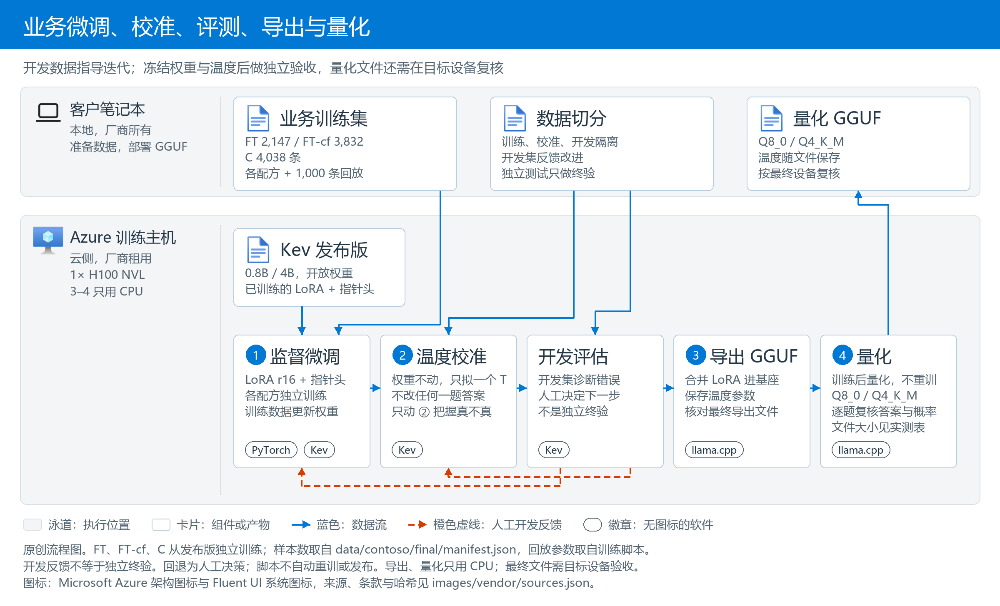
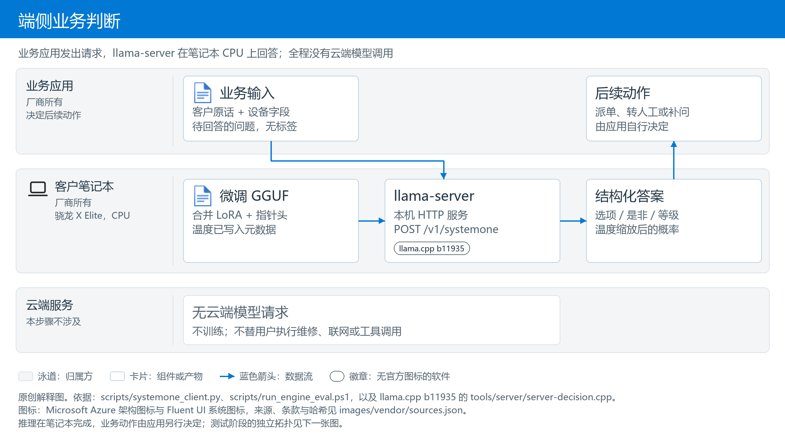
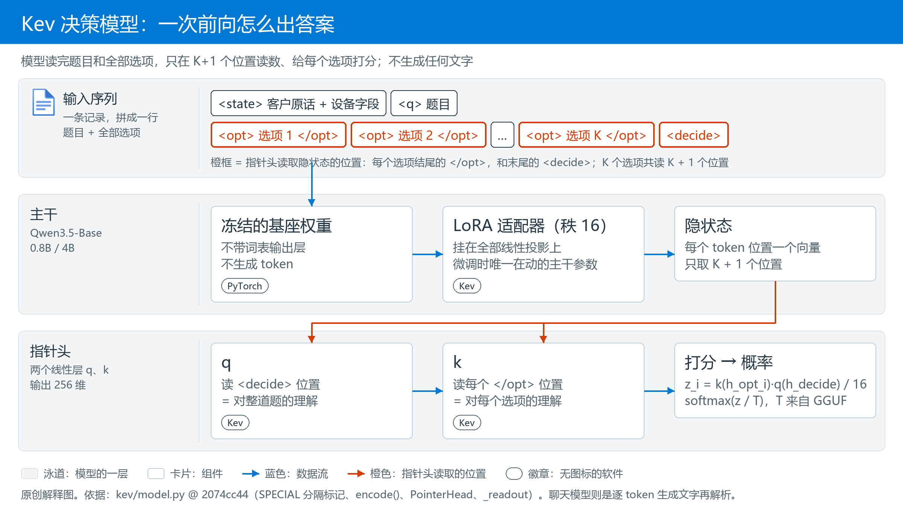

# 核心技术：微调与端侧运行

[English](Core-Technology.md) | [中文](核心技术_微调与端侧运行.md)

[项目首页](../README_CN.md) · [评测全集](评测与端侧结果全集.md) · [操作步骤](操作步骤全本.md)

### 为什么选择 Kev 作为候选

选择的是 **Kev 决策模型，0.8B 和 4B 版本基于 Qwen3.5**。它支持选择题、是非题和等级题，输出答案及概率，适合业务路由；不是以生成长篇回复为目标的聊天模型。选型看准确率、参数规模、开放权重和上下文长度四点。


*生产方原图：[Jared Palmer / Kev，What to Expect](https://github.com/jaredpalmer/kev/blob/2074cc44256200bb37540103fa4572901faa10f3/README.md#what-to-expect)，commit `2074cc44`，未修改。先看图例总准确率，再看知识题与规则题的差距。这是作者的公开评测，不是本仓库的厂商场景结果。*

| 模型 | 基座标称参数规模 | transfer-v4 开发集准确率（作者评测） | 训练时 state 上限（token） | 验证过仍准的输入长度（token） | 权重与本项目范围 |
|---|---|---|---|---|---|
| Microsoft-Decision-1 | 9B（Qwen3.5-9B，微软后训练） | 未在此套件评测 | 未披露 | 产品承诺单次输入 32,768 | Microsoft Foundry 托管，Preview；本项目未测试 |
| Jev | 作者未披露 | 85.7% | 未披露 | 未披露 | TypeSafe 托管 API；本项目未测试 |
| Kev-27B | 27B | 85.1% | 32,768 | 65,536 | 开放权重；本项目未部署 |
| Kev-9B | 9B | 82.0% | 7,552 | 8,192 | 开放权重；本项目未部署 |
| Kev-4B | 4B | 81.7% | 7,552 | 8,192 | 开放权重；本项目微调并部署到端侧 |
| Kev-0.8B | 0.8B | 64.8% | 7,552 | 8,192 | 开放权重；本项目微调并部署到端侧 |

- **准确率：4B 用更小的规模接近托管参考模型，但并非第一。** 作者图中 Kev-4B 比 Jev 低 4.0 个百分点，Kev-0.8B 低 20.9 个百分点。图注共 764 条记录；本仓库复现时，公布的 0.8B / 4B 准确率对应其中 656 道原始题，另有 108 条变体。作者不知道 Jev 的训练数据，所以这不是受控对比，也不代表真实售后准确率。边界见[作者说明](https://github.com/jaredpalmer/kev/blob/2074cc44256200bb37540103fa4572901faa10f3/README.md)和[本仓库公开基线复现](../验证结果/公开基线复现_20261027-123403)。
- **参数规模：用 0.8B 和 4B 验证准确率与端侧开销的取舍。** 作者建议准确率优先时从 4B 开始，尺寸更重要时用 0.8B。名称是标称规模，不是模型文件大小。GGUF 文件、进程内存和时延由[端侧实测](评测与端侧结果全集.md#5-笔记本端推理引擎)回答，不由参数量推算。
- **开放权重：可以下载、用业务数据微调，再导出到自己的设备。** [Kev 代码](https://github.com/jaredpalmer/kev/blob/2074cc44256200bb37540103fa4572901faa10f3/README.md#license)、[Kev-0.8B](https://huggingface.co/jaredpalmer/kev-0.8b)、[Kev-4B](https://huggingface.co/jaredpalmer/kev-4b)及相应 [Qwen3.5-0.8B-Base](https://huggingface.co/Qwen/Qwen3.5-0.8B-Base)、[Qwen3.5-4B-Base](https://huggingface.co/Qwen/Qwen3.5-4B-Base)采用 Apache-2.0。带标签 JSONL 通过 `--init_from` 从发布版继续微调（机制见下一节）。数据集仍需遵守各自许可证。

- **上下文长度不是业务准确率保证。** 架构窗口、训练输入长度和作者在特定数据上验证的长度是不同指标，上表不能解释成任何业务在该长度内都准确。本项目没有测出绝对最大上下文；在 x64、0.8B C、`-c 8192` 下，160 条长历史模拟工单有 7 条拒绝，其余 153 条为 206/459（44.9%）。历史、规则和标签条件与短输入不同，这不是纯长度因果实验，也没有验证换成更大模型或托管模型就能解决。[本项目长输入记录](评测与端侧结果全集.md#long-real)。作者与产品长度来源：[Kev README](https://github.com/jaredpalmer/kev/blob/2074cc44256200bb37540103fa4572901faa10f3/README.md#models)、[Foundry 模型目录](https://ai.azure.com/catalog/models/Microsoft-Decision-1)。

这些依据说明 Kev 值得验证，并不预先保证达到客户要求。FT 和 FT-cf 是从同一发布版分别训练的两种配方，**不是 FT → FT-cf 连续续训**；持续业务迭代是这套流程的使用方式，不是已经测过的长期运行结论。

### 架构：训练与日常推理是两件事

配方名称：**B0** 是不训练的 Kev 发布版；**B0-policy** 是同一个发布版，但把厂商规则全文写进每个问题的提示词；**FT** 是用业务数据在发布版上做监督微调；**FT-cf** 是 FT 的数据再加"只改一个设备字段"的反事实变体；**第二轮 C** 是 FT-cf 的配方再加 206 条针对薄弱字段的变体、训 4 个 epoch。FT、FT-cf 和第二轮 A/B/C 都从同一个发布版出发、各自独立训练；**最终推荐和交付的是第二轮 C**（`Contoso-Kev-0.8B-FTcf-R2C-Q8_0.gguf`），FT-cf 是它的上一版，第 1–7 节保留第一轮各配方的测量；C 的 GPU 数字见[第二轮](评测与端侧结果全集.md#round2)，在 x86-64 虚拟机和骁龙笔记本上的端侧数字见[端侧回归](评测与端侧结果全集.md#round2-device)。

#### 1. 微调、校准、导出、量化：把业务数据变成模型文件

数据准备脚本在笔记本上运行。大模型 A/B 只生成模拟原话，标签由业务规则代码计算，不参与端侧推理。GPU 主机上依次进行监督微调、温度校准，再用 CPU 导出 GGUF、量化成 Q8_0 或 Q4_K_M。开发集评估用于决定是否重训或重拟温度；最终应冻结权重、规则和温度，用未参与这些决定的数据验收，再对量化文件做目标设备回归。本项目历史测试错误已经用于配方迭代，因此现有成绩不能冒充独立盲测终验；修正文档没有补做新验收。GGUF 包含权重、分词器、指针头和温度，端侧实际使用的是该量化文件。[评测方法与边界](评测与端侧结果全集.md#测试怎么做的)。



*原创流程解释图，不是独立客户验收的证明。训练集更新权重，校准集拟合温度，开发评估指导迭代；冻结后的独立终验与量化文件的端侧回归仍是不同检查。量化不重训，效果见[第 5 节](评测与端侧结果全集.md#5-笔记本端推理引擎)。依据：[FT 流水线](../scripts/remote_pipeline_v2.sh)、[FT-cf 流水线](../scripts/remote_cf_round.sh)、[导出与量化脚本](../scripts/remote_export_gguf_cf.sh)。*

#### 2. 端侧推理：模型文件变成一次业务判断

笔记本加载已导出的 GGUF。业务程序发送原话、设备信息和待回答的问题，模型返回结构化答案及概率。**这一步不训练，不调用云端模型，也不会替用户执行维修、联系人工客服或修改设备设置。**



*原创解释图。推理在笔记本完成，业务动作由应用另行决定。依据：[本机客户端](../scripts/systemone_client.py)、[端侧运行入口](../scripts/run_engine_eval.ps1)。测试阶段的独立拓扑见[测试方法](评测与端侧结果全集.md#测试怎么做的)。*


### 核心技术：Kev 决策模型怎么微调

**决策模型和聊天模型的区别。** 聊天模型逐个生成文字；Kev 不生成文字。它把 Qwen3.5-Base 当只读编码器，在输入末尾拼上全部选项和一个 `<decide>` 标记，再用一个很小的**指针头**（pointer head：两个小线性层，给每个选项算一个分，像用手指在选项里指出一个）给每个选项打分，softmax 后就是各选项概率。一道 8 选 1 的题只需一次前向，答案不可能落在选项之外。

 位置、k 读每个 </opt> 位置，点积打分后 softmax 得到各选项概率；不生成任何文字。">

*原创解释图。橙色标出指针头读取隐状态的 K + 1 个位置；其余位置的隐状态只在前向中被注意力读到，不直接参与打分。依据：[kev/model.py](https://github.com/jaredpalmer/kev/blob/2074cc44256200bb37540103fa4572901faa10f3/kev/model.py) 的 `SPECIAL` 分隔标记、`encode()`、`PointerHead` 和 `_readout`，commit `2074cc44`。*

**监督微调（SFT）。** 损失就是正确选项上的交叉熵，没有强化学习，也没有附加损失项。

**哪些参数在动。** 基座冻结，只训练 LoRA 适配器（秩 16，挂在全部线性投影上）和指针头：0.8B 可训练 11.3M 参数，约占 1.4%；4B 为 33.8M，约 0.8%。

**在发布版上续训，不是从基座重训。** `--init_from` 先加载 Kev 发布版已训好的 LoRA 和指针头，再学厂商规则这部分差量；学习率因此压到 2e-5，是从头训练默认值的十分之一。

**防遗忘。** `--replay 1000` 把 1,000 条 Kev 原训练记录混进训练，防止模型只记得厂商数据；[第 2 节](评测与端侧结果全集.md#2-通用能力有没有丢)用 656 道公开题检验效果。

**FT-cf：反事实增强。** 原话不变，只改一个设备字段（地区、保修类型、购买天数等），让规则代码重算标签，逼模型读字段而不是只读原话；训练集从 2,147 条增加到 3,832 条。它和 FT 都从发布版独立训练，不是 FT 之后再续训。

**温度校准单独一步。** 训练完冻结权重，只在校准集上拟合一个标量 T，并随 GGUF 元数据带到端侧。它不改答案排序，只改概率的"尖"与"平"。详见[第 3 节](评测与端侧结果全集.md#3-校准答案排名正确概率仍可能不准)。

*机制细节与证据*：指针头是两个 256 维线性层 q、k，选项 i 的分数 `z_i = k(h_opt_i) · q(h_decide) / 16`，q 读 `<decide>` 位置、k 读各选项结尾 `</opt>` 位置的隐状态；损失 `F.cross_entropy(z, label)`，优化器 AdamW、OneCycleLR、梯度裁剪 1.0；LoRA alpha 32、dropout 0.05，`--lora_targets all` 覆盖注意力、前馈和 Qwen3.5 DeltaNet 层的全部投影。训练日志：`delta: warm start … 372 lora tensors and the pointer head load`、`trainable params=11.3M`（4B 为 33.8M）、`replay: 1000 of 12576 suite training records mixed with 2147`。源码 [kev/model.py](https://github.com/jaredpalmer/kev/blob/2074cc44256200bb37540103fa4572901faa10f3/kev/model.py)、[kev/train.py](https://github.com/jaredpalmer/kev/blob/2074cc44256200bb37540103fa4572901faa10f3/kev/train.py)（commit `2074cc44`），本次 [training_config.json](../验证结果/微调评测_20261027-220226/runs/0.8b/ft/training_config.json)。

**训练命令就是下面这一行**（摘自 [scripts/remote_pipeline_v2.sh](../scripts/remote_pipeline_v2.sh)，变量已换成 0.8B FT 的实际取值；操作步骤 B4 的脚本跑的就是它，跑完接着校准和评测）：

```bash
# GPU host, Kev repository root (commit 2074cc44), python from its .venv
/mnt/aipc/kev/.venv/bin/python -m kev.train \
  --data /mnt/aipc/data/contoso/train.jsonl \
  --suite evals/v7/decision-v7 --replay 1000 \
  --base Qwen/Qwen3.5-0.8B-Base --base_revision dc7cdfe2ee4154fa7e30f5b51ca41bfa40174e68 \
  --init_from jaredpalmer/kev-0.8b@v1.0 \
  --epochs 2 --lr 2e-5 --batch 1 --accum 8 \
  --dtype bf16 --checkpointing 1 --max_state 768 --device cuda --seed 1 \
  --out /mnt/aipc/runs/0.8b/ft
```

4B 换 `--base Qwen/Qwen3.5-4B-Base --base_revision 1001bb4d… --init_from jaredpalmer/kev-4b@v1.0 --batch 4 --accum 2`；FT-cf 换 `--data …/train_cf.jsonl --batch 4 --accum 2 --out …/ft_cf`（[remote_cf_round.sh](../scripts/remote_cf_round.sh)）。其余参数完全相同。训练代码是 Kev 自己的 [`kev/train.py`](https://github.com/jaredpalmer/kev/blob/2074cc44256200bb37540103fa4572901faa10f3/kev/train.py)，本项目没有改它，只给参数。

**每个参数是什么意思**（0.8B FT；4B 与 FT-cf 只有 micro-batch 和数据文件不同）：

| 配置项（`kev.train` 参数） | 本次取值 | 含义 |
|---|---|---|
| `--init_from` | `jaredpalmer/kev-{0.8b,4b}@v1.0` | 从发布版的 LoRA 和指针头续训（delta 模式） |
| `--lora` / `--lora_targets` | 16 / `all` | LoRA 秩 16（alpha 32），覆盖注意力、前馈和 DeltaNet 的全部线性投影 |
| `--head_dim` | 256 | 指针头 q、k 的输出维度 |
| `--lr` / `--head_lr` | 2e-5 / 0（0 表示与 `--lr` 相同） | LoRA 与指针头的学习率 |
| `--epochs` / 有效 batch | 2 / 8（0.8B FT 为 1 × 8，其余为 4 × 2） | 每条记录看 2 遍；每 8 条更新一次参数 |
| `--replay` | 1,000 | 混入 1,000 条 Kev 原训练记录防遗忘 |
| `--dtype` / `--weights_dtype` | bf16 / fp32 | bf16 自动混合精度前向，fp32 主权重 |
| `--max_state` | 768 | 每条记录的状态部分最多 768 token |
| `--checkpointing` | 1 | 梯度检查点：省显存，换更多计算 |
| `--seed` | 1 | 只跑了一个随机种子 |
| `ord_w`、`perm_kl`、`brier_w`、`focal_gamma`、`anchor_w` | 0 | 纯交叉熵，没有附加损失项 |

### 核心技术：笔记本上怎么跑

**llama-server 是什么。** llama.cpp 是一个 C/C++ 推理引擎，`llama-server` 是它自带的本机 HTTP 服务。本项目用官方 b11935 Windows ARM64 包，不改代码；这个版本认得 GGUF 里的决策模型标记，把 Kev 当决策模型服务，而不是文本生成模型。

**GGUF 里装的是什么。** 一个文件，四样东西：合并了 LoRA 的基座权重（所以启动时不需要 `--lora`）；指针头；三类题型的校准温度；分词器。0.8B FT-cf Q8_0 的实际文件为 774.8 MiB，表格取整为 775 MiB；Q4_K_M 约 528 MiB。模型张量统计的体积不等于磁盘文件大小，不能把日志中的张量体积填进文件大小列。

**为什么本项目采用量化。** 参数规模不等于文件大小；量化减少权重存储，但不预先保证更快或答案不变。0.8B FT-cf Q8_0 的实际文件为 774.8 MiB，约 0.812 GB；其骁龙答案与同配方 PyTorch 的一致率为 99.2% / 99.8%。这里包含表示、引擎和硬件差异，不是 BF16 到 Q8_0 的纯量化消融，也没有据此认定 CPU 的瓶颈。[同配方端侧比较](评测与端侧结果全集.md#从原始模型到量化微调模型一张表看精度速度和资源)。

**Q8_0 和 Q4_K_M 是什么。** 都是 llama.cpp 的分块整数量化：Q8_0 每个权重 8 bit，几乎无损；Q4_K_M 主体 4 bit，精度更低。本项目导出 Q4_K_M 时把注意力、DeltaNet、指针头和输出层保留为 8 bit，只压前馈层，比 llama.cpp 默认配比更保守。实测效果见[第 5 节](评测与端侧结果全集.md#5-笔记本端推理引擎)。

**上下文有多长。** 三个数字不要混：基座 Qwen3.5 的架构窗口是 262,144 token（GGUF 元数据 `qwen35.context_length`）；Kev 服务端接受 state 最多 65,536 token、每道题再加 8,192，超长直接拒绝不截断（`kev/model.py` 的 `SERVE_MAX_STATE`）；但 Kev-0.8B / 4B **训练时见过的 state 主要不超过 384 token，作者验证过仍准确的长度是 8,192**，16k 以上已不能排除准确率下降（Kev README「Length」段）。本项目每条输入 430–540 token，训练用 `--max_state 768`，llama-server 的 `-c 8192` 恰好等于作者验证过的上限。要把整份合同或长日志塞进 state，0.8B / 4B 在 8k 以上要先自己验准确率，不能拿 262k 当可用长度。作为参照，微软托管的 Microsoft-Decision-1（Qwen3.5-9B 后训练）承诺单次输入 32,768 token，Kev-27B 验证到 65,536；上下文长度与内存的关系见下一段。

**内存要连同完整配置读取。** 进程内存包括权重、缓存、临时计算缓冲和运行时开销，不能只由参数量或单个 `-c` 推算。骁龙 0.8B FT Q8_0 从 `-c 8192 -b 2048 -ub 2048` 改为 `-c 2048 -b 512 -ub 512` 后，提交内存从 5,014 到 2,119 MiB，少 2,895 MiB，工单中位数从 669 到 1,163 毫秒。三个参数同时变化，不能把全部内存或时间变化只归因于某一个参数。[完整条件与结果](评测与端侧结果全集.md#5-笔记本端推理引擎)。

**`/v1/systemone` 是决策接口，不是聊天补全。** 一次请求 = 客户原话 + 设备字段 + 几道题；返回每道题的答案和概率，不生成任何 token（`usage.output_tokens` 恒为 0）。概率已按 GGUF 内的温度缩放。接口遵循 TypeSafe System One API，不支持流式。

一句话看懂这个接口：**输入是一段情况加几道选择题，输出是模型给每个选项的概率，概率最高的就是答案。** 下面是本机一次真实调用（完整文件见[本机试用记录](../验证结果/本机试用_20261028-201046/support-us/result.json)）：

| | 内容 |
|---|---|
| 输入：情况 | 客户邮件：AuraBook Pro 16 好几个按键失灵，没摔过没进水。设备档案：美国区，Premium Care 3 年保修，购买 731 天 |
| 输入：题 1 | 派给哪个队列？8 个选项：远程软件支持、寄修、上门维修、电池计划、BIOS 二线、意外损坏理赔、订单/报价、隐私请求 |
| 输入：题 2 | 能上门维修吗？是 / 否 |
| 输入：题 3 | 多紧急？4 级：可以等、本周内、今天、立即 |
| 输出：题 1 | 订单/报价 42%，寄修 31%，上门维修 26%，其余接近 0 → 答“订单/报价” |
| 输出：题 2 | “是”的概率 29% → 答“否” |
| 输出：题 3 | “本周内”100%，其余接近 0 → 答“本周内” |

对应的 JSON（摘录）：

```jsonc
// request (excerpt): what the business application sends
{"state": {"channel": "email",
           "message": "您好：我的AuraBook Pro 16有好几个按键突然失灵了，电脑没有摔过，也没有进过水。……",
           "device": {"product_line": "AuraBook Pro 16", "region": "US", "warranty_plan": "Premium Care 3Y",
                      "days_since_purchase": 731, "battery_cycles": 667, "last_error_code": "none", "bios_version": "1.18"}},
 "questions": {"queue": {"type": "choice", "instructions": "Which Contoso support queue should take this case?",
                         "criteria": {"remote_l1": "Remote software support: drivers, Windows, Contoso apps and settings",
                                      "depot_repair": "Mail-in repair at a Contoso service center",
                                      "onsite_repair": "A technician visits the customer", "...": "5 more options"}},
               "onsite_eligible": {"type": "noul", "instructions": "Is the customer entitled to an onsite technician visit for this case?"},
               "urgency": {"type": "score", "instructions": "How urgently must Contoso respond?",
                           "criteria": ["Can wait", "Within this week", "Today", "Immediately: safety or data-loss risk"]}}}
// response (excerpt, probabilities rounded to 3 decimals): client_latency_ms = 783.8
{"model": "contoso-kev-0.8b-ftcf",
 "answers": {"queue": {"type": "choice", "choice": "sales_ops",
                       "probabilities": {"sales_ops": 0.423, "depot_repair": 0.313, "onsite_repair": 0.262, "remote_l1": 0.001, "...": "..."},
                       "confidence": 0.341},
             "onsite_eligible": {"type": "noul", "noul": 0.286},
             "urgency": {"type": "score", "score": 1.000,
                         "legend": {"0": "Can wait", "1": "Within this week", "2": "Today", "3": "Immediately: safety or data-loss risk"},
                         "probabilities": {"0": 0.000, "1": 1.000, "2": 0.000, "3": 0.000}, "confidence": 1.000}},
 "usage": {"input_tokens": 500, "output_tokens": 0}}
```

按规则这单该派“上门维修”，模型答错了。这个例子只为看懂接口；模型准不准看[第 7 节](评测与端侧结果全集.md#local-result)。

**启动参数逐项**（对应操作步骤 A1 的命令；默认值来自 [llama-server b11935 文档](https://github.com/ggml-org/llama.cpp/blob/b11935/tools/server/README.md)，实测数值来自[第 5 节](评测与端侧结果全集.md#5-笔记本端推理引擎)）：

| 启动参数 | 本次取值 | 作用 | 改了会怎样 |
|---|---|---|---|
| `-m` / `--alias` | 微调 GGUF 路径 / `contoso-kev-0.8b-r2c` | 加载的模型文件 / API 响应里报告的模型名 | 换文件即换模型；别名只影响响应里的 `model` 字段 |
| `--host` / `--port` | `127.0.0.1` / `8080` | 只监听本机回环地址 | 改成 `0.0.0.0` 会暴露到网络，本项目不建议 |
| `-c`（`--ctx-size`） | 8192 | 每个槽位的上下文 token 上限（默认 0 = 读模型值） | 影响缓存规模。本次同时将 `-c` 从 8192 改为 2048、`-b` 和 `-ub` 从 2048 改为 512，提交内存 5,014 → 2,119 MiB、工单三题请求中位耗时 669 → 1,163 毫秒；不能仅归因于 `-c` |
| `-b`（`--batch-size`） / `-ub`（`--ubatch-size`） | 2048 / 2048 | 一次送入模型的逻辑 / 物理批大小（默认 2048 / 512） | 越大一次处理的 token 越多、临时内存越大；`-ub 512` 是省内存配置的一部分 |
| `-ngl`（`--gpu-layers`） | 0 | 放到 GPU 的层数（默认 auto） | 0 = 全在 CPU。Adreno OpenCL 版用 99 全放 GPU，本机实测更慢 |
| `--cache-ram` | 0 | 提示词缓存上限 MiB（b11935 默认：普通模型 8192，决策模型 0） | 显式写 0，每次请求重新计算，结果可复现 |
| `--offline` | 开 | 禁止联网下载模型 | 只用本地文件 |
| `-np`（`--parallel`） | 未指定（auto；本机日志 `n_slots = 4`） | 并行槽位数 | 槽位是同时处理的上限，不是算力：x86-64 上 4 和 8 个槽位的吞吐相同，多的请求只是排队（第 5 节“并发”） |
| `--temp` 等采样参数 | 不用 | 文本生成的采样设置 | 决策接口不生成文本；概率温度来自 GGUF 元数据，不是 `--temp` |

**为什么跑 CPU，不跑 GPU 或 NPU。** Adreno GPU 走 OpenCL 版实测比 CPU 慢（0.8B FT 工单中位数 1,035 对 669 毫秒），还多占约 3,400 MiB 共享显存；Hexagon NPU 没有测，Windows 上需要打开驱动测试签名，公司电脑上没有做。所以推荐配置是 Q8_0 + CPU，12 线程。

*机制细节与证据*：b11935 读 GGUF 元数据 `qwen35.decision.type = kev`（启动日志 `decision model type: kev`、`n_threads = 12`）；转换器 `convert_hf_to_gguf.py` 日志 `detected Kev checkpoint` / `Model architecture: KevModel`，指针头存为张量 `cls.output.weight`（1024 × 512，q、k 两个 256 维投影拼接）和 `cls.output.bias`，温度存为 `qwen35.decision.temperature.{choice,score,noul}`（0.8B FT-cf 三项都是 1.1487）；Q8_0 平均 8.52 bit/权重、Q4_K_M 5.76 bit/权重，Q4_K_M 用 `--pure` 加 `--tensor-type` 把 `attn_`、`ssm_`、`cls`、`output.weight` 固定为 q8_0。请求字段：`state` 可以是 JSON 对象，每题有 `type`（`choice` / `noul` / `score`）、`instructions`、`criteria`，各题独立作答。来源：[转换与量化日志](../验证结果/微调评测_20261027-220226/gguf/0.8b-cf)、[导出脚本](../scripts/remote_export_gguf_cf.sh)、[llama-server b11935 文档](https://github.com/ggml-org/llama.cpp/blob/b11935/tools/server/README.md)。
