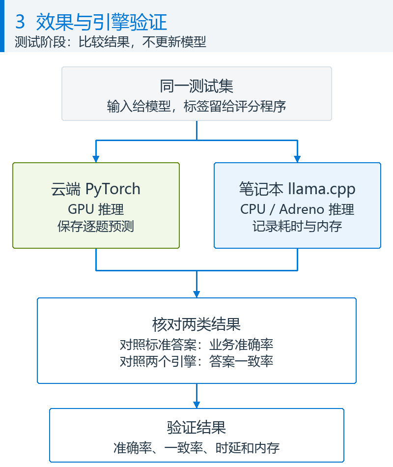

# 评测与端侧结果全集

[English](Evaluation-Results.md) | [中文](评测与端侧结果全集.md)

[项目首页](../README_CN.md) · [核心技术](核心技术_微调与端侧运行.md) · [操作步骤](操作步骤全本.md)

### 用什么场景验证

售后工单和助手路由是两种验证载体，不是全部业务需求。它们同时需要理解用户原话，并使用设备字段套用业务规则。

| 场景 | 模型读到什么 | 要回答的问题 |
|---|---|---|
| 售后工单分诊 | 客户原话 + 设备档案（产品线、地区、保修类型、购买天数、电池循环、诊断代码） | 分派到哪个队列（8 选 1）、能否上门维修（是/否）、紧急度（4 级） |
| 端侧助手意图路由 | 用户原话 + 设备状态（网络、是否企业管理、电源与电量、前台应用） | 调用哪个工具（14 选 1）、是否只在本机处理（是/否）、执行前是否要用户确认（是/否） |

难点在于很多答案取决于原话里没有写的字段。同一句"铰链松了"：保修类型是 Premium Care 3Y、地区在中日德美、仍在保修期内，就该派上门维修；换成新加坡或过了保修期，就该寄修或付费报价。发布版 Kev 不知道这些厂商规则。

本仓库回答四个问题：

1. **微调**：用厂商数据在 Kev 发布版上续训，能不能调好。
2. **性能**：比不训练、比把规则写进提示词好多少；置信度能否用来决定"自动处理还是转人工"；通用能力有没有丢。
3. **资源**：训练要多少 GPU 时间和显存；笔记本上模型多大、占多少内存、一次决策多久。
4. **推理引擎**：llama.cpp 能否在骁龙 X Elite 笔记本上运行微调后的模型，结果是否与 PyTorch 一致；换到 x86-64 CPU 是否照常。

## 实现效果

### 测试怎么做的

**每一步流程只推动[五项标准](../README_CN.md#criteria)中的一两项，其余必须回查没被碰坏。** 这也是校准没有“通过 / 不通过”的原因：它只负责②，判定“行不行、不行回哪一步”的是校准之后的评测。

| 流程步骤 | 推动哪项标准 | 必须回查什么 | 本项目实测（0.8B；交付的第二轮 C，括号内是上一版 FT-cf） |
|---|---|---|---|
| 数据生成与切分（含反事实变体） | ① 能学到什么；⑤ 逼模型读字段而不是背原话 | 训练、校准、测试互不重叠 | 训练集 2,147 → 3,832 → 4,038 条 |
| 微调（LoRA + 指针头） | ① 答案对不对；副作用是把握变尖 | ⑤ 公开题准确率别掉（判定线 2 个百分点） | 工单 44.7% → 96.3%（FT-cf 86.9%）；公开题 64.8% → 65.2%（FT-cf 64.8%） |
| 校准（拟合一个温度 T） | 只动 ② 把握真不真 | ① 一道题的答案都不变 | C：T = 2.83，校准集 ECE 0.025 → 0.010（FT-cf：T = 1.15，0.011 → 0.008）；16 组 × 71 个 T 答案逐位相同 |
| 导出 GGUF（BF16） | 什么都不该动 | 与 PyTorch 逐题一致 | 一致率 99.2% / 99.8%（FT-cf 笔记本）；C 的 Q8_0 在 x86-64 上 99.0% / 99.8% |
| 量化（Q8_0 / Q4_K_M） | ③ 延迟、④ 资源占用 | ①② 付出了多少 | 文件 1,447 → 775 / 528 MiB；8 bit 答案一致率 99.0–100%，4 bit 94.9–98.2%（FT / FT-cf） |
| 评测（`kev.benchmark`、端侧运行） | 不动任何一项，只量 | 五项全量 | GPU 上量①②⑤，笔记本上量③④和一致率 |
| 上线后巡检 | 不动 | 抽样量①②⑤，判“不动 / 只重拟 T / 重训” | [第 3 节的规则](#3-校准答案排名正确概率仍可能不准) |

训练用了多少 GPU 时间和显存是流程成本，不是模型标准，单列在[第 4 节](#4-训练要多少资源)。

**比较对象**（同一批记录、同一个评测程序 `kev.benchmark`）：

| 名称 | 做法 |
|---|---|
| B0 | 发布版 Kev（`jaredpalmer/kev-{0.8b,4b}@v1.0`），问题描述只有一句话，不训练 |
| B0-policy | 同一个发布版，把厂商策略全文写进每个问题的描述（工单场景每条记录的问题部分从约 950 字符变成约 4,600 字符） |
| FT | 在发布版上续训，方法是监督微调（SFT）：损失是每道题正确选项上的交叉熵，没有用强化学习（[训练配置](../验证结果/微调评测_20261027-220226/runs/0.8b/ft/training_config.json)里其他损失项的权重都是 0）。LoRA r16 + 指针头，2 个 epoch，lr 2e-5，有效 batch 8，bf16，seed 1；混入 1,000 条 Kev 原训练集防遗忘；在校准集上拟合温度 |
| FT-cf | FT 的数据再加"反事实"变体：训练原话不变，只改一个策略字段，标签由规则代码重算（训练集 2,147 → 3,832 条）。因为 FT 在"只改一个字段"的配对题上大多答不对才加了这一轮，选择规则在结果出来前写进了[实验协议]([NOTES]_实验协议_20261027-124000.md) |

**测试数据**（标签全部由策略代码计算，原用例和它的字段变体按组放在同一切分）。组隔离不保证不同用例生成的短文本绝不重复：助手测试集有 19 条原话与训练集相同，报告另给去掉这些记录后的对照。

| 测试集 | 记录 / 题数 | 原话由谁写 | 用途 |
|---|---|---|---|
| 工单·同分布、助手·同分布 | 170 / 510，159 / 477 | 大模型 A（与训练集同一个模型） | 主要结果 |
| 工单·分布外、助手·分布外 | 337 / 1,011，317 / 951 | 大模型 B（另一家厂商的模型）；新加坡、离线、按流量计费网络更多，一条消息里说两件事 | 换生成模型、换字段分布后是否还有效 |
| 工单·测试变体、助手·测试变体 | 126 / 378，70 / 210 | 测试集原话不变，只改一个策略字段 | 模型是否真的按字段套用规则 |
| Kev transfer-v4 开发集 | 656 题 | Kev 作者的公开题 | 通用能力有没有丢 |

一条工单测试记录（选项说明有删节）：模型看到的是 `state`，`label` 由策略代码根据设备档案算出，模型看不到。

```json
{"state": {"channel": "email",
           "message": "您好：\n请问我的 Contoso Nimbus 2-in-1 订单目前是什么状态？麻烦告知最新进度。\n谢谢\n李明",
           "device": {"product_line": "Nimbus 2-in-1", "region": "SG", "warranty_plan": "Accidental Damage 2Y",
                      "days_since_purchase": 749, "battery_cycles": 202, "last_error_code": "none", "bios_version": "1.11"}},
 "questions": {"queue": {"type": "choice", "instructions": "Which Contoso support queue should take this case?", "label": "sales_ops"},
               "onsite_eligible": {"type": "noul", "label": false},
               "urgency": {"type": "score", "label": 0}}}
```

目的里的两张图是客户上线后的样子；下面这张图只描述我们怎么测：同一测试集同时走 PyTorch 和笔记本两条路，PyTorch 路径和标准答案只在测试阶段存在，客户日常推理不需要它们。



*原创解释图。模型准确率与两个引擎的答案一致率是不同指标。PyTorch 评测在 H100 VM 上，llama.cpp 评测和请求计时在骁龙笔记本上；依据：[训练评测流水线](../scripts/remote_pipeline_v2.sh)、[端侧评测](../scripts/run_engine_eval.ps1)、[逐题比对](../scripts/parity.py)。这是一条测试链，不是用户日常推理的依赖。*

以下为 **2026-10-27 的历史评测**，与后面的本机单条试用分开记录。

**测量点**：

| 数字 | 在哪测 | 从哪里算到哪里 | 不包含 |
|---|---|---|---|
| 准确率、Brier、ECE、可自动处理比例 | GPU VM，`kev.benchmark --device cuda` | 一条记录的每道题各算一次，按题汇总 | 时延 |
| 配对差值的 95% 区间 | 笔记本，`summarize_results.py`（按原话分组重抽样 10,000 次）；协议指定的 `kev.compare`（宏平均）另列 | 同一批题上两个做法的差 | 换随机种子带来的波动 |
| 训练时间 | GPU VM，bash `$SECONDS` | 训练进程启动 → 检查点保存完毕（含加载基座和发布版检查点） | 校准、评测 |
| 训练显存 | GPU VM，`nvidia-smi` 每 2 秒采样的最大值；kev 记录的 PyTorch 分配峰值 | 训练进程运行期间 | — |
| 端侧单次决策时延 | 笔记本，`systemone_client.py` → `127.0.0.1:8080` | 客户端发出一条记录 → 收到该记录 3 道题的全部答案；一次一条，不并发 | 前 2 条预热请求、模型加载 |
| 端侧内存 | 笔记本，测完后读 `llama-server` 进程计数器 | 峰值工作集（实际占用的物理内存）、提交内存（向系统申请的内存） | — |
| 与 PyTorch 一致率 | 笔记本，`parity.py` | 同一测试文件逐题比较答案和概率 | — |

<a id="same-questions"></a>

### 1. 同一批问题：微调前后

**客户首先看三件事：业务题更准了吗，新问题还能答对吗，笔记本运行代价变了吗。** 下列主表固定比较同一规模的发布版与第一轮微调版 FT-cf（业务数据加字段变体增强），不按指标临时挑选表现最好的模型；最终交付的第二轮 C（同配方加 206 条变体、训 4 个 epoch）单列一表紧跟在后，与前者同题同卷。提示词加规则和第一版 FT 是实验对照，不混入主表的“微调前／后”。

前两张表的准确率来自同一条 H100 NVL / PyTorch 评测路径；第三张表测的是笔记本 CPU 的耗时和内存。两种测量位置分别标明，不能把 PyTorch 准确率当成量化模型的端侧准确率，完整端侧结果见[第 5 节](#5-笔记本端推理引擎)。

**准确率与泛化的前后列使用同一批问题、相同选项、相同标准答案和相同简短问题描述。** 工单与助手是两个不同任务，各自在同一测试集内比较。泛化表采用没有进入权重训练的分布外题，不是拿训练题验收；它更换了原话生成模型和字段分布，仍是模拟业务，不代表真实客户生产准确率。逐请求哈希与逐题标签来自[原始评测记录](../验证结果/微调评测_20261027-220226/runs)。

<!-- TABLE:README_ACC -->
**准确率：同一批业务测试题**

| 参数规模 | 测试集（题数） | 微调前准确率：发布版 | 微调后准确率：最终方案 | 提升（百分点） |
|---|---|---|---|---|
| 0.8B | 工单·同分布（510 题） | 44.7% | 86.9% | +42.2 |
| 0.8B | 助手·同分布（477 题） | 67.1% | 97.5% | +30.4 |
| 4B | 工单·同分布（510 题） | 60.8% | 95.9% | +35.1 |
| 4B | 助手·同分布（477 题） | 81.8% | 99.8% | +18.0 |

**泛化能力：同一批分布外新问题**

| 参数规模 | 测试集（题数） | 微调前准确率：发布版 | 微调后准确率：最终方案 | 提升（百分点） |
|---|---|---|---|---|
| 0.8B | 工单·分布外（1,011 题） | 43.0% | 82.5% | +39.5 |
| 0.8B | 助手·分布外（951 题） | 65.7% | 94.4% | +28.7 |
| 4B | 工单·分布外（1,011 题） | 60.7% | 91.4% | +30.7 |
| 4B | 助手·分布外（951 题） | 81.9% | 98.8% | +16.9 |
<!-- /TABLE:README_ACC -->

**交付模型第二轮 C：同一批题，在 FT-cf 之上再提多少**（GPU / PyTorch 评测，与上表同一条路径；配对差值的 95% 区间按原话分组重抽样 10,000 次；完整对照见[第二轮](#round2)）

| 参数规模 | 测试集（题数） | 发布版 | 第一轮 FT-cf | 交付的第二轮 C | C − FT-cf（百分点，95% 区间） |
|---|---|---|---|---|---|
| 0.8B | 工单·同分布（510 题） | 44.7% | 86.9% | **96.3%** | +9.4（+6.3 ~ +12.6） |
| 0.8B | 助手·同分布（477 题） | 67.1% | 97.5% | **100.0%** | +2.5（+1.3 ~ +3.9） |
| 0.8B | 工单·分布外（1,011 题） | 43.0% | 82.5% | **88.4%** | +5.9（+3.8 ~ +8.1） |
| 0.8B | 助手·分布外（951 题） | 65.7% | 94.4% | **97.3%** | +2.8（+1.5 ~ +4.2） |

4B 没有做第二轮；0.8B C 的同分布工单 96.3% 已超过 4B FT-cf 的 95.9%，分布外 88.4% 仍低于 4B 的 91.4%。

**性能：同一台笔记本、同一批请求，比较耗时和内存**

两侧均为骁龙 X Elite X1E80100、llama.cpp b11935 CPU，参数 `-c 8192 -b 2048 -ub 2048 --cache-ram 0`。0.8B 两侧均用 Q8_0，4B 两侧均用 Q4_K_M；不同规模之间不作性能归因。每侧均完成 170 条工单请求和 159 条助手请求，每条回答 3 道题；请求时延排除模型加载及预热，内存是整轮进程的峰值工作集。

<!-- TABLE:README_PERFORMANCE -->
| 固定模型配置 | 性能指标（单位） | 微调前测量值：发布版 | 微调后测量值：最终方案 |
|---|---|---|---|
| 0.8B / Q8_0 / CPU | 工单请求耗时中位数（毫秒） | 666 | 646 |
| 0.8B / Q8_0 / CPU | 助手请求耗时中位数（毫秒） | 843 | 984 |
| 0.8B / Q8_0 / CPU | 进程峰值工作集（MiB） | 2,323 | 2,314 |
| 4B / Q4_K_M / CPU | 工单请求耗时中位数（毫秒） | 3,022 | 3,615 |
| 4B / Q4_K_M / CPU | 助手请求耗时中位数（毫秒） | 3,790 | 4,751 |
| 4B / Q4_K_M / CPU | 进程峰值工作集（MiB） | 6,849 | 6,842 |
<!-- /TABLE:README_PERFORMANCE -->

数据依据是[端侧原始运行记录](../验证结果/端侧引擎_20261027-124700)，不是 GPU 上的评测耗时。案例编号、顺序、标准答案、输入 token 数和记录中的核心参数已配对核对；旧端侧记录没有逐请求内容哈希，因此不能把这项核对说成请求字节的独立证明。每个配置只跑一次，不同运行间存在波动：**本次能说明准确率改善，不证明微调使推理加速，也不能把全部耗时差归因于微调。** 这张笔记本表的微调后列是 FT-cf；交付的 C 在同一台笔记本上实测峰值工作集 2,314 MiB、提交内存 5,014 MiB，与 FT-cf 两位数字相同，工单中位数 635 毫秒（[端侧回归](#round2-device)）。

#### 实验分析：完整方案与剩余错误

发布版、提示词加规则、第一版 FT、最终 FT-cf 的完整矩阵保留在[报告 3.1](微调与端侧验证报告_20261027-130700.md#31-准确率微调前后对比)；字段变体矩阵保留在[报告 3.3](微调与端侧验证报告_20261027-130700.md#33-规则跟随只改一个设备字段答案会不会跟着变)。这些对照解释方案为何这样选择，不替代上面的同题前后比较。字段变体统计的是答案确实随字段改变的题，工单 172 题、助手 72 题。

- **两个尺寸在本次模拟业务测试上都提高了准确率。** 四个测试集上，FT 比 B0 高 14.7–41.8 个百分点（按题计），每一项的 95% 区间下界都大于 0；FT-cf 又比 FT 高 0.4–4.0 个百分点，其中 0.8B 工单两个测试集的 95% 区间包含 0。区间和协议指定的 `kev.compare` 口径见[报告 3.1](微调与端侧验证报告_20261027-130700.md#31-准确率微调前后对比)。
- **把规则写进提示词（B0-policy）远不如微调。** 它比 FT 低 10.5–30.2 个百分点，在 0.8B 助手分布外测试集上还比不加更低（63.6% 对 65.7%）。
- **FT 的短板是"按字段套规则"，FT-cf 补上了大部分。** 只看答案因字段改变的题，0.8B 从 FT 的 48.3% / 48.6% 提到 57.6% / 81.9%，4B 从 72.1% / 86.1% 提到 84.9% / 100.0%。按字段拆开（0.8B，测试变体与分布外变体合计），购买天数 41.9%、地区 36.2%、电池循环次数 49.2%，仍不到一半；详见[报告 3.3](微调与端侧验证报告_20261027-130700.md#33-规则跟随只改一个设备字段答案会不会跟着变)。
- **选择规则在结果出来前写定**：FT-cf 在开发集变体上比 FT 准，且开发集原题准确率下降不超过 1 个百分点。两个尺寸都满足：开发集变体（全部题）0.8B 从 78.9% / 82.9% 到 82.2% / 92.8%，4B 从 89.1% / 96.4% 到 95.9% / 100.0%；开发集原题都没有下降。

### 2. 通用能力有没有丢

这是[第 ⑤ 项标准](../README_CN.md#criteria)的第二问：上一节的分布外题问“新业务数据上还行不行”，这一节问“微调业务之后，原有通用任务是否退化”。每个前后对比都使用相同的 656 道 Kev 公开题；下表保留 FT 和 FT-cf 两种配方，交付的第二轮 C 在同一套题上是 65.2%（比发布版 +0.5 点，没有触发判定线；[第二轮](#round2)）。

<!-- TABLE:PUBLIC -->
| 模型与训练方案 | 通用题数 | 发布版准确率 | 微调后准确率 | 变化（百分点） |
|---|---|---|---|---|
| 0.8B FT | 656 | 64.8% | 64.8% | 0.0 |
| 0.8B FT-cf | 656 | 64.8% | 64.8% | 0.0 |
| 4B FT | 656 | 81.7% | 80.9% | -0.8 |
| 4B FT-cf | 656 | 81.7% | 82.6% | +0.9 |

**通用题的置信度：Brier 越低越好**

| 模型与训练方案 | 发布版 Brier | 微调后 Brier |
|---|---|---|
| 0.8B FT | 0.430 | 0.560 |
| 0.8B FT-cf | 0.430 | 0.574 |
| 4B FT | 0.243 | 0.299 |
| 4B FT-cf | 0.243 | 0.269 |
<!-- /TABLE:PUBLIC -->

- **未触发预设的遗忘判定线。** 协议的判定线是下降超过 2 个百分点。0.8B 的 FT 和 FT-cf 都是 64.8%，与发布版相同：逐题看，FT 有 20 题从错变对、20 题从对变错，FT-cf 是 22 题和 22 题，正好抵消。4B 的 FT 从 81.7% 降到 80.9%（656 题里少对 5 题），FT-cf 升到 82.6%（多对 6 题），都没有触发。这不等于每个通用任务的能力不变。
- **通用题上的置信度变差了。** 微调后的温度是按厂商校准集拟合的（0.8B 从发布版的 2.35 变成 1.26），概率更"尖"，Brier 随之变差。用发布版温度 2.35 重算，0.8B FT 的 Brier 是 0.490，仍比发布版的 0.430 差，说明微调本身也让通用题上的置信度略有变差。4B 也一样：FT（温度 1.66）的 Brier 从 0.243 变成 0.299，FT-cf（温度 2.35）是 0.269。同一个模型如果还要处理厂商业务以外的通用决策，应在混合数据上校准温度。

### 3. 校准：答案排名正确，概率仍可能不准

**微调学习选哪个答案；校准调整这些答案的概率。** 模型先产生原始分数（logits，即上一节指针头输出的 z），再用 `softmax(logits / T)` 得到概率。温度 T 是无量纲的正数，不是准确率或业务阈值。训练好了以后，可以固定全部模型权重，只重新拟合 T，不需要把模型原样重训一遍。

校准数据提供“输入、问题、候选项、正确标签”，不需要每个选项的标准概率。这里的标签由厂商规则代码生成，大模型只生成模拟原话，不充当校准裁判。训练集用于更新权重，开发集用于选方案，校准集用于拟合 T，未参与选择的测试数据用于验收。线上推理只使用保存好的 T，不重新拟合。

例如，三个选项在 T = 1 时为 80% / 10% / 10%，T = 2 时约为 58.6% / 20.7% / 20.7%；这是数学示例，不是实测。正 T 保持同题的选项排名，因此不能纠正排错的第一名。它会改变概率，也可能改变等级期望值或是否跨过业务阈值。概率合计 100% 只说明归一化，不说明它们可信；单题答错也不等于整体校准失效。

本次 0.8B FT-cf 用 **984 道校准题**拟合 T，日志显示约 1.15；拟合集准确率保持 93.0%，ECE 从 0.011 变为 0.008。五折交叉验证的 ECE 差值区间包含零，**不能宣称显著改善**。交付的第二轮 C 用同一套校准题拟合出 T = 2.83（拟合集准确率 96.6% 不变，ECE 0.025 → 0.010）：多训两个 epoch 让模型更“嘴硬”，校准步骤把它压回来；这正是“重训之后必须重校准”的实例（[第二轮](#round2)）。121 个候选 T 只对已保存的分数重算概率并比较平均 NLL，不是训练 121 次。完整例子、实际命令和原始证据见[报告第 3.4 节](微调与端侧验证报告_20261027-130700.md#calibration-guide)。

**给客户用的是内置校准参数的 GGUF。** 引擎加载文件后使用其中的温度；客户不需要校准服务。是否补问或转人工要由业务应用实现，本仓库没有自动接管或模型兜底。若答案能力不足，应针对数据与错误改进训练，而不是只调 T；若只是概率偏差，走[仅更新校准参数](操作步骤全本.md#calibration-update)。

#### 什么时候只改校准就行，什么时候必须重训：规则和实测边界

判断只看两件事，都能从保存的逐题结果离线算出，不用重新跑模型：

1. **答案对不对（准确率）。** 改 T 不改任何一道题的答案——这是数学性质，本次也用数字核了：16 个模型 × 测试集组合在 0.5 到 4.0 之间 71 个温度上准确率全部逐位相同。所以准确率不够、或者新数据上准确率掉出了原来的 95% 区间，**校准没有任何办法，只能改数据重训**。
2. **概率准不准（ECE），以及它有多少是一个标量 T 能修的。** 把新数据的逐题分数从 0.5 到 4.0 扫一遍 T，取 ECE 最小的那个：从当前 T 到最优 T 能降多少，就是“改校准就能解决”的部分；最优 T 下剩下的 ECE 是“校准修不掉”的部分。当前 T 的 ECE 还在自己的 95% bootstrap 区间里，就是噪声，什么都不用改。

下表是对本项目两个尺寸的 FT-cf 算出来的边界（脚本 [scripts/calibration_boundary.py](../scripts/calibration_boundary.py)，输入是 GPU 评测保存的原始分数；“最优 T”是在该测试集上自己选的，是上限不是可上线的值）：

| 模型与测试集 | 准确率（任何 T 下相同，95% 区间） | ECE：不校准 T=1 | ECE：交付的 T（95% 区间） | ECE：该测试集最优 T | 改校准最多能降 | 校准修不掉的部分 |
|---|---|---|---|---|---|---|
| 0.8B FT-cf，工单·同分布（510 题） | 86.9%（83.7–89.8%） | 0.032 | 0.030（T=1.15；0.021–0.055） | 0.021（T=1.35） | 0.009 | 0.021 |
| 0.8B FT-cf，助手·同分布（477 题） | 97.5%（95.8–98.7%） | 0.005 | 0.013（T=1.15；0.008–0.025） | 0.005（T=1.0） | 0.007 | 0.005 |
| 0.8B FT-cf，工单·分布外（1,011 题） | 82.5%（80.1–84.8%） | 0.074 | **0.064**（T=1.15；0.051–0.086） | 0.016（T=2.15） | **0.048** | 0.016 |
| 0.8B FT-cf，助手·分布外（951 题） | 94.4%（92.8–95.8%） | 0.022 | 0.018（T=1.15；0.011–0.032） | 0.005（T=1.65） | 0.012 | 0.005 |
| 4B FT-cf，工单·同分布（510 题） | 95.9%（94.1–97.5%） | 0.023 | 0.019（T=2.35；0.012–0.035） | 0.012（T=1.65） | 0.007 | 0.012 |
| 4B FT-cf，工单·分布外（1,011 题） | 91.4%（89.6–93.1%） | 0.057 | 0.023（T=2.35；0.016–0.040） | 0.015（T=2.8） | 0.008 | 0.015 |
| 0.8B 第二轮 C（交付），工单·同分布（510 题） | 96.3%（94.5–97.8%） | 0.022 | 0.025（T=2.83；0.015–0.041） | 0.009（T=1.55） | 0.016 | 0.009 |
| 0.8B 第二轮 C（交付），工单·分布外（1,011 题） | 88.4%（86.5–90.3%） | 0.087 | 0.055（T=2.83；0.039–0.073） | 0.026（T=4.0） | 0.029 | 0.026 |

这张表对本项目的四条结论：

- **同分布上交付的 T 已经够好，不要再调。** 六行里交付 T 的 ECE 都在自己的 95% 区间内，换成该测试集的最优 T 也只能再降 0.007–0.009，小于区间宽度。校准开口已经在噪声里。
- **换了分布，工单的概率偏差大部分是校准能修的。** 0.8B 分布外工单的 ECE 0.064 里，0.048 只要把 T 从 1.15 重拟合到约 2.15 就能消掉，剩下 0.016 与同分布相当——这是“模型在新数据上还是那么准，只是过于自信”的典型情形，**走仅更新校准参数就行**。代价是概率更“平”：同样用 90% 做自动处理门槛，覆盖率从 71.7% 降到 60.9%，被自动处理部分的准确率从 94.3% 升到 97.4%。
- **但准确率从 86.9% 掉到 82.5% 这 4.4 个点，校准一点也补不回来。** 82.5% 已经在同分布 95% 区间（83.7–89.8%）之外，这就是“必须重训”的信号；重训要补的是分布外数据里多出来的新加坡、离线、按流量计费网络和“一句话说两件事”（见[测试数据](#测试怎么做的)）。校准和重训不是二选一：这种情形下两件都要做，先重训，再在新数据上重拟合 T。
- **一个标量 T 照顾不了两种分布。** 0.8B 工单同分布的最优 T 是 1.35，分布外是 2.15；用 2.15 回头看同分布，ECE 是 0.031（交付 T 下 0.030，最优 1.35 下 0.021），不变差但也拿不到同分布的最优。所以 T 要在与上线数据同分布的校准集上拟，分布变了就重拟。分题型看，0.8B 分布外工单的偏差集中在紧急度等级题（ECE 0.107）和队列选择题（0.070），是非题（0.042）较好。

操作上：上线后定期抽一批带标签的新数据，跑一次 `kev.benchmark` 拿到逐题分数，再跑 `scripts/calibration_boundary.py`：准确率在区间内、ECE 在区间内 →不动；准确率在区间内、ECE 超出且“改校准最多能降”占大头 → 只重拟合 T（[步骤](操作步骤全本.md#calibration-update)）；准确率掉出区间 → 补数据重训，再校准。这些门槛是本项目模拟数据上的数字，换了数据要用同样方法重算。

<a id="gpu-bf16-baseline"></a>

### GPU 精度基线：量化前参考

以下两行来自 GPU 主机上的 PyTorch 评测，不是笔记本实测。它们保留 FT-cf 量化前的准确率和 BF16 文件信息，不提供笔记本时延、内存或加载时间；与端侧结果的差异见[量化对照](#从原始模型到量化微调模型一张表看精度速度和资源)。

| 模型与配方 | 权重格式 | 权重精度（bit/权重） | 文件（MiB） | 工单 / 助手准确率（GPU / PyTorch） |
|---|---|---|---|---|
| 0.8B FT-cf | BF16 | 16.0 | 1,437 | 86.9% / 97.5% |
| 4B FT-cf | BF16 | 16.0 | 8,026 | 95.9% / 99.8% |

端侧表中的一致率分别与同一规模、同一配方的 PyTorch 模型比较：发布版对发布版，FT 对 FT，FT-cf 对 FT-cf，第二轮 C 对第二轮 C。不能把不同微调版本共用为同一个参照。

### 4. 训练要多少资源

<!-- TABLE:TRAIN -->
**训练配方：每个配置运行一次，有效 batch 均为 8**

| 模型与训练方案 | micro-batch × accum | 训练记录（2 个 epoch 合计） | 优化步数 |
|---|---|---|---|
| 0.8B FT | 1 × 8 | 6,294 | 788 |
| 0.8B FT-cf | 4 × 2 | 9,664 | 1,208 |
| 4B FT | 4 × 2 | 6,294 | 788 |
| 4B FT-cf | 4 × 2 | 9,664 | 1,208 |

**训练消耗：1 张 H100 NVL，时间包含模型加载与保存**

| 模型与训练方案 | 墙钟时间 | 整卡显存峰值（nvidia-smi） | PyTorch 分配峰值 | 校准温度 |
|---|---|---|---|---|
| 0.8B FT | 26.9 分钟 | 4,555 MiB | 3,460 MiB | 1.26 |
| 0.8B FT-cf | 11.6 分钟 | 7,573 MiB | 5,326 MiB | 1.15 |
| 4B FT | 15.7 分钟 | 33,359 MiB | 22,581 MiB | 1.66 |
| 4B FT-cf | 20.1 分钟 | 26,215 MiB | 22,641 MiB | 2.35 |
<!-- /TABLE:TRAIN -->

交付的 **0.8B 第二轮 C** 不在上表的第一轮结果包里，按同一口径：micro-batch 4 × accum 2，4 个 epoch 共 20,152 条训练记录，2,520 步；墙钟 22 分 42 秒，整卡显存峰值 7,475 MiB，PyTorch 分配峰值 5,311 MiB，校准温度 2.83（[第二轮](#round2)）。显存和 FT-cf 一样，时间按训练记录数线性增长。

- 0.8B 的 FT 用 micro-batch 1 训了约 27 分钟；FT-cf 使用 micro-batch 4，训练记录多了 54%，用时约 12 分钟。由于数据和 micro-batch 同时变化，不能把全部时长差归因于单个参数。同样使用 micro-batch 4、训练 9,664 条记录时，4B FT-cf 用时 20.1 分钟，0.8B 用时 11.6 分钟。有效 batch 都是 8。
- nvidia-smi 这里记录整卡显存，可能包括框架缓存和其他进程，并非仅当前进程的张量；PyTorch 分配峰值也不代表全部运行开销。4B 两次训练的 PyTorch 分配峰值几乎相同（22,581 / 22,641 MiB），整卡峰值却相差 7,144 MiB。缓存可能是原因，但这些采样不足以证明归因，选卡不能只看张量分配量。
- **显存不够时用 micro-batch 1。** 同一配方（bf16、梯度检查点、`max_state 768`）改成 micro-batch 1 × accum 8，在原话加设备档案最长的 64 条厂商训练记录上训 8 步（GPU 上没有其他进程）：nvidia-smi 峰值 0.8B 4,213 MiB、4B 18,547 MiB，PyTorch 分配 3,365 / 17,375 MiB。这次探测没有混入 Kev 原训练集记录；0.8B 正式训练同样用 micro-batch 1，PyTorch 峰值 3,460 MiB，比探测高约 3%，按探测值选卡要留余量。
- 按这台 VM 的列表价每小时 9.07 美元（Azure Retail Prices API，Spain Central，2026-10-27；订阅的实际折扣价没有核对），一次 0.8B 训练约 1.8–4.1 美元，一次 4B 训练约 2.4–3.0 美元。

### 5. 笔记本端推理引擎

测试机：骁龙 X Elite X1E80100（12 核），64 GB 内存，Adreno X1-85 GPU（驱动 31.0.133.1），Windows 11 企业版；llama.cpp b11935 官方 Windows ARM64 发布包（CPU 版、Adreno OpenCL 版）。

<!-- TABLE:ENGINE -->
**准确率与引擎一致率**

| 模型、量化与运行参数 | 工单准确率：端侧（PyTorch） | 助手准确率：端侧（PyTorch） | 工单答案一致率：端侧对 PyTorch | 助手答案一致率：端侧对 PyTorch |
|---|---|---|---|---|
| 发布版 0.8B<br>Q8_0 · CPU，默认参数 | 45.7%（44.7%） | 66.9%（67.1%） | 97.6% | 99.0% |
| 发布版 0.8B<br>Q8_0 · CPU，默认参数，提示词含策略全文（B0-policy） | 60.6%（60.8%） | 71.7%（71.9%） | 98.6% | 99.8% |
| 发布版 0.8B<br>Q8_0 · Adreno GPU（OpenCL），默认参数 | 43.7%（44.7%） | 66.5%（67.1%） | 94.9% | 96.4% |
| 发布版 4B<br>Q4_K_M · CPU，默认参数 | 59.0%（60.8%） | 82.0%（81.8%） | 93.1% | 97.3% |
| 微调 FT 0.8B<br>Q4_K_M · CPU，默认参数 | 87.5%（86.5%） | 93.9%（93.5%） | 94.9% | 97.9% |
| 微调 FT 0.8B<br>Q8_0 · CPU，默认参数 | 86.5%（86.5%） | 93.5%（93.5%） | 99.2% | 99.6% |
| 微调 FT 0.8B<br>Q8_0 · CPU，-c 2048 -ub 512 | 86.5%（86.5%） | 93.5%（93.5%） | 99.2% | 99.6% |
| 微调 FT 0.8B<br>Q8_0 · Adreno GPU（OpenCL），默认参数 | 85.7%（86.5%） | 93.7%（93.5%） | 97.6% | 99.0% |
| 微调 FT-cf 0.8B<br>Q8_0 · CPU，默认参数 | 86.9%（86.9%） | 97.7%（97.5%） | 99.2% | 99.8% |
| 微调 FT-cf 4B<br>Q4_K_M · CPU，默认参数 | 95.3%（95.9%） | 99.6%（99.8%） | 98.2% | 99.8% |
| 微调 FT-cf 4B<br>Q8_0 · CPU，默认参数 | 96.1%（95.9%） | 99.8%（99.8%） | 99.4% | 100.0% |

**模型文件与进程内存**

| 模型、量化与运行参数 | 模型文件（MiB） | 峰值工作集（MiB） | 提交内存（MiB） |
|---|---|---|---|
| 发布版 0.8B<br>Q8_0 · CPU，默认参数 | 775 | 2,323 | 5,016 |
| 发布版 0.8B<br>Q8_0 · CPU，默认参数，提示词含策略全文（B0-policy） | 775 | 3,446 | 5,899 |
| 发布版 0.8B<br>Q8_0 · Adreno GPU（OpenCL），默认参数 | 775 | 4,118 | 5,809 |
| 发布版 4B<br>Q4_K_M · CPU，默认参数 | 2,893 | 6,849 | 7,497 |
| 微调 FT 0.8B<br>Q4_K_M · CPU，默认参数 | 528 | 1,819 | 4,766 |
| 微调 FT 0.8B<br>Q8_0 · CPU，默认参数 | 775 | 2,314 | 5,014 |
| 微调 FT 0.8B<br>Q8_0 · CPU，-c 2048 -ub 512 | 775 | 2,196 | 2,119 |
| 微调 FT 0.8B<br>Q8_0 · Adreno GPU（OpenCL），默认参数 | 775 | 4,105 | 5,801 |
| 微调 FT-cf 0.8B<br>Q8_0 · CPU，默认参数 | 775 | 2,314 | 5,014 |
| 微调 FT-cf 4B<br>Q4_K_M · CPU，默认参数 | 2,893 | 6,842 | 7,495 |
| 微调 FT-cf 4B<br>Q8_0 · CPU，默认参数 | 4,276 | 9,609 | 8,884 |

**单次请求时延**

| 模型、量化与运行参数 | 工单请求耗时中位数（毫秒） | 助手请求耗时中位数（毫秒） |
|---|---|---|
| 发布版 0.8B<br>Q8_0 · CPU，默认参数 | 666 | 843 |
| 发布版 0.8B<br>Q8_0 · CPU，默认参数，提示词含策略全文（B0-policy） | 4,353 | 2,435 |
| 发布版 0.8B<br>Q8_0 · Adreno GPU（OpenCL），默认参数 | 1,171 | 1,378 |
| 发布版 4B<br>Q4_K_M · CPU，默认参数 | 3,022 | 3,790 |
| 微调 FT 0.8B<br>Q4_K_M · CPU，默认参数 | 812 | 909 |
| 微调 FT 0.8B<br>Q8_0 · CPU，默认参数 | 669 | 822 |
| 微调 FT 0.8B<br>Q8_0 · CPU，-c 2048 -ub 512 | 1,163 | 1,184 |
| 微调 FT 0.8B<br>Q8_0 · Adreno GPU（OpenCL），默认参数 | 1,035 | 1,221 |
| 微调 FT-cf 0.8B<br>Q8_0 · CPU，默认参数 | 646 | 984 |
| 微调 FT-cf 4B<br>Q4_K_M · CPU，默认参数 | 3,615 | 4,751 |
| 微调 FT-cf 4B<br>Q8_0 · CPU，默认参数 | 3,649 | 4,115 |

没有跑完、不计入上表的运行：ft-kev-0.8b-Q8_0-cpu-ctx2048（support 144 条，无汇总）；ft-kev-4b-Q4_K_M-cpu（support 36 条，无汇总）。
<!-- /TABLE:ENGINE -->

#### 从原始模型到量化微调模型：一张表看精度、速度和资源

下面两表只列在骁龙笔记本上实际运行过的配置：原始发布版与各微调版的 Q8_0、Q4_K_M。BF16 量化前结果另列在 [GPU 精度基线](#gpu-bf16-baseline)，不作为笔记本运行记录。一致率与各行同一规模、同一配方的 PyTorch 模型逐题比较；FT 的 Q4_K_M 不能用 FT-cf 作参照。

| 模型（0.8B，骁龙 X Elite CPU，默认参数） | 权重量化格式 | 文件（MiB） | 笔记本准确率（工单 / 助手） | 与各自 PyTorch 逐题答案一致率 | 工单 / 助手请求中位数（毫秒） | 峰值工作集（MiB） | 模型加载（秒） |
|---|---|---|---|---|---|---|---|
| 原始发布版 B0，官方 Q8_0 包 | W8（Q8_0） | 775 | 45.7% / 66.9% | 97.6% / 99.0% | 666 / 843 | 2,323 | 未记录 |
| 微调 FT-cf，Q8_0 | W8（Q8_0） | 775 | 86.9% / 97.7% | 99.2% / 99.8% | 646 / 984 | 2,314 | 2.6 |
| 微调 FT，Q4_K_M（独立 FT 配方，非 FT-cf） | W4/W8 混合（自定义 Q4_K_M） | 528 | 87.5% / 93.9% | 94.9% / 97.9% | 812 / 909 | 1,819 | 2.5 |

| 模型（4B，骁龙 X Elite CPU，默认参数） | 权重量化格式 | 文件（MiB） | 笔记本准确率（工单 / 助手） | 与各自 PyTorch 逐题答案一致率 | 工单 / 助手请求中位数（毫秒） | 峰值工作集（MiB） | 模型加载（秒） |
|---|---|---|---|---|---|---|---|
| 原始发布版 B0，官方 Q4_K_M 包 | Q4_K_M（官方混合格式） | 2,893 | 59.0% / 82.0% | 93.1% / 97.3% | 3,022 / 3,790 | 6,849 | 未记录 |
| 微调 FT-cf，Q8_0 | W8（Q8_0） | 4,276 | 96.1% / 99.8% | 99.4% / 100.0% | 3,649 / 4,115 | 9,609 | 10.7 |
| 微调 FT-cf，Q4_K_M | W4/W8 混合（自定义 Q4_K_M） | 2,893 | 95.3% / 99.6% | 98.2% / 99.8% | 3,615 / 4,751 | 6,842 | 6.7 |

**两处准确率不是重复测同一个条件。** GPU / PyTorch 准确率用于比较业务微调的收益；笔记本准确率检查量化文件通过 llama.cpp 部署后答对多少题。同一配方使用相同测试题，但权重表示、引擎和计算硬件不同，因此数值不必相等，也不能把差异全部归因于量化。0.8B FT-cf 的 GPU / 笔记本结果分别是 86.9% / 97.5% 和 86.9% / 97.7%；C 分别是 96.3% / 100.0% 和 96.9% / 99.6%。FT Q4_K_M 的 GPU 参照是同一个 FT 的 86.5% / 93.5%，不是 FT-cf；其笔记本结果为 87.5% / 93.9%。

**存储细节：BPW 不等于量化位宽。** W8 表示主要权重采用 8 位量化；Q8_0 每 32 个 8 位权重共享一个 16 位缩放系数，块平均为 `(32 × 8 + 16) / 32 = 8.5` bit/权重。[llama.cpp b11935 的格式定义](https://github.com/ggml-org/llama.cpp/blob/b11935/ggml/src/ggml-common.h)明确列出 `block_q8_0`。实际量化日志中，0.8B FT-cf Q8_0 为 8.52 BPW；0.8B FT 自定义 Q4_K_M 为 5.76 BPW，4B FT-cf 为 5.75 BPW，原表四舍五入成 8.5 / 5.8。这里算的是权重张量存储，含分块缩放等开销，不是“8.5 位 / 5.8 位精度”，也不是整个 GGUF 文件的平均位数。

本项目的自定义 Q4_K_M 通过 `--pure` 和 `--tensor-type` 将前馈矩阵量化为 W4，同时把 attention、SSM、输出和分类头矩阵保留为 W8；其他未量化的小张量仍按其自身类型保存。官方发布版 Q4_K_M 不由这些命令生成，表中只标其官方混合格式，不推断各层位宽。[导出命令](../scripts/remote_export_gguf.sh) · [FT-cf 导出命令](../scripts/remote_export_gguf_cf.sh) · [0.8B Q8_0 日志](../验证结果/微调评测_20261027-220226/gguf/0.8b-cf/quantize-Q8_0.log) · [0.8B FT Q4 日志](../验证结果/微调评测_20261027-220226/gguf/0.8b/quantize-Q4_K_M.log) · [4B FT-cf Q4 日志](../验证结果/微调评测_20261027-220226/gguf/4b-cf/quantize-Q4_K_M.log)

- **微调带来的提升远大于量化带来的损失。** 0.8B：微调让工单准确率从 45.7% 到 86.9%（+41.2 个百分点），8 bit 量化相对 BF16 只动了 0.0 / +0.2 个百分点，510 道工单题里 506 道答案不变。4B 同样：+37.1 个百分点对 +0.2 / 0.0。
- **8 bit 是"几乎无损"，4 bit 看得见损失。** 8 bit 与 BF16 的逐题一致率 99.2%–100%；4 bit 降到 94.9%–98.2%，也就是 2%–5% 的题换了答案。0.8B 4 bit 的准确率比 BF16 高 1 个百分点，是换答案时恰好多换对了几道，不是更准。
- **量化省的是文件和内存，不是时间。** 文件 1,437 → 775 → 528 MiB；峰值工作集 2,314 → 1,819 MiB；但 4 bit 的单次请求没有比 8 bit 快（812 对 646 毫秒），因为 llama.cpp 的 CPU 内核要先把 4 bit 解包再算。
- **"0.8B 很小"指参数个数，不是文件。** 0.8B × 16 bit 是 1.4 GB 的文件；量化到 8 bit 才是 0.76 GB。笔记本上跑的、本页所有端侧数字测的，都是量化后的文件。
- **交付的第二轮 C 也测了 4 bit**（x86-64 虚拟机）：工单 95.3% 对 Q8_0 的 96.5%，与 PyTorch 一致率 97.1% 对 99.0%，进程内存不减——与上表 FT 的 4 bit 行同一结论，详见[端侧回归](#round2-device)。
- **加载时间**：Q8_0 0.8B 2.6 秒、4B 10.7 秒；Q4_K_M 4B 6.7 秒；文件越小加载越快。原始发布版那三次运行是最早手工跑的，当时没有记录加载时间。
- **没有做的**：原始模型的 BF16 和微调后 BF16 都没在笔记本上跑过（BF16 文件留在 GPU 主机上只作量化源，主机已释放）。微调方式上，本项目和 Kev 作者的配方都只训 LoRA 和指针头；同一 LoRA 配方下，4B 把“改一个字段答案要跟着变”的题从 0.8B 的 57.6% / 81.9% 提到 84.9% / 100%（第 1 节），说明 0.8B 的短板在模型容量，不在适配器。

#### 推理优化：测过哪些杠杆

下表把上面三张表里已测过的推理侧变量归纳到一起。每一行只改一个变量，数值直接取自上表（0.8B 用 FT 行，因为 FT 测了最多的配置）；"未测"是本次没有运行的组合，不是结论。每个配置只测一次，同结构模型两次运行的配对时延差可达 24%（见下面"单次运行的时延有波动"），所以 20% 以内的时延差不作结论。最后一行“CPU 架构”换的是另一台机器，数值取自下一小节，只看答案是否一致。

| 优化杠杆 | 对照（基线 → 变化） | 准确率（工单 / 助手） | 工单单次决策中位数（毫秒） | 峰值工作集（MiB） | 一句话结论 |
|---|---|---|---|---|---|
| 权重量化 | 0.8B FT Q8_0 → Q4_K_M（CPU，默认参数） | 86.5% / 93.5% → 87.5% / 93.9% | 669 → 812 | 2,314 → 1,819 | 文件小 247 MiB、内存少 495 MiB，但没有更快；与 PyTorch 一致率从 99.2% / 99.6% 降到 94.9% / 97.9%。准确率高 1 个百分点是量化噪声恰好偏向正确答案，不是更好 |
| 权重量化 | 4B FT-cf Q8_0 → Q4_K_M（CPU，默认参数） | 96.1% / 99.8% → 95.3% / 99.6% | 3,649 → 3,615 | 9,609 → 6,842 | 文件小 1,383 MiB、内存少 2,767 MiB；工单准确率比 PyTorch 低 0.6 个百分点。4B 内存紧时可用 |
| 上下文长度（`-c`）与批大小 | 0.8B FT Q8_0 `-c 8192 -ub 2048` → `-c 2048 -ub 512` | 86.5% / 93.5% → 不变 | 669 → 1,163 | 2,314 → 2,196（提交内存 5,014 → 2,119） | 提交内存少 2,895 MiB，代价是工单慢 74%、助手慢 44%；准确率不变。输入只有约 500 token，8192 的上下文大部分没用上 |
| 计算后端 | 0.8B FT Q8_0 CPU → Adreno GPU（OpenCL，`-ngl 99`） | 86.5% / 93.5% → 85.7% / 93.7% | 669 → 1,035 | 2,314 → 4,105 | GPU 更慢，进程工作集多 1,791 MiB，另占约 3,400 MiB 共享显存，一致率降到 97.6% / 99.0%。这台机器上不选 GPU |
| 提示词长度 | 0.8B 发布版 Q8_0 简短描述 → 规则全文写进提示词（B0-policy） | 45.7% / 66.9% → 60.6% / 71.7% | 666 → 4,353 | 2,323 → 3,446 | 每条记录输入 token 中位数 488 → 1,505，慢 6.5 倍、内存多 1.1 GB；准确率仍远不如微调（FT-cf 86.9% / 97.7%）。规则该学进权重，不该每次放进提示词 |
| 模型规模 | 发布版 4B Q4_K_M → 微调 0.8B FT-cf Q8_0（都是 CPU 默认参数） | 59.0% / 82.0% → 86.9% / 97.7% | 3,022 → 646 | 6,849 → 2,314 | 不微调直接换大模型不如微调小模型：准确率高 27.9 / 15.7 个百分点，快 3.9–4.7 倍，内存约三分之一 |
| 输入长度 | 0.8B FT-cf Q8_0，x86-64 虚拟机，每题输入 220 → 7,700 token（同 40 条工单加合成日志） | 不适用（填充不是真题，只测开销）；真题见下一行 | 1,450 → 40,706 | 1,552 → 5,061（提交内存 4,254 → 5,970） | 时间按长度线性涨，每秒约 190 token；KV 被填满后工作集涨 3.3 倍。详见下面“长输入”小节 |
| 长输入真题 | 0.8B 第二轮 C Q8_0，x86-64 虚拟机，160 条带历史的工单，每题 3,034–8,052 token，答案由历史决定 | **44.9%**（同 160 条去历史 63.1%；原短输入 96.5%）；7 条超窗口被拒 | 26,395（去历史 2,578） | 5,060（提交内存 5,970） | 读不了历史：不是忽视而是被带偏，对照题 0 / 53；8,192 是硬墙。详见[长输入真题](#long-real) |
| 并发请求 | 0.8B FT-cf Q8_0，x86-64 虚拟机，客户端在途 1 → 8 条（服务端 4 槽位） | 87.1% / 97.9% → 87.1% / 97.7% | 1,183 → 9,086 | 1,399 → 1,401 | 吞吐不增（每秒 0.79 → 0.81 条），时延按在途数线性排队；一条请求已用满 8 个计算线程。`-np 8` 也不增吞吐。详见下面“并发”小节 |
| NPU（Hexagon） | 未测 | — | — | — | Windows 上需要打开驱动测试签名，公司电脑上没有做 |
| 投机解码、KV 缓存复用 | 不适用 | — | — | — | 决策接口不生成 token，没有解码阶段；`--cache-ram 0` 关闭了提示词缓存 |
| CPU 架构 | 0.8B FT-cf Q8_0，骁龙 X Elite 笔记本（ARM64 包）→ AMD EPYC 7763 Azure 虚拟机（x64 包），都是 CPU 默认参数 | 86.9% / 97.7% → 87.1% / 97.9% | 646 → 1,168–1,255 | 2,314 → 1,400–1,552 | 同一个模型文件、同一 llama.cpp 版本和参数换到 x86-64 CPU 照常运行：987 道题里 983 道答案相同，两次运行结果完全一样。换的是整台机器（处理器、系统、8 对 12 线程），时延和内存的差别不归因于架构 |

- **端侧跑的就是微调后的模型。** 转换器把 LoRA 合并进基座，并把校准温度写进 GGUF 元数据：0.8B FT 写入 1.2599、FT-cf 写入 1.1487，4B FT-cf 写入 2.3511，与各自校准得到的温度相同。
- **Q8_0 与 PyTorch 逐题几乎一致。** 0.8B FT 的 Q8_0 在 CPU 上的准确率与 PyTorch 相同：510 道工单题里 506 道答案一致，477 道助手题里 475 道一致。FT-cf 是 506 道和 476 道；唯一不同的那道助手题，两边概率都在 0.5 附近（0.528 对 0.572）。4B FT-cf 的 Q8_0 是 507 道和 477 道；不一致的 3 道工单题，两边所选答案的概率都只有 0.48–0.51，引擎多答对 1 道（96.1% 对 95.9%）。
- **推荐 Q8_0 + CPU；4B 内存紧时可用 Q4_K_M。** 理由见上表的量化、后端两行。
- **内存可以按场景压。** 默认参数（`-c 8192 -b 2048 -ub 2048`，4 个并行槽位）提交内存 5,014 MiB；改成 `-c 2048 -ub 512` 降到 2,119 MiB，准确率不变，单次决策变慢到约 1.2 秒。
- **把规则写进提示词在端侧更贵。** 每条记录输入 token 的中位数，工单从 488 变成 1,505，助手从 456 变成 813；一次决策工单 4.4 秒、助手 2.4 秒。
- **不微调直接换 4B，不如微调 0.8B。** 同在笔记本 CPU 上，发布版 4B Q4_K_M 的准确率 59.0% / 82.0%，比 FT-cf 0.8B Q8_0（86.9% / 97.7%）低 27.9 / 15.7 个百分点。单次决策时延中位数 3,022 / 3,790 毫秒，是 0.8B（646 / 984 毫秒）的 3.9–4.7 倍。峰值工作集 6,849 MiB，约是 0.8B（2,314 MiB）的 3 倍。
- **单次运行的时延有波动，20% 以内的差别不作结论。** 0.8B FT 和 FT-cf 结构相同、每条记录的输入 token 也相同；按同一条记录配对比较，FT-cf 在工单上快 53 毫秒、在助手上慢 166 毫秒（中位数，约 −8% 和 +20%）。每个配置只测了一次。0.8B Q4_K_M 与 Q8_0 的差（工单 +21%、助手 +11%）和这个波动同一量级；Adreno GPU（+49% 到 +76%）、`-c 2048 -ub 512`（工单 +74%、助手 +44%）和 B0-policy（2.9–6.5 倍）的差远大于它。
- **4B 的时延只看量级：一次决策约 3–5 秒。** 4B 的三次运行（发布版 Q4_K_M、FT-cf Q8_0、FT-cf Q4_K_M）输入 token 逐条相同；两两按同一条记录配对，时延中位数相差 7–24%，结构相同的发布版和 FT-cf Q4_K_M 也差 23–24%。FT-cf Q8_0 测到助手集第 139 条时笔记本进入待机 5.4 小时；中位数不受影响（含这一条 4,115 毫秒、去掉 4,113 毫秒），Q4_K_M 在恢复后测。所以 Q4_K_M 和 Q8_0 哪个更快，这次测不出来。

#### 换到 x86-64 CPU：同一个模型文件照常运行

上面的笔记本是 ARM 处理器。为了回答“换成 x86-64 的 CPU 还能不能跑”，把同一个模型文件（`Contoso-Kev-0.8B-FTcf-Q8_0.gguf`，SHA-256 与笔记本上的一致）放到一台 Azure 虚拟机上：AMD EPYC 7763，8 个 vCPU（16 线程，2.45 GHz），64 GB 内存，Windows Server 2025，没有 GPU。引擎换成同一发布页的 `llama-b11935-bin-win-cpu-x64.zip`，启动参数不变（`-c 8192 -b 2048 -ub 2048 --cache-ram 0`），同样的 170 条工单和 159 条助手请求跑了两遍，与同一份 PyTorch 逐题结果比对。请求由同一台虚拟机上的客户端脚本发到 `127.0.0.1:8080`，耗时在客户端计量，与笔记本上的做法相同。

| 指标 | 骁龙 X Elite 笔记本（ARM64 包，上表的 FT-cf 0.8B 行） | AMD EPYC 7763 Azure 虚拟机（x64 包）：第 1 次 / 第 2 次运行 |
|---|---|---|
| 工单准确率（同一测试集 PyTorch 86.9%） | 86.9% | 87.1% / 87.1% |
| 助手准确率（同一测试集 PyTorch 97.5%） | 97.7% | 97.9% / 97.9% |
| 工单答案一致率：端侧对 PyTorch | 99.2% | 99.0% / 99.0% |
| 助手答案一致率：端侧对 PyTorch | 99.8% | 99.6% / 99.6% |
| 与骁龙逐题答案相同的题数：工单 510 题 / 助手 477 题 | — | 507 / 476（99.4% / 99.8%），两次运行相同 |
| 两次运行之间答案相同的题数（共 987 题） | 只跑了一次 | 987，概率逐位相同 |
| 峰值工作集（MiB） | 2,314 | 1,552 / 1,400 |
| 提交内存（MiB） | 5,014 | 4,254 / 4,254 |
| 工单请求耗时中位数（毫秒） | 646 | 1,255 / 1,168 |
| 助手请求耗时中位数（毫秒） | 984 | 1,401 / 1,332 |
| 引擎线程数（llama-server 默认） | 12 | 8 |

- **答案一致。** 987 道题里 983 道两台机器答案相同；4 道不同的都是两个选项概率接近的题（所选答案的概率 0.32–0.62），x86-64 多答对 3 道、少答对 1 道，所以准确率高 0.2 个百分点——这是概率在 0.5 附近的翻转，不是 x86-64 更准。逐题概率差的中位数 0.00003，最大 0.151。与 PyTorch 的一致率 99.0% / 99.6%，和骁龙的 99.2% / 99.8% 同一水平。
- **同一台机器两次运行完全一样。** 987 道题的答案和概率逐位相同，只有时延在变（工单中位数 1,255 → 1,168 毫秒，差 7%）。
- **时延不和笔记本比快慢。** 这是 8 vCPU 的虚拟机（2.45 GHz）对 12 核笔记本（3.4 GHz），引擎线程 8 对 12；只能说在这台虚拟机上一次决策约 1.2–1.4 秒。
- **内存比笔记本低。** 峰值工作集 1,400–1,552 MiB 对 2,314 MiB，提交内存 4,254 MiB 对 5,014 MiB，参数相同；差别的原因没有拆解。
- **原始记录**：[验证结果/端侧引擎_x64_20261030-234858](../验证结果/端侧引擎_x64_20261030-234858)——`machine.json` 是机器和引擎信息，`ftcf-kev-0.8b-Q8_0-cpu-run1`、`-run2` 是两次运行的逐条结果、服务日志、内存和逐题比对，`summary/` 是汇总表。第 7 节的 3 条单请求也在这台机器上重发了一遍，答案逐项相同。

<a id="round2-device"></a>

**第二轮 C 模型在同一台机器上：GPU 上多出来的准确率，量化和引擎没有吃掉。** [第二轮微调](#round2)的 C 模型（加数据 + 4 epoch，校准温度 T = 2.83）导出为 `Contoso-Kev-0.8B-FTcf-R2C-Q8_0.gguf`（775 MiB，SHA-256 `c427ed7a…08ad05`，全值在[导出清单](../验证结果/第二轮微调评测_20261101-101948/gguf/0.8b-r2C/gguf.sha256)），放到上表同一台虚拟机，同一个引擎包、同样的启动参数、同样的 329 条请求，跟已发布的 FT-cf 逐题对照；再用 `-c 2048 -b 512 -ub 512` 跑一遍，看精简参数会不会改答案。

| 指标（同一台 AMD EPYC 7763 虚拟机，llama.cpp b11935 x64，CPU） | 已发布 FT-cf Q8_0，默认参数 | 第二轮 C Q8_0，默认参数：第 1 次 / 第 2 次运行 | 第二轮 C Q8_0，`-c 2048 -ub 512` |
|---|---|---|---|
| 工单准确率（510 题；GPU 上 PyTorch：FT-cf 86.9%，C 96.3%） | 87.1% | **96.5%** / 96.5% | 96.5% |
| 助手准确率（477 题；GPU 上 PyTorch：FT-cf 97.5%，C 100.0%） | 97.9% | **99.8%** / 99.8% | 99.8% |
| 工单按题型：队列 / 能否上门 / 紧急度（各 170 题） | 71.8% / 90.0% / 99.4% | 92.9% / 98.2% / 98.2% | 同左 |
| “能否上门”18 道正例答对 | 2 | **17** | 17 |
| 答案一致率：端侧对各自的 PyTorch，工单 / 助手 | 99.0% / 99.6% | 99.0% / 99.8% | 99.0% / 99.8% |
| 与 FT-cf 逐题比：改对 / 改错（987 题） | 基准 | 改对 68，改错 11 | 同左 |
| 两次运行之间、两组参数之间答案相同的题数（987 题） | — | 987，概率逐位相同 | 987，概率逐位相同 |
| 峰值工作集（MiB） | 1,552 | 1,552 / 1,553 | **1,421** |
| 提交内存（MiB） | 4,254 | 4,253 / 4,254 | **1,360** |
| 工单 / 助手请求耗时中位数（毫秒） | 1,255 / 1,401 | 1,260 / 1,430、1,236 / 1,401 | 1,238 / 1,411 |
| 服务进程 CPU 利用率（16 逻辑处理器） | 50% | 50% / 50% | 50% |
| 模型文件（MiB）/ 加载秒数 | 775 / 2.6 | 775 / 2.6 | 775 / 2.5 |

- **端侧准确率和 GPU 上一样。** C 在 Q8_0 + llama.cpp 下工单 96.5%、助手 99.8%，对 GPU 上的 PyTorch（96.3% / 100.0%）一致率 99.0% / 99.8%，和 FT-cf 当时的 99.0% / 99.6% 同一水平：量化和引擎对 C 的影响和对 FT-cf 一样小。与 FT-cf 逐题比，987 题里改对 68 道、改错 11 道；改对的集中在队列（71.8% → 92.9%）和“能否上门”正例（18 道从 2 对到 17 对），与 GPU 上的结论相同；紧急度少对 2 道（169 → 167）。
- **性能不变。** 同尺寸、同量化、同参数，峰值工作集 1,552 MiB、提交内存 4,253 MiB、工单中位数约 1.24–1.26 秒，和 FT-cf 在此机的数字在波动范围内。第二轮多出的准确率没有付延迟或内存的代价——因为它改的是权重的值，不是模型结构。
- **精简参数一题不改。** `-c 2048 -ub 512` 下 987 题的答案和概率与默认参数逐位相同，提交内存 4,253 → 1,360 MiB（少 2,893 MiB，跟笔记本上 FT 的 5,014 → 2,119 是同一件事：KV 缓存按 `-c` 预分），峰值工作集 1,552 → 1,421 MiB，耗时不变。部署 C 时照样用 `-c 2048`。
- **原始记录**：[验证结果/端侧引擎_x64第二轮C_20261101-171344](../验证结果/端侧引擎_x64第二轮C_20261101-171344)（`machine.json`，`r2c-kev-0.8b-Q8_0-cpu`、`-run2`、`-c2048-ub512` 三次运行的逐条结果、服务日志和逐题比对，`summary/`）。
- **三次运行逐位可复现**：默认参数两次、精简参数一次，987 题的答案和概率全部相同，只有耗时在动（工单中位数 1,236–1,260 毫秒）。

**同一个 C 文件回到骁龙笔记本：和 FT-cf 同机、同包、同参数，再跑一遍。** 2026-11-01 在第 5 节上表那台 Surface Laptop 7（骁龙 X Elite X1E80100，12 核，llama.cpp b11935 ARM64 CPU 包）上，用 `Contoso-Kev-0.8B-FTcf-R2C-Q8_0.gguf`（SHA-256 与 x86-64 上的同一文件）跑同样的三次（[脚本](../scripts/laptop_round2c_eval.ps1)）：

| 指标（骁龙 X Elite 笔记本，llama.cpp b11935 ARM64，CPU） | FT-cf Q8_0，默认参数（10-27 的那次） | 第二轮 C Q8_0，默认参数：第 1 次 / 第 2 次运行 | 第二轮 C Q8_0，`-c 2048 -ub 512` |
|---|---|---|---|
| 工单准确率（510 题；GPU 上 PyTorch：FT-cf 86.9%，C 96.3%） | 86.9% | **96.9%** / 96.9% | 96.9% |
| 助手准确率（477 题；GPU 上 PyTorch：FT-cf 97.5%，C 100.0%） | 97.7% | **99.6%** / 99.6% | 99.6% |
| 答案一致率：端侧对各自的 PyTorch，工单 / 助手 | 99.2% / 99.8% | 98.6% / 99.6% | 98.6% / 99.6% |
| 与 FT-cf 逐题比：改对 / 改错（987 题） | 基准 | 改对 68，改错 8 | 同左 |
| 与 x86-64 上同一文件答案相同的题数（987 题） | — | 982（99.5%） | 982 |
| 两次运行之间、两组参数之间答案相同的题数（987 题） | — | 987，概率逐位相同 | 987，概率逐位相同 |
| 峰值工作集（MiB） | 2,314 | 2,314 / 2,313 | **2,196** |
| 提交内存（MiB） | 5,014 | 5,014 / 5,014 | **2,119** |
| 工单 / 助手请求耗时中位数（毫秒） | 646 / 984 | 635 / 905、626 / 907 | 851 / 1,023 |
| 模型文件（MiB）/ 加载秒数 | 775 / 2.6 | 775 / 2.6 | 775 / 4.7 |

- **笔记本上的结论和 x86-64 一样。** C 在骁龙上工单 96.9%、助手 99.6%，比 FT-cf 高 10.0 / 1.9 个百分点，与 FT-cf 逐题比改对 68 道、改错 8 道；两种 CPU 跑同一个文件，987 题里 982 题答案相同，5 道不同的全是最高概率落在 0.48–0.58 的边界题（逐题概率差的中位数 0.00001），所以 96.9% 与 96.5% 的差是概率 0.5 附近的翻转，不是哪种 CPU 更准。
- **内存与 FT-cf 完全相同**：峰值工作集 2,314 MiB、提交内存 5,014 MiB，两位数字和 10-27 的 FT-cf 一样；`-c 2048 -ub 512` 下 2,196 / 2,119 MiB，与笔记本上 FT 的精简档一致，答案一题不改。**第二轮没有付内存代价，这一条现在在客户机型上也成立了。**
- **时延只列实测，不下结论。** 默认参数工单中位数 635 / 626 毫秒（FT-cf 当时 646），精简档 851 毫秒——比第 5 节 FT 精简档的 1,163 快，但这台笔记本当时有后台负载，单次运行的差别在第 5 节说过的 20% 噪声内，不能说 C 更快或更慢。
- **三次运行逐位可复现**，与 x86-64 上一样。第 2 次默认参数运行曾在 135 条后被外部中断（评测进程消失，原因未查明），保留的部分结果放在 `interrupted/`，不计入；随后用同一脚本、同一文件完整重跑，就是表中的"第 2 次"。
- **原始记录**：[验证结果/端侧引擎_骁龙第二轮C_20261101-203702](../验证结果/端侧引擎_骁龙第二轮C_20261101-203702)（`machine.json`、三次运行的逐条结果、服务日志和逐题比对、`summary/`、中断与恢复记录）。
- **C 的 4 bit 版（Q4_K_M，x86-64）：省文件不省内存，付 1.2 个百分点，结论和第一轮一样。** 同一台虚拟机、同参数，`Contoso-Kev-0.8B-FTcf-R2C-Q4_K_M.gguf`（528 MiB，SHA-256 `26c04cab…2419e865`）：工单 95.3%、助手 99.4%（Q8_0 96.5% / 99.8%），对 GPU PyTorch 一致率 97.1% / 99.4%（Q8_0 99.0% / 99.8%）；与 Q8_0 逐题比 987 题里 969 题同答案，改错 13 改对 5，掉的集中在队列题（92.9% → 89.4%）。峰值工作集 1,583 MiB、提交内存 4,532 MiB，比 Q8_0 的 1,552 / 4,253 还多一点——文件小了 247 MiB，进程没省；中位耗时 925 / 1,076 毫秒（Q8_0 1,260 / 1,430）是单次运行，只列不下结论。所以 C 的交付仍是 Q8_0；4 bit 的定位和[量化对照表](#从原始模型到量化微调模型一张表看精度速度和资源)里 FT 的 4 bit 行一致。原始记录在同一目录的 `r2c-kev-0.8b-Q4_K_M-cpu/`。
- **骁龙上的并发也测了**（[下一小节末](#concurrency-laptop)）：五档吞吐 0.85–1.15 条/秒不随并发增长，`-np 8` 无用，987 题里 981–985 题答案与 1 并发相同——与 x86-64 上 FT-cf 的结论逐条相同。**仍没有测的**：C 的 Q4_K_M 没上骁龙。

#### 并发：同时来几条请求，会怎样

上面所有时延都是一次一条请求测的。为了回答“多人同时提单会怎样”，在同一台 x86-64 虚拟机上（AMD EPYC 7763，8 vCPU / 16 线程，llama-server 默认 8 个计算线程），让客户端同时保持 1 / 2 / 4 / 8 条请求在途，每档都跑完同样的 170 条工单 + 159 条助手请求；服务端用默认的 4 个槽位，最后一档把槽位改成 8（`-np 8`）再跑一次 8 并发。每条请求的时延仍在客户端从发出到收到全部答案计量，所以包含在服务端排队的时间；吞吐量 = 完成的请求数 ÷ 从第一条发出到最后一条返回的墙钟时间。模型、引擎、启动参数与上一小节相同。

| 客户端同时在途请求数 | 服务端槽位（`-np`） | 工单请求耗时中位数 / p90（毫秒） | 助手请求耗时中位数 / p90（毫秒） | 吞吐量（每秒完成请求数，两个测试集合计） | 服务进程 CPU 利用率（16 线程满载 = 100%） | 峰值工作集 / 提交内存（MiB） | 工单 / 助手准确率 | 与 1 并发逐题答案相同（987 题） |
|---|---|---|---|---|---|---|---|---|
| 1 | 4（默认） | 1,183 / 1,257 | 1,329 / 1,394 | 0.79 | 50% | 1,399 / 4,253 | 87.1% / 97.9% | 基准（与上一小节的串行运行 987 题答案、概率逐位相同） |
| 2 | 4（默认） | 2,344 / 2,930 | 2,654 / 3,227 | 0.77 | 50% | 1,552 / 4,253 | 86.9% / 97.9% | 984（99.7%） |
| 4 | 4（默认） | 2,811 / 6,966 | 2,984 / 7,878 | 0.82 | 50% | 1,552 / 4,254 | 87.1% / 97.9% | 981（99.4%） |
| 8 | 4（默认） | 9,086 / 11,747 | 10,492 / 13,132 | 0.81 | 50% | 1,401 / 4,254 | 87.1% / 97.7% | 984（99.7%） |
| 8 | 8 | 6,704 / 18,084 | 7,748 / 20,643 | 0.82 | 50% | 1,743 / 4,417 | 87.5% / 97.9% | 981（99.4%） |

- **并发不带来吞吐，只带来排队。** 从 1 并发到 8 并发，每秒完成的请求数稳在 0.77–0.82，没有增长；单条请求的中位数却从 1.2 秒涨到 9.1 秒（工单），大致等于“在途请求数 × 单条耗时”。原因是一条请求的前向计算已经用满了引擎的 8 个计算线程（CPU 利用率在所有档位都是 50%，即 16 个逻辑处理器里的 8 个），多条请求只能轮着用同一仓 CPU。这台机器的上限就是每秒约 0.8 条、每分钟约 48 条决策。
- **增加服务端槽位没有用。** `-np 8` 配 8 并发，吞吐与 `-np 4` 相同（每秒 0.82 对 0.81），中位数低一些但 p90 更高（18.1 秒对 11.7 秒）：8 条请求一起进槽位后互相争最同一仓 CPU，有的很早完成、有的拖到最后，比 4 槽位时“先排队再处理”更不均。槽位是并行的上限，不是算力。
- **答案基本不变，概率会变。** 并发时服务端把几条请求合在一个批次里计算，浮点数的累加顺序变了，所以 987 道题里大部分题的概率在小数点后几位上与串行不同（最大差 0.10），有 3–6 道题的答案翻了；翻的都是两个选项概率在 0.50 附近的题（所选答案概率 0.34–0.55），有的翻对、有的翻错，准确率在 ±0.4 个百分点内浮动。串行运行之间则是逐位相同的。
- **内存几乎不变。** 峰值工作集 1,399–1,743 MiB，提交内存 4,253–4,417 MiB；槽位在启动时就按 `-c 8192` 预留了，并发不再多占。
- **对部署的含义：** 端侧决策服务按“一台机器每秒约 1 条”规划，多的请求排队而不是并行；如果一台机器要服务多人，与其调 `-np`，不如给它更多核或者用更小的输入。这是 8 vCPU 虚拟机的结果；骁龙笔记本上用交付的 C 复测了同样五档（见下），12 核上绝对数字更快，但机制一样。
- **原始记录**：[验证结果/端侧引擎_x64并发_20261031-013937](../验证结果/端侧引擎_x64并发_20261031-013937)，每档一个目录（`-c1` 到 `-c8np8`），`summary/concurrency.json` 是本表的数据来源。跑法见操作步骤 C1 的 `-Concurrency` 和 `-Parallel`。

<a id="concurrency-laptop"></a>

**骁龙笔记本上同样的五档，换成交付的第二轮 C。** 同一台骁龙 X Elite 笔记本（12 核 / 12 线程，llama-server 默认 12 个计算线程），同一个 `Contoso-Kev-0.8B-FTcf-R2C-Q8_0.gguf`，与上表完全相同的五档、同样的 170 条工单 + 159 条助手请求、同样的计量方式（[脚本](../scripts/laptop_round2c_concurrency.ps1)）。笔记本在测试时没有其他前台负载，但第 14 轮的串行时延（工单 635 / 626 毫秒）与本表 1 并发的 624 毫秒之间仍有一台笔记本两次运行的正常波动。

| 客户端同时在途请求数 | 服务端槽位（`-np`） | 工单请求耗时中位数 / p90（毫秒） | 助手请求耗时中位数 / p90（毫秒） | 吞吐量（每秒完成请求数，两个测试集合计） | 服务进程 CPU 利用率（12 线程满载 = 100%） | 峰值工作集 / 提交内存（MiB） | 工单 / 助手准确率 | 与 1 并发逐题答案相同（987 题） |
|---|---|---|---|---|---|---|---|---|
| 1 | 4（默认） | 624 / 755 | 997 / 1,516 | 1.15 | 59% | 2,314 / 5,014 | 96.9% / 99.6% | 基准（与第 14 轮串行运行 987 题答案逐题相同） |
| 2 | 4（默认） | 1,820 / 2,737 | 2,082 / 3,292 | 0.92 | 55% | 2,314 / 5,014 | 96.5% / 100.0% | 981（99.4%） |
| 4 | 4（默认） | 2,893 / 7,491 | 3,486 / 7,746 | 0.90 | 59% | 2,314 / 5,014 | 96.9% / 99.8% | 984（99.7%） |
| 8 | 4（默认） | 7,959 / 11,893 | 9,487 / 16,800 | 0.85 | 54% | 2,316 / 5,014 | 96.9% / 100.0% | 985（99.8%） |
| 8 | 8 | 5,619 / 16,186 | 5,972 / 16,685 | 0.97 | 60% | 2,497 / 5,169 | 96.9% / 99.8% | 984（99.7%） |

- **机制在 12 核上没变：吞吐不随并发增长。** 1 并发每秒 1.15 条（串行，吞吐 = 1 ÷ 单条耗时），2–8 并发在 0.85–0.97 之间，没有一档超过串行；工单中位数从 0.6 秒涨到 8.0 秒（8 并发），还是“在途请求数 × 单条耗时”的排队。CPU 利用率 54–60%（12 个线程里约 7 个在算），比 x86-64 的 50% 高是因为核数不同，不是并发带来的。笔记本比虚拟机快（每秒 1.15 对 0.79 条），但“一台机器每秒约 1 条”的规划口径没变。
- **`-np 8` 在笔记本上同样没用。** 8 槽位配 8 并发，吞吐 0.97 对 4 槽位的 0.85，中位数低（5.6 对 8.0 秒）但 p90 更高（16.2 对 11.9 秒），内存多 181 MiB——与 x86-64 上的结论逐条相同。
- **答案基本不变，不能写成“完全不变”。** 2–8 并发与 1 并发逐题比，987 题里 981–985 题答案相同（99.4–99.8%），每档翻了 2–6 道，都是所选答案概率在 0.44–0.59 的边界题（工单第 42 条队列题 `battery_program` ↔ `sales_ops` 概率 0.487 ↔ 0.489，助手第 3 条 `run_on_device`），有翻对有翻错，准确率在 ±0.4 个百分点内；概率逐位相同的只有 74–113 题（1 并发对第 14 轮串行是 987 题逐位相同）。原因与 x86-64 相同：批次里的浮点累加顺序变了。
- **边界。** 每档一次运行；1 并发档的脚本不记录墙钟吞吐，表中 1.15 由时延之和折算；没有测 Q4_K_M 和 `-c 2048` 下的并发；不同笔记本、电池供电、发热降频都没有测。
- **原始记录**：[验证结果/端侧引擎_骁龙并发第二轮C_20261101-225349](../验证结果/端侧引擎_骁龙并发第二轮C_20261101-225349)，每档一个目录（`r2c-kev-0.8b-Q8_0-cpu-c1` 到 `-c8np8`，各有 `run.json`、`server.log`、`support/` 与 `assistant/` 的 `rows.jsonl`、`summary.json`、`parity_vs_pytorch.json`），`summary/concurrency.json` 是本表的数据来源，`machine.json` 是机器与范围。

<a id="long-input"></a>

#### 长输入：开销怎么涨，以及 0.8B 读不读历史

端侧决策题的常态是几百个 token：本项目工单每道题的输入（原话 + 7 个设备字段 + 一道题）是 77–291 token，中位数 158；999 条请求跑完，KV 缓存清理 0 次（x86-64 第一次运行的 `server.log`）。这一小节回答的是上限问题：“如果输入接近作者验证过的 8,192 token，笔记本要多久、要多少内存”。做法：取工单测试集前 40 条，原话、设备字段和问题不动，在 state 里加一个 `device_log` 字段填入合成的设备日志，直到每道题的输入约 7,700 token（[生成脚本](../scripts/make_long_state.py)），用与其他端侧行完全相同的脚本和参数在同一台 x86-64 虚拟机上跑。**这是开销测量，不是准确率测量，也不能用来说长输入对答案的影响**：填充的日志不是真题（没有对应 8k 长度的标签），也不是中性填充（模型会把“心跳正常”这样的日志当成证据），所以这次运行的答案与短输入不同既不说明模型变差，也不说明没变差。要知道 0.8B 在 8k 输入上准不准，必须用长度本身就携带信息的真题（带维修记录、多轮对话或诊断报告的工单，标签按全文计算）——这就是下面“真题”小节做的事。

| 配置（0.8B FT-cf Q8_0，x86-64 虚拟机，`-c 8192` × 4 槽位） | 每道题的输入（token） | 工单请求耗时中位数 / p90（毫秒） | 峰值工作集（MiB） | 提交内存（MiB） | 服务进程 CPU 利用率 |
|---|---|---|---|---|---|
| 短输入（原测试集，前 40 条） | 约 220（三题共 473） | 1,450 / — | 1,552 | 4,254 | 50% |
| 长输入（同 40 条 + 设备日志） | 约 7,700（三题共 23,100） | **40,706 / 46,224** | **5,061** | **5,970** | 49% |

- **时间按输入长度线性涨：长 35 倍，慢 28 倍。** 一条 8k 工单要 41 秒，每秒处理约 190 个 token，CPU 全程满载（50%，即 8 个计算线程全开）。这是决策模型的结构决定的：每道题都要把整个 state 重新读一遍（服务端 `usage.input_tokens` 是 23,100 = 3 题 × 7,700），且 llama.cpp b11935 对决策模型不复用 state 的缓存。要在笔记本上读整份文档做判断，卡的首先是秒数，不是窗口。
- **内存涨的是工作集，不是提交内存。** 提交内存 4,254 → 5,970 MiB（+40%），峰值工作集 1,552 → 5,061 MiB（+226%）：KV 缓存本来就按 `-c 8192` 预留了，短输入时没真的写进物理内存，长输入把它填满了。所以“提交内存”是配置决定的上限，“峰值工作集”才是真正被用掉的；给笔记本配内存要按前者，判断“还剩多少”要看后者。
- **四个槽位容不下三道 8k 的题。** 服务端把三道题当三行并行处理，每行 7,700 token，四个 8,192 的槽位共享一块 KV，每条请求都触发一次“清掉上一条的 KV 再重试”（日志 `purging slot` 41 次）。没有失败，但说明 `-c` 要按“最长输入 × 并行题数”而不是“最长输入”来定，内存也跟着涨。
- **笔记本部署建议：按实际输入定 `-c`。** 典型决策题 ≤ 1,000 token，`-c 2048` 就够，提交内存从 5.0 GB 降到 2.1 GB（笔记本，FT），x86-64 上第二轮 C 从 4,253 降到 1,360 MiB，两处准确率一位不变（[杠杆表](#5-笔记本端推理引擎)、[C 的对照表](#round2-device)）；只有确实要读长文档时才开 8192，并接受每条几十秒和 5 GB 一级的内存。本文其他端侧行用 8192 是为了和首次测量口径一致，不是推荐值。
- **原始记录**：[验证结果/端侧引擎_x64长输入_20261101-101318](../验证结果/端侧引擎_x64长输入_20261101-101318)（`run.json`、`server.log`、`support/rows.jsonl`）；短输入对照行来自[第一次 x86-64 运行](../验证结果/端侧引擎_x64_20261030-234858)的同 40 条。

<a id="long-real"></a>

**真题：答案藏在历史里，0.8B 读到了吗——没有。** 开销表回答“要多久”，这一小节回答“准不准”。做法：按本项目同一套厂商规则再加三条只能从历史里判断的条款——H1 电池已经按电池计划换过一次就不再换（改走销售报价 `sales_ops`）；H2 远程风扇配置重置上次已经试过且失败，过热就按硬件故障走（按保修和地区决定上门 / 寄修 / 报价）；H3 诊断报告写明“没有备份”的磁盘故障紧急度为 3（报告确认有备份则回到 2 / 1）。每条工单 = 原来的短记录（客户原话 + 7 个设备字段，与训练数据同格式）+ 一个 `case_history` 字段（历史工单、聊天记录、诊断报告，5,350–30,379 字符，中位 10,541；每道题输入 3,034–8,052 token，中位 4,869）。三条条款逐字追加在每道题的 `instructions` 末尾。160 条里 80 条历史含决定性事实（答案必须随历史改变，共 54 条的标签与短记录规则不同），80 条是对照：同样长的历史，但事实相反或缺席（电池还没换、重置没试过、报告确认有备份），正确答案就是短记录的答案——防止“一长就改答案”蒙对。历史文本由一个大模型按给定事实清单写成（[生成脚本](../scripts/gen_long_cases.py)，脚本只让它写文本，不让它判标签；标签全部由 `long_labels()` 算出，三个数据文件的 SHA-256 在 `manifest.json`）。同一台 x86-64 虚拟机、同一 `-c 8192` 四槽位参数、同一个 `Contoso-Kev-0.8B-FTcf-R2C-Q8_0.gguf`，一条一条跑；再跑两组对照把“长”和“新条款文本”两个变量拆开：同 160 条去掉 `case_history` 但保留条款文本（[longshort](../data/contoso/final/longshort_test_support.jsonl)），以及去掉历史、也去掉条款文本、与训练格式完全一致（[longplain](../data/contoso/final/longplain_test_support.jsonl)），后两组标签按短记录规则。

| 同一模型、同一台机器，三次运行 | 输入 | 记录 / 题 | 全部题答对 | 队列 / 上门 / 紧急度 | 工单请求耗时中位数 / p90（毫秒） | 每道题输入（token，中位 / 最大） | 峰值工作集 / 提交内存（MiB） |
|---|---|---|---|---|---|---|---|
| 长输入真题（标签按全文） | 短记录 + 历史 + 三条条款 | 160（7 条被服务端拒绝）/ 459 | **44.9%**（206/459） | 26.1% / 77.1% / 31.4% | 26,395 / 37,560 | 4,869 / 8,052 | 5,060 / 5,970 |
| 去历史、保留条款文本（标签按短记录） | 短记录 + 三条条款 | 160 / 480 | 63.1%（303/480） | 36.9% / 79.4% / 73.1% | 2,578 / 2,792 | 256 / 287 | 1,722 / 4,427 |
| 去历史、去条款文本 = 训练格式（标签按短记录） | 短记录 | 160 / 480 | 84.0%（403/480） | 73.1% / 95.6% / 83.1% | 1,338 / 1,445 | 166 / 197 | 1,403 / 4,170 |
| 参考：原短输入测试集（第 1 节） | 短记录 | 170 / 510 | 96.5% | 92.9% / 98.2% / 98.2% | 1,260 / — | 158 / 291 | 1,552 / 4,253 |

| 条款（决定性事实只在历史里） | 决定性记录·受影响题答对（答案必须改） | 对照记录·同一题答对（答案不该改） | 决定性记录·其余两题 | 对照记录·其余两题 |
|---|---|---|---|---|
| H1 电池已换过 → `sales_ops`（队列题） | 40.0% (10/25) | 0.0% (0/26) | 54.0% (27/50) | 57.7% (30/52) |
| H2 重置已试过 → 硬件故障（队列题） | 52.0% (13/25) | 0.0% (0/27) | 46.0% (23/50) | 59.3% (32/54) |
| H3 报告无备份 → 紧急度 3（紧急度题） | 26.9% (7/26) | 83.3% (20/24) | 34.6% (18/52) | 54.2% (26/48) |
| 合计 | **39.5% (30/76)** | **26.0% (20/77)** | 44.7% (68/152) | 57.1% (88/154) |

- **结论先说：这个 0.8B 读不了 2k–8k 的业务历史。三题合计只有 44.9% 答对，比短输入的 96.5% 掉了一半还多；而且不是“忽视历史、照短记录答”——那样的参照策略在同一批题上能得 88.5%，模型的答案与短记录答案相同的只有 42.9%。** 它是被长输入整体带偏了：队列题 112 / 153 条答 `sales_ops`（标签里只有 53 条），紧急度题 66 条答 0（标签里没有 0）。对照记录（历史在、事实相反）上 H1 / H2 的受影响题 **0 / 53 答对**——一看到电池 / 风扇的历史就改答案，根本没判断事实是否成立；H3 对照 83.3% 答对只是因为“有备份”时的正确答案正好是 1，而它本来就偏向答低。决定性记录上 39.5% 答对也不能算读懂：与去历史运行比，受影响题答案变了 41/76 道，但对照组同样在变。
- **掉分有两层，两组对照把它拆开了。** 去掉历史、只在 `instructions` 末尾追加三条条款文本（去历史 + 条款），准确率从 96.5% 掉到 63.1%：队列题 36.9%、紧急度 73.1%。再把条款文本也去掉、回到训练格式（去历史 + 去条款）是 84.0%。这 84.0% 与第 1 节的 96.5% 之间的差不是模型变了，是题的分布变了：这 160 条只覆盖电池 / 过热 / 磁盘三个场景，其中 26 条磁盘工单的短记录故意不提备份（短记录规则的标签是 3，模型没有依据只能答 1–2，26 道全错），去掉这 26 道是 88.1%；过热场景的队列题（`remote_l1`）本来就是 C 最弱的一类，在原测试集同三个场景上 C 是 93.2%（109/117）。所以“规则文本写法变了”这一层是 84.0% → 63.1%：训练时每道题的 `instructions` 是固定的，模型把它当格式标记而不是当规则读，追加三句条款就把紧急度题从 83.1% 打到 73.1%、队列题从 73.1% 打到 36.9%——这和第 2 节“规则跟随”里“改规则文本它不跟”的结论是同一件事。历史加进去再掉到 44.9%，是第二层。
- **8k 不是软上限，是硬墙。** 160 条里 7 条被 llama-server 直接拒绝：2 条 `400 request (… tokens) exceeds the available context size (8192 tokens)`，5 条 `500 Context size has been exceeded`（三道题并行时 KV 装不下）。这 7 条的历史是 7,858–24,681 字符，最短的一条才 7,858 字符也被拒，因为服务端按“3 题 × 整个 state”占槽位。超过窗口不是答错，是读不进去；部署时要在模型前面截断或摘要，不能指望它自己处理。
- **时延和内存与上面的填充测量一致。** 中位 26,395 毫秒一条（每道题约 4,869 token），峰值工作集 5,060 MiB、提交内存 5,970 MiB，KV 清理 146 次——读历史的代价是 20–40 秒一条，结果还是错的。
- **对部署的含义：不要把历史直接塞给这个模型。** 要用历史，当前可行的是两条路：在模型前面用规则或检索把“电池是否换过 / 重置是否试过 / 报告是否有备份”抽成字段加进 state（短记录格式，模型 96.5% 能用），或者用带长历史的样本重新微调（本项目训练数据里没有一条带历史的样本，`max_state 768` 也装不下）。第二条路需要重开 GPU 主机，本页没有做。
- **这组数的边界。** 160 条、一次运行、x86-64 一台机器；历史文本是大模型按事实清单写的，不是客户系统导出的；三条条款是对本项目规则的扩展，不是客户提供的；长度 3,034–8,052 token，没有测 8k 以上；三组运行同一模型、同一参数，差别只在输入。它回答的是“交付的 0.8B C 能不能直接读 2k–8k 的业务历史”，答案是不能；没有回答“微调后能不能”。
- **原始记录**：[验证结果/端侧引擎_x64长输入真题_20261101-224312](../验证结果/端侧引擎_x64长输入真题_20261101-224312)（`r2c-kev-0.8b-Q8_0-cpu-longreal/` 长输入运行、`…-longshort/` 去历史对照、`…-longplain/` 训练格式对照，各有 `run.json`、`server.log`、`support/rows.jsonl`；`summary/long_summary.md` 是按条款拆分的来源，`summary/long_numbers.json` 是本节全部数字，`machine.json` 是机器与范围）。

### 6. 需要什么硬件

| 环节 | 需不需要 GPU | 本次实测的硬件与占用（显存是 nvidia-smi 峰值） | 最低配置（按实测显存推算，没在这些卡上跑过） |
|---|---|---|---|
| 训练 0.8B | 需要 1 张 GPU（本次脚本用 NVIDIA CUDA） | H100 NVL；显存 4,555 MiB（micro-batch 1）、7,573 MiB（micro-batch 4） | 8 GB 显存（micro-batch 1） |
| 训练 4B | 需要 1 张 GPU（本次脚本用 NVIDIA CUDA） | H100 NVL；显存 18,547 MiB（micro-batch 1，只做了探测）、26,215–33,359 MiB（micro-batch 4） | 24 GB 显存（micro-batch 1）；micro-batch 4 要 40 GB 以上 |
| 转 GGUF | 不需要，只用 CPU | GPU 主机的 CPU | — |
| 笔记本推理 0.8B（Q8_0；FT-cf 与交付的 C 实测相同） | 不需要独立显卡或 NPU，用 CPU | 骁龙 X Elite 12 核；进程峰值工作集 2,314 MiB，提交内存 5,014 MiB（默认参数）或 2,119 MiB（`-c 2048 -ub 512`），两个模型逐位相同 | 整机内存按进程占用加上系统和其他程序来定 |
| 笔记本推理 4B FT-cf（Q8_0 / Q4_K_M） | 不需要独立显卡或 NPU，用 CPU | 骁龙 X Elite 12 核；进程峰值工作集 9,609 / 6,842 MiB，提交内存 8,884 / 7,495 MiB | 同上 |
| x86-64 CPU 推理 0.8B（Q8_0），对照：FT-cf 和交付的 C | 不需要 GPU，用 CPU | AMD EPYC 7763 Azure 虚拟机，8 vCPU；进程峰值工作集 1,400–1,553 MiB，提交内存 4,253–4,254 MiB（默认参数，两个模型共五次运行）；C 用 `-c 2048 -ub 512` 时 1,421 / 1,360 MiB | 同上 |

- **4B 的 24 GB 怎么来的。** 4B 用 micro-batch 1 只在最长的 64 条训练记录上做了显存探测（18,547 MiB），没有正式训练过。0.8B 正式训练用 micro-batch 1 时，nvidia-smi 峰值比探测高约 8%（4,555 对 4,213 MiB）；按同样比例，4B 约需 20 GB，24 GB 的卡还剩约 4 GB。
- **本次配方用 bf16**（`--dtype bf16`），选卡时要确认支持 bf16。训练时间只在 H100 NVL 上测过（第 4 节），换显存小、算力低的卡会更慢，具体多久没测。
- **PyTorch 评测（`kev.benchmark`）也在 GPU 上跑，显存没有单独记录。** 端侧上线不需要这一步。
- **端侧没测 NPU。** Adreno GPU 比 CPU 慢（第 5 节）。

<a id="local-result"></a>

### 7. 本机实际试用：有返回，也要看答得对不对

2026-10-28（UTC-07:00），在骁龙 X Elite X1E80100、约 64 GB 内存的笔记本上，用 llama.cpp b11935 的 CPU 版加载 **0.8B FT-cf Q8_0**，通过 `127.0.0.1:8080/v1/systemone` 发送单条请求。服务启用 `--offline`；每条请求回答 3 道题，不额外预热，不调用其他模型。

[环境与模型哈希](../验证结果/本机试用_20261028-201046/environment.public.json)确认加载的文件与历史 FT-cf 记录一致。3 条试用请求后采样的进程工作集为 2,288.6 MiB，提交内存为 4,988.7 MiB；这是本次进程采样，不替换前面的历史批量评测内存值。公开记录保留测量值，原始服务日志留在本地。

工单输入摘录：“我的AuraBook Pro 16有好几个按键突然失灵了，电脑没有摔过，也没有进过水。”设备为 Premium Care 3Y、购买 731 天。第二次保持其余输入完全相同，只把地区从 US 改成 SG。助手输入为：“帮我联系人工客服咨询保修。”完整无标签输入在 [data/contoso/examples](../data/contoso/examples)。

| 试用请求 | 策略要求的结果 | 模型实际返回 | 本次单条请求耗时（毫秒） | 原始请求与响应 |
|---|---|---|---|---|
| 工单，地区 US | 上门维修；可以上门；紧急度 1 | `sales_ops`（订单/报价）；不可上门；紧急度最可能为 1。队列和上门资格错误 | 783.8 | [support-us/result.json](../验证结果/本机试用_20261028-201046/support-us/result.json) |
| 同一工单，地区 SG | 寄修；不可上门；紧急度 1 | `sales_ops`；不可上门；紧急度最可能为 1。队列错误 | 617.2 | [support-sg/result.json](../验证结果/本机试用_20261028-201046/support-sg/result.json) |
| 助手，联系人工客服 | `support_chat`；业务动作不是纯本地；不需先确认 | 三项与策略一致 | 774.2 | [assistant/result.json](../验证结果/本机试用_20261028-201046/assistant/result.json) |

**本机调用已经成立，但 0.8B 在这组保修规则上仍不可靠。** 地区变化确实进入了请求，概率也发生变化，但队列没有正确改变。这里模拟的是业务场景，不是模型输出。助手返回“业务动作不是纯本地”，指联系人工客服这个后续动作；本次决策推理本身仍在本地，客户端没有真的联系人工客服。

这些输入复用了历史测试记录 `support-g1-11-00311` 和 `assistant-g1-12-00003`，不是新的独立质量评测。表中是单次客户端耗时，不是性能排名或时延保证。可用下面的[本机试用入口](操作步骤全本.md#local-try)自行修改输入、复跑并观察错误。

同样的 3 条请求在 x86-64 的 Azure 虚拟机（AMD EPYC 7763，第 5 节）上重发了一遍：答案逐项相同（`sales_ops`、`sales_ops`、`support_chat`，上门资格和确认判断也相同），概率最多相差 0.016；单条耗时 1,633–1,823 毫秒是虚拟机上的数值，不与笔记本比较。记录在 [验证结果/本机试用_x64_20261030-135532](../验证结果/本机试用_x64_20261030-135532)。

**交付的第二轮 C 把这条工单答对了。** 同一条“按键失灵、US、Premium Care 3Y、731 天”工单（批量打分中的 `support-g1-11-00311`）在 x86-64 虚拟机上：FT-cf 答 `sales_ops`（42.3%）、不可上门；C 答 `onsite_repair`（87.6%）、可上门（69.5%），紧急度仍为 1，三题都与规则一致（[端侧回归的逐条结果](../验证结果/端侧引擎_x64第二轮C_20261101-171344/r2c-kev-0.8b-Q8_0-cpu/support/rows.jsonl)）。这是第二轮加的 90 条上门正例起了作用；一道题答对不证明模型可靠，整体数字见[第二轮](#round2)。

<a id="headroom"></a>

### 还能再提多少准确率：下一轮微调该改什么

这一节先写的是预判，再写实测；两者不一样，都保留。预判是“多训几轮不会有用，换数据和换尺寸才有用”，依据如下：

| 线索 | 数字 | 当时的解读 |
|---|---|---|
| 开发集与测试集的差 | 0.8B FT-cf 工单：开发集 88.4%，测试集 86.9% | 没有过拟合也没有欠拟合，2 个 epoch 已收敛；同样数据再训几轮预计≤ 1 个百分点 |
| 错在哪里 | “改一个字段答案要跟着变”的题，0.8B FT-cf 按字段拆：电池循环 49.2%、购买天数 41.9%、地区 36.2%（比 FT 还低）；“能否上门”平衡准确率约 55%（测试集 89% 的答案是“否”，模型基本只答“否”） | 错误集中在数值阈值判断（第 365 / 730 / 1095 天、500 次循环）和多字段联合规则上，不是随机噪声 |
| 换尺寸 | 同一 LoRA 配方，4B 的字段跟随题 84.9% / 100%，购买天数 84.8%、电池循环 66.1% | 0.8B 的容量已经吃紧；短板在模型大小，不在适配器 |

<a id="round2"></a>

#### 第二轮实测：加数据、加轮数、两者都加

把预判里的前两条路各跑了一次，再加一次两者叠加，都从同一个 Kev 发布版出发，配方与 FT-cf 相同，每次只改一件事：

- **A：加数据，2 epoch**。训练集 3,832 → 4,038 条（[生成脚本](../scripts/augment_round2.py)：116 条改地区的变体，90 条改成“上门维修”的正例；原话不动，标签按规则重算；上门正例 186 → 308 条）。
- **B：原数据，4 epoch**。
- **C：加数据 + 4 epoch**。

全部在同一台 H100 NVL 上训练、校准，用与第 1 节相同的测试集评测；配对差值的 95% 区间按原话分组重抽样 10,000 次（[汇总脚本](../scripts/summarize_round2.py)）。

| 指标（0.8B） | FT-cf（已发布）2 epoch | A：加数据 2 epoch | B：原数据 4 epoch | C：加数据 4 epoch |
|---|---|---|---|---|
| 工单·同分布准确率（510 题） | 86.9% | 88.0%（+1.2，区间 −0.6 ~ +2.9） | 92.2%（+5.3，+2.3 ~ +8.2） | **96.3%**（+9.4，+6.3 ~ +12.6） |
| 工单·分布外准确率（1,011 题） | 82.5% | 83.3%（+0.8，−0.8 ~ +2.3） | 84.8%（+2.3，+0.6 ~ +4.0） | **88.4%**（+5.9，+3.8 ~ +8.1） |
| 助手·同分布 / 分布外 | 97.5% / 94.4% | 97.5% / 94.7% | 99.8% / 97.5% | **100.0% / 97.3%** |
| 工单·分布外 ECE | 0.064 | 0.061 | 0.073 | **0.055** |
| “改一个字段答案要跟着变”，分布外 316 道 | 48.4% | 52.5% | 66.8% | **76.9%** |
| ——其中地区字段 | 35.7% | 52.4% | 52.4% | **69.0%**（同分布 100%） |
| ——其中购买天数 | 37.4% | 38.2% | 67.9% | **78.6%** |
| “能否上门”正例答对：同分布 18 题 / 分布外 26 题 | 2 / 3 | 3 / 2 | 7 / 1 | **17 / 10** |
| 公开题 656 道（原有本事，判定线掉 2 点） | 64.8% | 65.9%（+1.1） | 63.7%（−1.1） | 65.2%（+0.5） |
| 训练时间 / GPU 显存峰值 | 11.6 分 / 7.6 GB | 14 分 15 秒 / 13.6 GB | 21 分 58 秒 / 7.5 GB | 22 分 42 秒 / 7.5 GB |
| 校准温度 T | 1.15 | 1.20 | 2.41 | 2.83 |

实测推翻了预判的前半句，并说明了为什么单因素对照会误导：

- **“2 个 epoch 已收敛”是错的。** 开发集与测试集只差 1.5 点说明没有过拟合，但不说明学够了。同样数据再训 2 个 epoch（B），工单准确率 +5.3 点，购买天数这个字段从 37.4% 到 67.9%：阈值规则是能学的，只是 2 个 epoch 没学到。
- **“加数据没用”也是错的，但单看 A 会得出这个结论。** A 的所有区间都包含 0，上门正例从 2 对变 3 对。可是同样的数据在 4 个 epoch 下（C），地区字段 52.4% → 69.0%（同分布 100%），上门正例 7 → 17 对：加的 90 条上门正例在 2 个 epoch 里根本没被学进去。数据和轮数不是二选一，是叠加的；只做“加数据”或只做“加轮数”的对照，都会把另一个因素的作用判成零。
- **赢的不是“微调次数”。** 容易误读成“再微调一轮就更好”：不是。A、B、C 和 FT-cf 一样，都是从 Kev 发布版**一次**训出来的，没有在 FT-cf 上续训；变的是这一次训练里数据被看几遍（epoch 2 → 4）和数据里有没有那 206 条针对性样本。两个旋钮各自的价值就是上表的 B（+5.3）和 A（+1.2），一起拧才是 C（+9.4）。也不要指望继续加 epoch 线性涨：上门正例 18 题已对 17，剩下的错集中在训练数据里没有的样本（电池循环字段），那要补数据不是补轮数；6 或 8 个 epoch 没测过，公开题 65.2% 只说明 4 个 epoch 还没过拟合。
- **C 没有付代价。** 分布外 ECE 从 0.064 降到 0.055，公开题 +0.5 点没掉，训练时间与 B 相同；校准温度从 1.15 升到 2.83，说明模型更“嘴硬”了，校准步骤把它压回去了——这正是第 3 节说的“重训之后必须重校准”。
- **“换尺寸”那条线索仍然成立，但差距变小了。** C 的同分布工单 96.3% 已经超过 4B FT-cf 的 95.9%（后者是 2 epoch，没做同样的第二轮）；分布外 88.4% 对 4B 的 91.4% 还差 3 点。
- **仍未解决**：电池循环字段没动（C 分布外 47.6%）；“能否上门”分布外 26 道正例还是只对 10 道。下一轮该给电池循环加落在 500 附近的变体，并把分布外的字段组合（新加坡、离线）按测试集的比例补进训练。
- **C 已做端侧回归，并成为交付模型。** `Contoso-Kev-0.8B-FTcf-R2C-Q8_0.gguf`（T = 2.83）在 x86-64 虚拟机上工单 96.5%、助手 99.8%，与 GPU 上一致率 99.0% / 99.8%，内存和耗时与 FT-cf 相同（[第 5 节的对照表](#round2-device)）；据此它替代 FT-cf 成为本项目推荐和交付的文件（[首屏表](../README_CN.md#criteria)、[操作步骤 A](操作步骤全本.md#local-try)）。随后在骁龙笔记本上复测：工单 96.9%、助手 99.6%，内存与 FT-cf 逐位相同（同一对照表）。原始记录：[验证结果/第二轮微调评测_20261101-101948](../验证结果/第二轮微调评测_20261101-101948)（`runs/0.8b/r2-{A,B,C}-*`、`summary/round2_summary.md`、`gguf/0.8b-r2{A,B,C}/` 的导出日志与 SHA-256）。

预判里的第三条路——**上 4B**（准确率 95.9% / 99.8%，但 Q8_0 文件 4.3 GB、一次决策 3.6–4.1 秒、峰值工作集 9.6 GB）——仍是产品取舒，不是训练问题；第二轮之后它的吸引力小了。微调方式不在候选里：本项目和 Kev 作者的配方都只训 LoRA（秩 16）和指针头，0.8B 只动 1.4% 的参数就把工单准确率从 45.7% 提到 96.3%，LoRA 是默认且足够的选择。如果客户的真数据已到手，下一轮应该直接在真数据上做，不必再在模拟数据上刷分。

### 这些结论的边界

- **数据是模拟的。** 规则、字段和客户原话都是为虚构厂商设计的，原话由大模型按事实清单生成，比真实客户的话更规整。真实数据上的绝对准确率会不同；本仓库能说明的是方法可行、提升的量级和资源需求。
- **每种做法只训练了一次（seed 1）。** 95% 区间只反映测试集抽样的不确定性，不包括换随机种子、换一批数据的波动。
- **温度用同分布的校准集拟合**（`calibrate_checkpoint.py --allow-in-distribution`，脚本会对这种用法给出警告）。分布外测试的 ECE 是这一选择的检验。
- **分布外助手测试缺一类。** 300 条用例中 13 条"应拒绝"类请求（绕过公司安全、登录他人账号），生成模型拒绝写原话，两轮重试仍失败。
- **端侧只测了一台骁龙笔记本和一台 x86-64 虚拟机。** 并发在两台机器上各测了一个配置（x86-64 上 0.8B FT-cf Q8_0，骁龙上 0.8B 第二轮 C Q8_0），每档一次。没有测发热降频、电池供电，也没有测 NPU。4B 只完整测了 FT-cf（4B FT 跑了 36 条后停止，不计入）；笔记本上每个配置只测了一次，同结构模型两次运行的配对时延差可达 24%。x86-64 只测了 0.8B Q8_0（已发布 FT-cf 两次运行，第二轮 C 三次运行），机器是 Azure 虚拟机而不是客户笔记本，没有测 4B、Q4_K_M 和 Intel 处理器。交付的第二轮 C 在骁龙上跑了 Q8_0 的三次串行（默认参数两次、精简参数一次）和五档并发各一次，没有测 Q4_K_M；笔记本上其余配置（FT、4B、量化对照、杠杆表）的数字仍是第一轮 FT / FT-cf 的。
- **本页的准确率只对短输入成立；长输入上交付模型不可用。** 第 1–3 节全部准确率都在 430–540 token 的短输入上测得（每道题 77–291）。[长输入真题](#long-real)是唯一一组按全文打标签的长输入测量：第二轮 C 在 160 条带 2k–8k token 业务历史的工单上只有 44.9% 答对，对照题 0 / 53，7 条超过 8,192 token 被服务端拒绝；去掉历史、只改规则文本就已掉到 63.1%。这组数只有 160 条、一次运行、x86-64 一台机器，历史由大模型按事实清单写成，三条历史条款是对本项目规则的扩展而不是客户规则。作者对 0.8B / 4B 的验证长度 8,192 是在英文合同（CUAD）上测的，不是本项目的业务题。
