# Component Precision and Deployment Guide for Large MoE Models

[](#summary-first)
[](#component-precision-by-model)
[](#evidence-boundaries)
[](#mi300x-run)
[](https://github.com/david-xinyuwei/david-share/actions/workflows/large-moe-precision-guide-ci.yml)

Author: Xinyu Wei · [中文](README_CN.md)

## Purpose

This project provides component-level precision references for Muse Spark Open 816B-A42B, NVIDIA Nemotron 3 Ultra 550B-A55B, and Inkling 975B. It covers the original BF16 and NVFP4 checkpoints and specific partner FP8 releases. Use it to distinguish weights, activations, matrix-multiply operands, accumulation/output, KV caches, and other state, and to select an appropriate hardware and inference-engine path.

Deliverables include per-model component tables, pinned checkpoint/configuration evidence, Hopper-compatible and native Blackwell execution paths, resource-accounting tools, and validation procedures. **Precision claims are scoped to the cited configuration or implementation. The only inference executed for this project is the BF16 load, smoke and serving-speed probe of the three original checkpoints on MI300X described below; production acceptance requires the target environment and business inputs.** Pricing and regional availability are outside this project's scope.

### Summary first

All three models are MoE networks whose experts stay resident while each token activates only a small share of them; their BF16 weights are 1.1–1.9 TB and do not fit one GPU, so the first selection question is "which GPU, how many, at which precision". The middle column is the publisher's own starting point; the right column is what this project actually ran on Azure MI300X on 2026-11-02. Neither column is a minimum GPU count or a concurrency guarantee.

| Model / format | Published starting point and limits | This project's run: MI300X 192 GB, vLLM ROCm, 2026-11-02 |
|---|---|---|
| Muse Spark Open<br>BF16 | Meta's card gives approximately 2 TB of VRAM [M1]. This is not a single-GPU specification or a concurrency guarantee. | **Passed**: 2 nodes, 16 GPUs, TP8 × PP2; 99.1 GiB weights per GPU; concurrency-1 decode 84.6 tok/s per request (3rd attempt, v0.33.0 image) [T2] |
| Muse Spark Open<br>NVFP4 | Meta lists four Blackwell Ultra GPUs or eight H200s; the vLLM recipe defaults to eight Blackwell GPUs [M3][M4]. These distinct recipes do not establish one universal minimum GPU count. | Not loaded; the original quantization config returns 401 to anonymous reads and needs authorized access |
| Nemotron 3 Ultra<br>BF16 | The card summary lists 16 H100s, 8 H200s or 8 B200s [N1]. This does not establish capacity at maximum context and target concurrency. | **Passed**: 1 node, 8 GPUs, TP8 + EP; 136.51 GiB weights per GPU; concurrency-1 decode 60.7 tok/s per request (3rd attempt) [T2] |
| Nemotron 3 Ultra<br>NVFP4 | The card lists four B200/GB200-class GPUs and eight H100s [N2]. H100 has no native FP4 compute; engine support differs. | Not loaded; export configuration read [N3], inference not run |
| Inkling<br>BF16 | Original BF16 release; the vLLM Hopper recipe requires multiple nodes [I1][I3]. Summed memory does not validate expert placement or communication. | **Passed**: 2 nodes, 16 GPUs, TP8 × PP2; 109.52 / 116.12 GiB weights per GPU (two pipeline stages); concurrency-1 decode 68.9 tok/s per request (6th attempt) [T2] |
| Inkling<br>NVFP4 | The vLLM recipe lists four GB200s and eight H200s [I3]. This does not generalize to four arbitrary Blackwell GPUs or eight arbitrary Hopper GPUs. | Not loaded; export configuration read [I4], inference not run |

The three partner FP8 releases (AMD Quark, Red Hat AI) were checked at the configuration level only and were not loaded on any GPU [M8][N8][I8]. Establish a same-model BF16 business-quality baseline first. NVFP4 and partner FP8 are candidates, not automatic replacements. Reject configurations that fail required quality, modalities, tool calling, or kernel compatibility. AMD's Muse FP8 card still says `Todo` under Deployment: it documents a recipe and hardware claims, not an end-to-end deployment verified here [M8]. The kernels, cache precisions, memory and speed figures behind the right column are in [MI300X run](#mi300x-run).

### Model scope

| Model | Total parameters<br>(billions) | Active parameters<br>per token (billions) |
|---|---:|---:|
| Muse Spark Open | 816 | 42 |
| Nemotron 3 Ultra | 550 | 55 |
| Inkling | 975 | 41 |

- **Muse Spark Open:** multimodal MoE Transformer and perception encoder; 62 language layers, 256 experts and top-8 routing. Meta publishes BF16/NVFP4 checkpoints with gated access under the Muse Model License [M1][M2].
- **Nemotron 3 Ultra:** hybrid Mamba-2, Attention, LatentMoE and MTP. NVIDIA publishes BF16/NVFP4 checkpoints under OpenMDW-1.1 [N1][N2].
- **Inkling:** 66 local/global Attention layers with short convolution, 256 routed and 2 shared experts, selecting 6 routed experts per token. Thinking Machines Lab publishes BF16/NVFP4 checkpoints under Apache-2.0 [I1][I2].

`B` means one billion parameters. Active parameter counts do not describe all resident weights. The other experts normally remain loaded unless an explicit offloading design accepts its communication and scheduling costs. Do not size complete checkpoints using 42B, 55B, or 41B. Nominal counts may also differ from exported multimodal, MTP, and auxiliary tensor inventories.

A readable model card does not grant weight access. The Muse license includes attribution requirements and additional conditions for certain model-service businesses; review the actual license for the intended distribution. This guide is not legal advice.

### Precision definitions and configuration scope

The original Nemotron 3 Ultra NVFP4 export assigns NVFP4 to routed experts, FP8 to shared experts and Mamba projections, and excludes router/gate modules. Its vLLM example separately chooses FP8 KV cache and FP16 Mamba state [N2][N3]. Calling this simply a "4-bit model" does not describe its components or establish a GPU count.

| Precision aspect | Inspection and limits |
|---|---|
| Weight storage | Inspect encoding, group scales, zero points and exceptions. An NVFP4 checkpoint does not imply that every tensor is 4-bit. |
| Activations | Inspect quantization at each operator's input and output. FP8 weights do not imply FP8 intermediate values everywhere. |
| Matrix multiplication | Inspect both operand types at the selected kernel. Stored INT4 weights do not imply native INT4 multiplication. |
| Accumulation and output | Inspect accumulators, reductions and returned tensor types. FP4 operands do not imply FP4 accumulation. |
| Caches and state | Inspect separate K, V, Mamba and short-convolution settings. Cache precision does not automatically follow weight precision. |

BF16 and FP16 both occupy 16 bits but use different exponent/mantissa layouts. The original reference checkpoints here are BF16; this guide does not invent an official FP16 release. Labels such as `W4A16` and `W8A8` give bit widths, not the integer/floating-point encoding or the selected kernel.

AWQ, GPTQ, and GSQ optimize quantized weights. GGUF is a file format; names such as `Q4_K_M` describe encoding or mixed-precision presets. These are not interchangeable categories. NVFP4 combines E2M1 values with an FP8 scale per 16 values and a global FP32 scale, so its storage footprint is not exactly four bits per value [H1].


Source: NVIDIA, *Introducing NVFP4 for Efficient and Accurate Low-Precision Inference*, Figure 2 [H1]. The original is a GIF that draws the figure step by step; this is its last frame (all three parts drawn) as a still image, pixels unmodified. Inspect the separate value and scale encodings; the figure does not establish every model component's precision or any performance result from this project.

## Results

### Component precision by model

Each model retains all 25 component and status items. Columns identify specific releases; rows separate storage, activations, arithmetic and caches.

Terms used in the tables:

| Term | Meaning |
|---|---|
| Baseline | Retains the original tensor type, which may include both BF16 and FP32 |
| Excluded | An explicit exclusion rule in the export configuration; not proof of BF16 storage |
| Runtime | Decided by launch settings and the inference backend, not by the checkpoint |
| N/A | The model has no such component; not an unchecked cell |
| Observed [T1] | Tensor dtype read from every safetensors header of the pinned revision, without reading weight data |
| MI300X run [T2] | Kernel, cache dtype and launch flag that vLLM actually selected on MI300X on 2026-11-02 |

Configuration notes below each table identify access restrictions, source conflicts and the settings to inspect; no default precision is invented for missing evidence.

Revisions and configuration summaries for all nine releases are retained in [model-evidence.json](data/model-evidence.json). FP8 refers to the specific AMD Quark and Red Hat AI releases [M8][N8][I8].

#### Muse Spark Open

Releases: Meta BF16 and NVFP4; AMD Quark FP8 [M1][M2][M8].

The three tables share one set of 25 rows so they can be read side by side. Muse is a plain Attention + MoE Transformer with no shared expert, no Mamba layer and no short convolution [M4], so the six "N/A" rows below mean the component does not exist in this model, not that it was left unchecked.

| Part | For&shy;mat:<br>BF16 | For&shy;mat:<br>FP8 | For&shy;mat:<br>NVFP4 |
|---|---|---|---|
| Weight<br>em&shy;bed&shy;ding | BF16 [M1] | Base&shy;line [M8] | Base&shy;line [M3] |
| Weight<br>atten&shy;tion pro&shy;jec&shy;tion | BF16 [M1] | FP8 [M8] | Base&shy;line [M3] |
| Weight<br>router | FP32 com&shy;pute; stor&shy;age dtype not pub&shy;lished [M4] | BF16 claim [M8] | FP32 com&shy;pute; stor&shy;age dtype not pub&shy;lished [M4] |
| Weight<br>rout&shy;ed expert | BF16 [M1] | FP8 [M8] | NVFP4 [M3] |
| Weight<br>shar&shy;ed expert | N/A [M4] | N/A [M4] | N/A [M4] |
| Weight<br>expert pre / post pro&shy;jec&shy;tion | Base&shy;line [M4] | Exclu&shy;ded [M8] | Base&shy;line [M4] |
| Weight<br>Mam&shy;ba pro&shy;jec&shy;tion | N/A | N/A | N/A |
| Weight<br>Mam&shy;ba state para&shy;me&shy;ter | N/A | N/A | N/A |
| Weight<br>short con&shy;vo&shy;lu&shy;tion | N/A | N/A | N/A |
| Weight<br>norm / bias | Base&shy;line [M1] | Base&shy;line [M8] | Base&shy;line [M3] |
| Weight<br>vision / audio | Base&shy;line [M1] | BF16 claim [M8] | Base&shy;line [M3] |
| Weight<br>draft | Own mod&shy;el [M3] | Own mod&shy;el | Own mod&shy;el [M3] |
| Weight<br>out&shy;put head | BF16 [M1] | Exclu&shy;ded [M8] | Base&shy;line [M3] |
| Input<br>atten&shy;tion pro&shy;jec&shy;tion | BF16, MI300X run [T2] | Dyna&shy;mic FP8 [M8] | Base&shy;line [M3] |
| Input<br>expert | BF16, MI300X run [T2] | Dyna&shy;mic FP8 [M8] | FP4 / 16 bit by kernel [V1] |
| Input<br>router / resid&shy;ual | FP32 [M4] | By code [M8] | FP32 [M4] |
| Expert math<br>Black&shy;well | BF16 | AMD path [M8] | Native FP4 [V1] |
| Expert math<br>Hop&shy;per / MI300X | BF16; Triton ex&shy;perts on MI300X<br>name below [T2] | CUDA<br>test first [M8] | H200: de&shy;code path [M3] |
| Sum / out&shy;put | By kernel | Not set by FP8 | Above FP4 [H1] |
| K cache | BF16, auto dtype follows weights<br>MI300X run [T2] | Run&shy;time | Run&shy;time |
| V cache | BF16 (same), MI300X run [T2] | Run&shy;time | Run&shy;time |
| Cache scale / atten&shy;tion | AITER atten&shy;tion and fused kernel; names below; MI300X run [T2] | By back&shy;end | By back&shy;end |
| Mam&shy;ba state cache | N/A | N/A | N/A |
| Short con&shy;vo&shy;lu&shy;tion cache | N/A | N/A | N/A |
| Infer&shy;ence status | MI300X 2 × 8 GPU smoke passed (TP8 × PP2, v0.33.0 image, text only) [T2] | Not run | Config read; not run |

**Configuration notes.** Meta documents expert-only quantization [M3]. The vLLM recipe specifies FP32 routing computation and residuals, but does not separately specify router weight storage [M4]; the router cell therefore reads "FP32 compute; storage dtype not published" rather than conflating the two. The original NVFP4 raw configuration returned HTTP 401 and requires authorized access to the pinned revision. Public model-card facts remain usable. AMD states that routing, encoders and the output head remain BF16, with static per-channel FP8 E4M3 expert/attention weights and dynamic per-token FP8 inputs [M8]. Its Deployment section is still `Todo`, not evidence of a CUDA deployment.

Muse has no shared expert [M4]. Draft weights are a separate checkpoint whose precision and memory require their own record. K/V dtypes, scales and Attention arithmetic depend on runtime settings and the backend; FP8 QKV projections do not imply FP8 Attention dot products.

Exact identifiers from the MI300X run: input flag `--dtype bfloat16`; expert backend `MuseSparkTritonExperts`; cache setting `kv_cache_dtype=auto`, selecting BF16 from the weights; attention backend `ROCM_AITER_FA` with the fused qk-norm/rope/kv-insert kernel.

#### NVIDIA Nemotron 3 Ultra

Releases: NVIDIA BF16 and NVFP4; Red Hat AI FP8 [N1][N2][N8].

Nemotron uses Mamba-2 rather than Inkling-style short convolution and has no vision/audio encoder [N1], so the three "N/A" rows below mean the component does not exist in this model.

| Part | For&shy;mat:<br>BF16 | For&shy;mat:<br>FP8 | For&shy;mat:<br>NVFP4 |
|---|---|---|---|
| Weight<br>em&shy;bed&shy;ding | BF16, ob&shy;served [T1] | Exclu&shy;ded [N8] | Exclu&shy;ded [N3] |
| Weight<br>atten&shy;tion pro&shy;jec&shy;tion | BF16, ob&shy;served [T1] | FP8 target [N8] | Not in low-bit rules [N3] |
| Weight<br>router | BF16 weights<br>F32 bias; tensor names below [T1] | Exclu&shy;ded [N8] | Exclu&shy;ded [N3] |
| Weight<br>rout&shy;ed expert | BF16, 49,152 ten&shy;sors, ob&shy;served [T1] | FP8 [N8] | NVFP4 [N3] |
| Weight<br>shar&shy;ed expert | BF16, ob&shy;served [T1] | FP8 target [N8] | FP8 [N3] |
| Weight<br>latent pro&shy;jec&shy;tion | BF16, ob&shy;served [T1] | Per rule [N8] | Exclu&shy;ded [N3] |
| Weight<br>Mam&shy;ba pro&shy;jec&shy;tion | BF16, ob&shy;served [T1] | FP8 target [N8] | FP8 [N3] |
| Weight<br>Mam&shy;ba state para&shy;me&shy;ter | All BF16; tensor names below [T1] | Con&shy;vo&shy;lu&shy;tion exclu&shy;ded [N8] | Con&shy;vo&shy;lu&shy;tion exclu&shy;ded [N3] |
| Weight<br>Inkling sconv | N/A | N/A | N/A |
| Weight<br>norm / bias | BF16, ob&shy;served [T1] | Exclu&shy;ded [N8] | Base&shy;line [N3] |
| Weight<br>vision / audio | N/A [N1] | N/A | N/A |
| Weight<br>MTP | BF16: 1,039 ten&shy;sors; 1 F32 bias; ob&shy;served [T1] | MTP not sep&shy;a&shy;rate&shy;ly speci&shy;fied [N8] | MTP not sep&shy;a&shy;rate&shy;ly speci&shy;fied [N2] |
| Weight<br>out&shy;put head | BF16, ob&shy;served [T1] | Exclu&shy;ded [N8] | Not in low-bit rules [N3] |
| Input<br>atten&shy;tion pro&shy;jec&shy;tion | BF16, MI300X run [T2] | Dyna&shy;mic FP8 [N8] | By oper&shy;ator [N3] |
| Input<br>expert | BF16, MI300X run [T2] | Dyna&shy;mic FP8 [N8] | FP4 / 16 bit by kernel [V1] |
| Input<br>router / resid&shy;ual | By code | Not in ex&shy;pert rules [N8] | Not in ex&shy;pert rules [N3] |
| Expert math<br>Black&shy;well | BF16 | FP8 on valid kernel | Native FP4 [V1] |
| Expert math<br>Hop&shy;per / MI300X | BF16; Triton ex&shy;perts on MI300X<br>name below [N1][T2] | FP8 on valid kernel | W4A16 de&shy;code [N2][V1] |
| Sum / out&shy;put | By kernel | Not set by FP8 | Above FP4 [H1] |
| K cache | BF16, auto by default; MI300X run [T2] | Set at start [N8] | FP8 in recipe [N2] |
| V cache | BF16, auto by default; MI300X run [T2] | Set at start [N8] | FP8 in recipe [N2] |
| Cache scale / atten&shy;tion | ROCm atten&shy;tion; name below; MI300X run [T2] | By back&shy;end | By back&shy;end [V2] |
| Mam&shy;ba state cache | FP16, launch flag; MI300X run [T2] | FP16 in recipe [N8] | FP16 in recipe [N2] |
| Short con&shy;vo&shy;lu&shy;tion cache | N/A | N/A | N/A |
| Infer&shy;ence status | 8× MI300X smoke **passed** [T2] | Not run | Config read; not run |

**Configuration notes.** N3 was read directly. Router/gate and latent projections occur in its exclusions; exclusion does not establish each tensor's BF16 storage. "Observed" in the BF16 column comes from the 2026-11-02 per-tensor census of all 225 safetensors headers at pinned revision `77df655d` [T1]: 51,023 tensors, 1,121,049,257,984 bytes, equal to the byte count computed from public API metadata; routed experts are 91.9 %, Mamba projections 3.6 %, MTP 2.0 %, shared experts 1.4 %. The model config sets `mamba_ssm_cache_dtype` to `float32`, but both the vLLM example and this run override it with `--mamba-ssm-cache-dtype float16`: cache precision is a launch decision, not a checkpoint property. The Red Hat FP8 recipe uses `Linear` targets with an explicit ignore list; only matching, non-excluded modules receive that FP8 scheme [N8].

The original NVFP4 expert group size is 16. N3 contains 49,344 module rules: 49,152 NVFP4 routed-expert rules, 96 FP8 shared-expert rules and 48 FP8 rules each for Mamba input and output projections. These are configuration-entry counts, not parameter counts or performance measurements. The official example uses FP16 Mamba state with stochastic rounding, independently of FP8 KV cache [N2]. The cited recipes do not separately map MTP precision; MTP sharing and tensor dtypes require inspection of the complete configuration and tensor inventory.

Exact identifiers from the table: BF16 router weights `gate.weight` and F32 correction bias `e_score_correction_bias`; Mamba state parameters `A_log`, `D`, `dt_bias` and `conv1d` are all BF16; MI300X expert backend `TritonExperts` and attention backend `ROCM_ATTN`. K/V use the default `auto` setting.

#### Inkling

Releases: Thinking Machines Lab BF16 and NVFP4; Red Hat AI FP8 [I1][I2][I8].

Inkling uses short convolution rather than Mamba [I1], so the three Mamba "N/A" rows below mean the component does not exist in this model.

| Part | For&shy;mat:<br>BF16 | For&shy;mat:<br>FP8 | For&shy;mat:<br>NVFP4 |
|---|---|---|---|
| Weight<br>em&shy;bed&shy;ding | BF16, ob&shy;served [T1] | Base&shy;line [I8] | BF16 [I3] |
| Weight<br>atten&shy;tion pro&shy;jec&shy;tion | BF16, ob&shy;served [T1] | Con&shy;fig exclu&shy;sion [I9] | BF16 [I3] |
| Weight<br>router | BF16 weights<br>F32 bias; names and shapes below [T1] | Base&shy;line [I8] | BF16 [I3] |
| Weight<br>rout&shy;ed expert | BF16 fused tensors; names and shapes below [T1] | FP8 with exclu&shy;sions [I8] | NVFP4 with exclu&shy;sions [I4] |
| Weight<br>shar&shy;ed expert | BF16; tensor name and shape below [T1] | Base&shy;line [I8] | BF16 [I3][I4] |
| Weight<br>latent pro&shy;jec&shy;tion | Do not infer from Nemotron [I1] | Do not infer from Nemotron [I8] | Do not infer from Nemotron [I3] |
| Weight<br>Mam&shy;ba pro&shy;jec&shy;tion | N/A | N/A | N/A |
| Weight<br>Mam&shy;ba state para&shy;me&shy;ter | N/A | N/A | N/A |
| Weight<br>short con&shy;vo&shy;lu&shy;tion | BF16, 264 ker&shy;nels; shape below [T1] | Base&shy;line [I8] | BF16 [I3] |
| Weight<br>norm / bias | BF16 + 128 F32 sca&shy;lars, ob&shy;served [T1] | Base&shy;line [I8] | Mostly BF16 [I3] |
| Weight<br>vision / audio | BF16, only 0.18 GB, ob&shy;served [T1] | Base&shy;line [I8] | En&shy;coders exclu&shy;ded [I4] |
| Weight<br>MTP | BF16, 160 ten&shy;sors, ob&shy;served [T1] | MTP not sep&shy;a&shy;rate&shy;ly speci&shy;fied [I8] | BF16 [I3] |
| Weight<br>out&shy;put head | BF16, ob&shy;served [T1] | Base&shy;line [I8] | BF16 [I3] |
| Input<br>atten&shy;tion pro&shy;jec&shy;tion | BF16; launch flag below [T2] | Con&shy;fig exclu&shy;sion [I9] | BF16 [I3] |
| Input<br>expert | BF16; AITER fused MoE uses BF16 input and BF16 weights [T2] | Dyna&shy;mic FP8 [I8] | FP4 / 16 bit by kernel [I3][V1] |
| Input<br>router / resid&shy;ual | BF16 trunk with 128 F32 sca&shy;lars [T1] | Base&shy;line [I8] | Base&shy;line [I3] |
| Expert math<br>Black&shy;well | BF16 | FP8 on valid kernel | Native FP4; exclu&shy;ded layers differ [I3] |
| Expert math<br>Hop&shy;per / MI300X | Hop&shy;per BF16 [I3]; AITER ex&shy;perts on MI300X<br>name below [T2] | FP8 on valid kernel | H200: de&shy;code to BF16 [I3] |
| Sum / out&shy;put | By kernel | Not set by FP8 | Above FP4 [H1] |
| K cache | BF16, auto dtype follows weights [T2] | Run&shy;time [I8] | Export: none [I4] |
| V cache | BF16, same; ob&shy;served [T2] | Run&shy;time [I8] | Export: none [I4] |
| Cache scale / atten&shy;tion | Local / global layers [I3]; MI300X uses the model's own AMD atten&shy;tion path, ob&shy;served [T2] | By back&shy;end | By back&shy;end |
| Mam&shy;ba state cache | N/A | N/A | N/A |
| Short con&shy;vo&shy;lu&shy;tion cache | BF16; at most 8 shards<br>exact limit below [T2] | Run&shy;time set&shy;tings | Run&shy;time set&shy;tings [I3] |
| Infer&shy;ence status | MI300X 2 × 8 GPU smoke passed (TP8 × PP2) [T2] | Pin en&shy;gine build<br>not run | Config read; not run |

**Configuration notes.** Inkling has local/global Attention, short convolution and shared experts; Nemotron's Mamba/LatentMoE precision map does not apply. "Observed" in the BF16 column is the 2026-11-02 census of all 109 safetensors headers at revision `828496ee` [T1]: 1,552 tensors, 1,904,755,280,148 bytes, equal to the API metadata; routed experts 97.4 %, attention 0.9 %, shared experts 0.8 %, MTP 0.6 %, dense MLP of layers 0–1 0.1 %. This checkpoint packs each layer's 256 experts into two fused tensors while Nemotron stores every expert separately, so the tensor counts differ 30× with identical precision semantics. The router's `gate.weight` first dimension is 258 = 256 routed experts + 2 shared experts that participate in scoring as sinks. I4 uses a global NVFP4 scheme with exclusions including `model.llm.layers.2.mlp.experts`, shared experts, routers and encoders. An absent per-module dictionary does not mean no quantization, and a global scheme does not override exclusions.

Red Hat's card and configuration disagree about Attention, so the table follows I9's `.attn` exclusion. Null output-activation and KV schemes do not mean FP8 output or cache. The original NVFP4 export's `kv_cache_quant_algo=none` means it does not specify cache quantization; runtime settings may override K/V dtypes. Short-convolution state follows its own implementation, not a uniform FP8/NVFP4 KV rule.

"Native FP4" requires a supported Blackwell kernel to be selected. Hopper fallback, native execution and excluded layers have separate activation/arithmetic paths. Accumulation, reduction and output precision depend on the actual kernel, not the weight label.

Routers select experts; routed experts perform expert computations. Low-bit expert weights do not establish a low-bit router.

Exact observed identifiers and shapes: BF16 `gate.weight` `[258×6144]` and F32 `gate.bias`; fused BF16 `experts.w13_weight` / `w2_weight` tensors shaped `[256,…]`; BF16 `shared_w13_weight` `[2,6144,6144]`; 264 BF16 short-convolution kernels `[2048,1,4]`. The run used `--dtype bfloat16`, `kv_cache_dtype=auto` and `AiterExperts` with 2stage and Silu. The exact sharding restriction is `sconv SWA cache supports tp_size <= num_kv_heads (8)`.

### NVFP4 execution on H100 and H200

A supported W4A16 fallback loads packed FP4 weights and scales, decodes tiles on chip into FP16/BF16, multiplies them by 16-bit activations, and returns results using the kernel's accumulation, reduction and output rules. Efficient fused kernels need not expand the entire model back into high-precision HBM storage. Other loaders may use different layouts; measure actual memory instead of assuming it.

$$
\widehat W_g = s_{\mathrm{tensor}}\,s_g\,q_g,\qquad Y\approx X_{16}\widehat W_{16}.
$$

Here `q_g` contains E2M1 approximations and `s_g` is a block scale. Decoding does not recover the original BF16 values lost during quantization. H100's FP8 support does not automatically turn this into FP8 computation, let alone native FP4. Verify the selected MoE kernel separately: a supported Linear-layer fallback does not establish support for every expert operator.



[Diagram source](images/nvfp4-execution-en.mmd). Exported with the `-ExportDiagrams` option of [preview.ps1](tools/preview.ps1), without a dependency on GitHub's dynamic diagram service.

Original explanatory diagram: a cross-source synthesis of NVIDIA's format, vLLM's fallback rules, and the model recipe [H1][V1][I3]. It is not an execution trace. The Blackwell branch applies only when a native kernel is selected; other model components can remain BF16 or FP8.

### Weight, arithmetic, and cache settings are independent

| Precision aspect | Required evidence and limits |
|---|---|
| Stored weights | Inspect the revision, tensor dtypes, quantization, scales and exclusions. NVFP4 in a filename is insufficient. |
| Matrix multiplication | Inspect the GPU, selected kernel, conversions and runtime log. Loading a checkpoint does not establish arithmetic precision. |
| Cache precision | Inspect KV, Mamba and sconv settings separately. Weight format does not establish cache precision. |
| Sum and output | Inspect the operator implementation. Operand bit width does not establish accumulator or output dtype. |

vLLM distinguishes `NVFP4` from `W4A16_NVFP4` and documents weight-only execution when native FP4 GEMM is unavailable [V1]. Nemotron's example uses FP8 KV cache and FP16 Mamba state with stochastic rounding [N2]; "all caches are FP8 or FP32" is not a universal rule.

AMD MI350X/MI355X support MXFP4, whose block-scale format differs from NVFP4 [H2][H3]. Inkling's recipe lists `lightseekorg/Inkling-MXFP4`, native MI355X execution and MI300X emulation. That is another publisher's checkpoint and another execution path, not a rename of the original NVFP4 release [I3].

### Resource accounting

The following tensor payloads are calculated from the six pinned revisions' public per-dtype element counts. **They are not complete download sizes or peak VRAM.** Inputs are in [model-evidence.json](data/model-evidence.json); run `node tools/inspect.mjs` to recompute them. Scale tensors and packed U8 elements use their actual storage dtypes, not the original logical parameter count.

| Model / format | Tensor bytes<br>GB | Tensor bytes<br>GiB |
|---|---:|---:|
| Muse Spark Open<br>BF16 | 1644.333 | 1531.405 |
| Muse Spark Open<br>NVFP4 | 533.011 | 496.405 |
| Nemotron 3 Ultra<br>BF16 | 1121.049 | 1044.058 |
| Nemotron 3 Ultra<br>NVFP4 | 320.071 | 298.090 |
| Inkling<br>BF16 | 1904.755 | 1773.942 |
| Inkling<br>NVFP4 | 592.005 | 551.348 |

Only tensors reported by public metadata are included. Headers, other files, caches/state, temporary workspaces and communication buffers are excluded. Nemotron BF16's reported total element count differs from the per-dtype sum; the tool preserves and reports this source discrepancy. See [Validation](VALIDATION.md). The 2026-11-02 header census of both BF16 snapshots [T1] reproduced the Nemotron and Inkling rows byte-for-byte, so the element-count × dtype-bytes method misses nothing.

**How much weight each GPU holds.** Observed tensor bytes divided across the publisher-listed GPU count, minus that GPU's nominal HBM. "Remaining" is the ceiling available to KV cache, Mamba/short-convolution state, activations, workspace and communication buffers before any of them is allocated; it is not a measured allocation. Entry point `node tools/budget.mjs --table`, input [deployment-budget.json](data/deployment-budget.json):

| Model | GPU × count | Weights per GPU<br>GB | HBM per GPU<br>GB | Remaining per GPU<br>GB | Source |
|---|---|---:|---:|---:|---|
| Nemotron 3 Ultra BF16 | 16 × H100 80GB | 70.1 | 80 | 9.9 | N1 |
| Nemotron 3 Ultra BF16 | 8 × H200 141GB | 140.1 | 141 | 0.9 | N1 |
| Nemotron 3 Ultra BF16 | 8 × B200 180GB | 140.1 | 180 | 39.9 | N1 |
| Nemotron 3 Ultra BF16 | 8 × MI300X 192GB | 140.1 | 192 | 51.9 | This repository's run [T2]: 146.67 GiB consumed per GPU after load (136.51 GiB weights + non-torch), 23.07 GiB available for KV cache |
| Inkling BF16 | 16 × H200 141GB | 119.0 | 141 | 22.0 | I3 (2 nodes × 8) |
| Inkling BF16 | 16 × MI300X 192GB | 119.0 | 192 | 73.0 | This repository's run [T2]: TP16 rejected by the model (`sconv SWA cache supports tp_size <= num_kv_heads (8)`); TP8 × PP2 loaded 109.5 / 116.1 GiB (two pipeline stages) with 57.4 / 51.0 GiB available for KV; TP8 × DP2 + EP16 loaded 114.9 GiB per GPU (budget 116.0 + 6.2 = 122.1 GB) |

8 × H200 for Nemotron BF16 leaves 0.9 GB per GPU: the model card's minimum configuration implicitly assumes FP8 KV cache and low concurrency, which is the gap between "weights fit" and "can serve". The Inkling row shows that "16 GPUs hold the weights" and "16 GPUs can be split TP16" are different facts: the attention/short-convolution cache sharding dimension constrains the parallel layout — on the same 16 GPUs, PP2 puts 109–116 GiB on each card and DP2+EP16 puts 115 GiB, both slightly under the 119 GB average because a pipeline stage or expert group holds only part of the non-expert tensors.

$$
M_{\text{peak}} = M_{\text{weights}} + M_{\text{KV}} + M_{\text{state}} + M_{\text{workspace}} + M_{\text{communication}} + M_{\text{other}}.
$$

The following is a hypothetical weight-only calculation from nominal total parameters, in decimal GB. It is not file size, measured VRAM or a GPU recommendation. The NVFP4 column assumes every parameter uses four value bits plus one 8-bit scale per 16 values, or 4.5 bits/parameter. Actual mixed-precision releases include higher-precision components and further metadata [H2].

| Model / total parameters | Format: BF16<br>Ideal GB | Format: NVFP4<br>Ideal GB |
|---|---:|---:|
| Muse Spark Open<br>816B | 1,632 | 459.0 |
| Nemotron 3 Ultra<br>550B | 1,100 | 309.375 |
| Inkling<br>975B | 1,950 | 548.4375 |

The formulas are `parameters * 2 bytes` and `parameters * (4 + 8/16) / 8 bytes`. Meta's approximately 700 GB deployment guidance cannot be replaced with 459 GB: one is publisher deployment guidance and the other an idealized encoding calculation. Their difference cannot be attributed to a single component without evidence.

For conventional full-attention layers:

$$
M_{\text{KV}} \approx 2\,N_{\text{layers}}\,N_{\text{KV heads}}\,D_{\text{head}}\,T_{\text{resident}}\,b_{\text{element}}.
$$

`T_resident` sums retained tokens across resident requests. Local attention, cache sharing, parallel replication, pages, quantization scales and state-space models require separate treatment. Do not apply this formula unchanged to all three models. Longer context and greater concurrency can make cache capacity the limiting factor.

Plan download/cache storage, serving weights, conversion intermediates and logs separately. Read the chosen revision's actual file sizes and decide whether both BF16 and NVFP4 checkpoints must coexist.

### MI300X run

<a id="mi300x-run"></a>

On 2026-11-02 the original BF16 weights were loaded with `rocm/vllm:rocm10.1.0_ubuntu24.04_py3.14-pytorch_2.13.0_vllm-0.29.0` on two Azure `Standard_ND96isr_MI300X_v5` VMs (8 × MI300X 192 GB each). None of the three publishers gives a BF16 recipe for MI300X, so this is the project's own experiment rather than a reproduction of official steps; it answers "does it load, which kernels are selected, what precision are the caches, how much memory" — not throughput or quality.


[Diagram source](images/mi300x-test-topology-en.mmd).

Original test-topology figure: Nemotron used node 0 only; Inkling and Muse used both nodes, one pipeline stage per node with TP8 inside each stage. Smoke requests were sent by `curl` on node 0 to its own `127.0.0.1:8000`; timing is wall-clock from `curl` send to complete JSON receipt, including scheduling and generation but no cross-machine network — not time to first token. Time to first token and tok/s were measured separately by the run-2 serving-speed probe (below). The control host only issued commands over SSH. Per-GPU memory figures are vLLM's GiB (binary); the weight bytes in the resource table are GB (decimal).


Original parallel-layout figure, drawn by [`tools/build_layout_figure.py`](tools/build_layout_figure.py) from [summary.json](data/mi300x-run/summary.json): **TP** (tensor parallel) splits every layer across the 8 GPUs of one node, **EP** (expert parallel) splits the routed experts across those same 8 GPUs, **PP** (pipeline parallel) puts the first half of the layers on node 0 and the second half on node 1. Nemotron ran `--tensor-parallel-size 8 --enable-expert-parallel` on node 0 alone (136.51 GiB weights per GPU). Inkling and Muse ran `--tensor-parallel-size 8 --pipeline-parallel-size 2` over Ray, stage 0 on node 0 and stage 1 on node 1; neither used EP. The per-GPU weights and free KV memory in the figure are the values vLLM logged after loading, the same numbers as in the tables below. The Azure VM icon is from Azure Architecture Icons V24; MI300X GPUs and vLLM processes are plain labelled boxes because no official icon exists for them. The figure shows layouts, not speed or quality.

| Model · layout | Load result | Selected kernels and backends | Memory per GPU | Cache precision | Smoke generation |
|---|---|---|---|---|---|
| Nemotron 3 Ultra BF16 · 1 node TP8+EP | **Passed** (3rd attempt) | MoE `TritonExperts`; attention `ROCM_ATTN`; Mamba SSU `triton`; all-reduce `AITER_CUSTOM`+`PYNCCL` | 136.51 GiB weights, 146.67 GiB consumed after load, 23.07 GiB free for KV, KV capacity 3,490,022 tokens | K/V BF16 (default); Mamba state FP16 (launch flag); attention block 1056 tokens aligned to Mamba page | zh 31→94 tokens 1.61 s; en 42→209 tokens 5.42 s; content correct |
| Inkling BF16 · 2 nodes TP8×PP2 | **Passed** (6th attempt) | MoE `AiterExperts` (ROCm AITER fused kernel, 2stage, Silu); all-reduce `AITER_CUSTOM`+`PYNCCL` (TP group), `PYNCCL` (PP group) | Stage 0: 109.52 GiB weights, 112.54 GiB consumed after load, 57.39 GiB free for KV; stage 1: 116.12 / 118.9 / 51.02 GiB; KV capacity 398,239 tokens | K/V BF16 (default); short-convolution cache BF16, shards at most 8 ways | zh 27→200 tokens 2.97 s and en 39→256 tokens 4.06 s (both stopped inside the reasoning segment, `max_tokens` too small); zh with `max_tokens=1024` 27→441 tokens 6.52 s, **final answer correct** |
| Inkling BF16 · 2 nodes TP8×DP2+EP16 | Engine ready (5th attempt), serving did not pass | Same kernels; `MoEPrepareAndFinalize` on the DP/EP path | 114.88 GiB weights per GPU, 50.25 GiB free for KV, KV capacity 317,040 tokens per DP rank | K/V BF16 (default) | Request 1 (local DP rank) 27→200 tokens 4.76 s; request 2 scheduled on the remote DP rank produced no output, `RPC call to sample_tokens timed out` after 5 minutes, engine exited |

Four facts you only meet on MI300X and no document states: ① the AITER fused-MoE kernel requires act_and_mul (SwiGLU-style) experts; Nemotron's LatentMoE `relu2` non-gated experts do not qualify and fall back to Triton MoE, while Inkling's gated experts use AITER directly. ② Nemotron's example flag `--enable-mamba-cache-stochastic-rounding` triggers an `ld.lld` link failure on this Triton 3.8 / ROCm 10.1 image and must be dropped to pass warm-up — a kernel-compilation issue, not a model issue. ③ Inkling cannot simply run TP16 across two nodes: the short-convolution cache shards at most 8 ways, so the layout is either "TP8 inside each node + DP2 across nodes + EP16" (the model card's Hopper recipe; on this image the engine became ready but a cross-node request hung) or "TP8 inside each node + PP2 across nodes" (the layout this project actually passed). ④ vLLM's FA4 warm-up checks the model config class rather than the platform and tries to import a CUDA-only extension on ROCm; `--kernel-config '{"enable_jit_warmup": false}'` skips it. The one-variable-per-attempt record (Nemotron 3 attempts, Inkling 6) and log excerpts are in [Validation](VALIDATION.md#mi300x-run).

#### Serving-speed probe (run 2, 2026-11-02)

<a id="serving-speed-probe"></a>

**Question.** The smoke requests above answer only "does it generate". Run 2 restarted the layouts that had passed, on the same machines, and used [`scripts/mi300x/09_perf_probe.py`](scripts/mi300x/09_perf_probe.py) to answer "roughly how fast": one fixed English prompt (37 tokens, asking why MoE models keep the router in higher precision than the experts), streamed, `max_tokens 256`, `temperature 0`, 3 rounds each at concurrency 1 and concurrency 8, preceded by one warm-up request so JIT and graph capture stay out of the timed rounds. This is a **probe, not a benchmark**: one short prompt, two concurrency levels, three rounds each — it gives the order of magnitude, not a distribution; long prompts, large batches and other output lengths are out of scope.

The three metrics are defined in the probe's own JSON and quoted here unchanged: **time to first token (TTFT)** = request send to the first streamed chunk carrying text (for a reasoning model the first visible token is reasoning text); **decode speed per request** = (completion_tokens − 1) ÷ (time of last chunk − time of first chunk); **aggregate throughput** = sum of completion_tokens over all streams of one round ÷ the span from the first send to the last finish in that round. `completion_tokens` comes from the server's `usage` object (`stream_options.include_usage`), not from counting chunks.

| Model · layout | Load result (run 2) | Concurrency 1: TTFT median / decode tok/s per request / aggregate tok/s | Concurrency 8: TTFT median / decode tok/s per request / aggregate tok/s | GPU memory in use during the probe (`rocm-smi`, GiB per GPU) |
|---|---|---|---|---|
| Inkling BF16 · 2 nodes TP8×PP2 | **Passed**: cold load 249.6 / 243.7 s (the two pipeline stages); after `/health` 200 all three smoke requests returned and the `max_tokens=1024` one gave a correct final answer | **45 ms** / **68.9** / 68.3 (n=3) | **97 ms** / **42.5** / **335.8** (n=24) | node 0: 170.6–171.2; node 1: 177.2–177.9 (includes the KV pre-allocation) |
| Nemotron 3 Ultra BF16 · 1 node TP8+EP | **Passed**: cold load 744.5 s, `init engine` 117.78 s; all three smoke requests `finish_reason=stop`, the Chinese BF16/FP16 answer correct and identical to run 1 | **170 ms** / **60.7** / 58.6 (n=3) | **358 ms** (max 1.17 s) / **42.0** / **317.4** (n=24) | 174.9–175.5 (weights 136.51 + KV 23.07 + runtime) |
| Muse Spark Open BF16 · 2 nodes TP8×PP2 (attempt 3, `vllm/vllm-openai-rocm:v0.33.0` + Ray) | **Passed**: weights 99.1 GiB per GPU, load 95.0 s (stage 0) / 43.1 s (stage 1), `init engine` 64.22 s, `/health` 200 at 04:22:41Z (4 min 36 s after the head started); 72.05 / 71.98 GiB free for KV = 8,130,184 tokens; three smoke requests returned and a fourth with `max_tokens=4096` ended `finish_reason=stop` with a **correct one-sentence BF16-vs-FP16 answer** after 1,289 reasoning tokens (1,354 completion tokens, 16.4 s) | **205 ms** / **84.6** / 79.5 (n=3) | **506 ms** (max 0.52 s) / **47.6** / **348.6** (n=24) | node 0: 180.0–180.9; node 1: 180.3–181.4 |

Two things to read off the table. First, at concurrency 8 Inkling's per-request decode drops from 68.9 to 42.5 tok/s while the aggregate rises from 68 to 336 tok/s — each stream is 38% slower when eight run together, and the node produces 4.9× more tokens overall; that is the usual shape of memory-bandwidth-bound MoE decoding, where more concurrency makes each token cheaper until KV cache or scheduling becomes the limit. Second, all 27 Inkling requests ended with `finish_reason=length`: it is a reasoning model and 256 tokens is still inside the reasoning segment, so these tok/s are the decode speed of the reasoning text, not of the final answer, and the first answer token a user sees arrives after the reasoning segment ends — much later than the TTFT. The raw JSON (per-request TTFT, decode speed, token counts and finish reasons) is [data/mi300x-run/inkling_bf16_16xMI300X_pp2_run2/08_perf.json](data/mi300x-run/inkling_bf16_16xMI300X_pp2_run2/08_perf.json); the medians in `summary.json` are recomputed from it and `tests/mi300x.test.mjs` checks every number this page quotes.

**Muse: three attempts** (details in [Validation](VALIDATION.md#mi300x-run)). Meta approved the weight gate on the morning of 2026-11-02; the 1.64 TB BF16 checkpoint was downloaded to both nodes (`bytes=1644365682665`). Attempt 1 used the vLLM recipe image `vllm/vllm-openai-rocm:muse-spark-open` and failed in one second: the image has no Ray (the recipe runs single-node TP8 on MI355X and never needs a multi-node executor). Attempt 2 added Ray 2.55.1 to that image; the weights loaded (104.84 GiB per GPU, 190 s) and then all 16 ranks segfaulted during memory profiling inside `fused_muse_spark_qknorm_rope_kv_insert_kernel.hip` — `llvm-objdump --offloading` on the image's `.so` files shows GPU code objects for `gfx950` (MI350X/MI355X) only and none for MI300X's `gfx942`; the fused kernel is selected unconditionally on the ROCm path and has no switch. Attempt 3 used `vllm/vllm-openai-rocm:v0.33.0`, released on 2026-11-02 (compiled for `gfx942` among others, same `vllm/models/muse_spark/` tree) plus Ray, and **passed**: the same fused kernel that segfaulted in attempt 2 ran, the engine came up in 4 min 36 s, and the probe numbers are in the table above. The MoE backend is `MuseSparkTritonExperts` (the launcher passes `--moe-backend triton`, as in the vLLM recipe's AMD example), attention is `ROCM_AITER_FA`, all-reduce `AITER_CUSTOM`+`PYNCCL` in the TP group and `PYNCCL` across the pipeline. Muse has the fastest single-stream decode of the three (84.6 tok/s against Inkling's 68.9 and Nemotron's 60.7 — it activates 42B parameters per token, the fewest of the three) and the highest TTFT at concurrency 1 (205 ms against 45 / 170 ms); like Inkling it is a reasoning model, so all 27 probe requests ended with `finish_reason=length` inside the reasoning segment and the `max_tokens=4096` request is the one that shows the final answer. The images differ (0.29.0 for Inkling/Nemotron, 0.33.0 for Muse), so the cross-model numbers are a reading of this run, not a controlled comparison.

### Evidence boundaries

Checked on 2026-11-01 (documents and configuration) and 2026-11-02 (MI300X run and tensor census). Of the nine releases, only the three BF16 originals were actually loaded in this project and produced correct answers — Nemotron 3 Ultra (1 node, 8 GPUs), Inkling (2 nodes, 16 GPUs, TP8 × PP2) and Muse Spark Open (2 nodes, 16 GPUs, TP8 × PP2, on the v0.33.0 image after two failed attempts); serving speed is covered only by the run-2 order-of-magnitude probe (one short prompt, concurrency 1 and 8), while throughput distributions, quality regression, long-context stability and recovery remain **NOT_RUN** for every release, and the six FP8 / NVFP4 releases were not loaded on any GPU. Source-reported benchmark scores from different projects are not combined into a comparison.

Nemotron's card discusses training recipes, weight exports and engine examples separately. Its prose mentions "NVFP4 KV caching" while concrete examples select FP8 cache; this guide follows the explicit parameters rather than treating the prose as a verified cache capability.

Inkling's recipe mentions both `vLLM 0.26.0+` and nightly installation. Neither is a reproducible guarantee for an arbitrary later build. Pin the tested commit or image digest and retain actual runtime evidence. Muse's raw quantization configuration returned HTTP 401 and was not bypassed; public publisher and recipe descriptions have narrower evidential scope than direct tensor inspection.

Red Hat's Inkling FP8 card describes attention Linear quantization, but the pinned configuration excludes `re:.*\.attn$` and `re:.*\.attn\..*` [I9]. The matrix preserves this conflict and does not label that subtree FP8. Actual module-name matching and loaded dtypes still need runtime inspection. Both Red Hat FP8 configurations have null `output_activations` and `kv_cache_scheme`: FP8 input rules do not establish FP8 outputs or KV storage.

License applicability, precise per-tensor gaps, device-specific peak memory and business performance still require validation. General framework support does not establish every precision, modality and backend combination. Muse BF16's weight gate (Meta's manually approved gated repositories; a `config.json` read returned 403 early on 2026-11-02) was approved the same morning, the weights were downloaded to both nodes, and the third attempt on the v0.33.0 image passed; the three MI300X attempts and the measured numbers are in [Serving-speed probe](#serving-speed-probe) and [Validation](VALIDATION.md#run-2). Muse's multimodal path was not exercised (`--language-model-only`), and its raw NVFP4 quantization configuration still returns 401.

### You want to … read

| You want to | Read |
|---|---|
| Know which GPU, how many, and at which precision the three models run, and which of that was actually tested | The [Summary first](#summary-first) table at the top of this page |
| Look up one component's precision in one release | The three tables in [Component precision by model](#component-precision-by-model); reference tags point to [Public sources](#public-sources) |
| Know how much weight each GPU holds and what is left for caches | The per-GPU budget table in [Resource accounting](#resource-accounting), data in [deployment-budget.json](data/deployment-budget.json) |
| See what actually ran on MI300X | [MI300X run](#mi300x-run) on this page; error text and log excerpts per attempt in [Validation](VALIDATION.md#mi300x-run); raw requests, responses and log key lines in [data/mi300x-run/](data/mi300x-run/) |
| Reproduce it on MI300X yourself | The step table in [Reproduce the BF16 load and smoke test on MI300X](#reproduce-the-bf16-load-and-smoke-test-on-mi300x) and [scripts/mi300x/](scripts/mi300x/) |
| Check how the repository's numbers were computed | The commands in [Recompute metadata without downloading weights](#recompute-metadata-without-downloading-weights); test semantics and unexecuted items in [Validation](VALIDATION.md) |
| Know which conclusions have evidence and which do not | [Evidence boundaries](#evidence-boundaries) and the [current status table in Validation](VALIDATION.md#current-status) |

### Directories and responsibilities

| Directory / file | Responsibility |
|---|---|
| `README.md` · `README_CN.md` | Main document; both languages read the same data files |
| `VALIDATION.md` · `VALIDATION_CN.md` | Test commands, expected semantics, the per-attempt MI300X record, current status table |
| `data/model-evidence.json` | API metadata snapshot and NVFP4 configuration summaries for the six pinned revisions (including the retained Muse 401) |
| `data/tensor-census/` | Per-tensor safetensors header census of the two BF16 snapshots |
| `data/deployment-budget.json` | Input for the per-GPU budget table (GPU counts, HBM, sources) |
| `data/mi300x-run/` | Public projection of the MI300X runs (run 1: Nemotron, Inkling PP2, Inkling DP2; run 2: Inkling PP2, Nemotron and Muse PP2, each with `08_perf.json` from the serving probe): raw requests/responses, memory JSON, log key lines, `summary.json`, SHA-256 of the private large files |
| `data/visual-evidence.json` | Source, dimensions, hash and proof boundary of every figure |
| `images/` | The NVIDIA official NVFP4 two-level-scaling figure; the original execution-path and test-topology diagrams (`.mmd` source + static `.svg`); the original parallel-layout figure (`mi300x-parallel-layout-{en,zh}.svg/.png`, generated from `summary.json` by `tools/build_layout_figure.py`); `icons/` holds the unmodified Azure official icon |
| `scripts/mi300x/` | MI300X reproduction scripts: node preparation, image pull, download, the three model launchers (`04_` Nemotron, `05_` Inkling, `08_` Muse), evidence collection, RCCL probe, serving-speed probe (`09_perf_probe.py`), `Dockerfile.muse-ray` |
| `tools/` | `inspect.mjs` (metadata recomputation), `census.mjs` (census summary), `budget.mjs` (per-GPU budget), `tensor_census.py` (header read on a machine holding the weights), `mi300x_evidence.py` (evidence projection and summary), `build_layout_figure.py` (parallel-layout figure), `preview.ps1` (local render and diagram export) |
| `tests/` | `inspect.test.mjs`, `census.test.mjs`, `mi300x.test.mjs`: 19 tests, run by [CI](https://github.com/david-xinyuwei/david-share/actions/workflows/large-moe-precision-guide-ci.yml) on every push |

## Steps

### Select a verifiable path before starting a service

| Step | Location and action | Pass condition |
|---|---|---|
| 1 | **Weight repository and license:** confirm model, precision, access and revision. | Obtainable licensed checkpoint with an explicit revision. |
| 2 | **Hardware and engine:** select the model's own recipe and pin software and topology. | Required modalities, cache and kernels explicitly supported. |
| 3 | **Capacity planning:** account for weights, context, concurrency and workspaces. | Headroom per device and parallel group, not only a total. |
| 4 | **Isolated validation:** start the selected official path; retain kernel and cache logs. | Loading, functionality and numerical checks pass. |
| 5 | **Business acceptance:** compare same-model BF16 and quantized releases on real tasks. | Quality, memory, latency and concurrency targets met. |
| 6 | **Production preparation:** pin image, weights, templates, rollback and monitoring. | Repeated deployment, upgrade and rollback verified. |

Use Meta's guide for Muse [M3], the matching Nemotron card for its precision [N1][N2], and the publisher-linked Inkling recipe [I3]. Do not assemble unrelated model commands into a supposedly universal launcher. Example context lengths, concurrency and parallelism are not business recommendations.

### Reproduce the BF16 load and smoke test on MI300X

These are the scripts this project ran on 2026-11-02, in [scripts/mi300x/](scripts/mi300x/); each one states at the top what it does and what to expect. Starting point: one or two Azure `Standard_ND96isr_MI300X_v5` VMs (image `microsoft-dsvm:ubuntu-hpc:2404-rocm`), a login user with `sudo`, and Hugging Face reachable from the nodes; Inkling also needs private-network connectivity between the two VMs (Ray on port 6379, RCCL over InfiniBand). Shell is Bash; the working directory is a clone of this project. Cost note: this VM size is about USD 14 per hour per VM at Spot reference price; the whole run took 2 h 36 min on two VMs, about USD 73. Deallocate when idle; the weights on local NVMe are lost with it.

**Execution boundary.** These scripts were finalized while the two days of runs were in progress; the committed versions have not been replayed end to end, steps 1 through 10, on a fresh VM. The evidence kept in this repository comes from the individual runs made during that work. Two known pitfalls are recorded in the script comments: after a VM restart the NVMe RAID0 is gone and `01_preflight.sh` must run again, and containerd can start before its new store exists so that `docker pull` fails with a `metadata.db` error until `systemctl restart containerd docker`.

| Order | Where | What | Script (exact commands in the block below) | Pass condition |
|---|---|---|---|---|
| 1 | each node | Build the NVMe RAID0, move the Docker/containerd stores onto it, record ROCm/GPU/IB facts | `01_preflight.sh` | Log ends with `GPU_COUNT=8`, `NVME_FREE_GB` > 3000, Docker root on NVMe |
| 2 | each node | Pull the vLLM ROCm image (about 30 GB) | `02_pull_image.sh` | `02_pull.log` ends with `PULL_EXIT=0` and `IMAGEID=sha256:e0ea9a10…` |
| 3 | node 0 | Download the pinned Nemotron revision (1.12 TB) | `03_download.sh` + Nemotron arguments | `DL_DONE … bytes=1121078235607` |
| 3' | each node | Download the pinned Inkling revision (1.90 TB, on both nodes) | `03_download.sh` + Inkling arguments | `DL_DONE … bytes=1904787107666` on both nodes |
| 4 | node 0 | Start Nemotron (TP8 + EP) | `04_serve_nemotron.sh` | `/health` returns 200; log contains `Using TritonExperts MoE backend` and `Model loading took 136.51 GiB` |
| 5 | node 0 | Collect evidence (3 smoke requests, GPU memory, key log lines, hashes) | `06_evidence.sh` + Nemotron arguments | The evidence directory has `02_smoke_response.json` with `finish_reason` = `stop` |
| 6 | node 0 | Stop the Nemotron container to free the 8 GPUs | `docker rm -f vllm_nemotron` | `rocm-smi --showmeminfo vram` shows < 1 GB per GPU |
| 7 | both | 16-rank all_reduce probe to confirm cross-node RCCL first (optional, saves time) | `07_rccl_probe.sh`, node 1 first, node 0 within 30 s | node 0 prints `RCCL_PROBE_OK=True world=16` and `PROBE_EXIT=0` |
| 8 | node 1 → node 0 | Start Inkling (TP8 × PP2, one pipeline stage per node) | `05_serve_inkling_2node.sh`, node 1 `worker` first, node 0 `head` about 30 s later | node 0 `/health` returns 200; log contains `Using AiterExperts MoE backend` and `Model loading took 109.52 / 116.12 GiB` on the two stages |
| 9 | node 0 | Collect Inkling evidence | `06_evidence.sh` + Inkling arguments | `07_smoke3_response.json` has `finish_reason` = `stop` and states the BF16/FP16 difference |
| 9' | node 0 | Serving-speed probe on whichever server is up (run 2) | `09_perf_probe.py <served_model_name> <evidence_dir>/08_perf.json` | Prints `conc=1 …` and `conc=8 …` lines and `PERF_DONE`; `08_perf.json` lists every request's TTFT, decode tok/s and `finish_reason` |
| 9'' | node 1 → node 0 | Muse Spark Open (TP8 × PP2, gated weights, needs the Ray-enabled image built from `Dockerfile.muse-ray` on both nodes first) | `08_serve_muse_2node.sh`, node 1 `worker`, node 0 `head` about 30 s later | node 0 `/health` returns 200; log contains `Using MuseSparkTritonExperts MoE backend` and `Model loading took 99.1 GiB` on all 16 ranks (about 4.5 min from head start on a warm page cache). The two failure modes met on 2026-11-02 (missing Ray; gfx950-only image) are in the script header |
| 10 | both | Stop containers; deallocate the VMs when no longer needed | `docker rm -f vllm_inkling`, then deallocate from the management plane | `PowerState/deallocated`; the weights on NVMe are gone with it |

```bash
# each node (steps 1-2)
sudo -E bash scripts/mi300x/01_preflight.sh
sudo -E bash scripts/mi300x/02_pull_image.sh
# downloads (steps 3 / 3'; variables come from scripts/mi300x/00_env.sh)
. scripts/mi300x/00_env.sh
bash scripts/mi300x/03_download.sh "$NEMOTRON_ID" "$NEMOTRON_REV"      # node 0
bash scripts/mi300x/03_download.sh "$INKLING_ID"  "$INKLING_REV"       # both nodes
# Nemotron (steps 4-6, node 0)
sudo -E bash scripts/mi300x/04_serve_nemotron.sh
sudo -E bash scripts/mi300x/06_evidence.sh vllm_nemotron nemotron-3-ultra-bf16 nemotron_bf16_8xMI300X
sudo docker rm -f vllm_nemotron
# cross-node probe (step 7): node 1 first, node 0 within 30 s
HEAD_IP=<node0 private IP> sudo -E bash scripts/mi300x/07_rccl_probe.sh 1 nogdr     # node 1
HEAD_IP=<node0 private IP> sudo -E bash scripts/mi300x/07_rccl_probe.sh 0 nogdr     # node 0
# Inkling (steps 8-10): node 1 worker first, node 0 head about 30 s later
HEAD_IP=<node0 private IP> sudo -E bash scripts/mi300x/05_serve_inkling_2node.sh worker   # node 1
HEAD_IP=<node0 private IP> sudo -E bash scripts/mi300x/05_serve_inkling_2node.sh head     # node 0
sudo -E bash scripts/mi300x/06_evidence.sh vllm_inkling inkling-bf16 inkling_bf16_16xMI300X_pp2   # node 0
python3 scripts/mi300x/09_perf_probe.py inkling-bf16 "$MOE_ROOT/evidence/inkling_bf16_16xMI300X_pp2/08_perf.json"  # node 0, server up
sudo docker rm -f vllm_inkling                                                            # both nodes
# Muse (step 9''): gated weights (03_download.sh with HF_TOKEN), Ray-enabled image on both nodes, then worker -> head
bash scripts/mi300x/03_download.sh "$MUSE_ID" "$MUSE_REV"                                             # both nodes
sudo docker build --network host --build-arg BASE=vllm/vllm-openai-rocm:v0.33.0 -t vllm-muse-ray:0.33.0 \
  -f scripts/mi300x/Dockerfile.muse-ray scripts/mi300x                                                  # both nodes
HEAD_IP=<node0 private IP> sudo -E bash scripts/mi300x/08_serve_muse_2node.sh worker      # node 1
HEAD_IP=<node0 private IP> sudo -E bash scripts/mi300x/08_serve_muse_2node.sh head        # node 0
```

Hand a collected directory to `python3 tools/mi300x_evidence.py project <evidence_dir> <tag>` to produce a public projection in the same format as this repository's [data/mi300x-run/](data/mi300x-run/) (host names, private IPs and the login user replaced; full container logs kept only as SHA-256); `python3 tools/mi300x_evidence.py summarize` recomputes `summary.json` from those raw files, and `node --test tests/mi300x.test.mjs` checks every number this page quotes against it. The six projections in this repository were produced that way; no value was typed by hand.

The two departures from the model cards that only appear on this ROCm image are written into the script comments: Nemotron disables AITER MoE and drops Mamba stochastic rounding; Inkling uses PP2 instead of the card's DP2 + EP16 and disables the FA4 warm-up. The exact error text, attempt order and reasoning for each are in [Validation](VALIDATION.md#mi300x-run).

### Recompute metadata without downloading weights

Requires Node.js 20 or later. From a shell at this directory:

```bash
node tools/inspect.mjs
node tools/census.mjs --table
node tools/budget.mjs --table
node --test tests/inspect.test.mjs tests/census.test.mjs tests/mi300x.test.mjs
```

The first command calculates tensor payload bytes from the six saved per-dtype inventories; the second summarizes the per-tensor header census of the two BF16 snapshots and cross-checks it against the API metadata; the third divides observed weight bytes across the publisher-listed GPU counts. The tests check matrix coverage, packed-byte accounting, explicit configuration gaps, failure handling, census-to-API byte parity, and that every MI300X number quoted on this page equals [data/mi300x-run/summary.json](data/mi300x-run/summary.json), and that the parallel-layout figure draws exactly the TP/PP/EP sizes and per-GPU memory in that summary with the ledgered Azure icon, plus one layout guard: in both READMEs the per-GPU budget, MI300X result, serving-probe and reproduction-step tables keep their full column sets, and no table cell contains a code identifier split by `<br>` or an empty `<code>` tag (19 tests in total). None of these commands invokes a model or validates GPU requirements.

For current public metadata rather than replay:

```bash
node tools/inspect.mjs --live
```

This reads the public Hugging Face model API, reports the new revisions and recalculates from the returned counts. It does not use the saved counts if a request fails, download weights, request access, or claim that old quantization-configuration verification applies to the new revision. Runtime cache and workspace allocation are not included.

Detailed commands, expected semantics and unexecuted checks: [Validation](VALIDATION.md) · [验证说明](VALIDATION_CN.md). Data and its boundaries: [model-evidence.json](data/model-evidence.json). The matrix's supporting sources are listed below.

### Production acceptance conditions

The unit of acceptance is **model revision + format + GPU + engine version + kernel + cache settings + parallel topology + workload**. A changed component invalidates the affected results.

Cover the text, image, audio/video, structured outputs and tool calls actually required. Use representative inputs at target context and concurrency, recording quality/error categories, peak VRAM, time to first token, generation-latency distribution and throughput. A health check, one answer or a smaller file is not production acceptance. BF16 is a reference, not a guarantee of correct answers; NVFP4 is not an unconditional lossless promise. Without the business tasks, target context and concurrency, guidance remains conditional: do not prescribe a precise instance count or SLA.

### Public sources

| ID | Source and inspected scope |
|---|---|
| M1/M2 | Meta [BF16][M1] and [NVFP4][M2] cards: identity, access, architecture and deployment guidance |
| M3 | [Meta deployment guide][M3]: expert-only quantization, Blackwell Ultra/H200 descriptions; commands not executed |
| M4 | [vLLM Muse recipe][M4]: FP32 routing/residuals, no shared experts, eight-GPU Blackwell and text-only AMD examples |
| M8 | [AMD Muse FP8][M8]: per-channel weights, per-token activations and exclusions |
| N1/N2 | NVIDIA [BF16][N1] and [NVFP4][N2] cards: hardware summaries, model and cache examples |
| N3 | [Pinned Nemotron export][N3]: module rules and exclusions, inspected as raw JSON |
| N8 | [Red Hat Nemotron FP8][N8]: quantization recipe, ignore list and deployment example; no benchmark reuse |
| I1/I2 | Thinking Machines Lab [BF16][I1] and [NVFP4][I2]: model, architecture, license and linked recipes |
| I3 | [vLLM Inkling recipe][I3]: precision, kernels, cache architecture and version caveats |
| I4 | [Pinned Inkling export][I4]: global NVFP4, cache `none` and exclusions |
| I8 | [Red Hat Inkling FP8][I8]: publisher, source model and integration dependency; attention prose conflict in I9 |
| I9 | [Pinned Red Hat Inkling FP8 config][I9]: `.attn` exclusions; null output activation and KV cache schemes |
| V1/V2 | vLLM [Model Optimizer][V1] and [KV cache][V2]: execution and cache distinctions |
| H1/H2 | [NVIDIA NVFP4 description][H1]: E2M1, scales and NVFP4/MXFP4 differences |
| H3 | [AMD MI350 series][H3]: MI350X/MI355X MXFP4 support |
| T1 | [Per-tensor census in this repository](data/tensor-census/): dtype and byte count of every tensor, read from the safetensors headers of the pinned revisions on 2026-11-02 without reading weight data; script [tensor_census.py](tools/tensor_census.py), summary `node tools/census.mjs --table` |
| T2 | [MI300X run in this repository](VALIDATION.md#mi300x-run): loaded and generated on Azure `Standard_ND96isr_MI300X_v5` with the `rocm/vllm` image on 2026-11-02; evidence directory and decisive log lines in the validation page |

Related background: [NVFP4](../NVFP4/), [quantization methods](../Quantization-Methods-Comparison-and-Practice/), and [memory estimation](../LLM-Memory-Estimation/). Their historical results are not acceptance evidence for these three models.

[M1]: https://huggingface.co/meta-models/Muse-Spark-Open-816B-A42B
[M2]: https://huggingface.co/meta-models/Muse-Spark-Open-816B-A42B-NVFP4
[M3]: https://dev.meta.ai/resources/blog/build-with-muse-spark-open
[M4]: https://recipes.vllm.ai/meta-models/Muse-Spark-Open-816B-A42B
[M8]: https://huggingface.co/amd/Muse-Spark-Open-816B-A42B-Quark-PTPC-FP8
[N1]: https://huggingface.co/nvidia/NVIDIA-Nemotron-3-Ultra-550B-A55B-BF16
[N2]: https://huggingface.co/nvidia/NVIDIA-Nemotron-3-Ultra-550B-A55B-NVFP4
[N3]: https://huggingface.co/nvidia/NVIDIA-Nemotron-3-Ultra-550B-A55B-NVFP4/blob/02462641f13d3af838b904f48195b9bb8a1e4ebc/hf_quant_config.json
[N8]: https://huggingface.co/RedHatAI/NVIDIA-Nemotron-3-Ultra-550B-A55B-FP8-dynamic
[I1]: https://huggingface.co/thinkingmachines/Inkling
[I2]: https://huggingface.co/thinkingmachines/Inkling-NVFP4
[I3]: https://recipes.vllm.ai/thinkingmachines/Inkling
[I4]: https://huggingface.co/thinkingmachines/Inkling-NVFP4/blob/42a75a99a40eb2ba1e0717db6357a0bf15205044/hf_quant_config.json
[I8]: https://huggingface.co/RedHatAI/Inkling-FP8-dynamic
[I9]: https://huggingface.co/RedHatAI/Inkling-FP8-dynamic/blob/cb2bf130a5263e01d7398723ae9b88e0060f4998/config.json
[V1]: https://docs.vllm.ai/en/stable/features/quantization/modelopt/
[V2]: https://docs.vllm.ai/en/stable/features/quantization/quantized_kvcache/
[H1]: https://developer.nvidia.com/blog/introducing-nvfp4-for-efficient-and-accurate-low-precision-inference/
[H2]: https://developer.nvidia.com/blog/introducing-nvfp4-for-efficient-and-accurate-low-precision-inference/
[H3]: https://www.amd.com/en/products/accelerators/instinct/mi350.html