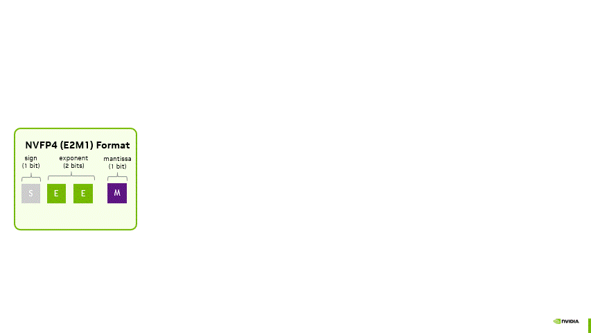
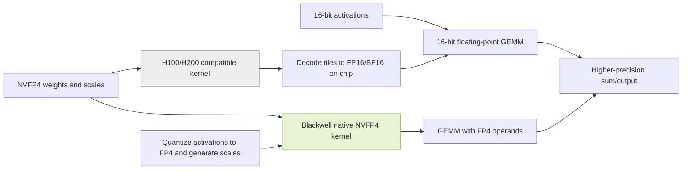

# Does a Model's Bit Width Describe Its Computation? Component Precision in Three Large MoE Models

[](#choosing-the-six-original-checkpoints)
[](#complete-component-precision-matrix)
[](#evidence-boundaries)
[](#evidence-boundaries)

Author: Xinyu Wei · [中文](README_CN.md)

## Purpose

Our [earlier article](https://mp.weixin.qq.com/s/2gyeCYu13PH_dGLUV3gryA) established a useful distinction: **a checkpoint describes storage; the operands consumed by the actual Tensor Core instruction describe matrix-multiply input precision.** This guide applies that distinction to Muse Spark Open, NVIDIA Nemotron 3 Ultra, and Inkling. What does BF16, FP8, or NVFP4 mean for each component, and what happens when NVFP4 weights run on H100?

The narrative proceeds from bit widths to model architecture, one complete component matrix, the H100 execution path, and deployment acceptance. Pricing, regional availability, and model rankings are out of scope. **This is a public-source and configuration analysis. No model inference has been executed for this project.**

### Start with a concrete counterexample

The original Nemotron 3 Ultra NVFP4 export assigns NVFP4 to routed experts, FP8 to shared experts and Mamba projections, and excludes router/gate modules. Its vLLM example separately chooses FP8 KV cache and FP16 Mamba state [N2][N3]. Calling this simply a "4-bit model" does not describe its components or establish a GPU count.

| Precision question | What must be inspected | Misleading shortcut |
|---|---|---|
| Weight storage | Encoding, group scales, zero points, and exceptions | Every tensor in an NVFP4 checkpoint is 4-bit |
| Activations | Quantization at the input and output of each operator | FP8 weights imply FP8 intermediate values everywhere |
| Matrix multiplication | Both operand types at the selected kernel | Stored INT4 weights imply native INT4 multiplication |
| Accumulation and output | Accumulators, reductions, and returned tensor types | FP4 operands imply FP4 accumulation |
| Caches and state | Separate K, V, Mamba, and short-convolution settings | Cache precision automatically follows weight precision |

BF16 and FP16 both occupy 16 bits but use different exponent/mantissa layouts. The original reference checkpoints here are BF16; this guide does not invent an official FP16 release. Labels such as `W4A16` and `W8A8` give bit widths, not the integer/floating-point encoding or the selected kernel.

AWQ, GPTQ, and GSQ optimize quantized weights. GGUF is a file format; names such as `Q4_K_M` describe encoding or mixed-precision presets. These are not interchangeable categories. NVFP4 combines E2M1 values with an FP8 scale per 16 values and a global FP32 scale, so its storage footprint is not exactly four bits per value [H1].



Source: NVIDIA, *Introducing NVFP4 for Efficient and Accurate Low-Precision Inference*, Figure 2 [H1]. Original, unmodified GIF. Inspect the separate value and scale encodings; the figure does not establish every model component's precision or any performance result from this project.

### Identify the models and releases

| Model | Publisher's nominal total parameters | Active parameters per token | Deployment-relevant architecture | Original releases and access |
|---|---:|---:|---|---|
| Muse Spark Open | 816B | 42B | Multimodal MoE Transformer, perception encoder, 62 language layers, 256 experts, top-8 routing | Meta BF16 and NVFP4; gated access under the Muse Model License [M1][M2] |
| NVIDIA Nemotron 3 Ultra | 550B | 55B | Hybrid Mamba-2, Attention and LatentMoE, with MTP | NVIDIA BF16 and NVFP4; OpenMDW-1.1 [N1][N2] |
| Inkling | 975B | 41B | 66 layers, local/global Attention, short convolution, 256 routed and 2 shared experts, top-6 routed experts | Thinking Machines Lab BF16 and NVFP4; Apache-2.0 [I1][I2] |

`B` means one billion parameters. Active parameter counts do not describe all resident weights. The other experts normally remain loaded unless an explicit offloading design accepts its communication and scheduling costs. Do not size complete checkpoints using 42B, 55B, or 41B. Nominal counts may also differ from exported multimodal, MTP, and auxiliary tensor inventories.

A readable model card does not grant weight access. The Muse license includes attribution requirements and additional conditions for certain model-service businesses; review the actual license for the intended distribution. This guide is not legal advice.

## Results

### Complete component precision matrix

**Conventions:** "Baseline" means retained checkpoint precision, not that every tensor is BF16: all three reference metadata records contain F32 tensors. "Excluded" means excluded from that quantization configuration, not a verified per-tensor dtype. "Unverified" is a gap, not an implicit BF16 value. "N/A" means the architecture has no such component. Execution rows describe a specified documented path, not profiler observations from this project.

Revisions for the six original BF16/NVFP4 checkpoints and the three partner FP8 releases are in [model-evidence.json](data/model-evidence.json). The FP8 columns use specific AMD Quark and Red Hat AI derivatives [M8][N8][I8], not an arbitrary FP8 checkpoint or a claim that the original model developer published it.

| Category and component/execution condition | Model: Muse Spark Open; release: Meta BF16 | Model: Muse Spark Open; release: AMD FP8 | Model: Muse Spark Open; release: Meta NVFP4 | Model: Nemotron 3 Ultra; release: NVIDIA BF16 | Model: Nemotron 3 Ultra; release: Red Hat FP8 | Model: Nemotron 3 Ultra; release: NVIDIA NVFP4 | Model: Inkling; release: TML BF16 | Model: Inkling; release: Red Hat FP8 | Model: Inkling; release: TML NVFP4 |
|---|---|---|---|---|---|---|---|---|---|
| Weights: token embedding | BF16 baseline [M1] | Baseline retained [M8] | Baseline; raw configuration requires authorization [M3] | BF16 baseline [N1] | Excluded [N8] | Excluded [N3] | BF16 baseline [I1] | Baseline retained [I8] | BF16 [I3] |
| Weights: Attention Q/K/V/O projections | BF16 baseline [M1] | FP8 E4M3, per-channel [M8] | Outside expert quantization; baseline [M3] | BF16 baseline [N1] | FP8 for matching Linear targets [N8] | Not among inspected FP8/NVFP4 rules; per-tensor baseline dtype unverified [N3] | BF16 baseline [I1] | Config excludes the `.attn` subtree; do not infer FP8 from card prose [I9] | BF16 [I3] |
| Weights: router/gate | Storage dtype unverified; routing computes in FP32 [M4] | Card says BF16 retained; computation remains unverified [M8] | Storage unverified; not router=NVFP4 [M4] | Per-tensor dtype unverified [N1] | `gate` excluded [N8] | `gate` excluded [N3] | BF16 [I3] | Baseline retained [I8] | BF16 [I3] |
| Weights: routed-expert matrices | BF16 [M1] | FP8 E4M3, per-channel [M8] | NVFP4; publisher quantizes experts only [M3] | BF16 [N1] | FP8, per-channel [N8] | NVFP4, group=16 [N3] | BF16 [I1] | FP8 with early-layer exclusions [I8] | NVFP4 with additional layer exclusions [I4] |
| Weights: shared-expert matrices | N/A: no shared expert [M4] | N/A [M4] | N/A [M4] | BF16 baseline [N1] | FP8 for matching Linear targets [N8] | FP8 [N3] | BF16 [I3] | Baseline retained [I8] | BF16 [I3][I4] |
| Weights: pre/post-expert latent projections | Baseline retained [M4] | Explicitly excluded [M8] | Baseline retained [M4] | LatentMoE baseline; inspect individual tensors [N1] | Check Linear targets and exclusions [N8] | Latent projections excluded; not FP4 [N3] | Different architecture; do not copy another model's recipe [I1] | Same boundary [I8] | Same boundary [I3] |
| Weights: Mamba input/output projections | N/A | N/A | N/A | BF16 baseline [N1] | FP8 for matching Linear targets [N8] | FP8 [N3] | N/A | N/A | N/A |
| Weights: Mamba convolution/state parameters | N/A | N/A | N/A | BF16/F32 baseline; not uniformly BF16 [N1] | Convolution, bias and other exclusions [N8] | Convolution excluded; per-tensor dtype requires separate verification [N3] | N/A | N/A | N/A |
| Weights: short convolution, sconv | N/A | N/A | N/A | N/A: not Inkling sconv | N/A | N/A | BF16 [I3] | Outside attention/expert Linear targets [I8] | BF16 [I3] |
| Weights: normalization and bias | Baseline; per-tensor inspection incomplete [M1] | Baseline retained [M8] | Baseline retained [M3] | Baseline, possibly F32 [N1] | Norm/bias exclusions [N8] | Non-expert rules do not imply FP4 [N3] | Baseline [I1] | Baseline retained [I8] | Primarily BF16; buffer dtypes require separate verification [I3] |
| Weights: vision/audio encoders | Multimodal components; inspect individual dtypes [M1] | Card declares BF16 retained [M8] | Outside expert quantization; baseline [M3] | N/A: text model [N1] | N/A | N/A | Multimodal components; baseline [I1] | Original precision retained [I8] | Encoders excluded; per-tensor dtypes require separate verification [I4] |
| Weights: MTP/external draft | External draft requires independent verification [M3] | External draft requires independent verification | External draft requires independent verification [M3] | MTP present; inspect shared weights [N1] | Separate MTP recipe unverified [N8] | Main checkpoint name does not establish MTP precision [N2] | MTP heads BF16 [I3] | Separate MTP recipe unverified [I8] | MTP heads BF16 [I3] |
| Weights: output head | BF16 baseline [M1] | `lm_head` excluded [M8] | Baseline retained [M3] | BF16 baseline [N1] | `lm_head` excluded [N8] | Outside FP8/NVFP4 rules; dtype requires separate verification [N3] | BF16 baseline [I1] | Unembedding baseline retained [I8] | BF16 [I3] |
| Activations: quantized Attention Linear input | 16-bit baseline | Dynamic per-token FP8 [M8] | Not an expert path; do not infer FP4 [M3] | 16-bit baseline | Dynamic per-token FP8 [N8] | No universal FP4 claim [N3] | 16-bit baseline | `.attn` excluded; generic FP8 input rule does not establish this path [I9] | BF16 path [I3] |
| Activations: expert Linear input, native low-precision path | 16-bit baseline | Dynamic per-token FP8 [M8] | FP4 when using a native FP4 kernel; otherwise backend-dependent [V1] | 16-bit baseline | Dynamic per-token FP8 [N8] | FP4 for the native NVFP4 path [V1] | 16-bit baseline | Dynamic per-token FP8 [I8] | FP4 for native NVFP4; excluded layers separate [I3][V1] |
| Activations: routing/residual stream | FP32 routing input and residual stream in recipe [M4] | Verify compute independently of BF16 weight claim [M8] | FP32 routing input and residual stream in recipe [M4] | Check implementation, not BF16 name | Not quantized alongside experts [N8] | Not quantized alongside experts [N3] | Implementation-dependent | Not quantized alongside experts [I8] | Not quantized alongside experts [I3] |
| Compute: expert GEMM, native Blackwell backend | BF16 operands | AMD release; CUDA compatibility not established [M8] | FP4 operands and block scales [V1] | BF16 operands | FP8 with a supported FP8 kernel | FP4 operands and block scales [V1] | BF16 operands | FP8 with a supported FP8 kernel | FP4 operands/scales; excluded layers retain baseline [I3] |
| Compute: expert GEMM, H100/H200 compatible backend | BF16; capacity separate | Publisher lists AMD hardware; Hopper path unverified [M8] | No native FP4; Meta lists H200, backend must be verified [M3] | BF16; capacity separate [N1] | FP8 with a supported FP8 kernel | Compatible W4A16; verify the MoE kernel [N2][V1] | BF16; multi-node requirements separate [I3] | FP8 with a supported FP8 kernel | Recipe states on-the-fly BF16 dequantization; named example is H200 [I3] |
| Compute: accumulation and output | Higher precision; verify kernel | Not uniformly FP8 | Not FP4 accumulation/output [H1] | Verify kernel | Not uniformly FP8 | Not FP4 accumulation/output [H1] | Verify kernel | Not uniformly FP8 | Not FP4 accumulation/output [H1] |
| KV cache: K storage | Independently configured | Not established by FP8 weight recipe | Independently configured | Example-dependent, not a universal default [N1] | Not explicitly quantized; set at runtime [N8] | FP8 in official vLLM example [N2] | Independently configured | Not established by weight recipe [I8] | Export declares `none`; runtime may override [I4] |
| KV cache: V storage | Independently configured | Not established by FP8 weight recipe | Independently configured | Example-dependent, not a universal default [N1] | Not explicitly quantized; set at runtime [N8] | FP8 in official vLLM example [N2] | Independently configured | Not established by weight recipe [I8] | Export declares `none`; runtime may override [I4] |
| KV cache: scales and Attention arithmetic | Depends on KV dtype, scales and backend | FP8 QKV projections do not imply FP8 Attention dot products | FP4 weights do not determine KV precision | Depends on KV dtype and backend | Same boundary | FP8 cache alone does not prove FP8 Attention computation [V2] | Local/global layers require separate accounting [I3] | Same boundary | Same boundary |
| Other cache: Mamba SSM | N/A | N/A | N/A | Official example: FP16 plus stochastic rounding [N1] | Official example: FP16 plus stochastic rounding [N8] | Official example: FP16 plus stochastic rounding [N2] | N/A | N/A | N/A |
| Other cache: short-convolution state | N/A | N/A | N/A | N/A | N/A | N/A | Present; runtime dtype must be verified [I3] | Present; not automatically FP8 KV | Present; not NVFP4 KV [I3] |
| Acceptance status | NOT_RUN | NOT_RUN | NOT_RUN; raw configuration gated | NOT_RUN | NOT_RUN | Configuration inspected; inference NOT_RUN | NOT_RUN | NOT_RUN; specific integration required | Configuration inspected; inference NOT_RUN |

The router selects experts; routed experts perform the selected computations. They are different modules. Nemotron's inspected export has 49,344 module rules: 49,152 NVFP4 routed-expert rules, 96 FP8 shared-expert rules, and 48 FP8 rules each for Mamba input and output projections. These are configuration entry counts, not parameter counts or performance measurements.

Inkling instead uses global NVFP4 settings with exclusions, including `model.llm.layers.2.mlp.experts`. An empty per-module dictionary does not mean no quantization, and the global algorithm does not override its exclusions [I4].

### How H100 executes NVFP4

A supported W4A16 fallback loads packed FP4 weights and scales, decodes tiles on chip into FP16/BF16, multiplies them by 16-bit activations, and returns results using the kernel's accumulation, reduction and output rules. Efficient fused kernels need not expand the entire model back into high-precision HBM storage. Other loaders may use different layouts; measure actual memory instead of assuming it.

$$
\widehat W_g = s_{\mathrm{tensor}}\,s_g\,q_g,\qquad Y\approx X_{16}\widehat W_{16}.
$$

Here `q_g` contains E2M1 approximations and `s_g` is a block scale. Decoding does not recover the original BF16 values lost during quantization. H100's FP8 support does not automatically turn this into FP8 computation, let alone native FP4. Verify the selected MoE kernel separately: a supported Linear-layer fallback does not establish support for every expert operator.



Original explanatory diagram: a cross-source synthesis of NVIDIA's format, vLLM's fallback rules, and the model recipe [H1][V1][I3]. It is not an execution trace. The Blackwell branch applies only when a native kernel is selected; other model components can remain BF16 or FP8.

### Choosing the six original checkpoints

| Model | Weight release | Documented candidate starting point | What it does not establish |
|---|---|---|---|
| Muse Spark Open | BF16 | Meta card gives approximately 2 TB of VRAM [M1] | Not a single-GPU specification or concurrency guarantee |
| Muse Spark Open | NVFP4 | Meta lists four Blackwell Ultra GPUs or eight H200s; vLLM recipe defaults to eight Blackwell GPUs [M3][M4] | Do not merge distinct recipes into one universal minimum GPU count |
| Nemotron 3 Ultra | BF16 | Card summary lists 16 H100s, 8 H200s or 8 B200s [N1] | Not capacity at maximum context plus target concurrency |
| Nemotron 3 Ultra | NVFP4 | Card lists four B200/GB200-class GPUs and eight H100s [N2] | H100 has no native FP4 compute; engine support differs |
| Inkling | BF16 | Original BF16 release; vLLM Hopper recipe requires multiple nodes [I1][I3] | Summed memory does not validate expert placement or communication |
| Inkling | NVFP4 | vLLM recipe lists four GB200s and eight H200s [I3] | Not four arbitrary Blackwell GPUs or eight arbitrary Hopper GPUs |

Establish a same-model BF16 business-quality baseline. NVFP4 and partner FP8 are candidates, not automatic replacements. Reject configurations that fail required quality, modalities, tool calling, or kernel compatibility. AMD's Muse FP8 card still says `Todo` under Deployment: it documents a recipe and hardware claims, not an end-to-end deployment verified here [M8].

### Weight, arithmetic, and cache settings are independent

| Question | Evidence to inspect | Invalid substitute |
|---|---|---|
| Stored weight format | Revision, tensor dtypes, quantization/scales/exclusions | NVFP4 in a filename |
| Actual multiplication | GPU, selected kernel, conversions, runtime log | A checkpoint successfully loaded |
| Cache precision | KV, Mamba and sconv settings separately | Weight format |
| Accumulation/output | Operator implementation | Operand bit width |

vLLM distinguishes `NVFP4` from `W4A16_NVFP4` and documents weight-only execution when native FP4 GEMM is unavailable [V1]. Nemotron's example uses FP8 KV cache and FP16 Mamba state with stochastic rounding [N2]; "all caches are FP8 or FP32" is not a universal rule.

AMD MI350X/MI355X support MXFP4, whose block-scale format differs from NVFP4 [H2][H3]. Inkling's recipe lists `lightseekorg/Inkling-MXFP4`, native MI355X execution and MI300X emulation. That is another publisher's checkpoint and another execution path, not a rename of the original NVFP4 release [I3].

### Resource accounting

The following tensor payloads are calculated from the six pinned revisions' public per-dtype element counts. **They are not complete download sizes or peak VRAM.** Inputs are in [model-evidence.json](data/model-evidence.json); run `node tools/inspect.mjs` to recompute them. Scale tensors and packed U8 elements use their actual storage dtypes, not the original logical parameter count.

| Model | Weight release | Tensor payload (decimal GB) | Tensor payload (binary GiB) |
|---|---|---:|---:|
| Muse Spark Open | BF16 | 1644.333 | 1531.405 |
| Muse Spark Open | NVFP4 | 533.011 | 496.405 |
| Nemotron 3 Ultra | BF16 | 1121.049 | 1044.058 |
| Nemotron 3 Ultra | NVFP4 | 320.071 | 298.090 |
| Inkling | BF16 | 1904.755 | 1773.942 |
| Inkling | NVFP4 | 592.005 | 551.348 |

Only tensors reported by public metadata are included. Headers, other files, caches/state, temporary workspaces and communication buffers are excluded. Nemotron BF16's reported total element count differs from the per-dtype sum; the tool preserves and reports this source discrepancy. See [Validation](VALIDATION.md).

$$
M_{\text{peak}} = M_{\text{weights}} + M_{\text{KV}} + M_{\text{state}} + M_{\text{workspace}} + M_{\text{communication}} + M_{\text{other}}.
$$

The following is a hypothetical weight-only calculation from nominal total parameters, in decimal GB. It is not file size, measured VRAM or a GPU recommendation. The NVFP4 column assumes every parameter uses four value bits plus one 8-bit scale per 16 values, or 4.5 bits/parameter. Actual mixed-precision releases include higher-precision components and further metadata [H2].

| Model | Input: nominal total parameters | Hypothetical all-BF16 payload | Hypothetical all-NVFP4 payload including block scales |
|---|---:|---:|---:|
| Muse Spark Open | 816B | 1,632 GB | 459.0 GB |
| Nemotron 3 Ultra | 550B | 1,100 GB | 309.375 GB |
| Inkling | 975B | 1,950 GB | 548.4375 GB |

The formulas are `parameters * 2 bytes` and `parameters * (4 + 8/16) / 8 bytes`. Meta's approximately 700 GB deployment guidance cannot be replaced with 459 GB: one is publisher deployment guidance and the other an idealized encoding calculation. Their difference cannot be attributed to a single component without evidence.

For conventional full-attention layers:

$$
M_{\text{KV}} \approx 2\,N_{\text{layers}}\,N_{\text{KV heads}}\,D_{\text{head}}\,T_{\text{resident}}\,b_{\text{element}}.
$$

`T_resident` sums retained tokens across resident requests. Local attention, cache sharing, parallel replication, pages, quantization scales and state-space models require separate treatment. Do not apply this formula unchanged to all three models. Longer context and greater concurrency can make cache capacity the limiting factor.

Plan download/cache storage, serving weights, conversion intermediates and logs separately. Read the chosen revision's actual file sizes and decide whether both BF16 and NVFP4 checkpoints must coexist.

### Evidence boundaries

Checked on 2026-11-01. The nine matrix columns have inference status **NOT_RUN** in this project. Throughput, latency, quality regression, long-context stability and recovery are not measured here. Source-reported benchmark scores from different projects are not combined into a comparison.

Nemotron's card discusses training recipes, weight exports and engine examples separately. Its prose mentions "NVFP4 KV caching" while concrete examples select FP8 cache; this guide follows the explicit parameters rather than treating the prose as a verified cache capability.

Inkling's recipe mentions both `vLLM 0.26.0+` and nightly installation. Neither is a reproducible guarantee for an arbitrary later build. Pin the tested commit or image digest and retain actual runtime evidence. Muse's raw quantization configuration returned HTTP 401 and was not bypassed; public publisher and recipe descriptions have narrower evidential scope than direct tensor inspection.

Red Hat's Inkling FP8 card describes attention Linear quantization, but the pinned configuration excludes `re:.*\.attn$` and `re:.*\.attn\..*` [I9]. The matrix preserves this conflict and does not label that subtree FP8. Actual module-name matching and loaded dtypes still need runtime inspection. Both Red Hat FP8 configurations have null `output_activations` and `kv_cache_scheme`: FP8 input rules do not establish FP8 outputs or KV storage.

License applicability, precise per-tensor gaps, device-specific peak memory and business performance still require validation. General framework support does not establish every precision, modality and backend combination.

## Steps

### Select a verifiable path before starting a service

| Order | Location | Action | Acceptance |
|---|---|---|---|
| 1 | Weight repository/license | Confirm model, precision, access and revision | Obtainable licensed checkpoint with an explicit revision |
| 2 | Hardware/engine | Select the model's own recipe and pin software/topology | Required modalities, cache and kernels explicitly supported |
| 3 | Capacity planning | Account for weights, context, concurrency and workspaces | Headroom per device and parallel group, not only a total |
| 4 | Isolated validation | Start the selected official path; retain kernel/cache logs | Loading, functionality and numerical checks pass |
| 5 | Business acceptance | Compare same-model BF16 and quantized releases on real tasks | Quality, memory and latency/concurrency targets met |
| 6 | Production preparation | Pin image, weights, templates, rollback and monitoring | Repeated deployment and upgrade/rollback verified |

Use Meta's guide for Muse [M3], the matching Nemotron card for its precision [N1][N2], and the publisher-linked Inkling recipe [I3]. Do not assemble unrelated model commands into a supposedly universal launcher. Example context lengths, concurrency and parallelism are not business recommendations.

### Recompute metadata without downloading weights

Requires Node.js 20 or later. From a shell at this directory:

```bash
node tools/inspect.mjs
node --test tests/inspect.test.mjs
```

The first command calculates tensor payload bytes from the six saved per-dtype inventories. The tests check matrix coverage, packed-byte accounting, explicit configuration gaps and failure handling. Neither command invokes a model or validates GPU requirements.

For current public metadata rather than replay:

```bash
node tools/inspect.mjs --live
```

This reads the public Hugging Face model API, reports the new revisions and recalculates from the returned counts. It does not use the saved counts if a request fails, download weights, request access, or claim that old quantization-configuration verification applies to the new revision. Runtime cache and workspace allocation are not included.

Detailed commands, expected semantics and unexecuted checks: [Validation](VALIDATION.md) · [验证说明](VALIDATION_CN.md). Data and its boundaries: [model-evidence.json](data/model-evidence.json). The matrix's supporting sources are listed below.

### What production acceptance means

The unit of acceptance is **model revision + format + GPU + engine version + kernel + cache settings + parallel topology + workload**. A changed component invalidates the affected results.

Cover the text, image, audio/video, structured outputs and tool calls actually required. Use representative inputs at target context and concurrency, recording quality/error categories, peak VRAM, time to first token, generation-latency distribution and throughput. A health check, one answer or a smaller file is not production acceptance. BF16 is a reference, not a guarantee of correct answers; NVFP4 is not an unconditional lossless promise.

### Public sources

| ID | Source and inspected scope |
|---|---|
| M1/M2 | Meta [BF16][M1] and [NVFP4][M2] cards: identity, access, architecture and deployment guidance |
| M3 | [Meta deployment guide][M3]: expert-only quantization, Blackwell Ultra/H200 descriptions; commands not executed |
| M4 | [vLLM Muse recipe][M4]: FP32 routing/residuals, no shared experts, eight-GPU Blackwell and text-only AMD examples |
| M8 | [AMD Muse FP8][M8]: per-channel weights, per-token activations and exclusions |
| N1/N2 | NVIDIA [BF16][N1] and [NVFP4][N2] cards: hardware summaries, model and cache examples |
| N3 | [Pinned Nemotron export][N3]: module rules and exclusions, inspected as raw JSON |
| N8 | [Red Hat Nemotron FP8][N8]: quantization recipe, ignore list and deployment example; no benchmark reuse |
| I1/I2 | Thinking Machines Lab [BF16][I1] and [NVFP4][I2]: model, architecture, license and linked recipes |
| I3 | [vLLM Inkling recipe][I3]: precision, kernels, cache architecture and version caveats |
| I4 | [Pinned Inkling export][I4]: global NVFP4, cache `none` and exclusions |
| I8 | [Red Hat Inkling FP8][I8]: publisher, source model and integration dependency; attention prose conflict in I9 |
| I9 | [Pinned Red Hat Inkling FP8 config][I9]: `.attn` exclusions; null output activation and KV cache schemes |
| V1/V2 | vLLM [Model Optimizer][V1] and [KV cache][V2]: execution and cache distinctions |
| H1/H2 | [NVIDIA NVFP4 description][H1]: E2M1, scales and NVFP4/MXFP4 differences |
| H3 | [AMD MI350 series][H3]: MI350X/MI355X MXFP4 support |

Related background: [NVFP4](../NVFP4/), [quantization methods](../Quantization-Methods-Comparison-and-Practice/), and [memory estimation](../LLM-Memory-Estimation/). Their historical results are not acceptance evidence for these three models.

[M1]: https://huggingface.co/meta-models/Muse-Spark-Open-816B-A42B
[M2]: https://huggingface.co/meta-models/Muse-Spark-Open-816B-A42B-NVFP4
[M3]: https://dev.meta.ai/resources/blog/build-with-muse-spark-open
[M4]: https://recipes.vllm.ai/meta-models/Muse-Spark-Open-816B-A42B
[M8]: https://huggingface.co/amd/Muse-Spark-Open-816B-A42B-Quark-PTPC-FP8
[N1]: https://huggingface.co/nvidia/NVIDIA-Nemotron-3-Ultra-550B-A55B-BF16
[N2]: https://huggingface.co/nvidia/NVIDIA-Nemotron-3-Ultra-550B-A55B-NVFP4
[N3]: https://huggingface.co/nvidia/NVIDIA-Nemotron-3-Ultra-550B-A55B-NVFP4/blob/02462641f13d3af838b904f48195b9bb8a1e4ebc/hf_quant_config.json
[N8]: https://huggingface.co/RedHatAI/NVIDIA-Nemotron-3-Ultra-550B-A55B-FP8-dynamic
[I1]: https://huggingface.co/thinkingmachines/Inkling
[I2]: https://huggingface.co/thinkingmachines/Inkling-NVFP4
[I3]: https://recipes.vllm.ai/thinkingmachines/Inkling
[I4]: https://huggingface.co/thinkingmachines/Inkling-NVFP4/blob/42a75a99a40eb2ba1e0717db6357a0bf15205044/hf_quant_config.json
[I8]: https://huggingface.co/RedHatAI/Inkling-FP8-dynamic
[I9]: https://huggingface.co/RedHatAI/Inkling-FP8-dynamic/blob/cb2bf130a5263e01d7398723ae9b88e0060f4998/config.json
[V1]: https://docs.vllm.ai/en/stable/features/quantization/modelopt/
[V2]: https://docs.vllm.ai/en/stable/features/quantization/quantized_kvcache/
[H1]: https://developer.nvidia.com/blog/introducing-nvfp4-for-efficient-and-accurate-low-precision-inference/
[H2]: https://developer.nvidia.com/blog/introducing-nvfp4-for-efficient-and-accurate-low-precision-inference/
[H3]: https://www.amd.com/en/products/accelerators/instinct/mi350.html