# Component Precision and Deployment Guide for Large MoE Models

[](#summary-first)
[](#component-precision-by-model)
[](#evidence-boundaries)
[](#mi300x-run)
[](https://github.com/david-xinyuwei/david-share/actions/workflows/large-moe-precision-guide-ci.yml)

Author: Xinyu Wei · [中文](README_CN.md)

## Purpose

This project provides component-level precision references for Muse Spark Open 816B-A42B, NVIDIA Nemotron 3 Ultra 550B-A55B, and Inkling 975B. It covers the original BF16 and NVFP4 checkpoints and specific partner FP8 releases. Use it to distinguish weights, activations, matrix-multiply operands, accumulation/output, KV caches, and other state, and to select an appropriate hardware and inference-engine path.

Deliverables include per-model component tables, pinned checkpoint/configuration evidence, resource-accounting tools, and validation procedures. **The precision study ran the original BF16 checkpoints on MI300X and the MXFP4 emulation paths for Inkling and Nemotron; Muse's MXFP4 path failed at initialization.** Configuration evidence and actual execution are labeled separately. Production acceptance requires the target environment and business inputs; regional supply and actual invoices are not evaluated here.

The two MI300X nodes also served a comparison of parallel strategies. **For Muse BF16, every strategy the vLLM recipe page offers on MI300X that fits two nodes ran with the page's generated commands, adapted for MI300X, with output limits high enough for answers to finish (2,266 of 2,286 did): TP8 × PP2 was fastest per request at every measured point; TP16 + EP was slower than TP16, as the page's AMD BF16 note says; the page's "Latency oriented" label for TP16 did not hold** ([results](#muse-selectable)). TP16 is not held back by InfiniBand bandwidth: at concurrency 1 it needs 4.4 ms more per token than TP8 × PP2, while that token's 11.4 MB of cross-node data needs 28 µs at link rate; the extra time points to about 126 cross-node synchronizations waited for one after another (count estimated from the source; see the [time budget](#muse-time-budget)). A separate **Qwen3-235B-A22B-Instruct-2507 BF16** experiment executed all five strategies in a recovery phase after Spot eviction interrupted its first phase ([initial phase](#qwen-fiveway), [recovery](#qwen-recovery)); its results are attributed separately from Muse. Quoted Spot rates are test-time references, not invoices or regional-availability assessments.

### Summary first

All three models are MoE networks whose experts stay resident while each token activates only a small share of them; their BF16 weights are 1.1–1.9 TB and do not fit one GPU, so the first selection question is "which GPU, how many, at which precision". One row per model: column 2 is the publisher's own starting point; columns 3–4 are the two paths this project actually ran on Azure MI300X (192 GB, vLLM ROCm) on 2026-11-02 — original BF16, and MXFP4, the only 4-bit path available on MI300X. Original NVFP4 is NVIDIA's Blackwell format; AMD GPUs have no native kernel for it and this project did not deploy it on MI300X, while its component precision stays in the three matrices below. None of these is a minimum GPU count or a concurrency guarantee. Speeds are per-request decode tok/s at concurrency 1 (median, n=3).

| Model | Published starting point and limits | This project's run:<br>original BF16 | This project's run:<br>MXFP4<br>(emulated kernels,<br>1 node, 8 GPUs) |
|---|---|---|---|
| Muse Spark Open | BF16: Meta's card gives approximately 2 TB of VRAM [M1].<br>NVFP4: four Blackwell Ultra GPUs or eight H200s; the vLLM recipe defaults to eight Blackwell GPUs [M3][M4].<br>The two recipes do not establish one universal minimum GPU count. | **Passed**:<br>2 nodes, 16 GPUs, TP8 × PP2;<br>99.1 GiB weights per GPU;<br>84.6 tok/s<br>(3rd attempt, v0.33.0 image) [T2] | **Failed**:<br>both attempts exited before loading weights — Muse's ROCm code requires the `AITER_MXFP4_MXFP4` backend,<br>vLLM selects `EMULATION` on MI300X, and the model code rejects it [T3] |
| Nemotron 3 Ultra | BF16: the card summary lists 16 H100s, 8 H200s or 8 B200s [N1].<br>NVFP4: four B200/GB200-class GPUs and eight H100s [N2]; H100 has no native FP4 compute. | **Passed**:<br>1 node, 8 GPUs, TP8 + EP;<br>136.51 GiB weights per GPU;<br>60.7 tok/s<br>(3rd attempt) [T2] | **Passed**:<br>BF16 weights quantized to MXFP4 at load time (vLLM's official `--quantization online`), TP8 + EP8;<br>43.21 GiB weights per GPU;<br>final answer correct;<br>7.7 tok/s [T3] |
| Inkling | BF16: original release; the vLLM Hopper recipe requires multiple nodes [I1][I3].<br>NVFP4: four GB200s or eight H200s [I3].<br>Summed memory does not validate expert placement or communication. | **Passed**:<br>2 nodes, 16 GPUs, TP8 × PP2;<br>109.52 / 116.12 GiB weights per GPU (two pipeline stages);<br>68.9 tok/s<br>(6th attempt) [T2] | **Passed**:<br>community Quark MXFP4 checkpoint `lightseekorg/Inkling-MXFP4` (the MI300X emulation path listed in the recipe [I3]), TP8;<br>66.74 GiB weights per GPU;<br>final answer correct;<br>6.1 tok/s [T3] |

Three things to know when reading this table. ① MI300X has no FP4 matrix compute, so both MXFP4 "Passed" cells use vLLM's `EMULATION` backend: weights are stored as MXFP4 and dequantized before each matrix multiply. It saves memory (Nemotron 136.51 → 43.21 GiB per GPU; Inkling from 16 GPUs down to 8), not time: per-request decode is 6–8 tok/s, one tenth of BF16. ② This is a "does it load, how much memory, is the answer right" check, not a quality regression test; the three partner FP8 releases (AMD Quark, Red Hat AI) were checked at the configuration level only and were not loaded on any GPU [M8][N8][I8]. ③ Establish a same-model BF16 business-quality baseline first; MXFP4 and partner FP8 are candidates, not automatic replacements, and a configuration that fails required quality, modalities, tool calling or kernel compatibility is rejected. AMD's Muse FP8 card still says `Todo` under Deployment: it documents a recipe and hardware claims, not an end-to-end deployment verified here [M8]. The kernels, cache precisions, memory and speed figures behind each column are in [MI300X run](#mi300x-run) and [MXFP4 low-precision path](#mxfp4-low-precision-path).

### Model scope

| Model | Total parameters<br>(billions) | Active parameters<br>per token (billions) |
|---|---:|---:|
| Muse Spark Open | 816 | 42 |
| Nemotron 3 Ultra | 550 | 55 |
| Inkling | 975 | 41 |

- **Muse Spark Open:** multimodal MoE Transformer and perception encoder; 62 language layers, 256 experts and top-8 routing. Meta publishes BF16/NVFP4 checkpoints with gated access under the Muse Model License [M1][M2].
- **Nemotron 3 Ultra:** hybrid Mamba-2, Attention, LatentMoE and MTP. NVIDIA publishes BF16/NVFP4 checkpoints under OpenMDW-1.1 [N1][N2].
- **Inkling:** 66 local/global Attention layers with short convolution, 256 routed and 2 shared experts, selecting 6 routed experts per token. Thinking Machines Lab publishes BF16/NVFP4 checkpoints under Apache-2.0 [I1][I2].

`B` means one billion parameters. Active parameter counts do not describe all resident weights. The other experts normally remain loaded unless an explicit offloading design accepts its communication and scheduling costs. Do not size complete checkpoints using 42B, 55B, or 41B. Nominal counts may also differ from exported multimodal, MTP, and auxiliary tensor inventories.

A readable model card does not grant weight access. The Muse license includes attribution requirements and additional conditions for certain model-service businesses; review the actual license for the intended distribution. This guide is not legal advice.

### Precision definitions and configuration scope

The original Nemotron 3 Ultra NVFP4 export assigns NVFP4 to routed experts, FP8 to shared experts and Mamba projections, and excludes router/gate modules. Its vLLM example separately chooses FP8 KV cache and FP16 Mamba state [N2][N3]. Calling this simply a "4-bit model" does not describe its components or establish a GPU count.

| Precision aspect | Inspection and limits |
|---|---|
| Weight storage | Inspect encoding, group scales, zero points and exceptions. An NVFP4 checkpoint does not imply that every tensor is 4-bit. |
| Activations | Inspect quantization at each operator's input and output. FP8 weights do not imply FP8 intermediate values everywhere. |
| Matrix multiplication | Inspect both operand types at the selected kernel. Stored INT4 weights do not imply native INT4 multiplication. |
| Accumulation and output | Inspect accumulators, reductions and returned tensor types. FP4 operands do not imply FP4 accumulation. |
| Caches and state | Inspect separate K, V, Mamba and short-convolution settings. Cache precision does not automatically follow weight precision. |

BF16 and FP16 both occupy 16 bits but use different exponent/mantissa layouts. The original reference checkpoints here are BF16; this guide does not invent an official FP16 release. Labels such as `W4A16` and `W8A8` give bit widths, not the integer/floating-point encoding or the selected kernel.

AWQ, GPTQ, and GSQ optimize quantized weights. GGUF is a file format; names such as `Q4_K_M` describe encoding or mixed-precision presets. These are not interchangeable categories. NVFP4 combines E2M1 values with an FP8 scale per 16 values and a global FP32 scale, so its storage footprint is not exactly four bits per value [H1].


Source: NVIDIA, *Introducing NVFP4 for Efficient and Accurate Low-Precision Inference*, Figure 2 [H1]. The original is a GIF that draws the figure step by step; this is its last frame (all three parts drawn) as a still image, pixels unmodified. Inspect the separate value and scale encodings; the figure does not establish every model component's precision or any performance result from this project.

## Results

### Component precision by model

Each model retains all 25 component and status items. Columns identify specific releases; rows separate storage, activations, arithmetic and caches.

Terms used in the tables:

| Term | Meaning |
|---|---|
| BF16 / FP32 | Possible tensor types; "not confirmed per tensor" means the allocation to individual tensors is not established |
| Excluded | An explicit exclusion rule in the export configuration; not proof of BF16 storage |
| Runtime | Decided by launch settings and the inference backend, not by the checkpoint |
| N/A | The model has no such component; not an unchecked cell |
| Observed [T1] | Tensor dtype read from every safetensors header of the pinned revision, without reading weight data |
| MI300X run [T2] | Kernel, cache dtype and launch flag that vLLM actually selected on MI300X on 2026-11-02 |

Configuration notes below each table identify access restrictions, source conflicts and the settings to inspect; no default precision is invented for missing evidence.

Revisions and configuration summaries for all nine releases are retained in [model-evidence.json](data/model-evidence.json). FP8 refers to the specific AMD Quark and Red Hat AI releases [M8][N8][I8].

#### Muse Spark Open

Releases: Meta BF16 and NVFP4; AMD Quark FP8 [M1][M2][M8].

The three tables share one set of 25 rows so they can be read side by side. Muse is a plain Attention + MoE Transformer with no shared expert, no Mamba layer and no short convolution [M4], so the six "N/A" rows below mean the component does not exist in this model, not that it was left unchecked.

| Part | BF16 | FP8 | NVFP4 |
|---|---|---|---|
| Weight<br>em&shy;bed&shy;ding | BF16 [M1] | BF16 (config) [M8] | BF16 (inferred: non-experts are not quantized) [M3] |
| Weight<br>atten&shy;tion pro&shy;jec&shy;tion | BF16 [M1] | FP8 [M8] | BF16 (inferred: non-experts are not quantized) [M3] |
| Weight<br>router | FP32 com&shy;pute; stor&shy;age dtype not pub&shy;lished [M4] | BF16 claim [M8] | FP32 com&shy;pute; stor&shy;age dtype not pub&shy;lished [M4] |
| Weight<br>rout&shy;ed expert | BF16 [M1] | FP8 [M8] | NVFP4 [M3] |
| Weight<br>shar&shy;ed expert | N/A [M4] | N/A [M4] | N/A [M4] |
| Weight<br>expert pre / post pro&shy;jec&shy;tion | BF16 / FP32, not confirmed per tensor [M4] | Exclu&shy;ded [M8] | BF16 / FP32, not confirmed per tensor [M4] |
| Weight<br>Mam&shy;ba pro&shy;jec&shy;tion | N/A | N/A | N/A |
| Weight<br>Mam&shy;ba state para&shy;me&shy;ter | N/A | N/A | N/A |
| Weight<br>short con&shy;vo&shy;lu&shy;tion | N/A | N/A | N/A |
| Weight<br>norm / bias | BF16 / FP32, not confirmed per tensor [M1] | BF16 / FP32, not confirmed per tensor [M8] | BF16 / FP32, not confirmed per tensor [M3] |
| Weight<br>vision / audio | BF16 / FP32, not confirmed per tensor [M1] | BF16 claim [M8] | BF16 / FP32, not confirmed per tensor [M3] |
| Weight<br>draft | Own mod&shy;el [M3] | Own mod&shy;el | Own mod&shy;el [M3] |
| Weight<br>out&shy;put head | BF16 [M1] | Exclu&shy;ded [M8] | BF16 (inferred: non-experts are not quantized) [M3] |
| Input<br>atten&shy;tion pro&shy;jec&shy;tion | BF16, MI300X run [T2] | Dyna&shy;mic FP8 [M8] | Runtime dtype; not fixed [M3] |
| Input<br>expert | BF16, MI300X run [T2] | Dyna&shy;mic FP8 [M8] | FP4 / 16 bit by kernel [V1] |
| Input<br>router / resid&shy;ual | FP32 [M4] | By code [M8] | FP32 [M4] |
| Expert math<br>Black&shy;well | BF16 | AMD path [M8] | Native FP4 [V1] |
| Expert math<br>Hop&shy;per / MI300X | BF16; Triton ex&shy;perts on MI300X<br>name below [T2] | CUDA<br>test first [M8] | H200: de&shy;code path [M3] |
| Sum / out&shy;put | By kernel | Not set by FP8 | Above FP4 [H1] |
| K cache | BF16, auto dtype follows weights<br>MI300X run [T2] | Run&shy;time | Run&shy;time |
| V cache | BF16 (same), MI300X run [T2] | Run&shy;time | Run&shy;time |
| Cache scale / atten&shy;tion | AITER atten&shy;tion and fused kernel; names below; MI300X run [T2] | By back&shy;end | By back&shy;end |
| Mam&shy;ba state cache | N/A | N/A | N/A |
| Short con&shy;vo&shy;lu&shy;tion cache | N/A | N/A | N/A |
| Infer&shy;ence status | MI300X 2 × 8 GPU smoke passed (TP8 × PP2, v0.33.0 image, text only) [T2] | Not run | Config read; not run |

**Configuration notes.** Meta documents expert-only quantization [M3]. The vLLM recipe specifies FP32 routing computation and residuals, but does not separately specify router weight storage [M4]; the router cell therefore reads "FP32 compute; storage dtype not published" rather than conflating the two. The original NVFP4 raw configuration returned HTTP 401 and requires authorized access to the pinned revision. Public model-card facts remain usable. AMD states that routing, encoders and the output head remain BF16, with static per-channel FP8 E4M3 expert/attention weights and dynamic per-token FP8 inputs [M8]. Its Deployment section is still `Todo`, not evidence of a CUDA deployment.

Muse has no shared expert [M4]. Draft weights are a separate checkpoint whose precision and memory require their own record. K/V dtypes, scales and Attention arithmetic depend on runtime settings and the backend; FP8 QKV projections do not imply FP8 Attention dot products.

Exact identifiers from the MI300X run: input flag `--dtype bfloat16`; expert backend `MuseSparkTritonExperts`; cache setting `kv_cache_dtype=auto`, selecting BF16 from the weights; attention backend `ROCM_AITER_FA` with the fused qk-norm/rope/kv-insert kernel.

#### NVIDIA Nemotron 3 Ultra

Releases: NVIDIA BF16 and NVFP4; Red Hat AI FP8 [N1][N2][N8].

Nemotron uses Mamba-2 rather than Inkling-style short convolution and has no vision/audio encoder [N1], so the three "N/A" rows below mean the component does not exist in this model.

| Part | BF16 | FP8 | NVFP4 |
|---|---|---|---|
| Weight<br>em&shy;bed&shy;ding | BF16, ob&shy;served [T1] | Exclu&shy;ded [N8] | Exclu&shy;ded [N3] |
| Weight<br>atten&shy;tion pro&shy;jec&shy;tion | BF16, ob&shy;served [T1] | FP8 target [N8] | Not in low-bit rules [N3] |
| Weight<br>router | BF16 weights<br>F32 bias; tensor names below [T1] | Exclu&shy;ded [N8] | Exclu&shy;ded [N3] |
| Weight<br>rout&shy;ed expert | BF16, 49,152 ten&shy;sors, ob&shy;served [T1] | FP8 [N8] | NVFP4 [N3] |
| Weight<br>shar&shy;ed expert | BF16, ob&shy;served [T1] | FP8 target [N8] | FP8 [N3] |
| Weight<br>latent pro&shy;jec&shy;tion | BF16, ob&shy;served [T1] | Per rule [N8] | Exclu&shy;ded [N3] |
| Weight<br>Mam&shy;ba pro&shy;jec&shy;tion | BF16, ob&shy;served [T1] | FP8 target [N8] | FP8 [N3] |
| Weight<br>Mam&shy;ba state para&shy;me&shy;ter | All BF16; tensor names below [T1] | Con&shy;vo&shy;lu&shy;tion exclu&shy;ded [N8] | Con&shy;vo&shy;lu&shy;tion exclu&shy;ded [N3] |
| Weight<br>Inkling sconv | N/A | N/A | N/A |
| Weight<br>norm / bias | BF16, ob&shy;served [T1] | Exclu&shy;ded [N8] | BF16 (inferred from unquantized rules) [N3] |
| Weight<br>vision / audio | N/A [N1] | N/A | N/A |
| Weight<br>MTP | BF16: 1,039 ten&shy;sors; 1 F32 bias; ob&shy;served [T1] | MTP not sep&shy;a&shy;rate&shy;ly speci&shy;fied [N8] | MTP not sep&shy;a&shy;rate&shy;ly speci&shy;fied [N2] |
| Weight<br>out&shy;put head | BF16, ob&shy;served [T1] | Exclu&shy;ded [N8] | Not in low-bit rules [N3] |
| Input<br>atten&shy;tion pro&shy;jec&shy;tion | BF16, MI300X run [T2] | Dyna&shy;mic FP8 [N8] | By oper&shy;ator [N3] |
| Input<br>expert | BF16, MI300X run [T2] | Dyna&shy;mic FP8 [N8] | FP4 / 16 bit by kernel [V1] |
| Input<br>router / resid&shy;ual | By code | Not in ex&shy;pert rules [N8] | Not in ex&shy;pert rules [N3] |
| Expert math<br>Black&shy;well | BF16 | FP8 on valid kernel | Native FP4 [V1] |
| Expert math<br>Hop&shy;per / MI300X | BF16; Triton ex&shy;perts on MI300X<br>name below [N1][T2] | FP8 on valid kernel | W4A16 de&shy;code [N2][V1] |
| Sum / out&shy;put | By kernel | Not set by FP8 | Above FP4 [H1] |
| K cache | BF16, auto by default; MI300X run [T2] | Set at start [N8] | FP8 in recipe [N2] |
| V cache | BF16, auto by default; MI300X run [T2] | Set at start [N8] | FP8 in recipe [N2] |
| Cache scale / atten&shy;tion | ROCm atten&shy;tion; name below; MI300X run [T2] | By back&shy;end | By back&shy;end [V2] |
| Mam&shy;ba state cache | FP16, launch flag; MI300X run [T2] | FP16 in recipe [N8] | FP16 in recipe [N2] |
| Short con&shy;vo&shy;lu&shy;tion cache | N/A | N/A | N/A |
| Infer&shy;ence status | 8× MI300X smoke **passed** [T2] | Not run | Config read; not run |

**Configuration notes.** N3 was read directly. Router/gate and latent projections occur in its exclusions; exclusion does not establish each tensor's BF16 storage. "Observed" in the BF16 column comes from the 2026-11-02 per-tensor census of all 225 safetensors headers at pinned revision `77df655d` [T1]: 51,023 tensors, 1,121,049,257,984 bytes, equal to the byte count computed from public API metadata; routed experts are 91.9 %, Mamba projections 3.6 %, MTP 2.0 %, shared experts 1.4 %. The model config sets `mamba_ssm_cache_dtype` to `float32`, but both the vLLM example and this run override it with `--mamba-ssm-cache-dtype float16`: cache precision is a launch decision, not a checkpoint property. The Red Hat FP8 recipe uses `Linear` targets with an explicit ignore list; only matching, non-excluded modules receive that FP8 scheme [N8].

The original NVFP4 expert group size is 16. N3 contains 49,344 module rules: 49,152 NVFP4 routed-expert rules, 96 FP8 shared-expert rules and 48 FP8 rules each for Mamba input and output projections. These are configuration-entry counts, not parameter counts or performance measurements. The official example uses FP16 Mamba state with stochastic rounding, independently of FP8 KV cache [N2]. The cited recipes do not separately map MTP precision; MTP sharing and tensor dtypes require inspection of the complete configuration and tensor inventory.

Exact identifiers from the table: BF16 router weights `gate.weight` and F32 correction bias `e_score_correction_bias`; Mamba state parameters `A_log`, `D`, `dt_bias` and `conv1d` are all BF16; MI300X expert backend `TritonExperts` and attention backend `ROCM_ATTN`. K/V use the default `auto` setting.

#### Inkling

Releases: Thinking Machines Lab BF16 and NVFP4; Red Hat AI FP8 [I1][I2][I8].

Inkling uses short convolution rather than Mamba [I1], so the three Mamba "N/A" rows below mean the component does not exist in this model.

| Part | BF16 | FP8 | NVFP4 |
|---|---|---|---|
| Weight<br>em&shy;bed&shy;ding | BF16, ob&shy;served [T1] | BF16 (inferred from config) [I8] | BF16 [I3] |
| Weight<br>atten&shy;tion pro&shy;jec&shy;tion | BF16, ob&shy;served [T1] | Con&shy;fig exclu&shy;sion [I9] | BF16 [I3] |
| Weight<br>router | BF16 weights<br>F32 bias; names and shapes below [T1] | BF16 weights; FP32 bias (inferred from config) [I8] | BF16 [I3] |
| Weight<br>rout&shy;ed expert | BF16 fused tensors; names and shapes below [T1] | FP8 with exclu&shy;sions [I8] | NVFP4 with exclu&shy;sions [I4] |
| Weight<br>shar&shy;ed expert | BF16; tensor name and shape below [T1] | BF16 (inferred from config) [I8] | BF16 [I3][I4] |
| Weight<br>latent pro&shy;jec&shy;tion | Do not infer from Nemotron [I1] | Do not infer from Nemotron [I8] | Do not infer from Nemotron [I3] |
| Weight<br>Mam&shy;ba pro&shy;jec&shy;tion | N/A | N/A | N/A |
| Weight<br>Mam&shy;ba state para&shy;me&shy;ter | N/A | N/A | N/A |
| Weight<br>short con&shy;vo&shy;lu&shy;tion | BF16, 264 ker&shy;nels; shape below [T1] | BF16 (inferred from config) [I8] | BF16 [I3] |
| Weight<br>norm / bias | BF16 + 128 F32 sca&shy;lars, ob&shy;served [T1] | BF16 + FP32 (inferred from config) [I8] | Mostly BF16 [I3] |
| Weight<br>vision / audio | BF16, only 0.18 GB, ob&shy;served [T1] | BF16 (inferred from config) [I8] | En&shy;coders exclu&shy;ded [I4] |
| Weight<br>MTP | BF16, 160 ten&shy;sors, ob&shy;served [T1] | MTP not sep&shy;a&shy;rate&shy;ly speci&shy;fied [I8] | BF16 [I3] |
| Weight<br>out&shy;put head | BF16, ob&shy;served [T1] | BF16 (inferred from config) [I8] | BF16 [I3] |
| Input<br>atten&shy;tion pro&shy;jec&shy;tion | BF16; launch flag below [T2] | Con&shy;fig exclu&shy;sion [I9] | BF16 [I3] |
| Input<br>expert | BF16; AITER fused MoE uses BF16 input and BF16 weights [T2] | Dyna&shy;mic FP8 [I8] | FP4 / 16 bit by kernel [I3][V1] |
| Input<br>router / resid&shy;ual | BF16 trunk with 128 F32 sca&shy;lars [T1] | BF16 trunk with FP32 bias (inferred from config) [I8] | BF16 trunk with FP32 bias (inferred from config) [I3] |
| Expert math<br>Black&shy;well | BF16 | FP8 on valid kernel | Native FP4; exclu&shy;ded layers differ [I3] |
| Expert math<br>Hop&shy;per / MI300X | Hop&shy;per BF16 [I3]; AITER ex&shy;perts on MI300X<br>name below [T2] | FP8 on valid kernel | H200: de&shy;code to BF16 [I3] |
| Sum / out&shy;put | By kernel | Not set by FP8 | Above FP4 [H1] |
| K cache | BF16, auto dtype follows weights [T2] | Run&shy;time [I8] | Export: none [I4] |
| V cache | BF16, same; ob&shy;served [T2] | Run&shy;time [I8] | Export: none [I4] |
| Cache scale / atten&shy;tion | Local / global layers [I3]; MI300X uses the model's own AMD atten&shy;tion path, ob&shy;served [T2] | By back&shy;end | By back&shy;end |
| Mam&shy;ba state cache | N/A | N/A | N/A |
| Short con&shy;vo&shy;lu&shy;tion cache | BF16; at most 8 shards<br>exact limit below [T2] | Run&shy;time set&shy;tings | Run&shy;time set&shy;tings [I3] |
| Infer&shy;ence status | MI300X 2 × 8 GPU smoke passed (TP8 × PP2) [T2] | Pin en&shy;gine build<br>not run | Config read; not run |

**Configuration notes.** Inkling has local/global Attention, short convolution and shared experts; Nemotron's Mamba/LatentMoE precision map does not apply. "Observed" in the BF16 column is the 2026-11-02 census of all 109 safetensors headers at revision `828496ee` [T1]: 1,552 tensors, 1,904,755,280,148 bytes, equal to the API metadata; routed experts 97.4 %, attention 0.9 %, shared experts 0.8 %, MTP 0.6 %, dense MLP of layers 0–1 0.1 %. This checkpoint packs each layer's 256 experts into two fused tensors while Nemotron stores every expert separately, so the tensor counts differ 30× with identical precision semantics. The router's `gate.weight` first dimension is 258 = 256 routed experts + 2 shared experts that participate in scoring as sinks. I4 uses a global NVFP4 scheme with exclusions including `model.llm.layers.2.mlp.experts`, shared experts, routers and encoders. An absent per-module dictionary does not mean no quantization, and a global scheme does not override exclusions.

Red Hat's card and configuration disagree about Attention, so the table follows I9's `.attn` exclusion. Null output-activation and KV schemes do not mean FP8 output or cache. The original NVFP4 export's `kv_cache_quant_algo=none` means it does not specify cache quantization; runtime settings may override K/V dtypes. Short-convolution state follows its own implementation, not a uniform FP8/NVFP4 KV rule.

"Native FP4" requires a supported Blackwell kernel to be selected. Hopper fallback, native execution and excluded layers have separate activation/arithmetic paths. Accumulation, reduction and output precision depend on the actual kernel, not the weight label.

Routers select experts; routed experts perform expert computations. Low-bit expert weights do not establish a low-bit router.

Exact observed identifiers and shapes: BF16 `gate.weight` `[258×6144]` and F32 `gate.bias`; fused BF16 `experts.w13_weight` / `w2_weight` tensors shaped `[256,…]`; BF16 `shared_w13_weight` `[2,6144,6144]`; 264 BF16 short-convolution kernels `[2048,1,4]`. The run used `--dtype bfloat16`, `kv_cache_dtype=auto` and `AiterExperts` with 2stage and Silu. The exact sharding restriction is `sconv SWA cache supports tp_size <= num_kv_heads (8)`.

### Weight, arithmetic, and cache settings are independent

| Precision aspect | Required evidence and limits |
|---|---|
| Stored weights | Inspect the revision, tensor dtypes, quantization, scales and exclusions. NVFP4 in a filename is insufficient. |
| Matrix multiplication | Inspect the GPU, selected kernel, conversions and runtime log. Loading a checkpoint does not establish arithmetic precision. |
| Cache precision | Inspect KV, Mamba and sconv settings separately. Weight format does not establish cache precision. |
| Sum and output | Inspect the operator implementation. Operand bit width does not establish accumulator or output dtype. |

Nemotron's example uses FP8 KV cache and FP16 Mamba state with stochastic rounding [N2]; "all caches are FP8 or FP32" is not a universal rule.

AMD MI350X/MI355X support MXFP4, whose block-scale format differs from NVFP4 [H2][H3]. Inkling's recipe lists `lightseekorg/Inkling-MXFP4`, native MI355X execution and MI300X emulation. That is another publisher's checkpoint and another execution path, not a rename of the original NVFP4 release [I3].

### Resource accounting

The following tensor payloads are calculated from the six pinned revisions' public per-dtype element counts. **They are not complete download sizes or peak VRAM.** Inputs are in [model-evidence.json](data/model-evidence.json); run `node tools/inspect.mjs` to recompute them. Scale tensors and packed U8 elements use their actual storage dtypes, not the original logical parameter count.

| Model / format | Tensor bytes<br>GB | Tensor bytes<br>GiB |
|---|---:|---:|
| Muse Spark Open<br>BF16 | 1644.333 | 1531.405 |
| Muse Spark Open<br>NVFP4 | 533.011 | 496.405 |
| Nemotron 3 Ultra<br>BF16 | 1121.049 | 1044.058 |
| Nemotron 3 Ultra<br>NVFP4 | 320.071 | 298.090 |
| Inkling<br>BF16 | 1904.755 | 1773.942 |
| Inkling<br>NVFP4 | 592.005 | 551.348 |

Only tensors reported by public metadata are included. Headers, other files, caches/state, temporary workspaces and communication buffers are excluded. Nemotron BF16's reported total element count differs from the per-dtype sum; the tool preserves and reports this source discrepancy. See [Validation](VALIDATION.md). The 2026-11-02 header census of both BF16 snapshots [T1] reproduced the Nemotron and Inkling rows byte-for-byte, so the element-count × dtype-bytes method misses nothing.

**How much weight each GPU holds.** Observed tensor bytes divided across the publisher-listed GPU count, minus that GPU's nominal HBM. "Remaining" is the ceiling available to KV cache, Mamba/short-convolution state, activations, workspace and communication buffers before any of them is allocated; it is not a measured allocation. Entry point `node tools/budget.mjs --table`, input [deployment-budget.json](data/deployment-budget.json):

| Model | GPU × count | Weights<br>per GPU<br>GB | HBM<br>per GPU<br>GB | Remaining<br>per GPU<br>GB | Source |
|---|---|---:|---:|---:|---|
| Nemotron 3 Ultra<br>BF16 | 16 × H100<br>80GB | 70.1 | 80 | 9.9 | N1 |
| Nemotron 3 Ultra<br>BF16 | 8 × H200<br>141GB | 140.1 | 141 | 0.9 | N1 |
| Nemotron 3 Ultra<br>BF16 | 8 × B200<br>180GB | 140.1 | 180 | 39.9 | N1 |
| Nemotron 3 Ultra<br>BF16 | 8 × MI300X<br>192GB | 140.1 | 192 | 51.9 | This repository's run [T2]:<br>146.67 GiB consumed per GPU after load (136.51 GiB weights + non-torch),<br>23.07 GiB available for KV cache |
| Inkling<br>BF16 | 16 × H200<br>141GB | 119.0 | 141 | 22.0 | I3 (2 nodes × 8) |
| Inkling<br>BF16 | 16 × MI300X<br>192GB | 119.0 | 192 | 73.0 | This repository's run [T2]:<br>TP16 rejected by the model (`sconv SWA cache supports tp_size <= num_kv_heads (8)`);<br>TP8 × PP2 loaded 109.5 / 116.1 GiB (two pipeline stages) with 57.4 / 51.0 GiB available for KV;<br>TP8 × DP2 + EP16 loaded 114.9 GiB per GPU (budget 116.0 + 6.2 = 122.1 GB) |

Dividing Nemotron BF16 across 8 × H200 leaves 0.9 GB per GPU before caches and runtime overhead; the budget alone cannot establish a usable context length or concurrency. Inkling also shows why total capacity does not establish TP16 compatibility. PP2 uses about 109–116 GiB per GPU and DP2+EP16 about 115 GiB, while the average budget is 119 GB. These figures use different units and different tensor placements, so their numeric magnitudes must not be compared directly.

$$
M_{\text{peak}} = M_{\text{weights}} + M_{\text{KV}} + M_{\text{state}} + M_{\text{workspace}} + M_{\text{communication}} + M_{\text{other}}.
$$

The following is a hypothetical weight-only calculation from nominal total parameters, in decimal GB. It is not file size, measured VRAM or a GPU recommendation. The NVFP4 column assumes every parameter uses four value bits plus one 8-bit scale per 16 values, or 4.5 bits/parameter. Actual mixed-precision releases include higher-precision components and further metadata [H2].

| Model / total parameters | Format: BF16<br>Ideal GB | Format: NVFP4<br>Ideal GB |
|---|---:|---:|
| Muse Spark Open<br>816B | 1,632 | 459.0 |
| Nemotron 3 Ultra<br>550B | 1,100 | 309.375 |
| Inkling<br>975B | 1,950 | 548.4375 |

The formulas are `parameters * 2 bytes` and `parameters * (4 + 8/16) / 8 bytes`. Meta's approximately 700 GB deployment guidance cannot be replaced with 459 GB: one is publisher deployment guidance and the other an idealized encoding calculation. Their difference cannot be attributed to a single component without evidence.

For conventional full-attention layers:

$$
M_{\text{KV}} \approx 2\,N_{\text{layers}}\,N_{\text{KV heads}}\,D_{\text{head}}\,T_{\text{resident}}\,b_{\text{element}}.
$$

`T_resident` sums retained tokens across resident requests. Local attention, cache sharing, parallel replication, pages, quantization scales and state-space models require separate treatment. Do not apply this formula unchanged to all three models. Longer context and greater concurrency can make cache capacity the limiting factor.

Plan download/cache storage, serving weights, conversion intermediates and logs separately. Read the chosen revision's actual file sizes and decide whether both BF16 and NVFP4 checkpoints must coexist.

### MI300X run

<a id="mi300x-run"></a>

On 2026-11-02 BF16 deployment was tested on two Azure `Standard_ND96isr_MI300X_v5` VMs (8 × MI300X 192 GB each). Nemotron and Inkling used `rocm/vllm:rocm10.1.0_ubuntu24.04_py3.14-pytorch_2.13.0_vllm-0.29.0`; the passing Muse run used `vllm/vllm-openai-rocm:v0.33.0` plus Ray. Run 1 checked loading, generation, selected kernels, cache precision and memory; run 2 separately measured latency and decode speed. The publishers did not provide the corresponding MI300X BF16 recipes, so these are this project's adaptations, not official-recipe reproductions or production quality acceptance.


[Diagram source and generator](tools/build_layout_figure.py): `--topology-only`. The unmodified VM icon is from Microsoft Azure Architecture Icons V24; runtime evidence is in [summary.json](data/mi300x-run/summary.json).

Original test-topology figure: Nemotron used node 0 only; Inkling and Muse used both nodes, one pipeline stage per node with TP8 inside each stage. Smoke requests were sent by `curl` on node 0 to its own `127.0.0.1:8000`; wall time includes scheduling and generation. The client HTTP path is local, but two-node inference still includes internal cross-node communication. Time to first token and tok/s were measured separately by the run-2 streaming probe. The control host only issued commands over SSH. Per-GPU memory figures use GiB (binary); the resource budget uses GB (decimal).

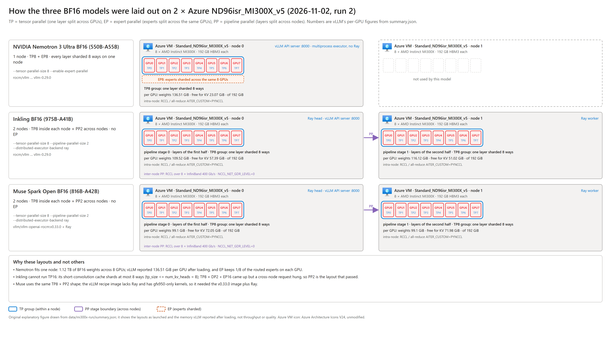

Original parallel-layout figure, drawn by [`tools/build_layout_figure.py`](tools/build_layout_figure.py) from [summary.json](data/mi300x-run/summary.json): **TP** (tensor parallel) splits every layer across the 8 GPUs of one node, **EP** (expert parallel) splits the routed experts across those same 8 GPUs, **PP** (pipeline parallel) puts the first half of the layers on node 0 and the second half on node 1. Nemotron ran `--tensor-parallel-size 8 --enable-expert-parallel` on node 0 alone (136.51 GiB weights per GPU). Inkling and Muse ran `--tensor-parallel-size 8 --pipeline-parallel-size 2` over Ray, stage 0 on node 0 and stage 1 on node 1; neither used EP. The per-GPU weights and free KV memory in the figure are the values vLLM logged after loading, the same numbers as in the tables below. The Azure VM icon is from Azure Architecture Icons V24; MI300X GPUs and vLLM processes are plain labelled boxes because no official icon exists for them. The figure shows layouts, not speed or quality.

| Model · layout | Load result | Selected kernels<br>and backends | Memory<br>per GPU | Cache<br>precision | Smoke<br>generation |
|---|---|---|---|---|---|
| Nemotron 3 Ultra BF16 · 1 node TP8+EP | **Passed** (3rd attempt) | MoE `TritonExperts`; attention `ROCM_ATTN`; Mamba SSU `triton`; all-reduce `AITER_CUSTOM`+`PYNCCL` | 136.51 GiB weights, 146.67 GiB consumed after load, 23.07 GiB free for KV, KV capacity 3,490,022 tokens | K/V BF16 (default); Mamba state FP16 (launch flag); attention block 1056 tokens aligned to Mamba page | zh 31→94 tokens 1.61 s; en 42→209 tokens 5.42 s; content correct |
| Inkling BF16 · 2 nodes TP8×PP2 | **Passed** (6th attempt) | MoE `AiterExperts` (ROCm AITER fused kernel, 2stage, Silu); all-reduce `AITER_CUSTOM`+`PYNCCL` (TP group), `PYNCCL` (PP group) | Stage 0: 109.52 GiB weights, 112.54 GiB consumed after load, 57.39 GiB free for KV; stage 1: 116.12 / 118.9 / 51.02 GiB; KV capacity 398,239 tokens | K/V BF16 (default); short-convolution cache BF16, shards at most 8 ways | zh 27→200 tokens 2.97 s and en 39→256 tokens 4.06 s (both stopped inside the reasoning segment, `max_tokens` too small); zh with `max_tokens=1024` 27→441 tokens 6.52 s, **final answer correct** |
| Inkling BF16 · 2 nodes TP8×DP2+EP16 | Engine ready (5th attempt), serving did not pass | Same kernels; `MoEPrepareAndFinalize` on the DP/EP path | 114.88 GiB weights per GPU, 50.25 GiB free for KV, KV capacity 317,040 tokens per DP rank | K/V BF16 (default) | Request 1 (local DP rank) 27→200 tokens 4.76 s; request 2 scheduled on the remote DP rank produced no output, `RPC call to sample_tokens timed out` after 5 minutes, engine exited |

Four facts you only meet on MI300X and no document states: ① the AITER fused-MoE kernel requires act_and_mul (SwiGLU-style) experts; Nemotron's LatentMoE `relu2` non-gated experts do not qualify and fall back to Triton MoE, while Inkling's gated experts use AITER directly. ② Nemotron's example flag `--enable-mamba-cache-stochastic-rounding` triggers an `ld.lld` link failure on this Triton 3.8 / ROCm 10.1 image and must be dropped to pass warm-up — a kernel-compilation issue, not a model issue. ③ Inkling cannot simply run TP16 across two nodes: the short-convolution cache shards at most 8 ways, so the layout is either "TP8 inside each node + DP2 across nodes + EP16" (the model card's Hopper recipe; on this image the engine became ready but a cross-node request hung) or "TP8 inside each node + PP2 across nodes" (the layout this project actually passed). ④ vLLM's FA4 warm-up checks the model config class rather than the platform and tries to import a CUDA-only extension on ROCm; `--kernel-config '{"enable_jit_warmup": false}'` skips it. The one-variable-per-attempt record (Nemotron 3 attempts, Inkling 6) and log excerpts are in [Validation](VALIDATION.md#mi300x-run).

**Cross-node RCCL probe (step 7 of the reproduction).** Before any two-node layout, [`scripts/mi300x/07_rccl_probe.sh`](scripts/mi300x/07_rccl_probe.sh) ran a 16-rank `torch.distributed` all_reduce inside the same vLLM image without a model: 2 nodes × 8 GPUs, 64 MiB of float32 per rank, one warm call and then five timed calls. Two variants. With the image's default GPU Direct RDMA the collective never completed: RCCL logged `Peermem not available, falling back to GPU Direct RDMA (DMAbuf)` on every GPU, the PyTorch collective watchdog reported a 240 s timeout and the script's 300 s `timeout` killed the run (`PROBE_EXIT=124`). With `NCCL_NET_GDR_LEVEL=0` (InfiniBand traffic staged through host memory instead of written into GPU memory directly) the same probe finished in 10 s: `RCCL_PROBE_OK=True world=16`, 64 MiB all_reduce **2.4 ms** on average, bus bandwidth **52.4 GB/s** by the ring formula 2(n−1)/n × bytes ÷ time (RCCL 2.30.7, ROCm 10.1.0). That is why every two-node launcher in `scripts/mi300x/` sets `NCCL_NET_GDR_LEVEL=0`, and every cross-node number in run 2 was measured with it. The probe is a connectivity check at one message size — one collective, one size, one run — not a bandwidth benchmark, and the cost of the host-staged path to serving speed was not measured separately. The projected node-0 logs of both variants are in [data/mi300x-run/rccl_probe/](data/mi300x-run/rccl_probe/); `summary.json` carries the result line's numbers under `rccl_probe`.

#### Serving-speed probe (run 2, 2026-11-02)

<a id="serving-speed-probe"></a>

**Question.** The smoke requests above answer only "does it generate". Run 2 restarted the layouts that had passed, on the same machines, and used [`scripts/mi300x/09_perf_probe.py`](scripts/mi300x/09_perf_probe.py) to answer "roughly how fast": one fixed English prompt (37 tokens, asking why MoE models keep the router in higher precision than the experts), streamed, `max_tokens 256`, `temperature 0`, 3 rounds each at concurrency 1 and concurrency 8, preceded by one warm-up request so JIT and graph capture stay out of the timed rounds. This is a **probe, not a benchmark**: one short prompt, two concurrency levels, three rounds each — it gives the order of magnitude, not a distribution; long prompts, large batches and other output lengths are out of scope.

The three metrics are defined in the probe's own JSON and quoted here unchanged: **time to first token (TTFT)** = request send to the first streamed chunk carrying text (for a reasoning model the first visible token is reasoning text); **decode speed per request** = (completion_tokens − 1) ÷ (time of last chunk − time of first chunk); **aggregate throughput** = sum of completion_tokens over all streams of one round ÷ the span from the first send to the last finish in that round. `completion_tokens` comes from the server's `usage` object (`stream_options.include_usage`), not from counting chunks.

| Model · layout | Load result (run 2) | Concurrency 1:<br>TTFT median /<br>decode tok/s per request /<br>aggregate tok/s | Concurrency 8:<br>TTFT median /<br>decode tok/s per request /<br>aggregate tok/s | GPU memory in use<br>during the probe<br>(`rocm-smi`, GiB per GPU) |
|---|---|---|---|---|
| Inkling BF16 · 2 nodes TP8×PP2 | **Passed**: cold load 249.6 / 243.7 s (the two pipeline stages); after `/health` 200 all three smoke requests returned and the `max_tokens=1024` one gave a correct final answer | **45 ms** / **68.9** / 68.3 (n=3) | **97 ms** / **42.5** / **335.8** (n=24) | node 0: 170.6–171.2; node 1: 177.2–177.9 (includes the KV pre-allocation) |
| Nemotron 3 Ultra BF16 · 1 node TP8+EP | **Passed**: cold load 744.5 s, `init engine` 117.78 s; all three smoke requests `finish_reason=stop`, the Chinese BF16/FP16 answer correct and identical to run 1 | **170 ms** / **60.7** / 58.6 (n=3) | **358 ms** (max 1.17 s) / **42.0** / **317.4** (n=24) | 174.9–175.5 (weights 136.51 + KV 23.07 + runtime) |
| Muse Spark Open BF16 · 2 nodes TP8×PP2 (attempt 3, `vllm/vllm-openai-rocm:v0.33.0` + Ray) | **Passed**: weights 99.1 GiB per GPU, load 95.0 s (stage 0) / 43.1 s (stage 1), `init engine` 64.22 s, `/health` 200 at 04:22:41Z (4 min 36 s after the head started); 72.05 / 71.98 GiB free for KV = 8,130,184 tokens; three smoke requests returned and a fourth with `max_tokens=4096` ended `finish_reason=stop` with a **correct one-sentence BF16-vs-FP16 answer** after 1,289 reasoning tokens (1,354 completion tokens; wall time not recorded for this request) | **205 ms** / **84.6** / 79.5 (n=3) | **506 ms** (max 0.52 s) / **47.6** / **348.6** (n=24) | node 0: 180.0–180.9; node 1: 180.3–181.4 |

At concurrency 8, Inkling's per-request decode drops from 68.9 to 42.5 tok/s while aggregate throughput rises from 68.3 to 335.8 tok/s. This observation covers only the recorded prompt and two concurrency levels; it neither establishes the bottleneck nor guarantees further gains at higher concurrency. All 27 Inkling requests ended with `finish_reason=length` inside the reasoning segment, so the speed measures reasoning-token decoding, not final-answer delivery. The first final-answer token arrives later than TTFT. Per-request measurements are in the [raw probe JSON](data/mi300x-run/inkling_bf16_16xMI300X_pp2_run2/08_perf.json); `summary.json` recomputes its medians and `tests/mi300x.test.mjs` checks the quoted values.

**Muse: three attempts** (details in [Validation](VALIDATION.md#mi300x-run)). Meta approved the weight gate on the morning of 2026-11-02; the 1.64 TB BF16 checkpoint was downloaded to both nodes (`bytes=1644365682665`). Attempt 1 used the vLLM recipe image `vllm/vllm-openai-rocm:muse-spark-open` and failed in one second: the image has no Ray (the recipe runs single-node TP8 on MI355X and never needs a multi-node executor). Attempt 2 added Ray 2.55.1 to that image; the weights loaded (104.84 GiB per GPU, 190 s) and then all 16 ranks segfaulted during memory profiling inside `fused_muse_spark_qknorm_rope_kv_insert_kernel.hip` — `llvm-objdump --offloading` on the image's `.so` files shows GPU code objects for `gfx950` (MI350X/MI355X) only and none for MI300X's `gfx942`; the fused kernel is selected unconditionally on the ROCm path and has no switch. Attempt 3 used `vllm/vllm-openai-rocm:v0.33.0`, released on 2026-11-02 (compiled for `gfx942` among others, same `vllm/models/muse_spark/` tree) plus Ray, and **passed**: the same fused kernel that segfaulted in attempt 2 ran, the engine came up in 4 min 36 s, and the probe numbers are in the table above. The MoE backend is `MuseSparkTritonExperts` (the launcher passes `--moe-backend triton`, as in the vLLM recipe's AMD example), attention is `ROCM_AITER_FA`, all-reduce `AITER_CUSTOM`+`PYNCCL` in the TP group and `PYNCCL` across the pipeline. Muse has the fastest single-stream decode in these runs (84.6 tok/s against Inkling's 68.9 and Nemotron's 60.7) and the highest TTFT at concurrency 1 (205 ms against 45 / 170 ms); like Inkling it is a reasoning model, so all 27 probe requests ended with `finish_reason=length` inside the reasoning segment and the `max_tokens=4096` request is the one that shows the final answer. The images differ (0.29.0 for Inkling/Nemotron, 0.33.0 for Muse), so the cross-model numbers are a reading of this run, not a controlled comparison.

#### MXFP4 low-precision path (run 3, 2026-11-02)

<a id="mxfp4-low-precision-path"></a>

**Question.** MI300X has no FP4 matrix compute, so can the three models' 4-bit weights run on this GPU at all? Run 3 tried **MXFP4** (the OCP open standard: FP4 values with one shared scale per block of 32, natively supported by AMD's MI350 series) on node 0's 8 GPUs with the same `vllm-muse-ray:0.33.0` image (vLLM 0.33.0, image ID `1bf04962…`). On MI300X vLLM selects the `EMULATION` backend for MXFP4 (`OCP_MXQuantizationEmulationTritonExperts`): weights sit in memory as 4-bit and a Triton kernel dequantizes them to 16-bit before every matrix multiply. This is not native FP4 arithmetic; it answers "how much memory is saved, is the answer right, how slow is the emulated path". Each model takes its own MXFP4 entry point: Inkling uses the community Quark checkpoint `lightseekorg/Inkling-MXFP4` listed in the vLLM recipe (both weights and activations MXFP4, `w_mxfp4_a_mxfp4` [I3]); Nemotron has no ready MXFP4 checkpoint, so it uses vLLM's official online quantization — the BF16 weights are quantized to MXFP4 while loading (`--quantization online --quantization-config '{"moe":"mxfp4"}' --moe-backend emulation`; expert activations are also dynamically quantized to MXFP4); Muse's ROCm code has its own entry (`VLLM_ROCM_MUSE_MOE_ONLINE_QUANT=mxfp4` + `--moe-backend auto`). All runs used `--enforce-eager` and `max_model_len 32768`. Each passing deployment first answered the same Chinese question as the BF16 smoke test (`max_tokens 4096`, so that a final answer is reached), then ran the unchanged run-2 [`09_perf_probe.py`](scripts/mi300x/09_perf_probe.py) (same English prompt, `max_tokens 256`, concurrency 1 and 8, three rounds each).

| Model · MXFP4 entry | Load result | MoE<br>kernel | Memory<br>per GPU | First answer<br>(Chinese question,<br>`max_tokens 4096`) | Concurrency 1:<br>TTFT median /<br>decode tok/s per request | Concurrency 8:<br>TTFT median /<br>decode tok/s per request /<br>aggregate tok/s |
|---|---|---|---|---|---|---|
| Inkling · `lightseekorg/Inkling-MXFP4` · TP8 | **Passed**, weights loaded in 348 s | `EMULATION` | 66.74 GiB weights (BF16: 109.52 / 116.12 on 16 GPUs); 94.79 GiB free for KV, 305,150 tokens | `finish_reason=stop`, 413 tokens (354 reasoning), wall 78.56 s; answer correct (BF16 8-bit exponent / 7-bit mantissa, FP16 5 + 10) | **358 ms** / **6.1** (n=3) | **726 ms** (max 3.53 s) / **5.7** / **44.6** (n=24) |
| Nemotron 3 Ultra · BF16 weights quantized online · TP8 + EP8 | **Passed**, weights loaded in 397 s (online quantization 1.2–1.8 s of that) | `EMULATION` (same) | 43.21 GiB weights (BF16: 136.51); 111.86 GiB free for KV, 13,758,836 tokens | `finish_reason=stop`, 110 tokens (21 reasoning), wall 22.64 s; answer correct | **178 ms** / **7.7** (n=3) | **484 ms** (max 1.33 s) / **6.9** / **54.9** (n=24) |
| Muse Spark Open · two attempts · TP8 | **Failed**, both exited before loading weights | attempt 1: never entered MXFP4; attempt 2: selected `EMULATION`, then rejected by the model code | — | — | — | — |

**Both Muse failures are explicit rejections in code, not memory or kernel crashes.** Attempt 1 copied Nemotron's generic online-quantization flags; all 8 workers raised `NotImplementedError: MuseSpark1x on ROCm only supports Quark W8A8 FP8 or OCP-MXFP4 W4A4 quantized checkpoints; got quantization 'online'` — Muse does not take the generic entry. Attempt 2 switched to Muse's own entry (`VLLM_ROCM_MUSE_MOE_ONLINE_QUANT=mxfp4`); this time MXFP4 was entered, vLLM selected `EMULATION` on MI300X, and all 8 workers immediately raised `NotImplementedError: MuseSpark1x MXFP4 on ROCm requires the AITER_MXFP4_MXFP4 backend; got EMULATION`. In other words Muse's ROCm implementation accepts only AITER's native MXFP4 kernel (MI350 series), and the emulated path is switched off by the model code itself — because Muse's expert outputs need a per-route post-norm before the weighted reduction, a step the emulation kernel does not have. So "Muse MXFP4 fails on MI300X" is **this vLLM version's code combined with this GPU**, not a weight or memory problem; pre-quantized checkpoints such as `amd/Muse-Spark-Open-816B-A42B-Quark-MXFP4` exist on Hugging Face, were not tested here, and their existence does not establish MI300X compatibility.

Four things to read off this table. ① **The saving is memory, not time**: Nemotron's weights per GPU drop from 136.51 to 43.21 GiB and its KV pool grows from 3,490,022 to 13,758,836 tokens (3.49 M → 13.76 M); Inkling drops from 16 GPUs to 8. But per-request decode is only 6–8 tok/s, one tenth of BF16 (Nemotron 60.7 → 7.7, Inkling 68.9 → 6.1), because every matrix multiply is preceded by a dequantization and `--enforce-eager` disables graph capture. ② The BF16 comparison is descriptive only: the BF16 runs used the 0.29.0 image without eager mode, and Inkling BF16 had 16 GPUs; do not attribute the whole speed gap to quantization. ③ The first-answer wall clock (Inkling 78.56 s) includes first-generation JIT compilation and is a different measurement from the warmed probe. ④ Quality regression, long context (32K is the configured limit, not a tested input) and minimum GPU counts were not measured. Raw files are in [data/mi300x-mxfp4/](data/mi300x-mxfp4/): each deployment's `launch.json` (actual argv), `first_response.json`, `08_perf.json` and server log key lines; `summary.json` is recomputed from them and `tests/mxfp4.test.mjs` checks every number quoted on this page.

The original NVFP4 releases were not deployed on MI300X: NVFP4 is NVIDIA's native Blackwell format, AMD GPUs have no kernel for it, and it is not the question this project asks on AMD hardware. Their component precision remains in the three matrices above; the only action taken on MI300X against an NVFP4 checkpoint was a single-expert kernel probe, recorded in [Validation](VALIDATION.md#run-3) and not used as a conclusion on this page.

### Five parallel strategies: recipe expectations versus MI300X measurements

**Question.** The vLLM recipe labels multi-node strategies as latency-oriented, balanced, throughput-oriented or production deployment. What do those labels mean on the same two MI300X nodes? Two Muse BF16 runs on the same 16 GPUs answer it. The [2026-11-04 run](#muse-selectable) used the page's own commands with output limits high enough for answers to finish; it is the answer. The [2026-11-03 run](#muse-fiveway-20261103) capped every output during reasoning and is kept as an earlier record. **The findings apply to this hardware, software and workload, not a universal ranking of five architectures.**

#### Start with the recipe's trade-offs

Sources: the [Muse vLLM recipe](https://recipes.vllm.ai/meta-models/Muse-Spark-Open-816B-A42B) and its [pinned model configuration](https://github.com/vllm-project/vllm/blob/bb197a852fbc3bf0a2b15bd57189dde616bf12c5/recipes/models/meta-models/Muse-Spark-Open-816B-A42B.yaml). Expectations below are hypotheses to test, not performance already established by this project.

| Recipe strategy | Benefit and expectation | Cost and prerequisite | Question for this run |
|---|---|---|---|
| Multi-node TP: tensor parallelism | GPUs cooperate on each layer; labeled latency-oriented | TP collectives cross nodes and depend on the interconnect; low latency is not guaranteed | Does TP16 beat TP8 x PP2 in first-text latency and decode speed on the same 16 GPUs? |
| Multi-node TP + PP: tensor and pipeline parallelism | TP stays within a node while layers are staged across nodes; labeled throughput-oriented | Pipeline fill/drain and stage imbalance still matter; theoretical communication volume is insufficient | How do aggregate throughput and per-request speed change at matched concurrency and input? |
| Multi-node TP + EP: tensor and expert parallelism | Combines tensor sharding and expert distribution; generic label is balanced | Expert communication, load distribution and kernels matter; **the Muse/AMD BF16 section specifically warns that EP can be slower** | Does the effect of enabling EP at TP16 change with concurrency and input? |
| Multi-node DP + EP: data and expert parallelism | Different workers process different requests; labeled throughput-oriented | The model must support that DP/EP combination; the generic selector is not sufficient | Does the installed Muse ROCm implementation accept DP16 before performance is considered? |
| Prefill/decode disaggregation | Input processing and token generation have independently configured pools | Both pools need model residency, KV transfer, routing and resource allocation | Can two BF16 pools fit the same 16-GPU budget before performance is measured? |

The recipe's validated AMD hardware is MI350X/MI355X. Its MXFP4, high-concurrency and DSpark guidance cannot be copied directly to MI300X BF16; the configuration marks AMD DP + EP unsupported. There is also a selector caveat: its generic multi-node DP + EP text describes local TP and cross-node DP, but the inspected NVIDIA two-node command used DP16, eight local DP ranks per node, and no TP8 argument. This project records actual argv and rank groups rather than treating a button label as a configuration.

#### Website-selectable strategies: measured on two MI300X nodes (2026-11-04)

<a id="muse-selectable"></a>

**What was tested.** On the [Muse recipe page](https://recipes.vllm.ai/meta-models/Muse-Spark-Open-816B-A42B?variant=bf16&hardware=mi300x&nodes=2&strategy=multi_node_tep) (recipe [`ba9a98b`](https://github.com/vllm-project/vllm/blob/ba9a98b881218d30ba6335befcb720a8f68c0442/recipes/models/meta-models/Muse-Spark-Open-816B-A42B.yaml), read 2026-11-04), the selection BF16 · MI300X · 2 nodes / 16 GPUs · KV offload off offers four strategies and greys out a fifth. This run used the command the page generates for each offered strategy that fits two nodes, set output limits high enough for answers to finish, and checked each statement the page makes about these strategies.

**What the page says and what was measured.** Statements are quoted from the page. A "point" is one of the 14 combinations of 2 inputs × 7 concurrency levels; "per-request decode" is the generation speed inside one answer, in token/s.

| Recipe page statement (quoted) | What it predicts for these 16 GPUs | Measured on 2 × 8 MI300X | Holds here? |
|---|---|---|---|
| Multi-Node TP + Pipeline Parallel, label **Throughput oriented**: "TP stays inside the high-bandwidth intra-node NVLink/IB domain; PP is what crosses the slower cross-node link. Good fit for very large models … where pure TP across nodes would bottleneck on inter-node bandwidth." | TP8 × PP2 is faster than TP16 | TP8 × PP2 had the fastest per-request decode at all 14 points, 15–41% above TP16, and the highest aggregate throughput at 12 of 14. Inter-node receive per node: TP16 up to 6,689 MB/s, TP8 × PP2 at most 35 MB/s | **Yes** for the ranking. On average the links were far from full: TP16's busiest level average used 1.7% of the 400 GB/s per node |
| Multi-Node Tensor Parallel, label **Latency oriented** | TP16 has the lowest per-request latency | TP16 was slower per request than TP8 × PP2 at all 14 points, and its first-text latency was lower at only 1 point. At concurrency 1 one short answer took 22.9 s on TP16 and 15.9 s on TP8 × PP2 (medians; similar lengths of 1,382 and 1,318 tokens) | **No** ([why](#muse-time-budget)) |
| Multi-Node Tensor + Expert Parallel, label **Balanced** | The label sets no measurable target | TP16 + EP was slower per request than TP16 at all 14 points: by 11.6–11.7% at concurrency 1 and by 0.8–4.6% from concurrency 2 up. Its aggregate throughput was lower at 11 of 14 points and its first-text latency lower at 11 of 14 | **No throughput advantage** on this hardware |
| AMD ROCm section: "Keep TP for BF16: its Triton experts are slower with expert parallelism." | TP16 + EP is slower than TP16 | Same observation as the row above | **Yes**. The page states it for gfx950 (MI350X/MI355X); MI300X agrees |
| NVIDIA section: "AMD supports only TP and TP + expert parallel." | TP + PP is outside AMD support | The page's own builder generated the TP8 × PP2 command for this MI300X selection. It ran 762 requests with 0 failures and was the fastest layout | **Inconsistent with the page's own builder**. Read it as a support statement, not as "TP + PP does not run" |
| Multi-Node Data + Expert Parallel, label **Throughput oriented** | — | Greyed out for this selection. The page also says "data-parallel strategies are not available on AMD" | Not run |
| Prefill/Decode Disaggregation, label **Production deployment** | — | At `nodes=2` the builder generates Prefill 2 × 8 GPUs plus Decode 2 × 8 GPUs: 4 nodes and 32 GPUs, twice the two available nodes | Not run |

**Where it ran.** Two Azure `Standard_ND96isr_MI300X_v5` Spot VMs in West US, each with eight MI300X 192 GB GPUs and eight InfiniBand ports at 400 Gb/s (`ibstat`: Active). Both ran kernel `6.8.0-1067-azure` and amdgpu `6.12.12` with the same image ID: `vllm/vllm-openai-rocm:v0.33.0` pinned as `sha256:4fcd39b758b6…` (vLLM `0.33.0+rocm100`, PyTorch `2.13.0+rocm10.0.0`, gfx942). Each node held the pinned Muse revision `0fb02478` (65 safetensors shards) on local NVMe. vLLM's multiprocess executor (`mp`, no Ray) spanned both nodes with `--nnodes 2`; node 1 ran headless ranks (`--headless`). The streaming client ran on node 0 against `127.0.0.1:8000`, so client timings include the cross-node work inside the engine but no client network hop.

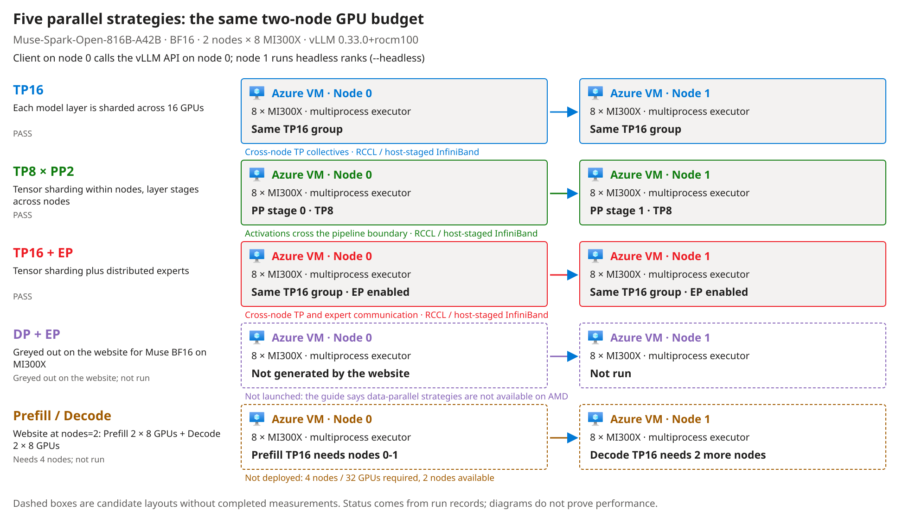

Original test topology generated by the [figure tool](tools/build_layout_figure.py) from the [run summary](data/mi300x-fiveway/muse-selectable_20261104/summary.json), with the unmodified official Azure VM icon. Check whether the TP group crosses nodes, where PP splits the layers, whether EP is on, and why DP + EP and P/D have no run. The drawing does not replace the logs.

**The page's command and the command that ran.** For each layout, every flag the page generates appears in the recorded argv ([`launch.txt`](data/mi300x-fiveway/muse-selectable_20261104/pp/launch.txt)); a test checks this against the page flags stored in the summary. The differences:

| Item | Recipe page (BF16 · MI300X · 2 nodes, head node) | This run | Reason |
|---|---|---|---|
| Image | `vllm/vllm-openai-rocm:muse-spark-open` | `vllm/vllm-openai-rocm:v0.33.0` pinned by digest | The page's image is compiled for gfx950 only; on gfx942 it segfaulted in a fused kernel on 2026-11-02 |
| Front end | Rust (`VLLM_USE_RUST_FRONTEND=1`) | Python (`VLLM_USE_RUST_FRONTEND=0`) | The page offers Python as the alternative; the v0.33.0 image ships no Rust front-end binary |
| Container | `--privileged --security-opt seccomp=unconfined --group-add video` | Not privileged: `--cap-add SYS_PTRACE`, `/dev/kfd`, `/dev/dri`, `/dev/infiniband`, host network and IPC | The project's launcher keeps this narrower set; every layout ran with it |
| Added flags | — | `--kernel-config '{"enable_jit_warmup": false}'`, `--distributed-timeout-seconds 3600`, plus `--revision`, `--host`, `--port`, `--served-model-name` | FA4 warm-up imports a CUDA-only extension on ROCm (2026-11-02); longer start-up across two nodes; pinned revision and API name |
| Cross-node RCCL | Not set | `NCCL_NET_GDR_LEVEL=0`, `NCCL_IB_HCA=^mlx5_8:1,mlx5_an0:1` | The default GPU Direct RDMA path hung in the 2026-11-01 probe; transfers are staged through host memory |

**Inputs and procedure.** The two prompts have the same text as in the 2026-11-03 run. The short engineering prompt:

> Explain in about 150 words why mixture-of-experts models keep the router in higher precision than the experts.

The deployment-analysis prompt begins as follows; the [complete input](data/mi300x-fiveway/muse-selectable_20261104/guide_prompt.txt) adds paraphrased strategy notes and model restrictions:

> Compare the advantages, disadvantages, and deployment prerequisites of these five inference layouts for one mixture-of-experts model.

The server recorded 166 and 713 input tokens, including the chat template; this is not a long-context test. Output limits were 8,192 and 16,384 tokens so that answers could finish. Requests streamed at `temperature 0`; `reasoning_effort` was omitted, so the model default applied. Each layout ran one warm-up per input, then 3 rounds at concurrency 1, 2, 4, 8, 16, 32 and 64: 381 requests per input, 762 per layout, **2,286 in total**. The layouts ran once each in the fixed order TP8 × PP2, TP16, TP16 + EP, without randomization. Before measuring, each layout answered a separate check, "Explain the difference between BF16 and FP16 in one sentence, including exponent and fraction bit counts." (limit 4,096 tokens); all three finished naturally and gave 8 exponent and 7 fraction bits for BF16, 5 and 10 for FP16.

**Reading the metrics.** First-text latency (TTFT) runs from send to the first streamed reasoning or answer text; E2E runs from send to the end of the stream. Per-request decode is (completion tokens − 1) divided by the time between the first and last text chunk. Aggregate throughput is the output tokens of all complete streams in a round divided by the round's length; the tables show the median of the 3 rounds. `--max-num-seqs 32` means that at concurrency 64 at most 32 requests generate at the same time and the rest wait for a free slot, so their TTFT includes the wait. Aggregate throughput at 64 therefore comes from the same 32-request batch as at 32. It can still be higher, because queued requests take over the slots that finished answers release, while a concurrency-32 round ends by waiting for its longest answer. A complete answer is a natural finish with answer text, not a correctness grade.

**Counts.** All 2,286 requests completed their streams; none failed. 2,266 ended naturally with an answer; 20 reached the 16,384-token limit, all on the deployment-analysis prompt: 13 on TP8 × PP2, 6 on TP16 + EP and 1 on TP16.

**Complete result matrix.** Generated by the [evidence tool](tools/mi300x_evidence.py) from the individual requests; DP + EP and P/D have no measured rows. Steady-state compute uses the same West US Spot reference, **29.515768 USD/hour for both VMs** (queried 2026-11-03), and excludes start-up, idle time, disks and billing adjustments.

<!-- BEGIN MUSE SELECTABLE RESULTS -->
Latency quantiles include complete streams only; aggregate throughput retains failed-request waiting time. Unavailable latency and unit cost are shown as `-`.

**Short engineering prompt**

Server-recorded input: 166 tokens, including the chat template; output limit: 8192 tokens.

| Layout | Concurrent requests | Median first-text latency (ms) | P95 first-text latency (ms) | Median E2E (s) | P95 E2E (s) | Per-request decode estimate (token/s) | Aggregate throughput (token/s) | Complete streams/requests sent | Complete answers/complete streams | Steady-state compute (USD/million output tokens) |
|---|---:|---:|---:|---:|---:|---:|---:|---:|---:|---:|
| TP16 | 1 | 214 | 218 | 22.86 | 22.86 | 61.1 | 60.5 | 3/3 | 3/3 | 135.59 |
| TP16 | 2 | 387 | 998 | 22.91 | 26.00 | 52.5 | 94.6 | 6/6 | 6/6 | 86.69 |
| TP16 | 4 | 429 | 435 | 31.12 | 32.91 | 46.6 | 171.9 | 12/12 | 12/12 | 47.68 |
| TP16 | 8 | 514 | 1,205 | 37.57 | 41.87 | 37.6 | 262.0 | 24/24 | 24/24 | 31.29 |
| TP16 | 16 | 737 | 858 | 41.65 | 46.22 | 31.7 | 432.5 | 48/48 | 48/48 | 18.96 |
| TP16 | 32 | 1,202 | 1,357 | 52.01 | 59.30 | 25.8 | 694.8 | 96/96 | 96/96 | 11.80 |
| TP16 | 64 | 21,108 | 65,648 | 87.32 | 115.83 | 24.5 | 692.9 | 192/192 | 192/192 | 11.83 |
| TP8 × PP2 | 1 | 196 | 197 | 15.93 | 15.93 | 83.8 | 82.7 | 3/3 | 3/3 | 99.09 |
| TP8 × PP2 | 2 | 275 | 1,463 | 18.32 | 18.81 | 73.0 | 143.9 | 6/6 | 6/6 | 56.98 |
| TP8 × PP2 | 4 | 460 | 473 | 22.73 | 23.17 | 57.6 | 222.1 | 12/12 | 12/12 | 36.92 |
| TP8 × PP2 | 8 | 476 | 493 | 29.21 | 34.07 | 44.9 | 305.6 | 24/24 | 24/24 | 26.83 |
| TP8 × PP2 | 16 | 548 | 918 | 34.45 | 41.32 | 38.7 | 505.7 | 48/48 | 48/48 | 16.21 |
| TP8 × PP2 | 32 | 690 | 2,364 | 38.06 | 44.39 | 36.4 | 926.1 | 96/96 | 96/96 | 8.85 |
| TP8 × PP2 | 64 | 14,009 | 48,693 | 60.11 | 89.94 | 32.6 | 900.3 | 192/192 | 192/192 | 9.11 |
| TP16 + EP | 1 | 222 | 222 | 25.37 | 25.38 | 54.0 | 53.5 | 3/3 | 3/3 | 153.30 |
| TP16 + EP | 2 | 380 | 1,001 | 27.85 | 29.29 | 50.3 | 95.3 | 6/6 | 6/6 | 86.06 |
| TP16 + EP | 4 | 407 | 542 | 31.21 | 32.48 | 45.3 | 172.1 | 12/12 | 12/12 | 47.65 |
| TP16 + EP | 8 | 429 | 1,112 | 37.15 | 41.24 | 36.9 | 257.0 | 24/24 | 24/24 | 31.90 |
| TP16 + EP | 16 | 589 | 1,238 | 44.94 | 64.13 | 30.5 | 333.6 | 48/48 | 48/48 | 24.57 |
| TP16 + EP | 32 | 918 | 1,767 | 51.91 | 65.33 | 25.5 | 641.8 | 96/96 | 96/96 | 12.78 |
| TP16 + EP | 64 | 22,090 | 60,176 | 87.19 | 114.08 | 24.3 | 676.3 | 192/192 | 192/192 | 12.12 |
| DP + EP | Greyed out on the website; not run | - | - | - | - | - | - | - | - | - |
| Prefill/Decode | Website configuration needs 4 nodes; not run | - | - | - | - | - | - | - | - | - |

**Deployment-guide analysis prompt**

Server-recorded input: 713 tokens, including the chat template; output limit: 16384 tokens.

| Layout | Concurrent requests | Median first-text latency (ms) | P95 first-text latency (ms) | Median E2E (s) | P95 E2E (s) | Per-request decode estimate (token/s) | Aggregate throughput (token/s) | Complete streams/requests sent | Complete answers/complete streams | Steady-state compute (USD/million output tokens) |
|---|---:|---:|---:|---:|---:|---:|---:|---:|---:|---:|
| TP16 | 1 | 241 | 244 | 78.71 | 78.78 | 60.9 | 60.7 | 3/3 | 3/3 | 135.00 |
| TP16 | 2 | 442 | 463 | 93.80 | 100.28 | 52.3 | 97.4 | 6/6 | 6/6 | 84.14 |
| TP16 | 4 | 681 | 684 | 84.24 | 99.81 | 46.6 | 163.9 | 12/12 | 12/12 | 50.01 |
| TP16 | 8 | 1,190 | 1,216 | 118.66 | 131.99 | 37.7 | 266.3 | 24/24 | 24/24 | 30.79 |
| TP16 | 16 | 2,189 | 2,242 | 140.64 | 164.01 | 30.9 | 432.3 | 48/48 | 47/48 | 18.96 |
| TP16 | 32 | 4,094 | 4,188 | 171.32 | 249.37 | 25.3 | 560.4 | 96/96 | 96/96 | 14.63 |
| TP16 | 64 | 69,211 | 231,545 | 305.02 | 398.30 | 24.7 | 689.4 | 192/192 | 192/192 | 11.89 |
| TP8 × PP2 | 1 | 221 | 222 | 53.16 | 53.16 | 83.4 | 83.1 | 3/3 | 3/3 | 98.67 |
| TP8 × PP2 | 2 | 313 | 403 | 61.08 | 72.30 | 72.7 | 144.6 | 6/6 | 6/6 | 56.69 |
| TP8 × PP2 | 4 | 507 | 523 | 75.14 | 82.31 | 58.6 | 215.2 | 12/12 | 12/12 | 38.10 |
| TP8 × PP2 | 8 | 705 | 798 | 102.60 | 225.33 | 44.5 | 193.4 | 24/24 | 22/24 | 42.40 |
| TP8 × PP2 | 16 | 1,051 | 1,074 | 122.91 | 143.25 | 35.4 | 486.3 | 48/48 | 48/48 | 16.86 |
| TP8 × PP2 | 32 | 1,611 | 1,700 | 146.60 | 209.64 | 31.2 | 523.7 | 96/96 | 91/96 | 15.65 |
| TP8 × PP2 | 64 | 55,985 | 195,672 | 259.71 | 341.49 | 30.2 | 744.5 | 192/192 | 186/192 | 11.01 |
| TP16 + EP | 1 | 223 | 224 | 83.96 | 84.00 | 53.8 | 53.6 | 3/3 | 3/3 | 152.90 |
| TP16 + EP | 2 | 386 | 407 | 104.64 | 114.72 | 50.2 | 91.3 | 6/6 | 6/6 | 89.84 |
| TP16 + EP | 4 | 529 | 531 | 100.16 | 103.33 | 44.8 | 171.5 | 12/12 | 12/12 | 47.82 |
| TP16 + EP | 8 | 888 | 911 | 112.27 | 144.90 | 36.4 | 236.6 | 24/24 | 24/24 | 34.65 |
| TP16 + EP | 16 | 1,506 | 1,533 | 148.16 | 166.70 | 29.5 | 415.1 | 48/48 | 48/48 | 19.75 |
| TP16 + EP | 32 | 2,760 | 2,852 | 173.20 | 203.21 | 24.9 | 365.0 | 96/96 | 93/96 | 22.46 |
| TP16 + EP | 64 | 76,238 | 210,394 | 313.35 | 391.48 | 24.5 | 551.3 | 192/192 | 189/192 | 14.87 |
| DP + EP | Greyed out on the website; not run | - | - | - | - | - | - | - | - | - |
| Prefill/Decode | Website configuration needs 4 nodes; not run | - | - | - | - | - | - | - | - | - |

**Inter-node traffic inside the measured rounds**

Each cell holds two numbers, node 0 then node 1: the receive rate summed over that node's eight InfiniBand ports (`mlx5_ib*`, RDMA verbs traffic), averaged over the one-second samples inside the three measured rounds, in MB/s (10^6 bytes per second), rounded to whole numbers, or to one decimal below 10 MB/s. The second table lists, per layout, the highest of these averages on either node, also for the IPoIB (`ib*` network interfaces) and `eth0` interfaces.

| Layout · input (cells: node 0 / node 1 InfiniBand receive, MB/s) | Concurrent requests: 1 | Concurrent requests: 2 | Concurrent requests: 4 | Concurrent requests: 8 | Concurrent requests: 16 | Concurrent requests: 32 | Concurrent requests: 64 |
|---|---:|---:|---:|---:|---:|---:|---:|
| TP16 · Short prompt | 688 / 688 | 1,751 / 1,760 | 1,999 / 1,947 | 5,644 / 5,671 | 3,496 / 3,398 | 6,640 / 6,458 | 6,480 / 6,390 |
| TP16 · Guide prompt | 688 / 697 | 1,799 / 1,802 | 1,894 / 1,835 | 5,503 / 5,650 | 2,702 / 2,741 | 5,581 / 5,580 | 6,689 / 6,664 |
| TP8 × PP2 · Short prompt | 0.2 / 3.0 | 0.3 / 5.0 | 0.3 / 9.8 | 0.3 / 14 | 0.4 / 20 | 0.6 / 33 | 0.5 / 35 |
| TP8 × PP2 · Guide prompt | 0.2 / 3.0 | 0.3 / 4.8 | 0.3 / 8.6 | 0.3 / 11 | 0.4 / 23 | 0.4 / 23 | 0.5 / 33 |
| TP16 + EP · Short prompt | 216 / 216 | 399 / 394 | 639 / 627 | 1,495 / 1,484 | 1,579 / 1,607 | 3,648 / 3,619 | 3,820 / 3,828 |
| TP16 + EP · Guide prompt | 216 / 216 | 369 / 369 | 634 / 634 | 1,301 / 1,292 | 2,019 / 2,016 | 2,058 / 2,047 | 3,136 / 3,144 |

| Layout | InfiniBand receive, highest level average (MB/s) | IPoIB receive, highest level average (MB/s) | eth0 receive, highest level average (MB/s) |
|---|---:|---:|---:|
| TP16 | 6,689 | 0 | 0.5 |
| TP8 × PP2 | 35 | 0 | 1.8 |
| TP16 + EP | 3,828 | 0 | 0.5 |
<!-- END MUSE SELECTABLE RESULTS -->

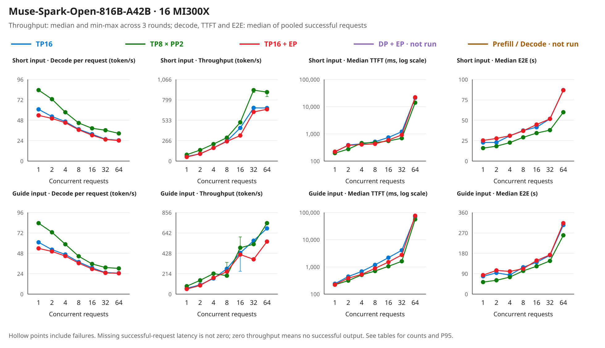

Original measurement chart from the same summary. Throughput whiskers span the three rounds' minimum and maximum; the TTFT axis is logarithmic because concurrency 64 adds queueing time. Concurrency levels are discrete; the lines only connect observations.

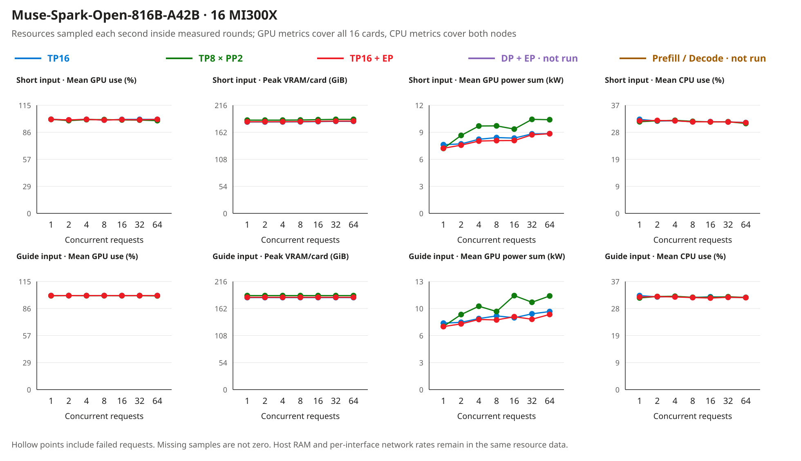

Original resource chart from each layout's two-node one-second samples, filtered to the measured rounds (each node recorded 17,252 samples over the whole batch). GPU power is the sum over 16 GPUs, not whole-system energy; host CPU includes the operating system and the sampler.

**What the results show.**

- **TP8 × PP2 is the layout to start from on these two nodes.** It decoded fastest at every point (83.8 against 61.1 and 54.0 token/s at concurrency 1 on the short prompt) and had the highest aggregate throughput at 12 of 14 points. The two exceptions, the deployment-analysis prompt at concurrency 8 and 32, are rounds stretched by answers that ran to the 16,384-token limit: at concurrency 8, round 1 took 109 s while rounds 2 and 3, each with one such answer, took about 246 s. Aggregate throughput counts finished tokens over the whole round, so one long answer lowers it without slower decoding.
- **TP16's cross-node traffic stayed far below the link capacity.** InfiniBand receive per node reached 6,689 MB/s for TP16 and 3,828 MB/s for TP16 + EP, against at most 35 MB/s for TP8 × PP2, while IPoIB and `eth0` stayed near zero: the collectives used InfiniBand RDMA verbs. Even TP16's busiest level average was 1.7% of the 400 GB/s that eight 400 Gb/s ports provide. These are averages of one-second samples over each level's rounds; the busiest single second and shorter bursts can be higher and are not shown. The server logs ([TP16](data/mi300x-fiveway/muse-selectable_20261104/tp/server-keylines.log), [TP8 × PP2](data/mi300x-fiveway/muse-selectable_20261104/pp/server-keylines.log)) record a structural difference instead: with the TP group spanning nodes, the AITER custom all-reduce and the quick all-reduce were disabled and the TP group used `PYNCCL` only, while TP8 × PP2 kept its TP groups inside each node and dispatched `AITER_CUSTOM` ahead of `PYNCCL`. Every TP16 decode step therefore waits on collectives that cross nodes. These waits were not traced one by one; the [time budget of one token](#muse-time-budget) estimates their size from the measured time and data per token.
- **Expert parallelism costs per-request speed here, most at concurrency 1.** TP16 + EP trailed TP16 by 11.6–11.7% at concurrency 1 and by 0.8–4.6% above it. Its first-text latency was lower than TP16's at 11 of 14 points, but its aggregate throughput was lower at 11 of 14. The largest aggregate gaps (−22.9% on the short prompt at concurrency 16, −34.9% and −20.0% on the deployment-analysis prompt at concurrency 32 and 64) come from long answers that set the round length: at short-prompt concurrency 16, one answer of 2,486 tokens in each round made the rounds last 68.1–68.8 s, while TP16's longest answer at that level was 1,750 tokens.
- **KV-cache size did not decide the ranking.** TP16 reserved 9,940,421 KV tokens and TP8 × PP2 8,780,862, with 103.22 and 99.1 GiB of weights per GPU. At most 32 sequences of at most 32,768 tokens are far from filling either pool.
- **Single-request decode reproduces across the two runs.** Concurrency-1 decode agrees with the [2026-11-03 run](#muse-fiveway-20261103) within 1 token/s (83.8 against 84.3, 61.1 against 61.8, 54.0 against 54.5), although that run capped its outputs and used a 0.92 memory budget.

<a id="muse-time-budget"></a>

**Why TP16 is slow across nodes although InfiniBand has spare bandwidth: the time budget of one token.** The traffic tables above show links far from full. Where the time goes follows from the same run: take the short prompt at concurrency 1 (one request generating at a time, so no queueing or batching) and put the time per output token next to that token's cross-node data. The [evidence tool](tools/mi300x_evidence.py) generates the table from `time_budget` in the [run summary](data/mi300x-fiveway/muse-selectable_20261104/summary.json); the counts in the last column come from the model card's 62 layers and the ROCm Muse code in vLLM v0.33.0, not from a runtime trace.

<!-- BEGIN MUSE SELECTABLE TIME BUDGET -->
| Layout (short prompt, concurrency 1) | Time per output token (ms, measured) | Extra time per token vs TP8 × PP2 (ms) | InfiniBand receive per output token, busier node (measured, prompt share included) | Time to move it at 400 GB/s per node (µs) | Collectives and cross-node hand-offs per token (estimated from the vLLM source) |
|---|---:|---:|---:|---:|---|
| TP8 × PP2 | 11.9 | 0 (reference) | 36 KB | 0.09 | 126 collectives, all inside a node; 1 hand-off between the pipeline stages |
| TP16 | 16.4 | 4.4 | 11.4 MB | 28 | ≈126 collectives, all across nodes (62 layers × 2 all-reduces, plus 2) |
| TP16 + EP | 18.5 | 6.6 | 4.0 MB | 10 | ≈126 collectives, all across nodes (62 layers × 2 all-reduces, plus 2); the page notes that the Triton expert kernels are slower with expert parallelism |

Per-token times and differences are calculated from unrounded values, then rounded separately; subtracting the displayed times can differ from the difference column by one last-place digit.
<!-- END MUSE SELECTABLE TIME BUDGET -->

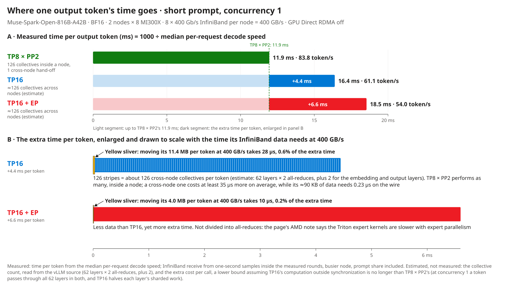

Original calculation figure generated by the [figure tool](tools/build_layout_figure.py) from the same summary. Panel A is the measured time per token. Panel B enlarges the extra time; the yellow sliver is the time that data needs at 400 GB/s, drawn to the same scale, and the 126 stripes in the TP16 bar are the estimated cross-node collectives, not a measured trace.

- **Bandwidth accounts for under 1% of the extra time.** TP16 takes 4.4 ms more per token than TP8 × PP2, while its 11.4 MB of cross-node data per token needs 28 µs at 400 GB/s, 0.6%. Even squeezed through a single 400 Gb/s port (50 GB/s) it would need 228 µs, 5.1%. TP16 + EP moves less data (4.0 MB): in the vLLM source, TP16's all-reduce in each expert layer carries the separate outputs of the 8 selected experts, while expert parallelism all-reduces one combined output. Yet its extra time is even longer (6.6 ms). The extra time is not spent moving data.
- **The data point to cross-node synchronizations waited for one after another (count estimated from the source).** vLLM's ROCm Muse code all-reduces twice per layer under TP: after the attention output projection and after the feed-forward or expert output. That is 124 over 62 layers, plus 2 collectives for the embedding and output layers: about 126 per token, each waiting for all 16 GPUs before work can continue. TP8 × PP2 performs as many, inside a node (the server log shows its TP groups dispatching `AITER_CUSTOM` first).
- **Each cross-node synchronization costs at least 35 µs more on average (lower-bound estimate).** At concurrency 1 a token passes through all 62 layers in both layouts: TP8 × PP2 runs its two stages one after the other and splits each layer's sharded work over 8 GPUs; TP16 splits it over 16, and the layer count and the unsharded parts (such as the router) are the same in both. As long as a smaller shard is not slower (kernel times were not measured separately), TP16's computation outside synchronization is no longer than TP8 × PP2's, and 4.4 ms ÷ 126 ≈ 35 µs is a lower bound on how much more a cross-node collective costs on average than an intra-node one; TP8 × PP2's stage hand-off counts against its own time and only makes the bound more conservative. The ≈90 KB of data per collective needs 0.23 µs on the wire; the rest is per-synchronization latency that hardly depends on the data size, possibly from cross-node coordination, the host-memory staging under `NCCL_NET_GDR_LEVEL=0`, and the intra-node fast all-reduce paths that are unavailable once a group spans nodes. Their shares were not separated in this run.
- **The measurement checks itself.** TP8 × PP2 hands one FP32 residual stream per token from node 0 to node 1: 8,192 values × 4 bytes = 32,768 bytes. Node 1 measured 31,792 bytes per processed token (prompt plus output), 97% of that. So the InfiniBand port counters record the GPU-to-GPU traffic, and the sampler's conversion of their 4-byte units (multiplied by 4) is right; a wrong conversion would be off by a factor of 4.
- **The rule to take away.** On these two nodes (GPU Direct RDMA off), per-request speed across nodes depends mainly on how many all-GPU synchronizations each token needs, not on link bandwidth. Keeping TP inside a node and letting only PP cross it leaves one hand-off per token. This agrees with the page's TP + PP recommendation, for a different reason: the page names inter-node bandwidth as the bottleneck; this run's data point to the number of synchronizations. GPU Direct RDMA or RCCL tuning might lower the cost per synchronization (not tested), but the structure of about 126 cross-node synchronizations per token stays.

Across all 14 points, InfiniBand receive per output token on the busier node was 8.2–21.7 MB for TP16, 3.7–5.8 MB for TP16 + EP and 35–49 KB for TP8 × PP2.

**Limits.** One deployment per layout in a fixed order; two prompts repeated, not a business dataset; `temperature 0`; inputs of 166 and 713 tokens. Long context, production request mixes, answer quality and multimodal input were not measured. GPU Direct RDMA was off; with it, TP16's cross-node collectives might cost less (not tested). The collective count and per-call cost in the time budget are estimates, not a trace. The image and front end differ from the page's command as listed above, and MI300X is not the hardware the recipe validates (gfx950). DP + EP and P/D were not run. [Validation](VALIDATION.md#muse-selectable-validation) lists the checks and the replay commands; [re-run steps](#muse-selectable-reproduce) start a new measurement.

#### 2026-11-03 run: method and actual placement

<a id="muse-fiveway-20261103"></a>

**Earlier record.** Every output in this run reached its cap during reasoning, and only three concurrency levels were measured. It is kept as a record; the 2026-11-04 run above is the answer.

On 2026-11-03, the run reused two West US Spot `Standard_ND96isr_MI300X_v5` VMs, eight GPUs per node. All three executed layouts used the same Muse BF16 revision, vLLM `0.33.0+rocm100`, PyTorch `2.13.0+rocm10.0.0`, and the `mp` multiprocessing executor. The base-image digest, actual commands and per-node image identities are retained with the evidence. TP16, TP8 x PP2 and TP16 + EP each used 16 GPUs in total.

Common settings: `--gpu-memory-utilization 0.92`, `--max-model-len 32768`, `--max-num-seqs 32`, `--max-num-batched-tokens 4096`, BF16 KV, Triton MoE and `ROCM_AITER_FA`. Prefix caching is disabled and chunked prefill enabled, following the AMD recipe. Speculative decoding is not used. Cross-node traffic retains the previously working `NCCL_NET_GDR_LEVEL=0` setting: host-staged InfiniBand, not a GPUDirect RDMA measurement.

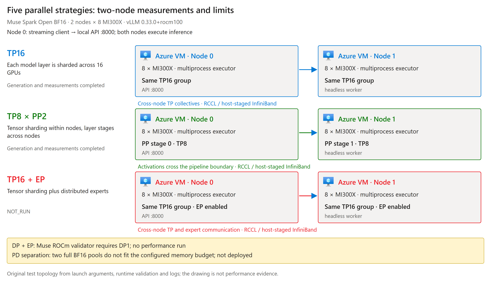

Original test topology, generated by the [figure tool](tools/build_layout_figure.py) from the [run summary](data/mi300x-fiveway/fiveway_20261103-160700/summary.json), with unmodified official Azure VM icons. Inspect whether TP crosses nodes, where PP splits layers, whether EP is enabled, and why two strategies have no performance run. The drawing does not replace logs.

**Actual inputs.** The first workload reuses the earlier engineering prompt verbatim:

> Explain in about 150 words why mixture-of-experts models keep the router in higher precision than the experts.

The second follows the requested analysis of the supplied deployment guide and begins:

> Compare the advantages, disadvantages, and deployment prerequisites of these five inference layouts for one mixture-of-experts model.

It then supplies paraphrased strategy notes and model restrictions; the [complete input](data/mi300x-fiveway/fiveway_20261103-160700/guide_prompt.txt) contains no repeated padding. The server reported 166 and 713 input tokens respectively, including the chat template, not a 32K-context test. Requests stream at `temperature 0`; reasoning effort is omitted and retains the model default. Output caps are 256 and 1024 tokens.

For each layout and input, one warm-up request precedes three rounds at concurrency 1, 8 and 32: 123 measured requests per input, **738 measured requests** across the three layouts. These are repetitions of two prompts, not 738 independent business samples. Layout order was TP, PP, then TP + EP, without randomization or repeated complete deployments. Startup and JIT time are excluded from the serving-rate tables.

**Metrics and output boundary.** First-text latency runs from client send to the first reasoning or answer-text chunk. Per-request decode speed is an estimate from token counts and first/last text chunks, not a distribution of per-token events. Aggregate throughput is complete-stream output tokens divided by the whole round duration, including failed-request waits, followed by the median of three rounds. Protocol completion and complete answers are counted separately.

**All 738 measured requests completed their streams, but all reached the output cap during reasoning: zero complete answers.** These results compare capped reasoning generation, not completion of the deployment-analysis task or answer quality. Each layout also ran a separate [complete-answer check](data/mi300x-fiveway/fiveway_20261103-160700/smoke_request.json) with a 4096-token cap; all three ended naturally and correctly stated the BF16/FP16 bit widths. One basic answer does not prove quality equivalence.

#### 2026-11-03 run: complete result matrix

The [evidence tool](tools/mi300x_evidence.py) recomputes the tables from individual requests. Unmeasured entries are not zero. Steady-state compute uses the queried West US Linux Spot reference rate of **29.515768 USD/hour for both VMs**, calculated as `two-VM hourly rate x 1,000,000 / aggregate throughput / 3600`. It includes reasoning tokens, is not a price per million final-answer tokens, and excludes startup, idle time, disks and invoice settlement.

<!-- BEGIN FIVEWAY RESULTS -->
**Short engineering prompt**

Server-recorded input: 166 tokens, including the chat template; output limit: 256 tokens.

| Layout | Concurrent requests | First-text latency (ms) | Per-request decode estimate (token/s) | Aggregate throughput (token/s) | Complete streams/requests sent | Complete answers/complete streams | Steady-state compute (USD/million output tokens) |
|---|---:|---:|---:|---:|---:|---:|---:|
| TP16 | 1 | 209 | 61.8 | 59.1 | 3/3 | 0/3 | 138.81 |
| TP16 | 8 | 513 | 38.4 | 286.1 | 24/24 | 0/24 | 28.65 |
| TP16 | 32 | 1,194 | 27.7 | 785.5 | 96/96 | 0/96 | 10.44 |
| TP8 x PP2 | 1 | 194 | 84.3 | 79.6 | 3/3 | 0/3 | 103.04 |
| TP8 x PP2 | 8 | 475 | 47.3 | 348.9 | 24/24 | 0/24 | 23.50 |
| TP8 x PP2 | 32 | 689 | 41.8 | 1,200.8 | 96/96 | 0/96 | 6.83 |
| TP16 + EP | 1 | 216 | 54.5 | 52.3 | 3/3 | 0/3 | 156.76 |
| TP16 + EP | 8 | 427 | 38.9 | 293.2 | 24/24 | 0/24 | 27.96 |
| TP16 + EP | 32 | 909 | 28.1 | 816.9 | 96/96 | 0/96 | 10.04 |
| DP + EP | Not measured | - | - | - | - | - | - |
| Prefill/Decode | Not measured | - | - | - | - | - | - |

**Deployment-guide analysis prompt**

Server-recorded input: 713 tokens, including the chat template; output limit: 1024 tokens.

| Layout | Concurrent requests | First-text latency (ms) | Per-request decode estimate (token/s) | Aggregate throughput (token/s) | Complete streams/requests sent | Complete answers/complete streams | Steady-state compute (USD/million output tokens) |
|---|---:|---:|---:|---:|---:|---:|---:|
| TP16 | 1 | 236 | 61.3 | 60.5 | 3/3 | 0/3 | 135.47 |
| TP16 | 8 | 1,179 | 37.7 | 288.9 | 24/24 | 0/24 | 28.38 |
| TP16 | 32 | 4,084 | 26.2 | 758.7 | 96/96 | 0/96 | 10.81 |
| TP8 x PP2 | 1 | 218 | 83.4 | 82.0 | 3/3 | 0/3 | 99.98 |
| TP8 x PP2 | 8 | 800 | 45.5 | 351.5 | 24/24 | 0/24 | 23.33 |
| TP8 x PP2 | 32 | 1,607 | 32.1 | 977.6 | 96/96 | 0/96 | 8.39 |
| TP16 + EP | 1 | 218 | 53.8 | 53.3 | 3/3 | 0/3 | 153.86 |
| TP16 + EP | 8 | 880 | 37.0 | 287.1 | 24/24 | 0/24 | 28.56 |
| TP16 + EP | 32 | 2,755 | 26.1 | 780.3 | 96/96 | 0/96 | 10.51 |
| DP + EP | Not measured | - | - | - | - | - | - |
| Prefill/Decode | Not measured | - | - | - | - | - | - |
<!-- END FIVEWAY RESULTS -->

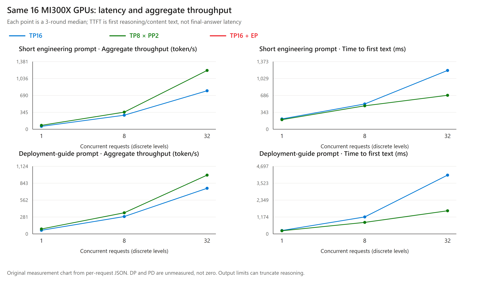

Original measurement chart from the [individual request records and summary](data/mi300x-fiveway/fiveway_20261103-160700/). Concurrency levels are discrete; connecting observations does not establish a continuous scaling law. Every round remains in the JSON.

#### 2026-11-03 run: which expectations held?

- **TP8 x PP2 was the better fit here.** For both inputs at all three concurrency levels, it had higher per-request decode and aggregate throughput, and lower first-text latency, than the other layouts. The recipe's latency-oriented TP label therefore did not produce an advantage under these conditions; it is not a promise.
- **EP depends on the condition.** TP16 + EP was slower than TP16 at concurrency 1, consistent with the BF16 caution. At concurrency 32, however, its aggregate-throughput median was slightly higher for both inputs, so not every metric worsened. Some rounds varied materially; differences of a few percent do not establish a general benefit.
- **Communication logs explain a configuration difference, not the entire cause.** Cross-node TP16 disabled custom quick all-reduce and selected `PYNCCL`; PP kept TP groups within nodes and retained intra-node backends. This is consistent with the recipe's communication-cost explanation, but the run did not separately control the backend or measure communication's share of time. The entire speed difference cannot be assigned to the network.
- **DP + EP had no full-model performance run.** The installed, unmodified `validate_bf16_deployment` accepted DP1 and rejected DP16 with `requires DP1 and PCP1`. The [validator invocation record](data/mi300x-fiveway/fiveway_20261103-160700/runtime-contract.log) includes its source hash. The guard was not removed to force a run.
- **PD was blocked by capacity preflight and was not deployed.** Each pool would have eight GPUs; the configured 0.92 memory budget cannot hold a full BF16 model plus runtime and cache headroom. More VMs, a different precision or CPU offload would change the experiment, so none was silently substituted. This does not refute PD guidance on appropriate hardware.

Production request distributions, multimodal input, cache reuse, speculative decoding, Spot-eviction recovery, real 32K inputs and higher concurrency were not measured. Re-run the target workload before making a deployment decision.

#### Qwen initial phase: Spot-interrupted run

<a id="qwen-fiveway"></a>

**Historical phase.** This section retains the eviction-time projection, not current task status. Azure Activity Log recorded Spot eviction on 2026-11-03; both test VMs subsequently became `deallocated`. Both inputs for TP, DP+EP and P/D had been returned, PP's full dataset was incomplete, and TP+EP had not started. All five layouts were subsequently executed in the separate [recovery phase](#qwen-recovery). Phases are not pooled and a better retry does not replace an earlier result.

**Why a different model?** The preceding Muse run has a ROCm DP restriction and cannot fit two full BF16 pools in the same GPU budget. This run uses a [pinned Qwen revision](https://huggingface.co/Qwen/Qwen3-235B-A22B-Instruct-2507/tree/ac9c66cc9b46af7306746a9250f23d47083d689e) to execute the strategy questions, not to attribute Qwen results to Muse. The recipe trade-offs above remain hypotheses to test.

**Common conditions and actual differences.** Two `Standard_ND96isr_MI300X_v5` VMs, eight MI300X GPUs each; the same BF16 revision, vLLM `0.33.0+rocm100`, PyTorch `2.13.0+rocm10.0.0`, `mp` executor, Triton MoE and `TRITON_ATTN`. Flags are `--gpu-memory-utilization 0.80`, `--max-model-len 32768`, `--max-num-seqs 64`, and `--max-num-batched-tokens 4096`, with prefix caching and chunked prefill enabled, without speculative decoding. Repeated prompts can hit cache; these TTFT values are not all cold-request latency.

| Layout | Node 0 | Node 1 | Material difference |
|---|---|---|---|
| TP16 | Half of the cross-node TP group | The other half of the same group | TP collectives cross nodes |
| TP8 x PP2 | TP8, pipeline stage 0 | TP8, pipeline stage 1 | TP stays local; activations cross nodes; this run's dataset is incomplete |
| TP16 + EP | Planned TP and EP execution | Planned use of the same GPU group | Not executed; no scores borrowed from another layout |
| DP16 + EP16 | TP1, DP ranks 0-7 | TP1, DP ranks 8-15 | Global request distribution; `max-num-seqs` is per DP rank, while client concurrency is capped separately |
| P/D | Prefill TP8 and official proxy entry | Decode TP8 | Two resident model pools; native TCP KV transfer, not an RDMA performance result |

P/D uses the unmodified [official Mooncake proxy](scripts/mi300x/mooncake_connector_proxy.py) and `kv_load_failure_policy=fail`, without decode-side recomputation on transfer failure. The installed automatic RDMA path selected host-local HIP IPC across hosts; adding `transport_hint` did not change the legacy engine's routing. Both failed attempts are retained. The final path uses the package's existing `MC_FORCE_TCP=1` and `mooncake_protocol=tcp`, without changing vLLM source, weights or VM identity. Native host staging and proxy overhead are included; this is not a result for optimized RDMA disaggregation.

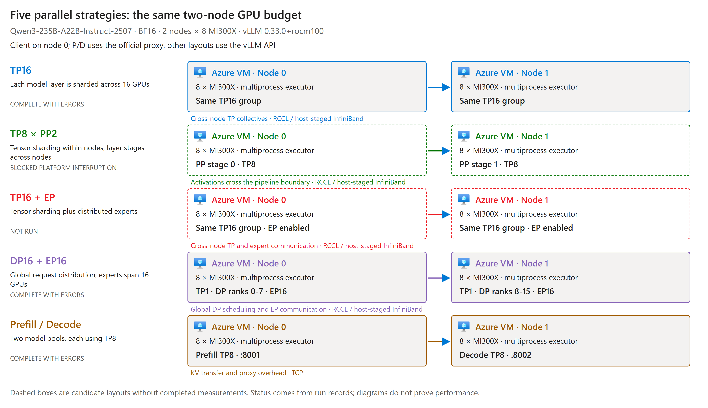

Original topology generated from the [run summary](data/mi300x-fiveway/qwen-fiveway_20261103-172600/summary.json). Dashed boxes mean no complete measurement, not unsupported hardware. The client is on node 0; P/D client timings include the official proxy, both pools and KV transfer.

**Actual inputs and counts.** The short input is the same engineering question below, with a 512-token output cap:

> Explain in about 150 words why mixture-of-experts models keep the router in higher precision than the experts.

The deployment-analysis input begins verbatim as follows, then includes paraphrased recipe notes and Muse-specific restrictions, with a 2048-token cap. Its [complete text](data/mi300x-fiveway/qwen-fiveway_20261103-172600/guide_prompt.txt) and [raw request records](data/mi300x-fiveway/qwen-fiveway_20261103-172600/) are retained.

> Compare the advantages, disadvantages, and deployment prerequisites of these five inference layouts for one mixture-of-experts model. Explain which objectives favor each layout and why a latency or throughput label is not a universal guarantee. Distinguish model sharding, request parallelism, and prefill/decode separation. Do not invent benchmark numbers. Use the supplied notes and state any unverified condition explicitly.

Each input has a warm-up followed by three rounds at concurrency **1, 2, 4, 8, 16, 32 and 64**: 381 formal requests per input. Requests stream at `temperature=0`. This is neither a real 32K-input test nor an independent business dataset. Execution order was P/D, DP+EP, TP and PP; eviction prevented TP+EP from starting. Order was not randomized and complete machine deployments were not repeated.

**Reading the metrics.** TTFT measures client send to first text; E2E measures client send to stream completion. Their quantiles include complete streams only. Aggregate throughput sums complete-stream output tokens over the full round duration, retaining failed-request waits, then takes the median of three rounds. P95 uses inclusive interpolation and is not a production SLA. A table's "complete answer" means natural completion with nonempty content, not correctness. A separate [BF16/FP16 smoke](data/mi300x-fiveway/qwen-fiveway_20261103-172600/smoke_request.json) checks basic semantics. Steady-state cost uses the same two-VM Spot reference, excluding startup, idle time, disks and billing adjustments.

<!-- BEGIN QWEN FIVEWAY RESULTS -->
Latency quantiles include complete streams only; aggregate throughput retains failed-request waiting time. Unavailable latency and unit cost are shown as `-`.

**Short engineering prompt**

Server-recorded input: 33 tokens, including the chat template; output limit: 512 tokens.

| Layout | Concurrent requests | Median first-text latency (ms) | P95 first-text latency (ms) | Median E2E (s) | P95 E2E (s) | Per-request decode estimate (token/s) | Aggregate throughput (token/s) | Complete streams/requests sent | Complete answers/complete streams | Steady-state compute (USD/million output tokens) |
|---|---:|---:|---:|---:|---:|---:|---:|---:|---:|---:|
| TP16 | 1 | 36 | 37 | 3.28 | 3.29 | 59.8 | 59.2 | 3/3 | 3/3 | 138.55 |
| TP16 | 2 | 38 | 38 | 3.40 | 3.42 | 57.4 | 112.9 | 6/6 | 6/6 | 72.64 |
| TP16 | 4 | 38 | 39 | 3.49 | 3.51 | 56.0 | 220.6 | 12/12 | 12/12 | 37.17 |
| TP16 | 8 | 40 | 42 | 3.89 | 4.06 | 49.5 | 379.4 | 24/24 | 24/24 | 21.61 |
| TP16 | 16 | 80 | 82 | 5.59 | 5.89 | 35.8 | 532.7 | 48/48 | 48/48 | 15.39 |
| TP16 | 32 | 105 | 111 | 6.04 | 6.37 | 32.4 | 972.7 | 96/96 | 96/96 | 8.43 |
| TP16 | 64 | 140 | 198 | 7.45 | 7.77 | 26.9 | 1,593.2 | 192/192 | 192/192 | 5.15 |
| TP8 x PP2 | Interrupted; incomplete data | - | - | - | - | - | - | - | - | - |
| TP16 + EP | Not run | - | - | - | - | - | - | - | - | - |
| DP + EP | 1 | 178 | 180 | 6.50 | 6.53 | 31.0 | 30.1 | 3/3 | 3/3 | 272.08 |
| DP + EP | 2 | 177 | 178 | 6.73 | 6.89 | 30.8 | 59.2 | 6/6 | 6/6 | 138.60 |
| DP + EP | 4 | 178 | 179 | 6.63 | 6.87 | 30.5 | 116.3 | 12/12 | 12/12 | 70.50 |
| DP + EP | 8 | 176 | 179 | 7.64 | 8.10 | 25.9 | 193.7 | 24/24 | 24/24 | 42.34 |
| DP + EP | 16 | 98 | 103 | 7.81 | 8.11 | 25.4 | 378.2 | 48/48 | 48/48 | 21.68 |
| DP + EP | 32 | 97 | 110 | 8.04 | 9.18 | 24.9 | 737.3 | 96/96 | 96/96 | 11.12 |
| DP + EP | 64 | 100 | 169 | 9.16 | 9.59 | 21.7 | 1,292.8 | 192/192 | 192/192 | 6.34 |
| Prefill/Decode | 1 | 51 | 53 | 1.99 | 1.99 | 104.2 | 101.5 | 3/3 | 3/3 | 80.80 |
| Prefill/Decode | 2 | 62 | 76 | 2.12 | 2.14 | 98.2 | 189.7 | 6/6 | 6/6 | 43.21 |
| Prefill/Decode | 4 | 101 | 106 | 2.28 | 2.31 | 91.6 | 349.3 | 12/12 | 12/12 | 23.48 |
| Prefill/Decode | 8 | 122 | 141 | 2.63 | 2.71 | 79.5 | 587.5 | 24/24 | 24/24 | 13.96 |
| Prefill/Decode | 16 | 154 | 195 | 2.96 | 3.06 | 72.1 | 1,056.2 | 48/48 | 48/48 | 7.76 |
| Prefill/Decode | 32 | 222 | 313 | 3.30 | 3.44 | 63.4 | 1,835.5 | 96/96 | 96/96 | 4.47 |
| Prefill/Decode | 64 | 415 | 633 | 4.59 | 5.16 | 46.0 | 2,379.3 | 167/192 | 167/167 | 3.45 |

**Deployment-guide analysis prompt**

Server-recorded input: 617 tokens, including the chat template; output limit: 2048 tokens.

| Layout | Concurrent requests | Median first-text latency (ms) | P95 first-text latency (ms) | Median E2E (s) | P95 E2E (s) | Per-request decode estimate (token/s) | Aggregate throughput (token/s) | Complete streams/requests sent | Complete answers/complete streams | Steady-state compute (USD/million output tokens) |
|---|---:|---:|---:|---:|---:|---:|---:|---:|---:|---:|
| TP16 | 1 | 69 | 70 | 24.65 | 24.65 | 58.3 | 58.1 | 3/3 | 3/3 | 141.14 |
| TP16 | 2 | 73 | 497 | 29.66 | 31.59 | 55.9 | 105.1 | 6/6 | 6/6 | 78.03 |
| TP16 | 4 | 78 | 79 | 27.51 | 28.36 | 53.9 | 202.0 | 12/12 | 12/12 | 40.60 |
| TP16 | 8 | 81 | 174 | 30.63 | 33.49 | 46.8 | 343.7 | 24/24 | 24/24 | 23.85 |
| TP16 | 16 | - | - | - | - | - | 0.0 | 0/48 | 0/0 | - |
| TP16 | 32 | - | - | - | - | - | 0.0 | 0/96 | 0/0 | - |
| TP16 | 64 | - | - | - | - | - | 0.0 | 0/192 | 0/0 | - |
| TP8 x PP2 | Interrupted; incomplete data | - | - | - | - | - | - | - | - | - |
| TP16 + EP | Not run | - | - | - | - | - | - | - | - | - |
| DP + EP | 1 | - | - | - | - | - | 0.0 | 0/3 | 0/0 | - |
| DP + EP | 2 | - | - | - | - | - | 0.0 | 0/6 | 0/0 | - |
| DP + EP | 4 | - | - | - | - | - | 0.0 | 0/12 | 0/0 | - |
| DP + EP | 8 | - | - | - | - | - | 0.0 | 0/24 | 0/0 | - |
| DP + EP | 16 | - | - | - | - | - | 0.0 | 0/48 | 0/0 | - |
| DP + EP | 32 | - | - | - | - | - | 0.0 | 0/96 | 0/0 | - |
| DP + EP | 64 | - | - | - | - | - | 0.0 | 0/192 | 0/0 | - |
| Prefill/Decode | 1 | - | - | - | - | - | 0.0 | 0/3 | 0/0 | - |
| Prefill/Decode | 2 | - | - | - | - | - | 0.0 | 0/6 | 0/0 | - |
| Prefill/Decode | 4 | - | - | - | - | - | 0.0 | 0/12 | 0/0 | - |
| Prefill/Decode | 8 | - | - | - | - | - | 0.0 | 0/24 | 0/0 | - |
| Prefill/Decode | 16 | - | - | - | - | - | 0.0 | 0/48 | 0/0 | - |
| Prefill/Decode | 32 | - | - | - | - | - | 0.0 | 0/96 | 0/0 | - |
| Prefill/Decode | 64 | - | - | - | - | - | 0.0 | 0/192 | 0/0 | - |
<!-- END QWEN FIVEWAY RESULTS -->

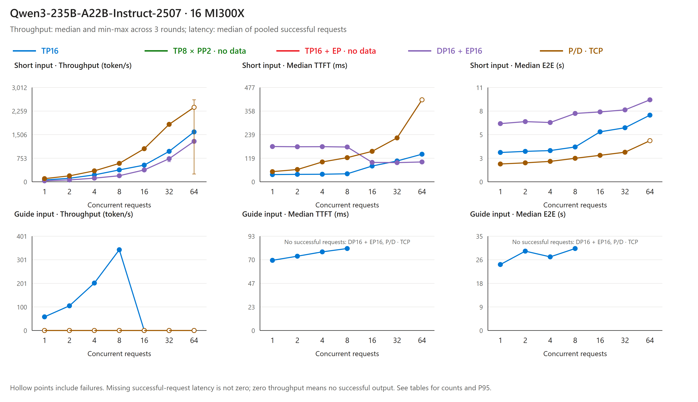

Original measurement chart from the same summary. Hollow points include request failures; throughput whiskers show round minima and maxima, not confidence intervals. Missing latency is not zero. Requests failing after service exit are not new independent latency samples.

**Observed findings and limits.** TP passed every short request but encountered timeouts and API exit from guide concurrency 16 onward. DP+EP passed every short request, then its remote worker response timed out during the guide's first prefill. P/D encountered KV transfer errors at short concurrency 64, and the subsequent guide did not succeed. All three runtime failures predate the later Spot eviction and cannot all be attributed to eviction. Logs identify failure stages, not the isolated underlying cause of the TP/DP worker stall or a general lack of support for Qwen or these architectures.

**Initial projection's resource boundary.** Both nodes started one-second sampling of per-GPU utilization, VRAM and power, host CPU/RAM, and per-interface Ethernet/InfiniBand byte counters. This eviction-time projection contains node 1 only. Its [TP samples](data/mi300x-fiveway/qwen-fiveway_20261103-172600/tp/resources-node1.jsonl), [DP samples](data/mi300x-fiveway/qwen-fiveway_20261103-172600/dp/resources-node1.jsonl), and [P/D samples](data/mi300x-fiveway/qwen-fiveway_20261103-172600/pd/resources-node1.jsonl) cover formal rounds and do not support an all-16-GPU chart. Recovery charts below use that phase's own two-node samples, not backfilled initial measurements. Host metrics include the OS and sampler, not exclusive model accounting.

The initial phase is a reproducible interim record, **not a complete five-option selection conclusion**. Recovery measurements do not patch these two historical tables. See [New Qwen measurement](#qwen-reproduce) and [Validation](VALIDATION.md#qwen-fiveway-validation).

#### Qwen recovery phase: all layouts executed, PP completed every request

<a id="qwen-recovery"></a>

**Question and actual inputs.** With the same two MI300X nodes, Qwen BF16 weights and one image, can each layout complete the same requests, and how do latency, throughput and resource use change? The short engineering input remains:

> Explain in about 150 words why mixture-of-experts models keep the router in higher precision than the experts.

The deployment-analysis input still begins:

> Compare the advantages, disadvantages, and deployment prerequisites of these five inference layouts for one mixture-of-experts model. Explain which objectives favor each layout and why a latency or throughput label is not a universal guarantee. Distinguish model sharding, request parallelism, and prefill/decode separation. Do not invent benchmark numbers. Use the supplied notes and state any unverified condition explicitly.

The [complete input](data/mi300x-fiveway/qwen-fiveway-recovery_20261103/guide_prompt.txt) and [individual request records](data/mi300x-fiveway/qwen-fiveway-recovery_20261103/) are retained together. Inputs have 33 and 617 tokens, with output caps of 512 and 2048 tokens respectively. This is not a long-context or business-quality evaluation.

**Controlled conditions.** Qwen revision `ac9c66cc9b46af7306746a9250f23d47083d689e`, BF16, two nodes with eight MI300X GPUs each, vLLM `0.33.0+rocm100`, PyTorch `2.13.0+rocm10.0.0`, `mp`, Triton MoE, `TRITON_ATTN`, the 0.80 memory budget and the scheduling limits above are fixed. The image was built once and imported on the peer; all layouts on both nodes used `sha256:3464a056f1359bfd0d567d1de85dfe9ee4a185056042032f6a2632834e76004e`. Layout is the comparison variable; KV allocation, per-rank scheduling and communication also change with it. PP ran in an earlier recovery stage, followed by TP+EP, TP, DP+EP and P/D sequentially, without randomization or interleaving. Initial-phase results are not pooled into this phase.

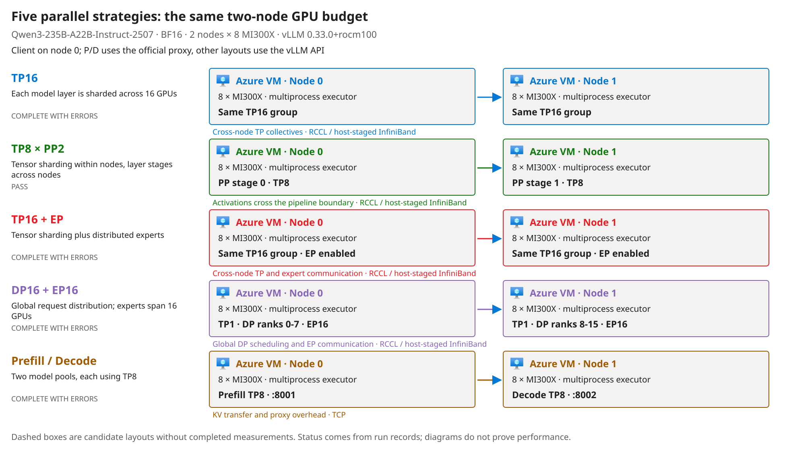

Original test topology from the [generator](tools/build_layout_figure.py) and [recovery summary](data/mi300x-fiveway/qwen-fiveway-recovery_20261103/summary.json). Inspect which TP groups cross nodes, where PP splits layers and the two P/D model pools; Azure VM icons remain unmodified official assets. Placement does not prove that communication explains every performance difference.

**Measurement and calculation.** Each layout warms up each input once, then runs three rounds at concurrency 1, 2, 4, 8, 16, 32 and 64: 381 formal requests per input and 3810 overall. Prefix caching and chunked prefill remain enabled, `temperature=0`, with no speculative decoding; repeated prompts can hit cache. TTFT is send-to-first-text and E2E is send-to-stream-completion. Quantiles use complete streams only. Throughput divides complete-stream output tokens by the entire round duration, retaining failed waits, then takes the median of three rounds. Cost uses the 2026-11-03 two-VM Spot reference of USD 29.515768/hour to calculate cost per million successful output tokens. It excludes startup, idle time and disks and is not an invoice.

**Outcome.** All 3810 requests are recorded: 2423 ended naturally with content and 1387 failed, with no truncated output counted as a complete answer. Complete answers are not correctness scores. Only PP completed both inputs in full. Subsequent unavailable requests remain in failure denominators, not as new independent latency samples.

| Recovery layout | Short input: complete answers/formal requests | Guide input: complete answers/formal requests | Native log and boundary |
|---|---:|---:|---|
| TP8 x PP2 | 381/381 | 381/381 | All ended naturally; not a production-stability commitment |
| TP16 + EP | 381/381 | 61/381 | `RPC call to sample_tokens timed out`, followed by engine exit |
| TP16 | 381/381 | 77/381 | Also records a `sample_tokens` RPC timeout; matching messages do not establish an identical cause |
| DP16 + EP16 | 381/381 | 0/381 | Both nodes record `sample_tokens` or `execute_dummy_batch` RPC timeouts |
| P/D, native TCP | 380/381 | 0/381 | Real KV transfers succeeded before transfer failures; the later input inherited the preceding fault |

P/D uses the unmodified Mooncake connector and official proxy with `MC_FORCE_TCP=1`, `mooncake_protocol=tcp` and `kv_load_failure_policy=fail`, without decode-side recomputation. [Transfer logs](data/mi300x-fiveway/qwen-fiveway-recovery_20261103/pd/server-keylines.log) establish actual cross-node KV transfer, not ordinary decode serving labeled as P/D. The underlying worker-stall cause is not isolated and does not establish a general lack of support for Qwen or these architectures.

<!-- BEGIN QWEN RECOVERY FIVEWAY RESULTS -->
Latency quantiles include complete streams only; aggregate throughput retains failed-request waiting time. Unavailable latency and unit cost are shown as `-`.

**Short engineering prompt**

Server-recorded input: 33 tokens, including the chat template; output limit: 512 tokens.

| Layout | Concurrent requests | Median first-text latency (ms) | P95 first-text latency (ms) | Median E2E (s) | P95 E2E (s) | Per-request decode estimate (token/s) | Aggregate throughput (token/s) | Complete streams/requests sent | Complete answers/complete streams | Steady-state compute (USD/million output tokens) |
|---|---:|---:|---:|---:|---:|---:|---:|---:|---:|---:|
| TP16 | 1 | 31 | 31 | 2.90 | 2.91 | 60.6 | 59.9 | 3/3 | 3/3 | 136.80 |
| TP16 | 2 | 32 | 54 | 3.17 | 3.39 | 58.5 | 109.4 | 6/6 | 6/6 | 74.95 |
| TP16 | 4 | 32 | 62 | 3.27 | 3.47 | 57.1 | 213.0 | 12/12 | 12/12 | 38.49 |
| TP16 | 8 | 67 | 69 | 3.99 | 4.19 | 50.3 | 376.7 | 24/24 | 24/24 | 21.76 |
| TP16 | 16 | 79 | 82 | 5.43 | 5.64 | 36.5 | 550.7 | 48/48 | 48/48 | 14.89 |
| TP16 | 32 | 105 | 111 | 5.93 | 6.21 | 33.0 | 976.4 | 96/96 | 96/96 | 8.40 |
| TP16 | 64 | 139 | 184 | 7.11 | 7.42 | 28.1 | 1,677.0 | 192/192 | 192/192 | 4.89 |
| TP8 x PP2 | 1 | 19 | 19 | 1.97 | 1.97 | 101.5 | 100.6 | 3/3 | 3/3 | 81.51 |
| TP8 x PP2 | 2 | 25 | 28 | 3.92 | 3.93 | 50.8 | 100.8 | 6/6 | 6/6 | 81.32 |
| TP8 x PP2 | 4 | 27 | 31 | 2.19 | 2.20 | 91.5 | 360.7 | 12/12 | 12/12 | 22.73 |
| TP8 x PP2 | 8 | 36 | 45 | 4.47 | 4.61 | 45.9 | 360.1 | 24/24 | 24/24 | 22.77 |
| TP8 x PP2 | 16 | 51 | 63 | 4.65 | 4.65 | 43.1 | 680.0 | 48/48 | 48/48 | 12.06 |
| TP8 x PP2 | 32 | 80 | 92 | 5.34 | 5.38 | 37.8 | 1,181.9 | 96/96 | 96/96 | 6.94 |
| TP8 x PP2 | 64 | 114 | 148 | 6.41 | 6.54 | 31.5 | 1,936.1 | 192/192 | 192/192 | 4.23 |
| TP16 + EP | 1 | 32 | 33 | 3.49 | 3.50 | 56.3 | 55.8 | 3/3 | 3/3 | 146.92 |
| TP16 + EP | 2 | 35 | 57 | 3.70 | 3.75 | 53.7 | 105.4 | 6/6 | 6/6 | 77.80 |
| TP16 + EP | 4 | 51 | 67 | 3.83 | 3.89 | 51.8 | 202.1 | 12/12 | 12/12 | 40.56 |
| TP16 + EP | 8 | 71 | 73 | 4.19 | 4.32 | 47.0 | 360.3 | 24/24 | 24/24 | 22.76 |
| TP16 + EP | 16 | 84 | 86 | 5.73 | 5.95 | 34.7 | 521.2 | 48/48 | 48/48 | 15.73 |
| TP16 + EP | 32 | 108 | 114 | 6.28 | 6.41 | 31.7 | 955.9 | 96/96 | 96/96 | 8.58 |
| TP16 + EP | 64 | 144 | 175 | 7.52 | 7.79 | 26.5 | 1,557.0 | 192/192 | 192/192 | 5.27 |
| DP + EP | 1 | 161 | 164 | 6.54 | 6.61 | 32.1 | 31.3 | 3/3 | 3/3 | 261.74 |
| DP + EP | 2 | 162 | 164 | 6.18 | 6.45 | 31.9 | 61.2 | 6/6 | 6/6 | 133.98 |
| DP + EP | 4 | 161 | 165 | 6.61 | 7.03 | 29.8 | 112.4 | 12/12 | 12/12 | 72.91 |
| DP + EP | 8 | 154 | 162 | 6.95 | 7.74 | 29.5 | 218.7 | 24/24 | 24/24 | 37.49 |
| DP + EP | 16 | 85 | 94 | 6.93 | 7.96 | 29.2 | 438.8 | 48/48 | 48/48 | 18.68 |
| DP + EP | 32 | 84 | 142 | 7.88 | 9.11 | 25.5 | 766.0 | 96/96 | 96/96 | 10.70 |
| DP + EP | 64 | 131 | 179 | 8.88 | 9.32 | 22.3 | 1,320.4 | 192/192 | 192/192 | 6.21 |
| Prefill/Decode | 1 | 51 | 52 | 1.94 | 1.94 | 104.5 | 101.7 | 3/3 | 3/3 | 80.64 |
| Prefill/Decode | 2 | 66 | 85 | 2.07 | 2.09 | 98.1 | 189.1 | 6/6 | 6/6 | 43.37 |
| Prefill/Decode | 4 | 86 | 109 | 2.28 | 2.30 | 90.0 | 343.3 | 12/12 | 12/12 | 23.89 |
| Prefill/Decode | 8 | 123 | 147 | 2.50 | 2.58 | 79.6 | 590.4 | 24/24 | 24/24 | 13.89 |
| Prefill/Decode | 16 | 141 | 189 | 2.85 | 2.96 | 73.7 | 1,101.4 | 48/48 | 48/48 | 7.44 |
| Prefill/Decode | 32 | 228 | 294 | 3.43 | 3.52 | 64.0 | 1,827.1 | 96/96 | 96/96 | 4.49 |
| Prefill/Decode | 64 | 431 | 640 | 4.79 | 5.16 | 44.5 | 2,402.4 | 191/192 | 191/191 | 3.41 |

**Deployment-guide analysis prompt**

Server-recorded input: 617 tokens, including the chat template; output limit: 2048 tokens.

| Layout | Concurrent requests | Median first-text latency (ms) | P95 first-text latency (ms) | Median E2E (s) | P95 E2E (s) | Per-request decode estimate (token/s) | Aggregate throughput (token/s) | Complete streams/requests sent | Complete answers/complete streams | Steady-state compute (USD/million output tokens) |
|---|---:|---:|---:|---:|---:|---:|---:|---:|---:|---:|
| TP16 | 1 | 59 | 63 | 23.05 | 23.07 | 59.3 | 59.2 | 3/3 | 3/3 | 138.57 |
| TP16 | 2 | 63 | 391 | 26.62 | 30.44 | 57.0 | 106.7 | 6/6 | 6/6 | 76.85 |
| TP16 | 4 | 126 | 128 | 24.90 | 26.97 | 55.0 | 206.1 | 12/12 | 12/12 | 39.77 |
| TP16 | 8 | 150 | 166 | 29.87 | 32.60 | 47.9 | 353.7 | 24/24 | 24/24 | 23.18 |
| TP16 | 16 | 192 | 229 | 41.34 | 45.85 | 34.9 | 466.5 | 32/48 | 32/32 | 17.58 |
| TP16 | 32 | - | - | - | - | - | 0.0 | 0/96 | 0/0 | - |
| TP16 | 64 | - | - | - | - | - | 0.0 | 0/192 | 0/0 | - |
| TP8 x PP2 | 1 | 53 | 55 | 16.34 | 16.34 | 96.5 | 96.2 | 3/3 | 3/3 | 85.21 |
| TP8 x PP2 | 2 | 76 | 951 | 32.66 | 32.67 | 48.2 | 96.2 | 6/6 | 6/6 | 85.19 |
| TP8 x PP2 | 4 | 77 | 105 | 34.52 | 34.87 | 46.2 | 183.0 | 12/12 | 12/12 | 44.80 |
| TP8 x PP2 | 8 | 103 | 125 | 31.96 | 35.98 | 43.7 | 318.3 | 24/24 | 24/24 | 25.76 |
| TP8 x PP2 | 16 | 110 | 132 | 34.24 | 36.37 | 40.5 | 608.7 | 48/48 | 48/48 | 13.47 |
| TP8 x PP2 | 32 | 234 | 1,302 | 37.09 | 41.80 | 38.7 | 1,125.5 | 96/96 | 96/96 | 7.28 |
| TP8 x PP2 | 64 | 381 | 1,427 | 53.97 | 60.53 | 28.4 | 1,582.9 | 192/192 | 192/192 | 5.18 |
| TP16 + EP | 1 | 64 | 66 | 26.50 | 26.52 | 55.1 | 54.9 | 3/3 | 3/3 | 149.22 |
| TP16 + EP | 2 | 68 | 430 | 29.80 | 33.80 | 52.1 | 101.3 | 6/6 | 6/6 | 80.96 |
| TP16 + EP | 4 | 91 | 157 | 29.46 | 32.32 | 49.9 | 183.7 | 12/12 | 12/12 | 44.63 |
| TP16 + EP | 8 | 140 | 171 | 32.76 | 36.25 | 44.6 | 331.4 | 24/24 | 24/24 | 24.74 |
| TP16 + EP | 16 | 195 | 198 | 44.94 | 49.17 | 33.1 | 0.0 | 16/48 | 16/16 | - |
| TP16 + EP | 32 | - | - | - | - | - | 0.0 | 0/96 | 0/0 | - |
| TP16 + EP | 64 | - | - | - | - | - | 0.0 | 0/192 | 0/0 | - |
| DP + EP | 1 | - | - | - | - | - | 0.0 | 0/3 | 0/0 | - |
| DP + EP | 2 | - | - | - | - | - | 0.0 | 0/6 | 0/0 | - |
| DP + EP | 4 | - | - | - | - | - | 0.0 | 0/12 | 0/0 | - |
| DP + EP | 8 | - | - | - | - | - | 0.0 | 0/24 | 0/0 | - |
| DP + EP | 16 | - | - | - | - | - | 0.0 | 0/48 | 0/0 | - |
| DP + EP | 32 | - | - | - | - | - | 0.0 | 0/96 | 0/0 | - |
| DP + EP | 64 | - | - | - | - | - | 0.0 | 0/192 | 0/0 | - |
| Prefill/Decode | 1 | - | - | - | - | - | 0.0 | 0/3 | 0/0 | - |
| Prefill/Decode | 2 | - | - | - | - | - | 0.0 | 0/6 | 0/0 | - |
| Prefill/Decode | 4 | - | - | - | - | - | 0.0 | 0/12 | 0/0 | - |
| Prefill/Decode | 8 | - | - | - | - | - | 0.0 | 0/24 | 0/0 | - |
| Prefill/Decode | 16 | - | - | - | - | - | 0.0 | 0/48 | 0/0 | - |
| Prefill/Decode | 32 | - | - | - | - | - | 0.0 | 0/96 | 0/0 | - |
| Prefill/Decode | 64 | - | - | - | - | - | 0.0 | 0/192 | 0/0 | - |
<!-- END QWEN RECOVERY FIVEWAY RESULTS -->

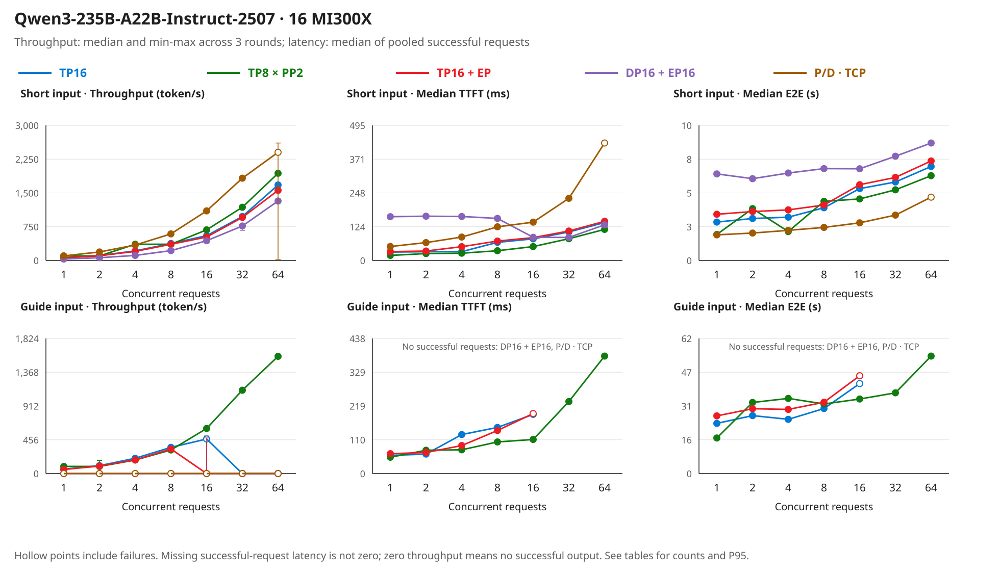

Original measurement chart from the [recovery request summary](data/mi300x-fiveway/qwen-fiveway-recovery_20261103/summary.json). Hollow points include failures; whiskers span three-round minima and maxima, not confidence intervals. Missing successful-request latency is not zero. Faster low-concurrency P/D does not offset later unavailability or represent an optimized RDMA implementation.

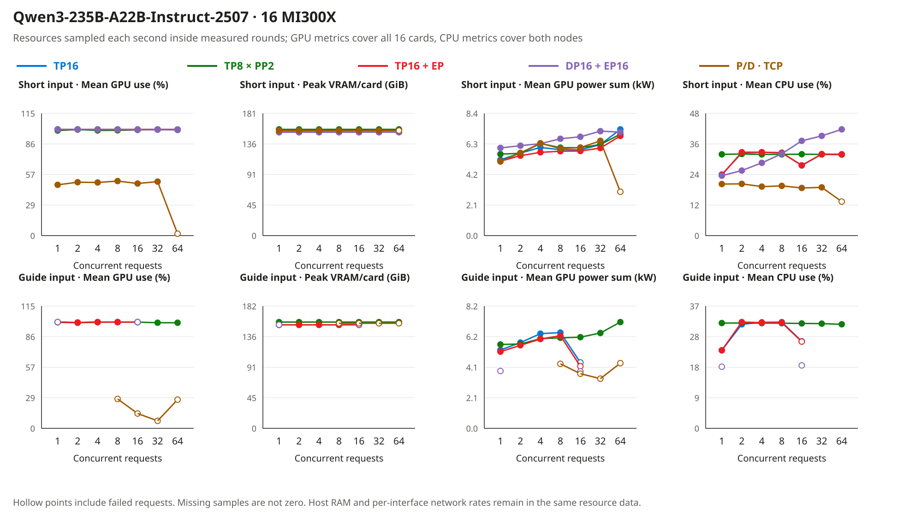

Original resource chart from the same summary and each layout's two-node resource JSONL. One-second samples are filtered to formal rounds, excluding loading, warm-up and between-stage idle time. The chart aggregates two nodes and 16 GPUs without filling missing values with zero. Host RAM and per-interface Ethernet/InfiniBand rates remain in the records. Host CPU includes the OS and sampler; GPU power is not whole-system energy or electricity cost. Systems reported synchronized clocks, but cross-host clock skew was not measured precisely.

**Conclusion for this run.** PP was the only layout to complete every request for these two repeated inputs on the recorded stack, making it a reproduction starting point for the same scenario, not proof that it is fastest for all workloads. Recipe labels describe architectural trade-offs, not substitutes for completion and failure checks. Business quality, actual 32K inputs, sustained stability, automatic Spot recovery and optimized RDMA remain unverified. See [new measurements](#qwen-reproduce) and [validation](VALIDATION.md#qwen-fiveway-validation).

### Evidence boundaries

The precision study checked documents/configuration on 2026-11-01 and MI300X loading/tensor headers on 2026-11-02. Five deployments then produced basic correct answers: the three original BF16 checkpoints and the Inkling/Nemotron MXFP4 emulation paths; Muse MXFP4 was rejected by its implementation. The 2026-11-03 and 2026-11-04 Muse layout measurements and the separate Qwen runs above have their own scope and are not described by the older concurrency-1/8 probes. None establishes business quality, real long-context behavior, production stability or fault recovery. Original NVFP4 full models and the three partner FP8 releases were not loaded on a GPU in this project; configuration evidence, component probes and full-model execution remain distinct.

Nemotron's card discusses training recipes, weight exports and engine examples separately. Its prose mentions "NVFP4 KV caching" while concrete examples select FP8 cache; this guide follows the explicit parameters rather than treating the prose as a verified cache capability.

Inkling's recipe mentions both `vLLM 0.26.0+` and nightly installation. Neither is a reproducible guarantee for an arbitrary later build. Pin the tested commit or image digest and retain actual runtime evidence. Muse's raw quantization configuration returned HTTP 401 and was not bypassed; public publisher and recipe descriptions have narrower evidential scope than direct tensor inspection.

Red Hat's Inkling FP8 card describes attention Linear quantization, but the pinned configuration excludes `re:.*\.attn$` and `re:.*\.attn\..*` [I9]. The matrix preserves this conflict and does not label that subtree FP8. Actual module-name matching and loaded dtypes still need runtime inspection. Both Red Hat FP8 configurations have null `output_activations` and `kv_cache_scheme`: FP8 input rules do not establish FP8 outputs or KV storage.

License applicability, precise per-tensor gaps, device-specific peak memory and business performance still require validation. General framework support does not establish every precision, modality and backend combination. Muse BF16's weight gate (Meta's manually approved gated repositories; a `config.json` read returned 403 early on 2026-11-02) was approved the same morning, the weights were downloaded to both nodes, and the third attempt on the v0.33.0 image passed; the three MI300X attempts and the measured numbers are in [Serving-speed probe](#serving-speed-probe) and [Validation](VALIDATION.md#run-2). Muse's multimodal path was not exercised (`--language-model-only`), and its raw NVFP4 quantization configuration still returns 401.

### You want to … read

| You want to | Read |
|---|---|
| Know which GPU, how many, and at which precision the three models run, and which of that was actually tested | The [Summary first](#summary-first) table at the top of this page |
| Look up one component's precision in one release | The three tables in [Component precision by model](#component-precision-by-model); reference tags point to [Public sources](#public-sources) |
| Know how much weight each GPU holds and what is left for caches | The per-GPU budget table in [Resource accounting](#resource-accounting), data in [deployment-budget.json](data/deployment-budget.json) |
| See what actually ran on MI300X | [MI300X run](#mi300x-run) on this page; error text and log excerpts per attempt in [Validation](VALIDATION.md#mi300x-run); raw requests, responses and log key lines in [data/mi300x-run/](data/mi300x-run/) |
| Know whether 4-bit weights run on MI300X, how much memory they save and how slow they are | [MXFP4 low-precision path](#mxfp4-low-precision-path) on this page; actual argv, first answers, probe JSON and Muse's error text in [data/mi300x-mxfp4/](data/mi300x-mxfp4/) |
| Compare parallel layouts and failure boundaries | [Muse: recipe page statements versus measurements](#muse-selectable), [why cross-node TP is slow despite InfiniBand](#muse-time-budget) and its [re-run steps](#muse-selectable-reproduce); the [earlier capped Muse run](#muse-fiveway-20261103); [Qwen initial phase](#qwen-fiveway), [complete recovery matrix](#qwen-recovery) and [new measurement steps](#qwen-reproduce) |
| Reproduce it on MI300X yourself | The step table in [Reproduce the BF16 load and smoke test on MI300X](#reproduce-the-bf16-load-and-smoke-test-on-mi300x) and [scripts/mi300x/](scripts/mi300x/) |
| Check how the repository's numbers were computed | The commands in [Recompute metadata without downloading weights](#recompute-metadata-without-downloading-weights); test semantics and unexecuted items in [Validation](VALIDATION.md) |
| Know which conclusions have evidence and which do not | [Evidence boundaries](#evidence-boundaries) and the [current status table in Validation](VALIDATION.md#current-status) |

### Directories and responsibilities

| Directory / file | Responsibility |
|---|---|
| `README.md` · `README_CN.md` | Main document; both languages read the same data files |
| `VALIDATION.md` · `VALIDATION_CN.md` | Test commands, expected semantics, the per-attempt MI300X record, current status table |
| `data/model-evidence.json` | API metadata snapshot and NVFP4 configuration summaries for the six pinned revisions (including the retained Muse 401) |
| `data/tensor-census/` | Per-tensor safetensors header census of the two BF16 snapshots |
| `data/deployment-budget.json` | Input for the per-GPU budget table (GPU counts, HBM, sources) |
| `data/mi300x-run/` | Public projection of the MI300X runs (run 1: Nemotron, Inkling PP2, Inkling DP2; run 2: Inkling PP2, Nemotron and Muse PP2, each with `08_perf.json` from the serving probe): raw requests/responses, memory JSON, log key lines, `summary.json`, SHA-256 of the private large files; `rccl_probe/` holds the key lines of the two cross-node RCCL probe variants (step 7) |
| `data/mi300x-mxfp4/` | Public projection of run 3 (MXFP4): the Inkling and Nemotron MXFP4 deployments (`launch.json` actual argv, `first_response.json`, `08_perf.json`, log key lines), the error lines of Muse's two failed attempts, `summary.json`, SHA-256 of the private large files; also one NVFP4 single-expert kernel probe's `gpu_probe.json`, referenced only from the validation page |
| `data/mi300x-fiveway/` | One directory per run, each with its own requests, launch settings, statistics, errors and resources: the 2026-11-04 Muse website-selectable run (`muse-selectable_20261104`, with two-node resource samples and inter-node rates), the 2026-11-03 capped Muse run, and the initial and recovery Qwen phases (all recovery layouts executed, failures kept) |
| `data/visual-evidence.json` | Source, dimensions, hash and proof boundary of every figure |
| `images/` | The NVIDIA official NVFP4 two-level-scaling figure; the original test-topology, parallel-layout and five-way topology, performance, resource and time-budget charts generated by `tools/build_layout_figure.py` (`mi300x-muse-selectable-*` for the 2026-11-04 run); `icons/` holds the unmodified Azure official icon. The old execution-path diagrams remain historical assets and are no longer used in the README |
| `scripts/mi300x/` | MI300X reproduction scripts: node preparation, image pull, download, the three model launchers (`04_` Nemotron, `05_` Inkling, `08_` Muse), evidence collection, RCCL probe, serving-speed probe (`09_perf_probe.py`), `Dockerfile.muse-ray`; for the layout comparisons, the measurement driver (`10_measure_layout.sh`), the Qwen launcher (`11_`), the resource sampler (`12_resource_monitor.py`), the Mooncake probe and proxy (`13_`, `mooncake_connector_proxy.py`) and the two-node batch runner (`14_run_remaining_layouts.sh`) |
| `tools/` | `inspect.mjs` (metadata recomputation), `census.mjs` (census summary), `budget.mjs` (per-GPU budget), `tensor_census.py` (header read on a machine holding the weights), `mi300x_evidence.py` and `mxfp4_evidence.py` (public projection and summary of the BF16 and MXFP4 evidence), `build_layout_figure.py` (parallel-layout, test-topology and five-way charts), `preview.ps1` (local render and diagram export) |
| `tests/` | `inspect.test.mjs`, `census.test.mjs`, `mi300x.test.mjs`, `mxfp4.test.mjs`: 24 local tests pass; [CI](https://github.com/david-xinyuwei/david-share/actions/workflows/large-moe-precision-guide-ci.yml) is configured on push, but this update is not published |

## Steps

### Select a verifiable path before starting a service

| Step | Location and action | Pass condition |
|---|---|---|
| 1 | **Weight repository and license:** confirm model, precision, access and revision. | Obtainable licensed checkpoint with an explicit revision. |
| 2 | **Hardware and engine:** select the model's own recipe and pin software and topology. | Required modalities, cache and kernels explicitly supported. |
| 3 | **Capacity planning:** account for weights, context, concurrency and workspaces. | Headroom per device and parallel group, not only a total. |
| 4 | **Isolated validation:** start the selected official path; retain kernel and cache logs. | Loading, functionality and numerical checks pass. |
| 5 | **Business acceptance:** compare same-model BF16 and quantized releases on real tasks. | Quality, memory, latency and concurrency targets met. |
| 6 | **Production preparation:** pin image, weights, templates, rollback and monitoring. | Repeated deployment, upgrade and rollback verified. |

Use Meta's guide for Muse [M3], the matching Nemotron card for its precision [N1][N2], and the publisher-linked Inkling recipe [I3]. Do not assemble unrelated model commands into a supposedly universal launcher. Example context lengths, concurrency and parallelism are not business recommendations.

### Reproduce the BF16 load and smoke test on MI300X

These are the scripts this project ran on 2026-11-02, in [scripts/mi300x/](scripts/mi300x/); each one states at the top what it does and what to expect. Starting point: one or two Azure `Standard_ND96isr_MI300X_v5` VMs (image `microsoft-dsvm:ubuntu-hpc:2404-rocm`), a login user with `sudo`, and Hugging Face reachable from the nodes; Inkling also needs private-network connectivity between the two VMs (Ray on port 6379, RCCL over InfiniBand). Shell is Bash; the working directory is a clone of this project. Cost note: this VM size is about USD 14 per hour per VM at Spot reference price. Run 1 (BF16 load and smoke, 00:29–03:05 Beijing time) took 2 h 36 min on two VMs, about USD 73; runs 2–3 (serving probe, Muse, MXFP4) ran on the same VMs after a 10:06 restart and their VM time is not separately costed here. Deallocate when idle; the weights on local NVMe are lost with it.

**Execution boundary.** These scripts were finalized while the two days of runs were in progress; the committed versions have not been replayed end to end, steps 1 through 10, on a fresh VM. The evidence kept in this repository comes from the individual runs made during that work. Two known pitfalls are recorded in the script comments: after a VM restart the NVMe RAID0 is gone and `01_preflight.sh` must run again, and containerd can start before its new store exists so that `docker pull` fails with a `metadata.db` error until `systemctl restart containerd docker`.

| Order | Where | What | Script<br>(exact commands in the block below) | Pass condition |
|---|---|---|---|---|
| 1 | each node | Build the NVMe RAID0, move the Docker/containerd stores onto it, record ROCm/GPU/IB facts | `01_preflight.sh` | Log ends with `GPU_COUNT=8`, `NVME_FREE_GB` > 3000, Docker root on NVMe |
| 2 | each node | Pull the vLLM ROCm image (about 30 GB) | `02_pull_image.sh` | `02_pull.log` ends with `PULL_EXIT=0` and `IMAGEID=sha256:e0ea9a10…` |
| 3 | node 0 | Download the pinned Nemotron revision (1.12 TB) | `03_download.sh` + Nemotron arguments | `DL_DONE … bytes=1121078235607` |
| 3' | each node | Download the pinned Inkling revision (1.90 TB, on both nodes) | `03_download.sh` + Inkling arguments | `DL_DONE … bytes=1904787107666` on both nodes |
| 4 | node 0 | Start Nemotron (TP8 + EP) | `04_serve_nemotron.sh` | `/health` returns 200; log contains `Using TritonExperts MoE backend` and `Model loading took 136.51 GiB` |
| 5 | node 0 | Collect evidence (3 smoke requests, GPU memory, key log lines, hashes) | `06_evidence.sh` + Nemotron arguments | The evidence directory has `02_smoke_response.json` with `finish_reason` = `stop` |
| 6 | node 0 | Stop the Nemotron container to free the 8 GPUs | `docker rm -f vllm_nemotron` | `rocm-smi --showmeminfo vram` shows < 1 GB per GPU |
| 7 | both | 16-rank all_reduce probe to confirm cross-node RCCL first (optional, saves time) | `07_rccl_probe.sh`, node 1 first, node 0 within 30 s | node 0 prints `RCCL_PROBE_OK=True world=16` and `PROBE_EXIT=0` (this project, `nogdr` variant: 64 MiB all_reduce 2.4 ms, 52.4 GB/s; the default-RDMA variant timed out) |
| 8 | node 1 → node 0 | Start Inkling (TP8 × PP2, one pipeline stage per node) | `05_serve_inkling_2node.sh`, node 1 `worker` first, node 0 `head` about 30 s later | node 0 `/health` returns 200; log contains `Using AiterExperts MoE backend` and `Model loading took 109.52 / 116.12 GiB` on the two stages |
| 9 | node 0 | Collect Inkling evidence | `06_evidence.sh` + Inkling arguments | `07_smoke3_response.json` has `finish_reason` = `stop` and states the BF16/FP16 difference |
| 9' | node 0 | Serving-speed probe on whichever server is up (run 2) | `09_perf_probe.py <served_model_name> <evidence_dir>/08_perf.json` | Prints `conc=1 …` and `conc=8 …` lines and `PERF_DONE`; `08_perf.json` lists every request's TTFT, decode tok/s and `finish_reason` |
| 9'' | node 1 → node 0 | Muse Spark Open (TP8 × PP2, gated weights, needs the Ray-enabled image built from `Dockerfile.muse-ray` on both nodes first) | `08_serve_muse_2node.sh`, node 1 `worker`, node 0 `head` about 30 s later | node 0 `/health` returns 200; log contains `Using MuseSparkTritonExperts MoE backend` and `Model loading took 99.1 GiB` on all 16 ranks (about 4.5 min from head start on a warm page cache). The two failure modes met on 2026-11-02 (missing Ray; gfx950-only image) are in the script header |
| 10 | both | Stop containers; deallocate the VMs when no longer needed | `docker rm -f vllm_inkling`, then deallocate from the management plane | `PowerState/deallocated`; the weights on NVMe are gone with it |

```bash
# each node (steps 1-2)
sudo -E bash scripts/mi300x/01_preflight.sh
sudo -E bash scripts/mi300x/02_pull_image.sh
# downloads (steps 3 / 3'; variables come from scripts/mi300x/00_env.sh)
. scripts/mi300x/00_env.sh
bash scripts/mi300x/03_download.sh "$NEMOTRON_ID" "$NEMOTRON_REV"      # node 0
bash scripts/mi300x/03_download.sh "$INKLING_ID"  "$INKLING_REV"       # both nodes
# Nemotron (steps 4-6, node 0)
sudo -E bash scripts/mi300x/04_serve_nemotron.sh
sudo -E bash scripts/mi300x/06_evidence.sh vllm_nemotron nemotron-3-ultra-bf16 nemotron_bf16_8xMI300X
sudo docker rm -f vllm_nemotron
# cross-node probe (step 7): node 1 first, node 0 within 30 s
HEAD_IP=<node0 private IP> sudo -E bash scripts/mi300x/07_rccl_probe.sh 1 nogdr     # node 1
HEAD_IP=<node0 private IP> sudo -E bash scripts/mi300x/07_rccl_probe.sh 0 nogdr     # node 0
# Inkling (steps 8-10): node 1 worker first, node 0 head about 30 s later
HEAD_IP=<node0 private IP> sudo -E bash scripts/mi300x/05_serve_inkling_2node.sh worker   # node 1
HEAD_IP=<node0 private IP> sudo -E bash scripts/mi300x/05_serve_inkling_2node.sh head     # node 0
sudo -E bash scripts/mi300x/06_evidence.sh vllm_inkling inkling-bf16 inkling_bf16_16xMI300X_pp2   # node 0
python3 scripts/mi300x/09_perf_probe.py inkling-bf16 "$MOE_ROOT/evidence/inkling_bf16_16xMI300X_pp2/08_perf.json"  # node 0, server up
sudo docker rm -f vllm_inkling                                                            # both nodes
# Muse (step 9''): gated weights (03_download.sh with HF_TOKEN), Ray-enabled image on both nodes, then worker -> head
bash scripts/mi300x/03_download.sh "$MUSE_ID" "$MUSE_REV"                                             # both nodes
sudo docker build --network host --build-arg BASE=vllm/vllm-openai-rocm:v0.33.0 -t vllm-muse-ray:0.33.0 \
  -f scripts/mi300x/Dockerfile.muse-ray scripts/mi300x                                                  # both nodes
HEAD_IP=<node0 private IP> sudo -E bash scripts/mi300x/08_serve_muse_2node.sh worker      # node 1
HEAD_IP=<node0 private IP> sudo -E bash scripts/mi300x/08_serve_muse_2node.sh head        # node 0
```

Hand a collected directory to `python3 tools/mi300x_evidence.py project <evidence_dir> <tag>` to produce a public projection in the same format as this repository's [data/mi300x-run/](data/mi300x-run/) (host names, private IPs and the login user replaced; full container logs kept only as SHA-256); `python3 tools/mi300x_evidence.py summarize` recomputes `summary.json` from those raw files, and `node --test tests/mi300x.test.mjs` checks every number this page quotes against it. The six projections in this repository were produced that way; no value was typed by hand.

The two departures from the model cards that only appear on this ROCm image are written into the script comments: Nemotron disables AITER MoE and drops Mamba stochastic rounding; Inkling uses PP2 instead of the card's DP2 + EP16 and disables the FA4 warm-up. The exact error text, attempt order and reasoning for each are in [Validation](VALIDATION.md#mi300x-run).

### Re-run the website-selectable Muse measurement

<a id="muse-selectable-reproduce"></a>

**Execution boundary.** These steps reuse the entry points that produced the 2026-11-04 run. That run was started through a private wrapper that set the same variables; the published sequence has not been replayed end to end on a fresh VM. Start from two MI300X nodes prepared with step 1 above (`01_preflight.sh`: NVMe RAID0, Docker and containerd on NVMe), a clone of this project on both, private networking between them, an SSH key and a verified host key from node 0 to node 1, and passwordless `sudo` on both. Shell is Bash; the working directory is this project's source root. None of these commands creates, stops or deallocates a VM.

| Order | Where | What | Pass condition |
|---|---|---|---|
| 1 | Both nodes | Pull the pinned image by digest; download the Muse revision (gated repository: `HF_TOKEN` with the accepted licence) | Same image ID on both nodes; 65 shards present |
| 2 | Both nodes | `init-fiveway` a new run directory from the published summary, with the same `RUN_ROOT` on both | `run.json` status `NOT_RUN`, its own table marker and figure names, no copied results |
| 3 | Both nodes | Start `12_resource_monitor.py` for this run | `resources-node0.jsonl` / `resources-node1.jsonl` grow |
| 4 | Node 0 | `14_run_remaining_layouts.sh` with `MODEL_FAMILY=muse` and `LAYOUTS=pp,tp,tep` | `batch-status.json` reaches `PASS`, or `COMPLETE_WITH_ERRORS` with every request recorded; one sealed archive per layout |
| 5 | Both nodes | Stop the samplers, hash both JSONL files, copy node 1's resource files into node 0's run directory, then copy the directory to the control machine | Hashes match after copying |
| 6 | Control machine | `project-fiveway` → tests → add a README region for the new run's marker → `render-fiveway` → figures | Only the new directory is analysed; this run's files stay unchanged |

```bash
# step 1, both nodes: pinned image and weights (gated repository: HF_TOKEN with the accepted Muse licence)
export IMAGE=vllm/vllm-openai-rocm@sha256:4fcd39b758b660c4e9c345c021e2ea8f0ccdb31e3c32507d676cc3005ae83fba
sudo docker pull "$IMAGE"
. scripts/mi300x/00_env.sh
bash scripts/mi300x/03_download.sh "$MUSE_ID" "$MUSE_REV"
# step 2, both nodes, the same new ID
export RUN_ID=muse-selectable-new
export RUN_ROOT="$HOME/moe-run/evidence/$RUN_ID"
python3 tools/mi300x_evidence.py init-fiveway "$RUN_ROOT" \
  data/mi300x-fiveway/muse-selectable_20261104/summary.json
# step 3, each node: NODE_ROLE=node0 on node 0, node1 on node 1
export NODE_ROLE=node0
sudo systemd-run --unit="muse-resources-$NODE_ROLE-$RUN_ID" \
  --property="StandardOutput=append:$RUN_ROOT/resource-monitor.log" \
  --property="StandardError=append:$RUN_ROOT/resource-monitor.log" \
  /usr/bin/python3 "$RUN_ROOT/source/12_resource_monitor.py" "$RUN_ROOT/resources-$NODE_ROLE.jsonl" --interval 1
# step 4, node 0; the runner reaches node 1 over SSH. Its default SSH_PORT is 33901, the test VMs' port; set your own
sudo systemd-run --unit="muse-batch-$RUN_ID" --uid="$USER" --working-directory="$RUN_ROOT" \
  --property="StandardOutput=append:$RUN_ROOT/batch.log" --property="StandardError=append:$RUN_ROOT/batch.log" \
  --setenv=HOME="$HOME" --setenv=RUN_ROOT="$RUN_ROOT" \
  --setenv=HEAD_IP=YOUR_NODE0_PRIVATE_IP --setenv=WORKER_IP=YOUR_NODE1_PRIVATE_IP \
  --setenv=SSH_USER="$USER" --setenv=SSH_PORT=22 --setenv=KNOWN_HOSTS="$HOME/.ssh/known_hosts" \
  --setenv=MODEL_FAMILY=muse --setenv=LAYOUTS=pp,tp,tep --setenv=IMAGE="$IMAGE" --setenv=GPU_UTIL=0.95 \
  --setenv=CONCURRENCIES=1,2,4,8,16,32,64 --setenv=ROUNDS=3 \
  --setenv=SHORT_MAX_TOKENS=8192 --setenv=GUIDE_MAX_TOKENS=16384 \
  --setenv=MODEL_SNAPSHOT="$HF_CACHE/hub/models--meta-models--Muse-Spark-Open-816B-A42B/snapshots/$MUSE_REV" \
  /bin/bash "$RUN_ROOT/source/14_run_remaining_layouts.sh"
cat "$RUN_ROOT/batch-status.json"
# step 5, each node after BATCH_COMPLETE appears in batch.log
sudo systemctl stop "muse-resources-$NODE_ROLE-$RUN_ID"
sha256sum "$RUN_ROOT/resources-$NODE_ROLE.jsonl" > "$RUN_ROOT/resources-$NODE_ROLE.sha256"
# step 6, control machine, with node 1's resources-node1.* in the same RUN_ROOT
python3 tools/mi300x_evidence.py project-fiveway "$RUN_ROOT"
node --test tests/mi300x.test.mjs
```

`init-fiveway` copies the scripts and both inputs and gives the new run the table marker `FIVEWAY RESULTS <RUN_ID>` and figure names `mi300x-<RUN_ID>-*`. `render-fiveway` fails until a README region with that marker exists, so a new run cannot overwrite the 2026-11-04 tables or figures. `COMPLETE_WITH_ERRORS` means the sweep finished with request or collection errors; inspect the layout's `status.json` and logs before reading its numbers.

Two node-level problems came up before this run started. After a Spot eviction and restart, one node's amdgpu driver stayed in initialization (`/sys/module/amdgpu/initstate` reported `coming` and the kernel log repeated `invalid pf2vf message size`); a guest restart of that VM cleared it. Check for `live` and eight gfx942 GPUs in `rocm-smi` before loading the model. After a guest restart (not a deallocation), the NVMe RAID array reassembles with its data but is not mounted: mount the existing XFS file system on `/mnt/nvme` and restart containerd and Docker; do not create or format the array again.

### Start a new Qwen five-layout measurement

<a id="qwen-reproduce"></a>

**Execution boundary.** Start with two MI300X nodes whose drivers, Docker, private networking and NVMe model cache are already configured. Use Bash from this project's source root. These steps reuse the actual launch/measurement entry points; they do not create VMs, change permissions or power them off. Both nodes need the same `RUN_ID`, absolute `RUN_ROOT`, image and checkpoint revision. Never point a new run at published or historical evidence. All five layouts executed in recovery, but a fresh-VM end-to-end replay and automatic Spot recovery remain unverified.

| Order | Where | Operation and entry point | Acceptance |
|---|---|---|---|
| 1 | Both nodes | Verify GPUs/drivers, networking, disk space and the pinned image; reuse a compatible existing environment | Record actual GPU count, versions and image IDs |
| 2 | Both nodes | Download the pinned Qwen snapshot; initialize matching new run directories with current scripts and original inputs | Matching inputs/revision, `NOT_RUN`, no copied scores |
| 3 | Both nodes | Start this run's `12_resource_monitor.py` | JSONL grows and contains eight cards, not estimated values |
| 4 | Both nodes | Run `11_serve_qwen_fiveway.sh head/worker` sequentially for `tp`, `pp`, `tep`, `dp`, `pd` | Actual rank groups, loading, health and smoke; P/D also needs the official proxy |
| 5 | Node 0 | Run `10_measure_layout.sh` for two inputs and seven concurrency levels | `PASS` or `COMPLETE_WITH_ERRORS` with complete request records; investigate the phase of `FAILED` |
| 6 | Both nodes and control machine | Seal logs, stop this run's sampler, hash and return the same directory | Byte-verified originals; both nodes required for all-GPU resource statistics |
| 7 | Control machine | `project-fiveway` -> tests -> `render-fiveway` -> figures | Analyze the new directory, preserve older runs, retain failures and gaps |

**Pinned image and download.** Run on both nodes with Hugging Face CLI installed. Reuse an existing identical snapshot. The existing Dockerfile includes Ray, but this run explicitly uses `mp`.

```bash
export IMAGE=vllm-fiveway:0.33.0
export HF_HOME=/mnt/nvme/hf
docker image inspect --format '{{.Id}}' "$IMAGE" || docker build --network host \
  --build-arg BASE=vllm/vllm-openai-rocm@sha256:4fcd39b758b660c4e9c345c021e2ea8f0ccdb31e3c32507d676cc3005ae83fba \
  -t "$IMAGE" -f scripts/mi300x/Dockerfile.muse-ray scripts/mi300x
hf download Qwen/Qwen3-235B-A22B-Instruct-2507 \
  --revision ac9c66cc9b46af7306746a9250f23d47083d689e --cache-dir "$HF_HOME/hub"
```

**Initialize on each node using the same new ID.** Set your own private `HEAD_IP` and `WORKER_IP`. On node 1, set its own `NODE_IP` and `NODE_ROLE=node1`; these variables are not automatically discovered.

```bash
export RUN_ID=qwen-new-run
export RUN_ROOT="$HOME/moe-run/evidence/$RUN_ID"
export HEAD_IP=YOUR_NODE0_PRIVATE_IP
export WORKER_IP=YOUR_NODE1_PRIVATE_IP
export NODE_IP="$HEAD_IP"
export NODE_ROLE=node0
python3 tools/mi300x_evidence.py init-fiveway "$RUN_ROOT" \
  data/mi300x-fiveway/qwen-fiveway_20261103-172600/summary.json
sudo systemd-run --unit="qwen-resources-$NODE_ROLE-$RUN_ID" \
  --property="StandardOutput=append:$RUN_ROOT/resource-monitor.log" \
  --property="StandardError=append:$RUN_ROOT/resource-monitor.log" \
  /usr/bin/python3 "$RUN_ROOT/source/12_resource_monitor.py" \
  "$RUN_ROOT/resources-$NODE_ROLE.jsonl" --interval 1
```

**One layout at a time.** Set the same `LAYOUT` on both nodes. Node 0 passes `head`, node 1 passes `worker`. The launcher refuses to overwrite a same-name container; retain the current evidence before the operator stops this run's previous containers.

```bash
export LAYOUT=tp
sudo env RUN_ROOT="$RUN_ROOT" LAYOUT="$LAYOUT" HEAD_IP="$HEAD_IP" \
  NODE_IP="$NODE_IP" IMAGE="$IMAGE" \
  bash "$RUN_ROOT/source/11_serve_qwen_fiveway.sh" head
```

For `LAYOUT=pd`, also start the official proxy on node 0. It waits for the pools; it does not expose its own `/health` endpoint.

```bash
sudo docker run -d --name qwen_fiveway_pd_proxy --network host \
  -v "$RUN_ROOT:/run-evidence" -e PYTHONUNBUFFERED=1 \
  --entrypoint /usr/bin/python3 "$IMAGE" /run-evidence/source/mooncake_connector_proxy.py \
  --host 0.0.0.0 --port 8000 --prefill "http://$HEAD_IP:8001" 8998 \
  --decode "http://$WORKER_IP:8002"
```

**Measure from node 0.** The branch selects the correct endpoint; it never turns a P/D failure into decode-side recomputation.

```bash
MEASURE_ENV=(--setenv="CONTAINER_NAME=qwen_fiveway_$LAYOUT")
if [ "$LAYOUT" = pd ]; then
  MEASURE_ENV=(--setenv=CONTAINER_NAME=qwen_fiveway_pd_proxy \
    --setenv=MODEL_CONTAINER_NAME=qwen_fiveway_pd \
    --setenv="HEALTH_URL=http://$WORKER_IP:8002/health" \
    --setenv="METRICS_URL=http://$WORKER_IP:8002/metrics" \
    --setenv="PREFILL_METRICS_URL=http://$HEAD_IP:8001/metrics" \
    --setenv="READY_PATTERN=All prefiller instances are ready.")
fi
sudo systemd-run --unit="qwen-measure-$LAYOUT-$RUN_ID" \
  --property="StandardOutput=append:$RUN_ROOT/$LAYOUT/measure.log" \
  --property="StandardError=append:$RUN_ROOT/$LAYOUT/measure.log" \
  --setenv="RUN_ROOT=$RUN_ROOT" --setenv="LAYOUT=$LAYOUT" \
  --setenv=SERVED_MODEL=qwen-fiveway-bf16 --setenv=BASE_URL=http://127.0.0.1:8000 \
  --setenv=CONCURRENCIES=1,2,4,8,16,32,64 --setenv=ROUNDS=3 \
  --setenv=SHORT_MAX_TOKENS=512 --setenv=GUIDE_MAX_TOKENS=2048 \
  "${MEASURE_ENV[@]}" /bin/bash "$RUN_ROOT/source/10_measure_layout.sh"
cat "$RUN_ROOT/$LAYOUT/status.json"
```

`COMPLETE_WITH_ERRORS` means the sweep finished with request or collection errors, not deployment acceptance. The current collector atomically saves `IN_PROGRESS` checkpoints between rounds. Local process-termination behavior was tested, but this repair was added after Spot interruption: **it does not reconstruct this run's lost data and has not passed real Spot recovery acceptance**. Preserve partial files and use a new ID for further measurements. `RESUME=1` only continues complete saved inputs on the same container; `RESUME=evidence` only seals two already-complete reports without inference.

**Seal and analyze.** Save `docker logs` and actual `docker inspect` commands on both nodes. Store node 1's log as the layout's `worker.log` and its command as `worker-launch.txt`. Stop the sampler, then hash its JSONL. Preserve relative paths when returning both nodes to one control-machine directory, verify original hashes first, and never overwrite differing evidence.

```bash
sudo systemctl stop "qwen-resources-$NODE_ROLE-$RUN_ID"
sha256sum "$RUN_ROOT/resources-$NODE_ROLE.jsonl" > "$RUN_ROOT/resources-$NODE_ROLE.sha256"
python3 tools/mi300x_evidence.py project-fiveway "$RUN_ROOT"
node --test tests/mi300x.test.mjs
python3 tools/mi300x_evidence.py render-fiveway "data/mi300x-fiveway/$RUN_ID/summary.json"
python3 tools/build_layout_figure.py --fiveway "data/mi300x-fiveway/$RUN_ID/summary.json" --png
```

Run the final PNG command on a Windows control machine with Microsoft Edge; omit `--png` to produce SVG on Linux. Repository tests also check published fixtures. A fresh run is validated by `project-fiveway` against its own hashes, counts and records; a green old fixture does not validate new execution. VM start, release or rebuilding is a separate operator decision; none of these commands changes VM power.

### Recompute metadata without downloading weights

Requires Node.js 20 or later. From a shell at this directory:

```bash
node tools/inspect.mjs
node tools/census.mjs --table
node tools/budget.mjs --table
node --test tests/inspect.test.mjs tests/census.test.mjs tests/mi300x.test.mjs tests/mxfp4.test.mjs
```

The first command calculates tensor payload bytes from the six saved per-dtype inventories; the second summarizes the per-tensor header census of the two BF16 snapshots and cross-checks it against the API metadata; the third divides observed weight bytes across the publisher-listed GPU counts. The tests check matrix coverage, packed-byte accounting, explicit configuration gaps, failure handling, census-to-API byte parity, and that every MI300X number quoted on this page equals [data/mi300x-run/summary.json](data/mi300x-run/summary.json) (including the cross-node RCCL probe's 2.4 ms / 52.4 GB/s and the default-RDMA timeout, read from the probe's own result line), and that the parallel-layout figure draws exactly the TP/PP/EP sizes and per-GPU memory in that summary with the ledgered Azure icon, plus one layout guard: in both READMEs the per-GPU budget, MI300X result, serving-probe and reproduction-step tables keep their full column sets, and no table cell contains a code identifier split by `<br>` or an empty `<code>` tag; `mxfp4.test.mjs` then checks every run-3 MXFP4 number (weights per GPU, KV, first-answer token counts, TTFT, tok/s) against [data/mi300x-mxfp4/summary.json](data/mi300x-mxfp4/summary.json), that Muse's two rejection messages are present in the log key lines, and that neither README calls Muse MXFP4 passed (24 tests in total, including the five-way request, resource and comparison checks in `mi300x.test.mjs`). None of these commands invokes a model or validates GPU requirements.

For current public metadata rather than replay:

```bash
node tools/inspect.mjs --live
```

This reads the public Hugging Face model API, reports the new revisions and recalculates from the returned counts. It does not use the saved counts if a request fails, download weights, request access, or claim that old quantization-configuration verification applies to the new revision. Runtime cache and workspace allocation are not included.

Detailed commands, expected semantics and unexecuted checks: [Validation](VALIDATION.md) · [验证说明](VALIDATION_CN.md). Data and its boundaries: [model-evidence.json](data/model-evidence.json). The matrix's supporting sources are listed below.

### Production acceptance conditions

The unit of acceptance is **model revision + format + GPU + engine version + kernel + cache settings + parallel topology + workload**. A changed component invalidates the affected results.

Cover the text, image, audio/video, structured outputs and tool calls actually required. Use representative inputs at target context and concurrency, recording quality/error categories, peak VRAM, time to first token, generation-latency distribution and throughput. A health check, one answer or a smaller file is not production acceptance. BF16 is a reference, not a guarantee of correct answers; NVFP4 is not an unconditional lossless promise. Without the business tasks, target context and concurrency, guidance remains conditional: do not prescribe a precise instance count or SLA.

### Public sources

| ID | Source and inspected scope |
|---|---|
| M1/M2 | Meta [BF16][M1] and [NVFP4][M2] cards: identity, access, architecture and deployment guidance |
| M3 | [Meta deployment guide][M3]: expert-only quantization, Blackwell Ultra/H200 descriptions; commands not executed |
| M4 | [vLLM Muse recipe][M4]: FP32 routing/residuals, no shared experts, eight-GPU Blackwell and text-only AMD examples |
| M8 | [AMD Muse FP8][M8]: per-channel weights, per-token activations and exclusions |
| N1/N2 | NVIDIA [BF16][N1] and [NVFP4][N2] cards: hardware summaries, model and cache examples |
| N3 | [Pinned Nemotron export][N3]: module rules and exclusions, inspected as raw JSON |
| N8 | [Red Hat Nemotron FP8][N8]: quantization recipe, ignore list and deployment example; no benchmark reuse |
| I1/I2 | Thinking Machines Lab [BF16][I1] and [NVFP4][I2]: model, architecture, license and linked recipes |
| I3 | [vLLM Inkling recipe][I3]: precision, kernels, cache architecture and version caveats |
| I4 | [Pinned Inkling export][I4]: global NVFP4, cache `none` and exclusions |
| I8 | [Red Hat Inkling FP8][I8]: publisher, source model and integration dependency; attention prose conflict in I9 |
| I9 | [Pinned Red Hat Inkling FP8 config][I9]: `.attn` exclusions; null output activation and KV cache schemes |
| V1/V2 | vLLM [Model Optimizer][V1] and [KV cache][V2]: execution and cache distinctions |
| H1/H2 | [NVIDIA NVFP4 description][H1]: E2M1, scales and NVFP4/MXFP4 differences |
| H3 | [AMD MI350 series][H3]: MI350X/MI355X MXFP4 support |
| T1 | [Per-tensor census in this repository](data/tensor-census/): dtype and byte count of every tensor, read from the safetensors headers of the pinned revisions on 2026-11-02 without reading weight data; script [tensor_census.py](tools/tensor_census.py), summary `node tools/census.mjs --table` |
| T2 | [MI300X run in this repository](VALIDATION.md#mi300x-run): loaded and generated on Azure `Standard_ND96isr_MI300X_v5` with the `rocm/vllm` image on 2026-11-02; evidence directory and decisive log lines in the validation page |
| T3 | [MXFP4 low-precision path in this repository](VALIDATION.md#run-3): the MXFP4 emulation path on 1 node × 8 MI300X with the `vllm-muse-ray:0.33.0` image on 2026-11-02 (Inkling and Nemotron passed, Muse rejected by the model code); public projection in [data/mi300x-mxfp4/](data/mi300x-mxfp4/) |

Related background: [NVFP4](../NVFP4/), [quantization methods](../Quantization-Methods-Comparison-and-Practice/), and [memory estimation](../LLM-Memory-Estimation/). Their historical results are not acceptance evidence for these three models.

[M1]: https://huggingface.co/meta-models/Muse-Spark-Open-816B-A42B
[M2]: https://huggingface.co/meta-models/Muse-Spark-Open-816B-A42B-NVFP4
[M3]: https://dev.meta.ai/resources/blog/build-with-muse-spark-open
[M4]: https://recipes.vllm.ai/meta-models/Muse-Spark-Open-816B-A42B
[M8]: https://huggingface.co/amd/Muse-Spark-Open-816B-A42B-Quark-PTPC-FP8
[N1]: https://huggingface.co/nvidia/NVIDIA-Nemotron-3-Ultra-550B-A55B-BF16
[N2]: https://huggingface.co/nvidia/NVIDIA-Nemotron-3-Ultra-550B-A55B-NVFP4
[N3]: https://huggingface.co/nvidia/NVIDIA-Nemotron-3-Ultra-550B-A55B-NVFP4/blob/02462641f13d3af838b904f48195b9bb8a1e4ebc/hf_quant_config.json
[N8]: https://huggingface.co/RedHatAI/NVIDIA-Nemotron-3-Ultra-550B-A55B-FP8-dynamic
[I1]: https://huggingface.co/thinkingmachines/Inkling
[I2]: https://huggingface.co/thinkingmachines/Inkling-NVFP4
[I3]: https://recipes.vllm.ai/thinkingmachines/Inkling
[I4]: https://huggingface.co/thinkingmachines/Inkling-NVFP4/blob/42a75a99a40eb2ba1e0717db6357a0bf15205044/hf_quant_config.json
[I8]: https://huggingface.co/RedHatAI/Inkling-FP8-dynamic
[I9]: https://huggingface.co/RedHatAI/Inkling-FP8-dynamic/blob/cb2bf130a5263e01d7398723ae9b88e0060f4998/config.json
[V1]: https://docs.vllm.ai/en/stable/features/quantization/modelopt/
[V2]: https://docs.vllm.ai/en/stable/features/quantization/quantized_kvcache/
[H1]: https://developer.nvidia.com/blog/introducing-nvfp4-for-efficient-and-accurate-low-precision-inference/
[H2]: https://developer.nvidia.com/blog/introducing-nvfp4-for-efficient-and-accurate-low-precision-inference/
[H3]: https://www.amd.com/en/products/accelerators/instinct/mi350.html