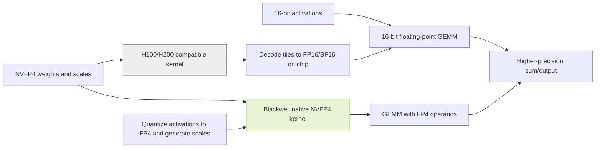

# Component Precision and Deployment Guide for Large MoE Models

[](#deployment-reference)
[](#component-precision-by-model)
[](#evidence-boundaries)
[](#evidence-boundaries)

Author: Xinyu Wei · [中文](README_CN.md)

## Purpose

This project provides component-level precision references for Muse Spark Open 816B-A42B, NVIDIA Nemotron 3 Ultra 550B-A55B, and Inkling 975B. It covers the original BF16 and NVFP4 checkpoints and specific partner FP8 releases. Use it to distinguish weights, activations, matrix-multiply operands, accumulation/output, KV caches, and other state, and to select an appropriate hardware and inference-engine path.

Deliverables include per-model component tables, pinned checkpoint/configuration evidence, Hopper-compatible and native Blackwell execution paths, resource-accounting tools, and validation procedures. **Precision claims are scoped to the cited configuration or implementation. No model inference has been executed for this project; production acceptance requires the target environment and business inputs.** Pricing and regional availability are outside this project's scope.

### Precision definitions and configuration scope

The original Nemotron 3 Ultra NVFP4 export assigns NVFP4 to routed experts, FP8 to shared experts and Mamba projections, and excludes router/gate modules. Its vLLM example separately chooses FP8 KV cache and FP16 Mamba state [N2][N3]. Calling this simply a "4-bit model" does not describe its components or establish a GPU count.

| Precision aspect | Inspection and limits |
|---|---|
| Weight storage | Inspect encoding, group scales, zero points and exceptions. An NVFP4 checkpoint does not imply that every tensor is 4-bit. |
| Activations | Inspect quantization at each operator's input and output. FP8 weights do not imply FP8 intermediate values everywhere. |
| Matrix multiplication | Inspect both operand types at the selected kernel. Stored INT4 weights do not imply native INT4 multiplication. |
| Accumulation and output | Inspect accumulators, reductions and returned tensor types. FP4 operands do not imply FP4 accumulation. |
| Caches and state | Inspect separate K, V, Mamba and short-convolution settings. Cache precision does not automatically follow weight precision. |

BF16 and FP16 both occupy 16 bits but use different exponent/mantissa layouts. The original reference checkpoints here are BF16; this guide does not invent an official FP16 release. Labels such as `W4A16` and `W8A8` give bit widths, not the integer/floating-point encoding or the selected kernel.

AWQ, GPTQ, and GSQ optimize quantized weights. GGUF is a file format; names such as `Q4_K_M` describe encoding or mixed-precision presets. These are not interchangeable categories. NVFP4 combines E2M1 values with an FP8 scale per 16 values and a global FP32 scale, so its storage footprint is not exactly four bits per value [H1].


Source: NVIDIA, *Introducing NVFP4 for Efficient and Accurate Low-Precision Inference*, Figure 2 [H1]. Original, unmodified GIF. Inspect the separate value and scale encodings; the figure does not establish every model component's precision or any performance result from this project.

### Model scope

| Model | Total<br>para&shy;meters<br>(billions) | Active para&shy;meters<br>per token<br>(billions) |
|---|---:|---:|
| Muse Spark Open | 816 | 42 |
| Nemotron 3 Ultra | 550 | 55 |
| Inkling | 975 | 41 |

- **Muse Spark Open:** multimodal MoE Transformer and perception encoder; 62 language layers, 256 experts and top-8 routing. Meta publishes BF16/NVFP4 checkpoints with gated access under the Muse Model License [M1][M2].
- **Nemotron 3 Ultra:** hybrid Mamba-2, Attention, LatentMoE and MTP. NVIDIA publishes BF16/NVFP4 checkpoints under OpenMDW-1.1 [N1][N2].
- **Inkling:** 66 local/global Attention layers with short convolution, 256 routed and 2 shared experts, selecting 6 routed experts per token. Thinking Machines Lab publishes BF16/NVFP4 checkpoints under Apache-2.0 [I1][I2].

`B` means one billion parameters. Active parameter counts do not describe all resident weights. The other experts normally remain loaded unless an explicit offloading design accepts its communication and scheduling costs. Do not size complete checkpoints using 42B, 55B, or 41B. Nominal counts may also differ from exported multimodal, MTP, and auxiliary tensor inventories.

A readable model card does not grant weight access. The Muse license includes attribution requirements and additional conditions for certain model-service businesses; review the actual license for the intended distribution. This guide is not legal advice.

## Results

### Component precision by model

Each model retains all 25 component and status items. Columns identify specific releases; rows separate storage, activations, arithmetic and caches.

**Terms:** "Baseline" retains the original tensor type, which may include BF16 and FP32. "Excluded" is an explicit export rule, not proof of BF16 storage. "Runtime" is determined by launch settings and the backend. "N/A" is reserved for absent components. Configuration notes below each table identify access restrictions, source conflicts and the settings to inspect; no default precision is invented for missing evidence.

Revisions and configuration summaries for all nine releases are retained in [model-evidence.json](data/model-evidence.json). FP8 refers to the specific AMD Quark and Red Hat AI releases [M8][N8][I8].

#### Muse Spark Open

Releases: Meta BF16 and NVFP4; AMD Quark FP8 [M1][M2][M8].

| Part | For&shy;mat:<br>BF16 | For&shy;mat:<br>FP8 | For&shy;mat:<br>NVFP4 |
|---|---|---|---|
| Weight<br>em&shy;bed&shy;ding | BF16 [M1] | Base&shy;line [M8] | Base&shy;line [M3] |
| Weight<br>atten&shy;tion pro&shy;jec&shy;tion | BF16 [M1] | FP8 [M8] | Base&shy;line [M3] |
| Weight<br>router | Dtype: see note [M4] | BF16 claim [M8] | Dtype: see note [M4] |
| Weight<br>rout&shy;ed expert | BF16 [M1] | FP8 [M8] | NVFP4 [M3] |
| Weight<br>shar&shy;ed expert | N/A [M4] | N/A [M4] | N/A [M4] |
| Weight<br>expert pre / post pro&shy;jec&shy;tion | Base&shy;line [M4] | Exclu&shy;ded [M8] | Base&shy;line [M4] |
| Weight<br>Mam&shy;ba pro&shy;jec&shy;tion | N/A | N/A | N/A |
| Weight<br>Mam&shy;ba state para&shy;me&shy;ter | N/A | N/A | N/A |
| Weight<br>short con&shy;vo&shy;lu&shy;tion | N/A | N/A | N/A |
| Weight<br>norm / bias | Base&shy;line [M1] | Base&shy;line [M8] | Base&shy;line [M3] |
| Weight<br>vision / audio | Base&shy;line [M1] | BF16 claim [M8] | Base&shy;line [M3] |
| Weight<br>draft | Own model [M3] | Own model | Own model [M3] |
| Weight<br>out&shy;put head | BF16 [M1] | Exclu&shy;ded [M8] | Base&shy;line [M3] |
| Input<br>atten&shy;tion pro&shy;jec&shy;tion | 16 bit | Dyna&shy;mic FP8 [M8] | Base&shy;line [M3] |
| Input<br>expert | 16 bit | Dyna&shy;mic FP8 [M8] | FP4 / 16 bit by kernel [V1] |
| Input<br>router / resid&shy;ual | FP32 [M4] | By code [M8] | FP32 [M4] |
| Expert math<br>Black&shy;well | BF16 | AMD path [M8] | Native FP4 [V1] |
| Expert math<br>Hop&shy;per | BF16 | CUDA: test first [M8] | H200: de&shy;code path [M3] |
| Sum / out&shy;put | By kernel | Not set by FP8 | Above FP4 [H1] |
| K cache | Run&shy;time | Run&shy;time | Run&shy;time |
| V cache | Run&shy;time | Run&shy;time | Run&shy;time |
| Cache scale / atten&shy;tion | By back&shy;end | By back&shy;end | By back&shy;end |
| Mam&shy;ba state cache | N/A | N/A | N/A |
| Short con&shy;vo&shy;lu&shy;tion cache | N/A | N/A | N/A |
| Infer&shy;ence status | Not run | Not run | Not run |

**Configuration notes.** Meta documents expert-only quantization [M3]. The vLLM recipe specifies FP32 routing computation and residuals, but does not separately specify router weight storage [M4]; these are different quantities. The original NVFP4 raw configuration returned HTTP 401 and requires authorized access to the pinned revision. Public model-card facts remain usable. AMD states that routing, encoders and the output head remain BF16, with static per-channel FP8 E4M3 expert/attention weights and dynamic per-token FP8 inputs [M8]. Its Deployment section is still `Todo`, not evidence of a CUDA deployment.

Muse has no shared expert [M4]. Draft weights are a separate checkpoint whose precision and memory require their own record. K/V dtypes, scales and Attention arithmetic depend on runtime settings and the backend; FP8 QKV projections do not imply FP8 Attention dot products.

#### NVIDIA Nemotron 3 Ultra

Releases: NVIDIA BF16 and NVFP4; Red Hat AI FP8 [N1][N2][N8].

| Part | For&shy;mat:<br>BF16 | For&shy;mat:<br>FP8 | For&shy;mat:<br>NVFP4 |
|---|---|---|---|
| Weight<br>em&shy;bed&shy;ding | BF16 [N1] | Exclu&shy;ded [N8] | Exclu&shy;ded [N3] |
| Weight<br>atten&shy;tion pro&shy;jec&shy;tion | BF16 [N1] | FP8 target [N8] | Not in low-bit rules [N3] |
| Weight<br>router | Base&shy;line [N1] | Exclu&shy;ded [N8] | Exclu&shy;ded [N3] |
| Weight<br>rout&shy;ed expert | BF16 [N1] | FP8 [N8] | NVFP4 [N3] |
| Weight<br>shar&shy;ed expert | BF16 [N1] | FP8 target [N8] | FP8 [N3] |
| Weight<br>latent pro&shy;jec&shy;tion | Base&shy;line [N1] | Per rule [N8] | Exclu&shy;ded [N3] |
| Weight<br>Mam&shy;ba pro&shy;jec&shy;tion | BF16 [N1] | FP8 target [N8] | FP8 [N3] |
| Weight<br>Mam&shy;ba state para&shy;me&shy;ter | BF16 / FP32 [N1] | Con&shy;vo&shy;lu&shy;tion exclu&shy;ded [N8] | Con&shy;vo&shy;lu&shy;tion exclu&shy;ded [N3] |
| Weight<br>Inkling sconv | N/A | N/A | N/A |
| Weight<br>norm / bias | Base&shy;line [N1] | Exclu&shy;ded [N8] | Base&shy;line [N3] |
| Weight<br>vision / audio | N/A [N1] | N/A | N/A |
| Weight<br>MTP | Share map: see note [N1] | MTP not sep&shy;a&shy;rate&shy;ly speci&shy;fied [N8] | MTP not sep&shy;a&shy;rate&shy;ly speci&shy;fied [N2] |
| Weight<br>out&shy;put head | BF16 [N1] | Exclu&shy;ded [N8] | Not in low-bit rules [N3] |
| Input<br>atten&shy;tion pro&shy;jec&shy;tion | 16 bit | Dyna&shy;mic FP8 [N8] | By oper&shy;ator [N3] |
| Input<br>expert | 16 bit | Dyna&shy;mic FP8 [N8] | FP4 / 16 bit by kernel [V1] |
| Input<br>router / resid&shy;ual | By code | Not in expert rules [N8] | Not in expert rules [N3] |
| Expert math<br>Black&shy;well | BF16 | FP8 on valid kernel | Native FP4 [V1] |
| Expert math<br>Hop&shy;per | BF16 [N1] | FP8 on valid kernel | W4A16 de&shy;code [N2][V1] |
| Sum / out&shy;put | By kernel | Not set by FP8 | Above FP4 [H1] |
| K cache | Per recipe [N1] | Set at launch [N8] | FP8 in recipe [N2] |
| V cache | Per recipe [N1] | Set at launch [N8] | FP8 in recipe [N2] |
| Cache scale / atten&shy;tion | By back&shy;end | By back&shy;end | By back&shy;end [V2] |
| Mam&shy;ba state cache | FP16 in recipe [N1] | FP16 in recipe [N8] | FP16 in recipe [N2] |
| Short con&shy;vo&shy;lu&shy;tion cache | N/A | N/A | N/A |
| Infer&shy;ence status | Not run | Not run | Config read; not run |

**Configuration notes.** N3 was read directly. Router/gate and latent projections occur in its exclusions; exclusion does not establish each tensor's BF16 storage. BF16 metadata also includes F32 tensors, so normalization, bias and state parameters retain their original dtypes. The Red Hat FP8 recipe uses `Linear` targets with an explicit ignore list; only matching, non-excluded modules receive that FP8 scheme [N8].

The original NVFP4 expert group size is 16. N3 contains 49,344 module rules: 49,152 NVFP4 routed-expert rules, 96 FP8 shared-expert rules and 48 FP8 rules each for Mamba input and output projections. These are configuration-entry counts, not parameter counts or performance measurements. The official example uses FP16 Mamba state with stochastic rounding, independently of FP8 KV cache [N2]. The cited recipes do not separately map MTP precision; MTP sharing and tensor dtypes require inspection of the complete configuration and tensor inventory.

#### Inkling

Releases: Thinking Machines Lab BF16 and NVFP4; Red Hat AI FP8 [I1][I2][I8].

| Part | For&shy;mat:<br>BF16 | For&shy;mat:<br>FP8 | For&shy;mat:<br>NVFP4 |
|---|---|---|---|
| Weight<br>em&shy;bed&shy;ding | BF16 [I1] | Base&shy;line [I8] | BF16 [I3] |
| Weight<br>atten&shy;tion pro&shy;jec&shy;tion | BF16 [I1] | Config exclu&shy;sion [I9] | BF16 [I3] |
| Weight<br>router | BF16 [I3] | Base&shy;line [I8] | BF16 [I3] |
| Weight<br>rout&shy;ed expert | BF16 [I1] | FP8 with exclu&shy;sions [I8] | NVFP4 with exclu&shy;sions [I4] |
| Weight<br>shar&shy;ed expert | BF16 [I3] | Base&shy;line [I8] | BF16 [I3][I4] |
| Weight<br>latent pro&shy;jec&shy;tion | Do not infer from Nemo&shy;tron [I1] | Do not infer from Nemo&shy;tron [I8] | Do not infer from Nemo&shy;tron [I3] |
| Weight<br>Mam&shy;ba pro&shy;jec&shy;tion | N/A | N/A | N/A |
| Weight<br>Mam&shy;ba state para&shy;me&shy;ter | N/A | N/A | N/A |
| Weight<br>short con&shy;vo&shy;lu&shy;tion | BF16 [I3] | Base&shy;line [I8] | BF16 [I3] |
| Weight<br>norm / bias | Base&shy;line [I1] | Base&shy;line [I8] | Mostly BF16 [I3] |
| Weight<br>vision / audio | Base&shy;line [I1] | Base&shy;line [I8] | En&shy;coders exclu&shy;ded [I4] |
| Weight<br>MTP | BF16 [I3] | MTP not sep&shy;a&shy;rate&shy;ly speci&shy;fied [I8] | BF16 [I3] |
| Weight<br>out&shy;put head | BF16 [I1] | Base&shy;line [I8] | BF16 [I3] |
| Input<br>atten&shy;tion pro&shy;jec&shy;tion | 16 bit | Config exclu&shy;sion [I9] | BF16 [I3] |
| Input<br>expert | 16 bit | Dyna&shy;mic FP8 [I8] | FP4 / 16 bit by kernel [I3][V1] |
| Input<br>router / resid&shy;ual | By code | Base&shy;line [I8] | Base&shy;line [I3] |
| Expert math<br>Black&shy;well | BF16 | FP8 on valid kernel | Native FP4; exclu&shy;ded layers differ [I3] |
| Expert math<br>Hop&shy;per | BF16 [I3] | FP8 on valid kernel | H200: de&shy;code to BF16 [I3] |
| Sum / out&shy;put | By kernel | Not set by FP8 | Above FP4 [H1] |
| K cache | Run&shy;time | Run&shy;time [I8] | Export: none [I4] |
| V cache | Run&shy;time | Run&shy;time [I8] | Export: none [I4] |
| Cache scale / atten&shy;tion | Local / global layers [I3] | By back&shy;end | By back&shy;end |
| Mam&shy;ba state cache | N/A | N/A | N/A |
| Short con&shy;vo&shy;lu&shy;tion cache | Run&shy;time set&shy;tings [I3] | Run&shy;time set&shy;tings | Run&shy;time set&shy;tings [I3] |
| Infer&shy;ence status | Not run | Pin engine build; not run | Config read; not run |

**Configuration notes.** Inkling has local/global Attention, short convolution and shared experts; Nemotron's Mamba/LatentMoE precision map does not apply. I4 uses a global NVFP4 scheme with exclusions including `model.llm.layers.2.mlp.experts`, shared experts, routers and encoders. An absent per-module dictionary does not mean no quantization, and a global scheme does not override exclusions.

Red Hat's card and configuration disagree about Attention, so the table follows I9's `.attn` exclusion. Null output-activation and KV schemes do not mean FP8 output or cache. The original NVFP4 export's `kv_cache_quant_algo=none` means it does not specify cache quantization; runtime settings may override K/V dtypes. Short-convolution state follows its own implementation, not a uniform FP8/NVFP4 KV rule.

"Native FP4" requires a supported Blackwell kernel to be selected. Hopper fallback, native execution and excluded layers have separate activation/arithmetic paths. Accumulation, reduction and output precision depend on the actual kernel, not the weight label.

Routers select experts; routed experts perform expert computations. Low-bit expert weights do not establish a low-bit router.

### NVFP4 execution on H100 and H200

A supported W4A16 fallback loads packed FP4 weights and scales, decodes tiles on chip into FP16/BF16, multiplies them by 16-bit activations, and returns results using the kernel's accumulation, reduction and output rules. Efficient fused kernels need not expand the entire model back into high-precision HBM storage. Other loaders may use different layouts; measure actual memory instead of assuming it.

$$
\widehat W_g = s_{\mathrm{tensor}}\,s_g\,q_g,\qquad Y\approx X_{16}\widehat W_{16}.
$$

Here `q_g` contains E2M1 approximations and `s_g` is a block scale. Decoding does not recover the original BF16 values lost during quantization. H100's FP8 support does not automatically turn this into FP8 computation, let alone native FP4. Verify the selected MoE kernel separately: a supported Linear-layer fallback does not establish support for every expert operator.



Original explanatory diagram: a cross-source synthesis of NVIDIA's format, vLLM's fallback rules, and the model recipe [H1][V1][I3]. It is not an execution trace. The Blackwell branch applies only when a native kernel is selected; other model components can remain BF16 or FP8.

### Deployment reference

| Model / format | Published starting point and limits |
|---|---|
| Muse Spark Open<br>BF16 | Meta's card gives approximately 2 TB of VRAM [M1]. This is not a single-GPU specification or a concurrency guarantee. |
| Muse Spark Open<br>NVFP4 | Meta lists four Blackwell Ultra GPUs or eight H200s; the vLLM recipe defaults to eight Blackwell GPUs [M3][M4]. These distinct recipes do not establish one universal minimum GPU count. |
| Nemotron 3 Ultra<br>BF16 | The card summary lists 16 H100s, 8 H200s or 8 B200s [N1]. This does not establish capacity at maximum context and target concurrency. |
| Nemotron 3 Ultra<br>NVFP4 | The card lists four B200/GB200-class GPUs and eight H100s [N2]. H100 has no native FP4 compute; engine support differs. |
| Inkling<br>BF16 | Original BF16 release; the vLLM Hopper recipe requires multiple nodes [I1][I3]. Summed memory does not validate expert placement or communication. |
| Inkling<br>NVFP4 | The vLLM recipe lists four GB200s and eight H200s [I3]. This does not generalize to four arbitrary Blackwell GPUs or eight arbitrary Hopper GPUs. |

Establish a same-model BF16 business-quality baseline. NVFP4 and partner FP8 are candidates, not automatic replacements. Reject configurations that fail required quality, modalities, tool calling, or kernel compatibility. AMD's Muse FP8 card still says `Todo` under Deployment: it documents a recipe and hardware claims, not an end-to-end deployment verified here [M8].

### Weight, arithmetic, and cache settings are independent

| Precision aspect | Required evidence and limits |
|---|---|
| Stored weights | Inspect the revision, tensor dtypes, quantization, scales and exclusions. NVFP4 in a filename is insufficient. |
| Matrix multiplication | Inspect the GPU, selected kernel, conversions and runtime log. Loading a checkpoint does not establish arithmetic precision. |
| Cache precision | Inspect KV, Mamba and sconv settings separately. Weight format does not establish cache precision. |
| Sum and output | Inspect the operator implementation. Operand bit width does not establish accumulator or output dtype. |

vLLM distinguishes `NVFP4` from `W4A16_NVFP4` and documents weight-only execution when native FP4 GEMM is unavailable [V1]. Nemotron's example uses FP8 KV cache and FP16 Mamba state with stochastic rounding [N2]; "all caches are FP8 or FP32" is not a universal rule.

AMD MI350X/MI355X support MXFP4, whose block-scale format differs from NVFP4 [H2][H3]. Inkling's recipe lists `lightseekorg/Inkling-MXFP4`, native MI355X execution and MI300X emulation. That is another publisher's checkpoint and another execution path, not a rename of the original NVFP4 release [I3].

### Resource accounting

The following tensor payloads are calculated from the six pinned revisions' public per-dtype element counts. **They are not complete download sizes or peak VRAM.** Inputs are in [model-evidence.json](data/model-evidence.json); run `node tools/inspect.mjs` to recompute them. Scale tensors and packed U8 elements use their actual storage dtypes, not the original logical parameter count.

| Model / format | Tensor bytes<br>GB | Tensor bytes<br>GiB |
|---|---:|---:|
| Muse Spark Open<br>BF16 | 1644.333 | 1531.405 |
| Muse Spark Open<br>NVFP4 | 533.011 | 496.405 |
| Nemotron 3 Ultra<br>BF16 | 1121.049 | 1044.058 |
| Nemotron 3 Ultra<br>NVFP4 | 320.071 | 298.090 |
| Inkling<br>BF16 | 1904.755 | 1773.942 |
| Inkling<br>NVFP4 | 592.005 | 551.348 |

Only tensors reported by public metadata are included. Headers, other files, caches/state, temporary workspaces and communication buffers are excluded. Nemotron BF16's reported total element count differs from the per-dtype sum; the tool preserves and reports this source discrepancy. See [Validation](VALIDATION.md).

$$
M_{\text{peak}} = M_{\text{weights}} + M_{\text{KV}} + M_{\text{state}} + M_{\text{workspace}} + M_{\text{communication}} + M_{\text{other}}.
$$

The following is a hypothetical weight-only calculation from nominal total parameters, in decimal GB. It is not file size, measured VRAM or a GPU recommendation. The NVFP4 column assumes every parameter uses four value bits plus one 8-bit scale per 16 values, or 4.5 bits/parameter. Actual mixed-precision releases include higher-precision components and further metadata [H2].

| Model / total<br>para&shy;meters | Format: BF16<br>Ideal GB | Format: NVFP4<br>Ideal GB |
|---|---:|---:|
| Muse Spark Open<br>816B | 1,632 | 459.0 |
| Nemotron 3 Ultra<br>550B | 1,100 | 309.375 |
| Inkling<br>975B | 1,950 | 548.4375 |

The formulas are `parameters * 2 bytes` and `parameters * (4 + 8/16) / 8 bytes`. Meta's approximately 700 GB deployment guidance cannot be replaced with 459 GB: one is publisher deployment guidance and the other an idealized encoding calculation. Their difference cannot be attributed to a single component without evidence.

For conventional full-attention layers:

$$
M_{\text{KV}} \approx 2\,N_{\text{layers}}\,N_{\text{KV heads}}\,D_{\text{head}}\,T_{\text{resident}}\,b_{\text{element}}.
$$

`T_resident` sums retained tokens across resident requests. Local attention, cache sharing, parallel replication, pages, quantization scales and state-space models require separate treatment. Do not apply this formula unchanged to all three models. Longer context and greater concurrency can make cache capacity the limiting factor.

Plan download/cache storage, serving weights, conversion intermediates and logs separately. Read the chosen revision's actual file sizes and decide whether both BF16 and NVFP4 checkpoints must coexist.

### Evidence boundaries

Checked on 2026-11-01. All nine releases across the three model tables have inference status **NOT_RUN** in this project. Throughput, latency, quality regression, long-context stability and recovery are not measured here. Source-reported benchmark scores from different projects are not combined into a comparison.

Nemotron's card discusses training recipes, weight exports and engine examples separately. Its prose mentions "NVFP4 KV caching" while concrete examples select FP8 cache; this guide follows the explicit parameters rather than treating the prose as a verified cache capability.

Inkling's recipe mentions both `vLLM 0.26.0+` and nightly installation. Neither is a reproducible guarantee for an arbitrary later build. Pin the tested commit or image digest and retain actual runtime evidence. Muse's raw quantization configuration returned HTTP 401 and was not bypassed; public publisher and recipe descriptions have narrower evidential scope than direct tensor inspection.

Red Hat's Inkling FP8 card describes attention Linear quantization, but the pinned configuration excludes `re:.*\.attn$` and `re:.*\.attn\..*` [I9]. The matrix preserves this conflict and does not label that subtree FP8. Actual module-name matching and loaded dtypes still need runtime inspection. Both Red Hat FP8 configurations have null `output_activations` and `kv_cache_scheme`: FP8 input rules do not establish FP8 outputs or KV storage.

License applicability, precise per-tensor gaps, device-specific peak memory and business performance still require validation. General framework support does not establish every precision, modality and backend combination.

## Steps

### Select a verifiable path before starting a service

| Step | Location and action | Pass condition |
|---|---|---|
| 1 | **Weight repository and license:** confirm model, precision, access and revision. | Obtainable licensed checkpoint with an explicit revision. |
| 2 | **Hardware and engine:** select the model's own recipe and pin software and topology. | Required modalities, cache and kernels explicitly supported. |
| 3 | **Capacity planning:** account for weights, context, concurrency and workspaces. | Headroom per device and parallel group, not only a total. |
| 4 | **Isolated validation:** start the selected official path; retain kernel and cache logs. | Loading, functionality and numerical checks pass. |
| 5 | **Business acceptance:** compare same-model BF16 and quantized releases on real tasks. | Quality, memory, latency and concurrency targets met. |
| 6 | **Production preparation:** pin image, weights, templates, rollback and monitoring. | Repeated deploy&shy;ment, upgrade and rollback verified. |

Use Meta's guide for Muse [M3], the matching Nemotron card for its precision [N1][N2], and the publisher-linked Inkling recipe [I3]. Do not assemble unrelated model commands into a supposedly universal launcher. Example context lengths, concurrency and parallelism are not business recommendations.

### Recompute metadata without downloading weights

Requires Node.js 20 or later. From a shell at this directory:

```bash
node tools/inspect.mjs
node --test tests/inspect.test.mjs
```

The first command calculates tensor payload bytes from the six saved per-dtype inventories. The tests check matrix coverage, packed-byte accounting, explicit configuration gaps and failure handling. Neither command invokes a model or validates GPU requirements.

For current public metadata rather than replay:

```bash
node tools/inspect.mjs --live
```

This reads the public Hugging Face model API, reports the new revisions and recalculates from the returned counts. It does not use the saved counts if a request fails, download weights, request access, or claim that old quantization-configuration verification applies to the new revision. Runtime cache and workspace allocation are not included.

Detailed commands, expected semantics and unexecuted checks: [Validation](VALIDATION.md) · [验证说明](VALIDATION_CN.md). Data and its boundaries: [model-evidence.json](data/model-evidence.json). The matrix's supporting sources are listed below.

### Production acceptance conditions

The unit of acceptance is **model revision + format + GPU + engine version + kernel + cache settings + parallel topology + workload**. A changed component invalidates the affected results.

Cover the text, image, audio/video, structured outputs and tool calls actually required. Use representative inputs at target context and concurrency, recording quality/error categories, peak VRAM, time to first token, generation-latency distribution and throughput. A health check, one answer or a smaller file is not production acceptance. BF16 is a reference, not a guarantee of correct answers; NVFP4 is not an unconditional lossless promise. Without the business tasks, target context and concurrency, guidance remains conditional: do not prescribe a precise instance count or SLA.

### Public sources

| ID | Source and inspected scope |
|---|---|
| M1/M2 | Meta [BF16][M1] and [NVFP4][M2] cards: identity, access, architecture and deployment guidance |
| M3 | [Meta deployment guide][M3]: expert-only quantization, Blackwell Ultra/H200 descriptions; commands not executed |
| M4 | [vLLM Muse recipe][M4]: FP32 routing/residuals, no shared experts, eight-GPU Blackwell and text-only AMD examples |
| M8 | [AMD Muse FP8][M8]: per-channel weights, per-token activations and exclusions |
| N1/N2 | NVIDIA [BF16][N1] and [NVFP4][N2] cards: hardware summaries, model and cache examples |
| N3 | [Pinned Nemotron export][N3]: module rules and exclusions, inspected as raw JSON |
| N8 | [Red Hat Nemotron FP8][N8]: quantization recipe, ignore list and deployment example; no benchmark reuse |
| I1/I2 | Thinking Machines Lab [BF16][I1] and [NVFP4][I2]: model, architecture, license and linked recipes |
| I3 | [vLLM Inkling recipe][I3]: precision, kernels, cache architecture and version caveats |
| I4 | [Pinned Inkling export][I4]: global NVFP4, cache `none` and exclusions |
| I8 | [Red Hat Inkling FP8][I8]: publisher, source model and integration dependency; attention prose conflict in I9 |
| I9 | [Pinned Red Hat Inkling FP8 config][I9]: `.attn` exclusions; null output activation and KV cache schemes |
| V1/V2 | vLLM [Model Optimizer][V1] and [KV cache][V2]: execution and cache distinctions |
| H1/H2 | [NVIDIA NVFP4 description][H1]: E2M1, scales and NVFP4/MXFP4 differences |
| H3 | [AMD MI350 series][H3]: MI350X/MI355X MXFP4 support |

Related background: [NVFP4](../NVFP4/), [quantization methods](../Quantization-Methods-Comparison-and-Practice/), and [memory estimation](../LLM-Memory-Estimation/). Their historical results are not acceptance evidence for these three models.

[M1]: https://huggingface.co/meta-models/Muse-Spark-Open-816B-A42B
[M2]: https://huggingface.co/meta-models/Muse-Spark-Open-816B-A42B-NVFP4
[M3]: https://dev.meta.ai/resources/blog/build-with-muse-spark-open
[M4]: https://recipes.vllm.ai/meta-models/Muse-Spark-Open-816B-A42B
[M8]: https://huggingface.co/amd/Muse-Spark-Open-816B-A42B-Quark-PTPC-FP8
[N1]: https://huggingface.co/nvidia/NVIDIA-Nemotron-3-Ultra-550B-A55B-BF16
[N2]: https://huggingface.co/nvidia/NVIDIA-Nemotron-3-Ultra-550B-A55B-NVFP4
[N3]: https://huggingface.co/nvidia/NVIDIA-Nemotron-3-Ultra-550B-A55B-NVFP4/blob/02462641f13d3af838b904f48195b9bb8a1e4ebc/hf_quant_config.json
[N8]: https://huggingface.co/RedHatAI/NVIDIA-Nemotron-3-Ultra-550B-A55B-FP8-dynamic
[I1]: https://huggingface.co/thinkingmachines/Inkling
[I2]: https://huggingface.co/thinkingmachines/Inkling-NVFP4
[I3]: https://recipes.vllm.ai/thinkingmachines/Inkling
[I4]: https://huggingface.co/thinkingmachines/Inkling-NVFP4/blob/42a75a99a40eb2ba1e0717db6357a0bf15205044/hf_quant_config.json
[I8]: https://huggingface.co/RedHatAI/Inkling-FP8-dynamic
[I9]: https://huggingface.co/RedHatAI/Inkling-FP8-dynamic/blob/cb2bf130a5263e01d7398723ae9b88e0060f4998/config.json
[V1]: https://docs.vllm.ai/en/stable/features/quantization/modelopt/
[V2]: https://docs.vllm.ai/en/stable/features/quantization/quantized_kvcache/
[H1]: https://developer.nvidia.com/blog/introducing-nvfp4-for-efficient-and-accurate-low-precision-inference/
[H2]: https://developer.nvidia.com/blog/introducing-nvfp4-for-efficient-and-accurate-low-precision-inference/
[H3]: https://www.amd.com/en/products/accelerators/instinct/mi350.html