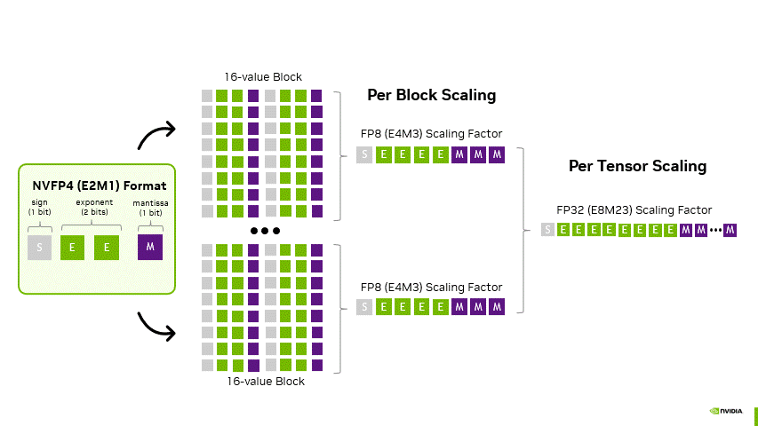
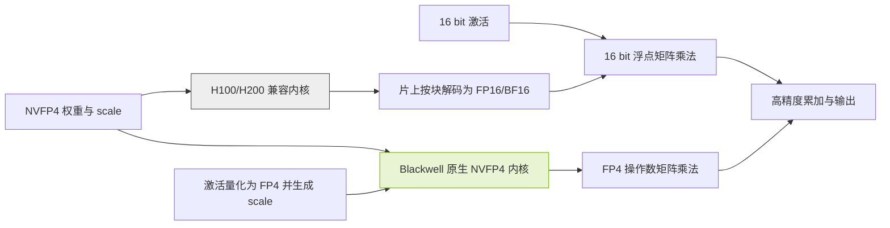
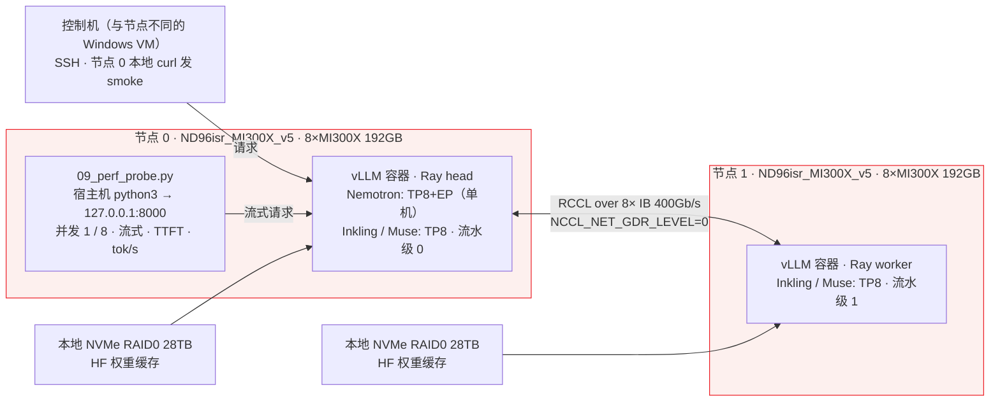
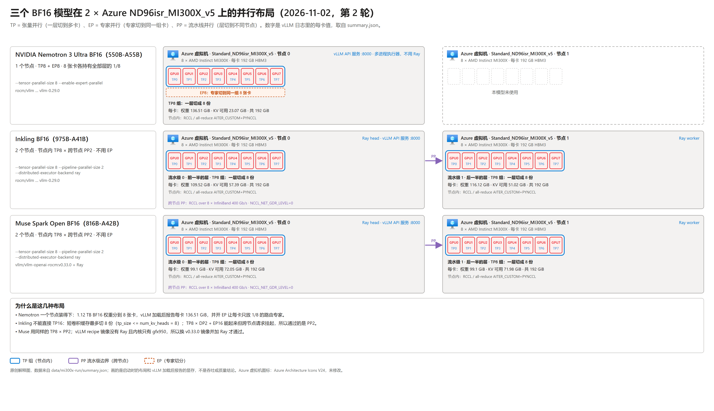

# 大型 MoE 模型组件精度与部署指南

[](#部署配置参考)
[](#逐模型组件精度)
[](#证据边界)
[](#mi300x-实测)

作者：魏新宇（Xinyu Wei） · [English](README.md)

## 目的

本项目提供 Muse Spark Open 816B-A42B、NVIDIA Nemotron 3 Ultra 550B-A55B 和 Inkling 975B 的组件精度参考，覆盖原厂 BF16、原厂 NVFP4 及指定伙伴 FP8 版本。用于核对权重、激活、矩阵乘法、累加与输出、KV Cache 和其他状态缓存，并选择与硬件及推理引擎相匹配的部署路径。

交付内容包括逐模型组件表、固定权重版本与配置证据、H100/H200 兼容执行和 Blackwell 原生执行路径、资源复算工具及验证步骤。**精度结论以对应配置或实现为依据；本项目执行过的推理只有下文三个原厂 BF16 权重在 MI300X 上的加载、smoke 和服务速度探针，生产验收需使用目标环境和业务输入。** 价格与云区域供应不在本项目范围内。

### 精度定义与配置范围

以 Nemotron 3 Ultra 的原厂 NVFP4 版本为例：导出规则将路由专家设为 NVFP4，却把共享专家和 Mamba 投影设为 FP8，并排除了 router/gate；官方 vLLM 示例又单独指定 FP8 KV cache 和 FP16 Mamba 状态 [N2][N3]。因此，“这个模型是 4 位”不能回答组件精度，更不能直接决定 GPU 数量。

| 精度类别 | 检查对象与判断边界 |
|---|---|
| 权重存储 | 检查数值编码、分组 scale、zero point 和混合精度例外。NVFP4 文件不表示所有张量都是 4 bit。 |
| 激活 | 检查各算子的输入、输出量化规则。权重 FP8 不表示所有中间值都是 FP8。 |
| 矩阵乘法 | 检查两个乘数进入实际内核时的类型。权重存 INT4 不表示 GPU 执行原生 INT4 乘法。 |
| 累加与输出 | 检查累加器、归约和返回张量的类型。FP4 乘数不表示全部累加在 FP4 中完成。 |
| 缓存与状态 | 分别检查 K、V、Mamba 和短卷积设置。缓存精度不自动跟随权重精度。 |

BF16 与 FP16 都占 16 bit，但指数与尾数分配不同，不是同一个数据类型。本文三个原厂基线都是 BF16，不另造“官方 FP16 版”。`W4A16` 和 `W8A8` 只说明权重与激活位宽，不能代替 INT4、FP8 E4M3、NVFP4 等具体编码及内核说明。

AWQ、GPTQ、GSQ 是求取低精度权重的方法；GGUF 是文件格式，`Q4_K_M` 等是量化编码或混合精度预设。这些名称不能与 NVFP4 硬件路径直接排成一条优劣顺序。NVFP4 使用 E2M1 数值、每 16 个数的 FP8 块缩放以及 FP32 全局缩放；即使数值字段是 4 bit，包含块 scale 后也不是每个数只占 4 bit [H1]。



来源：NVIDIA，《Introducing NVFP4 for Efficient and Accurate Low-Precision Inference》，Figure 2 [H1]。原图是逐步绘制的 GIF，这里取其最后一帧（三部分全部画出）作为静态图，像素未改。看点是数值位宽与两级缩放分开保存；该图不证明某个模型所有模块都用 NVFP4，也不是本项目性能结果。

### 模型范围

| 模型 | 总参数<br>十亿 | 激活参数<br>十亿/token |
|---|---:|---:|
| Muse Spark Open | 816 | 42 |
| Nemotron 3 Ultra | 550 | 55 |
| Inkling | 975 | 41 |

- **Muse Spark Open**：多模态 MoE Transformer 和感知编码器；语言骨干 62 层、256 个专家、每 token 选择 8 个。Meta 发布 BF16/NVFP4 权重，访问需按 Muse Model License 申请 [M1][M2]。
- **Nemotron 3 Ultra**：Mamba-2、Attention、LatentMoE 混合架构及 MTP。NVIDIA 发布 BF16/NVFP4 权重，许可为 OpenMDW-1.1 [N1][N2]。
- **Inkling**：66 层局部/全局 Attention 与短卷积；256 个路由专家、2 个共享专家，每 token 选择 6 个路由专家。Thinking Machines Lab 发布 BF16/NVFP4 权重，许可为 Apache-2.0 [I1][I2]。

`B` 表示十亿参数，`A42B` 等表示每 token 激活参数，不是需要常驻的完整权重。MoE 通常仍需装载全部专家，或明确采用会增加传输和调度开销的卸载策略。不能按 42B、55B、41B 计算完整模型的权重显存。参数标签也不一定包括全部多模态组件、MTP 和导出额外张量，应以所选 revision 的实际文件和张量清单复核。

模型卡可读不等于已获得权重下载权限。Muse 的模型许可证还有分发标识与特定服务业务的额外条件，需按自己的交付方式审查；本文不代替许可证审查。

## 实现效果

### 逐模型组件精度

三个模型各保留完整的 25 个组件和状态项。列表示具体发布版本，行区分权重、激活、计算与缓存，避免把存储位宽写成计算位宽。

**术语：**“保留基线”表示保持原始张量类型，可能包含 BF16 和 FP32；“排除量化”是导出配置的明确规则，不自动等于 BF16；“按运行配置”指由启动参数及后端决定；“不适用”只用于模型不存在的组件。表后的配置说明列出权限限制、来源冲突和需要读取的参数，不以缺省值填充证据空缺。

九个发布版本的 revision 与配置摘要保存在 [model-evidence.json](data/model-evidence.json)。下表中的 FP8 分别指 AMD Quark 和 Red Hat AI 的指定版本 [M8][N8][I8]，不代表所有同名 FP8 文件。

#### Muse Spark Open

发布版本：Meta BF16、NVFP4；AMD Quark FP8 [M1][M2][M8]。

三张表用同一套 25 行，便于逐行对照。Muse 是纯 Attention + MoE 的 Transformer，没有共享专家、Mamba 层和短卷积 [M4]，所以下表 6 行“不适用”是模型本身没有这个部件，不是未查。

| 组件 | 精度：<br>BF16 | 精度：<br>FP8 | 精度：<br>NVFP4 |
|---|---|---|---|
| 权重：词嵌入 | BF16 [M1] | 保留基线 [M8] | 保留基线 [M3] |
| 权重：注意力投影 | BF16 [M1] | FP8 [M8] | 保留基线 [M3] |
| 权重：路由器 | 计算用 FP32；权重存储 dtype 未公开 [M4] | BF16 声明 [M8] | 计算用 FP32；权重存储 dtype 未公开 [M4] |
| 权重：路由专家 | BF16 [M1] | FP8 [M8] | NVFP4 [M3] |
| 权重：共享专家 | 不适用 [M4] | 不适用 [M4] | 不适用 [M4] |
| 权重：专家前后投影 | 保留基线 [M4] | 排除量化 [M8] | 保留基线 [M4] |
| 权重：Mamba 投影 | 不适用 | 不适用 | 不适用 |
| 权重：Mamba 状态参数 | 不适用 | 不适用 | 不适用 |
| 权重：短卷积 | 不适用 | 不适用 | 不适用 |
| 权重：归一化与偏置 | 保留基线 [M1] | 保留基线 [M8] | 保留基线 [M3] |
| 权重：视觉与音频 | 保留基线 [M1] | BF16 声明 [M8] | 保留基线 [M3] |
| 权重：预测辅助模型 | 独立权重 [M3] | 独立权重 | 独立权重 [M3] |
| 权重：输出层 | BF16 [M1] | 排除量化 [M8] | 保留基线 [M3] |
| 激活：注意力投影输入 | BF16（`--dtype bfloat16`），MI300X 实测 [T2] | 动态 FP8 [M8] | 保留基线 [M3] |
| 激活：专家输入 | BF16，MI300X 实测 [T2] | 动态 FP8 [M8] | 依内核选 FP4 / 16 bit [V1] |
| 激活：路由与残差 | FP32 [M4] | 按实现 [M8] | FP32 [M4] |
| 运算：Black&shy;well 专家 | BF16 | 发布路径为 AMD [M8] | 原生 FP4 [V1] |
| 运算：Hopper / MI300X 专家 | BF16；MI300X 实测选中 `MuseSparkTritonExperts` [T2] | CUDA 支持另验 [M8] | H200 兼容路径 [M3] |
| 运算：累加与输出 | 按内核 | 非由 FP8 决定 | 高于 FP4 [H1] |
| K 缓存 | BF16（`kv_cache_dtype=auto` 随权重），MI300X 实测 [T2] | 按运行配置 | 按运行配置 |
| V 缓存 | BF16（同上），MI300X 实测 [T2] | 按运行配置 | 按运行配置 |
| 缓存缩放与注意力 | `ROCM_AITER_FA` 配融合 qk-norm/rope/kv-insert 内核，MI300X 实测 [T2] | 按后端 | 按后端 |
| Mamba 状态缓存 | 不适用 | 不适用 | 不适用 |
| 短卷积状态缓存 | 不适用 | 不适用 | 不适用 |
| 推理验收 | MI300X 2 × 8 卡 smoke 通过（TP8 × PP2，v0.33.0 镜像，纯文本） [T2] | 尚未执行 | 配置已解析，推理未执行 |

**配置说明。** Meta 公开说明只量化专家 [M3]；vLLM recipe 明确路由计算及残差使用 FP32，但没有单独给出 router 权重的存储 dtype [M4]，所以表中路由器一格写“计算用 FP32；权重存储 dtype 未公开”，不把两者混写。原厂 NVFP4 配置的匿名读取返回 401，需要授权后读取对应 revision；此访问限制不影响引用已公开的模型卡。AMD 模型卡声明路由、编码器及输出层保留 BF16，专家和注意力权重使用静态逐通道 FP8 E4M3、输入使用动态逐 token FP8 [M8]；其 Deployment 段仍为 `Todo`，不作为 CUDA 部署证明。

Muse 没有共享专家 [M4]。辅助预测使用独立的 draft checkpoint，其精度和内存须按该 checkpoint 另行记录。K/V dtype、scale 和注意力计算由运行参数及后端确定；QKV 投影使用 FP8，并不意味着 Attention 点积也使用 FP8。

#### NVIDIA Nemotron 3 Ultra

发布版本：NVIDIA BF16、NVFP4；Red Hat AI FP8 [N1][N2][N8]。

Nemotron 用 Mamba-2 而不用 Inkling 式短卷积，且没有视觉/音频编码器 [N1]，所以下表 3 行“不适用”是模型没有这个部件。

| 组件 | 精度：<br>BF16 | 精度：<br>FP8 | 精度：<br>NVFP4 |
|---|---|---|---|
| 权重：词嵌入 | BF16，实测 [T1] | 排除量化 [N8] | 排除量化 [N3] |
| 权重：注意力投影 | BF16，实测 [T1] | FP8 目标层 [N8] | 不在低精度规则中 [N3] |
| 权重：路由器 | `gate.weight` BF16 + `e_score_correction_bias` F32，实测 [T1] | 排除量化 [N8] | 排除量化 [N3] |
| 权重：路由专家 | BF16，49,152 个张量，实测 [T1] | FP8 [N8] | NVFP4 [N3] |
| 权重：共享专家 | BF16，实测 [T1] | FP8 目标层 [N8] | FP8 [N3] |
| 权重：潜空间投影 | BF16，实测 [T1] | 按目标与排除规则 [N8] | 排除量化 [N3] |
| 权重：Mamba 投影 | BF16，实测 [T1] | FP8 目标层 [N8] | FP8 [N3] |
| 权重：Mamba 状态参数 | `A_log` / `D` / `dt_bias` / `conv1d` 全部 BF16，实测 [T1] | 卷积等排除 [N8] | 卷积等排除 [N3] |
| 权重：Inkling 短卷积 | 不适用 | 不适用 | 不适用 |
| 权重：归一化与偏置 | BF16，实测 [T1] | 排除量化 [N8] | 保留基线 [N3] |
| 权重：视觉与音频 | 不适用 [N1] | 不适用 | 不适用 |
| 权重：MTP | BF16（1,039 张量）+ 1 个 F32 偏置，实测 [T1] | 配方未单列 [N8] | 配方未单列 [N2] |
| 权重：输出层 | BF16，实测 [T1] | 排除量化 [N8] | 不在低精度规则中 [N3] |
| 激活：注意力投影输入 | BF16，MI300X 实测 [T2] | 动态 FP8 [N8] | 按对应算子 [N3] |
| 激活：专家输入 | BF16，MI300X 实测 [T2] | 动态 FP8 [N8] | 依内核选 FP4 / 16 bit [V1] |
| 激活：路由与残差 | 按实现 | 排除专家量化 [N8] | 排除专家量化 [N3] |
| 运算：Black&shy;well 专家 | BF16 | 支持内核时 FP8 | 原生 FP4 [V1] |
| 运算：Hopper / MI300X 专家 | BF16；MI300X 实测选中 `TritonExperts` [N1][T2] | 支持内核时 FP8 | W4A16 兼容 [N2][V1] |
| 运算：累加与输出 | 按内核 | 非由 FP8 决定 | 高于 FP4 [H1] |
| K 缓存 | BF16（默认 `auto`），MI300X 实测 [T2] | 启动时另设 [N8] | 示例为 FP8 [N2] |
| V 缓存 | BF16（默认 `auto`），MI300X 实测 [T2] | 启动时另设 [N8] | 示例为 FP8 [N2] |
| 缓存缩放与注意力 | `ROCM_ATTN`，MI300X 实测 [T2] | 按后端 | 按后端 [V2] |
| Mamba 状态缓存 | FP16（启动参数生效），MI300X 实测 [T2] | 示例 FP16 [N8] | 示例 FP16 [N2] |
| 短卷积状态缓存 | 不适用 | 不适用 | 不适用 |
| 推理验收 | **MI300X 8 卡 smoke 通过** [T2] | 尚未执行 | 配置已解析，推理未执行 |

**配置说明。** N3 是直接读取的发布配置，router/gate、latent projection 等出现在排除列表中；排除规则不等于已逐张量确认 BF16。BF16 列的"实测"来自 2026-11-02 对固定 revision `77df655d` 全部 225 个 safetensors 文件头的逐张量普查 [T1]：51,023 个张量、1,121,049,257,984 字节，与公开 API 元数据算出的字节数完全一致；路由专家占 91.9%，Mamba 投影 3.6%，MTP 2.0%，共享专家 1.4%。模型配置的 `mamba_ssm_cache_dtype` 为 `float32`，但 vLLM 示例和本次实测都用 `--mamba-ssm-cache-dtype float16` 覆盖它，缓存精度由启动参数决定而不是 checkpoint。Red Hat FP8 使用 `Linear` 目标和明确的 ignore 列表；只有匹配目标且未被排除的模块才采用该 FP8 配方 [N8]。

原厂 NVFP4 专家分组大小为 16。N3 共包含 49,344 条模块量化规则：49,152 条 NVFP4 路由专家规则、96 条 FP8 共享专家规则，以及 Mamba 输入、输出投影各 48 条 FP8 规则。这是配置条目数，不是参数量或性能测量。官方示例的 Mamba 状态采用 FP16 加随机舍入；FP8 KV cache 与 Mamba 状态是两套独立设置 [N2]。MTP 的共享关系和未单列模块应通过完整模型配置及张量清单确认。

#### Inkling

发布版本：Thinking Machines Lab BF16、NVFP4；Red Hat AI FP8 [I1][I2][I8]。

Inkling 用短卷积而不用 Mamba [I1]，所以下表 3 行 Mamba “不适用”是模型没有这个部件。

| 组件 | 精度：<br>BF16 | 精度：<br>FP8 | 精度：<br>NVFP4 |
|---|---|---|---|
| 权重：词嵌入 | BF16，实测 [T1] | 保留基线 [I8] | BF16 [I3] |
| 权重：注意力投影 | BF16，实测 [T1] | 配置排除 [I9] | BF16 [I3] |
| 权重：路由器 | `gate.weight` BF16 [258×6144] + `gate.bias` F32，实测 [T1] | 保留基线 [I8] | BF16 [I3] |
| 权重：路由专家 | BF16，融合张量 `experts.w13_weight` / `w2_weight` 各 [256,…]，实测 [T1] | FP8<br>含排除层 [I8] | NVFP4<br>含排除层 [I4] |
| 权重：共享专家 | BF16，`shared_w13_weight` [2,6144,6144]，实测 [T1] | 保留基线 [I8] | BF16 [I3][I4] |
| 权重：潜空间投影 | 不套用 Nemo&shy;tron [I1] | 不套用 Nemo&shy;tron [I8] | 不套用 Nemo&shy;tron [I3] |
| 权重：Mamba 投影 | 不适用 | 不适用 | 不适用 |
| 权重：Mamba 状态参数 | 不适用 | 不适用 | 不适用 |
| 权重：短卷积 | BF16，264 个 [2048,1,4] 核，实测 [T1] | 保留基线 [I8] | BF16 [I3] |
| 权重：归一化与偏置 | BF16 + 128 个 F32 标量，实测 [T1] | 保留基线 [I8] | BF16 为主 [I3] |
| 权重：视觉与音频 | BF16，仅 0.18 GB，实测 [T1] | 保留基线 [I8] | 编码器排除 [I4] |
| 权重：MTP | BF16，160 个张量，实测 [T1] | 配方未单列 [I8] | BF16 [I3] |
| 权重：输出层 | BF16，实测 [T1] | 保留基线 [I8] | BF16 [I3] |
| 激活：注意力投影输入 | BF16（`--dtype bfloat16`），实测 [T2] | 配置排除 [I9] | BF16 [I3] |
| 激活：专家输入 | BF16，AITER 融合 MoE 以 BF16 收 BF16 权重，实测 [T2] | 动态 FP8 [I8] | 依内核选 FP4 / 16 bit [I3][V1] |
| 激活：路由与残差 | BF16 主干，128 个 F32 标量参与 [T1] | 保留基线 [I8] | 保留基线 [I3] |
| 运算：Black&shy;well 专家 | BF16 | 支持内核时 FP8 | 原生 FP4，排除层另算 [I3] |
| 运算：Hopper / MI300X 专家 | Hopper BF16 [I3]；MI300X `AiterExperts`（2stage，Silu），实测 [T2] | 支持内核时 FP8 | H200 解码为 BF16 [I3] |
| 运算：累加与输出 | 按内核 | 非由 FP8 决定 | 高于 FP4 [H1] |
| K 缓存 | BF16（`kv_cache_dtype=auto` 跟随权重），实测 [T2] | 按运行配置 [I8] | 导出为 none [I4] |
| V 缓存 | BF16（同上），实测 [T2] | 按运行配置 [I8] | 导出为 none [I4] |
| 缓存缩放与注意力 | 区分局部/全局层 [I3]；MI300X 走模型自带 AMD 注意力实现，实测 [T2] | 按后端 | 按后端 |
| Mamba 状态缓存 | 不适用 | 不适用 | 不适用 |
| 短卷积状态缓存 | BF16，切分上限 8 路（`sconv SWA cache supports tp_size <= num_kv_heads (8)`），实测 [T2] | 读取运行配置 | 读取运行配置 [I3] |
| 推理验收 | MI300X 2 × 8 卡 smoke 通过（TP8 × PP2） [T2] | 需固定集成版本，尚未执行 | 配置已解析，推理未执行 |

**配置说明。** Inkling 使用局部与全局 Attention、短卷积及共享专家，不套用 Nemotron 的 Mamba/LatentMoE 精度分配。BF16 列的"实测"来自 2026-11-02 对 revision `828496ee` 全部 109 个 safetensors 文件头的普查 [T1]：1,552 个张量、1,904,755,280,148 字节，与 API 元数据一致；路由专家占 97.4%，注意力 0.9%，共享专家 0.8%，MTP 0.6%，第 0–1 层稠密 MLP 0.1%。该 checkpoint 把每层 256 个专家打包成两个融合张量，而 Nemotron 每个专家单独存储，所以张量数相差 30 倍但精度语义相同。路由器 `gate.weight` 第一维是 258 = 256 个路由专家 + 2 个作为 sink 参与打分的共享专家。I4 采用全局 NVFP4 配置加排除列表，其中包括 `model.llm.layers.2.mlp.experts`、共享专家、router 和编码器等。没有逐模块字典不表示没有量化；全局算法也不能覆盖排除项。

Red Hat FP8 模型卡与实际配置对 Attention 的描述有冲突，表中按 I9 的 `.attn` 排除规则处理。输出激活与 KV 配方为空，不表示这些值都是 FP8。NVFP4 导出的 `kv_cache_quant_algo=none` 表示没有在该导出配置中指定缓存量化，运行时仍可另设 K/V dtype。短卷积缓存的 dtype 由其运行实现确定，不归入统一 FP8 或 NVFP4 KV。

表中“原生 FP4”以支持的 Blackwell 内核被实际选中为前提。Hopper 兼容路径、原生路径以及排除层分别处理激活和计算。所有累加、归约与输出精度都受实际内核约束，不由权重名称推断。

Router 负责选择专家，routed experts 负责专家计算。二者是不同组件，低精度专家权重不能被描述为低精度路由器。

### H100 与 H200 的 NVFP4 执行路径

以支持的 W4A16 兼容内核为例，流程是：读取打包的 FP4 权重及 scale，按块在片上解码为 FP16/BF16，和 16 bit 激活做矩阵乘法，再以该内核规定的累加、归约与输出精度返回结果。高效融合内核不需要先把整个模型展开后写回显存；但不是所有加载器都保留同一种内存布局，实际占用必须实测。

$$
\widehat W_g = s_{\mathrm{tensor}}\,s_g\,q_g,\qquad Y\approx X_{16}\widehat W_{16}.
$$

这里 `q_g` 是 E2M1 近似值，`s_g` 是块 scale。解码得到的是已量化的近似权重，**不是原始 BF16 权重恢复原状**。H100 的 FP8 能力也不会自动把这个路径变成 FP8，更不会变成原生 FP4。对 MoE，要单独确认被选中的专家内核，不能拿一个 Linear 层支持 Marlin 就替所有 MoE 算子背书。



原创解释图：将 NVIDIA 的格式说明、vLLM 的兼容选择规则和模型 recipe 放在同一张路径图中 [H1][V1][I3]。图展示机制与条件，不是执行 trace。Blackwell 分支只有在确实选中原生内核时成立；模型仍可包含 BF16/FP8 的其他模块。

### 部署配置参考

| 模型与版本 | 发布方给出的起点与边界 |
|---|---|
| Muse Spark Open<br>BF16 | Meta 模型卡给出约 2 TB VRAM 量级 [M1]。这不是单卡规格或目标并发保证。 |
| Muse Spark Open<br>NVFP4 | Meta 列四张 Blackwell Ultra 或八张 H200；vLLM recipe 默认八卡 Blackwell [M3][M4]。两份不同部署配方不能合成唯一“最低卡数”。 |
| Nemotron 3 Ultra<br>BF16 | 模型卡摘要列 16 张 H100、8 张 H200 或 8 张 B200 [N1]。这不保证最大上下文加目标并发时的容量。 |
| Nemotron 3 Ultra<br>NVFP4 | 模型卡列四张 B200/GB200 等与八张 H100 [N2]。H100 没有原生 FP4 算力，且引擎支持不同。 |
| Inkling<br>BF16 | 官方发布 BF16；vLLM recipe 的 Hopper 路径需要多节点 [I1][I3]。总显存相加不证明专家布局和通信可行。 |
| Inkling<br>NVFP4 | vLLM recipe 列四张 GB200、八张 H200 路径 [I3]。不能外推成四张任意 Blackwell 或八张任意 Hopper。 |

先以同模型 BF16 建立业务质量基线。NVFP4 和伙伴 FP8 都只是候选；当精度、模态、工具调用或兼容内核未通过验收时，不为减少权重体积而直接替换生产版本。AMD Muse FP8 模型卡的 Deployment 仍写 `Todo`，因此它证明配方与硬件声明，不构成本项目可直接复跑的部署教程 [M8]。

### 权重、计算与缓存配置

| 精度类别 | 必需证据与判断边界 |
|---|---|
| 权重存储 | 检查 checkpoint revision、张量类型、量化配置、缩放与排除列表。文件名中的 NVFP4 不足以证明这些信息。 |
| 矩阵乘法 | 检查 GPU、实际内核、转换步骤与运行日志。能加载权重不表示已确认计算精度。 |
| 缓存精度 | 分别检查 KV cache、Mamba 和短卷积状态设置。不能从权重格式推断缓存精度。 |
| 输出与累加 | 检查内核和算子实现。操作数位宽不决定累加器与输出 dtype。 |

H100/H200 没有 Blackwell 的原生 NVFP4 Tensor Core 计算路径。支持的兼容内核可以在片上把低比特权重转换成 FP16/BF16 后计算，仍可能节省权重存储与读取带宽，但不是原生 FP4 乘法。转换只解码近似值，不恢复量化前丢失的精度。vLLM 明确区分 `NVFP4` 和 `W4A16_NVFP4`，并说明缺少原生 FP4 GEMM 时的 W4A16 回退 [V1]。

Nemotron 的官方 vLLM 示例将 KV cache 设置为 FP8，将 Mamba SSM 状态设置为 FP16，并启用随机舍入 [N2]。因此“缓存都是 FP8 或 FP32”不是该模型的通用结论。Inkling 还有短卷积状态；不能用 Nemotron 的 Mamba 状态公式估算它。

AMD MI350 系列支持 MXFP4，包括 MI350X 和 MI355X；NVFP4 与 MXFP4 的块缩放规则不同，不能当作同一份权重的无条件互换格式 [H2][H3]。Inkling 的 recipe 另列了 `lightseekorg/Inkling-MXFP4` 和 MI355X 原生、MI300X 模拟路径，那是**另一个发布者的 checkpoint 与另一条执行路径**，不是把官方 NVFP4 行直接改名 [I3]。

### 资源估算

先算权重的量级，再加入缓存、工作区、并行复制和余量；不能用一个固定百分比替代实际测量。

我们从六个固定 revision 的公开逐 dtype 张量计数复算得到下面的负载。**这是张量数据字节，不是完整下载大小或峰值显存。** 输入在 [model-evidence.json](data/model-evidence.json)，计算入口为 `node tools/inspect.mjs`；scale 和打包 U8 张量按实际存储类型计数，不把压缩元素数当原始参数量。

| 模型与版本 | 张量负载<br>GB | 张量负载<br>GiB |
|---|---:|---:|
| Muse Spark Open<br>BF16 | 1644.333 | 1531.405 |
| Muse Spark Open<br>NVFP4 | 533.011 | 496.405 |
| Nemotron 3 Ultra<br>BF16 | 1121.049 | 1044.058 |
| Nemotron 3 Ultra<br>NVFP4 | 320.071 | 298.090 |
| Inkling<br>BF16 | 1904.755 | 1773.942 |
| Inkling<br>NVFP4 | 592.005 | 551.348 |

计算只覆盖公开元数据列出的张量，不含文件头、非张量文件、KV/状态缓存、临时工作区或通信缓冲。Nemotron BF16 的 API 总元素字段与逐 dtype 求和有差异，工具保留并报告该差异，不改原数据；更多边界见[验证说明](VALIDATION_CN.md)。2026-11-02 对两个 BF16 快照的文件头普查 [T1] 得到的字节数与上表 Nemotron、Inkling 两行完全一致，证明按 API 元素数乘 dtype 字节的算法没有漏项。

**每张卡要放多少权重。** 把观测到的张量字节按发布方列出的 GPU 数量平分，再和该 GPU 的标称 HBM 相减；"剩余"是扣掉权重之前 KV cache、Mamba/短卷积状态、激活、工作区和通信缓冲能用的上限，不是实测分配。入口 `node tools/budget.mjs --table`，输入 [deployment-budget.json](data/deployment-budget.json)：

| 模型 | GPU × 数量 | 每卡权重<br>GB | 每卡 HBM<br>GB | 每卡剩余<br>GB | 来源 |
|---|---|---:|---:|---:|---|
| Nemotron 3 Ultra BF16 | 16 × H100 80GB | 70.1 | 80 | 9.9 | N1 |
| Nemotron 3 Ultra BF16 | 8 × H200 141GB | 140.1 | 141 | 0.9 | N1 |
| Nemotron 3 Ultra BF16 | 8 × B200 180GB | 140.1 | 180 | 39.9 | N1 |
| Nemotron 3 Ultra BF16 | 8 × MI300X 192GB | 140.1 | 192 | 51.9 | 本项目实测 [T2]：加载后每卡 146.67 GiB 已用（权重 136.51 GiB + 非 torch），KV cache 可用 23.07 GiB |
| Inkling BF16 | 16 × H200 141GB | 119.0 | 141 | 22.0 | I3（2 节点 × 8） |
| Inkling BF16 | 16 × MI300X 192GB | 119.0 | 192 | 73.0 | 本项目实测 [T2]：TP16 被模型拒绝（`sconv SWA cache supports tp_size <= num_kv_heads (8)`）；TP8 × PP2 实际加载 109.5 / 116.1 GiB（两个流水级），KV 可用 57.4 / 51.0 GiB；TP8 × DP2 + EP16 每卡 114.9 GiB（预算 116.0 + 6.2 = 122.1 GB） |

8 × H200 跑 Nemotron BF16 每卡只剩 0.9 GB，说明模型卡把它列为最低配置时默认了 KV cache 要靠 FP8 和很小的并发；这是"能放下权重"和"能服务"之间的差距。Inkling 一行说明"16 卡能放下"和"16 卡能按 TP16 切"是两件事：权重放得下，但注意力/短卷积缓存的切分维度限制了并行形态——同样 16 卡，PP2 每卡装 109–116 GiB、DP2+EP16 每卡装 115 GiB，两种布局都比平均值 119 GB 略低，因为流水级/专家组各自只持有一部分非专家张量。

$$
M_{\text{peak}} = M_{\text{weights}} + M_{\text{KV}} + M_{\text{state}} + M_{\text{workspace}} + M_{\text{communication}} + M_{\text{other}}.
$$

下表只用模型卡的标称总参数做**假设性权重计算**，使用十进制 GB，不是下载文件大小、实际显存占用或 GPU 数量建议。NVFP4 一列假设所有参数都采用 4 bit 数值加每 16 个数一个 8 bit 块缩放，即 4.5 bit/参数；真实模型包含更高精度模块、额外缩放及元数据，因此不能直接按这一列配卡 [H2]。

| 模型与总参数 | 格式：BF16<br>理想 GB | 格式：NVFP4<br>理想 GB |
|---|---:|---:|
| Muse Spark Open<br>816B | 1,632 | 459.0 |
| Nemotron 3 Ultra<br>550B | 1,100 | 309.375 |
| Inkling<br>975B | 1,950 | 548.4375 |

计算方法分别为 `参数量 × 2 字节` 与 `参数量 × (4 + 8/16) / 8 字节`。这也解释了为什么不能将 Meta 给出的约 700 GB NVFP4 部署门槛替换为纸面 459 GB：两者口径不同，前者是发布方部署说明，后者只是理想化权重编码计算，不能反推差额全由某个组件造成。

对于标准全 Attention 层，KV cache 的基本估算为：

$$
M_{\text{KV}} \approx 2\,N_{\text{layers}}\,N_{\text{KV heads}}\,D_{\text{head}}\,T_{\text{resident}}\,b_{\text{element}}.
$$

`T_resident` 是所有常驻请求已保留 token 的总数，而非只有一个请求的上下文上限。局部 Attention、缓存复用、张量并行复制、分页、量化 scale 和状态空间模型需要分别处理，不能把标准公式不加修改地套到三个模型。更长的上下文和更多并发都可能让缓存而非权重成为主要约束。

存储至少区分下载与缓存目录、运行使用的权重目录、转换中间文件和日志。不要凭标称参数给出固定磁盘数字；先读取所选 revision 的文件大小并确认是否需要同时保留 BF16 与 NVFP4 两份权重。

### MI300X 实测

<a id="mi300x-实测"></a>

2026-11-02 在两台 Azure `Standard_ND96isr_MI300X_v5`（每台 8 × MI300X 192 GB）上用 `rocm/vllm:rocm10.1.0_ubuntu24.04_py3.14-pytorch_2.13.0_vllm-0.29.0` 实际加载 BF16 原厂权重。三个发布方都没有给 MI300X 的 BF16 配方，所以这是本项目自己的实验，不是复现官方步骤；它回答的是"能不能跑起来、实际选了什么内核、缓存什么精度、显存用了多少"，不是吞吐或质量。



原创测试拓扑图：Nemotron 只用节点 0；Inkling 和 Muse 用两个节点，每节点一个流水级，流水级内 TP8。smoke 请求由节点 0 上的 `curl` 发向本机 `127.0.0.1:8000`，计时点是 `curl` 发出到收到完整 JSON 的墙钟时间，包含调度和生成、不含跨机网络，不是首 token 延迟；首 token 延迟和 tok/s 由第 2 轮的速度探针单独测（见下文）。控制机只通过 SSH 下发命令。每卡显存数字是 vLLM 日志的 GiB（二进制）；资源估算表的权重字节是 GB（十进制）。



原创并行布局图，由 [`tools/build_layout_figure.py`](tools/build_layout_figure.py) 从 [summary.json](data/mi300x-run/summary.json) 生成：**TP**（张量并行）把每一层切到一个节点的 8 张卡上，**EP**（专家并行）把路由专家切到同一组 8 张卡上，**PP**（流水线并行）把前一半层放在节点 0、后一半层放在节点 1。Nemotron 只在节点 0 上跑 `--tensor-parallel-size 8 --enable-expert-parallel`（每卡权重 136.51 GiB）；Inkling 和 Muse 通过 Ray 跑 `--tensor-parallel-size 8 --pipeline-parallel-size 2`，流水级 0 在节点 0、流水级 1 在节点 1，两者都不用 EP。图中每卡权重和 KV 可用显存是 vLLM 加载后日志里的值，与下表数字相同。Azure 虚拟机图标来自 Azure Architecture Icons V24；MI300X 和 vLLM 进程没有官方图标，用带文字的普通方框表示。图只说明布局，不代表速度或质量。

| 模型 · 布局 | 加载结果 | 选中的内核与后端 | 显存（每卡） | 缓存精度 | smoke 生成 |
|---|---|---|---|---|---|
| Nemotron 3 Ultra BF16 · 1 节点 TP8+EP | **通过**（第 3 次尝试） | MoE `TritonExperts`；注意力 `ROCM_ATTN`；Mamba SSU `triton`；all-reduce `AITER_CUSTOM`+`PYNCCL` | 权重 136.51 GiB，加载后 146.67 GiB 已用，KV 可用 23.07 GiB，KV 容量 3,490,022 token | K/V BF16（默认）；Mamba 状态 FP16（启动参数）；注意力块 1056 token 对齐 Mamba 页 | 中文 31→94 token 1.61 s；英文 42→209 token 5.42 s；内容正确 |
| Inkling BF16 · 2 节点 TP8×PP2 | **通过**（第 6 次尝试） | MoE `AiterExperts`（ROCm AITER 融合内核，2stage，Silu）；all-reduce `AITER_CUSTOM`+`PYNCCL`（TP 组）、`PYNCCL`（PP 组） | 流水级 0：权重 109.52 GiB，加载后 112.54 GiB 已用，KV 可用 57.39 GiB；流水级 1：116.12 / 118.9 / 51.02 GiB；KV 容量 398,239 token | K/V BF16（默认）；短卷积缓存 BF16，切分上限 8 路 | 中文 27→200 token 2.97 s、英文 39→256 token 4.06 s（均止于推理段，`max_tokens` 不够）；中文 `max_tokens=1024` 27→441 token 6.52 s，**最终答案正确** |
| Inkling BF16 · 2 节点 TP8×DP2+EP16 | 引擎就绪（第 5 次尝试），服务未通过 | 同上，`MoEPrepareAndFinalize` 走 DP/EP 路径 | 每卡权重 114.88 GiB，KV 可用 50.25 GiB，每个 DP rank KV 容量 317,040 token | K/V BF16（默认） | 第 1 条（本机 DP rank）27→200 token 4.76 s；第 2 条被调度到远端 DP rank 后无输出，5 分钟后 `RPC call to sample_tokens timed out`，引擎退出 |

四条在 MI300X 上才会遇到、文档里没写的事实：① AITER 融合 MoE 内核要求专家是 act_and_mul（SwiGLU 类）结构，Nemotron LatentMoE 的 `relu2` 非门控专家不满足，必须回退到 Triton MoE；Inkling 的门控专家则直接用上 AITER。② Nemotron 示例里的 `--enable-mamba-cache-stochastic-rounding` 在这套 Triton 3.8 / ROCm 10.1 镜像上触发 `ld.lld` 链接失败，去掉它才能过 warm-up——这是内核编译问题，不是模型问题。③ Inkling 的多机布局不能简单 TP16：短卷积缓存最多切 8 路，所以要么"节点内 TP8 + 节点间 DP2 + EP16"（模型卡的 Hopper 配方，本镜像上引擎就绪但跨机请求挂起），要么"节点内 TP8 + 节点间 PP2"（本项目实际通过的布局）。④ vLLM 的 FA4 预热只看模型配置类不看平台，在 ROCm 上会去导入 CUDA 专有扩展，需要 `--kernel-config '{"enable_jit_warmup": false}'` 跳过。每次只改一个变量的完整尝试记录（Nemotron 3 次、Inkling 6 次）和日志摘录见[验证说明](VALIDATION_CN.md#mi300x-实测)。

#### 服务速度探针（第 2 轮，2026-11-02）

<a id="服务速度探针"></a>

**问题。** 上面的 smoke 只回答"能不能生成"。第 2 轮在同一套机器上重新拉起已通过的布局，用 [`scripts/mi300x/09_perf_probe.py`](scripts/mi300x/09_perf_probe.py) 回答"大概多快"：对同一条英文提示词（37 token，问"为什么 MoE 模型把路由器放在比专家更高的精度"）流式请求，`max_tokens 256`、`temperature 0`，并发 1 和并发 8 各 3 轮，先跑 1 条预热请求（让 JIT 和图捕获不落在计时里）。这是**探针不是 benchmark**：一条固定短提示、两个并发档、每档 3 轮，只给量级，不给分布；长提示、大批量和不同输出长度都不在范围内。

三个指标的定义写进了探针输出的 JSON，表里直接引用：**首 token 延迟（TTFT）** = 发出请求到收到第一个带文本的流式分片（推理模型的第一个可见 token 是推理段）；**单请求解码速度** = (completion_tokens − 1) ÷ (最后一个分片时刻 − 第一个分片时刻)；**总吞吐** = 一轮内所有并发流的 completion_tokens 之和 ÷ 该轮从第一条发出到最后一条结束的时间。`completion_tokens` 取服务端 `usage` 字段（`stream_options.include_usage`），不自己数。

| 模型 · 布局 | 加载结果（第 2 轮） | 并发 1：TTFT 中位 / 单请求解码 tok/s / 总吞吐 tok/s | 并发 8：TTFT 中位 / 单请求解码 tok/s / 总吞吐 tok/s | 探针期间每卡显存已用（`rocm-smi`，GiB） |
|---|---|---|---|---|
| Inkling BF16 · 2 节点 TP8×PP2 | **通过**，冷加载 249.6 / 243.7 s（两个流水级），`/health` 200 后 3 条 smoke 全部返回，`max_tokens=1024` 那条最终答案正确 | **45 ms** / **68.9** / 68.3（n=3） | **97 ms** / **42.5** / **335.8**（n=24） | 节点 0：170.6–171.2；节点 1：177.2–177.9（含 KV 预分配） |
| Nemotron 3 Ultra BF16 · 1 节点 TP8+EP | **通过**，冷加载 744.5 s，`init engine` 117.78 s；3 条 smoke 全部 `finish_reason=stop`，中文 BF16/FP16 答案正确（与第 1 轮逐字一致） | **170 ms** / **60.7** / 58.6（n=3） | **358 ms**（最大 1.17 s） / **42.0** / **317.4**（n=24） | 174.9–175.5（权重 136.51 + KV 23.07 + 运行时） |
| Muse Spark Open BF16 · 2 节点 TP8×PP2（第 3 次尝试，`vllm/vllm-openai-rocm:v0.33.0` + Ray） | **通过**：每卡权重 99.1 GiB，加载 95.0 s（流水级 0）/ 43.1 s（流水级 1），`init engine` 64.22 s，`/health` 200 于 04:22:41Z（head 启动后 4 分 36 秒）；KV 可用 72.05 / 71.98 GiB = 8,130,184 token；3 条 smoke 全部返回，追加的第 4 条 `max_tokens=4096` 以 `finish_reason=stop` 结束，1,289 个推理 token 后给出**正确的一句话 BF16/FP16 区别**（共 1,354 个 completion token，16.4 s） | **205 ms** / **84.6** / 79.5（n=3） | **506 ms**（最大 0.52 s） / **47.6** / **348.6**（n=24） | 节点 0：180.0–180.9；节点 1：180.3–181.4 |

读表时注意两点。第一，并发 8 时 Inkling 单请求解码从 68.9 降到 42.5 tok/s，但总吞吐从 68 升到 336 tok/s——8 条流一起走时每条慢 38%，整体多出 4.9 倍产出；这是 MoE 解码受显存带宽约束时的典型形状，并发越高单位 token 越便宜，直到 KV 缓存或调度成为瓶颈。第二，所有 27 条 Inkling 请求都以 `finish_reason=length` 结束——它是推理模型，256 token 还在推理段里，所以这里的 tok/s 是推理段的解码速度，不是最终答案的速度；对用户可见的首个答案 token 要等推理段结束，比 TTFT 晚得多。原始 JSON（含每条请求的 TTFT、解码速度、token 数、结束原因）在 [data/mi300x-run/inkling_bf16_16xMI300X_pp2_run2/08_perf.json](data/mi300x-run/inkling_bf16_16xMI300X_pp2_run2/08_perf.json)，`summary.json` 里的中位数由它重算，`tests/mi300x.test.mjs` 校验本页引用的每个数字。

**Muse 的三次尝试**（细节见[验证说明](VALIDATION_CN.md#mi300x-实测)）：Meta 的权重闸门于 2026-11-02 上午批准，1.64 TB BF16 权重两节点各下一份（`bytes=1644365682665`）。尝试 1 用 vLLM 配方镜像 `vllm/vllm-openai-rocm:muse-spark-open`，1 秒失败——镜像没装 Ray（配方是单机 TP8 跑在 MI355X 上，不需要多机执行器）。尝试 2 在该镜像上加 Ray 2.55.1，权重加载成功（每卡 104.84 GiB，190 s），然后 16 个 rank 在显存探测阶段全部段错误于 `fused_muse_spark_qknorm_rope_kv_insert_kernel.hip`——用 `llvm-objdump --offloading` 检查镜像里的 `.so`，所有 GPU 代码对象只有 `gfx950`（MI350X/MI355X），没有 MI300X 的 `gfx942`；这个融合内核在 ROCm 路径上无条件启用，没有开关。尝试 3 换成 2026-11-02 发布的 `vllm/vllm-openai-rocm:v0.33.0`（编译目标含 `gfx942`，`vllm/models/muse_spark/` 代码树相同）加 Ray，**通过**：尝试 2 里段错误的那个融合内核这次正常运行，引擎 4 分 36 秒就绪，探针数字见上表。MoE 后端是 `MuseSparkTritonExperts`（启动脑本按 vLLM recipe 的 AMD 示例传 `--moe-backend triton`），注意力 `ROCM_AITER_FA`，all-reduce 在 TP 组内 `AITER_CUSTOM`+`PYNCCL`、跨流水级 `PYNCCL`。三个模型中 Muse 的单流解码最快（84.6 tok/s，Inkling 68.9、Nemotron 60.7——它每 token 激活 42B 参数，三者中最少），并发 1 的 TTFT 则最高（205 ms，对比 45 / 170 ms）；它和 Inkling 一样是推理模型，27 条探针请求全部在推理段内以 `finish_reason=length` 结束，最终答案要看 `max_tokens=4096` 那条。三个模型用的镜像不同（Inkling/Nemotron 是 0.29.0，Muse 是 0.33.0），所以跨模型数字是本次运行的读数，不是受控对比。

### 证据边界

检查日期：2026-11-01（文档与配置）、2026-11-02（MI300X 实测与张量普查）。本文采用发布方模型卡、实际配置、推理引擎文档、固定 revision 的 safetensors 文件头和本项目在 MI300X 上的加载记录，不用模型榜单或不同环境的历史测试拼成性能对比。九个版本中只有三个原厂 BF16 在本项目实际加载并生成正确回答——Nemotron 3 Ultra（1 节点 8 卡）、Inkling（2 节点 16 卡，TP8 × PP2）和 Muse Spark Open（2 节点 16 卡，TP8 × PP2，两次失败后在 v0.33.0 镜像上通过）；服务速度只有第 2 轮的量级探针（一条短提示词，并发 1 和 8），吞吐分布、质量回归、长上下文稳定性和故障恢复对全部版本仍为 **NOT_RUN**，六个 FP8 / NVFP4 版本未在任何 GPU 上加载。

Nemotron 模型卡同时存在训练配方、权重版本和引擎示例；本文只将明确的导出规则用于模块精度判断。它的模型卡概述中出现“NVFP4 KV caching”，但具体示例使用 FP8 KV cache，本文按可执行参数说明差异，而不将概述视为已验证的缓存能力。

Inkling recipe 同时出现 `vLLM 0.26.0+` 和 nightly 安装提示。前者不是对任意后续 wheel 的保证，后者也不是可复现版本。上线前必须固定实际提交或镜像摘要，并保存成功启动和业务测试记录。

Red Hat Inkling FP8 模型卡概述称 Attention Linear 也量化，但固定 revision 的配置包含 `re:.*\.attn$` 和 `re:.*\.attn\..*` 两条排除规则 [I9]。主表保留这个冲突，按配置不把 `.attn` 子树写成 FP8；实际模块名匹配和加载后 dtype 仍须在运行时验收。两个 Red Hat FP8 配置的 `output_activations` 与 `kv_cache_scheme` 都为空，因此也不能由 FP8 输入规则推断输出和 KV 缓存都是 FP8。

Muse 的详细模块精度、三模型在指定机器上的峰值显存与性能，以及许可证在具体业务模式下的适用性仍需核验。公开模型卡的广泛支持列表不替代某一引擎、精度和模态的完整验收。Muse BF16 的权重闸门（Meta 人工审批的 gated 仓库，2026-11-02 凌晨读 `config.json` 返回 403）当天上午获批，权重已下载到两个节点，第 3 次尝试在 v0.33.0 镜像上通过；三次尝试和实测数字见[服务速度探针](#服务速度探针)与[验证说明](VALIDATION_CN.md#第-2-轮)。Muse 的多模态路径未测（`--language-model-only`），它的原厂 NVFP4 量化配置仍返回 401。

### 想要……请读

| 想要 | 读 |
|---|---|
| 查某个组件在某个版本里是什么精度 | 本页「[逐模型组件精度](#逐模型组件精度)」三张表，引用标号指向「[公开来源](#公开来源)」 |
| 知道每张卡要放多少权重、剩多少给缓存 | 「[资源估算](#资源估算)」的每卡预算表，数据在 [deployment-budget.json](data/deployment-budget.json) |
| 看 MI300X 上实际跑出了什么 | 本页「[MI300X 实测](#mi300x-实测)」；每次尝试的报错原文和日志摘录在[验证说明](VALIDATION_CN.md#mi300x-实测)；原始请求/响应/日志关键行在 [data/mi300x-run/](data/mi300x-run/) |
| 自己在 MI300X 上复现 | 「[在 MI300X 上复现 BF16 加载与 smoke](#在-mi300x-上复现-bf16-加载与-smoke)」的步骤表和 [scripts/mi300x/](scripts/mi300x/) |
| 核对仓库里的数字是怎么算出来的 | 「[不下载权重复算公开元数据](#不下载权重复算公开元数据)」的命令；测试语义与未执行项在[验证说明](VALIDATION_CN.md) |
| 知道哪些结论有证据、哪些没有 | 「[证据边界](#证据边界)」和[验证说明的当前验证状态表](VALIDATION_CN.md#当前验证状态) |

### 目录与职责

| 目录 / 文件 | 职责 |
|---|---|
| `README_CN.md` · `README.md` | 主文档，中英两版共用同一套数据文件 |
| `VALIDATION_CN.md` · `VALIDATION.md` | 测试命令、预期语义、MI300X 每次尝试的记录、当前验证状态表 |
| `data/model-evidence.json` | 六个固定 revision 的 API 元数据快照与 NVFP4 配置摘要（含 Muse 401 记录） |
| `data/tensor-census/` | 两个 BF16 快照的逐张量文件头普查结果 |
| `data/deployment-budget.json` | 每卡预算表的输入（GPU 数量、HBM、来源） |
| `data/mi300x-run/` | MI300X 实测的公开投影（第 1 轮：Nemotron、Inkling PP2、Inkling DP2；第 2 轮：Inkling PP2、Nemotron 和 Muse PP2，各带速度探针的 `08_perf.json`）：原始请求/响应、显存 JSON、日志关键行、`summary.json`、私有大文件的 SHA-256 |
| `data/visual-evidence.json` | 文中每张图的来源、尺寸、哈希和证明边界 |
| `images/` | NVIDIA 官方 NVFP4 两级缩放图；原创并行布局图（`mi300x-parallel-layout-{zh,en}.svg/.png`，由 `tools/build_layout_figure.py` 从 `summary.json` 生成）；`icons/` 下是未改动的 Azure 官方图标 |
| `scripts/mi300x/` | MI300X 复现脚本：节点准备、拉镜像、下载、三个模型的启动（`04_` Nemotron、`05_` Inkling、`08_` Muse）、证据采集、RCCL 探针、服务速度探针（`09_perf_probe.py`）、`Dockerfile.muse-ray` |
| `tools/` | `inspect.mjs`（元数据复算）、`census.mjs`（普查汇总）、`budget.mjs`（每卡预算）、`tensor_census.py`（在有权重的机器上读文件头）、`mi300x_evidence.py`（证据投影与汇总）、`preview.ps1`（本地渲染） |
| `tests/` | `inspect.test.mjs`、`census.test.mjs`、`mi300x.test.mjs`，共 18 项 |

## 操作步骤

### 先选可验证路径，再启动服务

| 顺序 | 位置与操作 | 通过条件 |
|---|---|---|
| 1 | **权重仓库与许可证页**：确认模型、精度版本、访问许可和固定 revision。 | 权重可合法取得，版本明确。 |
| 2 | **目标硬件与引擎**：选择同一模型的官方配方，固定 GPU、并行布局和引擎版本。 | 所需模态、缓存和内核都有明确支持。 |
| 3 | **容量规划**：统计权重字节，按目标上下文与并发计算缓存，再预留工作区。 | 每张卡与每个并行分组都有余量，不能只看总和。 |
| 4 | **隔离验证环境**：按官方配方启动，保存实际内核与缓存日志。 | 模型加载、功能调用与数值检查都通过。 |
| 5 | **业务验收环境**：用同一模型 BF16 与量化版本跑相同真实任务。 | 质量、峰值显存、延迟与并发满足预先定义的要求。 |
| 6 | **生产准备**：固定镜像、权重、模板、回退方案和监控。 | 新实例可重复部署；升级与回退有验证记录。 |

部署入口：Muse 使用 Meta 的开发者指南 [M3]；Nemotron 使用相应 BF16/NVFP4 模型卡中的引擎示例 [N1][N2]；Inkling 使用发布方链接的 vLLM recipe [I3]。不要把不同模型的命令拼成一个通用启动脚本，也不要把示例中的上下文长度、并发和并行参数原样当作业务推荐值。

### 在 MI300X 上复现 BF16 加载与 smoke

以下是本项目 2026-11-02 实测所用的脚本，位于 [scripts/mi300x/](scripts/mi300x/)，每个脚本开头注明它做什么、期望看到什么。起点：一台或两台 Azure `Standard_ND96isr_MI300X_v5`（镜像 `microsoft-dsvm:ubuntu-hpc:2404-rocm`），一个能 `sudo` 的登录用户，节点能访问 Hugging Face；Inkling 还需要两台机器的私网互通（Ray 6379 端口、RCCL 走 InfiniBand）。Shell 为 Bash，工作目录为本专题目录的克隆。费用提示：该规格每台约 14 美元/小时（Spot 参考价），本项目全程 2 小时 36 分钟、两台机器约 73 美元；不用时 `deallocate`，本地 NVMe 上的权重会随之丢失。

| 顺序 | 在哪台机器 | 做什么 | 脚本（命令原文见下方代码块） | 看到什么算通过 |
|---|---|---|---|---|
| 1 | 每台 | 组 NVMe RAID0、把 Docker/containerd 存储搬到 NVMe、记录 ROCm/GPU/IB 事实 | `01_preflight.sh` | 日志末尾 `GPU_COUNT=8`、`NVME_FREE_GB` > 3000、Docker 根目录在 NVMe |
| 2 | 每台 | 拉取 vLLM ROCm 镜像（约 30 GB） | `02_pull_image.sh` | `02_pull.log` 末尾 `PULL_EXIT=0`、`IMAGEID=sha256:e0ea9a10…` |
| 3 | 节点 0 | 下载 Nemotron 固定 revision（1.12 TB） | `03_download.sh` + Nemotron 参数 | `DL_DONE … bytes=1121078235607` |
| 3' | 每台 | 下载 Inkling 固定 revision（1.90 TB，两台都要） | `03_download.sh` + Inkling 参数 | 两台都出现 `DL_DONE … bytes=1904787107666` |
| 4 | 节点 0 | 启动 Nemotron（TP8 + EP） | `04_serve_nemotron.sh` | `/health` 返回 200；日志含 `Using TritonExperts MoE backend`、`Model loading took 136.51 GiB` |
| 5 | 节点 0 | 采集证据（3 条 smoke、显存、关键日志行、哈希） | `06_evidence.sh` + Nemotron 参数 | 证据目录出现 `02_smoke_response.json`，`finish_reason` 为 `stop` |
| 6 | 节点 0 | 停掉 Nemotron 容器，释放 8 卡 | `docker rm -f vllm_nemotron` | `rocm-smi --showmeminfo vram` 每卡回到 < 1 GB |
| 7 | 两台 | 16 进程 all_reduce 探针，先确认跨机 RCCL 通（可选但省时间） | `07_rccl_probe.sh`，节点 1 先、节点 0 在 30 秒内跟上 | 节点 0 打印 `RCCL_PROBE_OK=True world=16`、`PROBE_EXIT=0` |
| 8 | 节点 1 → 节点 0 | 启动 Inkling（TP8 × PP2，每台一个流水级） | `05_serve_inkling_2node.sh`，节点 1 `worker` 先、约 30 秒后节点 0 `head` | 节点 0 `/health` 返回 200；日志含 `Using AiterExperts MoE backend`、两个流水级分别 `Model loading took 109.52 / 116.12 GiB` |
| 9 | 节点 0 | 采集 Inkling 证据 | `06_evidence.sh` + Inkling 参数 | `07_smoke3_response.json` 的 `finish_reason` 为 `stop`，正文给出 BF16 与 FP16 的区别 |
| 9' | 节点 0 | 对当前在线的服务跑服务速度探针（第 2 轮） | `09_perf_probe.py <served_model_name> <证据目录>/08_perf.json` | 打印 `conc=1 …`、`conc=8 …` 和 `PERF_DONE`；`08_perf.json` 逐条记录 TTFT、解码 tok/s 和 `finish_reason` |
| 9'' | 节点 1 → 节点 0 | Muse Spark Open（TP8 × PP2，gated 权重，需先在两节点用 `Dockerfile.muse-ray` 构建带 Ray 的镜像） | `08_serve_muse_2node.sh`，节点 1 `worker`，约 30 s 后节点 0 `head` | 节点 0 `/health` 返回 200；日志有 `Using MuseSparkTritonExperts MoE backend`，16 个 rank 都出现 `Model loading took 99.1 GiB`（页缓存热时从 head 启动到就绪约 4.5 分钟）。2026-11-02 遇到的两种失败（没有 Ray；镜像只编了 gfx950）写在脚本头部 |
| 10 | 两台 | 停容器；不再使用时释放虚拟机 | `docker rm -f vllm_inkling`，再在管理面 deallocate | `PowerState/deallocated`；NVMe 上的权重随之清空 |

```bash
# 每台节点（步骤 1–2）
sudo -E bash scripts/mi300x/01_preflight.sh
sudo -E bash scripts/mi300x/02_pull_image.sh
# 下载（步骤 3 / 3'；变量来自 scripts/mi300x/00_env.sh）
. scripts/mi300x/00_env.sh
bash scripts/mi300x/03_download.sh "$NEMOTRON_ID" "$NEMOTRON_REV"      # 节点 0
bash scripts/mi300x/03_download.sh "$INKLING_ID"  "$INKLING_REV"       # 两台
# Nemotron（步骤 4–6，节点 0）
sudo -E bash scripts/mi300x/04_serve_nemotron.sh
sudo -E bash scripts/mi300x/06_evidence.sh vllm_nemotron nemotron-3-ultra-bf16 nemotron_bf16_8xMI300X
sudo docker rm -f vllm_nemotron
# 跨机探针（步骤 7）：节点 1 先执行，节点 0 在 30 秒内执行
HEAD_IP=<节点0私网IP> sudo -E bash scripts/mi300x/07_rccl_probe.sh 1 nogdr     # 节点 1
HEAD_IP=<节点0私网IP> sudo -E bash scripts/mi300x/07_rccl_probe.sh 0 nogdr     # 节点 0
# Inkling（步骤 8–10）：节点 1 先 worker，约 30 秒后节点 0 head
HEAD_IP=<节点0私网IP> sudo -E bash scripts/mi300x/05_serve_inkling_2node.sh worker   # 节点 1
HEAD_IP=<节点0私网IP> sudo -E bash scripts/mi300x/05_serve_inkling_2node.sh head     # 节点 0
sudo -E bash scripts/mi300x/06_evidence.sh vllm_inkling inkling-bf16 inkling_bf16_16xMI300X_pp2   # 节点 0
python3 scripts/mi300x/09_perf_probe.py inkling-bf16 "$MOE_ROOT/evidence/inkling_bf16_16xMI300X_pp2/08_perf.json"  # 节点 0，服务在线时
sudo docker rm -f vllm_inkling                                                       # 两台
# Muse（步骤 9''）：gated 权重（带 HF_TOKEN 跑 03_download.sh），两节点构建带 Ray 的镜像，再 worker -> head
bash scripts/mi300x/03_download.sh "$MUSE_ID" "$MUSE_REV"                                             # 两台
sudo docker build --network host --build-arg BASE=vllm/vllm-openai-rocm:v0.33.0 -t vllm-muse-ray:0.33.0 \
  -f scripts/mi300x/Dockerfile.muse-ray scripts/mi300x                                                  # 两台
HEAD_IP=<节点 0 私网 IP> sudo -E bash scripts/mi300x/08_serve_muse_2node.sh worker     # 节点 1
HEAD_IP=<节点 0 私网 IP> sudo -E bash scripts/mi300x/08_serve_muse_2node.sh head       # 节点 0
```

把采集到的目录交给 `python3 tools/mi300x_evidence.py project <evidence_dir> <tag>` 可生成与本仓库 [data/mi300x-run/](data/mi300x-run/) 同格式的公开投影（替换主机名、私网 IP 和登录用户，完整容器日志只保留 SHA-256）；`python3 tools/mi300x_evidence.py summarize` 从这些原始文件重算 `summary.json`，`node --test tests/mi300x.test.mjs` 再核对本文引用的每个数字。本仓库的六组投影就是这样得到的，未手工填写任何数值。

两处与模型卡不同、且只有在这套 ROCm 镜像上才会碰到的改动都写在脚本注释里：Nemotron 关掉 AITER MoE 并去掉 Mamba 随机舍入；Inkling 用 PP2 而不是模型卡的 DP2 + EP16，并关掉 FA4 预热。每一条的报错原文、尝试次序和判断依据见[验证说明](VALIDATION_CN.md#mi300x-实测)。

### 不下载权重复算公开元数据

需要 Node.js 20 或更高版本。在本目录的终端执行：

```bash
node tools/inspect.mjs
node tools/census.mjs --table
node tools/budget.mjs --table
node --test tests/inspect.test.mjs tests/census.test.mjs tests/mi300x.test.mjs
```

第一条命令从六个已保存版本的逐 dtype 元素数计算张量负载字节；第二条汇总两个 BF16 快照的逐张量文件头普查并与 API 元数据交叉核对；第三条按发布方列出的 GPU 数量算每卡权重与剩余 HBM。测试检查版本覆盖、打包字节计算、明确保留的配置缺口、失败处理、普查与 API 字节一致性，以及本文引用的每个 MI300X 实测数字（含第 2 轮速度探针的 TTFT 和 tok/s）是否与 [data/mi300x-run/summary.json](data/mi300x-run/summary.json) 一致，以及并行布局图画的 TP/PP/EP 大小和每卡显存是否就是该 summary 里的值、图标是否与台账哈希一致（共 18 项）。这些命令都不调用模型，也不验证 GPU 数量。

要读取当前公开元数据而不是复算快照：

```bash
node tools/inspect.mjs --live
```

该命令调用公开 Hugging Face 模型 API，输出新 revision 并按返回数据重新计算；失败时不会用旧快照伪装成功，不下载权重、不申请权限，也不把旧量化配置的核验结果套到新 revision。结果不包含运行时缓存与工作区。

完整命令、预期语义及未执行项：[验证说明](VALIDATION_CN.md) · [Validation](VALIDATION.md)。数据与范围：[model-evidence.json](data/model-evidence.json)。主表的公开依据见本页来源表。

### 生产验收条件

验收对象是完整组合：**模型 revision + 权重格式 + GPU 型号 + 推理引擎版本 + 计算内核 + 缓存设置 + 并行布局 + 请求负载**。改变其中一项，相关结果就需要重新核验。

必须覆盖实际使用的文本、图像、音频或视频任务、工具调用和结构化输出；用生产代表性输入检查长上下文与目标并发。记录正确率或业务评分、错误类型、峰值显存、首 token 延迟、生成延迟分布及服务吞吐。仅能返回一句话、通过健康检查或模型文件更小，都不等于生产验收通过。

BF16 是对照基线，并不保证答案正确；NVFP4 是候选格式，不是“天然无损”的承诺。若无客户任务、目标上下文和并发条件，最多给出上表这样的条件化建议，不给出假精确的实例数量或 SLA。

### 公开来源

| 编号 | 来源及检查范围 |
|---|---|
| M1 | [Meta Muse Spark Open BF16 模型卡](https://huggingface.co/meta-models/Muse-Spark-Open-816B-A42B)：模型身份、参数、访问条件与部署量级 |
| M2 | [Meta Muse Spark Open NVFP4 模型卡](https://huggingface.co/meta-models/Muse-Spark-Open-816B-A42B-NVFP4)：公开权重版本、部署量级与限制 |
| M3 | [Meta 开发者部署指南](https://dev.meta.ai/resources/blog/build-with-muse-spark-open)：专家量化范围与四卡 Blackwell Ultra/八卡 H200 声明；命令未执行 |
| M4 | [vLLM Muse recipe](https://recipes.vllm.ai/meta-models/Muse-Spark-Open-816B-A42B)：FP32 路由/残差、无共享专家、八卡 Blackwell 配方；AMD 例子为 text-only |
| M8 | [AMD Muse FP8](https://huggingface.co/amd/Muse-Spark-Open-816B-A42B-Quark-PTPC-FP8)：专家与 Attention 的逐通道权重、逐 token 激活和排除项 |
| N1 | [Nemotron 3 Ultra BF16 模型卡](https://huggingface.co/nvidia/NVIDIA-Nemotron-3-Ultra-550B-A55B-BF16)：模型、硬件摘要与各引擎限制 |
| N2 | [Nemotron 3 Ultra NVFP4 模型卡](https://huggingface.co/nvidia/NVIDIA-Nemotron-3-Ultra-550B-A55B-NVFP4)：硬件摘要、vLLM 与缓存示例 |
| N3 | [Nemotron NVFP4 固定版本导出配置][N3]：`quantized_layers` 与 `exclude_modules`；网页过大时通过原始 JSON 读取 |
| N8 | [Red Hat Nemotron FP8-dynamic](https://huggingface.co/RedHatAI/NVIDIA-Nemotron-3-Ultra-550B-A55B-FP8-dynamic)：FP8 配方、ignore 列表和部署例子；不引用其榜单或元数据日期作本项目结果 |
| I1 | [Inkling BF16 模型卡](https://huggingface.co/thinkingmachines/Inkling)：模型、架构、精度与引擎入口 |
| I2 | [Inkling NVFP4 模型卡](https://huggingface.co/thinkingmachines/Inkling-NVFP4)：正式版本与许可 |
| I3 | [vLLM Inkling recipe](https://recipes.vllm.ai/thinkingmachines/Inkling)：混合精度、Blackwell/Hopper 路径、版本提示与缓存结构；发布方模型卡链接此页 |
| I4 | [Inkling 固定 revision 的量化配置](https://huggingface.co/thinkingmachines/Inkling-NVFP4/blob/42a75a99a40eb2ba1e0717db6357a0bf15205044/hf_quant_config.json)：全局 NVFP4、`kv_cache_quant_algo=none`、专家/编码器等排除项 |
| I8 | [Red Hat Inkling FP8-dynamic](https://huggingface.co/RedHatAI/Inkling-FP8-dynamic)：发布者、原模型与集成依赖；其 Attention 概述与配置冲突见 I9 |
| I9 | [Red Hat Inkling FP8 固定配置](https://huggingface.co/RedHatAI/Inkling-FP8-dynamic/blob/cb2bf130a5263e01d7398723ae9b88e0060f4998/config.json)：`ignore` 排除 `.attn`；`output_activations` 与 `kv_cache_scheme` 为空 |
| V1 | [vLLM 稳定版 Model Optimizer 支持](https://docs.vllm.ai/en/stable/features/quantization/modelopt/)：NVFP4、W4A16_NVFP4 与兼容内核选择 |
| V2 | [vLLM KV cache 文档](https://docs.vllm.ai/en/stable/features/quantization/quantized_kvcache/)：缓存存储、scale 与 Attention 计算路径的区别 |
| H1 | [NVIDIA NVFP4 说明](https://developer.nvidia.com/blog/introducing-nvfp4-for-efficient-and-accurate-low-precision-inference/)：E2M1、16 元素块、FP8 块 scale 与 FP32 tensor scale |
| H2 | [NVIDIA NVFP4 与 MXFP4 格式对照](https://developer.nvidia.com/blog/introducing-nvfp4-for-efficient-and-accurate-low-precision-inference/)：两种块缩放及 NVFP4 的编码开销 |
| H3 | [AMD Instinct MI350 系列](https://www.amd.com/en/products/accelerators/instinct/mi350.html)：MI350X/MI355X 的 MXFP4 支持 |
| T1 | [本项目逐张量普查](data/tensor-census/)：2026-11-02 读取固定 revision 全部 safetensors 文件头得到的每个张量 dtype 与字节数，不读权重数据；脚本 [tensor_census.py](tools/tensor_census.py)，汇总 `node tools/census.mjs --table` |
| T2 | [本项目 MI300X 实测](VALIDATION_CN.md#mi300x-实测)：2026-11-02 在 Azure `Standard_ND96isr_MI300X_v5` 上用 `rocm/vllm` 镜像加载并生成；证据目录与关键日志行见验证说明 |

进一步阅读：[NVFP4](../NVFP4/)、[量化方法对比](../Quantization-Methods-Comparison-and-Practice/)、[大模型显存估算](../LLM-Memory-Estimation/)。这些目录解释通用方法或其他模型的历史结果，不能替代本文三款模型的验收。

[M1]: https://huggingface.co/meta-models/Muse-Spark-Open-816B-A42B
[M2]: https://huggingface.co/meta-models/Muse-Spark-Open-816B-A42B-NVFP4
[M3]: https://dev.meta.ai/resources/blog/build-with-muse-spark-open
[M4]: https://recipes.vllm.ai/meta-models/Muse-Spark-Open-816B-A42B
[M8]: https://huggingface.co/amd/Muse-Spark-Open-816B-A42B-Quark-PTPC-FP8
[N1]: https://huggingface.co/nvidia/NVIDIA-Nemotron-3-Ultra-550B-A55B-BF16
[N2]: https://huggingface.co/nvidia/NVIDIA-Nemotron-3-Ultra-550B-A55B-NVFP4
[N3]: https://huggingface.co/nvidia/NVIDIA-Nemotron-3-Ultra-550B-A55B-NVFP4/blob/02462641f13d3af838b904f48195b9bb8a1e4ebc/hf_quant_config.json
[N8]: https://huggingface.co/RedHatAI/NVIDIA-Nemotron-3-Ultra-550B-A55B-FP8-dynamic
[I1]: https://huggingface.co/thinkingmachines/Inkling
[I2]: https://huggingface.co/thinkingmachines/Inkling-NVFP4
[I3]: https://recipes.vllm.ai/thinkingmachines/Inkling
[I4]: https://huggingface.co/thinkingmachines/Inkling-NVFP4/blob/42a75a99a40eb2ba1e0717db6357a0bf15205044/hf_quant_config.json
[I8]: https://huggingface.co/RedHatAI/Inkling-FP8-dynamic
[I9]: https://huggingface.co/RedHatAI/Inkling-FP8-dynamic/blob/cb2bf130a5263e01d7398723ae9b88e0060f4998/config.json
[V1]: https://docs.vllm.ai/en/stable/features/quantization/modelopt/
[V2]: https://docs.vllm.ai/en/stable/features/quantization/quantized_kvcache/
[H1]: https://developer.nvidia.com/blog/introducing-nvfp4-for-efficient-and-accurate-low-precision-inference/
[H2]: https://developer.nvidia.com/blog/introducing-nvfp4-for-efficient-and-accurate-low-precision-inference/
[H3]: https://www.amd.com/en/products/accelerators/instinct/mi350.html