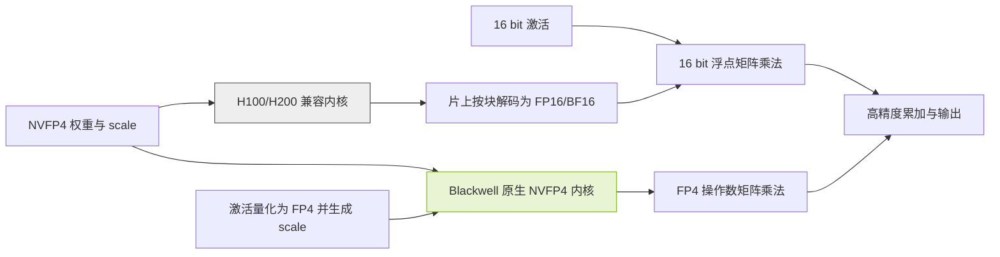

# 模型说自己是几位，GPU 就按几位算吗？三款大型 MoE 的组件精度与部署对照

[](#六种组合怎么选)
[](#逐组件精度大全表)
[](#证据边界)
[](#证据边界)

作者：魏新宇（Xinyu Wei） · [English](README.md)

## 目的

在[之前的公众号文章](https://mp.weixin.qq.com/s/2gyeCYu13PH_dGLUV3gryA)中，我们把问题落到了一个判断点：**模型文件写的是存储格式，Tensor Core 接收的操作数才说明矩阵乘法的输入精度。** 本篇沿这条线继续，回答 Muse Spark Open、Nemotron 3 Ultra 和 Inkling 的具体部署问题：模型叫 BF16、FP8 或 NVFP4 时，各组件究竟是什么精度？把 NVFP4 权重放到 H100 上，又会发生什么？

这里先解释位宽，再比较模型结构，随后用一张完整表对齐权重、激活、算子和缓存，最后给出部署条件与验收步骤。不涉及价格、云区域供应或性能排名。**本文是公开资料与配置分析，所有模型推理均未在本项目执行。**

### 从一个具体例子理解位宽

以 Nemotron 3 Ultra 的原厂 NVFP4 版本为例：导出规则将路由专家设为 NVFP4，却把共享专家和 Mamba 投影设为 FP8，并排除了 router/gate；官方 vLLM 示例又单独指定 FP8 KV cache 和 FP16 Mamba 状态 [N2][N3]。因此，“这个模型是 4 位”不能回答组件精度，更不能直接决定 GPU 数量。

| 要问的精度 | 真正需要确认的内容 | 典型误解 |
|---|---|---|
| 权重存储 | 数值编码、分组 scale、zero point、混合精度例外 | NVFP4 文件里所有张量都是 4 bit |
| 激活 | 某个算子的输入、输出是否动态量化 | 权重 FP8，所以所有中间值都是 FP8 |
| 矩阵乘法 | 两个乘数进入实际内核时的类型 | 权重存 INT4，GPU 就执行 INT4 乘法 |
| 累加与输出 | 累加器、归约和返回张量的类型 | FP4 乘法也在 FP4 中完成全部累加 |
| 缓存与状态 | K、V、Mamba、短卷积等各自的存储与读取规则 | 缓存精度自动等于权重精度 |

BF16 与 FP16 都占 16 bit，但指数与尾数分配不同，不是同一个数据类型。本文三个原厂基线都是 BF16，不另造“官方 FP16 版”。`W4A16` 和 `W8A8` 只说明权重与激活位宽，不能代替 INT4、FP8 E4M3、NVFP4 等具体编码及内核说明。

AWQ、GPTQ、GSQ 是求取低精度权重的方法；GGUF 是文件格式，`Q4_K_M` 等是量化编码或混合精度预设。这些名称不能与 NVFP4 硬件路径直接排成一条优劣顺序。NVFP4 使用 E2M1 数值、每 16 个数的 FP8 块缩放以及 FP32 全局缩放；即使数值字段是 4 bit，包含块 scale 后也不是每个数只占 4 bit [H1]。


来源：NVIDIA，《Introducing NVFP4 for Efficient and Accurate Low-Precision Inference》，Figure 2 [H1]，原始 GIF，未改图。看点是数值位宽与两级缩放分开保存；该图不证明某个模型所有模块都用 NVFP4，也不是本项目性能结果。

### 模型与版本先对齐

| 模型 | 发布方标称总参数 | 每 token 激活参数 | 架构中影响部署的部分 | 正式权重与访问条件 |
|---|---:|---:|---|---|
| Muse Spark Open | 816B | 42B | 多模态 MoE Transformer；感知编码器；62 层语言骨干、256 个专家、每 token 选择 8 个 | Meta 的 BF16 与 NVFP4；需要按 Muse Model License 申请权重访问 [M1][M2] |
| NVIDIA Nemotron 3 Ultra | 550B | 55B | Mamba-2、Attention、LatentMoE 混合；另有 MTP | NVIDIA 的 BF16 与 NVFP4；OpenMDW-1.1 [N1][N2] |
| Inkling | 975B | 41B | 66 层；局部与全局 Attention；短卷积；256 个路由专家及 2 个共享专家；每 token 选择 6 个路由专家 | Thinking Machines Lab 的 BF16 与 NVFP4；Apache-2.0 [I1][I2] |

`B` 表示十亿参数，`A42B` 等表示每 token 激活参数，不是需要常驻的完整权重。MoE 通常仍需装载全部专家，或明确采用会增加传输和调度开销的卸载策略。不能按 42B、55B、41B 计算完整模型的权重显存。参数标签也不一定包括全部多模态组件、MTP 和导出额外张量，应以所选 revision 的实际文件和张量清单复核。

模型卡可读不等于已获得权重下载权限。Muse 的模型许可证还有分发标识与特定服务业务的额外条件，需按自己的交付方式审查；本文不代替许可证审查。

## 实现效果

### 逐组件精度大全表

**阅读约定：**“基线”表示保留该原始 checkpoint 的精度，不等于所有张量都为 BF16；三个 BF16 版本都能在公开元数据中看到 F32 张量。“未量化”只证明该配置排除量化，不替代逐张量 dtype 核查。“未核实”是明确缺口，不是缺省 BF16。“不适用”表示模型没有该组件。运算行写的是指定路径的机制或发布方声明，不是本项目的 profiler 结果。

原厂 BF16/NVFP4 六个版本及伙伴 FP8 三个版本的 revision 保存在 [model-evidence.json](data/model-evidence.json)。FP8 三列分别采用 AMD Quark 与 Red Hat AI 的指定衍生版本 [M8][N8][I8]，不泛指所有同名 FP8 文件；逐项来源与未核实条件必须随版本一起保留。

| 类别与组件/执行条件 | 模型：Muse Spark Open；版本：Meta BF16 | 模型：Muse Spark Open；版本：AMD FP8 | 模型：Muse Spark Open；版本：Meta NVFP4 | 模型：Nemotron 3 Ultra；版本：NVIDIA BF16 | 模型：Nemotron 3 Ultra；版本：Red Hat FP8 | 模型：Nemotron 3 Ultra；版本：NVIDIA NVFP4 | 模型：Inkling；版本：TML BF16 | 模型：Inkling；版本：Red Hat FP8 | 模型：Inkling；版本：TML NVFP4 |
|---|---|---|---|---|---|---|---|---|---|
| 权重：Token embedding | BF16 基线 [M1] | 保留基线 [M8] | 保留基线；原始配置需授权 [M3] | BF16 基线 [N1] | 未量化 [N8] | 未量化 [N3] | BF16 基线 [I1] | 保留基线 [I8] | BF16 [I3] |
| 权重：Attention Q/K/V/O 投影 | BF16 基线 [M1] | FP8 E4M3、逐通道 [M8] | 不属于专家量化；保留基线 [M3] | BF16 基线 [N1] | 符合 Linear 目标的层为 FP8 [N8] | 不在已核对的 FP8/NVFP4 规则中；基线 dtype 待逐张量核验 [N3] | BF16 基线 [I1] | 配置排除 `.attn` 子树；不按模型卡概述写成 FP8 [I9] | BF16 [I3] |
| 权重：Router/gate | 存储 dtype 待核；路由计算 FP32 [M4] | 模型卡称保留 BF16；计算另核 [M8] | 存储 dtype 待核；不能写 router=NVFP4 [M4] | 逐张量 dtype 待核 [N1] | `gate` 被排除 [N8] | `gate` 被排除 [N3] | BF16 [I3] | 保留基线 [I8] | BF16 [I3] |
| 权重：路由专家矩阵 | BF16 [M1] | FP8 E4M3、逐通道 [M8] | NVFP4；发布方只量化专家 [M3] | BF16 [N1] | FP8、逐通道 [N8] | NVFP4、group=16 [N3] | BF16 [I1] | FP8；早期层有排除 [I8] | NVFP4；配置还排除部分层 [I4] |
| 权重：共享专家矩阵 | 不适用：无共享专家 [M4] | 不适用 [M4] | 不适用 [M4] | BF16 基线 [N1] | 符合 Linear 目标的层为 FP8 [N8] | FP8 [N3] | BF16 [I3] | 保留基线 [I8] | BF16 [I3][I4] |
| 权重：专家前后降维/升维投影 | 保留基线 [M4] | 明确排除 [M8] | 保留基线 [M4] | LatentMoE 基线；逐张量核验 [N1] | 按 Linear 目标及排除列表核验 [N8] | latent projection 被排除；不视为 FP4 [N3] | 与前两者不同；不套用其投影配方 [I1] | 同左 [I8] | 同左 [I3] |
| 权重：Mamba 输入/输出投影 | 不适用 | 不适用 | 不适用 | BF16 基线 [N1] | 符合 Linear 目标的层为 FP8 [N8] | FP8 [N3] | 不适用 | 不适用 | 不适用 |
| 权重：Mamba 卷积/状态参数 | 不适用 | 不适用 | 不适用 | BF16/F32 基线，不能统称 BF16 [N1] | 卷积、bias 等被排除 [N8] | 卷积等被排除；逐张量 dtype 另核 [N3] | 不适用 | 不适用 | 不适用 |
| 权重：短卷积 sconv | 不适用 | 不适用 | 不适用 | 不适用：不是 Inkling sconv | 不适用 | 不适用 | BF16 [I3] | 不在 attention/专家 Linear 量化范围 [I8] | BF16 [I3] |
| 权重：Norm 与 bias | 基线，未逐张量核验 [M1] | 保留基线 [M8] | 保留基线 [M3] | 基线，可能含 F32 [N1] | norm/bias 排除 [N8] | 非专家规则不能推成 FP4 [N3] | 基线 [I1] | 保留基线 [I8] | BF16 为主，缓冲区另核 [I3] |
| 权重：视觉/音频编码器 | 有多模态组件，dtype 逐项核验 [M1] | 模型卡声明 BF16 保留 [M8] | 不属于专家量化；保留基线 [M3] | 不适用：文本模型 [N1] | 不适用 | 不适用 | 有多模态组件，保留基线 [I1] | 保留原精度 [I8] | 编码器被排除；逐张量 dtype 另核 [I4] |
| 权重：MTP/外部 draft | 外部 draft 独立核验 [M3] | 外部 draft 独立核验 | 外部 draft 独立核验 [M3] | 有 MTP，需核对共享权重 [N1] | 逐模块配方未单独核验 [N8] | 不能由主模型 NVFP4 名称推断 [N2] | MTP heads BF16 [I3] | MTP 单独配方未核验 [I8] | MTP heads BF16 [I3] |
| 权重：输出 head | BF16 基线 [M1] | `lm_head` 排除 [M8] | 保留基线 [M3] | BF16 基线 [N1] | `lm_head` 排除 [N8] | 非 FP8/NVFP4 规则，dtype 另核 [N3] | BF16 基线 [I1] | unembedding 保留基线 [I8] | BF16 [I3] |
| 激活：被量化的 Attention Linear 输入 | 16 bit 基线 | 动态逐 token FP8 [M8] | 非专家路径，不推断为 FP4 [M3] | 16 bit 基线 | 动态逐 token FP8 [N8] | 没有统一 FP4 结论 [N3] | 16 bit 基线 | `.attn` 被排除，不能继承通用 FP8 输入规则 [I9] | BF16 路径 [I3] |
| 激活：专家 Linear 输入，原生低精度路径 | 16 bit 基线 | 动态逐 token FP8 [M8] | 原生 FP4 内核时量化到 FP4；否则按后端 [V1] | 16 bit 基线 | 动态逐 token FP8 [N8] | 原生 NVFP4 路径时 FP4 [V1] | 16 bit 基线 | 动态逐 token FP8 [I8] | 原生 NVFP4 路径时 FP4；排除层另算 [I3][V1] |
| 激活：Router/残差 | 路由输入与残差 FP32（recipe）[M4] | 原始计算路径需核验，不能由权重 BF16 推断 [M8] | 路由输入与残差 FP32（recipe）[M4] | 不由 BF16 名称推断；按实现 | 不随专家一起压到 FP8 [N8] | 不随专家一起压到 FP4 [N3] | 按实现核验 | 不随专家一起量化 [I8] | 不随专家一起量化 [I3] |
| 运算：专家 GEMM，Blackwell 原生后端 | BF16 操作数 | AMD 发布路径；不可直接承诺 CUDA 支持 [M8] | FP4 操作数及块 scale [V1] | BF16 操作数 | 支持的 FP8 内核时为 FP8 | FP4 操作数及块 scale [V1] | BF16 操作数 | 支持的 FP8 内核时为 FP8 | FP4 操作数及块 scale；排除层保留基线 [I3] |
| 运算：专家 GEMM，H100/H200 兼容后端 | BF16；容量另核 | 发布方列 AMD 硬件；Hopper 路径未核验 [M8] | 无原生 FP4；Meta 列 H200，具体后端另核 [M3] | BF16；容量另核 [N1] | 支持的 FP8 内核时为 FP8 | 兼容 W4A16；必须核对 MoE 内核 [N2][V1] | BF16；多节点另核 [I3] | 支持的 FP8 内核时为 FP8 | recipe 声明专家现场解码为 BF16；明确示例为 H200 [I3] |
| 运算：累加与输出 | 高于低比特输入；按内核核验 | 不等于全 FP8 | 不等于 FP4 累加/输出 [H1] | 按内核核验 | 不等于全 FP8 | 不等于 FP4 累加/输出 [H1] | 按内核核验 | 不等于全 FP8 | 不等于 FP4 累加/输出 [H1] |
| KV Cache：K 存储 | 运行时独立配置 | 未由 FP8 权重配方确认 | 运行时独立配置 | 按示例选择；不是唯一默认 [N1] | 未显式量化；运行时另设 [N8] | 官方 vLLM 示例 FP8 [N2] | 运行时独立配置 | 不由权重配方确认 [I8] | 导出声明 `none`；运行时可另设 [I4] |
| KV Cache：V 存储 | 运行时独立配置 | 未由 FP8 权重配方确认 | 运行时独立配置 | 按示例选择；不是唯一默认 [N1] | 未显式量化；运行时另设 [N8] | 官方 vLLM 示例 FP8 [N2] | 运行时独立配置 | 不由权重配方确认 [I8] | 导出声明 `none`；运行时可另设 [I4] |
| KV Cache：scale 与 Attention 计算 | 取决于 KV dtype、量化 scale 和后端 | 同左；QKV 投影 FP8 不等于 Attention 点积 FP8 | 同左；权重 FP4 不决定 KV 精度 | 取决于 KV dtype 和后端 | 同左 | FP8 缓存不独立证明全 Attention 在 FP8 中计算 [V2] | 还需区分局部/全局层 [I3] | 同左 | 同左 |
| 其他缓存：Mamba SSM | 不适用 | 不适用 | 不适用 | 官方示例 FP16 + 随机舍入 [N1] | 官方示例 FP16 + 随机舍入 [N8] | 官方示例 FP16 + 随机舍入 [N2] | 不适用 | 不适用 | 不适用 |
| 其他缓存：短卷积状态 | 不适用 | 不适用 | 不适用 | 不适用 | 不适用 | 不适用 | 存在；dtype 需运行配置确认 [I3] | 存在；不能算作统一 FP8 KV | 存在；不能算作 NVFP4 KV [I3] |
| 验收状态 | 未实测 | 未实测 | 未实测；原始配置访问受限 | 未实测 | 未实测 | 配置已核对，推理未实测 | 未实测 | 未实测；需指定集成版本 | 配置已核对，推理未实测 |

`router` 是决定把 token 交给谁的模块，`routed experts` 是执行专家计算的模块。写成“router 用 NVFP4”会把这两个对象颠倒。对 Nemotron，本次读取的是实际发布的量化配置，而非由模型结构猜测。

同一份 Nemotron 配置中，共核对到 49,344 条模块量化规则：49,152 条路由专家规则为 NVFP4，96 条共享专家规则为 FP8，48 条 Mamba 输入投影与 48 条输出投影规则为 FP8。**这些是配置条目数，不是参数量、运行次数或性能结果。** Inkling 则采用全局 NVFP4 配置加排除列表，其中包含 `model.llm.layers.2.mlp.experts`；不能因缺少逐模块字典而判定它没有量化，也不能省略排除项 [I4]。

### H100 到底怎样执行 NVFP4

以支持的 W4A16 兼容内核为例，流程是：读取打包的 FP4 权重及 scale，按块在片上解码为 FP16/BF16，和 16 bit 激活做矩阵乘法，再以该内核规定的累加、归约与输出精度返回结果。高效融合内核不需要先把整个模型展开后写回显存；但不是所有加载器都保留同一种内存布局，实际占用必须实测。

$$
\widehat W_g = s_{\mathrm{tensor}}\,s_g\,q_g,\qquad Y\approx X_{16}\widehat W_{16}.
$$

这里 `q_g` 是 E2M1 近似值，`s_g` 是块 scale。解码得到的是已量化的近似权重，**不是原始 BF16 权重恢复原状**。H100 的 FP8 能力也不会自动把这个路径变成 FP8，更不会变成原生 FP4。对 MoE，要单独确认被选中的专家内核，不能拿一个 Linear 层支持 Marlin 就替所有 MoE 算子背书。



原创解释图：将 NVIDIA 的格式说明、vLLM 的兼容选择规则和模型 recipe 放在同一张路径图中 [H1][V1][I3]。图展示机制与条件，不是执行 trace。Blackwell 分支只有在确实选中原生内核时成立；模型仍可包含 BF16/FP8 的其他模块。

### 六种组合怎么选

| 模型 | 权重版本 | 有来源的候选起点 | 不能据此承诺 |
|---|---|---|---|
| Muse Spark Open | BF16 | Meta 模型卡给出约 2 TB VRAM 量级 [M1] | 不是单卡规格或目标并发保证 |
| Muse Spark Open | NVFP4 | Meta 列四张 Blackwell Ultra 或八张 H200；vLLM recipe 默认八卡 Blackwell [M3][M4] | 不把两份不同部署配方合成唯一“最低卡数” |
| Nemotron 3 Ultra | BF16 | 模型卡摘要列 16 张 H100、8 张 H200 或 8 张 B200 [N1] | 不是最大上下文加目标并发的容量保证 |
| Nemotron 3 Ultra | NVFP4 | 模型卡列四张 B200/GB200 等与八张 H100 [N2] | H100 不能获得原生 FP4 算力，且引擎支持不同 |
| Inkling | BF16 | 官方确认 BF16；vLLM recipe 的 Hopper 路径需要多节点 [I1][I3] | 总显存相加不证明专家布局和通信可行 |
| Inkling | NVFP4 | vLLM recipe 列四张 GB200、八张 H200 路径 [I3] | 不外推成四张任意 Blackwell 或八张任意 Hopper |

先以同模型 BF16 建立业务质量基线。NVFP4 和伙伴 FP8 都只是候选；当精度、模态、工具调用或兼容内核未通过验收时，不为减少权重体积而直接替换生产版本。AMD Muse FP8 模型卡的 Deployment 仍写 `Todo`，因此它证明配方与硬件声明，不构成本项目可直接复跑的部署教程 [M8]。

### 权重、计算、缓存是三份不同的配置

| 问题 | 应检查的对象 | 不能使用的替代判断 |
|---|---|---|
| 权重以什么格式保存 | checkpoint revision、张量类型、量化配置、缩放与排除列表 | 模型名字里写着 NVFP4 |
| 矩阵乘法用什么输入精度 | 所选 GPU、实际内核、转换步骤与运行日志 | GPU 能加载这个文件 |
| 缓存用什么精度 | KV cache、Mamba 状态或短卷积状态的独立设置 | 权重是 NVFP4，所以缓存也是 NVFP4 |
| 输出与累加是什么精度 | 内核和算子实现 | 两个乘数是 FP4，所以累加和输出也是 FP4 |

H100/H200 没有 Blackwell 的原生 NVFP4 Tensor Core 计算路径。支持的兼容内核可以在片上把低比特权重转换成 FP16/BF16 后计算，仍可能节省权重存储与读取带宽，但不是原生 FP4 乘法。转换只解码近似值，不恢复量化前丢失的精度。vLLM 明确区分 `NVFP4` 和 `W4A16_NVFP4`，并说明缺少原生 FP4 GEMM 时的 W4A16 回退 [V1]。

Nemotron 的官方 vLLM 示例将 KV cache 设置为 FP8，将 Mamba SSM 状态设置为 FP16，并启用随机舍入 [N2]。因此“缓存都是 FP8 或 FP32”不是该模型的通用结论。Inkling 还有短卷积状态；不能用 Nemotron 的 Mamba 状态公式估算它。

AMD MI350 系列支持 MXFP4，包括 MI350X 和 MI355X；NVFP4 与 MXFP4 的块缩放规则不同，不能当作同一份权重的无条件互换格式 [H2][H3]。Inkling 的 recipe 另列了 `lightseekorg/Inkling-MXFP4` 和 MI355X 原生、MI300X 模拟路径，那是**另一个发布者的 checkpoint 与另一条执行路径**，不是把官方 NVFP4 行直接改名 [I3]。

### 资源怎样估算

先算权重的量级，再加入缓存、工作区、并行复制和余量；不能用一个固定百分比替代实际测量。

我们从六个固定 revision 的公开逐 dtype 张量计数复算得到下面的负载。**这是张量数据字节，不是完整下载大小或峰值显存。** 输入在 [model-evidence.json](data/model-evidence.json)，计算入口为 `node tools/inspect.mjs`；scale 和打包 U8 张量按实际存储类型计数，不把压缩元素数当原始参数量。

| 模型 | 权重版本 | 张量数据负载（十进制 GB） | 张量数据负载（二进制 GiB） |
|---|---|---:|---:|
| Muse Spark Open | BF16 | 1644.333 | 1531.405 |
| Muse Spark Open | NVFP4 | 533.011 | 496.405 |
| Nemotron 3 Ultra | BF16 | 1121.049 | 1044.058 |
| Nemotron 3 Ultra | NVFP4 | 320.071 | 298.090 |
| Inkling | BF16 | 1904.755 | 1773.942 |
| Inkling | NVFP4 | 592.005 | 551.348 |

计算只覆盖公开元数据列出的张量，不含文件头、非张量文件、KV/状态缓存、临时工作区或通信缓冲。Nemotron BF16 的 API 总元素字段与逐 dtype 求和有差异，工具保留并报告该差异，不改原数据；更多边界见[验证说明](VALIDATION_CN.md)。

$$
M_{\text{peak}} = M_{\text{weights}} + M_{\text{KV}} + M_{\text{state}} + M_{\text{workspace}} + M_{\text{communication}} + M_{\text{other}}.
$$

下表只用模型卡的标称总参数做**假设性权重计算**，使用十进制 GB，不是下载文件大小、实际显存占用或 GPU 数量建议。NVFP4 一列假设所有参数都采用 4 bit 数值加每 16 个数一个 8 bit 块缩放，即 4.5 bit/参数；真实模型包含更高精度模块、额外缩放及元数据，因此不能直接按这一列配卡 [H2]。

| 模型 | 计算输入：总参数 | 假设全 BF16 的权重负载 | 假设全 NVFP4、含块缩放的权重负载 |
|---|---:|---:|---:|
| Muse Spark Open | 816B | 1,632 GB | 459.0 GB |
| Nemotron 3 Ultra | 550B | 1,100 GB | 309.375 GB |
| Inkling | 975B | 1,950 GB | 548.4375 GB |

计算方法分别为 `参数量 × 2 字节` 与 `参数量 × (4 + 8/16) / 8 字节`。这也解释了为什么不能将 Meta 给出的约 700 GB NVFP4 部署门槛替换为纸面 459 GB：两者口径不同，前者是发布方部署说明，后者只是理想化权重编码计算，不能反推差额全由某个组件造成。

对于标准全 Attention 层，KV cache 的基本估算为：

$$
M_{\text{KV}} \approx 2\,N_{\text{layers}}\,N_{\text{KV heads}}\,D_{\text{head}}\,T_{\text{resident}}\,b_{\text{element}}.
$$

`T_resident` 是所有常驻请求已保留 token 的总数，而非只有一个请求的上下文上限。局部 Attention、缓存复用、张量并行复制、分页、量化 scale 和状态空间模型需要分别处理，不能把标准公式不加修改地套到三个模型。更长的上下文和更多并发都可能让缓存而非权重成为主要约束。

存储至少区分下载与缓存目录、运行使用的权重目录、转换中间文件和日志。不要凭标称参数给出固定磁盘数字；先读取所选 revision 的文件大小并确认是否需要同时保留 BF16 与 NVFP4 两份权重。

### 证据边界

检查日期：2026-11-01。本文采用发布方模型卡、实际配置和推理引擎文档，不用模型榜单或不同环境的历史测试拼成性能对比。大全表九列均未在本项目执行推理，吞吐、延迟、质量回归、长上下文稳定性和故障恢复均为 **NOT_RUN**。

Nemotron 模型卡同时存在训练配方、权重版本和引擎示例；本文只将明确的导出规则用于模块精度判断。它的模型卡概述中出现“NVFP4 KV caching”，但具体示例使用 FP8 KV cache，本文按可执行参数说明差异，而不将概述视为已验证的缓存能力。

Inkling recipe 同时出现 `vLLM 0.26.0+` 和 nightly 安装提示。前者不是对任意后续 wheel 的保证，后者也不是可复现版本。上线前必须固定实际提交或镜像摘要，并保存成功启动和业务测试记录。

Red Hat Inkling FP8 模型卡概述称 Attention Linear 也量化，但固定 revision 的配置包含 `re:.*\.attn$` 和 `re:.*\.attn\..*` 两条排除规则 [I9]。主表保留这个冲突，按配置不把 `.attn` 子树写成 FP8；实际模块名匹配和加载后 dtype 仍须在运行时验收。两个 Red Hat FP8 配置的 `output_activations` 与 `kv_cache_scheme` 都为空，因此也不能由 FP8 输入规则推断输出和 KV 缓存都是 FP8。

Muse 的详细模块精度、三模型在指定机器上的峰值显存与性能，以及许可证在具体业务模式下的适用性仍需核验。公开模型卡的广泛支持列表不替代某一引擎、精度和模态的完整验收。

## 操作步骤

### 先选可验证路径，再启动服务

| 顺序 | 在哪里 | 做什么 | 通过条件 |
|---|---|---|---|
| 1 | 权重仓库与许可证页 | 确认模型、BF16/NVFP4 版本、访问许可和固定 revision | 权重可合法取得，版本明确 |
| 2 | 目标硬件与引擎 | 选择同一模型的官方部署配方，固定 GPU、并行布局和引擎版本 | 所需模态、缓存和内核都有明确支持 |
| 3 | 容量规划 | 统计实际权重字节，按目标上下文与并发计算缓存，再预留工作区 | 每张卡与每个并行分组都有余量，不能只看总和 |
| 4 | 隔离验证环境 | 按官方配方启动，保存实际内核与缓存日志 | 模型加载、功能调用与数值检查都通过 |
| 5 | 业务验收环境 | 用同一模型 BF16 与 NVFP4 跑相同真实任务 | 质量、峰值显存、延迟与并发满足预先定义的要求 |
| 6 | 生产准备 | 固定镜像、权重、模板、回退方案和监控 | 新实例可重复部署；升级与回退有验证记录 |

部署入口：Muse 使用 Meta 的开发者指南 [M3]；Nemotron 使用相应 BF16/NVFP4 模型卡中的引擎示例 [N1][N2]；Inkling 使用发布方链接的 vLLM recipe [I3]。不要把不同模型的命令拼成一个通用启动脚本，也不要把示例中的上下文长度、并发和并行参数原样当作业务推荐值。

### 不下载权重复算公开元数据

需要 Node.js 20 或更高版本。在本目录的终端执行：

```bash
node tools/inspect.mjs
node --test tests/inspect.test.mjs
```

第一条命令从六个已保存版本的逐 dtype 元素数计算张量负载字节。测试检查版本覆盖、打包字节计算、明确保留的配置缺口和失败处理；两条命令都不调用模型，也不验证 GPU 数量。

要读取当前公开元数据而不是复算快照：

```bash
node tools/inspect.mjs --live
```

该命令调用公开 Hugging Face 模型 API，输出新 revision 并按返回数据重新计算；失败时不会用旧快照伪装成功，不下载权重、不申请权限，也不把旧量化配置的核验结果套到新 revision。结果不包含运行时缓存与工作区。

完整命令、预期语义及未执行项：[验证说明](VALIDATION_CN.md) · [Validation](VALIDATION.md)。数据与范围：[model-evidence.json](data/model-evidence.json)。主表的公开依据见本页来源表。

### 怎样判断真正能上生产

验收对象是完整组合：**模型 revision + 权重格式 + GPU 型号 + 推理引擎版本 + 计算内核 + 缓存设置 + 并行布局 + 请求负载**。改变其中一项，相关结果就需要重新核验。

必须覆盖实际使用的文本、图像、音频或视频任务、工具调用和结构化输出；用生产代表性输入检查长上下文与目标并发。记录正确率或业务评分、错误类型、峰值显存、首 token 延迟、生成延迟分布及服务吞吐。仅能返回一句话、通过健康检查或模型文件更小，都不等于生产验收通过。

BF16 是对照基线，不是对错误答案的保证；NVFP4 是候选格式，不是“天然无损”的承诺。若无客户任务、目标上下文和并发条件，最多给出上表这样的条件化建议，不给出假精确的实例数量或 SLA。

### 公开来源

| 编号 | 来源及检查范围 |
|---|---|
| M1 | [Meta Muse Spark Open BF16 模型卡](https://huggingface.co/meta-models/Muse-Spark-Open-816B-A42B)：模型身份、参数、访问条件与部署量级 |
| M2 | [Meta Muse Spark Open NVFP4 模型卡](https://huggingface.co/meta-models/Muse-Spark-Open-816B-A42B-NVFP4)：公开权重版本、部署量级与限制 |
| M3 | [Meta 开发者部署指南](https://dev.meta.ai/resources/blog/build-with-muse-spark-open)：专家量化范围与四卡 Blackwell Ultra/八卡 H200 声明；命令未执行 |
| M4 | [vLLM Muse recipe](https://recipes.vllm.ai/meta-models/Muse-Spark-Open-816B-A42B)：FP32 路由/残差、无共享专家、八卡 Blackwell 配方；AMD 例子为 text-only |
| M8 | [AMD Muse FP8](https://huggingface.co/amd/Muse-Spark-Open-816B-A42B-Quark-PTPC-FP8)：专家与 Attention 的逐通道权重、逐 token 激活和排除项 |
| N1 | [Nemotron 3 Ultra BF16 模型卡](https://huggingface.co/nvidia/NVIDIA-Nemotron-3-Ultra-550B-A55B-BF16)：模型、硬件摘要与各引擎限制 |
| N2 | [Nemotron 3 Ultra NVFP4 模型卡](https://huggingface.co/nvidia/NVIDIA-Nemotron-3-Ultra-550B-A55B-NVFP4)：硬件摘要、vLLM 与缓存示例 |
| N3 | [Nemotron NVFP4 导出配置](https://huggingface.co/nvidia/NVIDIA-Nemotron-3-Ultra-550B-A55B-NVFP4/blob/main/hf_quant_config.json)：`quantized_layers` 与 `exclude_modules`；网页过大时通过原始 JSON 读取 |
| N8 | [Red Hat Nemotron FP8-dynamic](https://huggingface.co/RedHatAI/NVIDIA-Nemotron-3-Ultra-550B-A55B-FP8-dynamic)：FP8 配方、ignore 列表和部署例子；不引用其榜单或元数据日期作本项目结果 |
| I1 | [Inkling BF16 模型卡](https://huggingface.co/thinkingmachines/Inkling)：模型、架构、精度与引擎入口 |
| I2 | [Inkling NVFP4 模型卡](https://huggingface.co/thinkingmachines/Inkling-NVFP4)：正式版本与许可 |
| I3 | [vLLM Inkling recipe](https://recipes.vllm.ai/thinkingmachines/Inkling)：混合精度、Blackwell/Hopper 路径、版本提示与缓存结构；发布方模型卡链接此页 |
| I4 | [Inkling 固定 revision 的量化配置](https://huggingface.co/thinkingmachines/Inkling-NVFP4/blob/42a75a99a40eb2ba1e0717db6357a0bf15205044/hf_quant_config.json)：全局 NVFP4、`kv_cache_quant_algo=none`、专家/编码器等排除项 |
| I8 | [Red Hat Inkling FP8-dynamic](https://huggingface.co/RedHatAI/Inkling-FP8-dynamic)：发布者、原模型与集成依赖；其 Attention 概述与配置冲突见 I9 |
| I9 | [Red Hat Inkling FP8 固定配置](https://huggingface.co/RedHatAI/Inkling-FP8-dynamic/blob/cb2bf130a5263e01d7398723ae9b88e0060f4998/config.json)：`ignore` 排除 `.attn`；`output_activations` 与 `kv_cache_scheme` 为空 |
| V1 | [vLLM 稳定版 Model Optimizer 支持](https://docs.vllm.ai/en/stable/features/quantization/modelopt/)：NVFP4、W4A16_NVFP4 与兼容内核选择 |
| V2 | [vLLM KV cache 文档](https://docs.vllm.ai/en/stable/features/quantization/quantized_kvcache/)：缓存存储、scale 与 Attention 计算路径的区别 |
| H1 | [NVIDIA NVFP4 说明](https://developer.nvidia.com/blog/introducing-nvfp4-for-efficient-and-accurate-low-precision-inference/)：E2M1、16 元素块、FP8 块 scale 与 FP32 tensor scale |
| H2 | [NVIDIA NVFP4 与 MXFP4 格式对照](https://developer.nvidia.com/blog/introducing-nvfp4-for-efficient-and-accurate-low-precision-inference/)：两种块缩放及 NVFP4 的编码开销 |
| H3 | [AMD Instinct MI350 系列](https://www.amd.com/en/products/accelerators/instinct/mi350.html)：MI350X/MI355X 的 MXFP4 支持 |

进一步阅读：[NVFP4](../NVFP4/)、[量化方法对比](../Quantization-Methods-Comparison-and-Practice/)、[大模型显存估算](../LLM-Memory-Estimation/)。这些目录解释通用方法或其他模型的历史结果，不能替代本文三款模型的验收。

[M1]: https://huggingface.co/meta-models/Muse-Spark-Open-816B-A42B
[M2]: https://huggingface.co/meta-models/Muse-Spark-Open-816B-A42B-NVFP4
[M3]: https://dev.meta.ai/resources/blog/build-with-muse-spark-open
[M4]: https://recipes.vllm.ai/meta-models/Muse-Spark-Open-816B-A42B
[M8]: https://huggingface.co/amd/Muse-Spark-Open-816B-A42B-Quark-PTPC-FP8
[N1]: https://huggingface.co/nvidia/NVIDIA-Nemotron-3-Ultra-550B-A55B-BF16
[N2]: https://huggingface.co/nvidia/NVIDIA-Nemotron-3-Ultra-550B-A55B-NVFP4
[N3]: https://huggingface.co/nvidia/NVIDIA-Nemotron-3-Ultra-550B-A55B-NVFP4/blob/02462641f13d3af838b904f48195b9bb8a1e4ebc/hf_quant_config.json
[N8]: https://huggingface.co/RedHatAI/NVIDIA-Nemotron-3-Ultra-550B-A55B-FP8-dynamic
[I1]: https://huggingface.co/thinkingmachines/Inkling
[I2]: https://huggingface.co/thinkingmachines/Inkling-NVFP4
[I3]: https://recipes.vllm.ai/thinkingmachines/Inkling
[I4]: https://huggingface.co/thinkingmachines/Inkling-NVFP4/blob/42a75a99a40eb2ba1e0717db6357a0bf15205044/hf_quant_config.json
[I8]: https://huggingface.co/RedHatAI/Inkling-FP8-dynamic
[I9]: https://huggingface.co/RedHatAI/Inkling-FP8-dynamic/blob/cb2bf130a5263e01d7398723ae9b88e0060f4998/config.json
[V1]: https://docs.vllm.ai/en/stable/features/quantization/modelopt/
[V2]: https://docs.vllm.ai/en/stable/features/quantization/quantized_kvcache/
[H1]: https://developer.nvidia.com/blog/introducing-nvfp4-for-efficient-and-accurate-low-precision-inference/
[H2]: https://developer.nvidia.com/blog/introducing-nvfp4-for-efficient-and-accurate-low-precision-inference/
[H3]: https://www.amd.com/en/products/accelerators/instinct/mi350.html