# 大型 MoE 模型组件精度与部署指南

[](#先看结论)
[](#逐模型组件精度)
[](#证据边界)
[](#mi300x-实测)
[](https://github.com/david-xinyuwei/david-share/actions/workflows/large-moe-precision-guide-ci.yml)

作者：魏新宇（Xinyu Wei） · [English](README.md)

## 目的

本指南帮助读者核对三个大型 MoE 模型的组件精度，并判断目标硬件和推理引擎能否运行所选版本。模型包括 Muse Spark Open 816B-A42B、NVIDIA Nemotron 3 Ultra 550B-A55B 和 Inkling 975B；版本包括原厂 BF16、原厂 NVFP4，以及指定的伙伴 FP8 版本。

文中提供组件精度表、固定权重版本与配置证据、显存估算工具和复现步骤。**精度研究实际运行过三个模型的 BF16 版本，以及 Inkling、Nemotron 的 MXFP4 模拟路径；Muse 的 MXFP4 路径在初始化时失败。** 精度说明、配置检查和实测结果分别标注，不能相互替代。生产验收仍需使用目标环境和业务输入；本文不评估区域供应或真实账单。

两台 MI300X 节点还用来比较并行策略。**对 Muse BF16，vLLM recipe 页面在 MI300X 上提供、且能放进两个节点的策略都按页面生成的命令（含 MI300X 适配）运行，输出上限足以让回答自然结束（2,286 条中 2,266 条自然结束）：TP8 × PP2 在每个测量点的单请求速度都最快；TP16 + EP 慢于 TP16，与页面的 AMD BF16 提示一致；页面给 TP16 的“Latency oriented”标签没有成立**（[结果](#muse-selectable)）。TP16 慢的原因不是 InfiniBand 带宽：并发 1 时它每个 token 比 TP8 × PP2 多用 4.4 ms，而这个 token 的 11.4 MB 跨节点数据按链路速率只需 28 µs；多出的时间指向约 126 次逐次等待的跨节点同步（次数按源码估算，见[时间账](#muse-time-budget)）。另以 **Qwen3-235B-A22B-Instruct-2507 BF16** 做的五布局实验，在 Spot 驱逐中断初轮后，于恢复轮执行了全部五种策略（[初轮](#qwen-fiveway)、[恢复轮](#qwen-recovery)），其结果与 Muse 分开归属。文中 Spot 价格只是测试时点参考，不是账单或区域供应评估。

### 先看结论

三个模型的 BF16 权重约为 1.1–1.9 TB，单卡无法容纳。MoE 每个 token 只激活部分专家，但部署时通常仍要让全部专家权重常驻显存。

下表区分两类信息：发布方给出的部署配置，以及本项目 2026-11-02 在 Azure MI300X（每卡 192 GB，vLLM ROCm）上的实测结果。实测覆盖 BF16 和 MXFP4 模拟路径，不构成最低卡数或并发保证。速度为并发 1 时的单请求解码速度，单位 tok/s，取 3 次请求的中位数。原厂 NVFP4 版本未在 MI300X 上部署，其组件精度另列于下文。

| 模型 | 发布方给出的起点与边界 | 本项目实测：<br>原厂 BF16 | 本项目实测：<br>MXFP4<br>（模拟内核，<br>1 节点 8 卡） |
|---|---|---|---|
| Muse Spark Open | BF16：Meta 模型卡给出约 2 TB VRAM 量级 [M1]。<br>NVFP4：四张 Blackwell Ultra 或八张 H200，vLLM recipe 默认八卡 Blackwell [M3][M4]。<br>两份配方不能合成唯一“最低卡数”。 | **通过**：<br>2 节点 16 卡，TP8 × PP2；<br>每卡权重 99.1 GiB；<br>84.6 tok/s<br>（第 3 次尝试，v0.33.0 镜像）[T2] | **失败**：<br>两次尝试都在加载权重前退出——Muse 的 ROCm 代码要求 `AITER_MXFP4_MXFP4` 后端，<br>MI300X 上 vLLM 选中的是 `EMULATION`，被模型代码拒绝 [T3] |
| Nemotron 3 Ultra | BF16：模型卡摘要列 16 张 H100、8 张 H200 或 8 张 B200 [N1]。<br>NVFP4：四张 B200/GB200 等与八张 H100 [N2]；H100 没有原生 FP4 算力。 | **通过**：<br>1 节点 8 卡，TP8 + EP；<br>每卡权重 136.51 GiB；<br>60.7 tok/s<br>（第 3 次尝试）[T2] | **通过**：<br>BF16 权重加载时在线量化为 MXFP4（vLLM 官方 `--quantization online`），TP8 + EP8；<br>每卡权重 43.21 GiB；<br>最终答案正确；<br>7.7 tok/s [T3] |
| Inkling | BF16：官方发布；vLLM recipe 的 Hopper 路径需要多节点 [I1][I3]。<br>NVFP4：四张 GB200、八张 H200 [I3]。<br>总显存相加不证明专家布局和通信可行。 | **通过**：<br>2 节点 16 卡，TP8 × PP2；<br>每卡权重 109.52 / 116.12 GiB（两个流水级）；<br>68.9 tok/s<br>（第 6 次尝试）[T2] | **通过**：<br>社区 Quark MXFP4 checkpoint `lightseekorg/Inkling-MXFP4`（recipe 列出的 MI300X 模拟路径 [I3]），TP8；<br>每卡权重 66.74 GiB；<br>最终答案正确；<br>6.1 tok/s [T3] |

- **显存更省，不代表运行更快。** 两个通过的 MXFP4 部署使用 `EMULATION`：权重以 MXFP4 存储，计算前反量化。Nemotron 每卡权重从 136.51 GiB 降到 43.21 GiB，Inkling 从 16 卡减到 8 卡；单请求解码只有 6–8 tok/s。两轮的镜像、图捕获设置和卡数并不完全相同，不能把速度差全部归因于量化。
- **通过启动与回答检查，不等于通过质量验收。** 三个伙伴 FP8 版本只核对了配置，没有加载到 GPU [M8][N8][I8]。AMD Muse FP8 模型卡的 Deployment 仍为 `Todo`，不能作为已经验证的部署教程 [M8]。
- **生产选型还需业务验证。** 先用同模型 BF16 版本建立质量参照，再核对量化版本的精度、模态、工具调用和内核兼容性。不能仅因权重更小就替换生产版本。

内核、缓存、显存和速度的详细记录见 [MI300X 实测](#mi300x-实测)及 [MXFP4 低精度路径](#mxfp4-低精度路径)。

### 模型范围

| 模型 | 总参数<br>十亿 | 激活参数<br>十亿/token |
|---|---:|---:|
| Muse Spark Open | 816 | 42 |
| Nemotron 3 Ultra | 550 | 55 |
| Inkling | 975 | 41 |

- **Muse Spark Open**：多模态 MoE Transformer 和感知编码器；语言骨干 62 层、256 个专家、每 token 选择 8 个。Meta 发布 BF16/NVFP4 权重，访问需按 Muse Model License 申请 [M1][M2]。
- **Nemotron 3 Ultra**：Mamba-2、Attention、LatentMoE 混合架构及 MTP。NVIDIA 发布 BF16/NVFP4 权重，许可为 OpenMDW-1.1 [N1][N2]。
- **Inkling**：66 层局部/全局 Attention 与短卷积；256 个路由专家、2 个共享专家，每 token 选择 6 个路由专家。Thinking Machines Lab 发布 BF16/NVFP4 权重，许可为 Apache-2.0 [I1][I2]。

`B` 表示十亿参数，`A42B` 等表示每 token 激活参数，不是需要常驻的完整权重。MoE 通常仍需装载全部专家，或明确采用会增加传输和调度开销的卸载策略。不能按 42B、55B、41B 计算完整模型的权重显存。参数标签也不一定包括全部多模态组件、MTP 和导出额外张量，应以所选 revision 的实际文件和张量清单复核。

模型卡可读不等于已获得权重下载权限。Muse 的模型许可证还有分发标识与特定服务业务的额外条件，需按自己的交付方式审查；本文不代替许可证审查。

### 精度定义与配置范围

以 Nemotron 3 Ultra 的原厂 NVFP4 版本为例：导出规则将路由专家设为 NVFP4，却把共享专家和 Mamba 投影设为 FP8，并排除了 router/gate；官方 vLLM 示例又单独指定 FP8 KV cache 和 FP16 Mamba 状态 [N2][N3]。因此，“这个模型是 4 位”不能回答组件精度，更不能直接决定 GPU 数量。

| 精度类别 | 检查对象与判断边界 |
|---|---|
| 权重存储 | 检查数值编码、分组 scale、zero point 和混合精度例外。NVFP4 文件不表示所有张量都是 4 bit。 |
| 激活 | 检查各算子的输入、输出量化规则。权重 FP8 不表示所有中间值都是 FP8。 |
| 矩阵乘法 | 检查两个乘数进入实际内核时的类型。权重存 INT4 不表示 GPU 执行原生 INT4 乘法。 |
| 累加与输出 | 检查累加器、归约和返回张量的类型。FP4 乘数不表示全部累加在 FP4 中完成。 |
| 缓存与状态 | 分别检查 K、V、Mamba 和短卷积设置。缓存精度不自动跟随权重精度。 |

BF16 与 FP16 都占 16 bit，但指数与尾数分配不同，不是同一个数据类型。本文三个原厂基线都是 BF16，不另造“官方 FP16 版”。`W4A16` 和 `W8A8` 只说明权重与激活位宽，不能代替 INT4、FP8 E4M3、NVFP4 等具体编码及内核说明。

AWQ、GPTQ、GSQ 是求取低精度权重的方法；GGUF 是文件格式，`Q4_K_M` 等是量化编码或混合精度预设。这些名称不能与 NVFP4 硬件路径直接排成一条优劣顺序。NVFP4 使用 E2M1 数值、每 16 个数的 FP8 块缩放以及 FP32 全局缩放；即使数值字段是 4 bit，包含块 scale 后也不是每个数只占 4 bit [H1]。


来源：NVIDIA，《Introducing NVFP4 for Efficient and Accurate Low-Precision Inference》，Figure 2 [H1]。原图是逐步绘制的 GIF，这里取其最后一帧（三部分全部画出）作为静态图，像素未改。看点是数值位宽与两级缩放分开保存；该图不证明某个模型所有模块都用 NVFP4，也不是本项目性能结果。

## 实现效果

### 逐模型组件精度

三张表采用相同的 25 个检查项，分别列出权重、激活、计算和缓存精度。列头表示发布版本，不表示该版本的所有组件都采用同一种精度。

表中用语：

| 用语 | 含义 |
|---|---|
| BF16 / FP32 | 两种可能的张量类型；标注“未逐项确认”时，不表示已确定每个张量的 dtype |
| 排除量化 | 导出配置里的明确排除规则；不自动等于 BF16 |
| 按运行配置 | 由启动参数及推理后端决定，checkpoint 不规定 |
| N/A | 模型没有该组件；不同于尚未验证 |
| 实测 [T1] | 读取固定 revision 全部 safetensors 文件头得到的张量 dtype，不读权重数据 |
| MI300X 实测 [T2] | 2026-11-02 在 MI300X 上 vLLM 实际选中的内核、缓存 dtype 与启动参数 |

表后的配置说明列出权限限制、来源冲突和需要读取的参数，不以缺省值填充证据空缺。

九个发布版本的 revision 与配置摘要保存在 [model-evidence.json](data/model-evidence.json)。下表中的 FP8 分别指 AMD Quark 和 Red Hat AI 的指定版本 [M8][N8][I8]，不代表所有同名 FP8 文件。

#### Muse Spark Open

发布版本：Meta BF16、NVFP4；AMD Quark FP8 [M1][M2][M8]。

Muse 采用 Attention + MoE 架构，没有共享专家、Mamba 层和短卷积。对应的 6 行以 `N/A` 标识 [M4]。

| 组件 | BF16 | FP8 | NVFP4 |
|---|---|---|---|
| 权重：词嵌入 | BF16 [M1] | BF16（配置）[M8] | BF16（按专家外不量化推断）[M3] |
| 权重：注意力投影 | BF16 [M1] | FP8 [M8] | BF16（按专家外不量化推断）[M3] |
| 权重：路由器 | 计算用 FP32；权重存储 dtype 未公开 [M4] | BF16 声明 [M8] | 计算用 FP32；权重存储 dtype 未公开 [M4] |
| 权重：路由专家 | BF16 [M1] | FP8 [M8] | NVFP4 [M3] |
| 权重：共享专家 | N/A [M4] | N/A [M4] | N/A [M4] |
| 权重：专家前后投影 | BF16 / FP32，未逐项确认 [M4] | 排除量化 [M8] | BF16 / FP32，未逐项确认 [M4] |
| 权重：Mamba 投影 | N/A | N/A | N/A |
| 权重：Mamba 状态参数 | N/A | N/A | N/A |
| 权重：短卷积 | N/A | N/A | N/A |
| 权重：归一化与偏置 | BF16 / FP32，未逐项确认 [M1] | BF16 / FP32，未逐项确认 [M8] | BF16 / FP32，未逐项确认 [M3] |
| 权重：视觉与音频 | BF16 / FP32，未逐项确认 [M1] | BF16 声明 [M8] | BF16 / FP32，未逐项确认 [M3] |
| 权重：预测辅助模型 | 独立权重 [M3] | 独立权重 | 独立权重 [M3] |
| 权重：输出层 | BF16 [M1] | 排除量化 [M8] | BF16（按专家外不量化推断）[M3] |
| 激活：注意力投影输入 | BF16，MI300X 实测 [T2] | 动态 FP8 [M8] | 由运行 dtype 决定，未固定 [M3] |
| 激活：专家输入 | BF16，MI300X 实测 [T2] | 动态 FP8 [M8] | 依内核选 FP4 / 16 bit [V1] |
| 激活：路由与残差 | FP32 [M4] | 按实现 [M8] | FP32 [M4] |
| 运算：Blackwell 专家 | BF16 | 发布路径为 AMD [M8] | 原生 FP4 [V1] |
| 运算：Hopper / MI300X 专家 | BF16；MI300X 实测使用 Triton 专家内核，名称见表后 [T2] | CUDA 支持另验 [M8] | H200 兼容路径 [M3] |
| 运算：累加与输出 | 按内核 | 非由 FP8 决定 | 高于 FP4 [H1] |
| K 缓存 | BF16，自动随权重，MI300X 实测 [T2] | 按运行配置 | 按运行配置 |
| V 缓存 | BF16（同上），MI300X 实测 [T2] | 按运行配置 | 按运行配置 |
| 缓存缩放与注意力 | AITER 注意力及融合内核，名称见表后；MI300X 实测 [T2] | 按后端 | 按后端 |
| Mamba 状态缓存 | N/A | N/A | N/A |
| 短卷积状态缓存 | N/A | N/A | N/A |
| 推理验收 | MI300X 2 × 8 卡 smoke 通过（TP8 × PP2，v0.33.0 镜像，纯文本） [T2] | 尚未执行 | 配置已解析，推理未执行 |

**配置说明。** Meta 公开说明只量化专家 [M3]；vLLM recipe 明确路由计算及残差使用 FP32，但没有单独给出 router 权重的存储 dtype [M4]，所以表中路由器一格写“计算用 FP32；权重存储 dtype 未公开”，不把两者混写。原厂 NVFP4 配置的匿名读取返回 401，需要授权后读取对应 revision；此访问限制不影响引用已公开的模型卡。AMD 模型卡声明路由、编码器及输出层保留 BF16，专家和注意力权重使用静态逐通道 FP8 E4M3、输入使用动态逐 token FP8 [M8]；其 Deployment 段仍为 `Todo`，不作为 CUDA 部署证明。

Muse 没有共享专家 [M4]。辅助预测使用独立的 draft checkpoint，其精度和内存须按该 checkpoint 另行记录。K/V dtype、scale 和注意力计算由运行参数及后端确定；QKV 投影使用 FP8，并不意味着 Attention 点积也使用 FP8。

本次 MI300X 的完整运行标识：输入参数 `--dtype bfloat16`；专家后端 `MuseSparkTritonExperts`；缓存设置 `kv_cache_dtype=auto`，随权重选择 BF16；注意力后端 `ROCM_AITER_FA`，配融合 qk-norm/rope/kv-insert 内核。

#### NVIDIA Nemotron 3 Ultra

发布版本：NVIDIA BF16、NVFP4；Red Hat AI FP8 [N1][N2][N8]。

Nemotron 使用 Mamba-2，没有 Inkling 式短卷积，也没有视觉或音频编码器。对应的 3 行以 `N/A` 标识 [N1]。

| 组件 | BF16 | FP8 | NVFP4 |
|---|---|---|---|
| 权重：词嵌入 | BF16，实测 [T1] | 排除量化 [N8] | 排除量化 [N3] |
| 权重：注意力投影 | BF16，实测 [T1] | FP8 目标层 [N8] | 不在低精度规则中 [N3] |
| 权重：路由器 | 权重 BF16；校正偏置 F32，实测，张量名见表后 [T1] | 排除量化 [N8] | 排除量化 [N3] |
| 权重：路由专家 | BF16，49,152 个张量，实测 [T1] | FP8 [N8] | NVFP4 [N3] |
| 权重：共享专家 | BF16，实测 [T1] | FP8 目标层 [N8] | FP8 [N3] |
| 权重：潜空间投影 | BF16，实测 [T1] | 按目标与排除规则 [N8] | 排除量化 [N3] |
| 权重：Mamba 投影 | BF16，实测 [T1] | FP8 目标层 [N8] | FP8 [N3] |
| 权重：Mamba 状态参数 | `A_log` / `D` / `dt_bias` / `conv1d` 全部 BF16，实测 [T1] | 卷积等排除 [N8] | 卷积等排除 [N3] |
| 权重：Inkling 短卷积 | N/A | N/A | N/A |
| 权重：归一化与偏置 | BF16，实测 [T1] | 排除量化 [N8] | BF16（按未量化规则推断）[N3] |
| 权重：视觉与音频 | N/A [N1] | N/A | N/A |
| 权重：MTP | BF16（1,039 张量）+ 1 个 F32 偏置，实测 [T1] | 配方未单列 [N8] | 配方未单列 [N2] |
| 权重：输出层 | BF16，实测 [T1] | 排除量化 [N8] | 不在低精度规则中 [N3] |
| 激活：注意力投影输入 | BF16，MI300X 实测 [T2] | 动态 FP8 [N8] | 按对应算子 [N3] |
| 激活：专家输入 | BF16，MI300X 实测 [T2] | 动态 FP8 [N8] | 依内核选 FP4 / 16 bit [V1] |
| 激活：路由与残差 | 按实现 | 排除专家量化 [N8] | 排除专家量化 [N3] |
| 运算：Blackwell 专家 | BF16 | 支持内核时 FP8 | 原生 FP4 [V1] |
| 运算：Hopper / MI300X 专家 | BF16；MI300X 使用 Triton 专家内核，名称见表后 [N1][T2] | 支持内核时 FP8 | W4A16 兼容 [N2][V1] |
| 运算：累加与输出 | 按内核 | 非由 FP8 决定 | 高于 FP4 [H1] |
| K 缓存 | BF16（默认 `auto`），MI300X 实测 [T2] | 启动时另设 [N8] | 示例为 FP8 [N2] |
| V 缓存 | BF16（默认 `auto`），MI300X 实测 [T2] | 启动时另设 [N8] | 示例为 FP8 [N2] |
| 缓存缩放与注意力 | ROCm 注意力后端，名称见表后；MI300X 实测 [T2] | 按后端 | 按后端 [V2] |
| Mamba 状态缓存 | FP16（启动参数生效），MI300X 实测 [T2] | 示例 FP16 [N8] | 示例 FP16 [N2] |
| 短卷积状态缓存 | N/A | N/A | N/A |
| 推理验收 | **MI300X 8 卡 smoke 通过** [T2] | 尚未执行 | 配置已解析，推理未执行 |

**配置说明。** N3 是直接读取的发布配置，router/gate、latent projection 等出现在排除列表中；排除规则不等于已逐张量确认 BF16。BF16 列的"实测"来自 2026-11-02 对固定 revision `77df655d` 全部 225 个 safetensors 文件头的逐张量普查 [T1]：51,023 个张量、1,121,049,257,984 字节，与公开 API 元数据算出的字节数完全一致；路由专家占 91.9%，Mamba 投影 3.6%，MTP 2.0%，共享专家 1.4%。模型配置的 `mamba_ssm_cache_dtype` 为 `float32`，但 vLLM 示例和本次实测都用 `--mamba-ssm-cache-dtype float16` 覆盖它，缓存精度由启动参数决定而不是 checkpoint。Red Hat FP8 使用 `Linear` 目标和明确的 ignore 列表；只有匹配目标且未被排除的模块才采用该 FP8 配方 [N8]。

原厂 NVFP4 专家分组大小为 16。N3 共包含 49,344 条模块量化规则：49,152 条 NVFP4 路由专家规则、96 条 FP8 共享专家规则，以及 Mamba 输入、输出投影各 48 条 FP8 规则。这是配置条目数，不是参数量或性能测量。官方示例的 Mamba 状态采用 FP16 加随机舍入；FP8 KV cache 与 Mamba 状态是两套独立设置 [N2]。MTP 的共享关系和未单列模块应通过完整模型配置及张量清单确认。

表中完整标识：路由权重 `gate.weight` 为 BF16，校正偏置 `e_score_correction_bias` 为 F32；MI300X 的专家后端是 `TritonExperts`，注意力后端是 `ROCM_ATTN`。

#### Inkling

发布版本：Thinking Machines Lab BF16、NVFP4；Red Hat AI FP8 [I1][I2][I8]。

Inkling 使用短卷积，没有 Mamba 层。对应的 3 行以 `N/A` 标识 [I1]。

| 组件 | BF16 | FP8 | NVFP4 |
|---|---|---|---|
| 权重：词嵌入 | BF16，实测 [T1] | BF16（配置推断）[I8] | BF16 [I3] |
| 权重：注意力投影 | BF16，实测 [T1] | 配置排除 [I9] | BF16 [I3] |
| 权重：路由器 | 权重 BF16；偏置 F32，实测；张量名与形状见表后 [T1] | 权重 BF16；偏置 FP32（配置推断）[I8] | BF16 [I3] |
| 权重：路由专家 | BF16，融合专家张量，实测；名称与形状见表后 [T1] | FP8<br>含排除层 [I8] | NVFP4<br>含排除层 [I4] |
| 权重：共享专家 | BF16，实测；张量名与形状见表后 [T1] | BF16（配置推断）[I8] | BF16 [I3][I4] |
| 权重：潜空间投影 | 不套用 Nemotron [I1] | 不套用 Nemotron [I8] | 不套用 Nemotron [I3] |
| 权重：Mamba 投影 | N/A | N/A | N/A |
| 权重：Mamba 状态参数 | N/A | N/A | N/A |
| 权重：短卷积 | BF16，264 个核，实测；形状见表后 [T1] | BF16（配置推断）[I8] | BF16 [I3] |
| 权重：归一化与偏置 | BF16 + 128 个 F32 标量，实测 [T1] | BF16 + FP32（配置推断）[I8] | BF16 为主 [I3] |
| 权重：视觉与音频 | BF16，仅 0.18 GB，实测 [T1] | BF16（配置推断）[I8] | 编码器排除 [I4] |
| 权重：MTP | BF16，160 个张量，实测 [T1] | 配方未单列 [I8] | BF16 [I3] |
| 权重：输出层 | BF16，实测 [T1] | BF16（配置推断）[I8] | BF16 [I3] |
| 激活：注意力投影输入 | BF16，实测；参数见表后 [T2] | 配置排除 [I9] | BF16 [I3] |
| 激活：专家输入 | BF16，AITER 融合 MoE 以 BF16 收 BF16 权重，实测 [T2] | 动态 FP8 [I8] | 依内核选 FP4 / 16 bit [I3][V1] |
| 激活：路由与残差 | BF16 主干，128 个 F32 标量参与 [T1] | BF16 主干，FP32 偏置参与（配置推断）[I8] | BF16 主干，FP32 偏置参与（配置推断）[I3] |
| 运算：Blackwell 专家 | BF16 | 支持内核时 FP8 | 原生 FP4，排除层另算 [I3] |
| 运算：Hopper / MI300X 专家 | Hopper BF16 [I3]；MI300X 为 AITER 专家内核，实测；名称见表后 [T2] | 支持内核时 FP8 | H200 解码为 BF16 [I3] |
| 运算：累加与输出 | 按内核 | 非由 FP8 决定 | 高于 FP4 [H1] |
| K 缓存 | BF16，自动随权重，实测 [T2] | 按运行配置 [I8] | 导出为 none [I4] |
| V 缓存 | BF16（同上），实测 [T2] | 按运行配置 [I8] | 导出为 none [I4] |
| 缓存缩放与注意力 | 区分局部/全局层 [I3]；MI300X 走模型自带 AMD 注意力实现，实测 [T2] | 按后端 | 按后端 |
| Mamba 状态缓存 | N/A | N/A | N/A |
| 短卷积状态缓存 | BF16，最多切分 8 路，实测；限制原文见表后 [T2] | 读取运行配置 | 读取运行配置 [I3] |
| 推理验收 | MI300X 2 × 8 卡 smoke 通过（TP8 × PP2） [T2] | 需固定集成版本，尚未执行 | 配置已解析，推理未执行 |

**配置说明。** Inkling 使用局部与全局 Attention、短卷积及共享专家，不套用 Nemotron 的 Mamba/LatentMoE 精度分配。BF16 列的"实测"来自 2026-11-02 对 revision `828496ee` 全部 109 个 safetensors 文件头的普查 [T1]：1,552 个张量、1,904,755,280,148 字节，与 API 元数据一致；路由专家占 97.4%，注意力 0.9%，共享专家 0.8%，MTP 0.6%，第 0–1 层稠密 MLP 0.1%。该 checkpoint 把每层 256 个专家打包成两个融合张量，而 Nemotron 每个专家单独存储，所以张量数相差 30 倍但精度语义相同。路由器 `gate.weight` 第一维是 258 = 256 个路由专家 + 2 个作为 sink 参与打分的共享专家。I4 采用全局 NVFP4 配置加排除列表，其中包括 `model.llm.layers.2.mlp.experts`、共享专家、router 和编码器等。没有逐模块字典不表示没有量化；全局算法也不能覆盖排除项。

Red Hat FP8 模型卡与实际配置对 Attention 的描述有冲突，表中按 I9 的 `.attn` 排除规则处理。输出激活与 KV 配方为空，不表示这些值都是 FP8。NVFP4 导出的 `kv_cache_quant_algo=none` 表示没有在该导出配置中指定缓存量化，运行时仍可另设 K/V dtype。短卷积缓存的 dtype 由其运行实现确定，不归入统一 FP8 或 NVFP4 KV。

表中“原生 FP4”以支持的 Blackwell 内核被实际选中为前提。Hopper 兼容路径、原生路径以及排除层分别处理激活和计算。所有累加、归约与输出精度都受实际内核约束，不由权重名称推断。

Router 负责选择专家，routed experts 负责专家计算。二者是不同组件，低精度专家权重不能被描述为低精度路由器。

表中完整标识与形状：`gate.weight` 为 BF16 `[258×6144]`，`gate.bias` 为 F32；融合张量 `experts.w13_weight` / `w2_weight` 各为 BF16 `[256,…]`，`shared_w13_weight` 为 BF16 `[2,6144,6144]`；短卷积有 264 个 BF16 `[2048,1,4]` 核。运行参数为 `--dtype bfloat16`、`kv_cache_dtype=auto`；专家后端 `AiterExperts` 使用 2stage、Silu。短卷积切分限制原文是 `sconv SWA cache supports tp_size <= num_kv_heads (8)`。

### 权重、计算与缓存配置

| 精度类别 | 必需证据与判断边界 |
|---|---|
| 权重存储 | 检查 checkpoint revision、张量类型、量化配置、缩放与排除列表。文件名中的 NVFP4 不足以证明这些信息。 |
| 矩阵乘法 | 检查 GPU、实际内核、转换步骤与运行日志。能加载权重不表示已确认计算精度。 |
| 缓存精度 | 分别检查 KV cache、Mamba 和短卷积状态设置。不能从权重格式推断缓存精度。 |
| 输出与累加 | 检查内核和算子实现。操作数位宽不决定累加器与输出 dtype。 |

Nemotron 的官方 vLLM 示例将 KV cache 设置为 FP8，将 Mamba SSM 状态设置为 FP16，并启用随机舍入 [N2]。因此“缓存都是 FP8 或 FP32”不是该模型的通用结论。Inkling 还有短卷积状态；不能用 Nemotron 的 Mamba 状态公式估算它。

AMD MI350 系列支持 MXFP4，包括 MI350X 和 MI355X；NVFP4 与 MXFP4 的块缩放规则不同，不能当作同一份权重的无条件互换格式 [H2][H3]。Inkling 的 recipe 另列了 `lightseekorg/Inkling-MXFP4` 和 MI355X 原生、MI300X 模拟路径，那是**另一个发布者的 checkpoint 与另一条执行路径**，不是把官方 NVFP4 行直接改名 [I3]。

### 资源估算

先算权重的量级，再加入缓存、工作区、并行复制和余量；不能用一个固定百分比替代实际测量。

我们从六个固定 revision 的公开逐 dtype 张量计数复算得到下面的负载。**这是张量数据字节，不是完整下载大小或峰值显存。** 输入在 [model-evidence.json](data/model-evidence.json)，计算入口为 `node tools/inspect.mjs`；scale 和打包 U8 张量按实际存储类型计数，不把压缩元素数当原始参数量。

| 模型与版本 | 张量负载<br>GB | 张量负载<br>GiB |
|---|---:|---:|
| Muse Spark Open<br>BF16 | 1644.333 | 1531.405 |
| Muse Spark Open<br>NVFP4 | 533.011 | 496.405 |
| Nemotron 3 Ultra<br>BF16 | 1121.049 | 1044.058 |
| Nemotron 3 Ultra<br>NVFP4 | 320.071 | 298.090 |
| Inkling<br>BF16 | 1904.755 | 1773.942 |
| Inkling<br>NVFP4 | 592.005 | 551.348 |

计算只覆盖公开元数据列出的张量，不含文件头、非张量文件、KV/状态缓存、临时工作区或通信缓冲。Nemotron BF16 的 API 总元素字段与逐 dtype 求和有差异，工具保留并报告该差异，不改原数据；更多边界见[验证说明](VALIDATION_CN.md)。2026-11-02 对两个 BF16 快照的文件头普查 [T1] 得到的字节数与上表 Nemotron、Inkling 两行完全一致，证明按 API 元素数乘 dtype 字节的算法没有漏项。

**每卡显存预算。** 下表先将张量总字节数除以 GPU 数量，得到每卡平均权重，再用该 GPU 的标称 HBM 减去权重。剩余空间还要容纳 KV cache、Mamba/短卷积状态、激活、工作区和通信缓冲，不能直接视为可用缓存。计算入口为 `node tools/budget.mjs --table`，输入为 [deployment-budget.json](data/deployment-budget.json)；所有预算数字使用十进制 GB，日志中的实测数字使用 GiB。

| 模型 | GPU × 数量 | 每卡<br>权重<br>GB | 每卡<br>HBM<br>GB | 每卡<br>剩余<br>GB | 来源 |
|---|---|---:|---:|---:|---|
| Nemotron 3 Ultra<br>BF16 | 16 × H100<br>80GB | 70.1 | 80 | 9.9 | N1 |
| Nemotron 3 Ultra<br>BF16 | 8 × H200<br>141GB | 140.1 | 141 | 0.9 | N1 |
| Nemotron 3 Ultra<br>BF16 | 8 × B200<br>180GB | 140.1 | 180 | 39.9 | N1 |
| Nemotron 3 Ultra<br>BF16 | 8 × MI300X<br>192GB | 140.1 | 192 | 51.9 | 本项目实测 [T2]：<br>加载后每卡 146.67 GiB 已用（权重 136.51 GiB + 非 torch），<br>KV cache 可用 23.07 GiB |
| Inkling<br>BF16 | 16 × H200<br>141GB | 119.0 | 141 | 22.0 | I3（2 节点 × 8） |
| Inkling<br>BF16 | 16 × MI300X<br>192GB | 119.0 | 192 | 73.0 | 本项目实测 [T2]：<br>TP16 被模型拒绝（`sconv SWA cache supports tp_size <= num_kv_heads (8)`）；<br>TP8 × PP2 实际加载 109.5 / 116.1 GiB（两个流水级），KV 可用 57.4 / 51.0 GiB；<br>TP8 × DP2 + EP16 每卡 114.9 GiB（预算 116.0 + 6.2 = 122.1 GB） |

**预算不等于可服务容量。** 按 8 × H200 平均分摊 Nemotron BF16 权重，每卡只余 0.9 GB，尚未计入缓存和运行开销。仅凭这张表，不能判断目标上下文和并发是否可用。

**总显存足够，也不代表任意并行方式都能用。** Inkling 的短卷积缓存限制 TP 切分数量。同样是 16 卡，TP8 × PP2 每卡约 109–116 GiB，TP8 × DP2 + EP16 约 115 GiB；平均预算则为 119 GB。这里既有 GB 与 GiB 的单位差异，也有流水级和专家组的实际张量分配差异，不能直接比较数值大小。

$$
M_{\text{peak}} = M_{\text{weights}} + M_{\text{KV}} + M_{\text{state}} + M_{\text{workspace}} + M_{\text{communication}} + M_{\text{other}}.
$$

下表只用模型卡的标称总参数做**假设性权重计算**，使用十进制 GB，不是下载文件大小、实际显存占用或 GPU 数量建议。NVFP4 一列假设所有参数都采用 4 bit 数值加每 16 个数一个 8 bit 块缩放，即 4.5 bit/参数；真实模型包含更高精度模块、额外缩放及元数据，因此不能直接按这一列配卡 [H2]。

| 模型与总参数 | 格式：BF16<br>理想 GB | 格式：NVFP4<br>理想 GB |
|---|---:|---:|
| Muse Spark Open<br>816B | 1,632 | 459.0 |
| Nemotron 3 Ultra<br>550B | 1,100 | 309.375 |
| Inkling<br>975B | 1,950 | 548.4375 |

计算方法分别为 `参数量 × 2 字节` 与 `参数量 × (4 + 8/16) / 8 字节`。这也解释了为什么不能将 Meta 给出的约 700 GB NVFP4 部署门槛替换为纸面 459 GB：两者口径不同，前者是发布方部署说明，后者只是理想化权重编码计算，不能反推差额全由某个组件造成。

对于标准全 Attention 层，KV cache 的基本估算为：

$$
M_{\text{KV}} \approx 2\,N_{\text{layers}}\,N_{\text{KV heads}}\,D_{\text{head}}\,T_{\text{resident}}\,b_{\text{element}}.
$$

`T_resident` 是所有常驻请求已保留 token 的总数，而非只有一个请求的上下文上限。局部 Attention、缓存复用、张量并行复制、分页、量化 scale 和状态空间模型需要分别处理，不能把标准公式不加修改地套到三个模型。更长的上下文和更多并发都可能让缓存而非权重成为主要约束。

存储至少区分下载与缓存目录、运行使用的权重目录、转换中间文件和日志。不要凭标称参数给出固定磁盘数字；先读取所选 revision 的文件大小并确认是否需要同时保留 BF16 与 NVFP4 两份权重。

### MI300X 实测

<a id="mi300x-实测"></a>

2026-11-02，本项目在两台 Azure `Standard_ND96isr_MI300X_v5` 上验证 BF16 部署，每台配备 8 张 MI300X、每卡标称 192 GB。第一轮检查模型能否加载、能否完成基本生成，以及实际使用的内核、缓存精度和显存；第二轮另测首 token 延迟与解码速度。

Nemotron 和 Inkling 使用 `rocm/vllm:rocm10.1.0_ubuntu24.04_py3.14-pytorch_2.13.0_vllm-0.29.0`；Muse 的通过记录使用 `vllm/vllm-openai-rocm:v0.33.0` 加 Ray。三个发布方当时没有提供对应的 MI300X BF16 配方，因此这些是本项目的适配实验，不是官方配方复现，也不代表生产质量验收。


[图源与生成器](tools/build_layout_figure.py)：`--topology-only`。Azure 虚拟机图标来自 Microsoft Azure Architecture Icons V24，未修改；实测记录来自 [summary.json](data/mi300x-run/summary.json)。

原创测试拓扑图：控制机通过 SSH 下发命令，请求在节点 0 本地发出。Nemotron 只用节点 0；Inkling 和 Muse 使用两台节点，各承担一个流水级，节点内均为 TP8。基本生成检查由 `curl` 请求本机 `127.0.0.1:8000`，记录从发送到收到完整 JSON 的耗时，包含调度和生成；客户端没有跨机 HTTP 链路，双节点推理内部仍有跨机通信。首 token 延迟和 tok/s 则由第 2 轮的流式探针测量。每卡显存采用日志中的 GiB，资源预算表采用十进制 GB。


原创并行布局图，由 [`tools/build_layout_figure.py`](tools/build_layout_figure.py) 从 [summary.json](data/mi300x-run/summary.json) 生成：**TP**（张量并行）把每一层切到一个节点的 8 张卡上，**EP**（专家并行）把路由专家切到同一组 8 张卡上，**PP**（流水线并行）把前一半层放在节点 0、后一半层放在节点 1。Nemotron 只在节点 0 上跑 `--tensor-parallel-size 8 --enable-expert-parallel`（每卡权重 136.51 GiB）；Inkling 和 Muse 通过 Ray 跑 `--tensor-parallel-size 8 --pipeline-parallel-size 2`，流水级 0 在节点 0、流水级 1 在节点 1，两者都不用 EP。图中每卡权重和 KV 可用显存是 vLLM 加载后日志里的值，与下表数字相同。Azure 虚拟机图标来自 Azure Architecture Icons V24；MI300X 和 vLLM 进程没有官方图标，用带文字的普通方框表示。图只说明布局，不代表速度或质量。

| 模型 · 布局 | 加载结果 | 选中的内核<br>与后端 | 显存<br>（每卡） | 缓存<br>精度 | smoke<br>生成 |
|---|---|---|---|---|---|
| Nemotron 3 Ultra BF16 · 1 节点 TP8+EP | **通过**（第 3 次尝试） | MoE `TritonExperts`；注意力 `ROCM_ATTN`；Mamba SSU `triton`；all-reduce `AITER_CUSTOM`+`PYNCCL` | 权重 136.51 GiB，加载后 146.67 GiB 已用，KV 可用 23.07 GiB，KV 容量 3,490,022 token | K/V BF16（默认）；Mamba 状态 FP16（启动参数）；注意力块 1056 token 对齐 Mamba 页 | 中文 31→94 token 1.61 s；英文 42→209 token 5.42 s；内容正确 |
| Inkling BF16 · 2 节点 TP8×PP2 | **通过**（第 6 次尝试） | MoE `AiterExperts`（ROCm AITER 融合内核，2stage，Silu）；all-reduce `AITER_CUSTOM`+`PYNCCL`（TP 组）、`PYNCCL`（PP 组） | 流水级 0：权重 109.52 GiB，加载后 112.54 GiB 已用，KV 可用 57.39 GiB；流水级 1：116.12 / 118.9 / 51.02 GiB；KV 容量 398,239 token | K/V BF16（默认）；短卷积缓存 BF16，切分上限 8 路 | 中文 27→200 token 2.97 s、英文 39→256 token 4.06 s（均止于推理段，`max_tokens` 不够）；中文 `max_tokens=1024` 27→441 token 6.52 s，**最终答案正确** |
| Inkling BF16 · 2 节点 TP8×DP2+EP16 | 引擎就绪（第 5 次尝试），服务未通过 | 同上，`MoEPrepareAndFinalize` 走 DP/EP 路径 | 每卡权重 114.88 GiB，KV 可用 50.25 GiB，每个 DP rank KV 容量 317,040 token | K/V BF16（默认） | 第 1 条（本机 DP rank）27→200 token 4.76 s；第 2 条被调度到远端 DP rank 后无输出，5 分钟后 `RPC call to sample_tokens timed out`，引擎退出 |

本次适配主要遇到四类问题，结论仅适用于记录中的软件版本和配置：

- **专家结构。** AITER 融合 MoE 要求 act_and_mul（SwiGLU 类）专家。Nemotron LatentMoE 使用 `relu2` 非门控专家，因此改用 Triton MoE；Inkling 的门控专家可使用 AITER。
- **Mamba 编译。** `--enable-mamba-cache-stochastic-rounding` 在 Triton 3.8 / ROCm 10.1 镜像中触发 `ld.lld` 链接失败，移除该参数后通过预热。这是当前内核编译路径的问题，不是模型权重错误。
- **Inkling 并行方式。** 短卷积缓存最多切分 8 路，不能直接使用 TP16。TP8 × DP2 + EP16 虽然引擎就绪，但跨节点请求挂起；本项目通过的是 TP8 × PP2。
- **FA4 预热。** 该版本按模型配置类选择预热路径，在 ROCm 上尝试导入 CUDA 扩展。设置 `--kernel-config '{"enable_jit_warmup": false}'` 后可跳过。

Nemotron 的 3 次尝试、Inkling 的 6 次尝试及对应日志见[验证说明](VALIDATION_CN.md#mi300x-实测)。

**跨机通信检查（复现步骤 7）。** 在加载模型前，先用 [`07_rccl_probe.sh`](scripts/mi300x/07_rccl_probe.sh) 检查两台节点的 RCCL 集合通信。探针在同一 vLLM 镜像内启动 16 个进程（2 节点 × 8 卡），每个 rank 使用 64 MiB float32 数据，预热 1 次后计时 5 次。

- **默认 GPU Direct RDMA 路径失败。** RCCL 记录 `Peermem not available, falling back to GPU Direct RDMA (DMAbuf)`，随后 PyTorch 在 240 s 报超时，脚本在 300 s 终止运行，返回 `PROBE_EXIT=124`。
- **经主机内存中转的路径通过。** 设置 `NCCL_NET_GDR_LEVEL=0` 后，探针在 10 秒内完成，返回 `RCCL_PROBE_OK=True world=16`。64 MiB all_reduce 平均耗时 **2.4 ms**；按环形公式 `2(n−1)/n × 字节数 ÷ 时间` 换算的总线带宽为 **52.4 GB/s**。版本为 RCCL 2.30.7、ROCm 10.1.0。

因此，双机启动脚本及第 2 轮跨机实测均采用 `NCCL_NET_GDR_LEVEL=0`。这只是单一消息大小的连通性检查，不是完整带宽评测；主机中转对服务速度的影响没有单独测量。两次探针的日志见 [rccl_probe](data/mi300x-run/rccl_probe/)，结果由同一字段写入 `summary.json`。

#### 服务速度探针（第 2 轮，2026-11-02）

<a id="服务速度探针"></a>

**测量问题。** 基本生成检查回答“能否正常生成”，第 2 轮则用同一套机器和已通过的布局测量延迟与速度。工具为 [`09_perf_probe.py`](scripts/mi300x/09_perf_probe.py)。

**输入与条件。** 使用一条固定英文提示词，共 37 token，询问为什么 MoE 路由器通常比专家使用更高精度。请求采用流式输出，`max_tokens 256`、`temperature 0`；并发 1 和并发 8 各运行 3 轮，计时前先发 1 条预热请求，避免将首次 JIT 编译和图捕获计入稳定阶段。

**范围。** 这是一组量级探针，不是完整 benchmark。它没有覆盖长提示、大批量、其他输出长度，也不足以描述延迟分布。

三个指标的定义写进了探针输出的 JSON，表里直接引用：**首 token 延迟（TTFT）** = 发出请求到收到第一个带文本的流式分片（推理模型的第一个可见 token 是推理段）；**单请求解码速度** = (completion_tokens − 1) ÷ (最后一个分片时刻 − 第一个分片时刻)；**总吞吐** = 一轮内所有并发流的 completion_tokens 之和 ÷ 该轮从第一条发出到最后一条结束的时间。`completion_tokens` 取服务端 `usage` 字段（`stream_options.include_usage`），不自己数。

| 模型 · 布局 | 加载结果（第 2 轮） | 并发 1：<br>TTFT 中位 /<br>单请求解码 tok/s /<br>总吞吐 tok/s | 并发 8：<br>TTFT 中位 /<br>单请求解码 tok/s /<br>总吞吐 tok/s | 探针期间<br>每卡显存已用<br>（`rocm-smi`，GiB） |
|---|---|---|---|---|
| Inkling BF16 · 2 节点 TP8×PP2 | **通过**，冷加载 249.6 / 243.7 s（两个流水级），`/health` 200 后 3 条 smoke 全部返回，`max_tokens=1024` 那条最终答案正确 | **45 ms** / **68.9** / 68.3（n=3） | **97 ms** / **42.5** / **335.8**（n=24） | 节点 0：170.6–171.2；节点 1：177.2–177.9（含 KV 预分配） |
| Nemotron 3 Ultra BF16 · 1 节点 TP8+EP | **通过**，冷加载 744.5 s，`init engine` 117.78 s；3 条 smoke 全部 `finish_reason=stop`，中文 BF16/FP16 答案正确（与第 1 轮逐字一致） | **170 ms** / **60.7** / 58.6（n=3） | **358 ms**（最大 1.17 s） / **42.0** / **317.4**（n=24） | 174.9–175.5（权重 136.51 + KV 23.07 + 运行时） |
| Muse Spark Open BF16 · 2 节点 TP8×PP2（第 3 次尝试，`vllm/vllm-openai-rocm:v0.33.0` + Ray） | **通过**：每卡权重 99.1 GiB，加载 95.0 s（流水级 0）/ 43.1 s（流水级 1），`init engine` 64.22 s，`/health` 200 于 04:22:41Z（head 启动后 4 分 36 秒）；KV 可用 72.05 / 71.98 GiB = 8,130,184 token；3 条 smoke 全部返回，追加的第 4 条 `max_tokens=4096` 以 `finish_reason=stop` 结束，1,289 个推理 token 后给出**正确的一句话 BF16/FP16 区别**（共 1,354 个 completion token；这条未记墙钟） | **205 ms** / **84.6** / 79.5（n=3） | **506 ms**（最大 0.52 s） / **47.6** / **348.6**（n=24） | 节点 0：180.0–180.9；节点 1：180.3–181.4 |

**并发改善总吞吐，但单个请求变慢。** Inkling 从并发 1 提升到并发 8 后，单请求解码速度从 68.9 降为 42.5 tok/s，总吞吐从 68.3 升为 335.8 tok/s。这个结果只描述本次输入和两个并发档，不证明继续提高并发会持续获益，也不能据此单独确定瓶颈。

**推理 token 不等于最终答案。** Inkling 的 27 条探针请求都以 `finish_reason=length` 结束，256 token 上限耗尽时仍在推理段。这里的 tok/s 是推理文本解码速度；用户看到最终答案的时间晚于 TTFT。

逐条请求的 TTFT、速度、token 数和结束原因见[原始探针 JSON](data/mi300x-run/inkling_bf16_16xMI300X_pp2_run2/08_perf.json)。`summary.json` 从原始记录重算中位数，`tests/mi300x.test.mjs` 核对文中引用值。

**Muse BF16 在第 3 次尝试通过。** Meta 于 2026-11-02 上午批准权重访问，两台节点各下载一份约 1.64 TB 的 BF16 权重（`bytes=1644365682665`）。过程见[验证说明](VALIDATION_CN.md#mi300x-实测)：

1. **配方镜像缺少 Ray。** 使用 `vllm/vllm-openai-rocm:muse-spark-open`，约 1 秒后失败。该配方面向 MI355X 单机 TP8，本身不需要多机执行器。
2. **补装 Ray 后遇到 GPU 架构不匹配。** 加入 Ray 2.55.1 后，权重在 190 s 内加载，每卡 104.84 GiB；随后 16 个 rank 在显存探测阶段于 `fused_muse_spark_qknorm_rope_kv_insert_kernel.hip` 段错误。`llvm-objdump --offloading` 显示镜像的 GPU 代码对象只有 `gfx950`，没有 MI300X 所需的 `gfx942`；该融合内核在 ROCm 路径上没有关闭开关。
3. **换用包含 gfx942 的镜像后通过。** 2026-11-02 发布的 `vllm/vllm-openai-rocm:v0.33.0` 保留相同的 `vllm/models/muse_spark/` 代码树，并包含 `gfx942` 编译目标。加入 Ray 后，原来失败的融合内核正常运行，引擎在 4 分 36 秒内就绪。

通过的配置使用 `--moe-backend triton`，MoE 后端为 `MuseSparkTritonExperts`，注意力后端为 `ROCM_AITER_FA`；TP 组使用 `AITER_CUSTOM` + `PYNCCL`，跨流水级使用 `PYNCCL`。

本次 Muse 单请求解码为 84.6 tok/s，Inkling 为 68.9 tok/s，Nemotron 为 60.7 tok/s；并发 1 的 TTFT 分别为 205 ms、45 ms、170 ms。Muse 的 27 条探针请求都在推理段达到 `finish_reason=length`，最终答案由另一次 `max_tokens=4096` 请求确认。三个模型使用的镜像不同：Inkling/Nemotron 为 0.29.0，Muse 为 0.33.0，因此这些只是各次运行的读数，不是受控的模型性能排名。

#### MXFP4 低精度路径（第 3 轮，2026-11-02）

<a id="mxfp4-低精度路径"></a>

**测量问题。** 第 3 轮检查三个模型的 MXFP4 权重能否在 MI300X 上运行、占用多少显存，以及能否给出正确回答。实验在节点 0 的 8 张卡上进行，统一使用 `vllm-muse-ray:0.33.0`（vLLM 0.33.0，镜像 ID `1bf04962…`）、`--enforce-eager` 和 `max_model_len 32768`。

MXFP4 是 OCP 定义的 FP4 块缩放格式，每 32 个数共享一组缩放。MI300X 没有 FP4 矩阵算力，当前 vLLM 选择 `EMULATION` 后端，完整内核名为 `OCP_MXQuantizationEmulationTritonExperts`。权重以 4 bit 存储，矩阵乘法前由 Triton 内核反量化为 16 bit；这不是 MI350 系列上的原生 FP4 计算。

三个模型的入口分别为：

- **Inkling：** 使用 recipe 列出的社区 Quark 权重 `lightseekorg/Inkling-MXFP4`，权重和激活均为 MXFP4，配置为 `w_mxfp4_a_mxfp4` [I3]。
- **Nemotron：** 本次使用 BF16 权重在线量化，将专家权重和激活量化为 MXFP4。参数为 `--quantization online --quantization-config '{"moe":"mxfp4"}' --moe-backend emulation`。
- **Muse：** 使用模型专用入口 `VLLM_ROCM_MUSE_MOE_ONLINE_QUANT=mxfp4`，并设置 `--moe-backend auto`。

每个成功启动的部署先回答与 BF16 检查相同的中文问题，使用 `max_tokens 4096` 以容纳最终答案；随后运行同一份 [`09_perf_probe.py`](scripts/mi300x/09_perf_probe.py)。探针仍使用固定英文提示、`max_tokens 256`，并发 1 和 8 各 3 轮。

| 模型 · MXFP4 入口 | 加载结果 | MoE<br>内核 | 显存<br>（每卡） | 首条回答<br>（中文问题，<br>`max_tokens 4096`） | 并发 1：<br>TTFT 中位 /<br>单请求解码 tok/s | 并发 8：<br>TTFT 中位 /<br>单请求解码 tok/s /<br>总吞吐 tok/s |
|---|---|---|---|---|---|---|
| Inkling · `lightseekorg/Inkling-MXFP4` · TP8 | **通过**，权重加载 348 s | `EMULATION` | 权重 66.74 GiB（BF16 为 16 卡每卡 109.52 / 116.12）；KV 可用 94.79 GiB，305,150 token | `finish_reason=stop`，413 token（推理 354），墙钟 78.56 s；答案正确（BF16 8 位指数 7 位尾数，FP16 5 + 10） | **358 ms** / **6.1**（n=3） | **726 ms**（最大 3.53 s） / **5.7** / **44.6**（n=24） |
| Nemotron 3 Ultra · BF16 权重在线量化 · TP8 + EP8 | **通过**，权重加载 397 s（其中在线量化 1.2–1.8 s） | `EMULATION`（同上） | 权重 43.21 GiB（BF16 为 136.51）；KV 可用 111.86 GiB，13,758,836 token | `finish_reason=stop`，110 token（推理 21），墙钟 22.64 s；答案正确 | **178 ms** / **7.7**（n=3） | **484 ms**（最大 1.33 s） / **6.9** / **54.9**（n=24） |
| Muse Spark Open · 两次尝试 · TP8 | **失败**，都在加载权重前退出 | 尝试 1：未进入 MXFP4；尝试 2：选中 `EMULATION` 后被模型代码拒绝 | — | — | — | — |

**Muse MXFP4 的两次失败发生在初始化检查，不是显存耗尽或内核崩溃。**

1. **通用在线量化入口被拒绝。** 使用与 Nemotron 相同的参数，8 个 worker 均报 `NotImplementedError: MuseSpark1x on ROCm only supports Quark W8A8 FP8 or OCP-MXFP4 W4A4 quantized checkpoints; got quantization 'online'`。
2. **模型专用入口仍遇到后端限制。** 设置 `VLLM_ROCM_MUSE_MOE_ONLINE_QUANT=mxfp4` 后，vLLM 进入 MXFP4 路径并选中 `EMULATION`，随后 8 个 worker 均报 `NotImplementedError: MuseSpark1x MXFP4 on ROCm requires the AITER_MXFP4_MXFP4 backend; got EMULATION`。

该版本要求专家输出先按路由归一化，再加权归约；Muse 的适配层只接受对应的 AITER 原生 MXFP4 后端，拒绝通用模拟后端。**失败结论仅限本次 vLLM 版本、入口和 MI300X 配置，不代表 Muse 永远无法部署 MXFP4。** `amd/Muse-Spark-Open-816B-A42B-Quark-MXFP4` 等预量化权重不在本次测试范围内，不能仅凭权重存在就宣称兼容。

- **显存下降。** Nemotron 每卡权重从 136.51 GiB 降至 43.21 GiB，KV 池从 3,490,022 token 增至 13,758,836 token，约为 349 万和 1,376 万 token；Inkling 从 16 卡减至 8 卡。
- **速度没有同步改善。** Nemotron 从 60.7 降至 7.7 tok/s，Inkling 从 68.9 降至 6.1 tok/s。模拟路径有反量化开销，且本轮使用 `--enforce-eager`；BF16 轮次还使用不同镜像和卡数，因此不能把差值全部归因于量化。
- **首次回答与预热后速度分开看。** Inkling 首条回答的 78.56 s 包含首次生成的 JIT 编译，不等同于预热后探针的耗时。
- **仍有未测范围。** 质量回归、长上下文和最低卡数均未验证。32K 只是配置上限，本次没有使用 32K 输入。

实际启动参数、首条回答、速度探针和日志关键行均保存在 [data/mi300x-mxfp4/](data/mi300x-mxfp4/)。`summary.json` 从 `launch.json`、`first_response.json`、`08_perf.json` 等原始文件重算，`tests/mxfp4.test.mjs` 核对本页引用值。

原厂 NVFP4 版本没有在 MI300X 上部署：NVFP4 是 NVIDIA Blackwell 的原生格式，AMD GPU 上没有对应内核，也不是本项目在 AMD 上要回答的问题。它们的组件精度还在上文三张矩阵里；在 MI300X 上对 NVFP4 checkpoint 做过的唯一动作是一次单专家内核探针，记在[验证说明](VALIDATION_CN.md#第-3-轮)，不作为本页的结论。

### 五种并行策略：网站预期与 MI300X 实测

**问题。** vLLM recipe 把多节点策略标为“延迟优先”“均衡”“吞吐优先”或“生产部署”。这些标签在同样的两台 MI300X 上意味着什么？两轮 Muse BF16 实测使用同样的 16 张 GPU 回答这个问题：[2026-11-04 那一轮](#muse-selectable)用页面自己的命令，输出上限足以让回答自然结束，是本节的结论来源；[2026-11-03 那一轮](#muse-fiveway-20261103)的输出全部在推理阶段被截断，保留为早期记录。**结果只适用于这套硬件、版本和输入，不是给五种架构排一个通用名次。**

#### 先看网站给出的取舍

来源为 [Muse vLLM recipe](https://recipes.vllm.ai/meta-models/Muse-Spark-Open-816B-A42B) 及其[固定版本配置](https://github.com/vllm-project/vllm/blob/bb197a852fbc3bf0a2b15bd57189dde616bf12c5/recipes/models/meta-models/Muse-Spark-Open-816B-A42B.yaml)。下表的“预期”是待验证假设，不是本项目已经测出的性能。

| 网站模式 | 优点与预期 | 代价与前提 | 本轮要验证什么 |
|---|---|---|---|
| 多节点 TP：张量并行 | 多卡共同计算同一层，网站标为延迟优先 | TP 集合通信跨节点，依赖互连；低延迟不是保证 | 同为 16 卡，TP16 的首文本延迟和解码是否优于 TP8 × PP2 |
| 多节点 TP＋PP：张量与流水线并行 | 节点内做 TP、节点间切层，避免每次 TP 通信跨节点；网站标为吞吐优先 | 流水线存在填充、排空和阶段不均衡，不能只看理论通信量 | 相同并发和输入下，总吞吐与单请求速度如何变化 |
| 多节点 TP＋EP：张量与专家并行 | 同时分布张量计算和专家，网站通用标签为均衡 | 专家通信、负载分布和内核实现都影响结果；**Muse/AMD 的 BF16 段落特别提示 EP 可能更慢** | TP16 开关 EP 的差异是否随并发和输入改变 |
| 多节点 DP＋EP：数据与专家并行 | 让不同工作进程处理不同请求，网站标为吞吐优先 | 模型必须支持相应 DP/EP 组合；不能只看通用选择器 | 实际 Muse ROCm 实现是否接受 DP16，再决定能否测性能 |
| Prefill/Decode 分离 | 输入处理与逐 token 生成独立部署，两边可以分别配置并行方式 | 两边各需完整模型驻留，还需 KV Cache 传输、路由与资源配比 | 同一 16 卡预算能否容纳两个 BF16 模型池；能装下才谈性能 |

网站的 AMD 实测对象是 MI350X/MI355X；关于 MXFP4、高并发和 DSpark 的建议不能直接搬到 MI300X BF16。其配置已把 AMD 的 DP＋EP 标为不支持。另一个需注意的细节是：通用 DP＋EP 说明写“节点内 TP、节点间 DP”，但本次查看的 NVIDIA 两节点命令生成的是 DP16、每节点 8 个 DP rank，没有 TP8 参数。因此本项目记录实际 argv 和 rank 分组，不用按钮名称代替配置。

#### 网站可选策略：两台 MI300X 实测（2026-11-04）

<a id="muse-selectable"></a>

**测什么。** 在 [Muse recipe 页面](https://recipes.vllm.ai/meta-models/Muse-Spark-Open-816B-A42B?variant=bf16&hardware=mi300x&nodes=2&strategy=multi_node_tep)（配方版本 [`ba9a98b`](https://github.com/vllm-project/vllm/blob/ba9a98b881218d30ba6335befcb720a8f68c0442/recipes/models/meta-models/Muse-Spark-Open-816B-A42B.yaml)，2026-11-04 读取）选择 BF16 · MI300X · 2 节点 / 16 卡 · KV offload 关闭后，页面提供四种策略，第五种置灰。本轮对其中能放进两个节点的每一种策略，都使用页面生成的启动命令，并把输出上限放宽到足以让回答自然结束，再逐条核对页面对这些策略的说法。

**页面怎么说，实测怎么样。** 引文为页面原文。“测量点”指 2 组输入 × 7 档并发，共 14 个组合；“单请求解码”指一个回答内部的生成速度，单位 token/s。

| 页面原文 | 对这 16 张卡的预期 | 2 × 8 MI300X 实测 | 是否成立 |
|---|---|---|---|
| 多节点 TP + PP（Multi-Node TP + Pipeline Parallel），标签 **Throughput oriented**：“TP stays inside the high-bandwidth intra-node NVLink/IB domain; PP is what crosses the slower cross-node link. Good fit for very large models … where pure TP across nodes would bottleneck on inter-node bandwidth.” | TP8 × PP2 比 TP16 快 | 14 个测量点里，TP8 × PP2 的单请求解码全部最快，比 TP16 快 15–41%；总吞吐在 14 个点中有 12 个最高。每节点跨机接收：TP16 最高 6,689 MB/s，TP8 × PP2 最多 35 MB/s | 排名**成立**。但按均值看，链路远未用满：TP16 最忙一档的均值只占每节点 400 GB/s 的 1.7% |
| 多节点 TP（Multi-Node Tensor Parallel），标签 **Latency oriented** | TP16 的单请求延迟最低 | 14 个点里 TP16 的单请求速度都慢于 TP8 × PP2，首文本延迟也只有 1 个点比它低。并发 1 时，一条短问题回答在 TP16 上用 22.9 s，在 TP8 × PP2 上用 15.9 s（中位数；回答长度相近，分别为 1,382 和 1,318 token） | **不成立**（[原因](#muse-time-budget)） |
| 多节点 TP + EP（Multi-Node Tensor + Expert Parallel），标签 **Balanced** | 标签没有给出可测的目标 | 14 个点里 TP16 + EP 的单请求解码都慢于 TP16：并发 1 时慢 11.6–11.7%，并发 2 起慢 0.8–4.6%。总吞吐在 14 个点中有 11 个更低，首文本延迟在 14 个点中有 11 个更低 | 在这套硬件上**没有吞吐优势** |
| AMD ROCm 段落：“Keep TP for BF16: its Triton experts are slower with expert parallelism.” | TP16 + EP 慢于 TP16 | 同上一行 | **成立**。页面针对的是 gfx950（MI350X/MI355X），MI300X 上方向一致 |
| NVIDIA 段落：“AMD supports only TP and TP + expert parallel.” | AMD 不提供 TP + PP | 页面自己的命令生成器为这个 MI300X 选择生成了 TP8 × PP2 命令；它完成 762 条请求、0 失败，而且是最快的布局 | **与页面自己的生成器矛盾**。宜理解为支持范围声明，而不是“TP + PP 跑不起来” |
| 多节点 DP + EP（Multi-Node Data + Expert Parallel），标签 **Throughput oriented** | — | 这一选择下按钮置灰；页面另写明“data-parallel strategies are not available on AMD” | 未测 |
| Prefill/Decode 分离（Prefill/Decode Disaggregation），标签 **Production deployment** | — | `nodes=2` 时生成器给出 Prefill 2 × 8 卡加 Decode 2 × 8 卡，共 4 节点、32 卡，是现有节点数的两倍 | 未测 |

**在哪里运行。** 两台 West US 的 Azure `Standard_ND96isr_MI300X_v5` Spot 虚拟机，每台 8 张 MI300X 192 GB，配 8 个 400 Gb/s 的 InfiniBand 端口（`ibstat` 状态为 Active）。两台的内核都是 `6.8.0-1067-azure`，amdgpu 驱动为 `6.12.12`，并使用同一个镜像 ID：按摘要固定的 `vllm/vllm-openai-rocm:v0.33.0`（`sha256:4fcd39b758b6…`，vLLM `0.33.0+rocm100`、PyTorch `2.13.0+rocm10.0.0`，gfx942）。每台节点的本地 NVMe 上都有固定 revision `0fb02478` 的 Muse 权重（65 个 safetensors 分片）。vLLM 的多进程执行器（`mp`，不用 Ray）以 `--nnodes 2` 跨两台运行，节点 1 只运行不带 API 的计算进程（`--headless`）。流式客户端在节点 0 上请求 `127.0.0.1:8000`，因此客户端耗时包含引擎内部的跨机工作，但不包含客户端自身的网络往返。

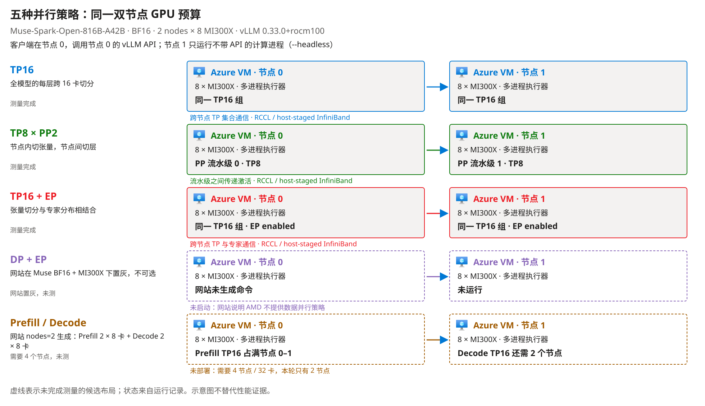

原创测试拓扑图，由[图形生成器](tools/build_layout_figure.py)读取[本轮汇总](data/mi300x-fiveway/muse-selectable_20261104/summary.json)生成，Azure 虚拟机图标保持官方原图。观察重点：TP 组是否跨节点、PP 在哪里切层、EP 是否开启，以及 DP + EP 和 P/D 为什么没有运行。图不替代原始日志。

**页面命令与实际命令。** 每个布局实际 argv（[`launch.txt`](data/mi300x-fiveway/muse-selectable_20261104/pp/launch.txt)）都包含页面生成的全部参数；测试会对照汇总中保存的页面参数逐条核对。差别如下：

| 项目 | Recipe 页面（BF16 · MI300X · 2 节点，头节点） | 本轮 | 原因 |
|---|---|---|---|
| 镜像 | `vllm/vllm-openai-rocm:muse-spark-open` | 按摘要固定的 `vllm/vllm-openai-rocm:v0.33.0` | 页面镜像只编译了 gfx950；2026-11-02 在 gfx942 上于融合内核处段错误 |
| 前端 | Rust（`VLLM_USE_RUST_FRONTEND=1`） | Python（`VLLM_USE_RUST_FRONTEND=0`） | 页面提供 Python 作为备选；v0.33.0 镜像不带 Rust 前端程序 |
| 容器权限 | `--privileged --security-opt seccomp=unconfined --group-add video` | 非特权：`--cap-add SYS_PTRACE`，显式挂载 `/dev/kfd`、`/dev/dri`、`/dev/infiniband`，使用主机网络与 IPC | 沿用本项目启动脚本的较小权限集，三个布局都正常运行 |
| 新增参数 | — | `--kernel-config '{"enable_jit_warmup": false}'`、`--distributed-timeout-seconds 3600`，以及 `--revision`、`--host`、`--port`、`--served-model-name` | ROCm 上 FA4 预热会导入只有 CUDA 才有的扩展（2026-11-02）；两节点启动需要更长的超时；固定 revision 和 API 名称 |
| 跨机 RCCL | 未设置 | `NCCL_NET_GDR_LEVEL=0`、`NCCL_IB_HCA=^mlx5_8:1,mlx5_an0:1` | 2026-11-01 的探针中，默认 GPU Direct RDMA 路径挂起；传输经主机内存中转 |

**输入与流程。** 两组提示词与 2026-11-03 那一轮文字相同。短工程问题原文：

> Explain in about 150 words why mixture-of-experts models keep the router in higher precision than the experts.

部署分析问题开头如下，[完整输入](data/mi300x-fiveway/muse-selectable_20261104/guide_prompt.txt)后面附有网站策略的转述和模型限制：

> Compare the advantages, disadvantages, and deployment prerequisites of these five inference layouts for one mixture-of-experts model.

服务端记录两组分别为 166 和 713 个输入 token，包含聊天模板，不是长上下文测试。输出上限为 8,192 和 16,384 token，让回答能够自然结束。请求流式输出、`temperature 0`；没有设置 `reasoning_effort`，沿用模型默认。每个布局对每组输入先预热一次，再在并发 1、2、4、8、16、32、64 各跑 3 轮：每组输入 381 条，每个布局 762 条，**共 2,286 条**。三个布局按 TP8 × PP2、TP16、TP16 + EP 的固定顺序各部署一次，没有随机化。正式测量前，每个布局先回答一条独立检查题“Explain the difference between BF16 and FP16 in one sentence, including exponent and fraction bit counts.”（上限 4,096 token）；三个布局都自然结束，并正确写出 BF16 为 8 位指数、7 位尾数，FP16 为 5 位指数、10 位尾数。

**指标怎么读。** 首文本延迟（TTFT）从发出请求计到第一个推理或答案文本分片；E2E 计到流结束。单请求解码等于（输出 token 数 − 1）÷ 首末两个文本分片的时间差。总吞吐是一轮中所有完整流的输出 token 之和除以整轮耗时，表中取 3 轮的中位数。`--max-num-seqs 32` 意味着并发 64 时最多 32 条请求同时生成，其余排队等空位，所以它们的 TTFT 包含排队时间。并发 64 的总吞吐因此来自与并发 32 相同的 32 条批量；它仍可能更高，因为排队的请求会补上已完成回答空出的位置，而并发 32 的一轮要等最长的回答结束。“完整答案”指自然结束且有答案文本，不是正确性评分。

**计数。** 2,286 条请求全部完成传输，没有失败。2,266 条自然结束并给出答案；20 条写满 16,384 token 上限，全部出现在部署分析问题：TP8 × PP2 13 条，TP16 + EP 6 条，TP16 1 条。

**完整结果矩阵。** 表格由[证据工具](tools/mi300x_evidence.py)从逐条请求生成；DP + EP 与 P/D 没有测量行。稳态计算费沿用同一个 West US Spot 参考价，两台合计 **29.515768 美元/小时**（2026-11-03 查询），不含启动、空闲、磁盘和账单调整。

<!-- BEGIN MUSE SELECTABLE RESULTS -->
延迟分位数只统计传输完整的请求；总吞吐的时间分母保留失败等待。没有成功请求的延迟和没有输出的单位成本记为 `-`。

**短工程问题**

服务端记录输入 166 token（包含聊天模板）；输出上限 8192 token。

| 布局 | 并发数（concurrency） | 首文本延迟中位数（ms） | 首文本延迟 P95（ms） | E2E 中位数（s） | E2E P95（s） | 单请求解码估计（token/s） | 总吞吐（token/s） | 传输完整/发出请求 | 完整答案/传输完整 | 稳态计算费（美元/百万输出 token） |
|---|---:|---:|---:|---:|---:|---:|---:|---:|---:|---:|
| TP16 | 1 | 214 | 218 | 22.86 | 22.86 | 61.1 | 60.5 | 3/3 | 3/3 | 135.59 |
| TP16 | 2 | 387 | 998 | 22.91 | 26.00 | 52.5 | 94.6 | 6/6 | 6/6 | 86.69 |
| TP16 | 4 | 429 | 435 | 31.12 | 32.91 | 46.6 | 171.9 | 12/12 | 12/12 | 47.68 |
| TP16 | 8 | 514 | 1,205 | 37.57 | 41.87 | 37.6 | 262.0 | 24/24 | 24/24 | 31.29 |
| TP16 | 16 | 737 | 858 | 41.65 | 46.22 | 31.7 | 432.5 | 48/48 | 48/48 | 18.96 |
| TP16 | 32 | 1,202 | 1,357 | 52.01 | 59.30 | 25.8 | 694.8 | 96/96 | 96/96 | 11.80 |
| TP16 | 64 | 21,108 | 65,648 | 87.32 | 115.83 | 24.5 | 692.9 | 192/192 | 192/192 | 11.83 |
| TP8 × PP2 | 1 | 196 | 197 | 15.93 | 15.93 | 83.8 | 82.7 | 3/3 | 3/3 | 99.09 |
| TP8 × PP2 | 2 | 275 | 1,463 | 18.32 | 18.81 | 73.0 | 143.9 | 6/6 | 6/6 | 56.98 |
| TP8 × PP2 | 4 | 460 | 473 | 22.73 | 23.17 | 57.6 | 222.1 | 12/12 | 12/12 | 36.92 |
| TP8 × PP2 | 8 | 476 | 493 | 29.21 | 34.07 | 44.9 | 305.6 | 24/24 | 24/24 | 26.83 |
| TP8 × PP2 | 16 | 548 | 918 | 34.45 | 41.32 | 38.7 | 505.7 | 48/48 | 48/48 | 16.21 |
| TP8 × PP2 | 32 | 690 | 2,364 | 38.06 | 44.39 | 36.4 | 926.1 | 96/96 | 96/96 | 8.85 |
| TP8 × PP2 | 64 | 14,009 | 48,693 | 60.11 | 89.94 | 32.6 | 900.3 | 192/192 | 192/192 | 9.11 |
| TP16 + EP | 1 | 222 | 222 | 25.37 | 25.38 | 54.0 | 53.5 | 3/3 | 3/3 | 153.30 |
| TP16 + EP | 2 | 380 | 1,001 | 27.85 | 29.29 | 50.3 | 95.3 | 6/6 | 6/6 | 86.06 |
| TP16 + EP | 4 | 407 | 542 | 31.21 | 32.48 | 45.3 | 172.1 | 12/12 | 12/12 | 47.65 |
| TP16 + EP | 8 | 429 | 1,112 | 37.15 | 41.24 | 36.9 | 257.0 | 24/24 | 24/24 | 31.90 |
| TP16 + EP | 16 | 589 | 1,238 | 44.94 | 64.13 | 30.5 | 333.6 | 48/48 | 48/48 | 24.57 |
| TP16 + EP | 32 | 918 | 1,767 | 51.91 | 65.33 | 25.5 | 641.8 | 96/96 | 96/96 | 12.78 |
| TP16 + EP | 64 | 22,090 | 60,176 | 87.19 | 114.08 | 24.3 | 676.3 | 192/192 | 192/192 | 12.12 |
| DP + EP | 网站置灰，未测 | - | - | - | - | - | - | - | - | - |
| Prefill/Decode | 网站配置需 4 节点，未测 | - | - | - | - | - | - | - | - | - |

**网站部署分析问题**

服务端记录输入 713 token（包含聊天模板）；输出上限 16384 token。

| 布局 | 并发数（concurrency） | 首文本延迟中位数（ms） | 首文本延迟 P95（ms） | E2E 中位数（s） | E2E P95（s） | 单请求解码估计（token/s） | 总吞吐（token/s） | 传输完整/发出请求 | 完整答案/传输完整 | 稳态计算费（美元/百万输出 token） |
|---|---:|---:|---:|---:|---:|---:|---:|---:|---:|---:|
| TP16 | 1 | 241 | 244 | 78.71 | 78.78 | 60.9 | 60.7 | 3/3 | 3/3 | 135.00 |
| TP16 | 2 | 442 | 463 | 93.80 | 100.28 | 52.3 | 97.4 | 6/6 | 6/6 | 84.14 |
| TP16 | 4 | 681 | 684 | 84.24 | 99.81 | 46.6 | 163.9 | 12/12 | 12/12 | 50.01 |
| TP16 | 8 | 1,190 | 1,216 | 118.66 | 131.99 | 37.7 | 266.3 | 24/24 | 24/24 | 30.79 |
| TP16 | 16 | 2,189 | 2,242 | 140.64 | 164.01 | 30.9 | 432.3 | 48/48 | 47/48 | 18.96 |
| TP16 | 32 | 4,094 | 4,188 | 171.32 | 249.37 | 25.3 | 560.4 | 96/96 | 96/96 | 14.63 |
| TP16 | 64 | 69,211 | 231,545 | 305.02 | 398.30 | 24.7 | 689.4 | 192/192 | 192/192 | 11.89 |
| TP8 × PP2 | 1 | 221 | 222 | 53.16 | 53.16 | 83.4 | 83.1 | 3/3 | 3/3 | 98.67 |
| TP8 × PP2 | 2 | 313 | 403 | 61.08 | 72.30 | 72.7 | 144.6 | 6/6 | 6/6 | 56.69 |
| TP8 × PP2 | 4 | 507 | 523 | 75.14 | 82.31 | 58.6 | 215.2 | 12/12 | 12/12 | 38.10 |
| TP8 × PP2 | 8 | 705 | 798 | 102.60 | 225.33 | 44.5 | 193.4 | 24/24 | 22/24 | 42.40 |
| TP8 × PP2 | 16 | 1,051 | 1,074 | 122.91 | 143.25 | 35.4 | 486.3 | 48/48 | 48/48 | 16.86 |
| TP8 × PP2 | 32 | 1,611 | 1,700 | 146.60 | 209.64 | 31.2 | 523.7 | 96/96 | 91/96 | 15.65 |
| TP8 × PP2 | 64 | 55,985 | 195,672 | 259.71 | 341.49 | 30.2 | 744.5 | 192/192 | 186/192 | 11.01 |
| TP16 + EP | 1 | 223 | 224 | 83.96 | 84.00 | 53.8 | 53.6 | 3/3 | 3/3 | 152.90 |
| TP16 + EP | 2 | 386 | 407 | 104.64 | 114.72 | 50.2 | 91.3 | 6/6 | 6/6 | 89.84 |
| TP16 + EP | 4 | 529 | 531 | 100.16 | 103.33 | 44.8 | 171.5 | 12/12 | 12/12 | 47.82 |
| TP16 + EP | 8 | 888 | 911 | 112.27 | 144.90 | 36.4 | 236.6 | 24/24 | 24/24 | 34.65 |
| TP16 + EP | 16 | 1,506 | 1,533 | 148.16 | 166.70 | 29.5 | 415.1 | 48/48 | 48/48 | 19.75 |
| TP16 + EP | 32 | 2,760 | 2,852 | 173.20 | 203.21 | 24.9 | 365.0 | 96/96 | 93/96 | 22.46 |
| TP16 + EP | 64 | 76,238 | 210,394 | 313.35 | 391.48 | 24.5 | 551.3 | 192/192 | 189/192 | 14.87 |
| DP + EP | 网站置灰，未测 | - | - | - | - | - | - | - | - | - |
| Prefill/Decode | 网站配置需 4 节点，未测 | - | - | - | - | - | - | - | - | - |

**测量轮次内的跨节点流量**

每格两个数，依次是节点 0 和节点 1：该节点 8 个 InfiniBand 端口（`mlx5_ib*`，RDMA verbs 流量）的接收速率之和，取 3 轮正式请求时间窗内每秒采样的均值，单位 MB/s（10^6 字节/秒）；10 MB/s 以上取整，以下保留一位小数。第二张表列出每个布局在任一节点上这些均值中的最高值，并补充 IPoIB（`ib*` 网络接口）和 `eth0` 两类接口。

| 布局 · 输入（每格：节点 0 / 节点 1 的 InfiniBand 接收，MB/s） | 并发请求数：1 | 并发请求数：2 | 并发请求数：4 | 并发请求数：8 | 并发请求数：16 | 并发请求数：32 | 并发请求数：64 |
|---|---:|---:|---:|---:|---:|---:|---:|
| TP16 · 短工程问题 | 688 / 688 | 1,751 / 1,760 | 1,999 / 1,947 | 5,644 / 5,671 | 3,496 / 3,398 | 6,640 / 6,458 | 6,480 / 6,390 |
| TP16 · 网站部署分析问题 | 688 / 697 | 1,799 / 1,802 | 1,894 / 1,835 | 5,503 / 5,650 | 2,702 / 2,741 | 5,581 / 5,580 | 6,689 / 6,664 |
| TP8 × PP2 · 短工程问题 | 0.2 / 3.0 | 0.3 / 5.0 | 0.3 / 9.8 | 0.3 / 14 | 0.4 / 20 | 0.6 / 33 | 0.5 / 35 |
| TP8 × PP2 · 网站部署分析问题 | 0.2 / 3.0 | 0.3 / 4.8 | 0.3 / 8.6 | 0.3 / 11 | 0.4 / 23 | 0.4 / 23 | 0.5 / 33 |
| TP16 + EP · 短工程问题 | 216 / 216 | 399 / 394 | 639 / 627 | 1,495 / 1,484 | 1,579 / 1,607 | 3,648 / 3,619 | 3,820 / 3,828 |
| TP16 + EP · 网站部署分析问题 | 216 / 216 | 369 / 369 | 634 / 634 | 1,301 / 1,292 | 2,019 / 2,016 | 2,058 / 2,047 | 3,136 / 3,144 |

| 布局 | InfiniBand 接收，各档均值中最高（MB/s） | IPoIB 接收，各档均值中最高（MB/s） | eth0 接收，各档均值中最高（MB/s） |
|---|---:|---:|---:|
| TP16 | 6,689 | 0 | 0.5 |
| TP8 × PP2 | 35 | 0 | 1.8 |
| TP16 + EP | 3,828 | 0 | 0.5 |
<!-- END MUSE SELECTABLE RESULTS -->

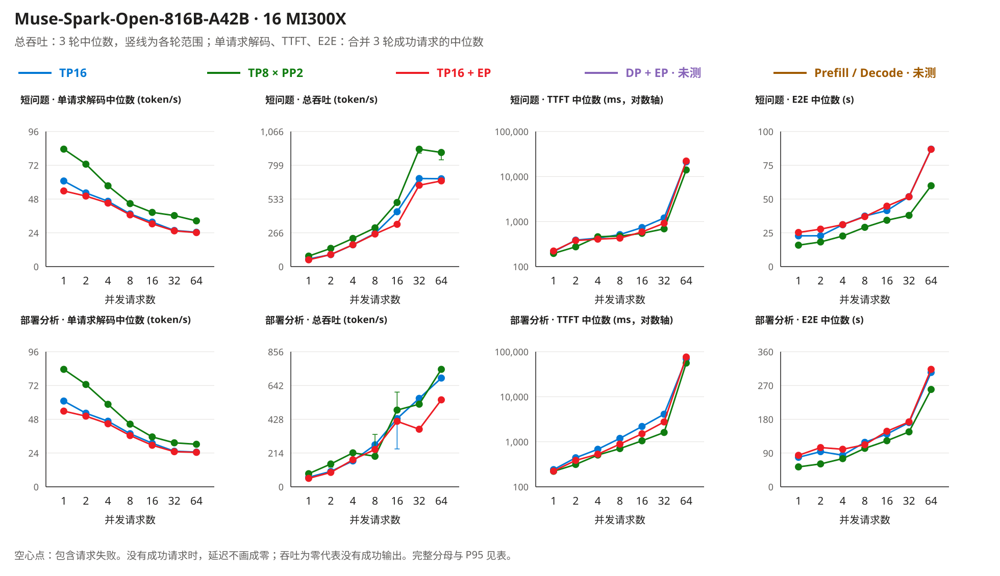

原创测量图，数据来自同一份汇总。总吞吐的竖线是 3 轮的最小值到最大值；TTFT 用对数轴，因为并发 64 包含排队时间。并发档位是离散的，折线只连接观测点。

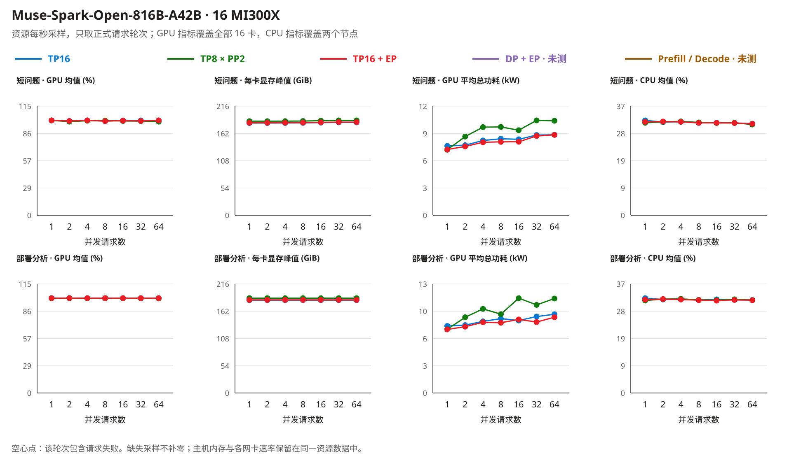

原创资源图，取自每个布局两节点的每秒采样，只保留正式测量轮次内的样本（整批运行中每个节点共记录 17,252 个样本）。GPU 功耗是 16 张卡之和，不是整机能耗；主机 CPU 包含操作系统和采样器本身。

**结果说明了什么。**

- **在这两台节点上，应从 TP8 × PP2 开始。** 它在每个测量点的单请求解码都最快（短问题并发 1：83.8 token/s，另两种为 61.1 和 54.0），总吞吐在 14 个点中有 12 个最高。两个例外是部署分析问题的并发 8 和并发 32：这两档的轮次被写满 16,384 token 上限的回答拉长。以并发 8 为例，第 1 轮用 109 s，第 2、3 轮各有一条这样的回答，各用约 246 s。总吞吐按整轮时间计算已完成的 token，一条很长的回答就会拉低它，并不代表解码变慢。
- **TP16 的跨机流量远低于链路容量。** 每节点 InfiniBand 接收在 TP16 下最高 6,689 MB/s，TP16 + EP 最高 3,828 MB/s，TP8 × PP2 最多 35 MB/s；IPoIB 和 `eth0` 几乎为零，说明集合通信走的是 InfiniBand RDMA verbs。即使是 TP16 最忙一档的均值，也只占 8 个 400 Gb/s 端口合计 400 GB/s 的 1.7%。这些数是各档测量轮内逐秒采样的平均值；单秒峰值和更短的突发可能更高，表中没有列出。服务日志（[TP16](data/mi300x-fiveway/muse-selectable_20261104/tp/server-keylines.log)、[TP8 × PP2](data/mi300x-fiveway/muse-selectable_20261104/pp/server-keylines.log)）记录的是结构上的差别：TP 组跨节点后，AITER 自定义 all-reduce 和 quick all-reduce 都被关闭，TP 组只用 `PYNCCL`；TP8 × PP2 的 TP 组留在节点内，仍优先使用 `AITER_CUSTOM`（其次是 `PYNCCL`）。因此 TP16 每个解码步都要等待跨机集合通信完成。这些等待没有逐次跟踪，[一个 token 的时间账](#muse-time-budget)用实测的每 token 时间和数据量估算了它们的规模。
- **专家并行在这里降低了单请求速度，并发 1 时最明显。** TP16 + EP 比 TP16 慢：并发 1 时慢 11.6–11.7%，更高并发时慢 0.8–4.6%。它的首文本延迟在 14 个点中有 11 个低于 TP16，但总吞吐在 14 个点中也有 11 个更低。总吞吐差距最大的几档（短问题并发 16 低 22.9%，部署分析问题并发 32、64 分别低 34.9% 和 20.0%）都来自拉长整轮的长回答：短问题并发 16 时，每轮都有一条 2,486 token 的回答，使每轮用时达到 68.1–68.8 s，而 TP16 在这一档最长的回答是 1,750 token。
- **KV Cache 容量没有决定排名。** TP16 预留 9,940,421 个 KV token，TP8 × PP2 为 8,780,862 个，每卡权重分别为 103.22 GiB 和 99.1 GiB。最多 32 条、每条不超过 32,768 token 的序列，远远用不满任何一个缓存池。
- **单请求解码速度在两轮之间可以复现。** 并发 1 的单请求解码与 [2026-11-03 那一轮](#muse-fiveway-20261103)相差不到 1 token/s（83.8 对 84.3、61.1 对 61.8、54.0 对 54.5），尽管那一轮截断了输出，显存预算也是 0.92。

<a id="muse-time-budget"></a>

**为什么有 InfiniBand，TP16 跨节点还是慢：一个 token 的时间账。** 上面的流量表说明链路远没有跑满。慢在哪里，可以用同一轮数据算一笔账：取短问题、并发 1（同一时刻只有一个请求在生成，不受排队和批处理影响），把每个输出 token 的时间与这个 token 的跨节点数据量放在一起比较。表格由[证据工具](tools/mi300x_evidence.py)从[本轮汇总](data/mi300x-fiveway/muse-selectable_20261104/summary.json)的 `time_budget` 生成；最后一列的次数来自模型卡的 62 层和 vLLM v0.33.0 的 ROCm 版 Muse 代码，不是运行时跟踪。

<!-- BEGIN MUSE SELECTABLE TIME BUDGET -->
| 布局（短问题，并发 1） | 每个输出 token 的时间（ms，实测） | 比 TP8 × PP2 每个 token 多用的时间（ms） | 较忙节点每个输出 token 的 InfiniBand 接收量（实测，含输入部分的分摊） | 这些数据以每节点 400 GB/s 传输所需时间（µs） | 每个 token 的集合通信与跨节点交接（按 vLLM 源码估算） |
|---|---:|---:|---:|---:|---|
| TP8 × PP2 | 11.9 | 0（基准） | 36 KB | 0.09 | 126 次集合通信都在节点内；流水级之间交接 1 次 |
| TP16 | 16.4 | 4.4 | 11.4 MB | 28 | 约 126 次集合通信都跨节点（62 层 × 2 次 all-reduce，再加 2 次） |
| TP16 + EP | 18.5 | 6.6 | 4.0 MB | 10 | 约 126 次集合通信都跨节点（62 层 × 2 次 all-reduce，再加 2 次）；页面说明 Triton 专家内核在专家并行下更慢 |

每个 token 的时间与差值都先用未舍入的原值计算，再分别四舍五入；直接相减表中的显示值，末位数字可能与差值列不同。
<!-- END MUSE SELECTABLE TIME BUDGET -->

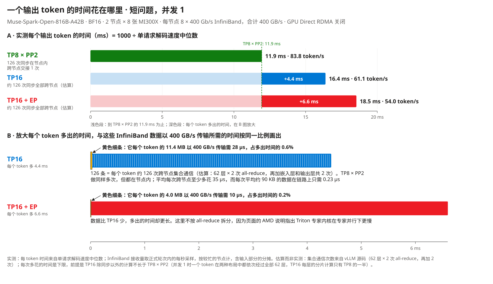

原创计算图，由[图形生成器](tools/build_layout_figure.py)读取同一份汇总生成。A 图是实测的每 token 时间。B 图把多出的时间放大；黄色细条是这些数据以 400 GB/s 传输所需的时间，与多出的时间按同一比例画出；TP16 横条里的 126 条细分是估算的跨节点集合通信次数，不是实测跟踪。

- **带宽只能解释多出时间的 1% 以内。** TP16 每个 token 比 TP8 × PP2 多用 4.4 ms，而它每个 token 的 11.4 MB 跨节点数据以 400 GB/s 传输只需 28 µs，占 0.6%。即使全部挤在一个 400 Gb/s 端口上（50 GB/s），也只需 228 µs，占 5.1%。TP16 + EP 的数据更少（4.0 MB）：按 vLLM 源码，TP16 在每个专家层的那次 all-reduce 要汇总 8 个被选中专家各自的输出，专家并行只汇总合并后的一份。但它多出的时间反而更长（6.6 ms）。多出的时间并没有花在传数据上。
- **数据指向逐次等待的跨节点同步（次数按源码估算）。** vLLM 的 ROCm 版 Muse 代码在每层做两次 TP all-reduce：注意力输出投影之后一次，前馈或专家输出之后一次。62 层共 124 次，再加嵌入层和输出层共 2 次集合通信，每个 token 约 126 次；每次都要等 16 张卡全部完成才能继续。TP8 × PP2 做同样多次，但都在节点内（服务日志中它的 TP 组优先使用 `AITER_CUSTOM`）。
- **平均每次跨节点同步至少多花 35 µs（下限估算）。** 并发 1 时，一个 token 在两种布局中都要依次经过全部 62 层：TP8 × PP2 的两个流水级先后执行，每层的分片计算分给 8 张卡；TP16 分给 16 张卡，层数和不分片的部分（如路由器）两边相同。只要较小的分片不会更慢（本轮没有单独测量内核耗时），TP16 除同步以外的计算就不比 TP8 × PP2 长，4.4 ms ÷ 126 ≈ 35 µs 就是平均每次跨节点集合通信比节点内多花时间的下限；TP8 × PP2 的流水级交接算在它自己的时间里，只会让这个下限更保守。每次平均约 90 KB 的数据在链路上只需 0.23 µs，其余是每次同步本身的延迟，与数据量关系不大，可能来自跨节点协调、`NCCL_NET_GDR_LEVEL=0` 下经主机内存的中转，以及跨节点后不再可用的节点内快速 all-reduce。三者各占多少，本轮没有拆分。
- **这套测量口径可以自我核对。** TP8 × PP2 每个 token 只把一份 FP32 残差流从节点 0 交给节点 1：8,192 个值 × 4 字节 = 32,768 字节。节点 1 实测每个处理过的 token（输入加输出）接收 31,792 字节，是预期值的 97%。可见 InfiniBand 端口计数器记录的正是 GPU 之间的通信量，采样器把以 4 字节为单位的计数乘以 4 的换算也没有错（换算错了会差 4 倍）。
- **可以带走的规则。** 在这两台节点上（GPU Direct RDMA 关闭），跨节点时单请求速度主要取决于每个 token 要做多少次全员同步，而不是链路带宽。把 TP 留在节点内、只让 PP 跨节点，每个 token 只交接一次。这与页面推荐 TP + PP 的做法一致，但原因不同：页面写的是跨节点带宽会成为瓶颈，本轮的数据指向同步次数。打开 GPU Direct RDMA 或调整 RCCL 也许能降低每次同步的开销（未测），但每个 token 约 126 次跨节点同步的结构不会变。

在全部 14 个测量点上，较忙节点每个输出 token 的跨节点接收量：TP16 为 8.2–21.7 MB，TP16 + EP 为 3.7–5.8 MB，TP8 × PP2 为 35–49 KB。

**边界。** 每个布局按固定顺序只部署一次；两条提示词重复测量，不是业务数据集；`temperature 0`；输入只有 166 和 713 token。长上下文、生产请求分布、答案质量和多模态输入都没有测。GPU Direct RDMA 处于关闭状态，打开后 TP16 的跨机集合通信可能更快（未测）。时间账里的集合通信次数和每次多花的时间是估算，不是逐次跟踪。镜像和前端与页面命令的差别见上表；MI300X 也不是该配方验证过的硬件（gfx950）。DP + EP 与 P/D 未运行。核对项与复算命令见[验证说明](VALIDATION_CN.md#muse-selectable-validation)，新建测量见[重跑步骤](#muse-selectable-reproduce)。

#### 2026-11-03 轮：怎么测

<a id="muse-fiveway-20261103"></a>

**早期记录。** 这一轮的输出全部在推理阶段达到上限，而且只测了三档并发。它保留为记录，结论以上面 2026-11-04 的实测为准。

2026-11-03，复用两台 West US Spot `Standard_ND96isr_MI300X_v5`，每台 8 张卡。三个布局均为同一 Muse BF16 revision、vLLM `0.33.0+rocm100`、PyTorch `2.13.0+rocm10.0.0` 和 `mp` 多进程执行器；基础镜像摘要、实际命令和每个节点的镜像身份保存在证据中。TP16、TP8 × PP2、TP16＋EP 的总 GPU 数均为 16。

共同设置：`--gpu-memory-utilization 0.92`、`--max-model-len 32768`、`--max-num-seqs 32`、`--max-num-batched-tokens 4096`、BF16 KV、Triton MoE 和 `ROCM_AITER_FA`。沿用 AMD 配方关闭 prefix caching、启用 chunked prefill；不使用推测解码。跨节点通信沿用已验证的 `NCCL_NET_GDR_LEVEL=0`，经主机内存中转，不是 GPU Direct RDMA 测试。

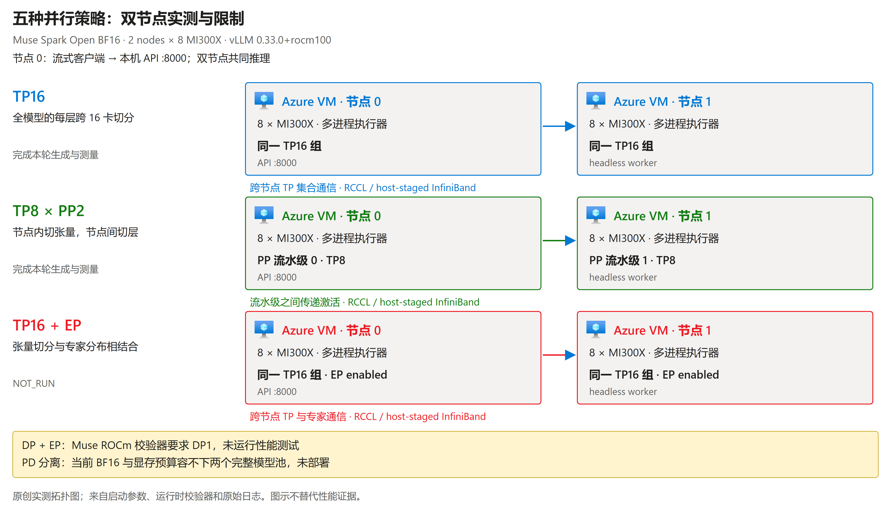

原创实测拓扑图，由 [图形生成器](tools/build_layout_figure.py)读取[本轮汇总](data/mi300x-fiveway/fiveway_20261103-160700/summary.json)。Azure VM 图标保持官方原图；观察重点是 TP 组是否跨节点、PP 在哪里切层、EP 是否启用，以及两项未运行性能测试的原因。图不替代原始日志。

**真实输入。** 第一组复用此前的工程问题，提示词原文为：

> Explain in about 150 words why mixture-of-experts models keep the router in higher precision than the experts.

第二组来自本次分析网站部署方式的任务，开头为：

> Compare the advantages, disadvantages, and deployment prerequisites of these five inference layouts for one mixture-of-experts model.

后面附网站五种策略的转述和模型限制；[完整输入](data/mi300x-fiveway/fiveway_20261103-160700/guide_prompt.txt)没有重复填充。服务端记录两组分别为 166 和 713 个输入 token，包含聊天模板，不是 32K 长上下文测试。请求流式输出，`temperature 0`，推理档位未显式设置，沿用模型默认；输出上限分别为 256 和 1024 token。

每个布局、每组输入先预热一次，再以并发 1、8、32 各运行 3 轮，即每组 123 条正式测量请求。三个布局合计 **738 条正式请求**。这是两条提示词的重复测量，能描述这些条件下的时序波动，不是 738 个独立业务样本。布局按 TP→PP→TP＋EP 顺序运行，没有随机化或多次完整重建；启动和 JIT 时间不计入下方服务吞吐。

**指标与结果边界。** 首文本延迟从客户端发出请求计到第一个推理或答案文本分片。单请求解码速度是基于 token 总数及首末文本分片的估计，不是逐 token 延迟分布。总吞吐以每轮完整流的输出 token 总数除以整轮耗时，再取 3 轮中位数；失败等待仍保留在分母中。完整流与完整答案分开计数。

**738 条正式请求全部完成传输，但都在推理段达到输出上限，完整答案为 0。** 因而这里比较的是有输出长度限制的推理生成速度，不能声称完成了网站分析任务，也不能据此比较答案质量。另有每布局 1 条独立的[完整回答检查](data/mi300x-fiveway/fiveway_20261103-160700/smoke_request.json)，使用 4096 token 上限；三次均自然结束并正确说明 BF16/FP16 的位数。一次基础回答不构成质量等价证明。

#### 2026-11-03 轮：完整结果矩阵

表格由 [证据工具](tools/mi300x_evidence.py) 从逐条请求重算，未测项不按零处理。稳态计算费采用本次查询的 West US Linux Spot 参考价，两台合计 **29.515768 美元/小时**，按 `两台每小时价格 × 1,000,000 ÷ 总吞吐 ÷ 3600` 折算；包含推理 token，不是每百万最终答案 token 的价格，也不含启动、空闲、磁盘或真实账单结算。

<!-- BEGIN FIVEWAY RESULTS -->
**短工程问题**

服务端记录输入 166 token（包含聊天模板）；输出上限 256 token。

| 布局 | 并发数（concurrency） | 首文本延迟（ms） | 单请求解码估计（token/s） | 总吞吐（token/s） | 传输完整/发出请求 | 完整答案/传输完整 | 稳态计算费（美元/百万输出 token） |
|---|---:|---:|---:|---:|---:|---:|---:|
| TP16 | 1 | 209 | 61.8 | 59.1 | 3/3 | 0/3 | 138.81 |
| TP16 | 8 | 513 | 38.4 | 286.1 | 24/24 | 0/24 | 28.65 |
| TP16 | 32 | 1,194 | 27.7 | 785.5 | 96/96 | 0/96 | 10.44 |
| TP8 x PP2 | 1 | 194 | 84.3 | 79.6 | 3/3 | 0/3 | 103.04 |
| TP8 x PP2 | 8 | 475 | 47.3 | 348.9 | 24/24 | 0/24 | 23.50 |
| TP8 x PP2 | 32 | 689 | 41.8 | 1,200.8 | 96/96 | 0/96 | 6.83 |
| TP16 + EP | 1 | 216 | 54.5 | 52.3 | 3/3 | 0/3 | 156.76 |
| TP16 + EP | 8 | 427 | 38.9 | 293.2 | 24/24 | 0/24 | 27.96 |
| TP16 + EP | 32 | 909 | 28.1 | 816.9 | 96/96 | 0/96 | 10.04 |
| DP + EP | 未测 | - | - | - | - | - | - |
| Prefill/Decode | 未测 | - | - | - | - | - | - |

**网站部署分析问题**

服务端记录输入 713 token（包含聊天模板）；输出上限 1024 token。

| 布局 | 并发数（concurrency） | 首文本延迟（ms） | 单请求解码估计（token/s） | 总吞吐（token/s） | 传输完整/发出请求 | 完整答案/传输完整 | 稳态计算费（美元/百万输出 token） |
|---|---:|---:|---:|---:|---:|---:|---:|
| TP16 | 1 | 236 | 61.3 | 60.5 | 3/3 | 0/3 | 135.47 |
| TP16 | 8 | 1,179 | 37.7 | 288.9 | 24/24 | 0/24 | 28.38 |
| TP16 | 32 | 4,084 | 26.2 | 758.7 | 96/96 | 0/96 | 10.81 |
| TP8 x PP2 | 1 | 218 | 83.4 | 82.0 | 3/3 | 0/3 | 99.98 |
| TP8 x PP2 | 8 | 800 | 45.5 | 351.5 | 24/24 | 0/24 | 23.33 |
| TP8 x PP2 | 32 | 1,607 | 32.1 | 977.6 | 96/96 | 0/96 | 8.39 |
| TP16 + EP | 1 | 218 | 53.8 | 53.3 | 3/3 | 0/3 | 153.86 |
| TP16 + EP | 8 | 880 | 37.0 | 287.1 | 24/24 | 0/24 | 28.56 |
| TP16 + EP | 32 | 2,755 | 26.1 | 780.3 | 96/96 | 0/96 | 10.51 |
| DP + EP | 未测 | - | - | - | - | - | - |
| Prefill/Decode | 未测 | - | - | - | - | - | - |
<!-- END FIVEWAY RESULTS -->

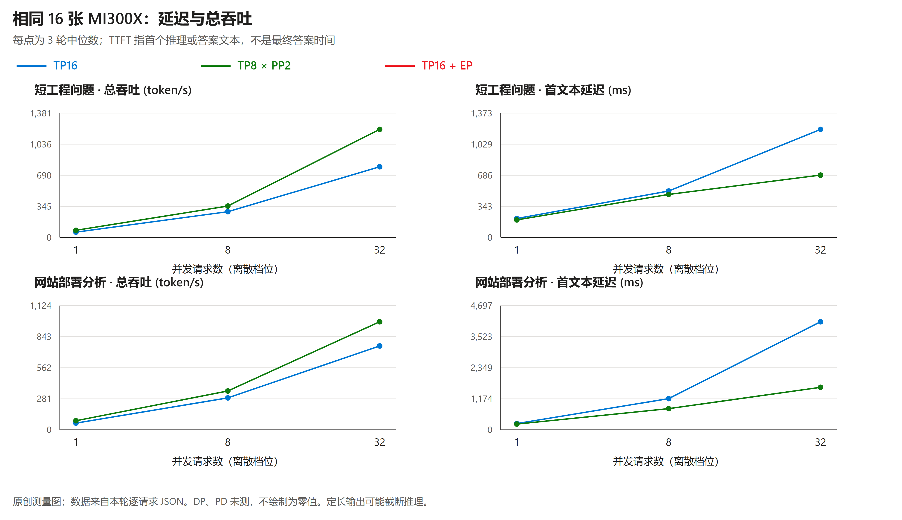

原创测量图，来源为[逐请求数据及汇总](data/mi300x-fiveway/fiveway_20261103-160700/)。横轴是离散并发档位，折线只连接观测点，不代表连续扩展规律；各轮数值保留在 JSON 中。

#### 2026-11-03 轮：哪些网站判断得到支持

- **本轮 TP8 × PP2 更合适。** 两组输入、三个并发档中，它的单请求解码和总吞吐均高于另外两个布局，首文本延迟也更低。因此，网站的“TP 延迟优先”标签没有在这套条件下形成优势，不能当作承诺。
- **EP 的结论要看条件。** 并发 1 时 TP16＋EP 比 TP16 慢，符合网站针对 BF16 的提醒；但并发 32 时两组输入的总吞吐中位数略高，并非所有指标都更差。部分轮次有明显波动，不能把几个百分点的差距推广成普遍收益。
- **通信日志解释了配置差别，没有单独证明全部因果。** TP16 跨节点后关闭了自定义 quick all-reduce、使用 `PYNCCL`；PP 的 TP 组留在节点内，仍可使用节点内后端。它与网站关于跨节点通信成本的解释相符，但本轮没有单独控制通信后端或测量通信占比，不能把全部速度差都归因于网络。
- **DP＋EP：未进行整模型性能测试。** 本机原版 `validate_bf16_deployment` 接受 DP1、拒绝 DP16，报 `requires DP1 and PCP1`；[校验器调用记录](data/mi300x-fiveway/fiveway_20261103-160700/runtime-contract.log)含源码哈希。没有删除该保护条件来强行运行。
- **PD 分离：容量预检阻塞，未部署。** 每个池只有 8 张卡，按本轮 0.92 的预算不足以驻留完整 BF16 模型并保留运行时和缓存余量。增加机器、换精度或 CPU offload 都会改变本轮条件，因此没有暗中替换；也不能据此否定网站在合适硬件上的 PD 建议。

这一轮没有测生产请求分布、多模态、缓存复用、推测解码、Spot 驱逐恢复、32K 实际输入或更高并发。下一次选型应在目标业务负载下重跑，而不是直接套用本表。

#### Qwen 初轮：Spot 驱逐中断

<a id="qwen-fiveway"></a>

**历史阶段。** 下面保留驱逐时的初轮投影，不是当前任务进度。2026-11-03 的 Azure 活动日志记录了 Spot 驱逐；两台测试 VM 随后均处于 `deallocated`。当时 TP、DP+EP、P/D 的两组输入已完整回流，PP 的完整数据未齐，TP+EP 尚未启动。恢复后的五种布局已另行执行，见[恢复轮完整结果](#qwen-recovery)；两轮不混算，也不挑选较好一次替换原结果。

**为什么换模型。** 前一轮 Muse 在当前 ROCm 路径下限制 DP，且同一 GPU 预算容不下两个 BF16 模型池。本轮另选[固定 Qwen revision](https://huggingface.co/Qwen/Qwen3-235B-A22B-Instruct-2507/tree/ac9c66cc9b46af7306746a9250f23d47083d689e)，目的是执行相同的策略问题，不是把 Qwen 的成绩算给 Muse。网站的优缺点仍是上一表中的待验证假设。

**共同条件与实际差别。** 两台 `Standard_ND96isr_MI300X_v5`，每台 8 张 MI300X；同一 BF16 revision、vLLM `0.33.0+rocm100`、PyTorch `2.13.0+rocm10.0.0`、`mp` 执行器、Triton MoE 与 `TRITON_ATTN`。设置为 `--gpu-memory-utilization 0.80`、`--max-model-len 32768`、`--max-num-seqs 64`、`--max-num-batched-tokens 4096`，开启 prefix caching 与 chunked prefill，不用推测解码。重复提示可能命中缓存，不能把这些 TTFT 称为冷请求延迟。

| 布局 | 节点 0 | 节点 1 | 必须保留的差别 |
|---|---|---|---|
| TP16 | 跨节点 TP 组的一半 | 同一 TP 组的另一半 | TP 集合通信跨节点 |
| TP8 × PP2 | TP8，流水级 0 | TP8，流水级 1 | TP 留在节点内，层间激活跨节点；本轮数据未齐 |
| TP16 + EP | 计划使用 TP 与 EP | 计划使用同一组 GPU | 尚未执行，不从其他布局推断成绩 |
| DP16 + EP16 | TP1，DP rank 0–7 | TP1，DP rank 8–15 | 全局请求分配；`max-num-seqs` 按 DP rank 生效，客户端总并发另行限制 |
| P/D | Prefill TP8，官方代理入口 | Decode TP8 | 两份模型驻留；使用原生 TCP KV 传输，不是 RDMA 性能结果 |

P/D 使用原版 [Mooncake 代理](scripts/mi300x/mooncake_connector_proxy.py)，`kv_load_failure_policy=fail`，传输失败不会在 D 端重算。当前 Mooncake 的自动 RDMA 路径跨机误选 HIP IPC，添加 `transport_hint` 也未改变旧引擎路由；这两次失败被保留。最终使用安装包已有的 `MC_FORCE_TCP=1` 与 `mooncake_protocol=tcp`，没有修改 vLLM 源码、模型权重或 VM 身份。TCP 包含主机中转及代理开销，不能用它代表优化过的 RDMA P/D。

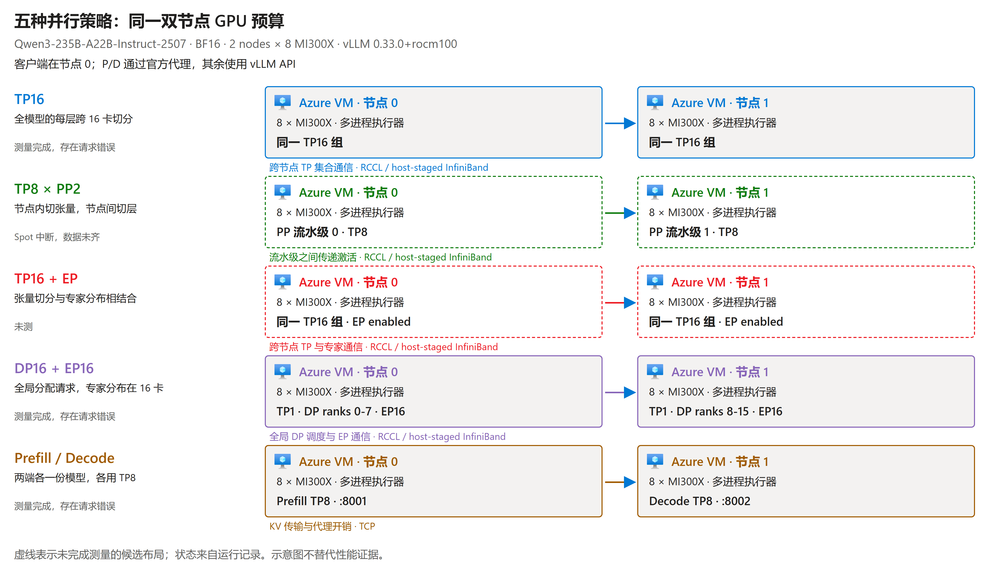

原创拓扑图，直接读取[本轮摘要](data/mi300x-fiveway/qwen-fiveway_20261103-172600/summary.json)。虚线是没有完整测量的数据项，不代表硬件不支持。客户端在节点 0；P/D 的客户端计时包含官方代理、两端执行与 KV 传输。

**实际输入与计数。** 短输入仍是以下工程问题，输出上限为 512 token：

> Explain in about 150 words why mixture-of-experts models keep the router in higher precision than the experts.

部署分析输入的首段原文如下，后接网站策略转述与 Muse 特有限制，输出上限为 2048 token；[完整输入](data/mi300x-fiveway/qwen-fiveway_20261103-172600/guide_prompt.txt)与[原始请求记录](data/mi300x-fiveway/qwen-fiveway_20261103-172600/)一并保存。

> Compare the advantages, disadvantages, and deployment prerequisites of these five inference layouts for one mixture-of-experts model. Explain which objectives favor each layout and why a latency or throughput label is not a universal guarantee. Distinguish model sharding, request parallelism, and prefill/decode separation. Do not invent benchmark numbers. Use the supplied notes and state any unverified condition explicitly.

每组输入先 warm-up，再按并发 **1、2、4、8、16、32、64** 各发出 3 轮请求，即每组 381 条正式请求。`temperature=0`，流式输出；不是 32K 实际输入或独立业务样本集。执行顺序为 P/D、DP+EP、TP、PP，TP+EP 因驱逐未开始；顺序没有随机化，也没有做多次整机重建。

**怎样读数字。** TTFT 是客户端发出请求到首个文本分片；E2E 是发出请求到流结束。两者的分位数只统计传输完整的请求。总吞吐把每轮完整流的输出 token 相加，除以整轮时间，保留失败等待，再取 3 轮中位数。P95 使用包含端点的插值，不是生产 SLA。表中“完整答案”仅指自然结束且有正文，不等于答案正确；另有[BF16/FP16 基础 smoke](data/mi300x-fiveway/qwen-fiveway_20261103-172600/smoke_request.json)做语义检查。稳态成本沿用本轮两台 Spot 参考价，不含启动、空闲、磁盘和账单调整。

<!-- BEGIN QWEN FIVEWAY RESULTS -->
延迟分位数只统计传输完整的请求；总吞吐的时间分母保留失败等待。没有成功请求的延迟和没有输出的单位成本记为 `-`。

**短工程问题**

服务端记录输入 33 token（包含聊天模板）；输出上限 512 token。

| 布局 | 并发数（concurrency） | 首文本延迟中位数（ms） | 首文本延迟 P95（ms） | E2E 中位数（s） | E2E P95（s） | 单请求解码估计（token/s） | 总吞吐（token/s） | 传输完整/发出请求 | 完整答案/传输完整 | 稳态计算费（美元/百万输出 token） |
|---|---:|---:|---:|---:|---:|---:|---:|---:|---:|---:|
| TP16 | 1 | 36 | 37 | 3.28 | 3.29 | 59.8 | 59.2 | 3/3 | 3/3 | 138.55 |
| TP16 | 2 | 38 | 38 | 3.40 | 3.42 | 57.4 | 112.9 | 6/6 | 6/6 | 72.64 |
| TP16 | 4 | 38 | 39 | 3.49 | 3.51 | 56.0 | 220.6 | 12/12 | 12/12 | 37.17 |
| TP16 | 8 | 40 | 42 | 3.89 | 4.06 | 49.5 | 379.4 | 24/24 | 24/24 | 21.61 |
| TP16 | 16 | 80 | 82 | 5.59 | 5.89 | 35.8 | 532.7 | 48/48 | 48/48 | 15.39 |
| TP16 | 32 | 105 | 111 | 6.04 | 6.37 | 32.4 | 972.7 | 96/96 | 96/96 | 8.43 |
| TP16 | 64 | 140 | 198 | 7.45 | 7.77 | 26.9 | 1,593.2 | 192/192 | 192/192 | 5.15 |
| TP8 x PP2 | 中断，数据未齐 | - | - | - | - | - | - | - | - | - |
| TP16 + EP | 未测 | - | - | - | - | - | - | - | - | - |
| DP + EP | 1 | 178 | 180 | 6.50 | 6.53 | 31.0 | 30.1 | 3/3 | 3/3 | 272.08 |
| DP + EP | 2 | 177 | 178 | 6.73 | 6.89 | 30.8 | 59.2 | 6/6 | 6/6 | 138.60 |
| DP + EP | 4 | 178 | 179 | 6.63 | 6.87 | 30.5 | 116.3 | 12/12 | 12/12 | 70.50 |
| DP + EP | 8 | 176 | 179 | 7.64 | 8.10 | 25.9 | 193.7 | 24/24 | 24/24 | 42.34 |
| DP + EP | 16 | 98 | 103 | 7.81 | 8.11 | 25.4 | 378.2 | 48/48 | 48/48 | 21.68 |
| DP + EP | 32 | 97 | 110 | 8.04 | 9.18 | 24.9 | 737.3 | 96/96 | 96/96 | 11.12 |
| DP + EP | 64 | 100 | 169 | 9.16 | 9.59 | 21.7 | 1,292.8 | 192/192 | 192/192 | 6.34 |
| Prefill/Decode | 1 | 51 | 53 | 1.99 | 1.99 | 104.2 | 101.5 | 3/3 | 3/3 | 80.80 |
| Prefill/Decode | 2 | 62 | 76 | 2.12 | 2.14 | 98.2 | 189.7 | 6/6 | 6/6 | 43.21 |
| Prefill/Decode | 4 | 101 | 106 | 2.28 | 2.31 | 91.6 | 349.3 | 12/12 | 12/12 | 23.48 |
| Prefill/Decode | 8 | 122 | 141 | 2.63 | 2.71 | 79.5 | 587.5 | 24/24 | 24/24 | 13.96 |
| Prefill/Decode | 16 | 154 | 195 | 2.96 | 3.06 | 72.1 | 1,056.2 | 48/48 | 48/48 | 7.76 |
| Prefill/Decode | 32 | 222 | 313 | 3.30 | 3.44 | 63.4 | 1,835.5 | 96/96 | 96/96 | 4.47 |
| Prefill/Decode | 64 | 415 | 633 | 4.59 | 5.16 | 46.0 | 2,379.3 | 167/192 | 167/167 | 3.45 |

**网站部署分析问题**

服务端记录输入 617 token（包含聊天模板）；输出上限 2048 token。

| 布局 | 并发数（concurrency） | 首文本延迟中位数（ms） | 首文本延迟 P95（ms） | E2E 中位数（s） | E2E P95（s） | 单请求解码估计（token/s） | 总吞吐（token/s） | 传输完整/发出请求 | 完整答案/传输完整 | 稳态计算费（美元/百万输出 token） |
|---|---:|---:|---:|---:|---:|---:|---:|---:|---:|---:|
| TP16 | 1 | 69 | 70 | 24.65 | 24.65 | 58.3 | 58.1 | 3/3 | 3/3 | 141.14 |
| TP16 | 2 | 73 | 497 | 29.66 | 31.59 | 55.9 | 105.1 | 6/6 | 6/6 | 78.03 |
| TP16 | 4 | 78 | 79 | 27.51 | 28.36 | 53.9 | 202.0 | 12/12 | 12/12 | 40.60 |
| TP16 | 8 | 81 | 174 | 30.63 | 33.49 | 46.8 | 343.7 | 24/24 | 24/24 | 23.85 |
| TP16 | 16 | - | - | - | - | - | 0.0 | 0/48 | 0/0 | - |
| TP16 | 32 | - | - | - | - | - | 0.0 | 0/96 | 0/0 | - |
| TP16 | 64 | - | - | - | - | - | 0.0 | 0/192 | 0/0 | - |
| TP8 x PP2 | 中断，数据未齐 | - | - | - | - | - | - | - | - | - |
| TP16 + EP | 未测 | - | - | - | - | - | - | - | - | - |
| DP + EP | 1 | - | - | - | - | - | 0.0 | 0/3 | 0/0 | - |
| DP + EP | 2 | - | - | - | - | - | 0.0 | 0/6 | 0/0 | - |
| DP + EP | 4 | - | - | - | - | - | 0.0 | 0/12 | 0/0 | - |
| DP + EP | 8 | - | - | - | - | - | 0.0 | 0/24 | 0/0 | - |
| DP + EP | 16 | - | - | - | - | - | 0.0 | 0/48 | 0/0 | - |
| DP + EP | 32 | - | - | - | - | - | 0.0 | 0/96 | 0/0 | - |
| DP + EP | 64 | - | - | - | - | - | 0.0 | 0/192 | 0/0 | - |
| Prefill/Decode | 1 | - | - | - | - | - | 0.0 | 0/3 | 0/0 | - |
| Prefill/Decode | 2 | - | - | - | - | - | 0.0 | 0/6 | 0/0 | - |
| Prefill/Decode | 4 | - | - | - | - | - | 0.0 | 0/12 | 0/0 | - |
| Prefill/Decode | 8 | - | - | - | - | - | 0.0 | 0/24 | 0/0 | - |
| Prefill/Decode | 16 | - | - | - | - | - | 0.0 | 0/48 | 0/0 | - |
| Prefill/Decode | 32 | - | - | - | - | - | 0.0 | 0/96 | 0/0 | - |
| Prefill/Decode | 64 | - | - | - | - | - | 0.0 | 0/192 | 0/0 | - |
<!-- END QWEN FIVEWAY RESULTS -->

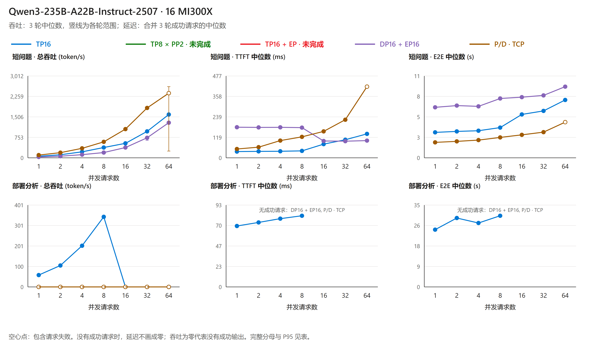

原创测量图，数据来自同一摘要：空心点包含请求失败，吞吐竖线是各轮最小值到最大值，不是置信区间；缺失延迟不补零。后来因服务退出而失败的请求，不是新的独立延迟样本。

**实际发现与边界。** TP 的短输入全部成功，部署分析在并发 16 起出现超时与 API 退出；DP+EP 的短输入全部成功，但部署分析首次 prefill 的远端 worker 响应超时；P/D 在短输入并发 64 出现 KV 传输错误，后续部署分析未成功。这三种运行错误均发生在后来的 Spot 驱逐之前，不能全部归因于驱逐。日志能确定失败阶段，尚未隔离 TP/DP worker 停滞的底层原因，也不能把这些局部失败改写成 Qwen 或某种架构普遍不支持。

**初轮投影的资源边界。** 两节点都启动过每秒采样，字段含每卡 GPU 利用率、显存、功耗、主机 CPU/内存、各 Ethernet 与 InfiniBand 接口累计字节。这份驱逐时的投影只含节点 1；对应[TP 样本](data/mi300x-fiveway/qwen-fiveway_20261103-172600/tp/resources-node1.jsonl)、[DP 样本](data/mi300x-fiveway/qwen-fiveway_20261103-172600/dp/resources-node1.jsonl)、[P/D 样本](data/mi300x-fiveway/qwen-fiveway_20261103-172600/pd/resources-node1.jsonl)只选取正式请求轮次，不据此生成全 16 卡曲线。恢复轮下方的双节点曲线来自恢复轮自己的采样，不能倒填初轮。主机指标包含操作系统与采样进程，不是模型独占资源计量。

初轮是可复算的阶段性记录，**不是完整五方案选型结论**。恢复后没有用新结果修补这两张旧表。执行入口见[新建 Qwen 测量](#qwen-reproduce)，检查方法见[验证说明](VALIDATION_CN.md#qwen-fiveway-validation)。

#### Qwen 恢复轮：五种布局全部执行，PP 全部通过

<a id="qwen-recovery"></a>

**问题与实际输入。** 同样的两台 MI300X、同一 Qwen BF16 权重和同一镜像下，五种布局能否完成相同请求，延迟、吞吐与资源占用如何变化？短工程输入仍为：

> Explain in about 150 words why mixture-of-experts models keep the router in higher precision than the experts.

部署分析输入的首段仍为：

> Compare the advantages, disadvantages, and deployment prerequisites of these five inference layouts for one mixture-of-experts model. Explain which objectives favor each layout and why a latency or throughput label is not a universal guarantee. Distinguish model sharding, request parallelism, and prefill/decode separation. Do not invent benchmark numbers. Use the supplied notes and state any unverified condition explicitly.

[完整输入](data/mi300x-fiveway/qwen-fiveway-recovery_20261103/guide_prompt.txt)与[逐请求记录](data/mi300x-fiveway/qwen-fiveway-recovery_20261103/)一起保存。两组输入分别为 33 和 617 token，输出上限为 512 和 2048 token；不是长上下文或业务质量评测。

**控制条件。** 固定 Qwen revision `ac9c66cc9b46af7306746a9250f23d47083d689e`、BF16、两节点各 8 张 MI300X、vLLM `0.33.0+rocm100`、PyTorch `2.13.0+rocm10.0.0`、`mp`、Triton MoE、`TRITON_ATTN`、0.80 显存预算和前述调度上限。镜像只构建一次，再导入另一节点；五布局两端实际 image ID 均为 `sha256:3464a056f1359bfd0d567d1de85dfe9ee4a185056042032f6a2632834e76004e`。比较变量是布局，KV 分配、每 rank 调度与通信路径也随布局改变。PP 在恢复后的早一阶段执行，其余按 TP+EP、TP、DP+EP、P/D 串行运行，没有随机化或交错配对；不与初轮混算。

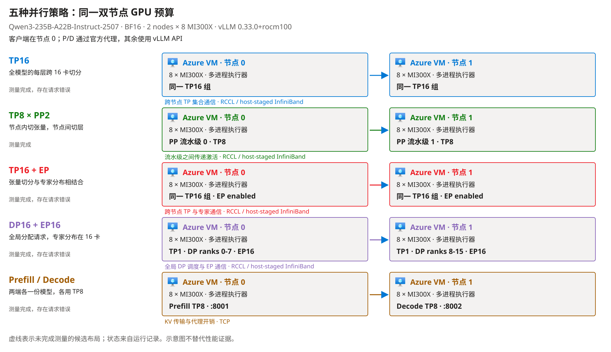

原创实测拓扑图，由[生成器](tools/build_layout_figure.py)读取[恢复轮摘要](data/mi300x-fiveway/qwen-fiveway-recovery_20261103/summary.json)。观察 TP 是否跨节点、PP 在哪里切层，以及 P/D 的两个模型池；Azure VM 图标保持官方原图。部署位置不证明通信是全部性能差异的原因。

**测量与计算。** 每布局、每组输入先预热一次，再以并发 1、2、4、8、16、32、64 各跑 3 轮，每组 381 条正式请求，合计 3810 条。开启 prefix caching 与 chunked prefill，`temperature=0`，不用推测解码；重复提示可能命中缓存。TTFT 是发送到首文本，E2E 是发送到流结束，分位数只包括完整流；吞吐按完整流输出 token 除以整轮时间，再取三轮中位数，失败等待不剔除。成本按 2026-11-03 的两台 Spot 参考价 29.515768 美元/小时折算每百万成功输出 token，不含启动、空闲、磁盘，也不是账单。

**执行结果。** 3810 条请求全部有记录：2423 条自然结束且有正文，1387 条失败，没有截断输出计入完整答案。“完整答案”不是正确性评分。只有 PP 完成两组输入的全部请求；故障后的不可用请求保留在分母中，不是新的独立延迟样本。

| 恢复轮布局 | 短输入：完整答案／正式请求 | 部署分析：完整答案／正式请求 | 原生日志与边界 |
|---|---:|---:|---|
| TP8 × PP2 | 381/381 | 381/381 | 全部自然结束；不是生产稳定性承诺 |
| TP16 + EP | 381/381 | 61/381 | `RPC call to sample_tokens timed out`，引擎随后退出 |
| TP16 | 381/381 | 77/381 | 同样记录 `sample_tokens` RPC 超时；报错相同不证明根因相同 |
| DP16 + EP16 | 381/381 | 0/381 | 两端记录 `sample_tokens`／`execute_dummy_batch` RPC 超时 |
| P/D，原生 TCP | 380/381 | 0/381 | 先有真实 KV 传输成功，后有传输失败；后续输入受到先前故障影响 |

P/D 使用原版 Mooncake connector 和官方代理、`MC_FORCE_TCP=1`、`mooncake_protocol=tcp`、`kv_load_failure_policy=fail`，不在 D 端重算兜底。[传输日志](data/mi300x-fiveway/qwen-fiveway-recovery_20261103/pd/server-keylines.log)证明本轮实际使用过跨节点 KV 传输，不是把普通 decode 服务当成 P/D。worker 超时的底层原因尚未隔离，不能据此说 Qwen 或这些架构普遍不支持。

<!-- BEGIN QWEN RECOVERY FIVEWAY RESULTS -->
延迟分位数只统计传输完整的请求；总吞吐的时间分母保留失败等待。没有成功请求的延迟和没有输出的单位成本记为 `-`。

**短工程问题**

服务端记录输入 33 token（包含聊天模板）；输出上限 512 token。

| 布局 | 并发数（concurrency） | 首文本延迟中位数（ms） | 首文本延迟 P95（ms） | E2E 中位数（s） | E2E P95（s） | 单请求解码估计（token/s） | 总吞吐（token/s） | 传输完整/发出请求 | 完整答案/传输完整 | 稳态计算费（美元/百万输出 token） |
|---|---:|---:|---:|---:|---:|---:|---:|---:|---:|---:|
| TP16 | 1 | 31 | 31 | 2.90 | 2.91 | 60.6 | 59.9 | 3/3 | 3/3 | 136.80 |
| TP16 | 2 | 32 | 54 | 3.17 | 3.39 | 58.5 | 109.4 | 6/6 | 6/6 | 74.95 |
| TP16 | 4 | 32 | 62 | 3.27 | 3.47 | 57.1 | 213.0 | 12/12 | 12/12 | 38.49 |
| TP16 | 8 | 67 | 69 | 3.99 | 4.19 | 50.3 | 376.7 | 24/24 | 24/24 | 21.76 |
| TP16 | 16 | 79 | 82 | 5.43 | 5.64 | 36.5 | 550.7 | 48/48 | 48/48 | 14.89 |
| TP16 | 32 | 105 | 111 | 5.93 | 6.21 | 33.0 | 976.4 | 96/96 | 96/96 | 8.40 |
| TP16 | 64 | 139 | 184 | 7.11 | 7.42 | 28.1 | 1,677.0 | 192/192 | 192/192 | 4.89 |
| TP8 x PP2 | 1 | 19 | 19 | 1.97 | 1.97 | 101.5 | 100.6 | 3/3 | 3/3 | 81.51 |
| TP8 x PP2 | 2 | 25 | 28 | 3.92 | 3.93 | 50.8 | 100.8 | 6/6 | 6/6 | 81.32 |
| TP8 x PP2 | 4 | 27 | 31 | 2.19 | 2.20 | 91.5 | 360.7 | 12/12 | 12/12 | 22.73 |
| TP8 x PP2 | 8 | 36 | 45 | 4.47 | 4.61 | 45.9 | 360.1 | 24/24 | 24/24 | 22.77 |
| TP8 x PP2 | 16 | 51 | 63 | 4.65 | 4.65 | 43.1 | 680.0 | 48/48 | 48/48 | 12.06 |
| TP8 x PP2 | 32 | 80 | 92 | 5.34 | 5.38 | 37.8 | 1,181.9 | 96/96 | 96/96 | 6.94 |
| TP8 x PP2 | 64 | 114 | 148 | 6.41 | 6.54 | 31.5 | 1,936.1 | 192/192 | 192/192 | 4.23 |
| TP16 + EP | 1 | 32 | 33 | 3.49 | 3.50 | 56.3 | 55.8 | 3/3 | 3/3 | 146.92 |
| TP16 + EP | 2 | 35 | 57 | 3.70 | 3.75 | 53.7 | 105.4 | 6/6 | 6/6 | 77.80 |
| TP16 + EP | 4 | 51 | 67 | 3.83 | 3.89 | 51.8 | 202.1 | 12/12 | 12/12 | 40.56 |
| TP16 + EP | 8 | 71 | 73 | 4.19 | 4.32 | 47.0 | 360.3 | 24/24 | 24/24 | 22.76 |
| TP16 + EP | 16 | 84 | 86 | 5.73 | 5.95 | 34.7 | 521.2 | 48/48 | 48/48 | 15.73 |
| TP16 + EP | 32 | 108 | 114 | 6.28 | 6.41 | 31.7 | 955.9 | 96/96 | 96/96 | 8.58 |
| TP16 + EP | 64 | 144 | 175 | 7.52 | 7.79 | 26.5 | 1,557.0 | 192/192 | 192/192 | 5.27 |
| DP + EP | 1 | 161 | 164 | 6.54 | 6.61 | 32.1 | 31.3 | 3/3 | 3/3 | 261.74 |
| DP + EP | 2 | 162 | 164 | 6.18 | 6.45 | 31.9 | 61.2 | 6/6 | 6/6 | 133.98 |
| DP + EP | 4 | 161 | 165 | 6.61 | 7.03 | 29.8 | 112.4 | 12/12 | 12/12 | 72.91 |
| DP + EP | 8 | 154 | 162 | 6.95 | 7.74 | 29.5 | 218.7 | 24/24 | 24/24 | 37.49 |
| DP + EP | 16 | 85 | 94 | 6.93 | 7.96 | 29.2 | 438.8 | 48/48 | 48/48 | 18.68 |
| DP + EP | 32 | 84 | 142 | 7.88 | 9.11 | 25.5 | 766.0 | 96/96 | 96/96 | 10.70 |
| DP + EP | 64 | 131 | 179 | 8.88 | 9.32 | 22.3 | 1,320.4 | 192/192 | 192/192 | 6.21 |
| Prefill/Decode | 1 | 51 | 52 | 1.94 | 1.94 | 104.5 | 101.7 | 3/3 | 3/3 | 80.64 |
| Prefill/Decode | 2 | 66 | 85 | 2.07 | 2.09 | 98.1 | 189.1 | 6/6 | 6/6 | 43.37 |
| Prefill/Decode | 4 | 86 | 109 | 2.28 | 2.30 | 90.0 | 343.3 | 12/12 | 12/12 | 23.89 |
| Prefill/Decode | 8 | 123 | 147 | 2.50 | 2.58 | 79.6 | 590.4 | 24/24 | 24/24 | 13.89 |
| Prefill/Decode | 16 | 141 | 189 | 2.85 | 2.96 | 73.7 | 1,101.4 | 48/48 | 48/48 | 7.44 |
| Prefill/Decode | 32 | 228 | 294 | 3.43 | 3.52 | 64.0 | 1,827.1 | 96/96 | 96/96 | 4.49 |
| Prefill/Decode | 64 | 431 | 640 | 4.79 | 5.16 | 44.5 | 2,402.4 | 191/192 | 191/191 | 3.41 |

**网站部署分析问题**

服务端记录输入 617 token（包含聊天模板）；输出上限 2048 token。

| 布局 | 并发数（concurrency） | 首文本延迟中位数（ms） | 首文本延迟 P95（ms） | E2E 中位数（s） | E2E P95（s） | 单请求解码估计（token/s） | 总吞吐（token/s） | 传输完整/发出请求 | 完整答案/传输完整 | 稳态计算费（美元/百万输出 token） |
|---|---:|---:|---:|---:|---:|---:|---:|---:|---:|---:|
| TP16 | 1 | 59 | 63 | 23.05 | 23.07 | 59.3 | 59.2 | 3/3 | 3/3 | 138.57 |
| TP16 | 2 | 63 | 391 | 26.62 | 30.44 | 57.0 | 106.7 | 6/6 | 6/6 | 76.85 |
| TP16 | 4 | 126 | 128 | 24.90 | 26.97 | 55.0 | 206.1 | 12/12 | 12/12 | 39.77 |
| TP16 | 8 | 150 | 166 | 29.87 | 32.60 | 47.9 | 353.7 | 24/24 | 24/24 | 23.18 |
| TP16 | 16 | 192 | 229 | 41.34 | 45.85 | 34.9 | 466.5 | 32/48 | 32/32 | 17.58 |
| TP16 | 32 | - | - | - | - | - | 0.0 | 0/96 | 0/0 | - |
| TP16 | 64 | - | - | - | - | - | 0.0 | 0/192 | 0/0 | - |
| TP8 x PP2 | 1 | 53 | 55 | 16.34 | 16.34 | 96.5 | 96.2 | 3/3 | 3/3 | 85.21 |
| TP8 x PP2 | 2 | 76 | 951 | 32.66 | 32.67 | 48.2 | 96.2 | 6/6 | 6/6 | 85.19 |
| TP8 x PP2 | 4 | 77 | 105 | 34.52 | 34.87 | 46.2 | 183.0 | 12/12 | 12/12 | 44.80 |
| TP8 x PP2 | 8 | 103 | 125 | 31.96 | 35.98 | 43.7 | 318.3 | 24/24 | 24/24 | 25.76 |
| TP8 x PP2 | 16 | 110 | 132 | 34.24 | 36.37 | 40.5 | 608.7 | 48/48 | 48/48 | 13.47 |
| TP8 x PP2 | 32 | 234 | 1,302 | 37.09 | 41.80 | 38.7 | 1,125.5 | 96/96 | 96/96 | 7.28 |
| TP8 x PP2 | 64 | 381 | 1,427 | 53.97 | 60.53 | 28.4 | 1,582.9 | 192/192 | 192/192 | 5.18 |
| TP16 + EP | 1 | 64 | 66 | 26.50 | 26.52 | 55.1 | 54.9 | 3/3 | 3/3 | 149.22 |
| TP16 + EP | 2 | 68 | 430 | 29.80 | 33.80 | 52.1 | 101.3 | 6/6 | 6/6 | 80.96 |
| TP16 + EP | 4 | 91 | 157 | 29.46 | 32.32 | 49.9 | 183.7 | 12/12 | 12/12 | 44.63 |
| TP16 + EP | 8 | 140 | 171 | 32.76 | 36.25 | 44.6 | 331.4 | 24/24 | 24/24 | 24.74 |
| TP16 + EP | 16 | 195 | 198 | 44.94 | 49.17 | 33.1 | 0.0 | 16/48 | 16/16 | - |
| TP16 + EP | 32 | - | - | - | - | - | 0.0 | 0/96 | 0/0 | - |
| TP16 + EP | 64 | - | - | - | - | - | 0.0 | 0/192 | 0/0 | - |
| DP + EP | 1 | - | - | - | - | - | 0.0 | 0/3 | 0/0 | - |
| DP + EP | 2 | - | - | - | - | - | 0.0 | 0/6 | 0/0 | - |
| DP + EP | 4 | - | - | - | - | - | 0.0 | 0/12 | 0/0 | - |
| DP + EP | 8 | - | - | - | - | - | 0.0 | 0/24 | 0/0 | - |
| DP + EP | 16 | - | - | - | - | - | 0.0 | 0/48 | 0/0 | - |
| DP + EP | 32 | - | - | - | - | - | 0.0 | 0/96 | 0/0 | - |
| DP + EP | 64 | - | - | - | - | - | 0.0 | 0/192 | 0/0 | - |
| Prefill/Decode | 1 | - | - | - | - | - | 0.0 | 0/3 | 0/0 | - |
| Prefill/Decode | 2 | - | - | - | - | - | 0.0 | 0/6 | 0/0 | - |
| Prefill/Decode | 4 | - | - | - | - | - | 0.0 | 0/12 | 0/0 | - |
| Prefill/Decode | 8 | - | - | - | - | - | 0.0 | 0/24 | 0/0 | - |
| Prefill/Decode | 16 | - | - | - | - | - | 0.0 | 0/48 | 0/0 | - |
| Prefill/Decode | 32 | - | - | - | - | - | 0.0 | 0/96 | 0/0 | - |
| Prefill/Decode | 64 | - | - | - | - | - | 0.0 | 0/192 | 0/0 | - |
<!-- END QWEN RECOVERY FIVEWAY RESULTS -->

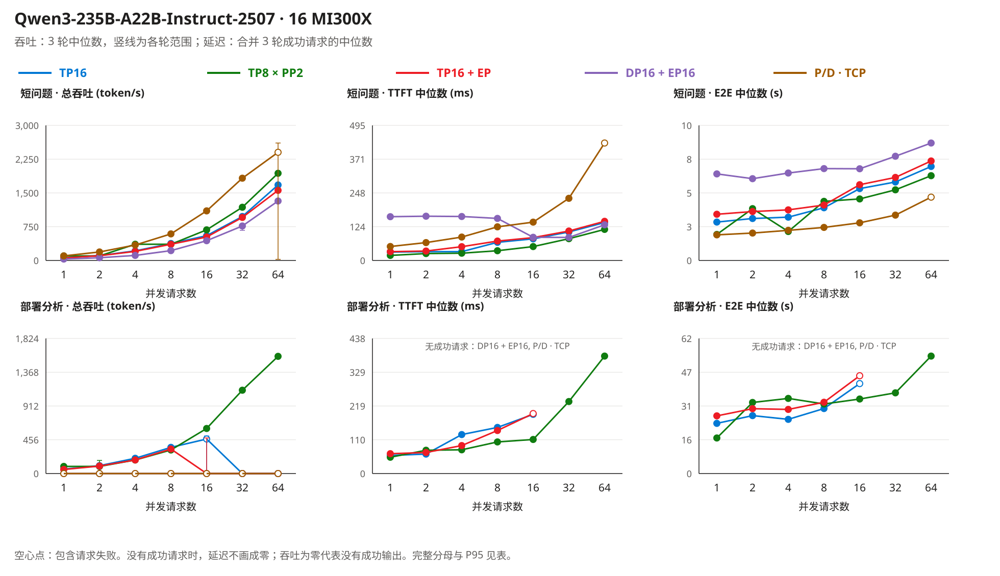

原创测量图来自[恢复轮逐请求汇总](data/mi300x-fiveway/qwen-fiveway-recovery_20261103/summary.json)。空心点包含失败，竖线是三轮最小值到最大值，不是置信区间；没有成功请求的延迟不画成零。低并发 P/D 的速度不能抵消后续不可用，也不能代表优化过的 RDMA 实现。

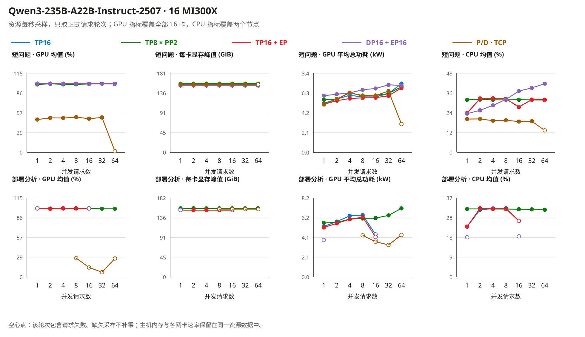

原创资源图来自同一摘要及每布局的双节点资源 JSONL。每秒采样后按正式轮次时间窗口筛选，排除加载、预热和阶段间空闲；聚合两节点、16 张卡，不把缺失值补零。主机 RAM 与各 Ethernet/InfiniBand 接口速率仍在记录中。主机 CPU 包含操作系统和采样器，GPU 功耗不是整机能耗或实际电费。系统报告时钟同步，但跨机时钟偏差未精测。

**本轮结论。** PP 是这两个重复输入和记录软件栈上唯一完成全部请求的布局，可作为相同场景的复现起点，不证明它对所有业务最快。网站标签是架构取舍提示，不能替代成功率与故障检查。业务质量、实际 32K 输入、长期稳定性、自动 Spot 恢复和优化 RDMA 路径仍未验证。复现入口见[新建测量](#qwen-reproduce)，核对方法见[验证说明](VALIDATION_CN.md#qwen-fiveway-validation)。

### 证据边界

精度研究检查日期为 2026-11-01（文档与配置）和 2026-11-02（MI300X 加载与张量普查）。当时五个部署生成过基础正确回答：三个原厂 BF16 与 Inkling、Nemotron 两个 MXFP4 模拟路径；Muse MXFP4 被模型代码拒绝。2026-11-03 和 2026-11-04 的 Muse 布局测量以及另行开展的 Qwen 实验见上文，不能用旧的并发 1/8 探针概括它们。各轮都没有完成业务质量、真实长上下文、生产稳定性或故障恢复验收。原厂 NVFP4 全模型和三个伙伴 FP8 版本未在本项目加载到 GPU；本页仍分别保留配置证据、局部探针和整模型执行的边界。

Nemotron 模型卡同时存在训练配方、权重版本和引擎示例；本文只将明确的导出规则用于模块精度判断。它的模型卡概述中出现“NVFP4 KV caching”，但具体示例使用 FP8 KV cache，本文按可执行参数说明差异，而不将概述视为已验证的缓存能力。

Inkling recipe 同时出现 `vLLM 0.26.0+` 和 nightly 安装提示。前者不是对任意后续 wheel 的保证，后者也不是可复现版本。上线前必须固定实际提交或镜像摘要，并保存成功启动和业务测试记录。

Red Hat Inkling FP8 模型卡概述称 Attention Linear 也量化，但固定 revision 的配置包含 `re:.*\.attn$` 和 `re:.*\.attn\..*` 两条排除规则 [I9]。主表保留这个冲突，按配置不把 `.attn` 子树写成 FP8；实际模块名匹配和加载后 dtype 仍须在运行时验收。两个 Red Hat FP8 配置的 `output_activations` 与 `kv_cache_scheme` 都为空，因此也不能由 FP8 输入规则推断输出和 KV 缓存都是 FP8。

Muse 的详细模块精度、三模型在指定机器上的峰值显存与性能，以及许可证在具体业务模式下的适用性仍需核验。公开模型卡的广泛支持列表不替代某一引擎、精度和模态的完整验收。Muse BF16 的权重闸门（Meta 人工审批的 gated 仓库，2026-11-02 凌晨读 `config.json` 返回 403）当天上午获批，权重已下载到两个节点，第 3 次尝试在 v0.33.0 镜像上通过；三次尝试和实测数字见[服务速度探针](#服务速度探针)与[验证说明](VALIDATION_CN.md#第-2-轮)。Muse 的多模态路径未测（`--language-model-only`），它的原厂 NVFP4 量化配置仍返回 401。

### 阅读导航

| 阅读目的 | 对应内容 |
|---|---|
| 查看硬件配置和实测结论 | [先看结论](#先看结论) |
| 核对组件精度 | [组件精度表](#逐模型组件精度)及[来源说明](#公开来源) |
| 估算权重和每卡显存 | [资源估算](#资源估算)及[预算输入](data/deployment-budget.json) |
| 查看 BF16 部署结果 | [MI300X 实测](#mi300x-实测)、[尝试记录](VALIDATION_CN.md#mi300x-实测)及[原始数据](data/mi300x-run/) |
| 查看 MXFP4 的显存、速度和失败原因 | [MXFP4 低精度路径](#mxfp4-低精度路径)及[原始数据](data/mi300x-mxfp4/) |
| 比较并行布局及失败边界 | [Muse：网站说法与实测对照](#muse-selectable)、[为什么有 InfiniBand 跨节点仍慢](#muse-time-budget)及其[重跑步骤](#muse-selectable-reproduce)；[较早的截断轮次](#muse-fiveway-20261103)；[Qwen 初轮](#qwen-fiveway)、[Qwen 恢复轮完整矩阵](#qwen-recovery)及[新建测量](#qwen-reproduce) |
| 在 MI300X 上复现 | [部署步骤](#在-mi300x-上复现-bf16-加载与-smoke)及[脚本](scripts/mi300x/) |
| 复算文中数据 | [复算命令](#不下载权重复算公开元数据)及[验证说明](VALIDATION_CN.md) |
| 确认未验证范围 | [证据边界](#证据边界)及[验证状态](VALIDATION_CN.md#当前验证状态) |

### 目录与职责

| 目录 / 文件 | 职责 |
|---|---|
| `README_CN.md` · `README.md` | 主文档，中英两版共用同一套数据文件 |
| `VALIDATION_CN.md` · `VALIDATION.md` | 测试命令、预期语义、MI300X 每次尝试的记录、当前验证状态表 |
| `data/model-evidence.json` | 六个固定 revision 的 API 元数据快照与 NVFP4 配置摘要（含 Muse 401 记录） |
| `data/tensor-census/` | 两个 BF16 快照的逐张量文件头普查结果 |
| `data/deployment-budget.json` | 每卡预算表的输入（GPU 数量、HBM、来源） |
| `data/mi300x-run/` | MI300X 实测的公开投影（第 1 轮：Nemotron、Inkling PP2、Inkling DP2；第 2 轮：Inkling PP2、Nemotron 和 Muse PP2，各带速度探针的 `08_perf.json`）：原始请求/响应、显存 JSON、日志关键行、`summary.json`、私有大文件的 SHA-256；`rccl_probe/` 存跨机 RCCL 探针两种设置的日志关键行（步骤 7） |
| `data/mi300x-mxfp4/` | 第 3 轮 MXFP4 的公开投影：Inkling 和 Nemotron 的 MXFP4 部署（`launch.json` 实际 argv、`first_response.json`、`08_perf.json`、日志关键行）、Muse 两次失败尝试的报错行、`summary.json`、私有大文件的 SHA-256；另含一次 NVFP4 单专家内核探针的 `gpu_probe.json`（只在验证说明里引用） |
| `data/mi300x-fiveway/` | 每轮一个目录，各自保存请求、运行参数、统计、错误及资源：2026-11-04 的 Muse 网站可选策略实测（`muse-selectable_20261104`，含两节点资源采样与跨机速率）、2026-11-03 的 Muse 截断轮次，以及 Qwen 初轮与恢复轮（恢复轮五布局全部执行，失败结果保留） |
| `data/visual-evidence.json` | 文中每张图的来源、尺寸、哈希和证明边界 |
| `images/` | NVIDIA 官方 NVFP4 两级缩放图；原创测试拓扑图、并行布局图，以及五布局的拓扑、性能、资源图和时间账图，由 `tools/build_layout_figure.py` 生成（2026-11-04 那一轮为 `mi300x-muse-selectable-*`）；`icons/` 保存未修改的 Azure 官方图标。旧执行路径图保留为历史素材，不再用于正文 |
| `scripts/mi300x/` | MI300X 复现脚本：节点准备、拉镜像、下载、三个模型的启动（`04_` Nemotron、`05_` Inkling、`08_` Muse）、证据采集、RCCL 探针、服务速度探针（`09_perf_probe.py`）、`Dockerfile.muse-ray`；布局对比用到的测量驱动（`10_measure_layout.sh`）、Qwen 启动脚本（`11_`）、资源采样（`12_resource_monitor.py`）、Mooncake 探针与代理（`13_`、`mooncake_connector_proxy.py`）和双节点批处理（`14_run_remaining_layouts.sh`） |
| `tools/` | `inspect.mjs`（元数据复算）、`census.mjs`（普查汇总）、`budget.mjs`（每卡预算）、`tensor_census.py`（在有权重的机器上读文件头）、`mi300x_evidence.py` 和 `mxfp4_evidence.py`（BF16 与 MXFP4 证据的公开投影与汇总）、`build_layout_figure.py`（并行布局图、测试拓扑图和五布局图）、`preview.ps1`（本地渲染与图导出） |
| `tests/` | `inspect.test.mjs`、`census.test.mjs`、`mi300x.test.mjs`、`mxfp4.test.mjs`，当前本地 24 项通过；[CI](https://github.com/david-xinyuwei/david-share/actions/workflows/large-moe-precision-guide-ci.yml) 配置为每次推送运行，本轮尚未发布 |

## 操作步骤

### 先选可验证路径，再启动服务

| 步骤（Step） | 位置与操作 | 通过条件 |
|---|---|---|
| 1 | **权重仓库与许可证页**：确认模型、精度版本、访问许可和固定 revision。 | 权重可合法取得，版本明确。 |
| 2 | **目标硬件与引擎**：选择同一模型的官方配方，固定 GPU、并行布局和引擎版本。 | 所需模态、缓存和内核都有明确支持。 |
| 3 | **容量规划**：统计权重字节，按目标上下文与并发计算缓存，再预留工作区。 | 每张卡与每个并行分组都有余量，不能只看总和。 |
| 4 | **隔离验证环境**：按官方配方启动，保存实际内核与缓存日志。 | 模型加载、功能调用与数值检查都通过。 |
| 5 | **业务验收环境**：用同一模型 BF16 与量化版本跑相同真实任务。 | 质量、峰值显存、延迟与并发满足预先定义的要求。 |
| 6 | **生产准备**：固定镜像、权重、模板、回退方案和监控。 | 新实例可重复部署；升级与回退有验证记录。 |

部署入口：Muse 使用 Meta 的开发者指南 [M3]；Nemotron 使用相应 BF16/NVFP4 模型卡中的引擎示例 [N1][N2]；Inkling 使用发布方链接的 vLLM recipe [I3]。不要把不同模型的命令拼成一个通用启动脚本，也不要把示例中的上下文长度、并发和并行参数原样当作业务推荐值。

### 在 MI300X 上复现 BF16 加载与 smoke

以下是本项目 2026-11-02 实测所用的脚本，位于 [scripts/mi300x/](scripts/mi300x/)，每个脚本开头注明它做什么、期望看到什么。起点：一台或两台 Azure `Standard_ND96isr_MI300X_v5`（镜像 `microsoft-dsvm:ubuntu-hpc:2404-rocm`），一个能 `sudo` 的登录用户，节点能访问 Hugging Face；Inkling 还需要两台机器的私网互通（Ray 6379 端口、RCCL 走 InfiniBand）。Shell 为 Bash，工作目录为本专题目录的克隆。费用提示：该规格每台约 14 美元/小时（Spot 参考价）；第 1 轮（BF16 加载与 smoke，00:29–03:05 北京时间）两台机器共 2 小时 36 分钟，约 73 美元；第 2–3 轮（速度探针、Muse、MXFP4）当天 10:06 重启后另计机时，未单独折算。不用时 `deallocate`，本地 NVMe 上的权重会随之丢失。

**执行边界。** 这些脚本是在两天的实测中边跑边改定稿的，仓库里的最终版本没有在一台全新的虚拟机上从第 1 步到第 10 步完整回放过一次；仓库保留的证据来自实测过程中的各次运行。已知的两处坑写在脚本注释里：虚拟机重新启动后 NVMe RAID0 会消失，必须重跑 `01_preflight.sh`；containerd 可能先于新存储目录启动导致 `docker pull` 报 `metadata.db` 错，`systemctl restart containerd docker` 可解。

| 步骤（Step） | 机器（Host） | 操作 | 脚本 | 验收 |
|---|---|---|---|---|
| 1 | 每台 | 组 NVMe RAID0、把 Docker/containerd 存储搬到 NVMe、记录 ROCm/GPU/IB 事实 | `01_preflight.sh` | 日志末尾 `GPU_COUNT=8`、`NVME_FREE_GB` > 3000、Docker 根目录在 NVMe |
| 2 | 每台 | 拉取 vLLM ROCm 镜像（约 30 GB） | `02_pull_image.sh` | `02_pull.log` 末尾 `PULL_EXIT=0`、`IMAGEID=sha256:e0ea9a10…` |
| 3 | 节点 0 | 下载 Nemotron 固定 revision（1.12 TB） | `03_download.sh` + Nemotron 参数 | `DL_DONE … bytes=1121078235607` |
| 3' | 每台 | 下载 Inkling 固定 revision（1.90 TB，两台都要） | `03_download.sh` + Inkling 参数 | 两台都出现 `DL_DONE … bytes=1904787107666` |
| 4 | 节点 0 | 启动 Nemotron（TP8 + EP） | `04_serve_nemotron.sh` | `/health` 返回 200；日志含 `Using TritonExperts MoE backend`、`Model loading took 136.51 GiB` |
| 5 | 节点 0 | 采集证据（3 条 smoke、显存、关键日志行、哈希） | `06_evidence.sh` + Nemotron 参数 | 证据目录出现 `02_smoke_response.json`，`finish_reason` 为 `stop` |
| 6 | 节点 0 | 停掉 Nemotron 容器，释放 8 卡 | `docker rm -f vllm_nemotron` | `rocm-smi --showmeminfo vram` 每卡回到 < 1 GB |
| 7 | 两台 | 16 进程 all_reduce 探针，先确认跨机 RCCL 通（可选但省时间） | `07_rccl_probe.sh`，节点 1 先、节点 0 在 30 秒内跟上 | 节点 0 打印 `RCCL_PROBE_OK=True world=16`、`PROBE_EXIT=0`（本项目 `nogdr` 设置：64 MiB all_reduce 2.4 ms、52.4 GB/s；默认 RDMA 设置超时） |
| 8 | 节点 1 → 节点 0 | 启动 Inkling（TP8 × PP2，每台一个流水级） | `05_serve_inkling_2node.sh`，节点 1 `worker` 先、约 30 秒后节点 0 `head` | 节点 0 `/health` 返回 200；日志含 `Using AiterExperts MoE backend`、两个流水级分别 `Model loading took 109.52 / 116.12 GiB` |
| 9 | 节点 0 | 采集 Inkling 证据 | `06_evidence.sh` + Inkling 参数 | `07_smoke3_response.json` 的 `finish_reason` 为 `stop`，正文给出 BF16 与 FP16 的区别 |
| 9' | 节点 0 | 对当前在线的服务跑服务速度探针（第 2 轮） | `09_perf_probe.py <served_model_name> <证据目录>/08_perf.json` | 打印 `conc=1 …`、`conc=8 …` 和 `PERF_DONE`；`08_perf.json` 逐条记录 TTFT、解码 tok/s 和 `finish_reason` |
| 9'' | 节点 1 → 节点 0 | Muse Spark Open（TP8 × PP2，gated 权重，需先在两节点用 `Dockerfile.muse-ray` 构建带 Ray 的镜像） | `08_serve_muse_2node.sh`，节点 1 `worker`，约 30 s 后节点 0 `head` | 节点 0 `/health` 返回 200；日志有 `Using MuseSparkTritonExperts MoE backend`，16 个 rank 都出现 `Model loading took 99.1 GiB`（页缓存热时从 head 启动到就绪约 4.5 分钟）。2026-11-02 遇到的两种失败（没有 Ray；镜像只编了 gfx950）写在脚本头部 |
| 10 | 两台 | 停容器；不再使用时释放虚拟机 | `docker rm -f vllm_inkling`，再在管理面 deallocate | `PowerState/deallocated`；NVMe 上的权重随之清空 |

各步骤的命令原文见下方代码块。

```bash
# 每台节点（步骤 1–2）
sudo -E bash scripts/mi300x/01_preflight.sh
sudo -E bash scripts/mi300x/02_pull_image.sh
# 下载（步骤 3 / 3'；变量来自 scripts/mi300x/00_env.sh）
. scripts/mi300x/00_env.sh
bash scripts/mi300x/03_download.sh "$NEMOTRON_ID" "$NEMOTRON_REV"      # 节点 0
bash scripts/mi300x/03_download.sh "$INKLING_ID"  "$INKLING_REV"       # 两台
# Nemotron（步骤 4–6，节点 0）
sudo -E bash scripts/mi300x/04_serve_nemotron.sh
sudo -E bash scripts/mi300x/06_evidence.sh vllm_nemotron nemotron-3-ultra-bf16 nemotron_bf16_8xMI300X
sudo docker rm -f vllm_nemotron
# 跨机探针（步骤 7）：节点 1 先执行，节点 0 在 30 秒内执行
HEAD_IP=<节点0私网IP> sudo -E bash scripts/mi300x/07_rccl_probe.sh 1 nogdr     # 节点 1
HEAD_IP=<节点0私网IP> sudo -E bash scripts/mi300x/07_rccl_probe.sh 0 nogdr     # 节点 0
# Inkling（步骤 8–10）：节点 1 先 worker，约 30 秒后节点 0 head
HEAD_IP=<节点0私网IP> sudo -E bash scripts/mi300x/05_serve_inkling_2node.sh worker   # 节点 1
HEAD_IP=<节点0私网IP> sudo -E bash scripts/mi300x/05_serve_inkling_2node.sh head     # 节点 0
sudo -E bash scripts/mi300x/06_evidence.sh vllm_inkling inkling-bf16 inkling_bf16_16xMI300X_pp2   # 节点 0
python3 scripts/mi300x/09_perf_probe.py inkling-bf16 "$MOE_ROOT/evidence/inkling_bf16_16xMI300X_pp2/08_perf.json"  # 节点 0，服务在线时
sudo docker rm -f vllm_inkling                                                       # 两台
# Muse（步骤 9''）：gated 权重（带 HF_TOKEN 跑 03_download.sh），两节点构建带 Ray 的镜像，再 worker -> head
bash scripts/mi300x/03_download.sh "$MUSE_ID" "$MUSE_REV"                                             # 两台
sudo docker build --network host --build-arg BASE=vllm/vllm-openai-rocm:v0.33.0 -t vllm-muse-ray:0.33.0 \
  -f scripts/mi300x/Dockerfile.muse-ray scripts/mi300x                                                  # 两台
HEAD_IP=<节点 0 私网 IP> sudo -E bash scripts/mi300x/08_serve_muse_2node.sh worker     # 节点 1
HEAD_IP=<节点 0 私网 IP> sudo -E bash scripts/mi300x/08_serve_muse_2node.sh head       # 节点 0
```

把采集到的目录交给 `python3 tools/mi300x_evidence.py project <evidence_dir> <tag>` 可生成与本仓库 [data/mi300x-run/](data/mi300x-run/) 同格式的公开投影（替换主机名、私网 IP 和登录用户，完整容器日志只保留 SHA-256）；`python3 tools/mi300x_evidence.py summarize` 从这些原始文件重算 `summary.json`，`node --test tests/mi300x.test.mjs` 再核对本文引用的每个数字。本仓库的六组投影就是这样得到的，未手工填写任何数值。

两处与模型卡不同、且只有在这套 ROCm 镜像上才会碰到的改动都写在脚本注释里：Nemotron 关掉 AITER MoE 并去掉 Mamba 随机舍入；Inkling 用 PP2 而不是模型卡的 DP2 + EP16，并关掉 FA4 预热。每一条的报错原文、尝试次序和判断依据见[验证说明](VALIDATION_CN.md#mi300x-实测)。

### 重跑网站可选策略的 Muse 实测

<a id="muse-selectable-reproduce"></a>

**执行边界。** 以下步骤复用产生 2026-11-04 实测的入口脚本。那一轮由一个设置相同变量的私有包装脚本启动；这里公开的步骤序列尚未在全新 VM 上完整回放。起点是两台已按上文步骤 1 准备好的 MI300X 节点（`01_preflight.sh`：NVMe RAID0，Docker 与 containerd 存储在 NVMe 上），两台都有本专题的源码，私网互通，节点 0 到节点 1 有 SSH 密钥和已核实的主机公钥，两台都可免密 `sudo`。Shell 为 Bash，工作目录为本专题源码根。下面的命令都不会创建、停止或释放 VM。

| 步骤（Step） | 机器（Host） | 操作 | 通过条件 |
|---|---|---|---|
| 1 | 两节点 | 按摘要拉取固定镜像；下载 Muse 固定 revision（gated 仓库，需要已接受许可证的 `HF_TOKEN`） | 两节点镜像 ID 相同；65 个分片齐全 |
| 2 | 两节点 | 用已发布的汇总 `init-fiveway` 一个新运行目录，两节点 `RUN_ROOT` 相同 | `run.json` 状态为 `NOT_RUN`，有自己的表格标记和图片文件名，不带旧结果 |
| 3 | 两节点 | 为本轮启动 `12_resource_monitor.py` | `resources-node0.jsonl` / `resources-node1.jsonl` 持续增长 |
| 4 | 节点 0 | 以 `MODEL_FAMILY=muse`、`LAYOUTS=pp,tp,tep` 运行 `14_run_remaining_layouts.sh` | `batch-status.json` 为 `PASS`，或为 `COMPLETE_WITH_ERRORS` 且每条请求都有记录；每个布局一个封存包 |
| 5 | 两节点 | 停止采样，为两个 JSONL 生成哈希，把节点 1 的资源文件复制到节点 0 的运行目录，再把整个目录复制到控制机 | 复制后哈希一致 |
| 6 | 控制机 | `project-fiveway` → 测试 → 为新运行的标记添加 README 区域 → `render-fiveway` → 生成图 | 只分析新目录；本轮文件保持不变 |

```bash
# 步骤 1，两节点：固定镜像与权重（gated 仓库，需要已接受 Muse 许可证的 HF_TOKEN）
export IMAGE=vllm/vllm-openai-rocm@sha256:4fcd39b758b660c4e9c345c021e2ea8f0ccdb31e3c32507d676cc3005ae83fba
sudo docker pull "$IMAGE"
. scripts/mi300x/00_env.sh
bash scripts/mi300x/03_download.sh "$MUSE_ID" "$MUSE_REV"
# 步骤 2，两节点，使用同一个新 ID
export RUN_ID=muse-selectable-new
export RUN_ROOT="$HOME/moe-run/evidence/$RUN_ID"
python3 tools/mi300x_evidence.py init-fiveway "$RUN_ROOT" \
  data/mi300x-fiveway/muse-selectable_20261104/summary.json
# 步骤 3，每个节点：节点 0 设 NODE_ROLE=node0，节点 1 设 node1
export NODE_ROLE=node0
sudo systemd-run --unit="muse-resources-$NODE_ROLE-$RUN_ID" \
  --property="StandardOutput=append:$RUN_ROOT/resource-monitor.log" \
  --property="StandardError=append:$RUN_ROOT/resource-monitor.log" \
  /usr/bin/python3 "$RUN_ROOT/source/12_resource_monitor.py" "$RUN_ROOT/resources-$NODE_ROLE.jsonl" --interval 1
# 步骤 4，节点 0；运行器通过 SSH 访问节点 1。脚本默认 SSH_PORT 为测试 VM 使用的 33901，请改成你的端口
sudo systemd-run --unit="muse-batch-$RUN_ID" --uid="$USER" --working-directory="$RUN_ROOT" \
  --property="StandardOutput=append:$RUN_ROOT/batch.log" --property="StandardError=append:$RUN_ROOT/batch.log" \
  --setenv=HOME="$HOME" --setenv=RUN_ROOT="$RUN_ROOT" \
  --setenv=HEAD_IP=YOUR_NODE0_PRIVATE_IP --setenv=WORKER_IP=YOUR_NODE1_PRIVATE_IP \
  --setenv=SSH_USER="$USER" --setenv=SSH_PORT=22 --setenv=KNOWN_HOSTS="$HOME/.ssh/known_hosts" \
  --setenv=MODEL_FAMILY=muse --setenv=LAYOUTS=pp,tp,tep --setenv=IMAGE="$IMAGE" --setenv=GPU_UTIL=0.95 \
  --setenv=CONCURRENCIES=1,2,4,8,16,32,64 --setenv=ROUNDS=3 \
  --setenv=SHORT_MAX_TOKENS=8192 --setenv=GUIDE_MAX_TOKENS=16384 \
  --setenv=MODEL_SNAPSHOT="$HF_CACHE/hub/models--meta-models--Muse-Spark-Open-816B-A42B/snapshots/$MUSE_REV" \
  /bin/bash "$RUN_ROOT/source/14_run_remaining_layouts.sh"
cat "$RUN_ROOT/batch-status.json"
# 步骤 5，batch.log 出现 BATCH_COMPLETE 后在每个节点执行
sudo systemctl stop "muse-resources-$NODE_ROLE-$RUN_ID"
sha256sum "$RUN_ROOT/resources-$NODE_ROLE.jsonl" > "$RUN_ROOT/resources-$NODE_ROLE.sha256"
# 步骤 6，控制机；节点 1 的 resources-node1.* 已放进同一个 RUN_ROOT
python3 tools/mi300x_evidence.py project-fiveway "$RUN_ROOT"
node --test tests/mi300x.test.mjs
```

`init-fiveway` 复制脚本和两组输入，并给新运行分配表格标记 `FIVEWAY RESULTS <RUN_ID>` 和图片文件名 `mi300x-<RUN_ID>-*`。README 中没有该标记的区域时，`render-fiveway` 会直接失败，所以新运行不会覆盖 2026-11-04 的表格和图。`COMPLETE_WITH_ERRORS` 表示测量跑完但有请求或采集错误，读数之前先检查该布局的 `status.json` 和日志。

本轮开始前遇到过两个节点层面的问题。Spot 驱逐并重新启动后，一台节点的 amdgpu 驱动一直停在初始化阶段（`/sys/module/amdgpu/initstate` 为 `coming`，内核日志反复出现 `invalid pf2vf message size`），对该 VM 做一次客户机重启后恢复。加载模型之前先确认状态为 `live`，并且 `rocm-smi` 能看到 8 张 gfx942 GPU。客户机重启（不是释放）后，NVMe RAID 阵列会带着数据自动重组，但不会自动挂载：把现有的 XFS 文件系统挂到 `/mnt/nvme`，再重启 containerd 和 Docker；不要重新创建或格式化阵列。

### 新建 Qwen 五布局测量

<a id="qwen-reproduce"></a>

**执行边界。** 以下面向已经准备好驱动、Docker、互通私网和模型 NVMe 缓存的两台 MI300X 节点，Bash 工作目录为本专题源码根。它复用本轮真实启动与测量入口，不创建 VM、不修改权限、不自动停机。两节点的 `RUN_ID`、`RUN_ROOT`、镜像与权重 revision 必须相同。新 ID 不得指向已发布或历史证据目录。恢复轮已执行全部五布局，但完整全新 VM 回放与自动 Spot 恢复仍未验证。

| 步骤（Step） | 机器（Host） | 操作与入口 | 验收 |
|---|---|---|---|
| 1 | 两节点 | 核对 GPU/驱动、网络、可用磁盘和固定镜像；已有兼容环境直接复用 | 实际 GPU 数、版本和镜像 ID 已记录 |
| 2 | 两节点 | 下载固定 Qwen snapshot；新建同名运行目录，复制当前脚本与原始输入 | 两份输入和 revision 一致；状态为 `NOT_RUN`，没有旧成绩 |
| 3 | 两节点 | 用 `12_resource_monitor.py` 启动本轮采样 | JSONL 持续写入且有八张卡；不是另造估算值 |
| 4 | 两节点 | `11_serve_qwen_fiveway.sh head/worker`，逐个运行 `tp`、`pp`、`tep`、`dp`、`pd` | 真实 rank 分组、模型加载、health 和 smoke；P/D 另启动官方代理 |
| 5 | 节点 0 | `10_measure_layout.sh` 进行两组输入、七档并发测量 | `PASS` 或 `COMPLETE_WITH_ERRORS` 且完整请求清单存在；`FAILED` 需先查阶段 |
| 6 | 两节点与控制机 | 封存日志、停止本轮采样、生成 SHA256，回流同一运行目录 | 原始文件逐字校验；只有两节点资源齐全才做全卡统计 |
| 7 | 控制机 | `project-fiveway` → 测试 → `render-fiveway` → 图形生成 | 只使用新运行目录；旧结果不变；缺失与失败明确保留 |

**固定镜像与下载。** 两节点安装 Hugging Face CLI 后执行；已有相同 snapshot 时复用，不重复下载。镜像复用现有 Dockerfile，其中包含 Ray，但本轮执行器明确使用 `mp`。

```bash
export IMAGE=vllm-fiveway:0.33.0
export HF_HOME=/mnt/nvme/hf
docker image inspect --format '{{.Id}}' "$IMAGE" || docker build --network host \
  --build-arg BASE=vllm/vllm-openai-rocm@sha256:4fcd39b758b660c4e9c345c021e2ea8f0ccdb31e3c32507d676cc3005ae83fba \
  -t "$IMAGE" -f scripts/mi300x/Dockerfile.muse-ray scripts/mi300x
hf download Qwen/Qwen3-235B-A22B-Instruct-2507 \
  --revision ac9c66cc9b46af7306746a9250f23d47083d689e --cache-dir "$HF_HOME/hub"
```

**两节点各自初始化，使用相同新 ID。** `HEAD_IP`、`WORKER_IP` 改成自己的私网地址；节点 1 使用自己的 `NODE_IP` 和 `NODE_ROLE=node1`。不要把示例参数当成自动发现。

```bash
export RUN_ID=qwen-new-run
export RUN_ROOT="$HOME/moe-run/evidence/$RUN_ID"
export HEAD_IP=YOUR_NODE0_PRIVATE_IP
export WORKER_IP=YOUR_NODE1_PRIVATE_IP
export NODE_IP="$HEAD_IP"
export NODE_ROLE=node0
python3 tools/mi300x_evidence.py init-fiveway "$RUN_ROOT" \
  data/mi300x-fiveway/qwen-fiveway_20261103-172600/summary.json
sudo systemd-run --unit="qwen-resources-$NODE_ROLE-$RUN_ID" \
  --property="StandardOutput=append:$RUN_ROOT/resource-monitor.log" \
  --property="StandardError=append:$RUN_ROOT/resource-monitor.log" \
  /usr/bin/python3 "$RUN_ROOT/source/12_resource_monitor.py" \
  "$RUN_ROOT/resources-$NODE_ROLE.jsonl" --interval 1
```

**一次只运行一个布局。** 两节点设置相同 `LAYOUT`；节点 0 传 `head`，节点 1 传 `worker`。脚本拒绝覆盖同名容器；切换前先保存当前结果，再由操作者停止本轮旧容器。

```bash
export LAYOUT=tp
sudo env RUN_ROOT="$RUN_ROOT" LAYOUT="$LAYOUT" HEAD_IP="$HEAD_IP" \
  NODE_IP="$NODE_IP" IMAGE="$IMAGE" \
  bash "$RUN_ROOT/source/11_serve_qwen_fiveway.sh" head
```

当 `LAYOUT=pd` 时，节点 0 还需运行官方代理；其健康检查等待 P/D 两端就绪，不提供自己的 `/health`。

```bash
sudo docker run -d --name qwen_fiveway_pd_proxy --network host \
  -v "$RUN_ROOT:/run-evidence" -e PYTHONUNBUFFERED=1 \
  --entrypoint /usr/bin/python3 "$IMAGE" /run-evidence/source/mooncake_connector_proxy.py \
  --host 0.0.0.0 --port 8000 --prefill "http://$HEAD_IP:8001" 8998 \
  --decode "http://$WORKER_IP:8002"
```

**节点 0 测量。** 下面的条件分支仅选择正确入口，不会把 P/D 失败改成单端重算。

```bash
MEASURE_ENV=(--setenv="CONTAINER_NAME=qwen_fiveway_$LAYOUT")
if [ "$LAYOUT" = pd ]; then
  MEASURE_ENV=(--setenv=CONTAINER_NAME=qwen_fiveway_pd_proxy \
    --setenv=MODEL_CONTAINER_NAME=qwen_fiveway_pd \
    --setenv="HEALTH_URL=http://$WORKER_IP:8002/health" \
    --setenv="METRICS_URL=http://$WORKER_IP:8002/metrics" \
    --setenv="PREFILL_METRICS_URL=http://$HEAD_IP:8001/metrics" \
    --setenv="READY_PATTERN=All prefiller instances are ready.")
fi
sudo systemd-run --unit="qwen-measure-$LAYOUT-$RUN_ID" \
  --property="StandardOutput=append:$RUN_ROOT/$LAYOUT/measure.log" \
  --property="StandardError=append:$RUN_ROOT/$LAYOUT/measure.log" \
  --setenv="RUN_ROOT=$RUN_ROOT" --setenv="LAYOUT=$LAYOUT" \
  --setenv=SERVED_MODEL=qwen-fiveway-bf16 --setenv=BASE_URL=http://127.0.0.1:8000 \
  --setenv=CONCURRENCIES=1,2,4,8,16,32,64 --setenv=ROUNDS=3 \
  --setenv=SHORT_MAX_TOKENS=512 --setenv=GUIDE_MAX_TOKENS=2048 \
  "${MEASURE_ENV[@]}" /bin/bash "$RUN_ROOT/source/10_measure_layout.sh"
cat "$RUN_ROOT/$LAYOUT/status.json"
```

`COMPLETE_WITH_ERRORS` 表示扫测完成但请求或采集有错误，不是部署通过。当前采集器在轮次之间原子保存 `IN_PROGRESS` 检查点；本地模拟进程终止已验证，但它是 Spot 中断后新增的修正，**没有恢复本轮丢失的数据，也未经历真实 Spot 恢复验收**。中断文件不能按完整结果投影，保留原件并使用新 ID 补测。`RESUME=1` 仅续跑同一容器中已完整保存的输入；`RESUME=evidence` 仅收尾已有两份完整报告，不执行新推理。

**封存与复算。** 两节点保存 `docker logs` 和实际 `docker inspect` 命令；节点 1 的日志放入对应布局的 `worker.log`，其命令放入 `worker-launch.txt`。结束本轮采样后，对各自 JSONL 生成哈希。复制到控制机时保持同一运行目录的相对路径，先校验原始哈希，禁止覆盖不同文件。

```bash
sudo systemctl stop "qwen-resources-$NODE_ROLE-$RUN_ID"
sha256sum "$RUN_ROOT/resources-$NODE_ROLE.jsonl" > "$RUN_ROOT/resources-$NODE_ROLE.sha256"
python3 tools/mi300x_evidence.py project-fiveway "$RUN_ROOT"
node --test tests/mi300x.test.mjs
python3 tools/mi300x_evidence.py render-fiveway "data/mi300x-fiveway/$RUN_ID/summary.json"
python3 tools/build_layout_figure.py --fiveway "data/mi300x-fiveway/$RUN_ID/summary.json" --png
```

最后一条 PNG 命令在装有 Microsoft Edge 的 Windows 控制机上执行；Linux 可先不带 `--png` 生成 SVG。全仓库测试还会检查本文发布的证据；新运行则以 `project-fiveway` 对该目录的原始哈希、记录数与统计校验为准，不能用旧 fixture 的绿灯冒充新运行通过。VM 的启动、释放或重建须单独决定；上述命令不操作 VM 电源。

### 不下载权重复算公开元数据

需要 Node.js 20 或更高版本。在本目录的终端执行：

```bash
node tools/inspect.mjs
node tools/census.mjs --table
node tools/budget.mjs --table
node --test tests/inspect.test.mjs tests/census.test.mjs tests/mi300x.test.mjs tests/mxfp4.test.mjs
```

第一条命令从六个已保存版本的逐 dtype 元素数计算张量负载字节；第二条汇总两个 BF16 快照的逐张量文件头普查并与 API 元数据交叉核对；第三条按发布方列出的 GPU 数量算每卡权重与剩余 HBM。测试检查版本覆盖、打包字节计算、明确保留的配置缺口、失败处理、普查与 API 字节一致性，以及本文引用的每个 MI300X 实测数字（含第 2 轮速度探针的 TTFT 和 tok/s，以及跨机 RCCL 探针的 2.4 ms / 52.4 GB/s 和默认 RDMA 设置的超时，均从探针自己的结果行读出）是否与 [data/mi300x-run/summary.json](data/mi300x-run/summary.json) 一致，以及并行布局图画的 TP/PP/EP 大小和每卡显存是否就是该 summary 里的值、图标是否与台账哈希一致，还有一项版式守卫：两版 README 的每卡预算表、MI300X 结果表、速度探针表和复现步骤表必须保持完整列数，表内不得出现被 `<br>` 切断的代码标识或空 `<code>` 标签；`mxfp4.test.mjs` 再核对第 3 轮 MXFP4 的每个数字（每卡权重、KV、首条回答 token 数、TTFT、tok/s）与 [data/mi300x-mxfp4/summary.json](data/mi300x-mxfp4/summary.json) 一致，Muse 的两条拒绝原文在日志关键行里，并且两版 README 没有把 Muse MXFP4 写成通过（共 24 项，含 `mi300x.test.mjs` 中的五布局请求、资源与对比检查）。这些命令都不调用模型，也不验证 GPU 数量。

要读取当前公开元数据而不是复算快照：

```bash
node tools/inspect.mjs --live
```

该命令调用公开 Hugging Face 模型 API，输出新 revision 并按返回数据重新计算；失败时不会用旧快照伪装成功，不下载权重、不申请权限，也不把旧量化配置的核验结果套到新 revision。结果不包含运行时缓存与工作区。

完整命令、预期语义及未执行项：[验证说明](VALIDATION_CN.md) · [Validation](VALIDATION.md)。数据与范围：[model-evidence.json](data/model-evidence.json)。主表的公开依据见本页来源表。

### 生产验收条件

验收对象是完整组合：**模型 revision + 权重格式 + GPU 型号 + 推理引擎版本 + 计算内核 + 缓存设置 + 并行布局 + 请求负载**。改变其中一项，相关结果就需要重新核验。

必须覆盖实际使用的文本、图像、音频或视频任务、工具调用和结构化输出；用生产代表性输入检查长上下文与目标并发。记录正确率或业务评分、错误类型、峰值显存、首 token 延迟、生成延迟分布及服务吞吐。仅能返回一句话、通过健康检查或模型文件更小，都不等于生产验收通过。

BF16 是对照基线，并不保证答案正确；NVFP4 是候选格式，不是“天然无损”的承诺。若无客户任务、目标上下文和并发条件，最多给出上表这样的条件化建议，不给出假精确的实例数量或 SLA。

### 公开来源

| 编号 | 来源及检查范围 |
|---|---|
| M1 | [Meta Muse Spark Open BF16 模型卡](https://huggingface.co/meta-models/Muse-Spark-Open-816B-A42B)：模型身份、参数、访问条件与部署量级 |
| M2 | [Meta Muse Spark Open NVFP4 模型卡](https://huggingface.co/meta-models/Muse-Spark-Open-816B-A42B-NVFP4)：公开权重版本、部署量级与限制 |
| M3 | [Meta 开发者部署指南](https://dev.meta.ai/resources/blog/build-with-muse-spark-open)：专家量化范围与四卡 Blackwell Ultra/八卡 H200 声明；命令未执行 |
| M4 | [vLLM Muse recipe](https://recipes.vllm.ai/meta-models/Muse-Spark-Open-816B-A42B)：FP32 路由/残差、无共享专家、八卡 Blackwell 配方；AMD 例子为 text-only |
| M8 | [AMD Muse FP8](https://huggingface.co/amd/Muse-Spark-Open-816B-A42B-Quark-PTPC-FP8)：专家与 Attention 的逐通道权重、逐 token 激活和排除项 |
| N1 | [Nemotron 3 Ultra BF16 模型卡](https://huggingface.co/nvidia/NVIDIA-Nemotron-3-Ultra-550B-A55B-BF16)：模型、硬件摘要与各引擎限制 |
| N2 | [Nemotron 3 Ultra NVFP4 模型卡](https://huggingface.co/nvidia/NVIDIA-Nemotron-3-Ultra-550B-A55B-NVFP4)：硬件摘要、vLLM 与缓存示例 |
| N3 | [Nemotron NVFP4 固定版本导出配置][N3]：`quantized_layers` 与 `exclude_modules`；网页过大时通过原始 JSON 读取 |
| N8 | [Red Hat Nemotron FP8-dynamic](https://huggingface.co/RedHatAI/NVIDIA-Nemotron-3-Ultra-550B-A55B-FP8-dynamic)：FP8 配方、ignore 列表和部署例子；不引用其榜单或元数据日期作本项目结果 |
| I1 | [Inkling BF16 模型卡](https://huggingface.co/thinkingmachines/Inkling)：模型、架构、精度与引擎入口 |
| I2 | [Inkling NVFP4 模型卡](https://huggingface.co/thinkingmachines/Inkling-NVFP4)：正式版本与许可 |
| I3 | [vLLM Inkling recipe](https://recipes.vllm.ai/thinkingmachines/Inkling)：混合精度、Blackwell/Hopper 路径、版本提示与缓存结构；发布方模型卡链接此页 |
| I4 | [Inkling 固定 revision 的量化配置](https://huggingface.co/thinkingmachines/Inkling-NVFP4/blob/42a75a99a40eb2ba1e0717db6357a0bf15205044/hf_quant_config.json)：全局 NVFP4、`kv_cache_quant_algo=none`、专家/编码器等排除项 |
| I8 | [Red Hat Inkling FP8-dynamic](https://huggingface.co/RedHatAI/Inkling-FP8-dynamic)：发布者、原模型与集成依赖；其 Attention 概述与配置冲突见 I9 |
| I9 | [Red Hat Inkling FP8 固定配置](https://huggingface.co/RedHatAI/Inkling-FP8-dynamic/blob/cb2bf130a5263e01d7398723ae9b88e0060f4998/config.json)：`ignore` 排除 `.attn`；`output_activations` 与 `kv_cache_scheme` 为空 |
| V1 | [vLLM 稳定版 Model Optimizer 支持](https://docs.vllm.ai/en/stable/features/quantization/modelopt/)：NVFP4、W4A16_NVFP4 与兼容内核选择 |
| V2 | [vLLM KV cache 文档](https://docs.vllm.ai/en/stable/features/quantization/quantized_kvcache/)：缓存存储、scale 与 Attention 计算路径的区别 |
| H1 | [NVIDIA NVFP4 说明](https://developer.nvidia.com/blog/introducing-nvfp4-for-efficient-and-accurate-low-precision-inference/)：E2M1、16 元素块、FP8 块 scale 与 FP32 tensor scale |
| H2 | [NVIDIA NVFP4 与 MXFP4 格式对照](https://developer.nvidia.com/blog/introducing-nvfp4-for-efficient-and-accurate-low-precision-inference/)：两种块缩放及 NVFP4 的编码开销 |
| H3 | [AMD Instinct MI350 系列](https://www.amd.com/en/products/accelerators/instinct/mi350.html)：MI350X/MI355X 的 MXFP4 支持 |
| T1 | [本项目逐张量普查](data/tensor-census/)：2026-11-02 读取固定 revision 全部 safetensors 文件头得到的每个张量 dtype 与字节数，不读权重数据；脚本 [tensor_census.py](tools/tensor_census.py)，汇总 `node tools/census.mjs --table` |
| T2 | [本项目 MI300X 实测](VALIDATION_CN.md#mi300x-实测)：2026-11-02 在 Azure `Standard_ND96isr_MI300X_v5` 上用 `rocm/vllm` 镜像加载并生成；证据目录与关键日志行见验证说明 |
| T3 | [本项目 MXFP4 低精度路径](VALIDATION_CN.md#第-3-轮)：2026-11-02 在 1 节点 8 × MI300X 上用 `vllm-muse-ray:0.33.0` 镜像的 MXFP4 模拟路径（Inkling、Nemotron 通过，Muse 被模型代码拒绝）；公开投影在 [data/mi300x-mxfp4/](data/mi300x-mxfp4/) |

进一步阅读：[NVFP4](../NVFP4/)、[量化方法对比](../Quantization-Methods-Comparison-and-Practice/)、[大模型显存估算](../LLM-Memory-Estimation/)。这些目录解释通用方法或其他模型的历史结果，不能替代本文三款模型的验收。

[M1]: https://huggingface.co/meta-models/Muse-Spark-Open-816B-A42B
[M2]: https://huggingface.co/meta-models/Muse-Spark-Open-816B-A42B-NVFP4
[M3]: https://dev.meta.ai/resources/blog/build-with-muse-spark-open
[M4]: https://recipes.vllm.ai/meta-models/Muse-Spark-Open-816B-A42B
[M8]: https://huggingface.co/amd/Muse-Spark-Open-816B-A42B-Quark-PTPC-FP8
[N1]: https://huggingface.co/nvidia/NVIDIA-Nemotron-3-Ultra-550B-A55B-BF16
[N2]: https://huggingface.co/nvidia/NVIDIA-Nemotron-3-Ultra-550B-A55B-NVFP4
[N3]: https://huggingface.co/nvidia/NVIDIA-Nemotron-3-Ultra-550B-A55B-NVFP4/blob/02462641f13d3af838b904f48195b9bb8a1e4ebc/hf_quant_config.json
[N8]: https://huggingface.co/RedHatAI/NVIDIA-Nemotron-3-Ultra-550B-A55B-FP8-dynamic
[I1]: https://huggingface.co/thinkingmachines/Inkling
[I2]: https://huggingface.co/thinkingmachines/Inkling-NVFP4
[I3]: https://recipes.vllm.ai/thinkingmachines/Inkling
[I4]: https://huggingface.co/thinkingmachines/Inkling-NVFP4/blob/42a75a99a40eb2ba1e0717db6357a0bf15205044/hf_quant_config.json
[I8]: https://huggingface.co/RedHatAI/Inkling-FP8-dynamic
[I9]: https://huggingface.co/RedHatAI/Inkling-FP8-dynamic/blob/cb2bf130a5263e01d7398723ae9b88e0060f4998/config.json
[V1]: https://docs.vllm.ai/en/stable/features/quantization/modelopt/
[V2]: https://docs.vllm.ai/en/stable/features/quantization/quantized_kvcache/
[H1]: https://developer.nvidia.com/blog/introducing-nvfp4-for-efficient-and-accurate-low-precision-inference/
[H2]: https://developer.nvidia.com/blog/introducing-nvfp4-for-efficient-and-accurate-low-precision-inference/
[H3]: https://www.amd.com/en/products/accelerators/instinct/mi350.html