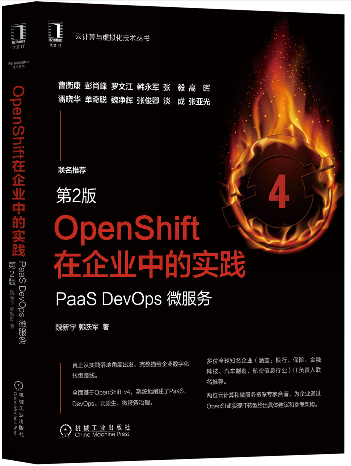
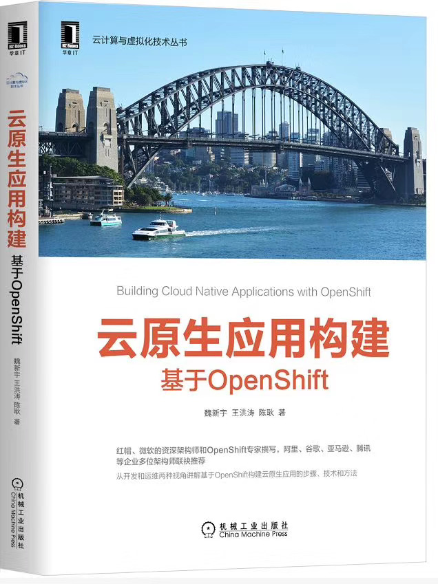
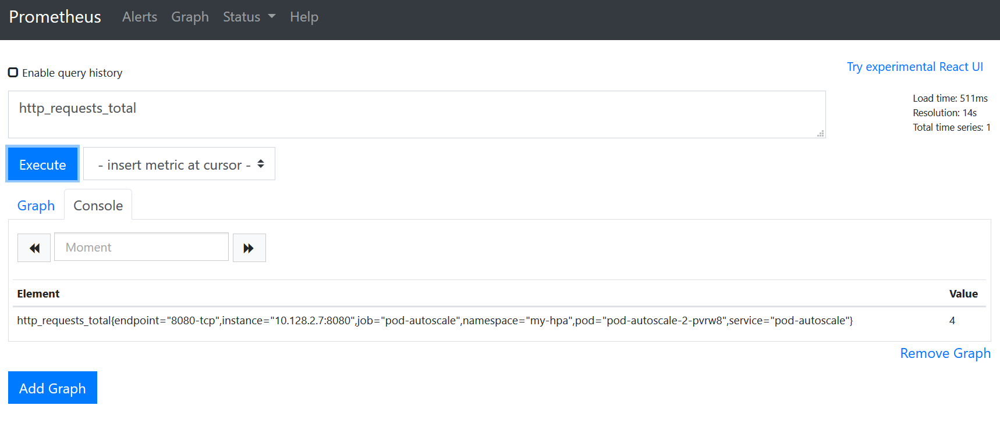

# AI Agents & Deep Learning: Code, Benchmarks and Explainers

<div align="center">

[](https://github.com/xinyuwei-david/david-share/stargazers)
[](https://github.com/xinyuwei-david/david-share/issues)
[](LICENSE)

**Hands-on projects on building AI agents and on training, serving and measuring the models behind them, mostly on Azure**

</div>

---

## 🌟 Overview

This repository collects the hands-on work of **Xinyu Wei (魏新宇)** in two connected areas:

- **AI agents**: building, hosting and operating agents on Microsoft Foundry and Azure, the model APIs and gateways they call, voice agents, retrieval and MCP.
- **Deep learning**: fine-tuning and reinforcement learning, inference optimization, precision and quantization, GPU selection on NVIDIA and AMD hardware, multimodal models, and one-topic algorithm explainers.

Each folder is a self-contained project with its own README. Many recent projects also include the scripts, raw results and CI checks that produced their numbers.

## 🆕 Recently Updated

| Last updated | Project | Area |
|---|---|---|
| 2026-11-14 | [Thermal 3D Modeling Studio: Azure OpenAI GPT-6 Astra Writes the Model Code, OpenCascade Builds the STEP](./Agents/Thermal-3D-Modeling-Studio/) | AI Agents |
| 2026-11-05 | [Component Precision and Deployment Guide for Large MoE Models](./Deep-Learning/Large-MoE-Precision-and-Deployment-Guide/) | Deep Learning |
| 2026-11-03 | [Decision Model on the Edge: Fine-Tuning and Inference Optimization](./Deep-Learning/AIPC-Decision-Model-Finetune/) | Deep Learning |
| 2026-10-27 | [Claude 5.5 on Microsoft Foundry: Thinking, Effort, Prompt Caching, Latency and Coding Accuracy](./Agents/Claude-Foundry-LiteLLM-Performance/) | AI Agents |
| 2026-10-23 | [Five Ways to Host an Agent Sandbox on Azure](./Agents/Azure-Agent-Sandbox-Hosting/) | AI Agents |
| 2026-10-17 | [LLM Inference Optimization on Azure GPU VMs](./Deep-Learning/LLM-Inference-Optimization-on-Azure-GPU-VMs/) | Deep Learning |
| 2026-10-13 | [Azure MI300X: AllReduce regression after a native host-driver upgrade](./Deep-Learning/MI300X-ROCm-Host-Driver-AllReduce-Regression/) | Deep Learning |
| 2026-10-11 | [Measure Azure GPU Hours with DCGM and Azure Monitor](./Deep-Learning/Azure-GPU-Hours-Monitoring/) | Deep Learning |
| 2026-10-04 | [Azure OpenAI Model and Model Router Benchmark](./Agents/Model-And-Router-Benchmark/) | AI Agents |
| 2026-10-04 | [English meeting transcription on far-field audio: six Azure speech paths, four AMI clips](./Multimodal-Models/Meeting-Transcription-AMI-English/) | Multimodal Models |

## 📚 Browse by Area

| Area | What you will find |
|---|---|
| 🤖 [AI Agents](./Agents/) | Building, hosting and operating agents on Microsoft Foundry; agent applications; voice agents; model, API and gateway benchmarks on Azure; retrieval and evaluation |
| 🧠 [Deep Learning](./Deep-Learning/) | Fine-tuning, RL and alignment; inference optimization (vLLM, SGLang, speculative decoding, KV cache); precision and quantization (FP8, FP4); GPU selection and benchmarks on NVIDIA and AMD; distributed training |
| 🔬 [DL Algorithm Insights](./DL-Algorithm-Insights/) | One algorithm or systems topic per folder, explained in depth with experiments |
| 🎨 [Multimodal Models](./Multimodal-Models/) | Image generation benchmarks (MAI-Image, GPT-Image), speech and voice, vision-language models, medical imaging |
| 📘 [Edge-Side AI book code](./Code-of-Book-Edge-AI/) | Companion code for *Edge-Side AI: Training, Optimizing and Deploying Small Models* (2026) |
| 📗 [LLM book code](./Code-of-Book/) | Companion code for *Principles, Training, and Applications of Large Language Models* (2024) |

Each area page groups its projects by topic. Projects whose models or APIs have since been superseded stay in place under **Archive** on their area page, so existing links keep working.

---

## 🛠️ Technology Stack

<div align="center">


**Agents & platforms**: Microsoft Foundry • Azure OpenAI • Microsoft Agent Framework • MCP • Azure AI Speech / Voice Live  
**Training & serving**: vLLM • SGLang • DeepSpeed • FSDP • LoRA / QLoRA • GRPO  
**Infrastructure**: Azure ND / NC GPU VMs (H100, H200, MI300X) • AKS • InfiniBand / RDMA

</div>

---

## 📚 Published Works

### 📘 Latest Publication (Pre-order, December 3, 2026)
**"Edge-Side AI: Training, Optimizing and Deploying Small Models"**

<div align="center">

</div>

- 🔗 **Repository**: [Code Examples](https://github.com/david-xinyuwei/david-share/tree/master/Code-of-Book-Edge-AI)
- 🛒 **Purchase**: [JD Mall](https://item.m.jd.com/product/10238645405080.html)

### 📗 Previous Publications

#### 🤖 Principles, Training, and Applications of Large Language Models (2024)
<div align="center">

</div>

- 🔗 **Repository**: [Code Examples](./Code-of-Book/)
- 🛒 **Purchase**: [JD Mall](https://item.jd.com/14776306.html)

#### 🏦 Financial Services IT Construction (2022)
<div align="center">

</div>

- 🔗 **Repository**: [FSI-IT-Construction](https://github.com/xinyuwei-david/FSI-IT-construction)

#### ☁️ Microservices & DevOps (2021)
<div align="center">

</div>

- 🔗 **Repository**: [MSA-DevOps](https://github.com/ocp-msa-devops/Version-2.git)

#### 🐳 Cloud Native Applications with OpenShift (2020)
<div align="center">

</div>

- 🔗 **Repository**: [OpenShift Applications](https://github.com/xinyuwei-david/Building-Cloud-Native-Applications-with-OpenShift.git)

#### 🚀 Foundational Work (2019)
<div align="center">

</div>

---

## 📦 Get a Single Project

The full repository is large (over 3 GB). To download only the folder you need:

```bash
git clone --depth 1 --filter=blob:none --sparse https://github.com/david-xinyuwei/david-share.git
cd david-share
git sparse-checkout set Deep-Learning/Speculative-Decoding
```

Replace `Deep-Learning/Speculative-Decoding` with any project folder. Videos, audio and some large result files are stored with Git LFS; if a project needs them, install Git LFS and run `git lfs pull --include="Deep-Learning/Speculative-Decoding/**"`.

## 📄 License

This project is licensed under the MIT License - see the [LICENSE](LICENSE) file for details.

---

<div align="center">

**⭐ Star this repository if you find it useful.**

</div>
